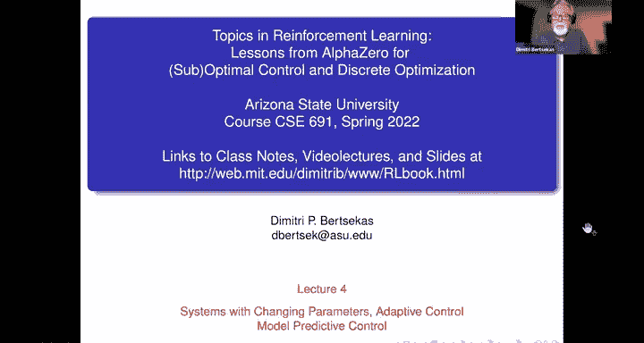

# 17：参数未知系统与自适应控制 🎯




## 概述
在本节课中，我们将学习两种特殊的控制问题及其方法论：自适应控制和模型预测控制。我们将探讨当系统参数随时间变化时，如何设计控制器来应对这些变化，并了解模型预测控制的基本架构及其与强化学习的联系。

---

## 自适应控制简介
上一节我们概述了课程的整体结构，本节中我们来看看自适应控制。自适应控制处理的是系统模型参数随时间变化的问题。我们将给出一些常见情况的例子，并讨论如何采取措施来应对这些变化，因为之前使用的控制方法可能不再有效。

模型预测控制是控制系统设计中的另一种主要方法。其架构与AlphaZero架构非常相似。我们将在控制理论应用的背景下讨论这种方法论。

接下来，我们将花些时间总结到目前为止所学的内容。包括今天在内的四讲课程，将为我们探索几个不同方向提供一个平台。我们无法涵盖所有方向，但会重点关注其中的一些，特别是rollout和使用神经网络材料的近似方法。我们也会列出一些不会覆盖的方向，供大家自行探索。

---

## 自适应控制详解
自适应控制是一种已有50多年历史的方法论。它涉及的问题中，系统方程参数、成本参数或约束条件可能随时间变化，控制器必须随之适应。

### 巡航控制示例
考虑一个巡航控制系统，需要将汽车速度保持在某个目标水平附近，该目标可由驾驶员调整。在这个简化版本中，状态仅是汽车速度，记为 `xk`。它随时间演变，受到推进力 `uk` 的影响，变化规律如下：
```
xk+1 = A * xk + B * uk
```
其中，系数 `A` 和 `B` 可能随时间变化。`A` 可能建模道路摩擦、风阻等使汽车减速的因素。`B` 取决于多个参数，例如踩踏板的深度 `uk` 所产生的实际作用力，这可能取决于路况、汽车重量（如乘客数量）等因素。此外，目标速度 `x_bar` 也可能变化。

一个合理的成本函数是二次型的：
```
成本 = (xk - x_bar)^2 + R * uk^2
```
我们希望将状态保持在该目标速度附近，并对偏离施加二次惩罚。控制量 `uk` 也有二次成本，其中 `R` 是一个固定的正数。

然而，这并非我们之前见过的标准线性二次问题，因为 `A`、`B` 和 `x_bar` 可能随时间变化。它们可能被测量，但很可能存在误差，测量本身也有成本。总体而言，相对于 `A`、`B` 和 `x_bar` 固定的问题，这个问题要困难得多。

### 应对参数变化的几种方法
以下是处理此类情况的几种不同方法：

1.  **鲁棒控制**：忽略参数变化，不进行估计，假装它们不变。设计一个在某种意义上（例如，对于较广的参数范围）有效的鲁棒控制器。这是最简单的可能性，但效果也最差。
2.  **间接自适应控制**：主动估计变化的参数，然后利用估计值来修改控制器。例如，一旦检测到参数变化，可以进行在线重新规划（通过优化）。换句话说，修改控制器，使其对新的参数估计集是最优的。这种方法历史悠久，在实践中取得了成功，是自适应控制的主要方法之一。
3.  **基于rollout的近似重新优化**：不进行耗时的完全重新优化，而是使用rollout进行近似在线重新规划。使用某个基策略进行rollout，并利用当前参数估计来计算所需的成本值。随着系统变化，rollout算法也会变化，但不像完全重新优化那样耗时。
4.  **基于部分可观测马尔可夫决策过程（POMDP）的方法**：这是一种更原则性的方法，不将估计和控制分开。它将自适应控制问题表述为一种POMDP，将未知参数视为隐藏状态的一部分。然后，我们尝试用已知的强化学习方法近似求解这个非常难解的DP问题。

我们将逐一讨论这些方法。

---

## 鲁棒控制方法
在鲁棒控制中，系统具有控制输入和可观测的输出，系统可能随时间变化。然而，控制器是固定的。系统输出被反馈给控制器，控制器施加控制，我们完全忽略系统的变化，当作一切不变。不尝试估计参数，希望这个固定控制器能在系统变化的整个范围内提供可接受的性能。

这是一个非常简单的方法。它有时有效，有时无效。总的来说，这是一种有风险的方法。然而，有一个重要的特例被证明是成功的，那就是**PID控制器**。PID控制器已有约100年历史，代表比例、积分、微分。它涉及三个参数，通常通过实验或启发式方法（有时是手动方法）进行调优。

PID控制器的输出是单个输出，即实际输出与期望输出之间的偏差（误差）。三个参数对以下误差进行加权：当前时刻的瞬时误差（比例）、累积误差（积分）以及误差随时间的变化（微分）。它只有三个参数，调优后即可使用，甚至不需要知道被控对象的数学模型。

这种方法的局限性在于，它主要适用于单输入单输出的标量控制。虽然有人努力将PID控制扩展到更一般的情况，但成功程度不一。另一方面，PID控制器有一个非常诱人的优点：不需要数学模型，只需将控制器接入系统，然后调优参数即可。

在过多贬低鲁棒控制方法之前，重要的是记住PID控制器是这个方法中非常成功的代表。

---

## 间接自适应控制方法
在间接自适应控制中，系统参数在变化。我们从系统获取数据，尽可能观测系统，并估计这些参数。因此，如果系统运行到某个不同的状态，我们尝试识别并估计新的运行环境。

每隔一段时间，模型的参数估计值被输入控制器，控制器随之调整自身，因此得名“自适应控制”。控制器被重新计算，以使其对当前的参数集是最优的。

这可以看作是系统辨识阶段和控制器优化阶段的交替。我们交替进行系统辨识和控制器优化。这种方法的一个问题是可能耗时。你可能需要每两秒施加一次控制，但重新优化可能需要几分钟，这可能是个问题。

此外，还存在一些有趣的理论问题，涉及在控制系统同时辨识参数的可能性。控制过程可能会隐藏系统的某些参数，使其难以辨识，这可能造成问题。课堂笔记中通过例子对此略有讨论。人们已经能够修改方案来处理这个问题，但参数估计过程并不简单，需要大量有趣且巧妙的算法设计。

### 线性二次问题示例
考虑一个简单的一维线性二次问题，类似于我们之前处理过的，特别是在上一讲中。系统动态为：
```
x_{k+1} = x_k + B * u_k
```
成本是二次型的。我们基本上希望将系统控制在零点附近，并施加控制，但控制量不能太大，由二次惩罚项决定。

然而，与我们之前处理的线性二次问题不同，假设 `B` 未知或会变化。现在比较鲁棒控制器和精确优化（间接自适应）控制器。

首先，我们选择一个鲁棒控制器，即对于 `B=2` 最优的标称控制器。在横坐标 `B` 上，对于 `B=2`，我们使用Riccati方程和线性控制器找到最优控制器，并将其用于 `B` 的整个取值范围。

重新优化的控制器会估计 `B`，并假设估计是精确的。在任何时刻，它计算 `B`，得到当前的 `B`，并应用对该 `B` 最优的策略。

在纵坐标上，是成本系数（稳态成本系数）。无论是鲁棒控制器还是重新优化控制器，产生的成本都是二次型的，其系数是稳态的，因此更高的点对应更高的成本。对于 `B=2` 的最优成本就在这里。

随着 `B` 减小，我们需要更大的控制量，这增加了成本，因此成本随着 `B` 变小而增加。重新优化控制器的成本曲线较低。使用鲁棒控制器的成本肯定更高，但可以看到存在相当大的差异。这就是因使用鲁棒控制器且不估计变化的 `B` 而付出的代价。

---

## 基于Rollout的近似重新优化
现在讨论通过rollout进行的近似重新优化，之后我们将回到这个例子。

在这里，参数在变化，我们使用rollout而不是完全重新优化来进行重新规划。这里有一个计算和估计模块，观察变化的系统，估计参数（可能也估计价值函数和其他系统参数），并将这些参数传递给控制器。

现在，控制器在状态 `xk` 处并不使用对当前参数集最优的策略，而是利用其参数来修改一个rollout策略（在本例中为一步前瞻策略）。我们使用一步前瞻和终端成本函数近似，对某个基策略（最好是一个对较广参数集都有效的鲁棒策略）进行rollout。

然而，这不是一个鲁棒控制器，因为它涉及rollout，这是一种形式的预优化。在计算上，这比控制器优化更便宜。我们不是每隔一段时间就重新优化，而是使用rollout，其计算量要小得多。我们继续使用相同的鲁棒基策略，但也有可能在后台重新计算基策略，并每隔一段时间将其传递给控制器。

因此，它可能不如完全重新优化那么好，但却是向那个方向迈出的重要一步。现在我要论证，这几乎和精确优化一样好。原因是rollout非常有效，如果参数接近其标称值且变化不快，那么rollout可以非常有效地近似最优控制。

### 回到线性二次示例
同样的线性系统和成本，变化的系数 `B` 被估计并传递给控制器。鲁棒策略忽略这个估计，根本不使用它。间接自适应控制（精确重新优化）使用它并重新计算最优策略，得到图中黑色曲线。

现在，用rollout代替完全重新优化，结果几乎一样好。只有在边缘区域，它才开始略有变化。与鲁棒基策略相比，则完全没有可比性。基本上，从这里到这里，是一个牛顿步长，这个牛顿步长非常有效，以至于在这个特定情况下几乎是最优的。

**学生提问澄清**：
*   黄色星点是重新优化的rollout策略。
*   黑色曲线是精确重新优化的策略。
*   当基策略对 `B=2` 最优时，所有曲线在 `B=2` 处重合。
*   随着参数变化，精确重新优化给出最低成本。近似重新优化（通过rollout）几乎一样好，实际上在这一侧几乎相同，很难区分；在这一侧，大约从这里开始出现分歧。
*   鲁棒基策略和重新优化rollout策略之间的差异源于牛顿步长（一步前瞻）。精确重新优化与rollout之间的差异在于，精确重新优化不进行一步前瞻，而是为新的 `B` 在每一步重新计算控制。

**关于计算复杂度的提问**：在存在多个控制选项的场景中，这会增加复杂度吗？这是一个学术例子，在线性二次问题中，一切都可以解析计算。在不同的问题中，这些计算可能变得很可观。rollout可能需要可观的计算，但精确优化可能更糟，甚至糟糕得多。

---

## 基于POMDP的原则性方法
这种方法没有人为地将估计和控制分开。我们首先估计，然后控制，再调整控制，如此往复。在这里，一切都在一个优化框架中同时进行，涉及一个POMDP问题，众所周知，这类问题非常难精确求解。

我们有一个确定性系统，但涉及一些未知参数。为简单起见，假设参数可以取有限个值，例如 `M` 个不同的值（100个或1000个等）。也可以是连续值，但有限值更容易理解。

我们不知道参数，但有一个先验概率分布在这个参数集上。然后，随着系统演化，我们更新这些参数的概率分布，并将其用于控制。

系统涉及状态 `xk`、控制 `uk` 和参数 `θ`。假设我们精确观测到状态 `xk`（完美状态观测），并使用它作为测量值来更新参数 `θ` 的概率分布。换句话说，我们估计信念状态。我们计算一个信念，即给定到目前为止收集的所有信息（包括观测到的当前和过去状态，以及过去施加的所有控制），`θ` 取特定值的条件概率。

现在我们有一个涉及增广状态的POMDP。系统的真实状态是 `xk`（完全可观测）和 `θ`（隐藏）。`θ` 不变化，但我们不知道它的值。这就是增广状态，我们将其表述为一个POMDP。对于这个POMDP，我们可以写出贝尔曼方程。

这个贝尔曼方程具有以下形式。它可以是增广状态的函数，但另一种可能是让时间 `k` 的最优成本成为当前信息的函数。这当然是可能的，我们可以用这个信息向量作为状态来论证动态规划。

为了证明这个贝尔曼方程，需要进行大量繁琐的计算，所以我将用直观的术语解释它。请记住，所有贝尔曼方程都涉及对控制的最小化，即两项之和：当前阶段的期望成本，以及未来的期望成本。这里的“期望”是针对信念状态（信念分布）的不确定性。

这里的求和部分，即用信念概率加权的成本加权和，给出了当前阶段的期望成本。`θ` 未知，所以我们取其相对于当前信念概率的期望值。而 `J_{k+1}^*` 是从下一个状态（即下一个信息向量 `I_{k+1}`）出发的最优成本。

这个方程具有贝尔曼方程的所有特征：对控制的最小化，当前阶段的期望成本加上假设从此刻起最优行动的期望未来成本。当然，求解这个方程是完全不可能的，除非在最简单的例子中。因此需要近似。

我们知道哪些近似方法？值空间近似。我们用某种有意义的近似事物来近似这个很难计算的东西 `J^*`。然后用 `J̃` 替换 `J^*`，在这里对 `u` 进行最小化。

在这里，使用仅依赖于状态 `x` 的近似是很方便的，而不是依赖于所有过去信息的东西。所有过去的信息都通过 `xk`、`uk` 和参数值 `θ` 编码在这个近似 `J̃` 中。这就是为什么这里有 `I`。换句话说，我们对每个可能的 `θ` 值使用不同的近似。然后我们在这里对 `u` 进行最小化，得到一个一步前瞻策略。然后通过闭式或更可能通过仿真来计算这个表达式，这是一个可行的计算。

我们可以取 `J̃_i` 是什么？一种可能性是取其为在已知 `θ_i` 的假设下最优策略的成本函数。换句话说，我们假装知道那个参数值。对于每个可能的 `θ_i` 值都有一个这样的成本函数，我们在这里用相应的概率对它们进行加权。

另一种可能性是使用一个已知策略的成本函数作为 `J̃`，同样是在已知 `θ_i` 的假设下。因此，对于每个不同的 `θ_i` 值，都有一个不同的已知策略，我们使用某种启发式方法来计算每个 `θ_i` 值的这个表达式，然后用相应的概率在这里对它们进行加权。这就是POMDP背景下的rollout类比。

我们将在未来的一讲中研究这个方案，并将其与其他具有未知参数特征的问题结合起来。你可能会问，为什么我们需要采用这种方法而不是前一种？这种方法更适合于控制器决策可能意味着选择对系统进行观测的情况。我们可能希望选择控制，以便在未来增强观测过程，例如使用更好的观测类型等。我们将在未来讲到相关例子时看到这类情况。

### Wordle 游戏示例
我想举一个与我近期经验相关的例子。许多人可能熟悉这个文字谜题Wordle。每天有数百万人玩这个出现在《纽约时报》上的谜题。它涉及未知参数和决策。你可能会惊讶，这其实是一个自适应控制问题。

游戏机制：我们有一个神秘单词集合（《纽约时报》版本约有2500个）。每天从中选出一个神秘单词。玩家需要尽可能用最少的猜测次数猜出这个神秘单词。猜测词可以从一个约12000个词的列表中选择。

每天，《纽约时报》选择一个神秘单词，你挑选猜测词。例如，神秘单词是“INERT”。第一次猜测是“AUDIO”。选择这个词后，你会得到关于神秘单词与当前猜测词之间某些字母共通性的反馈信息。这里有五个字母，字母“I”是两个词共有的，但不在完全相同的位置，而是不同位置，这些字母被标记为黄色。

这个信息很重要，它应该影响你后续的猜测。例如，在第二次猜测中，我们选了这个词。现在，这个词与神秘词有几个共同字母。字母“E”和“R”是共有的，并且位置完全相同。字母“T”是共有的，但在神秘词和当前猜测词中位置不同，“M”类似。此时，你已经知道了所有字母。从这里得到四个字母，从这里得到一个字母，所以你知道神秘词包含的确切五个字母。然后你可以猜出单词是“INERT”。所以这里用了3次猜测得到神秘词。

这就是问题的运作方式。它与自适应控制的特殊联系在于：未知参数就是未知的神秘单词。它从一个已知的2500个单词集合中取值。在《纽约时报》案例中，先验分布是均匀分布。

**问题表述**：状态 `xk` 是可能的秘密单词列表。换句话说，给定到目前为止的所有猜测，我们可以构建一个与目前获得的信息一致的所有可能神秘单词的子集列表。控制 `uk` 是猜测词，从可能的猜测词列表中选择。

一个未知的神秘单词在开始时被选定，然后你施加决策（猜测词），并缩小可能的秘密单词列表 `xk`，直到它只包含一个单词。因此，你具备了最优控制或自适应控制表述的所有要素：动态（即秘密单词列表随时间演变的方式）、决策（猜测词的选择）和成本函数（每次猜测支付1单位成本）。

你可以用方程来表述，并纳入上一张幻灯片给出的框架中。这里的 `θ` 是增广状态的一部分，它是部分可观测的（`xk` 完全可观测，`θ` 通过猜测结果部分可观测），你更新相应的信念。这个问题的好处在于，信念分布实际上是秘密单词列表上的均匀分布。这个问题的更困难版本是当神秘单词的初始概率分布不均匀时，会变得相当困难。

现在，可以通过动态规划精确求解这个问题，并且已经有人做到了。对于每个不同的初始神秘单词，他们通过动态规划计算了最优策略。根据一份报告，这需要使用大量并行计算机进行数天的计算。所以这是一个高度非平凡的计算，是一个巨大的动态规划计算，得益于这个问题的特殊结构。

**另一种方法（Rollout）**：我们与ASU的两名学生一起，使用上一张幻灯片描述的rollout方法，并使用了几个基启发式策略中的一个（例如，选择能提供最大信息或尽可能缩小当前神秘列表大小的猜测词）。我们按照上一张描述的方式使用rollout。

我的合作者是去年修这门课的两位学生，他们的学期论文就是关于这个想法。他们在这个文字谜题上做了学期论文，最初相当成功，然后进一步研究这个问题，我们得到了一些非常好的结果，现在有一篇在线存档论文可以查阅细节和结果。

我将让Sant和Aidan在后面的讲座中讨论这个算法。但目前，我只给出结果。对于所有可能神秘单词选择（超过12500个选择）的平均猜测次数，最优性能是3.5084次。这是通过我之前提到的巨大动态规划计算得到的最优数字。


Rollout在几秒钟内解决这个问题，并给出一个与最优值相差不到百分之零点五的结果。实际上，对于所有实际目的而言，它几乎是最优的。不仅如此，它要快得多。如果你使这个问题复杂化，例如增加神秘单词集合的大小或字母数量（比如6或7个字母而不是5个），或者引入神秘单词的非均匀初始概率分布，那么问题就变得难以处理，无论使用多少计算能力或尝试多少周，都无法精确求解。然而，rollout仍然在几秒钟量级内有效，