# 18：确定性动态规划问题的Rollout算法 🎓


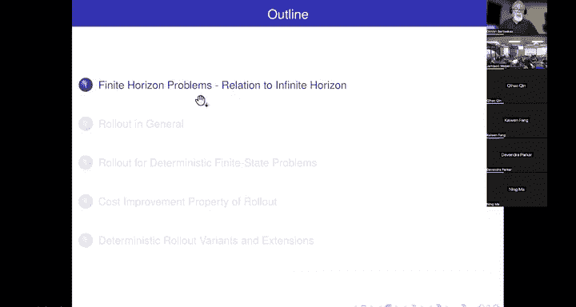

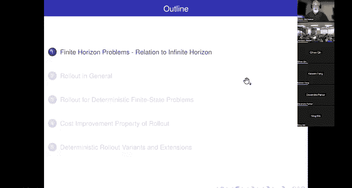

## 📖 概述
在本节课中，我们将学习确定性动态规划（DP）问题中的Rollout算法。我们将回顾有限时域问题，探讨其与无限时域问题的联系，并深入讲解Rollout算法的核心概念、理论性质（特别是其成本改进特性）以及多种变体和扩展。

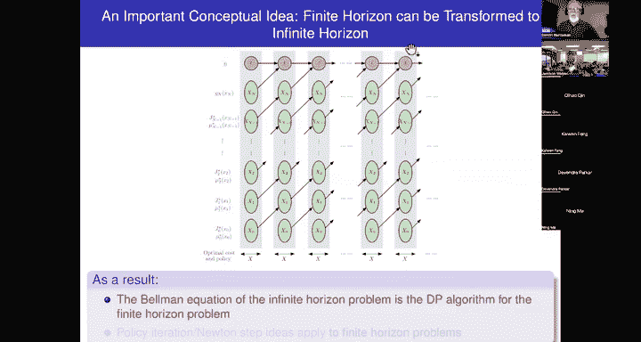

---

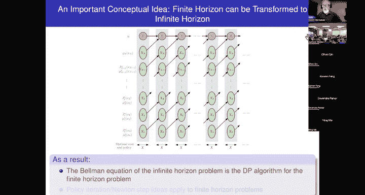


## 🔄 回顾有限时域问题
上一讲我们概述了强化学习的广阔领域。本节中，我们将重新审视有限时域动态规划问题。


我们有一个涉及状态、控制和随机扰动的一般随机问题。给定当前状态，我们通过选择控制和一个随机扰动值来转移到下一个状态，并产生一个成本。成本函数是所有阶段成本与最后阶段终端成本的总和。我们关注的是将状态映射到控制的策略序列。给定初始状态，我们的目标是在所有策略中最小化期望成本。最优成本函数是依赖于初始状态的最小成本。

动态规划算法通过从终端阶段开始向后递推，计算每个阶段尾部子问题的最优成本。然而，对于复杂问题，这种计算可能非常耗时或难以处理。强化学习致力于简化这种计算，其中最重要的部分之一是**值空间近似**。我们使用近似值函数 `J̃` 来代替难以计算的 `J*`，然后在实时决策时进行最小化。

---

## ♾️ 有限时域与无限时域问题的联系
为了将无限时域问题的算法和见解应用于有限时域问题，我们需要理解两者之间的联系。

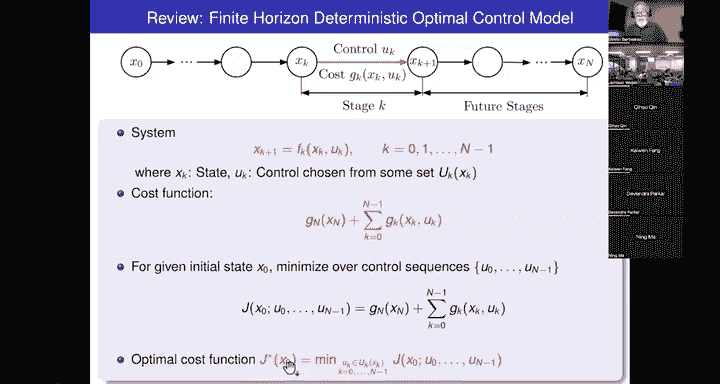

一个有限时域问题可以转化为一个等效的无限时域问题。具体方法是：构建无限时域问题的状态空间，即所有有限时域各阶段状态空间的并集，并添加一个终止状态。控制空间由每个状态可用的控制构成。系统函数（转移函数）则由有限时域问题的系统函数堆叠而成。

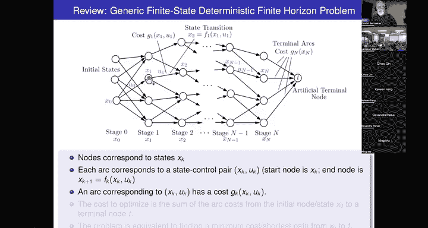

在这种构造下，从初始状态 `x0` 出发，无限时域问题的最优成本函数值，就等于从 `x0` 开始的有限时域问题的最优成本。无限时域问题的最优策略也给出了有限时域问题的最优策略。因此，贝尔曼方程、策略迭代等所有适用于无限时域问题的理论和见解，经过适当转换后，同样适用于有限时域问题。

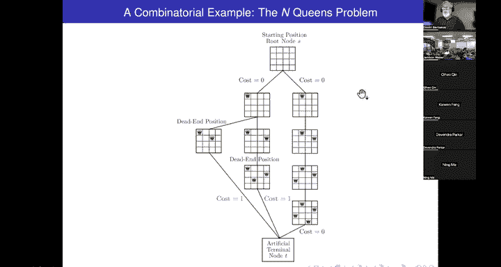

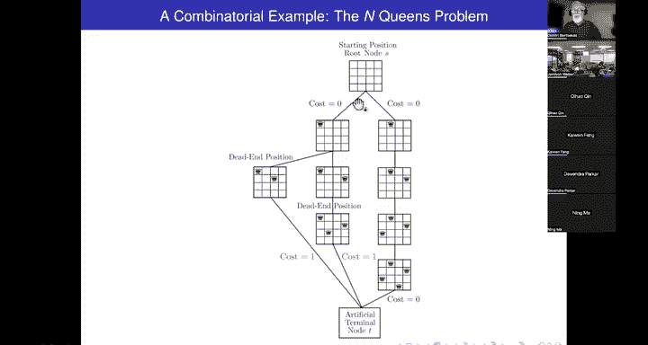

---

## 🚀 Rollout算法概述
Rollout算法是值空间近似的一个特例。其核心思想是使用某个**基础策略**（或启发式方法）的成本函数 `J̃` 来近似未来成本。

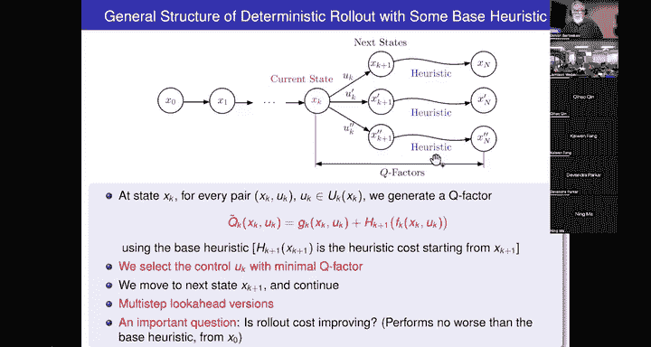

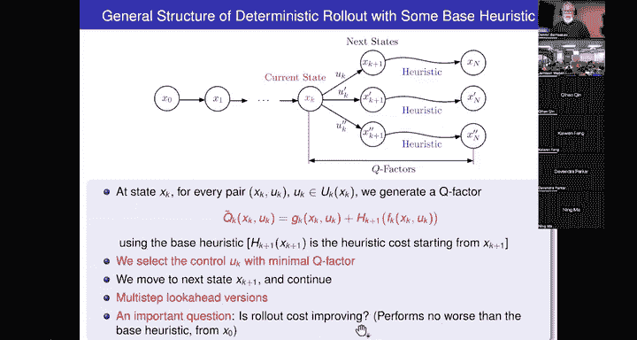

以下是Rollout算法（以L步前瞻为例）的关键步骤描述：
```python
# 伪代码描述L步前瞻Rollout
在状态 x_k 处：
    对于每个可能的控制序列 (u_k, ..., u_{k+L-1})：
        计算从 x_k 开始，执行该控制序列的L步累积成本。
        从第 k+L 步的状态出发，运行基础启发式方法，得到剩余成本估计 H(x_{k+L})。
        计算总Q因子：Q = (L步累积成本) + H(x_{k+L})
    选择具有最小Q因子的控制序列中的第一个控制 u_k* 并执行。
    转移到新状态 x_{k+1}，重复上述过程。
```
通过这种最小化操作得到的策略称为**Rollout策略**，以区别于其依赖的**基础策略**。

Rollout算法之所以重要，有多个原因：它易于理解和实现；通过模拟基础策略来获得 `J̃`，是在线可实现的成本函数近似方法；从理论上看，它相当于从基础策略成本函数出发的一个牛顿步；它也是策略迭代算法的一次迭代，但Rollout可以在线通过模拟实现，而近似策略迭代通常需要神经网络等离线训练。此外，Rollout非常通用，适用于确定性和随机性问题、有限和无限时域，并且能与许多其他强化学习方法结合。

---

## ⚙️ 聚焦确定性有限状态问题
现在，我们将焦点集中在**确定性**问题上。在确定性问题中，没有随机扰动，给定当前状态和控制，下一个状态是确定的。

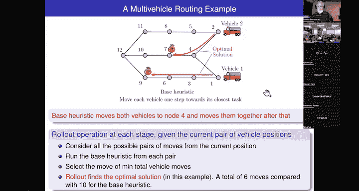

我们进一步关注**有限状态**问题。这类问题可以方便地用分层图来可视化：每个阶段是一层，节点代表状态，弧代表控制（或状态-控制对）。每条弧都有一个关联的成本。一条从初始节点到终止节点的路径代表一个控制序列，其总成本就是路径上所有弧的成本之和。

因此，有限状态确定性有限时域问题，等价于在一个特殊的无环图中寻找最短路径问题。

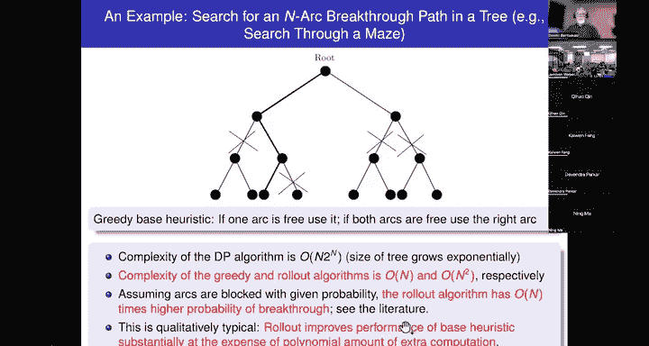

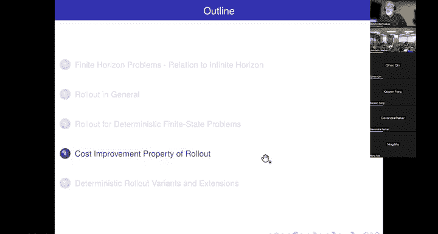

**示例：N皇后问题**
N皇后问题可以表述为一个多阶段决策问题。状态是棋盘的部分布局（已放置的皇后位置）。在每个阶段（每一行），决策是在该行选择一个列来放置皇后，且不能与已放置的皇后冲突。转移成本为0，除非到达一个“死局”状态（无法合法放置下一个皇后），此时产生高成本并转移到终止状态。目标就是找到一条零成本的路径（一个合法解）。随着N增大，问题规模呈指数级增长。

---

## 🔍 Rollout算法在确定性问题中的运作
在确定性Rollout中，我们从当前状态 `x_k` 出发，考虑所有可能的下一状态 `x_{k+1}`。对于每一个可能的转移，我们运行基础启发式方法，从 `x_{k+1}` 开始完成到终点的轨迹，并计算其启发式成本 `H(x_{k+1})`。然后，我们计算每个控制 `u_k` 的Q因子：`Q(x_k, u_k) = g_k(x_k, u_k) + H(x_{k+1})`。最后，选择具有最小Q因子的控制。

也存在多步前瞻版本，即前瞻L步后，在叶子节点上应用基础启发式方法。

一个关键问题是：**Rollout策略是否一定比基础策略更好？** 这需要一定的条件来保证。

---

## 📈 Rollout的成本改进性质
我们希望确保Rollout策略的性能不差于基础策略。这需要基础启发式满足某些条件，主要是**序列一致性**或更一般的**序列改进性**。

*   **序列一致性**：基础启发式在某个状态选择的控制，仅取决于该状态本身，而与如何到达该状态无关。这意味着，如果启发式从 `x_k` 生成了一条轨迹，那么当它到达轨迹中的下一个状态 `x_{k+1}` 时，它会生成该轨迹的剩余部分。贪婪启发式通常满足序列一致性。
*   **序列改进性**：这是一个更弱的条件。它要求在当前状态 `x_k`，至少存在一个控制 `u_k`，使得其Q因子不大于从 `x_k` 开始的基础启发式成本。即：`min_{u_k} Q(x_k, u_k) ≤ H(x_k)`。

**序列一致性蕴含序列改进性**。在序列改进性条件下，可以证明Rollout策略的成本不差于基础策略的成本。证明思路是跟踪Rollout算法运行时产生的“当前轨迹”成本序列，该序列是单调非增的，起始于基础启发式轨迹成本，终止于Rollout轨迹成本。

**示例：多车辆任务协调问题**
考虑一个多车辆在图上移动执行任务的问题。基础启发式是“每个车辆独立地、自私地向其最近的待处理任务移动一步”。这可能导致车辆聚集，效率低下。Rollout算法则在每一步考虑所有车辆可能的联合移动组合，对每种组合运行基础启发式直到任务完成，并选择总移动步数最少的组合作为当前决策。在这个例子中，Rollout找到了最优解（总6步），而基础启发式需要10步，展示了成本改进。

---

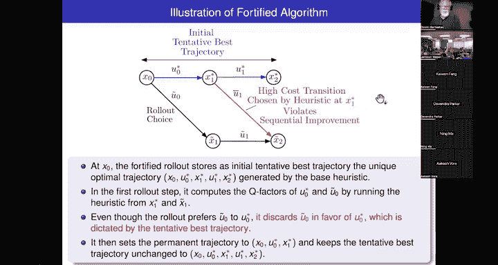

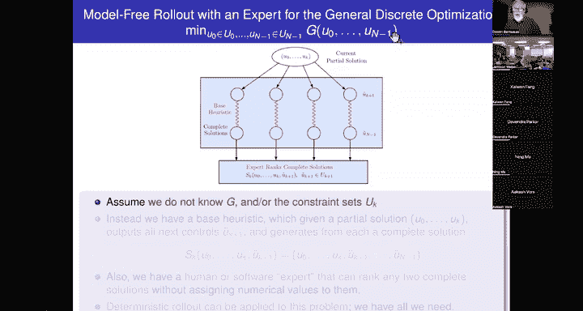

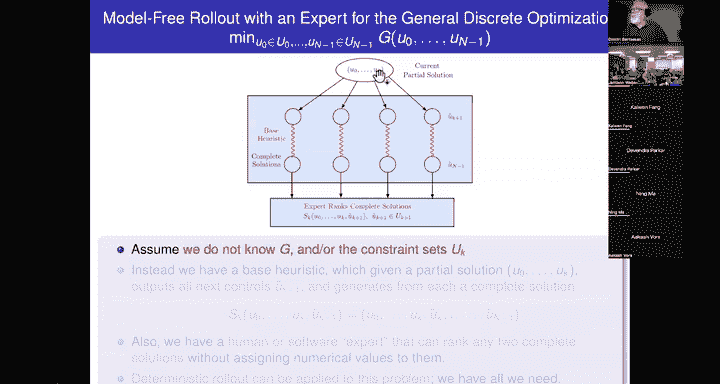

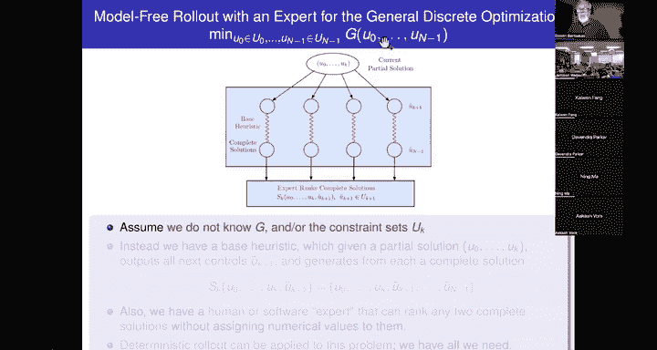

## 🛠️ 确定性Rollout的变体与扩展
为了应对不同挑战，Rollout算法有多种变体。

1.  **简化Rollout**：旨在减少计算量。不要求必须选择最小Q因子的控制，而是选择任何一个Q因子小于当前状态启发式成本的控制。这可以在保证成本改进的前提下，仅计算一部分有希望的控制，从而节省大量计算。
2.  **多启发式Rollout**：当有多个候选启发式时，可以构建一个“超启发式”。在每一步，对所有启发式都运行Rollout计算，然后选择所有启发式中最好的那个结果对应的控制。可以证明，如果所有个体启发式都是序列改进的，那么超启发式也是序列改进的。
3.  **强化Rollout**：用于处理基础启发式不满足序列改进性的情况。算法除了维护当前执行轨迹，还额外维护一个“迄今最佳轨迹”。在每一步，比较Rollout建议的新轨迹与“迄今最佳轨迹”的成本。只有当新轨迹成本更低时，才采纳Rollout的建议；否则，继续执行“迄今最佳轨迹”上的控制。这可以恢复成本改进的保证。
4.  **无模型Rollout**：适用于成本函数或问题约束不显式已知，但存在一个“黑箱”评估器的情况。例如，在组合优化问题中，我们有一个启发式算法能从部分解生成完整解，另有一个专家软件能比较两个完整解的优劣（但不给出具体成本值）。Rollout算法依然可以工作：在每一步，对每个可能的下一步决策，用启发式生成完整解，然后调用评估器找出所有完整解中最优的那个，并据此选择当前决策。

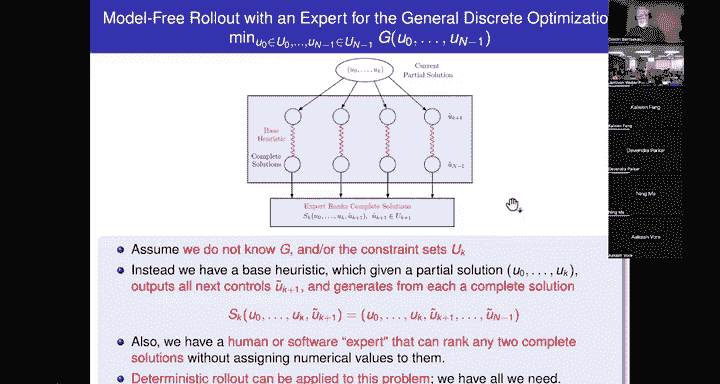

**示例：RNA二级结构预测**
这是一个无模型Rollout的应用实例。状态是RNA序列的部分折叠（碱基配对情况）。决策是关闭一个配对、开启一个配对或什么都不做。基础启发式是一个“部分折叠软件”，给定部分折叠，它能生成一个完整的折叠结构。评估器是另一个专家软件，可以比较两个完整折叠的优劣。Rollout算法利用这两个黑箱模块进行决策，在生物学家难以就精确成本函数达成一致的情况下，寻找有意义的RNA折叠结构。

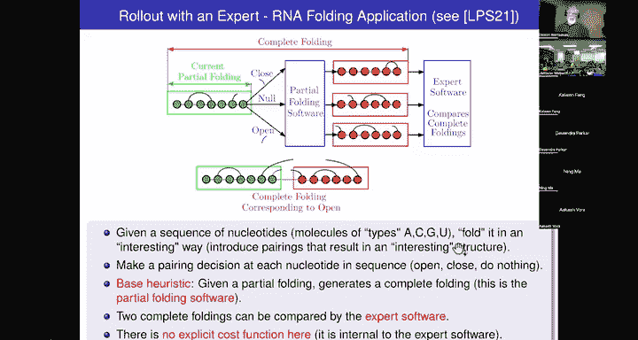

---


## 💎 总结
本节课中，我们一起学习了确定性动态规划问题的Rollout算法。我们从回顾有限时域问题及其与无限时域问题的联系开始，深入探讨了Rollout算法的核心机制。我们了解到，在满足序列改进性（或更强的序列一致性）条件下，Rollout策略能保证不差于基础策略。我们还介绍了多种Rollout变体，包括简化Rollout、多启发式Rollout、强化Rollout和无模型Rollout，它们分别用于降低计算量、整合多种启发式、处理不满足改进条件的情况以及在成本函数未知时应用。Rollout算法因其简单性、可靠性和通用性，成为强化学习中一个强大而实用的工具。