# 19：确定性多步前瞻与约束Rollout 🧠

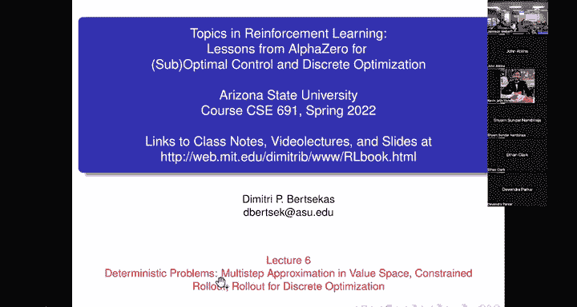

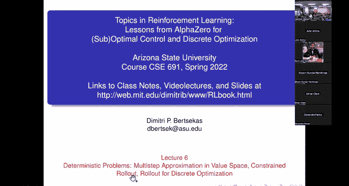

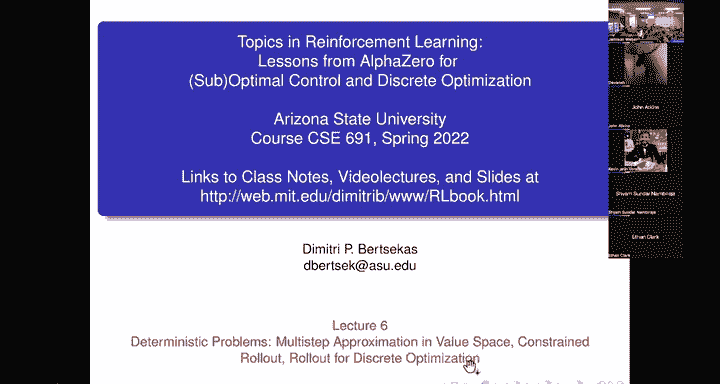

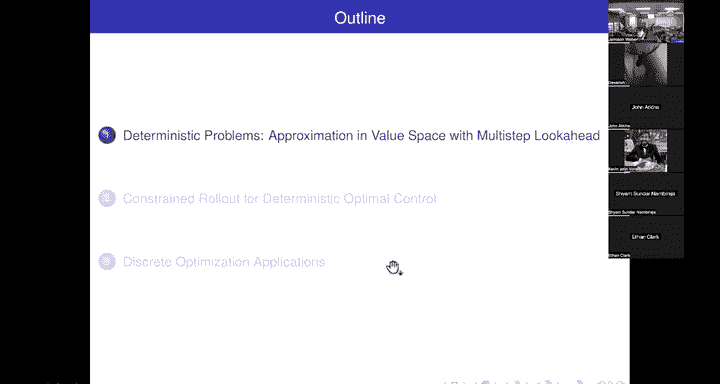

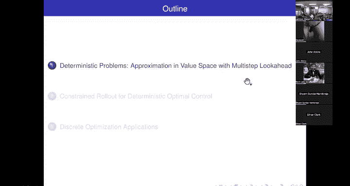

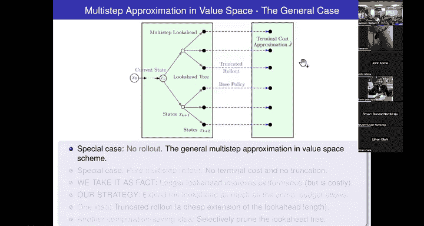

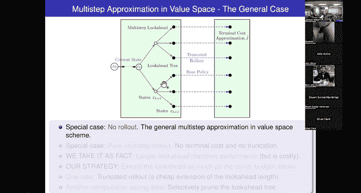

## 概述
在本节课中，我们将继续探讨确定性问题的值空间近似方法，但重点将转向**多步前瞻**。随后，我们将介绍**约束Rollout**方法，并将其应用于离散优化问题，如整数规划。我们将学习如何通过更长的前瞻步长来提升性能，同时利用各种计算优化技术（如剪枝、迭代深化）在有限的计算预算内实现这一目标。

---

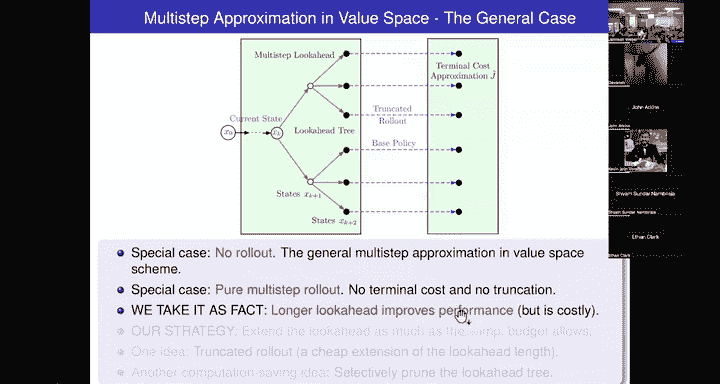

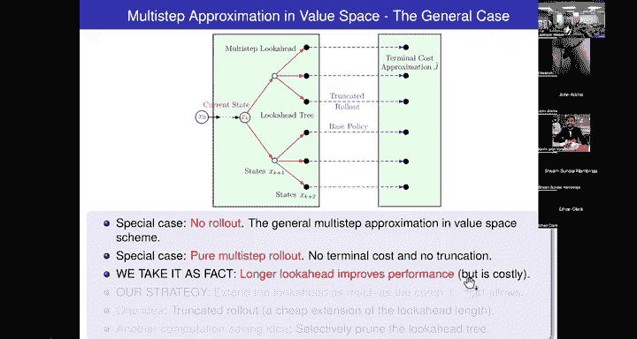

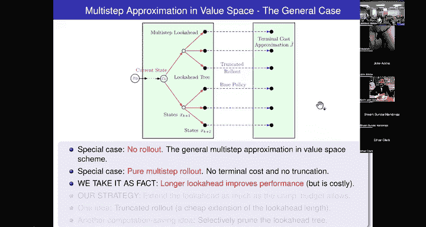

## 确定性多步前瞻

上一讲我们介绍了确定性问题的值空间近似。本节中，我们来看看如何将单步前瞻扩展到**多步前瞻**。

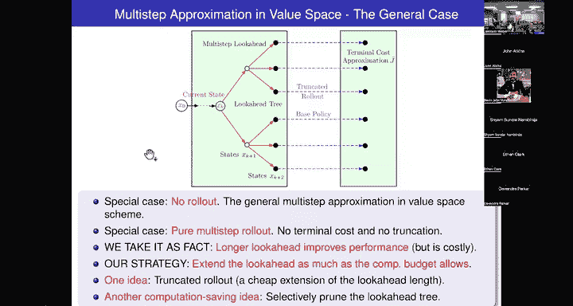

确定性问题在此背景下非常理想，因为它们不涉及任何蒙特卡洛模拟，并且值空间近似可以灵活地进行，这是随机问题所不具备的。

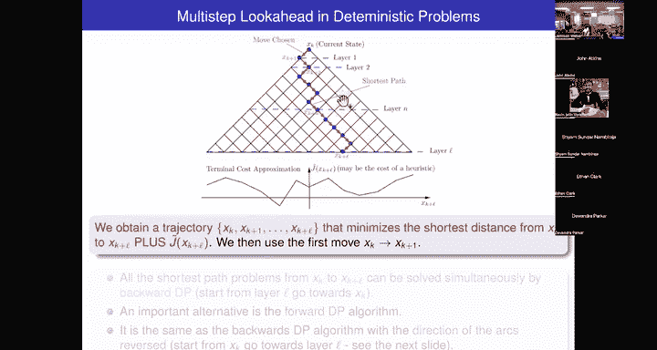

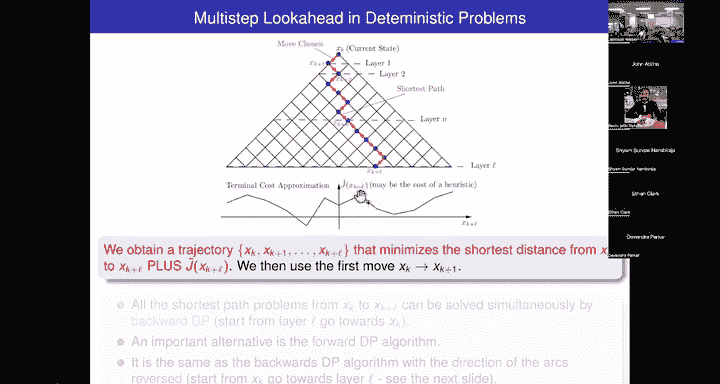

下图展示了一个通用的多步前瞻架构，它结合了截断Rollout和终端成本近似。这是AlphaZero或相关架构的简化确定性版本。

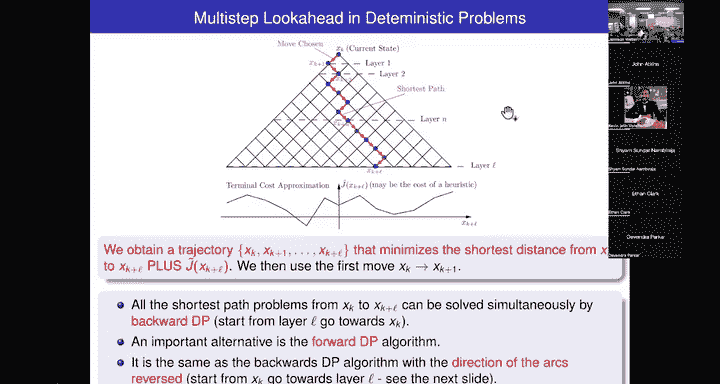

在当前状态选择控制时，我们构建一个向前延伸L步的前瞻树（图中L=2）。然后，从这个树的每个叶子节点开始，运行一个确定性的基础策略（可能被截断），并使用一个终端成本函数近似值 $\tilde{J}$ 来近似未来成本。

这个方案的一种特殊情况是：不在中间进行Rollout，而是直接使用 $\tilde{J}$ 来评估前瞻树的叶子节点。这代表了值空间近似的通用多步形式。本质上，总是可以将截断的Rollout部分合并到终端成本近似中。本讲我们将主要关注这种类型的方案。

### 长前瞻的优势与计算挑战
我们倾向于使用更长的前瞻步长，因为通常更长的前瞻能带来更好的性能。这一点已被许多研究（包括AlphaZero）所证实。AlphaZero的成功很大程度上归功于其使用的非常长的前瞻（如向前看20-30步）。

然而，更长的前瞻也意味着更高的计算资源成本。由于这是一个在线算法，我们在生成当前最佳行动时，可用的计算时间是有限的（可能是几秒或几小时）。我们的策略是：在计算预算允许的范围内，尽可能扩展前瞻步长。

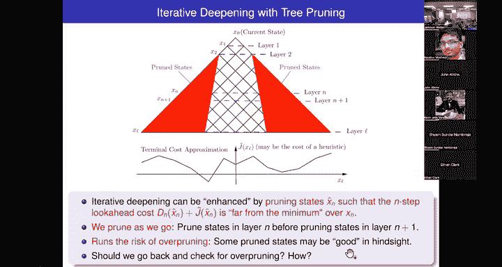

以下是两种扩展前瞻步长并节省计算的方法：

1.  **截断Rollout**：这是一种廉价扩展前瞻长度的方法。使用单一确定性策略进行Rollout，计算成本远低于在前瞻树中进行最小化搜索。
2.  **选择性剪枝**：随着前瞻树的扩展，叶子节点数量会急剧增加计算负担。一个想法是在扩展过程中，有选择地剪掉那些看起来不太有希望的分支。

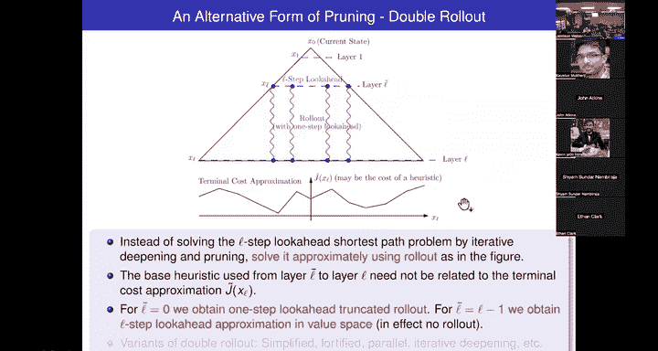

---

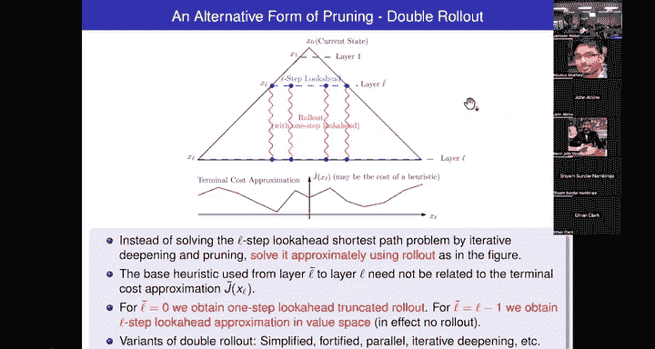

## 前向动态规划与迭代深化

为了理解多步前瞻的具体计算，让我们重新绘制前瞻图，这次采用垂直方向。

从当前状态 $x_k$ 出发，我们向前看L步。每一层的节点代表未来某个步数可能到达的状态。在最后一层L，我们有一个终端成本函数近似值 $\tilde{J}$。

多步前瞻值空间近似的工作方式是：找到一条从 $x_k$ 到第L层某个状态 $x_{k+L}$ 的轨迹，使得路径成本加上 $\tilde{J}(x_{k+L})$ 的总和最小。这需要对第L层的所有候选状态计算从 $x_k$ 到该状态的最短路径成本。

### 计算方法：前向动态规划
计算这些最短路径，可以使用**后向动态规划**（从终点层L开始，逐步向后计算到起点）。但在多步前瞻的背景下，**前向动态规划**通常更为方便。

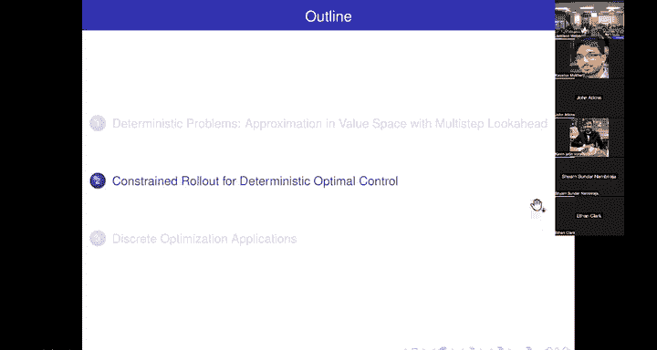

前向动态规划从起点 $x_k$（记为 $x_0$）开始，逐步向前计算到每一层的最短距离。其核心递推公式如下：

对于第 $n+1$ 层的某个状态 $x_{n+1}$，其最短距离 $V_{n+1}(x_{n+1})$ 通过考察其在第 $n$ 层所有可能的前驱状态 $x_n$ 来计算：
$$ V_{n+1}(x_{n+1}) = \min_{x_n \in \text{Pred}(x_{n+1})} \left[ V_n(x_n) + g(x_n, u_{x_n \to x_{n+1}}) \right] $$
其中，$g(x_n, u)$ 是从状态 $x_n$ 采取控制 $u$ 到达 $x_{n+1}$ 的代价，$\text{Pred}(x_{n+1})$ 是 $x_{n+1}$ 在第 $n$ 层的前驱状态集合。

计算出所有第L层状态的 $V_L(x_L)$ 后，我们找到最小化 $V_L(x_L) + \tilde{J}(x_L)$ 的状态 $x_L^*$，然后选择沿着到达 $x_L^*$ 的最优路径上的第一个控制动作。

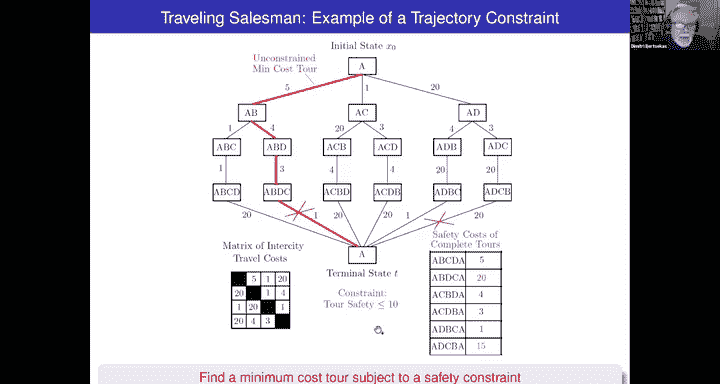

### 迭代深化
这引出了一个有趣的想法：**迭代深化**。我们首先解决n步前瞻问题，如果时间允许，再解决n+1步前瞻问题。如果计算预算耗尽，我们就使用当前已解决的最大步长前瞻的结果。这与前向动态规划算法完美契合，形成了一个**随时算法**——即使计算在中间被打断，也能返回一个可行的解决方案。

---

## 计算优化：剪枝与双重Rollout

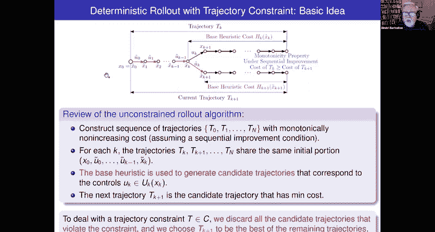

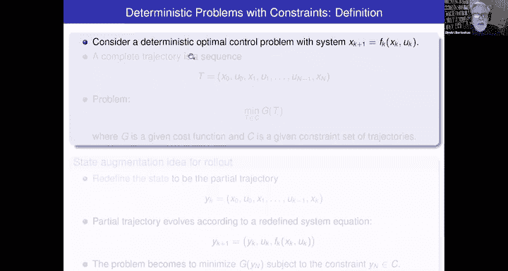

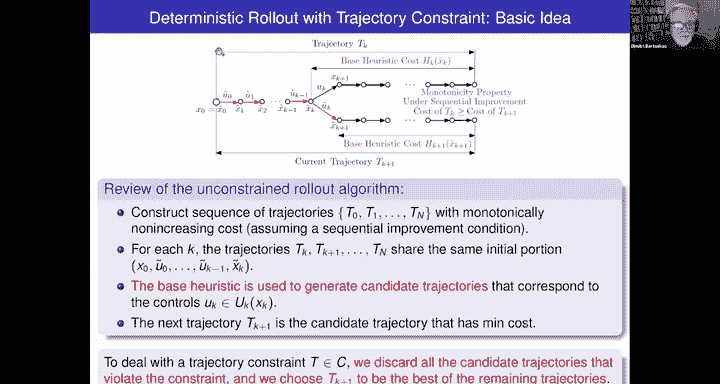

为了节省计算以支持更长的前瞻，我们可以采用剪枝策略。

### 基于成本的剪枝
在扩展前瞻树时，我们可以剪掉那些在当前层看起来成本远高于最小成本的节点（状态）。这样，我们可以将计算资源集中在更有希望的分支上，并在下一层扩展更多节点。然而，这有过度剪枝的风险（可能错误地剪掉了后期表现良好的节点）。处理这个问题可能需要系统性的回溯检查或更启发式的方法。

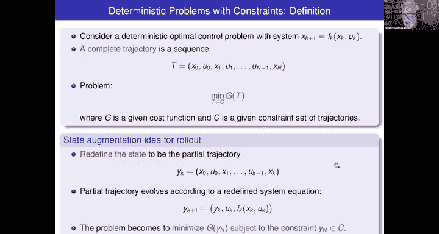

### 双重Rollout
另一种“剪枝”形式是**双重Rollout**。我们不是对所有分支进行完整的最短路径计算，而是使用Rollout来近似评估部分路径。

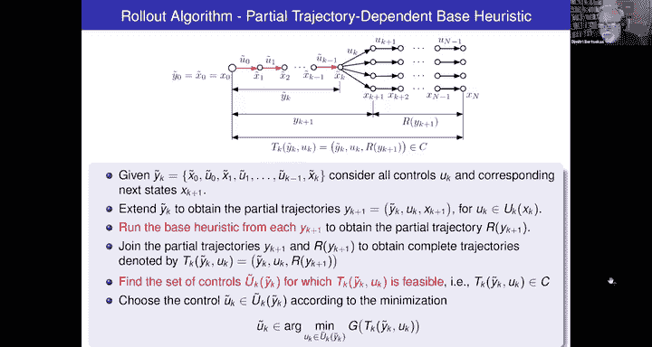

我们选择一个中间层 $\bar{L}$（$\bar{L} < L$）。对于第 $\bar{L}$ 层的每个状态，我们不是继续用动态规划，而是从一个基础启发式策略开始进行Rollout（可能被截断，并以 $\tilde{J}$ 结束），从而得到一条到达终点的近似轨迹及其成本。然后，我们比较从起点到第 $\bar{L}$ 层各状态的成本，加上从该状态出发的Rollout成本，选择总成本最小的路径。

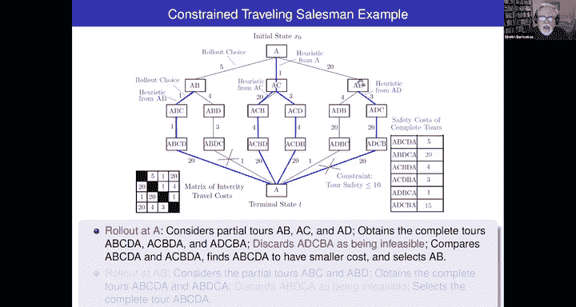

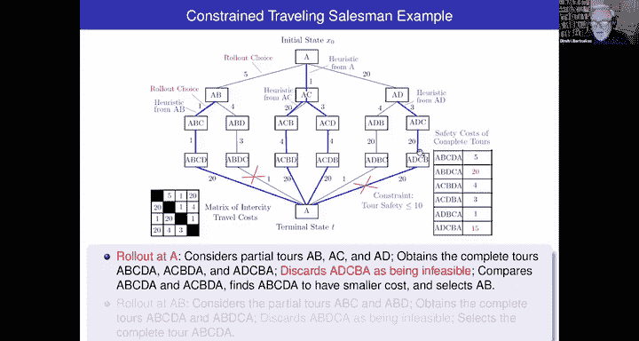

-   当 $\bar{L}=0$ 时，这退化为一步前瞻加截断Rollout。
-   当 $\bar{L}=L-1$ 时，这近似于完整的L步值空间近似。

这种方法可以看作是介于纯截断Rollout和纯值空间近似之间的方案。其中的Rollout部分还可以进行各种变体，如使用简化Rollout、并行Rollout（使用多个启发式策略）或结合迭代深化。

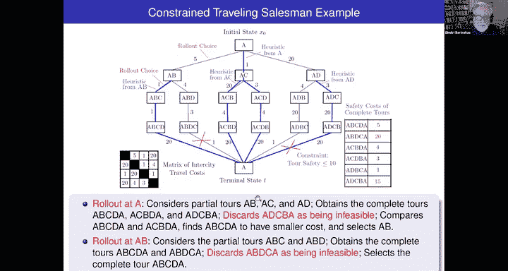

---

## 增量式多步Rollout

本节介绍一个更灵活的算法：**增量式多步Rollout**。它采用更不规则的子图进行剪枝和迭代深化。

与固定层数的剪枝不同，该算法维护一个从根节点 $x_0$ 出发的、无环的连通子图 $S$（图中蓝色部分）。在每次迭代中：
1.  对于子图 $S$ 中的所有叶子节点 $x$，计算从 $x_0$ 到 $x$ 在子图 $S$ 内的最短距离 $d_S(x)$。
2.  计算评估值 $d_S(x) + H(x)$，其中 $H(x)$ 是一个启发式估计，表示从节点 $x$ 到问题终点的剩余成本。$H(x)$ 可以包含从 $x$ 出发的基础启发式策略成本、终端成本近似 $\tilde{J}$，以及一个惩罚项 $\delta \cdot (\text{从 } x_0 \text{ 到 } x \text{ 的步数})$。
3.  选择评估值最小的叶子节点 $x^*$ 进行扩展：将其所有后继节点加入子图 $S$。
4.  重复此过程，直到达到目标层数L或计算预算用尽。

参数 $\delta$ 控制着搜索的“宽度”：
-   $\delta = 0$：算法倾向于深度优先搜索，子图变得“细长”，类似于Rollout。
-   $\delta \to \infty$：算法倾向于广度优先搜索，在进入下一层之前必须穷举当前层所有节点，相当于无剪枝的完整动态规划。

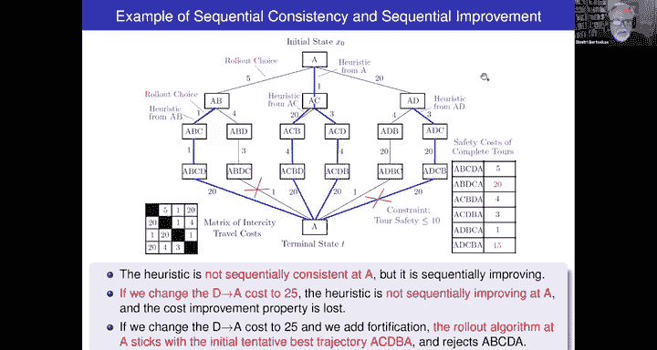

这个算法自然地结合了迭代深化和选择性剪枝，并且是一个随时算法。

---

## 约束Rollout

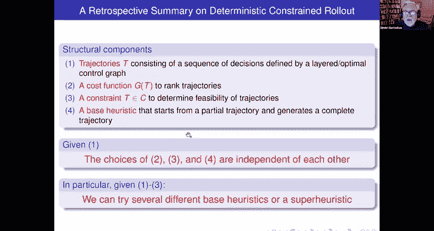

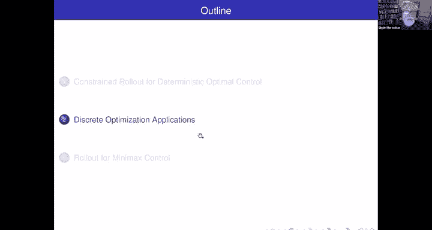

现在，我们转向一个新的主题：**约束Rollout**，用于解决带有轨迹约束的确定性最优控制问题。这类约束耦合了不同阶段的控制，使得标准动态规划难以处理。约束Rollout极大地扩展了Rollout的应用范围，特别是可以应用于棘手的离散优化问题（如带跳数限制的最短路径问题）。

约束Rollout的基本思想非常简单直接：在标准Rollout中，我们在当前状态评估所有可能控制对应的Q因子（通过运行基础启发式策略得到完整轨迹的成本）。在约束Rollout中，我们**排除**那些会导致轨迹违反约束的候选控制，只从可行的候选控制中选择Q因子最小的那个。

### 问题形式化与算法
考虑一个确定性最优控制问题，其成本函数 $G(\pi)$ 和约束集 $C$ 可以依赖于整个轨迹 $\pi = (x_0, u_0, ..., x_N)$。为了处理这种阶段间耦合，我们采用**状态扩增**技巧：将状态重新定义为到当前时刻为止的**部分轨迹** $y_k = (x_0, u_0, ..., x_k)$。这样，成本 $G$ 和约束 $C$ 就只依赖于最终状态 $y_N$（即完整轨迹）。

基于扩增状态的约束Rollout算法步骤如下：
1.  从初始部分轨迹 $y_k$（当前状态）开始。
2.  对于每个可行的控制 $u_k$，生成新的部分轨迹 $y_{k+1} = (y_k, u_k, x_{k+1})$。
3.  对每个 $y_{k+1}$，运行基础启发式策略，得到一个完整的候选轨迹 $\pi_{candidate}$。
4.  检查哪些候选轨迹满足约束 $C$，记可行控制集合为 $\bar{U}(y_k)$。
5.  从可行控制集合 $\bar{U}(y_k)$ 中，选择使得最终轨迹成本 $G(\pi_{candidate})$ 最小的控制 $u_k^*$。
6.  执行 $u_k^*$，移动到下一个状态，并重复此过程。

### 理论保证与强化条件
为了保证约束Rollout能改进基础启发式策略的成本，我们需要强化版的**序列改进条件**：
1.  **可行性保证**：从任何可达的部分轨迹 $y_k$ 出发，至少存在一个控制 $u_k$，使得应用基础启发式策略后得到的完整轨迹是可行的（即满足约束）。
2.  **成本改进**：在可行的控制中，最小Q因子不超过从当前部分轨迹 $y_k$ 直接运行基础启发式策略得到的成本。

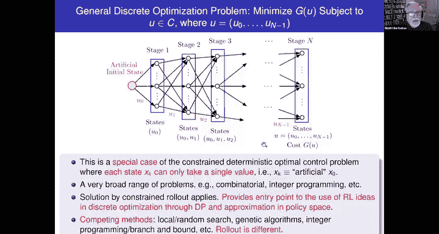

如果基础启发式策略不能天然满足序列改进条件，我们可以使用**强化版算法**：该算法始终保留一个“当前最佳可行轨迹”。在每一步，它尝试通过Rollout找到更好的可行轨迹。如果找不到，则回退到当前最佳轨迹。这确保了只要初始启发式轨迹是可行的，算法产生的轨迹就始终可行且成本不增。

### 示例：带安全约束的旅行商问题
通过一个4城市的旅行商问题示例，我们演示了约束Rollout的工作流程。问题要求在总旅行成本最小的同时，满足一条安全约束（某些路径组合的安全指数需低于阈值）。我们展示了如何一步步应用约束Rollout，在每一步排除违反安全约束的候选路径，最终找到一个可行且成本低于初始启发式解的新路径。

---

## 约束Rollout在离散优化中的应用

约束Rollout的框架非常通用，特别适用于具有以下结构的离散优化问题：
-   最小化成本函数 $G(u)$。
-   决策变量 $u = (u_0, u_1, ..., u_{N-1})$ 具有分量结构（例如，0-1整数规划中的各个变量）。
-   约束集 $C$ 可能非常复杂，耦合所有变量。

这类问题涵盖了组合优化中的大量难题，如匹配、路由、分配、调度、装箱等。任何整数规划问题都可以纳入此框架。

### 示例：设施选址问题
我们以经典的**设施选址问题**为例，说明如何应用约束Rollout。

**问题描述**：
-   有一组候选设施位置，决定变量 $u_k \in \{0,1\}$ 表示是否在位置 $k$ 建厂。
-   建厂成本为 $b_k u_k$。
-   有一组客户，客户 $i$ 的需求为 $d_i$。
-   从设施 $k$ 服务客户 $i$ 的单位成本为 $a_{ik}$，服务量为 $y_{ik}$。
-   每个设施 $k$ 有容量 $c_k$（如果 $u_k=1$）。
-   目标：最小化总成本（建厂成本 + 服务成本），满足所有客户需求，且服务量不超过设施容量。

**Rollout应用**：
1.  **问题重构**：将决策顺序定为依次决定 $u_0, u_1, ...$。对于给定的选址决策 $u$，剩余的服务量分配问题是一个易于求解的线性运输问题。因此，成本 $G(u)$ 可以通过求解这个线性规划得到。
2.  **基础启发式策略**：一个简单的基础启发式是“在所有剩余位置建厂”。即，给定一个部分决策 $(u_0, ..., u_k)$，基础策略将后续所有 $u_{k+1}, ..., u_{N-1}$ 都设为1。
3.  **Rollout步骤**：在每一步 $k$，对于当前部分决策，我们考虑两个候选：
    -   候选A：设 $u_k=1$，后续按基础启发式（全设为1）。
    -   候选B：设 $u_k=0$，后续按基础启发式（全设为1）。
    我们检查这两个完整决策 $u$ 的可行性（通过求解对应的线性运输问题），并计算成本 $G(u)$。然后选择可行且成本较低的那个候选对应的 $u_k$ 值。
4.  **性质**：由于基础启发式策略（全建厂）总是可行的，并且在这个特定问题结构下，序列改进条件容易满足，因此该约束Rollout算法能够保证改进单纯使用基础启发式（即全部建厂）的成本。

这种方法的美妙之处在于，它能优雅地处理传统整数规划方法难以应对的复杂附加约束（如区域规划约束）。

---

## 总结

本节课我们一起学习了以下核心内容：

1.  **确定性多步前瞻**：我们探讨了通过构建多步前瞻树，结合终端成本近似和截断Rollout来改进决策的方法。核心挑战在于平衡更长的前瞻步长（带来性能提升）与有限的计算资源。
2.  **计算优化技术**：为了在预算内实现更长前瞻，我们介绍了多种技术：
    -   **前向动态规划与迭代深化**：实现随时算法，逐步加深搜索。
    -   **剪枝**：舍弃不乐观的分支以节省计算。
    -   **双重Rollout与增量式多步Rollout**：使用启发式评估来近似部分路径成本，实现更灵活、高效的搜索。
3.  **约束Rollout**：我们将标准Rollout扩展到了带有轨迹约束的确定性问题上。关键思想是在每一步排除会导致不可行轨迹的控制动作。通过状态扩增技巧，我们将问题转化为扩增状态空间上的Rollout。
4.  **离散优化应用**：我们展示了约束Rollout如何应用于像设施选址这样的整数规划问题。通过将决策分解为顺序步骤，并利用基础启发式策略（如“全建厂”）来生成候选和评估可行性，Rollout提供了一种解决复杂约束离散优化问题的新途径。

这些方法为强化学习技术进入传统的组合优化和整数规划领域打开了大门。在接下来的课程中，我们将把目光转向随机性问题和无限空间问题。