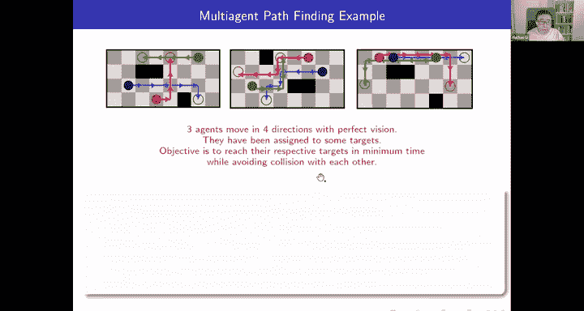
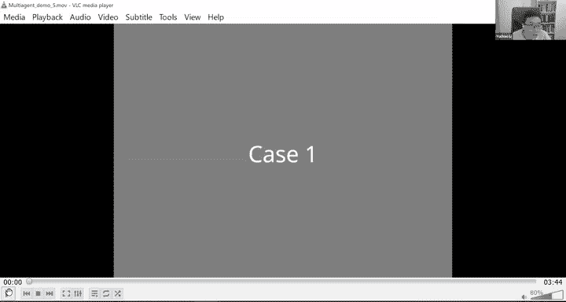
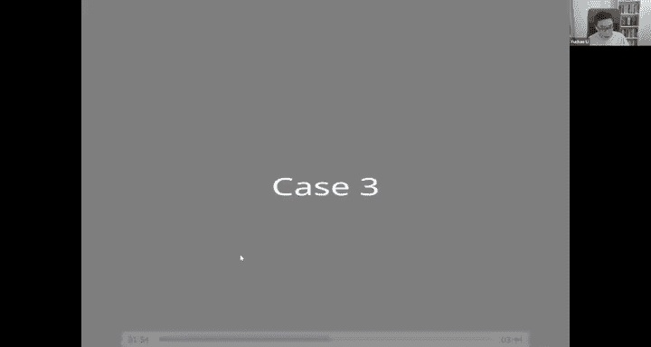
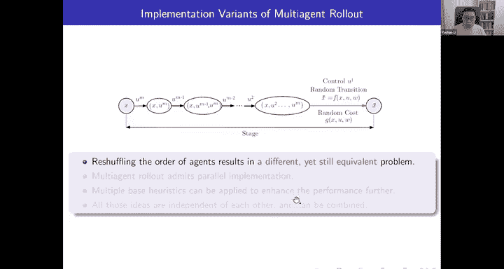
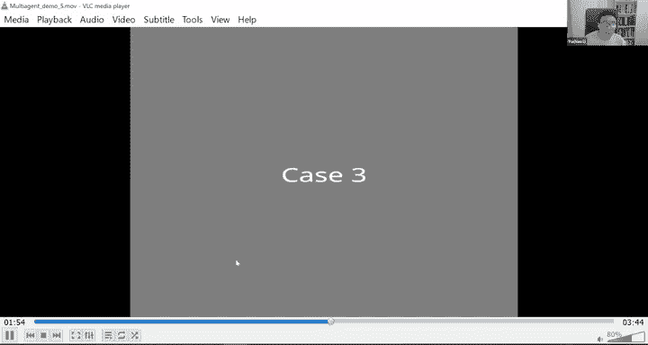
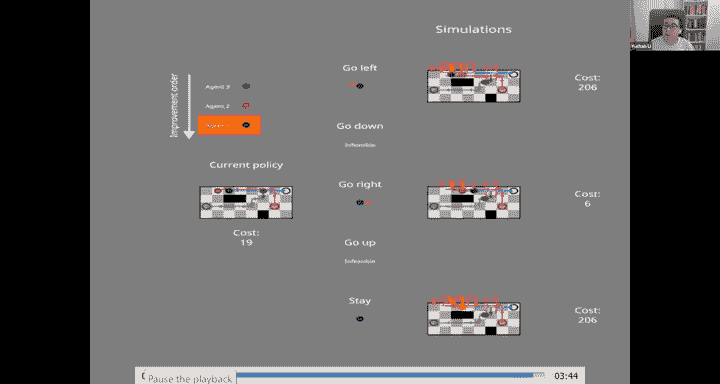
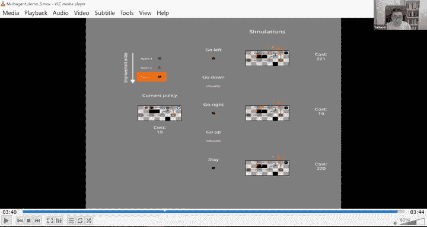
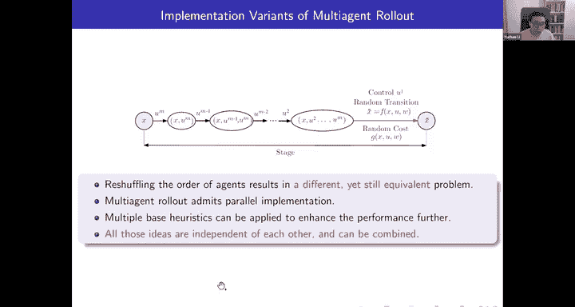
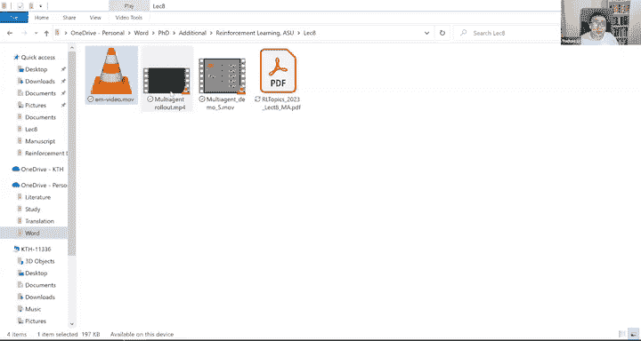
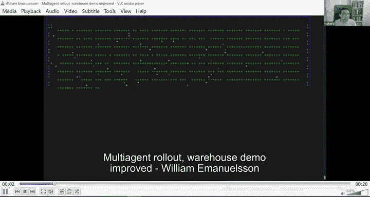

# 21：多智能体Rollout算法详解与演示 🚀🤖

在本节课中，我们将回顾基于第3讲幻灯片的多智能体Rollout算法要点。此外，我们将通过演示，展示该算法在紧密约束环境中为多个机器人进行路径规划的应用，以帮助大家建立更直观的理解。

---

## 多智能体问题概述

多智能体问题历史悠久，其定义性特征在于存在多个智能体。这些智能体彼此之间、与环境以及计算云之间选择性地收集和共享信息。每个智能体基于本地可用的信息做出自己的决策。

从数学角度看，随时间演变的情况不依赖于单个智能体的决策，而是依赖于所有智能体决策的整体集合。我们称之为**笛卡尔积结构**。

---

## 信息模式分类

多智能体问题的主要数学区别在于智能体之间信息传递的方式。

**经典信息模式**：智能体完全合作，共享且从不遗忘信息。所有智能体属于同一团队，为了团队整体利益共享信息。这类问题可以通过动态规划处理。

**非经典信息模式**：智能体仅选择性地与他人共享信息，甚至可能存在对抗关系。这可能源于隐私问题或竞争关系。这类问题难以用动态规划处理。

本次回顾我们只关注**经典信息模式**。在此模式下，智能体拥有精确的状态信息，并根据状态函数选择控制。这意味着每个智能体在做本地决策时，都能访问云端的所有可用信息。

---

## 问题建模

从数学角度看，这类问题可以建模为一个具有状态 **X** 和控制 **U** 的离散时间系统。控制 **U** 由 **M** 个分量组成，即 **U = (U1, U2, ..., UM)**，对应 **M** 个智能体。

对于这类问题，智能体本身可能只是一个隐喻，重要的是其数学结构。有时，可能只有一个物理实体决定所有控制分量，但我们可以想象每个控制分量由一个虚拟的智能体负责。这样做是为了开发更好的次优方案。

---

## 多智能体路径规划示例

考虑一个多智能体路径规划的例子：有三个智能体，每个都有指定的唯一目标。目标是在避免彼此碰撞的同时，以最短时间到达各自的目标。每个智能体可以向四个方向移动，也可以停留在当前位置，并拥有“完美视野”。

“完美视野”意味着每个智能体不仅知道环境布局和其他智能体的位置，还知道其他智能体的意图（即未来的移动计划）。这是一个合作性问题，目标是让团队整体尽快到达目标。

如果考虑所有智能体同时移动，我们需要从 **5^M** 种可能的移动组合中选择当前阶段的最佳移动（M=3）。然而，通过**多智能体Rollout算法**，我们可以将这个选择数量减少到 **5 * M**，同时保持良好的性能提升特性。

其核心思想是将控制分解为一系列“一次一个智能体”的移动序列。

---

## 算法演示与原理

在演示中，我们首先关注第一个智能体，查看其在当前阶段所有可行的动作。我们尝试所有五个动作，然后通过**基础策略**构建轨迹的剩余部分，而其他两个智能体则遵循基础启发式方法。我们“展开”或模拟后续情况，找出最佳动作。

确定第一个智能体的最佳动作后，我们固定它，然后为第二个智能体重复此过程，依此类推。

**核心公式**：Rollout策略选择属于最小成本控制集合的动作，记为 **μ_t(x) ∈ argmin**。使用“属于”而非“等于”是因为有时可能有多个控制动作达到相同的最小成本。在这种情况下，我们通常采用一个规则：如果达到最小值的控制之一与基础策略建议的动作一致，则坚持使用基础策略。

---

## 算法背后的数学原理

该方案实质上是在**控制复杂性**和**状态复杂性**之间进行权衡。我们引入了一个等效的重构问题，将控制动作展开。

在物理世界中，所有智能体同时应用其控制并移动到下一个状态 **X'**。但我们可以想象这是按顺序应用的，就像在模拟中我们首先尝试第一个智能体的动作一样。

对于这个重构后的问题，每个阶段只涉及一个智能体的控制选择，因此控制空间得到简化。但代价是，我们需要引入 **M-1** 个额外的状态层和相应的成本函数。

然而，这并不构成问题，因为通过这种重构，我们可以实现更高效的“一次一个智能体”的Rollout。这正是将标准Rollout应用于这个重构后的问题。这意味着即使我们大幅降低了计算复杂度，多智能体Rollout仍然是一个**新策略**，其性能应比基础策略有实质性提升，这在我们的模拟中得到了证实。

状态空间大小的增加不会对Rollout产生不利影响，因为在在线执行时，每个阶段只查看一个状态及其后继状态。

**计算复杂度**：从物理世界的 **N^M** 种选择（N是每个分量的可能选择数），降低到重构问题的 **N * M** 种选择。

---

## 算法的灵活性与扩展

该框架非常强大，提供了许多可能性和灵活性：

1.  **顺序重排**：控制分量的原始顺序对先优化哪个没有约束。我们可以随机选择顺序，或通过计算决定哪个顺序对在线Rollout最有利。每种不同的顺序都对应于引入一个不同的、但同样等效的问题。
2.  **并行实现**：在模拟中，所有不同的场景都是同时进行的。这意味着这些计算没有必须顺序执行的限制，可以并行实现。如果拥有并行计算单元，应充分利用这一点。
3.  **多基础启发式**：我们可以应用多个基础启发式策略来进一步提升性能。在演示中只使用了一种基础策略（计算最短路径），但可以使用几种不同的基础策略并将它们结合起来。
4.  **组合使用**：所有这些想法彼此独立，可以结合起来以进一步增强性能，当然这是以额外计算为代价的。

---

## 大规模应用演示

该方法可以很好地扩展，我们尝试过的最大规模达到200个智能体（当然环境需要更大）。合作者用C++实现，所有智能体在当前阶段做出决策的平均计算时间约为50毫秒。

该方法还能通过重新计算来适应变化的环境。例如，我们引入了40个智能体，它们会随机“故障”并成为障碍物。通过重新计算，所有智能体都能在这种时变环境中导航并完成任务。

在大规模仓库机器人演示中，有数百个机器人参与。基础策略通过A*算法计算每个网格到所有交付点的最短距离。由于基础策略假设其他智能体不存在，因此这是一个静态环境，可以预先计算最短路径并存储为查找表，这仅需约7MB存储空间。

---

## 碰撞处理与理论保证

关于碰撞避免，从理论角度看，最保守和最安全的启发式方法是“一次一个智能体”：第一个智能体完成交付后，第二个智能体再开始移动，依此类推。这基于一个温和的假设：当其他所有智能体保持静止时，第一个智能体存在到达其目标的路径。

在实际实现中，我们进行了超过1000次测试，从未需要用到如此保守的策略。通常只需要重排顺序最多两次，就能为所有智能体找到路径。

在模拟中，当执行多智能体Rollout时，通常已经能找到可行路径。在更大规模中，虽然可能性较低，但在基于策略的模拟展开阶段仍可能发生碰撞。因此，在我们的实现中，我们将碰撞视为一种成本，并引入折扣因子，以尽可能将碰撞推向未来，并希望到那时，基础策略预测的碰撞可能已经解决或存在解决方法。

**总结**：存在理论保证（通过引入超级保守的基础策略），但在使用强大的基础策略（如仅依赖最短路径）时，则无法保证。

---

## 注意事项

一个重要但未在课程中强调的注意事项是：当贪婪启发式策略在两个或更多动作之间出现平局（例如最短路径有多个等优选择）时，必须确保基础启发式是**顺序一致**的。这意味着在任何给定状态下，无论从何路径到达该状态，都应应用相同的动作。

如果出现平局，**不应随机选择**，而应有一个一致的规则。如果随机化，则会失去成本改进特性，并可能导致相当糟糕的结果。

---

## 总结

本节课我们一起回顾并深入探讨了多智能体Rollout算法。我们了解了其背后的数学原理，即通过重构问题在控制复杂性和状态复杂性之间进行权衡。我们通过路径规划示例和视频演示，直观地看到了算法如何通过顺序优化每个智能体的动作来大幅降低计算复杂度（从 **N^M** 到 **N*M**），同时保持性能提升的特性。

我们还探讨了算法的灵活性，如智能体优化顺序的重排、并行实现的可能性、结合多基础启发式策略等，这些都能进一步增强算法性能。最后，我们讨论了碰撞处理的理论与实践，以及确保基础启发式顺序一致的重要性。

多智能体Rollout是一个强大而灵活的框架，为处理大规模协作智能体系统的实时决策问题提供了有效的解决方案。