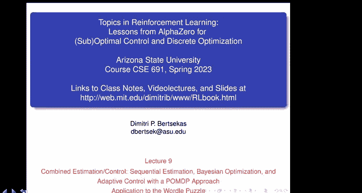
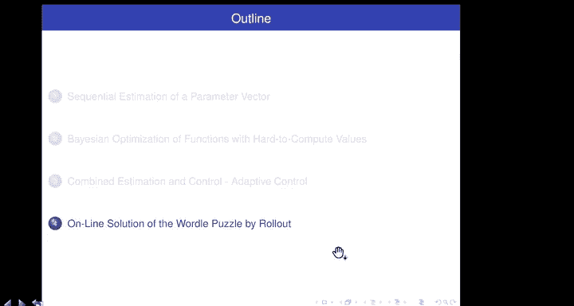
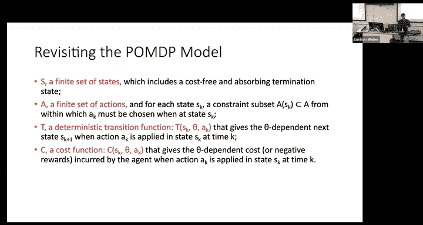
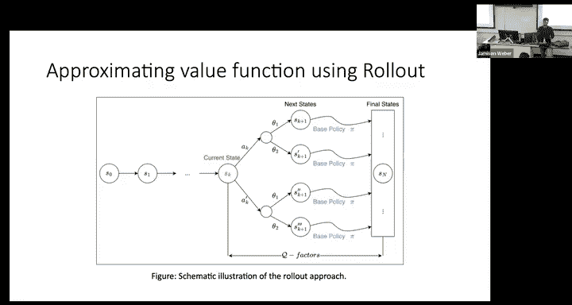
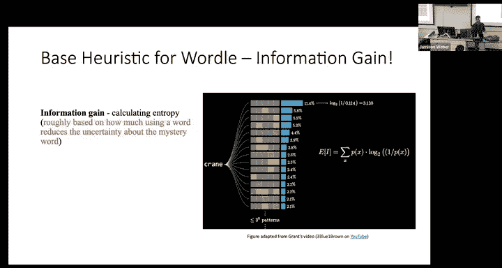
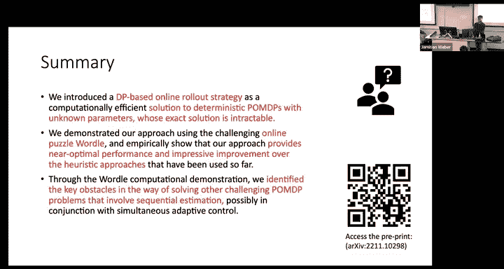

# 22：贝叶斯优化与自适应控制 🧠

在本节课中，我们将学习结合了估计与控制的几个主题，包括序贯估计、贝叶斯优化和自适应控制。这些主题都可以通过部分可观测动态规划（PDP）的方法来解决。课程最后，我们将讨论一个应用于Wordle猜词游戏的实际案例。

---

## 概述 📋

我们将从序贯参数估计开始，讨论如何利用先前的测量结果来决定后续的测量。接着，我们将探讨贝叶斯优化，这是一种用于优化没有解析形式、但可以通过仿真或实验（代价高昂地）计算其值的函数的方法。然后，我们将讨论在自适应控制背景下出现的估计与控制相结合的问题。最后，我们将通过一个Wordle猜词游戏的案例，展示自适应控制和rollout方法的应用。

---

## 1. 序贯参数估计 🔄

上一节我们介绍了课程的整体框架，本节中我们来看看序贯参数估计的具体问题。

我们有一个多维参数向量 **θ** 需要估计。我们可以使用代价高昂的观测来获取信息，并且观测的数量和类型是可以选择的（可能涉及多种类型、不同成本的观测）。决策者需要基于已累积的观测结果来评估：是停止观测并基于当前信息估计 **θ**，还是继续观测（并可能选择新的观测类型）。这个过程涉及序贯决策，因此可以应用动态规划。

一个经典的例子是二元假设检验：我们试图通过序贯获取的、有成本的观测，在两个假设中做出决定。每获得一个新观测后，我们可以选择接受其中一个假设（停止动作），或者支付一定成本获取新的观测。这在统计和质量控制中有广泛应用。

以下是序贯估计的一些应用场景：
*   **质量控制**：判断一批产品是否合格。
*   **统计设计/临床试验**：在多个假设或诊断中进行选择。
*   **序贯搜索问题**：如搜救任务，决定下一步搜索哪里。
*   **传感器网络**：规划路径以收集足够信息。
*   **序贯解码问题**：例如我们将在Wordle游戏中讨论的。

这里需要做一个重要区分：
*   **简单序贯估计问题**：当前的观测选择不影响未来观测的可用性或成本。这类问题相对简单。
*   **更复杂的问题**：当前的观测可能会影响未来的选项。这类问题更具控制问题的特征，可以视为自适应控制框架下的**估计与控制相结合**的问题。

---

## 2. 代理优化与贝叶斯优化 🎯

上一节我们讨论了序贯估计，本节中我们来看看一个重要的特例——代理优化，特别是贝叶斯优化。

代理优化处理的是**黑箱函数**的近似最小化问题，这些函数的值只能通过耗时的计算、仿真或实验获得。基本思路是：我们有一个涉及参数 **θ** 的参数化模型来近似目标函数。我们序贯地获取与 **θ** 相关的观测，然后决定是继续观测，还是停止观测并用估计出的 **θ** 来构建一个**代理函数**，最后通过优化这个代理函数来获得原问题的次优解。

核心问题在于：如何基于先前观测的结果来选择新的观测点？这引出了一个反复出现的主题：**探索与利用的权衡**。
*   **利用**：在可能接近最优解的区域进行观测。
*   **探索**：在搜索空间中相对未探索的区域进行观测，希望发现更好的值。

代理优化的应用实例包括：
*   **地质统计插值**：例如在南非的金矿勘探中应用。
*   **设计优化**：空气动力学设计、新材料/新药研发。
*   **超参数调优**：调整机器学习模型（如神经网络）的超参数。

### 2.1 贝叶斯优化方法

贝叶斯优化是代理优化的一种形式。我们有一个定义在 m 个点上的黑箱函数 `f(u)`。我们将参数向量 **θ** 定义为这些点上的函数值：`θ_u = f(u)`。我们通过带有噪声 `w` 的测量来获取函数值：`z = θ_u + w`。

我们假设参数 **θ** 有一个**先验分布** `B_0`，并且相邻点的函数值是相关的。在获取了 k 个观测点 `(u_1, ..., u_k)` 的测量值后，我们选择下一个观测点 `u_{k+1}`，并利用估计器更新**后验分布** `B_{k+1}`。

一个重要的特例是**高斯情况**：当先验分布和噪声都是高斯分布时，后验分布也是高斯的，并且存在闭式更新公式，这基于高斯过程回归理论，相对容易处理。

在贝叶斯优化中，后验分布 `B_k` 本质上就是一个**概率化的代理函数**，它随着每次新测量而更新。

### 2.2 基于获取函数的近视策略

贝叶斯优化中，选择下一个观测点的主要方法是基于**获取函数**的**近视（或贪婪）策略**。

我们将此问题建模为一个PDP问题：
*   **状态**：后验分布 `B_k`（信念状态）。
*   **控制**：观测点选择 `u_{k+1}`。
*   **系统动态**：信念状态在控制和观测噪声 `z` 的影响下演化。

近视策略在时间 `k` 计算当前后验 `B_k` 下、所有可能观测点 `u` 对应的获取函数 `h(B_k, u)`，然后选择最大化该函数的点作为下一个观测点。

常见的获取函数例子包括：
1.  **上置信界**：`h(B_k, u) = -μ_k(u) + β_k * σ_k(u)`
    *   其中 `μ_k(u)` 是后验均值（利用指数），`σ_k(u)` 是后验标准差（探索指数），`β_k` 是可调参数。
2.  **期望改进**：衡量相对于当前已获得的最佳函数值，预期能带来的改进。

这两种函数都隐式地平衡了探索与利用。

### 2.3 动态规划与Rollout方法

虽然近视策略是主流，但我们可以从动态规划的角度更原则性地看待贝叶斯优化。最优代价函数 `J*_k(B_k)` 满足贝尔曼方程，但精确求解不可行。

我们可以采用**值空间近似**，用 `J̃` 近似 `J*`，从而得到一步前瞻策略。一个有效的方法是使用**rollout**，并以近视的获取函数策略作为**基策略**。研究表明，这种基于rollout的方法能改进标准的近视贝叶斯优化，是一个前景广阔的研究方向。

---

## 3. 自适应控制：结合估计与控制 🤖

上一节我们介绍了贝叶斯优化，本节中我们来看看更一般的、结合估计与控制的自适应控制问题。

我们考虑一个包含未知参数向量 **θ** 的确定性系统。我们假设 **θ** 取自 M 个可能值之一，并且有一个已知的初始概率分布。状态 `x_k` 被完美观测，这为我们提供了关于 **θ** 的信息。

我们可以将此问题表述为一个PDP问题，其中**状态**是 `(x_k, θ)`，但 `θ` 不可观测。信念状态是 **θ** 的后验分布 `b_k`。由此可推导出贝尔曼方程，但同样难以求解。

我们再次使用**值空间近似**。一种方法是选择 `J̃` 为：假设我们知道真实的 `θ_i` 时所对应的最优策略的代价函数。这在理论上很有吸引力，但需要为每个可能的 `θ_i` 计算最优策略，计算量巨大。

另一种更实用的方法是使用**rollout**。我们选择一个**基策略** `π`（可以是同一个策略用于所有 `θ`），并用其代价函数作为 `J̃`。具体步骤如下：
1.  在当前状态 `x_k` 和当前后验 `b_k` 下，考虑所有可能的控制 `u`。
2.  对于每个 `u` 和每个可能的 `θ_i`，使用基策略 `π` 进行rollout模拟直到终止，计算代价，得到 `Q` 因子 `Q_π(x_k, u, θ_i)`。
3.  计算平均 `Q` 因子：`Q̄_π(x_k, u) = Σ_i b_k(θ_i) * Q_π(x_k, u, θ_i)`。
4.  选择具有最小平均 `Q` 因子的控制 `u` 执行。

可以证明，如果对所有 `θ_i` 使用相同的基策略 `π`，那么由此得到的rollout策略能改进基策略 `π` 的性能。

---

## 4. Wordle猜词游戏中的应用实例 🧩

上一节我们介绍了自适应控制的rollout方法，本节中我们通过Wordle游戏来看一个具体的应用案例。

Wordle游戏的目标是猜出一个隐藏的5字母神秘单词。玩家从一个大的猜测词列表中提出猜测，并根据颜色反馈（绿色：字母位置正确；黄色：字母正确但位置错误；灰色：字母不正确）来缩小可能的神秘单词列表（初始约2315个词）。游戏目标是最小化猜中所需次数的期望值（假设神秘单词均匀随机选取）。

关键点在于：**初始信念分布（神秘单词上的分布）是均匀的，并且在游戏过程中，随着获得反馈，更新后的信念分布始终保持均匀**。这个特性使得有人能够通过庞大的动态规划计算得到该游戏的最优策略。然而，一旦问题稍有变化（如词表变大、单词变长），精确求解就变得不可能。

Rollout方法为解决此问题提供了强大工具。我们可以将Wordle建模为一个确定性PDP：
*   **参数 θ**：神秘单词本身。
*   **状态**：当前可能的神秘单词列表。
*   **信念状态**：在该列表上的均匀分布。
*   **控制/动作**：选择的猜测单词。
*   **转移**：根据猜测词获得的颜色反馈，过滤出新的可能单词列表。
*   **单步代价**：每猜一次代价为1。

我们可以选择不同的**基策略**，例如：
*   **最大信息增益**：选择能最大程度减少可能单词列表熵（不确定性）的猜测词。
*   **最速下降**：选择能使最坏情况下（反馈后）新列表尺寸最小的猜测词。
*   **最大期望概率**：选择自身最可能是答案的猜测词（在均匀分布下效果不佳）。

实验表明，无论基策略本身性能如何，**在其基础上使用rollout都能显著降低平均猜测次数**，并且结果非常接近理论最优值。这直观地展示了rollout的成本改进特性。

这种方法也适用于游戏的“困难模式”或其他变种，展示了其通用性。当然，rollout方法也需要合理的基策略、后验分布估计器，并可能面临计算量大的问题，但可以通过剪枝、神经网络近似Q因子等技术来缓解。

---

## 总结 🎓

在本节课中，我们一起学习了：
1.  **序贯估计**：如何在有成本的序贯观测下估计参数，并做出继续观测或停止的决策。
2.  **贝叶斯优化**：作为代理优化的一个特例，用于优化黑箱函数，核心是探索与利用的权衡，通常使用基于获取函数的近视策略。
3.  **自适应控制**：将参数估计与控制相结合的一般框架。我们介绍了基于值空间近似的rollout方法，它使用一个基策略的代价函数作为近似，并能改进基策略的性能。
4.  **Wordle案例**：展示了如何将自适应控制和rollout方法应用于一个具体的、有趣的序贯决策问题，并取得了接近最优的性能。

这些主题展示了动态规划和近似动态规划在解决复杂序贯决策问题上的强大能力和灵活性。