# 23：离线训练与神经网络 🧠

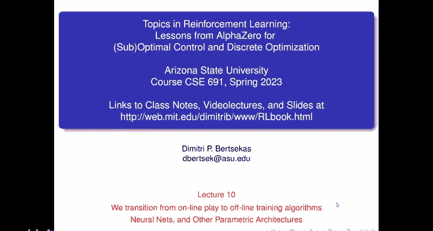

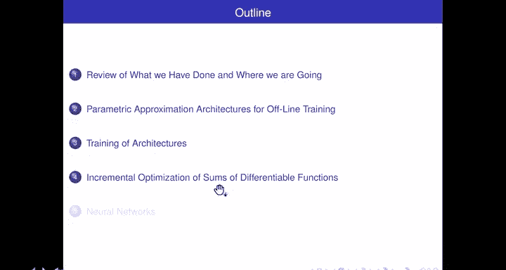

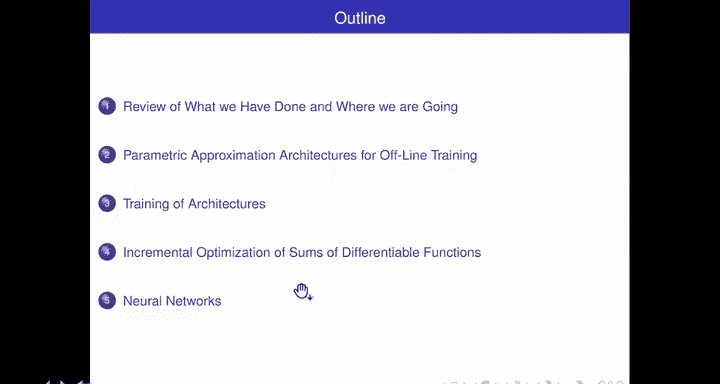

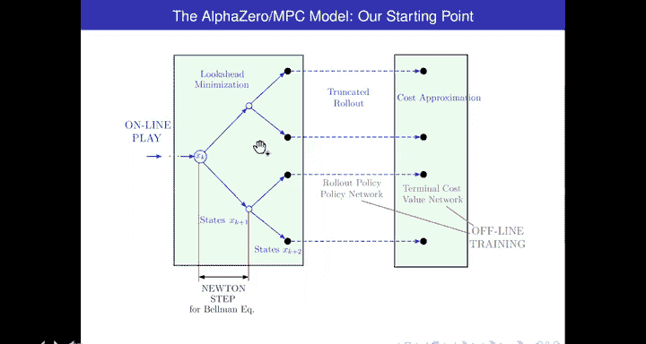

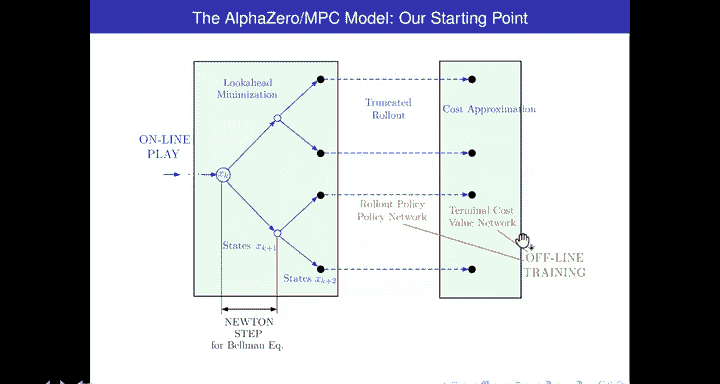

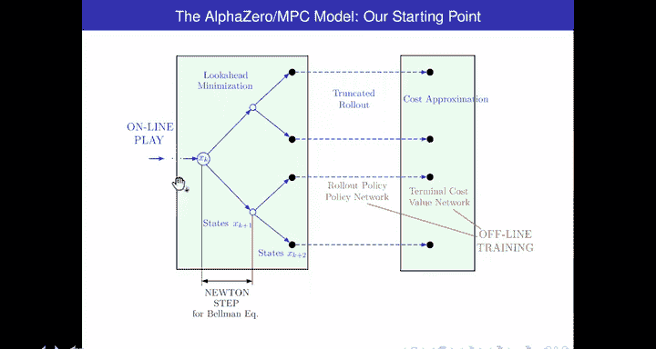

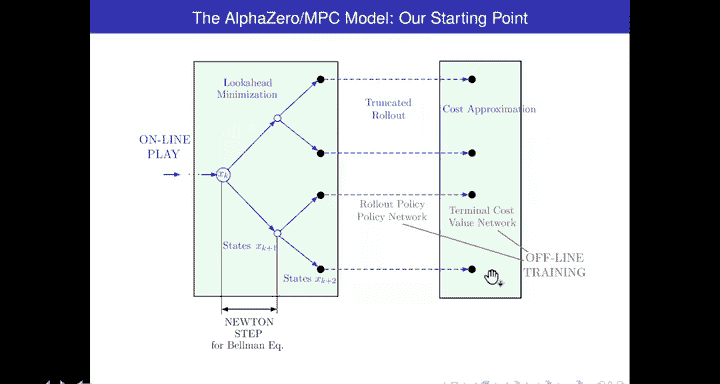

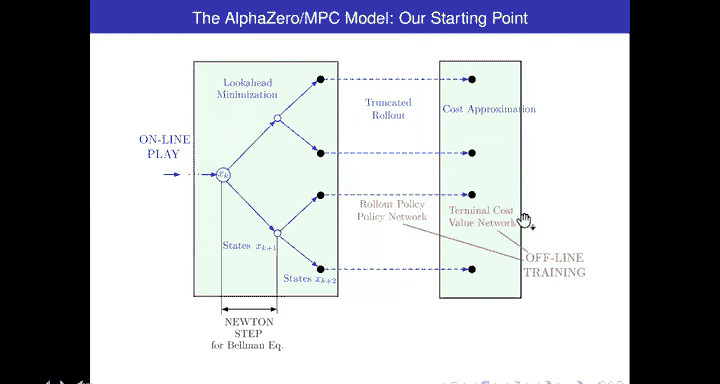

在本节课中，我们将从之前讨论的在线博弈思想，过渡到离线训练算法，包括神经网络和其他参数化架构的使用。我们将用几节课的时间来探讨离线训练。

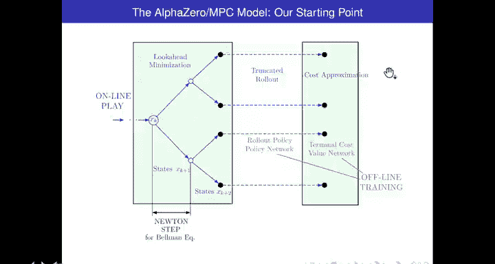

##概述 📋

我们将首先回顾已完成的内容和未来的方向，然后深入探讨离线训练和参数化近似架构的使用。接着，我们将讨论用于寻找这些架构参数的训练算法。之后，我们会将这些算法视为更广泛算法类别（即可微函数大和优化）的一个特例进行讨论。最后，我们将简要介绍神经网络以及这些算法如何应用于其上下文。

## 回顾：在线博弈与离线训练 🔄

这是我们熟悉的起点：AlphaZero架构和蒙特卡洛树搜索架构非常相似。它们都涉及在线博弈和离线训练之间的基本划分。

在线博弈算法（图中蓝色部分）涉及在当前状态下进行多步前瞻并生成搜索树。然后，我们运行一个策略若干步。最后，我们使用终端成本函数近似来近似后续步骤的效果。

离线训练（图中紫色方块）用于提供终端成本近似以及用于进行模拟的策略。这是在开始决策过程之前完成的，是一个与在线博弈分离的预备阶段。

用于在线和离线训练的算法也可以分开设计，并且几乎可以独立运行。两者通过一个与牛顿方法相关的基本关系相互作用。牛顿方法是前瞻最小化的第一步，而其他步骤代表了成本近似向某种形式的策略迭代的增强，以便为新的第一步提供一个更好的起点。第一步是精确的最小化，完成了大部分工作。其余部分虽然重要，但不如第一步关键。

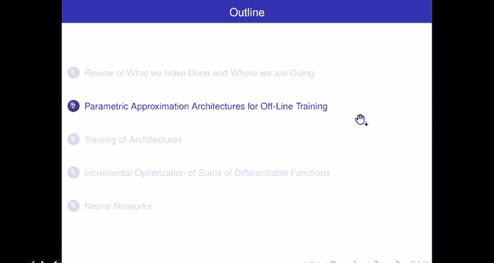

请注意，图中可能没有多步前瞻，也许只有一步前瞻，也可能没有中间部分。不同的设计涉及这些思想的不同用法。这里展示的是最通用的图。在我看来，这是强化学习的基础。

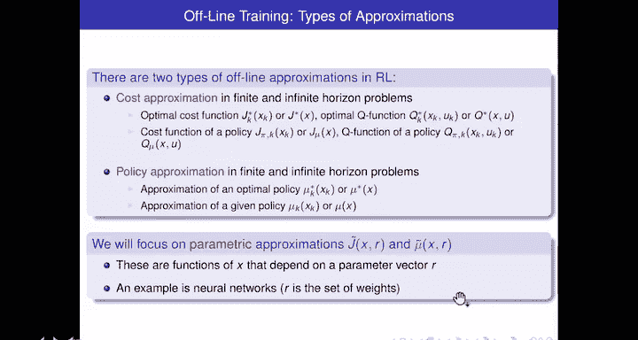

有可能在没有在线博弈的情况下通过强化学习获得好的策略。例如，你可以通过某种近似策略空间（一种策略迭代）获得一个基础策略，并直接使用它，而不经过这个近似步骤。然而，这会带来性能损失。我们讨论过基础策略和在线博弈策略之间的成本改进特性。在某些情况下，这种改进非常显著（如AlphaZero），而在其他情况下，改进并不那么显著，因此基础策略可能已经能提供良好的性能。然而，最佳性能通常来自结合了在线博弈的方法。

到目前为止，我们已经涵盖了在线博弈算法的设计。我们从概述性讲座开始，涵盖了讲义第一章中的大图景，包括离线训练和在线博弈之间的划分、牛顿方法的作用、确定性问题和随机问题的精确动态规划、有限和无限视野问题。我们讨论得并不非常理论化，主要是为后续内容奠定基础。

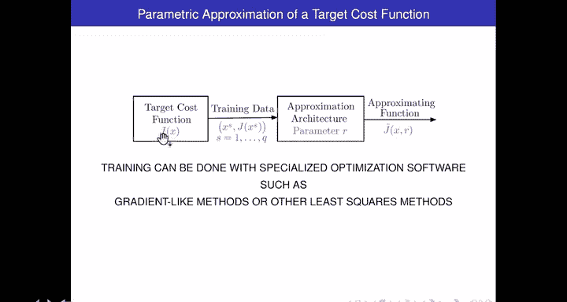

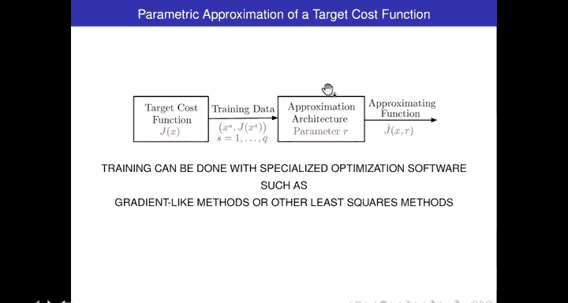

在这些介绍性讲座中，我们重点讨论了模拟和近似策略迭代，将模拟视为策略迭代的第一步。我们讨论了问题表述和转换：如何表述问题，基本思想是需要从一系列决策开始，为动态系统和顺序控制选择设定阶段。如果问题不完全符合我们使用的标准形式，可以通过引入状态增强、改变终止状态或处理随机或最短路径问题来改变它。多智能体问题涉及一个对我们目的非常有趣的转换，它涉及多组件控制，这会导致计算困难，我们通过协调问题来在很大程度上避免这种困难。

我们讨论了部分状态信息问题到完美状态信息问题的转换，使用了信念状态（充分统计量）的思想。我们还谈到了交通控制和模型预测控制，但不够详细。不幸的是，在整个课程中，我们不会过多涉及这些材料。然而，明年我计划将课程重点放在自适应和模型预测控制上，这个主题太大，无法涵盖所有内容。

我们在讲义第二章中详细讨论了在线模拟。我们首先讨论了确定性和随机程序的模拟以及策略迭代、45模拟、75模拟、约束模拟。对于确定性问题的模型预测控制模拟，对于随机问题的模拟，我们讨论了与采样效率相关的方差减少思想。然后我们专注于多步前瞻，我们做了一节关于确定性问题的多步前瞻讲座，包括剪枝思想、双重模拟等。接着我们研究了随机问题的多步前瞻，即确定性等价近似的思想，用确定性等价物近似除第一步之外所有阶段的随机变量，这极大地加快了计算速度，并且性能损失相对较小（如果有的话）。我们讨论了蒙特卡洛树搜索，这是一种正式的适应性模拟，旨在使在线博弈算法各个部分的期望值计算更高效。

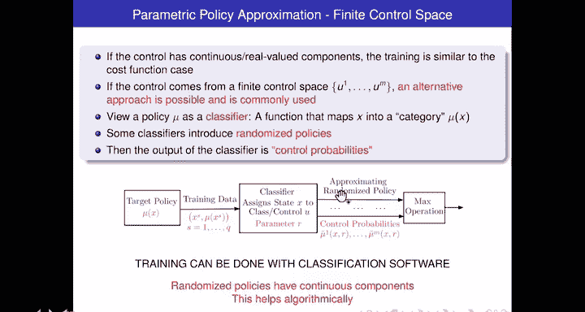

大约两节课前，我们回顾了多智能体问题，有一个演示。有一些变体我们没有详细讨论，特别是通过信号间接通信并协调其行动的自主智能体的思想。所有这些都在你的笔记中，但我们没有像我希望的那样详细讨论。在上一节课中，我们讨论了参数优化、参数估计、自适应控制。一个更原则性的自适应控制框架，以及在该上下文中模拟的使用，我们通过案例进行了说明。

这就是我们到目前为止所做的内容。接下来我们将进行两节讲座（今天和下周），内容基于讲义第三章。我们将涵盖使用价值函数近似和策略近似（使用神经网络和其他架构）来近似价值和策略。这些近似架构的训练将使用增量梯度方法，这是我们今天要做的。下周，我们将讨论使用近似架构的近似策略迭代。对于策略迭代，你必须使用近似架构。如果你试图进行策略迭代，你无法避免使用神经网络或类似的东西。

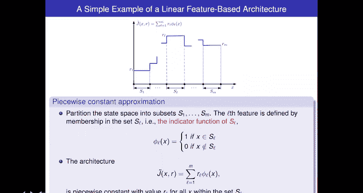

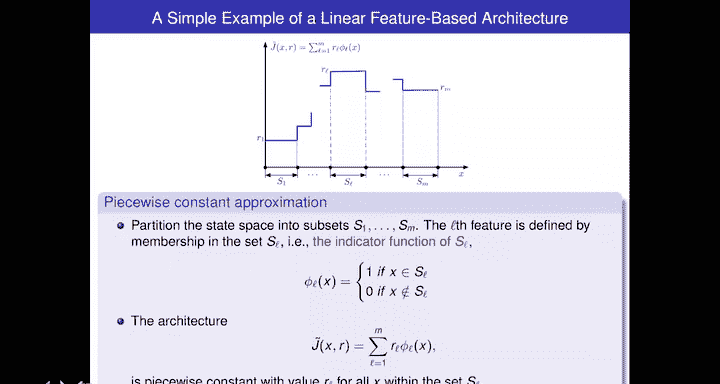

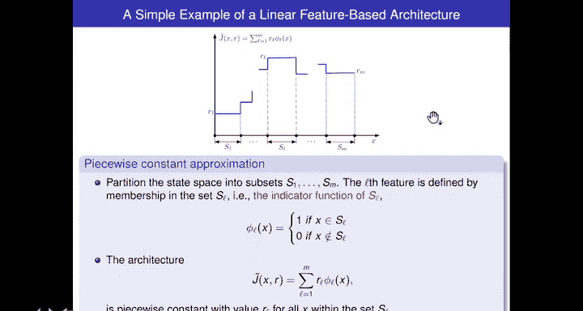

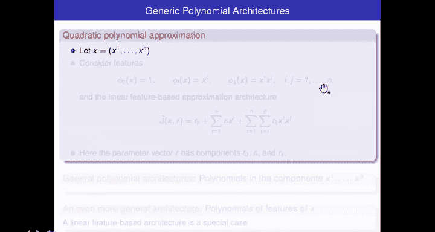

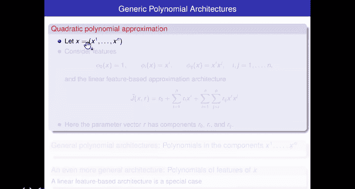

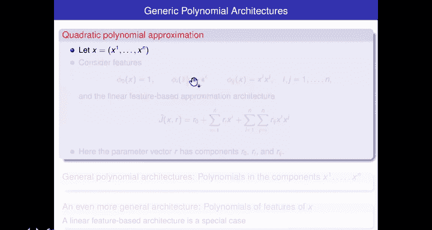

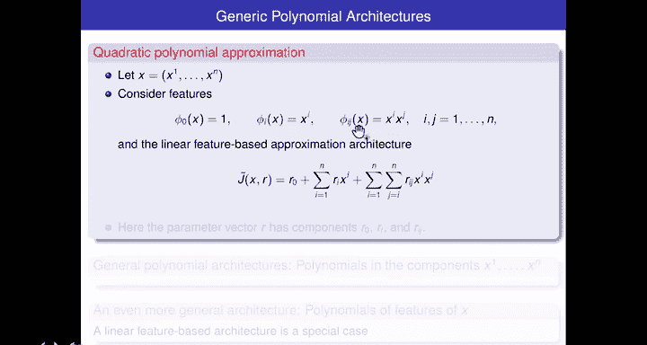

然后我们将讨论基于聚合的替代近似架构。我们将在下周的最后一节课中讨论这两件事。

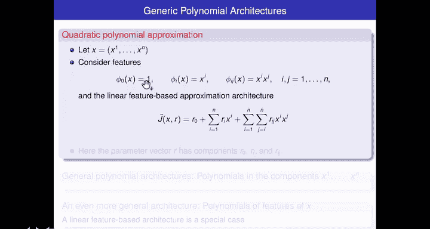

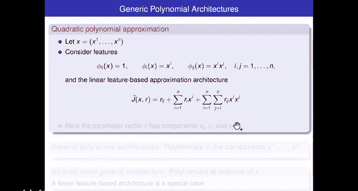

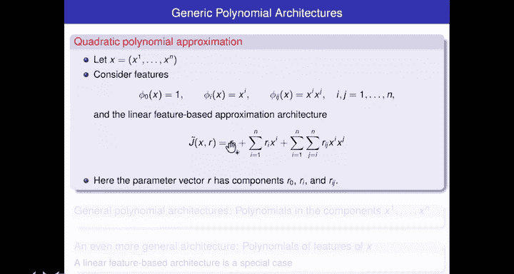

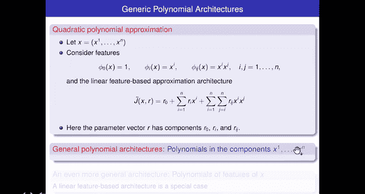

有很多内容被省略了。如果你回顾我在2019年至2021年课程提供的视频讲座，以及2019年的强化学习书籍和我的两卷动态规划书籍，还有几个额外的主题。关于策略迭代的理论更多。策略迭代的理论相当完整。有限视野动态规划的数学几乎微不足道，非常直观和简单。而一旦进入无限视野问题，就会出现大量的数学理论，特别是当你离开有限状态折扣问题（这是人工智能社区大部分强化学习工作的基础）时。这些问题相对容易，但一旦你离开这些领域，就会出现重大的数学困难，我们在本课程中没有涵盖。在早期的视频讲座中，有一些与随机逼近算法相关的训练方法，用于近似价值空间。有一个著名的方法叫TD（时间差分）学习和其他时间差分方法，这些在90年代非常重要，现在我不太确定它们是否仍然那么重要，但它们当时非常重要，也吸引了很多数学家，因为它们的算法分析非常具有挑战性。Q学习的数学分析也很有趣。实际上，第一个是我和Tsitsiklis的合作成果。所有这些我们都没有涵盖，有些在这本书中更多，也在给出的参考文献中。

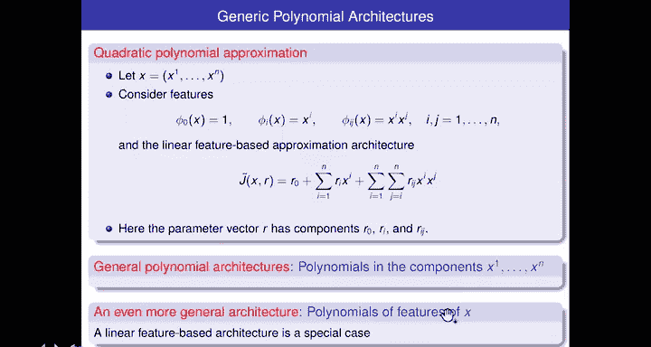

最后，在人工智能的许多团体中，有一个相当流行的主题，即策略空间近似和策略梯度。策略梯度方法和随机搜索方法用于训练策略。在我们的上下文中，它们可以用来为模拟或近似价值空间提供基础策略，但它们也可以作为独立的策略使用。它们不如我们通过多步前瞻得到的策略好，因为没有成本改进保证。另一方面，在特定上下文中它们可能足够好。近似策略空间（相对于价值空间近似）的一个优点是，一旦你训练好一个策略，在线生成控制几乎是即时的。你不需要进行多步前瞻、模拟等操作，这些操作可能相当耗时。然而，这样做会带来性能损失，在线计算方便，但在线性能会下降。

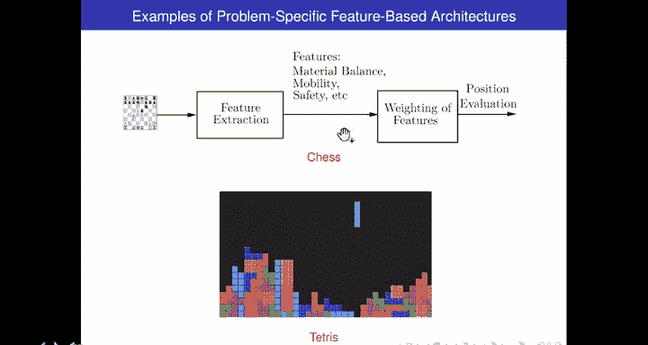

我们不会涉及这些内容，有大量的文献，包括我自己的和一些其他人的。这些都是该领域许多人积极研究的重要主题，但我们无法涵盖所有内容，所以必须划清界限。

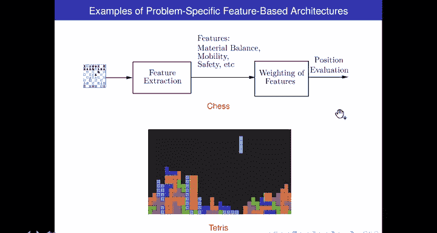

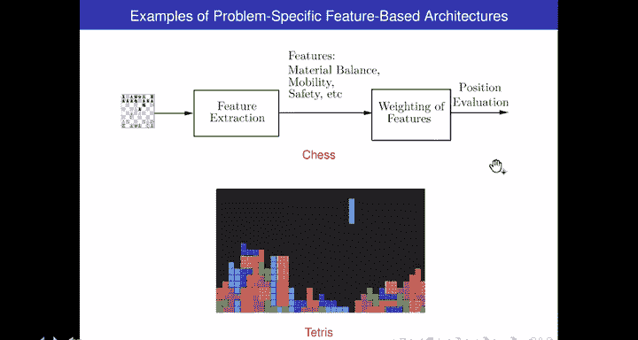

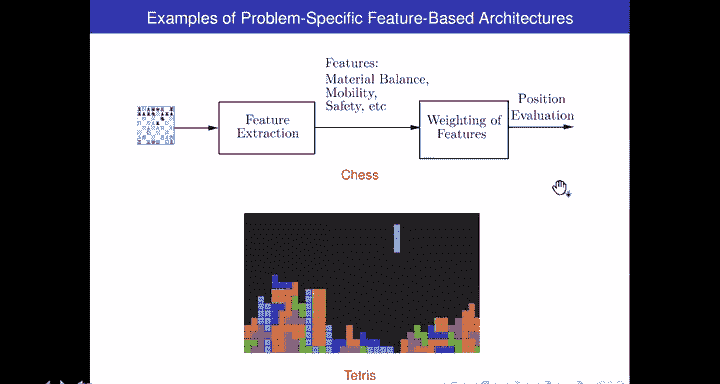

## 近似价值空间与一步前瞻 📈

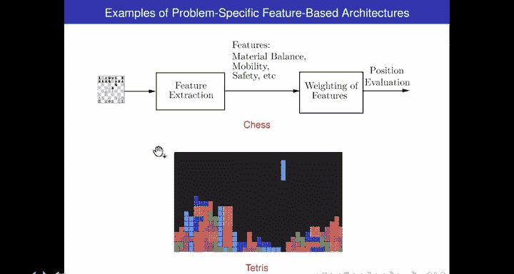

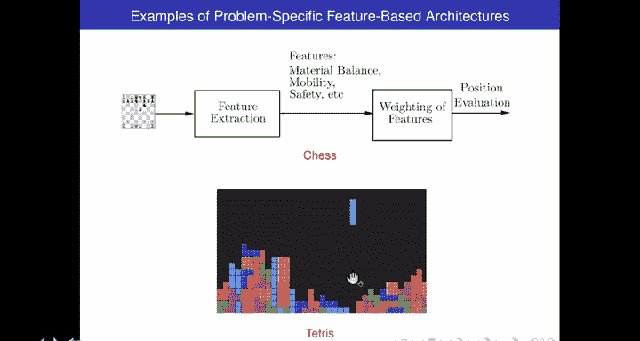

在给定状态 \(X_k\) 下，我们通过最小化第一步的期望成本以及由成本函数近似 \( \tilde{J}_{k+1} \)（代替 \( J^*_{k+1} \)）编码的未来期望近似价值来找到一个控制。请记住，这里有三种近似：最优成本函数的近似、期望计算的近似（可能很显著）以及这个最小化的近似（也可能相当耗时）。我们讨论了许多计算 \( \tilde{J} \) 的方法，包括模拟、预测控制等。今天我们将讨论图中粉色的部分（离线训练）。在下节课中，我们将讨论聚合等其他方法。

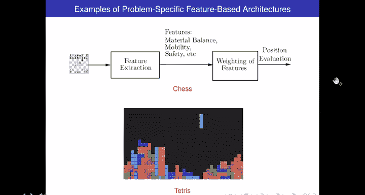

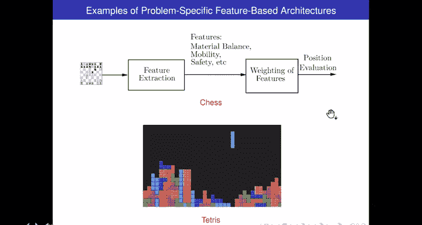

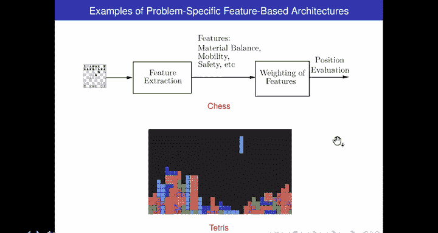

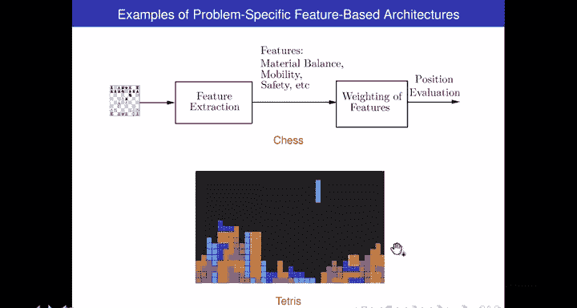

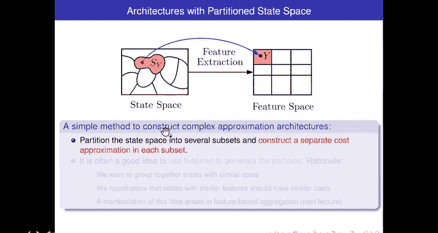

关于近似期望值，我们讨论了使用确定性等价、适应性模拟、蒙特卡洛树搜索。以及一个特殊的最小化近似情况，即多智能体协调，它是一个更简单的最小化，但在性能上几乎不会损失什么。

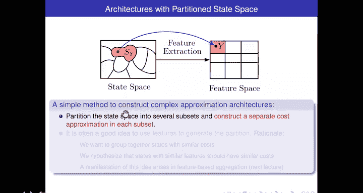

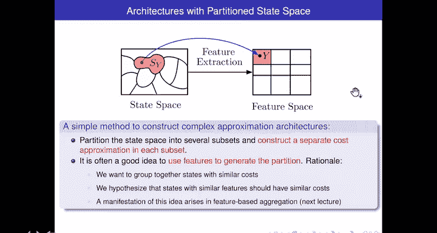

这是一步前瞻的情况。多步前瞻也有类似的图，只是多步上下文中出现了一些特殊问题。我们不是向前看一步，而是向前看 \(L\) 步，然后近似剩余的未来。同样存在类似的问题，例如在第一步之后使用确定性等价来近似期望，这是一个重要的思想。然后是对所有这些进行动态规划最小化，这是一个 \(L\) 步动态规划问题（原始问题可能视野很长，但这只是向前 \(L\) 步）。我们在这里用我们已有的任何近似进行最小化，通过某种形式的动态规划（可能涉及我们讨论过的近似）来解决，然后我们丢弃第一步之后的所有策略，只使用第一个控制。

多步前瞻的思想是它增强了牛顿步骤的起点，使其更接近能提供非常好性能的“最佳点”。在实践中，多步前瞻总是比一步前瞻效果更好，但计算要求更显著，这是基本的权衡。

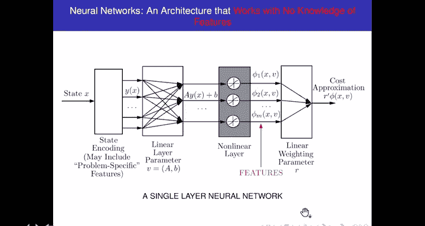

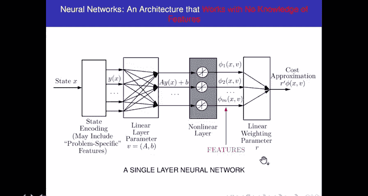

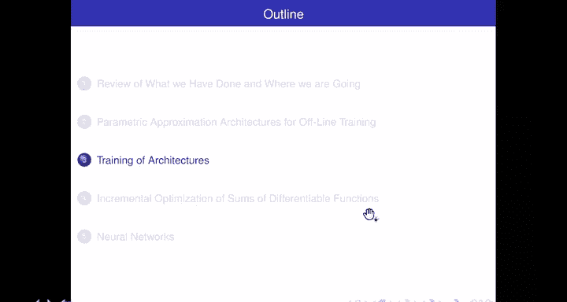

## 离线训练的参数化近似架构 🏗️

在强化学习中，有两种类型的近似。机器学习当然是一个比强化学习大得多的主题，有各种近似。但在强化学习中，你只想近似两样东西：成本函数和策略。

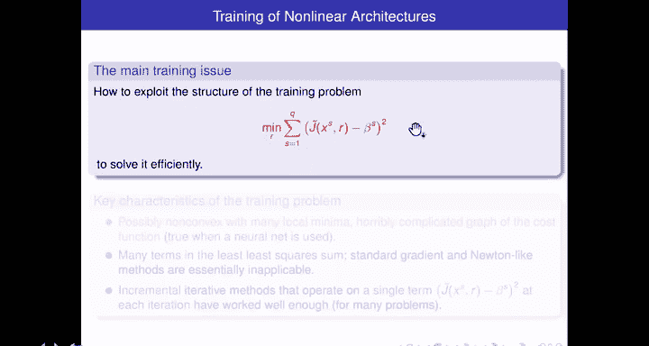

第一种近似是在策略迭代程序中实现成本函数近似。换句话说，近似有限视野问题的最优成本函数，或给定视野问题的最优成本函数，或有限和给定视野问题的最优Q函数。请注意，对于无限视野问题，我们只想近似一个函数。但在有限视野问题中，有一大堆函数需要近似，因此可能在那方面有更多工作要做，但你仍然可以在该上下文中使用近似。这就是为什么在有限视野问题中，模拟通常比近似更好，因为在近似方面有更多工作要做。对于无限视野，情况则不同。

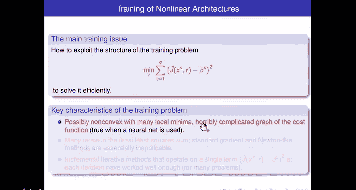

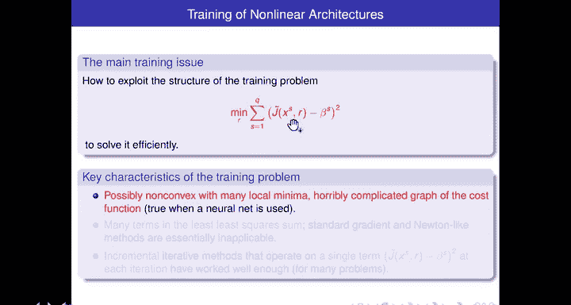

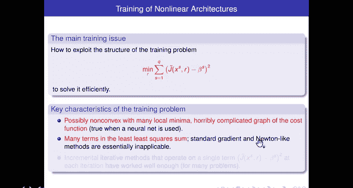

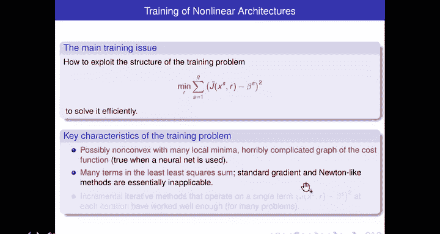

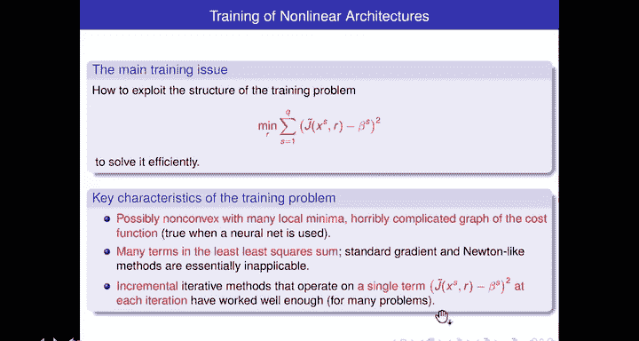

正如我们可以近似最优成本函数一样，我们可能也有兴趣近似策略的成本函数（有限视野或无限视野策略）或策略的Q函数（有限视野或无限视野）。这是一种近似：成本函数近似。

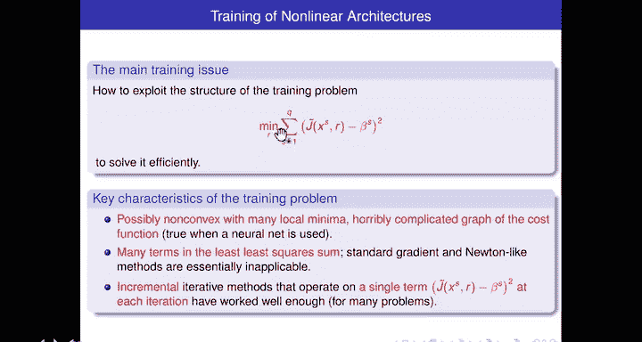

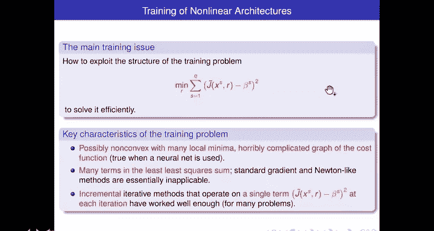

第二种近似是策略近似。近似有限或无限视野设置中的最优策略，或近似给定策略。这可以通过许多不同的方式完成，启发式地永远玩下去，但我们将专注于参数化近似，即我们引入依赖于参数向量 \(r\) 的函数参数类，无论是在成本近似中还是在策略近似中。然后我们基于训练选择 \(r\)。现在这个参数将特定于特定类型的架构。例如，对于神经网络，\(r\) 是一个巨大的向量，即神经网络所有权重的集合。我假设你们都多少接触过神经网络，知道我在谈论权重，我们稍后会讨论。

这就是我们关注的参数化近似，涉及一个参数向量 \(r\)。

让我给出成本近似和策略近似的示意图。对于成本近似，我们有一个目标成本函数 \(J\)。我们可能有多个目标成本函数，但我们一次处理一个。我们生成训练数据，训练数据是状态和对应成本的对。可能涉及某种度量，但我在这里省略了。生成 \(q\) 个样本，\(q\) 可能非常大，达到数千甚至数百万，这是针对某个问题以特定方式完成的。我们有了训练数据，然后我们将其通过一个近似架构，并通过某种算法调整这个参数，使得输出近似函数与目标匹配。换句话说，当这个近似函数专门用于这些状态时，其输出与 \(J\) 相似。这是通过某种优化软件完成的，例如我将讨论的梯度类型方法以及其他类型的优化方法。所以我们有一个目标，我们希望通过训练使近似与目标匹配。

你如何获得目标成本函数？至少在我们讨论的方法中，通过运行大量模拟轨迹，进行蒙特卡洛模拟来近似，然后得到训练集。原则上，这个 \(J\) 可能包含噪声，但在我们讨论的方法中，噪声会通过自然平均被平均掉。所以 \(J\) 是黄金标准，\(J\) 是蒙特卡洛之前的近似。这个 \(J\) 可以是一个样本平均。这是一个原子轨迹问题。所有这些都需要大量工作，包括数据收集和训练。但所有这些都是离线的。所以你可以花几周甚至更长时间收集数据。如果你有并行计算硬件，那么你可以利用它们，将其用于有用的目的。

这就是成本函数的示意图。这些可能是有限视野成本函数、无限视野成本函数、Q函数或策略成本函数，等等。

现在让我们谈谈策略近似。如果控制具有连续分量，那么训练与成本函数情况非常相似：你生成训练数据，将其通过近似架构，进行回归、最小二乘等，得到目标策略的参数化近似。然而，在许多问题中，控制集是有限的，只有有限数量的控制。这带来了一种常用的替代方法，它基于分类。如果你接触过机器学习，你听说过分类问题。你想构建一个分类器。分类器的作用是：对于来自某个总体的给定样本，它将样本分类到某个类别。例如，总体是水果，一个巨大的水果总体，你通过一个分类器查看每个案例，分类器说这是橙子、苹果、梨等。有很多与分类相关的软件可供使用，也有很多使用分类器的经验。

策略可以是一个分类器。你可以将策略视为一个分类器。分类器查看状态总体，并将其分类到对应于不同控制的子集类别中。每个类别，第一个类别是需要控制 \(u_1\) 的状态集合，第二个类别是需要控制 \(u_2\) 的状态集合，依此类推。因此，分类器在状态空间中创建一个划分，划分的每个部分是根据该策略使用相应控制的状态集合。

因此，对于有限数量控制的策略是一个分类器。你可以使用分类软件对其进行训练。现在，一些分类器引入随机策略。它们不在输出生成控制，而是生成控制概率。这在分类器中很常见，虽然不是所有分类器，但很多都是。所以这里有一个示意图：你有一个想要近似的目标策略。你生成训练数据，即状态样本。你生成相应的控制。然后你构建一个分类器，它将状态 \(x\) 分配给控制或类别 \(u\)。这是一个依赖于参数的参数分类器，输出控制概率。因此，对于给定状态和给定参数，这是在状态 \(x\) 下应用控制1的概率，依此类推。这些概率具有控制质量的含义：高概率控制是你更喜欢的更高质量控制。如果你只对输出单个控制感兴趣，那么你在这里进行最大操作，并输出概率最大的控制。例如，AlphaZero在输出端生成各种走法的概率，这个走法90%好，另一个走法3%好，等等。它提供了对走法更灵活的评价。事实证明，AlphaZero中的这些概率用于驱动蒙特卡洛树搜索，这是一个复杂的故事，但它给了你这个概念。同样，如果你看国际象棋程序，在给定位置输出看起来像概率的东西：最强走法、第二强走法等。因此，使用随机策略和输出概率的分类器很常见。现在，将这些概率与数据匹配的训练可以通过各种分类软件完成，通常涉及优化，通常涉及与成本类似的东西。随机部分也有帮助，因为它们具有连续分量，并且对于一些算法，连续分量对它们更友好。所以我想在这里给你留下深刻印象的是：策略近似、参数化架构与成本近似非常相似，只是在有限控制空间的情况下，你有更多选择，可以选择使用特定的软件。

## 专注于成本函数近似 🎯

我们将专注于成本函数近似，而不是策略近似。我们从一个目标函数开始，也从一类依赖于 \(x\) 和可调参数向量 \(r\) 的参数化函数开始。这是一个 \(m\) 维向量，\(m\) 可以非常大或相对较小。我们的目标是调整这个向量以改变 \(\tilde{J}\) 并匹配来自目标函数的训练数据。训练算法本质上是选择 \(r\) 的优化算法。例如，线性回归类型、最小二乘法、线性回归。通常涉及二次惩罚，但也有其他可能性。这里的 \(\tilde{J}\) 以复杂的方式依赖于 \(x\)，但它可能在 \(r\) 上是线性的，也可能是非线性的。如果它对 \(r\) 是线性的，我们称该架构为线性的；否则，我们称其为非线性的。神经网络绝对是高度非线性的且非常复杂。

一类重要的近似架构是基于特征的。它们通过一个特征向量依赖于 \(x\)。这是一个捕获校园主要特征的向量。从数学上讲，架构依赖于 \(x\)，但通过这个特征向量。这里的想法是，特征实际上主导了 \(\tilde{J}\) 中的非线性。因此，即使这里对 \(x\) 的依赖性更受限制，但由于特征选择得当，它仍然足够好，可以捕捉 \(\tilde{J}\) 中的非线性。

什么是线性基于特征的架构？它是一个线性依赖于参数和特征向量的架构。这里的特征向量由 \(m\) 个分量组成。特征向量是 \(m\) 个数字，它们对应于相应特征的值。你在这里看到的是参数向量和特征向量的内积。换句话说，这两个向量分量的乘积之和。\(r_l\) 是 \(r\) 的分量，\(\phi_l\) 是 \(\phi\) 的分量。在线性基于特征的架构中，你可以看到这里的图片：输入状态，我们从中提取特征以形成特征向量，我们线性地加权特征，并在输出端得到线性成本近似，即这里的内积。在训练中，我们尝试找到 \(r\)，以某种方式匹配你从目标函数获得的训练集。

现在，让我给出一些特征和基于特征的架构的例子。这是一个非常通用的练习：分段常数近似。你有一个目标函数（我没有显示），你想用一个分段常数函数来近似它，即在某些子集内为常数的函数。现在你有一个将空间划分为子集 \(S_1\) 到 \(S_m\) 的划分，并指定你的近似架构。近似在相应子集内是常数。那么特征是什么？它们指定了在相应集合中的成员资格，所以如果 \(x\) 属于相应集合 \(S_l\)，则 \(\phi_l\) 等于1，否则为0。换句话说，给定一个状态，这个特征告诉你 \(x\) 位于右侧、左侧或中间。这是特征提供的信息类型。现在，如果你取这些指示函数（值为1），将其与 \(r_l\) 相乘，你会得到这里所示的架构。这些是常数水平，水平就是参数。架构在相应集合内是常数值 \(r_l\)。这是一个非常通用的架构，但功能不是很强大，因为如果你有一个复杂的目标函数，你必须非常明智地选择这些集合，才能得到有效的东西。

另一个非常通用的架构是多项式近似。假设状态有 \(n\) 个分量，它是 \(n\) 维空间中的一个元素。考虑涉及分量之间交叉乘积的二次特征。这里有 \(x_1^2\)、\(x_2^2\)、\(x_1 x_2\)、\(x_1 x_3\) 等等，所有这些都是特征。还有线性特征，还有一个常数偏移，根据乘数系数上下移动近似。像这样的架构，即这些二次特征的线性组合，用相应的权重加权，线性特征用这些 \(r_i\) 加权，常数项用 \(r_0\) 加权。参数向量是 \(r_0\)、\(r_i\) 和 \(r_{ij}\) 的组合。当然，你可以进入更复杂的高阶多项式架构，例如三阶、四阶等。这些是涉及 \(x\) 分量必要阶多项式的特征，以获得良好的近似。数学分析中有完整的理论表明，给定足够多的多项式，你几乎可以近似实践中可能出现的任何有用的东西。还有更通用的架构，不是具有 \(x\) 分量多项式的特征，而是具有 \(\phi_i(x)\) 的多项式。换句话说，先提取 \(x\) 的一些特征，然后多项式组合它们以获得更复杂的特征。这变得非常强大。事实上，关于这类架构的特征有很多工作，尽管如今人们倾向于更喜欢使用神经网络。分段常数架构非常通用，适用于非常广泛的问题。现在，有可能查看特定问题并查看特殊的特征，这些特征利用了