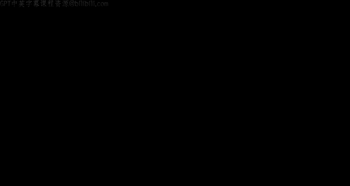
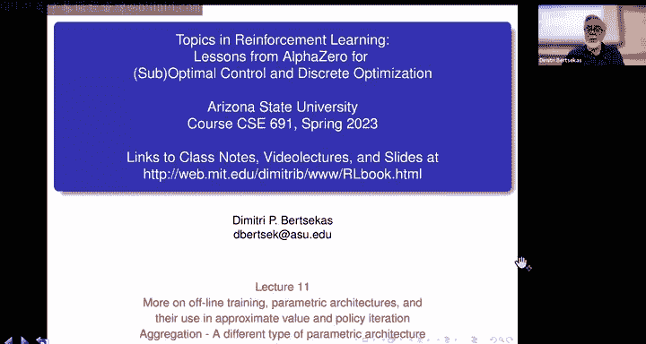

# 24：离线训练回顾、近似与聚合 🧠

在本节课中，我们将回顾离线训练和参数化架构（如神经网络）的核心概念，并探讨如何将这些架构用于近似值迭代和策略迭代。我们还将介绍一种不同的参数化架构——聚合，特别是基于代表性状态的聚合方法，并讨论其相关特性和挑战。

---

## 回顾：离线训练与参数化架构

在之前的课程中，我们讨论了离线训练、近似架构和神经网络。本节我们将回顾这些内容，并看看这些架构如何在训练和近似值迭代的背景下使用。

### 近似值空间与单步前瞻

考虑一个熟悉的场景：在给定状态 \(X_k\) 下，我们通过一步前瞻来近似值空间。我们最小化两个部分的和：即时单步成本以及由近似成本函数 \(\tilde{J}\) 表示的未来成本。

我们可能使用这些近似值作为期望值的近似。我们一直专注于构建后验观测的方法，上次我们研究了参数化架构、神经网络，而导航也符合这个框架。

还有多步前瞻的对应图，我们已经讨论过。

在强化学习中，我们使用两种类型的参数化架构：
1.  近似成本函数，如成本函数、策略、Q因子或最优成本函数。
2.  近似策略空间。

这两种方法的微软实现非常相似。基于分类算法的策略空间近似有更多选择，但除此之外方法类似。在本图中，我们考虑要近似的目标成本函数是一个成本函数 \(J(x)\) 的情况。

### 训练过程

我们收集训练数据，生成大量状态 \(x^1, ..., x^q\) 以及这些状态下目标成本函数的对应值（可能带有一些误差）。我们将这些数据输入一个算法，该算法选择一个依赖于参数 \(r\) 的函数 \(\tilde{J}\) 来近似 \(J(x)\)。生成此函数并找到参数 \(r\) 的过程就是训练算法。

训练可以通过专门的优化软件完成，如梯度类方法、最小二乘法、神经网络软件等。

因此，我们生成训练数据并运行优化算法，将参数化类中的近似函数与数据匹配。这是一个通用思路。

### 参数化函数类

更具体地说，我们选择一个依赖于状态和参数向量 \(r\) 的参数化函数类，其中 \(r\) 包含有限数量的可调参数。我们调整这个向量来改变 \(\tilde{J}\) 的形状，以匹配来自目标函数的训练数据。

根据 \(\tilde{J}\) 是线性还是非线性，架构分为线性或非线性。

### 基于特征的架构

如果架构通过特征向量 \(\phi(x)\) 依赖于 \(x\)，从而捕捉 \(x\) 的主要特征，则称为基于特征的架构。这意味着 \(\tilde{J}\) 的函数形式依赖于 \(\phi\)。直观的想法是，特征可以捕捉成本函数中的主要非线性。在许多情况下，我们可以使用一个线性的 \(\tilde{J}\)（在 \(\phi\) 上线性），所有的非线性都来自这些可能复杂的特征。

线性特征基架构是一个重要的类别，它相对容易训练，并具有以下形式：
\[
\tilde{J}(x, r) = \sum_{\ell=1}^{m} r_\ell \phi_\ell(x) = r' \phi(x)
\]
其中，向量 \(r\) 是 \(m\) 个分量的集合，这些分量进入上述方程。这里看到的是 \(r\) 和特征向量 \(\phi(x)\) 的内积。

### 线性特征基架构示意图

对于给定状态，它从状态中提取特征，形成特征向量 \(\phi(x)\)。这些特征根据上述表达式进行线性加权，系数是训练的结果。因此，给定 \(x\) 和训练结果，我们以这种方式获得目标函数的线性成本函数近似。

### 神经网络架构

对于基于特征的架构，我们需要能够构建特定问题的特征。有时这些特征不明显。神经网络的好处在于它们基于数据为我们构建特征。

对于一个简单的仅包含一层的神经网络，其示意图如下：给定状态 \(x\)，它输出该状态成本的近似值。这是通过将状态 \(x\) 编码成适合神经网络的某种形式（例如坐标，也可能包含一些特定问题的特征）来实现的。这个编码 \(y(x)\) 通过一个线性层，其中矩阵 \(A\) 和向量 \(b\) 包含可训练参数。线性层的输出是一个向量，该向量通过一组非线性单元，产生 \(m\) 个依赖于 \(x\) 和可调参数（线性层的参数）的特征。然后这些特征用参数 \(r\)（神经网络参数向量的一部分）加权，得到目标函数 \(J(x)\) 的成本近似值。

### 训练问题

训练问题首先包括收集训练数据：一组状态-成本对 \((x^s, \beta^s)\)，其中 \(x^s\) 是数据集中第 \(s\) 个分量的状态，\(\beta^s\) 是 \(x^s\) 处对应成本的样本。然后我们解决一个训练问题，通常是一个最小二乘最小化问题：
\[
\min_{A, b, r} \sum_{s=1}^{q} (\beta^s - \tilde{J}(x^s, A, b, r))^2
\]
其中 \(\beta^s\) 是目标函数的样本值，\(\tilde{J}\) 是神经网络的输出，涉及系数 \(r\)、矩阵 \(A\)、向量 \(b\)（所有这些都是可最小化的参数）以及 \(m\) 个特征。从这组非线性单元中出来的特征是 \(\sigma\)，它依赖于线性层输出的每个分量。

这个优化问题非常复杂，而且规模可能很大，因为它涉及大量数据点（求和的项很多）。传统的优化方法（如标准梯度法、牛顿法）效果不佳。然而，增量方法的发现改变了这一局面，这些方法一次处理一个数据点（也称为反向传播方法）。使用某种增量方法至关重要，这方面有很多研究，并且针对特定应用有更好的方法。

### 神经网络的重要特性

这里有两个重要的通用特性：
1.  **神经网络的通用近似性质**：该性质表明，只要有足够大的层（即使是只有一层），我们就可以近似任何感兴趣的目标函数。这个性质已知已有大约40年甚至更久。
2.  **深度神经网络的优势**：最近的研究发现，涉及许多层（不止一层）的深度神经网络具有重要优势。最近的研究将神经网络的优势与过参数化联系起来。过参数化意味着参数数量远多于数据点数量。事实证明，过参数化不仅有助于提供与数据集良好匹配的参数，而且还有助于在数据集之外表现良好（即在该领域常说的良好泛化特性）。过去5到10年，这个领域有很多有趣的理论研究。

以上是对我们上一讲内容的简要总结。现在，我们想看看这些架构如何在动态规划问题的关键背景下工作。

---

## 有限时域问题中的近似

首先，我们来看有限时域问题，并尝试近似动态规划算法。我们顺序地近似从最后阶段开始向后进行的 \(N\) 步动态规划算法，每一步都提供一个近似（神经网络近似或其他近似）。这也称为拟合值迭代，是文献中常见的名称。

### 拟合值迭代过程

这是一个顺序近似过程，从最后阶段开始向后进行到第一阶段。我们训练成本近似 \(\tilde{J}_N, \tilde{J}_{N-1}, ..., \tilde{J}_0\) 来代替最优成本函数 \(J_N^*, J_{N-1}^*, ..., J_0^*\)（即最优成本问题）。我们向后顺序进行，类似于动态规划算法，在每一步都进行近似。

我们从 \(\tilde{J}_N\) 开始，令其等于终端成本 \(g_N\)（终端成本函数）。给定第 \(k+1\) 步的近似 \(\tilde{J}_{k+1}\)，我们使用一步前瞻来构建大量数据对（状态-成本对）\((x_k^s, \beta_k^s)\)，其中 \(\beta_k^s\) 是用近似 \(\tilde{J}\) 代替 \(J^*\) 后的动态规划算法右侧表达式。

我们以某种方式选取大量数据点状态（例如10万、100万或更多），使其在状态空间内适当平衡和分布。对于每一个状态，我们进行这里的计算并形成这个数据集。这为我们提供了训练集，通过它我们训练一个参数化架构 \(\tilde{J}_k\)。

给定 \(\tilde{J}_k\) 后，我们做类似的事情，获取数据并训练 \(\tilde{J}_{k-1}, \tilde{J}_{k-2}\)，一直向后到 \(\tilde{J}_0\)。

### 计算挑战

这里有一个令人不快的点：每一个样本 \(\beta_k^s\) 的计算都涉及一个期望值的最小化。这可能是一项相当艰巨的计算。期望值可能计算量很大，而且你必须为每个控制进行计算，所有这些只是为了获得一个单一的数据点。因此，这可能是一项实质性的计算。当然，如果是确定性问题的情形会好一些（这里没有期望值），并且如果你的控制相对较少（与控制数量庞大的情况相比）。

无论如何，假设我们必须计算那个数据集，那么我们要做的就是最小化目标函数的参数（可能还会添加一些正则化项），并且通常我们使用增量方法来解决这个优化问题。

### 在线应用

训练完这些近似之后，在线应用时使用的正是与这里相同的最小化。因此，本质上，用于训练的软件与用于在线应用的软件是相同的。通过这种方式，我们获得了牛顿步长解释的好处，从而获得了良好的性能。

另一方面，问题是我之前提到的困难：期望值的最小化使样本收集复杂化，使得数据集的构建更加困难。

---

## 基于Q因子的拟合值迭代

这是实现相同想法（拟合值迭代）的另一种方式，但我们将使用Q因子而不是成本，我们将拟合Q因子，近似Q因子。

### 过程

我们引入一个依赖于状态和控制以及参数 \(r\) 的参数化架构 \(\tilde{Q}(x_k, u_k, r_k)\)。我们记得在有限时域动态规划中，我们可以用最优成本或最优Q因子来表述算法。用Q因子表述的算法看起来类似，只是起点不同。

如果我们想通过近似进行向后迭代，这就是我们在每一步必须进行的那种近似。给定 \(\tilde{Q}_{k+1}\)，我们希望将 \(\tilde{Q}_k\) 与来自此计算的数据匹配。

因此，我们计算 \(\tilde{Q}(x_k, u_k, r_k)\) 对于许多三元组 \((x_k, u_k, \beta_k)\)，其中 \(\beta_k\) 是这个期望值的样本。

### 关键优势：采样

这里“样本”这个词很重要。我们不需要计算精确的期望值（这可能计算量很大），只需要这个期望值的样本就足够了。这是一个数学上的技巧。

相对于上一张幻灯片的方法，期望和最小化的顺序被颠倒了。之前是期望值的最小化，而这里是最小化的期望值。期望值的最小化无法用采样很好地近似，然而，最小化的期望值可以用仅仅几个样本来近似。

因此，对于这个 \(\beta_k^s\)，我们不需要计算完整的期望值，取一个样本、五个样本、五十个样本就足够了，将其扔进相同的最小二乘优化中，它就能工作，这是此处数学的本质。

### 模型无关的另一个优势

这种方法基于Q因子的另一个优势是：这里的随机样本可以以模型无关的方式获得。我们不需要成本的封闭形式表达式，也不需要概率的数学模型。我们需要一个计算机模型（某种模块），否则我们无法进行。但主要区别是我们不需要一个解析模型。有一个计算机模型就足够了，这就是模型无关的含义。这并不意味着你完全不用担心模型，你必须有一个计算机模拟器，可以生成这种形式的样本：给定 \(x_k\) 和 \(u_k\)，你可以生成第一阶段成本的随机样本以及下一个状态的对应样本。因此，你需要的是一个黑箱：输入 \(x\) 和 \(u\)，输出 \(g\) 和 \(x_{k+1}\)，你不需要概率分布或其他任何公式。

### 在线控制

收集完这个数据集并进行训练（通过增量方法或其他方法）之后，我们可以通过以下方式在线获得一步前瞻控制：
\[
\tilde{\mu}_k(x_k) \in \arg\min_{u_k \in U(x_k)} \tilde{Q}_k(x_k, u_k, r_k)
\]
不需要模型或期望值计算。训练好的Q因子，我们在状态 \(x\) 处对所有Q因子进行最小化，得到在训练完成后要应用的控制。这是一个重要的优势，在线计算被简化了。我们有一个神经网络（或其他近似架构），我们输入当前状态，它输出所有Q因子，然后我们可能通过暴力搜索来最小化这些Q因子。

### 潜在缺点

另一方面，如果你近似Q因子，牛顿步长性质就丢失了。你没有进行涉及期望值等的适当最小化。

此外，如果你用某些问题数据训练后，问题数据发生了变化（例如在自适应控制中），那么你需要进行在线重新规划。但当涉及到在线规划时，这是一个不好的最小化对象，因为它是在特定模型上训练的。如果你改变了模型参数，那么使用与当前模型不匹配的近似控制可能会非常糟糕。

### 解决方案：值空间近似

如何解决这些问题需要更多的工作，这项工作涉及值空间近似，使用由数学模型或计算机模型提供的成本近似和适当的分布。因此，你使用值空间近似，并通过这个最小化来计算 \(\tilde{J}\)。你可以通过训练（也许是离线训练）从这个 \(\tilde{Q}\) 中提取出 \(\tilde{J}\)，或者也可以在线计算（如果可用）。通过这种方式，牛顿步长性质得以恢复，并且该方案对在线和重新规划中的微小变化具有弹性，你仍然使用模拟器来计算正确的成本函数和状态转移。

这些是在使用离线训练动态规划时的重要问题。

---

## 近似Q因子还是Q因子差？

这个议题很重要，我敦促你尝试理解它，课堂笔记中也有解释。

我们应该近似Q因子还是不同控制之间的Q因子差？我们在讨论方差缩减时曾触及这个问题。我们说过需要关注Q因子差，并将方差缩减的目标对准Q因子差。现在我们要在稍微不同的背景下看这个问题。

### 示例：比例失调问题

假设我们近似Q因子。可能发生问题的一个例子是：假设你有一个标量系统，其每阶段成本很小。考虑一个连续时间问题的离散化，涉及简单的微分方程 \(\dot{x} = u\)。如果我们离散化这个方程，标准的离散化会得到这个离散时间方程，其中 \(\delta\) 是离散化间隔，通常你希望 \(\delta\) 非常小。从 \(t\) 到 \(t+\delta\) 的对应阶段成本是与 \(\delta\) 成比例的某个量（例如二次型）。这是一个实践中非常常见的问题类别：连续时间问题，我们将其离散化。如果你想忠实地离散化，你必须取非常小的 \(\delta\)。这是一个线性二次型问题，也可以封闭形式求解。

考虑一个线性策略 \(\mu\)，它应用于 \(x\)，产生 \(-2x\)（仅为例）。其成本函数可以用我们讲过的标准公式计算。如果你进行这个计算，你会得到这个公式。这是 \(J_\mu\) 的精确形式。正如你所料，在线性二次型问题中，线性策略的成本函数是二次的。如果你看 \(\delta\) 如何进入方程，有一项不依赖于 \(\delta\)，有一项线性依赖于 \(\delta\)，还有其他项是 \(\delta\) 的二次方。对于小的 \(\delta\)，不依赖于 \(\delta\) 的项占主导。然而，每阶段成本与 \(\delta\) 成比例。所以当你进行近似时，当你构建Q因子时，Q因子涉及 \(J_\mu\) 和第一阶段成本的和。对应的Q因子可以这样计算。我们在这里加上对应于 \(u^2\) 本身的二次项。因此，Q因子包含一个巨大的项（不依赖于 \(u\) 的部分），一个涉及 \(x\) 和 \(u\) 的小项，以及一个不重要的平方项。所以Q因子包含比例失调的项，而公式中重要的部分（依赖于 \(u\) 的部分）在数量级上被这个巨大的项淹没了。因此，策略改进的重要部分是依赖于 \(u\) 的部分。另一方面，如果你用某个 \(\tilde{Q}\) 来近似这个，近似将试图捕捉这个巨大的项，而重要的部分可能会在噪声中消失。所以当你试图近似这个东西时，你会得到无意义的结果。

### 解决方案：近似Q因子差

另一方面，如果你近似两个控制 \(u\) 和 \(u'\) 之间的Q因子差，那么这个巨大的项就被减去了。所以你近似的是正确的东西，重要的东西。比例失调项的问题就不会出现。

因此，你会看到很多关于优势更新或使用基线的文献，其中你减去一些主导项以使训练更好一些。这个例子代表了在这种背景下的困难。

### 一般背景下的基线与优势更新

让我在更一般的背景下暂停一下这个讨论。正如我所说，这个领域有很多文献和很多技巧。加入巨大的影响或差异近似。

对于Q因子计算中一般性的比例失调项，补救办法通常是减去状态依赖的常数（我们在文献中称之为基线）。基线的使用也出现在一般的机器学习中。共识是，近似应该以某种方式抵消这些失调项，在某种意义上消除它们。

让我在这里举个例子：假设你使用截断 rollout 和一个策略 \(\mu\) 以及某个终端成本函数近似。因此，成本结构近似大致接近策略 \(\mu\) 的成本。在值空间近似中，我们最小化这个表达式。问题是如何处理 \(g\) 相对于 \(\tilde{J}\) 很小的情况。在截断 rollout 中，存在近似，如果 \(g\) 很小，它将在混乱中丢失。什么时候 \(g\) 会相对于 \(\tilde{J}\) 很小？当我们离散化连续时间系统时就会发生这种情况，但还有其他情况。有时成本是稀疏的，或者称为稀疏奖励。换句话说，大部分成本发生在时域末端，而中间的成本是0或非常小。那么中间成本就是 \(g\)。如果这是零，那么一切都依赖于 \(\tilde{J}\)，如果你没有正确近似 \(\tilde{J}\)，你将会陷入大麻烦。\(g\) 无关紧要。

### 补救措施

这里的一个补救措施是从 \(\tilde{J}\) 中减去一个基线，并使用差值进行训练。例如，使用 \(J_\mu(x) - J_\mu(x')\)，这是当前状态和下一状态之间的成本差，而不是用下一状态的成本进行训练。因此，我们用成本差进行训练，而不是用成本本身进行训练。

另一种方法是优势更新，我们处理相对Q因子，并从普通Q因子中减去一个状态依赖的基线（即最小Q因子）。所以我们近似优势（Q因子差），而不是Q因子本身。

这里涉及很多技巧，我只是让你对这个议题有所认识，我敦促你更仔细地查看笔记和其他文献。

以上是针对有限时域的。有限时域的许多内容也适用于无限时域情况，但在无限时域中，我们还有近似策略迭代的重要方法。近似策略迭代主要用于无限时域问题。

---

## 近似策略迭代

现在让我们看看在策略迭代背景下使用近似。有任何问题吗？好的，这是新的总结回顾。

让我们看看精确策略迭代，我们已经深入研究过，但在课程中多个地方（包括一开始讨论AlphaZero时）都触及过。

### 精确策略迭代

当涉及到策略迭代的计算时，我们更喜欢使用有限状态转移概率表示法，因为通常系统涉及有限状态空间。

精确策略迭代包括两个步骤：每个迭代涉及一个策略评估阶段，我们计算成本函数 \(J_\mu\) 及其Q因子（考虑到第一阶段后的期望成本）。策略评估给出Q因子（这里的表达式），然后我们通过在每个状态最小化Q因子来获得新策略，在每个状态获得一个控制，这就是新策略。这是精确的，