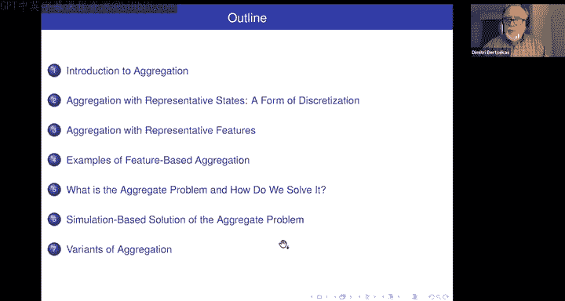
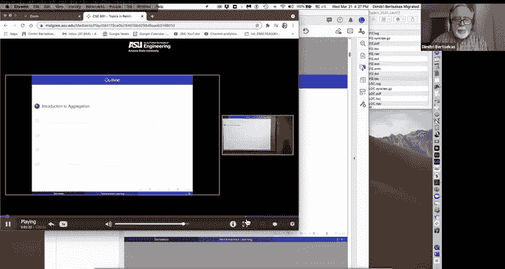
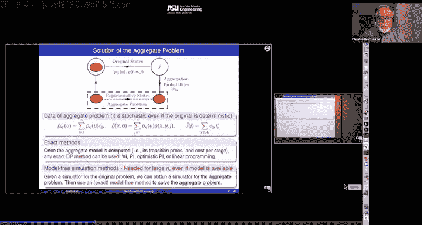
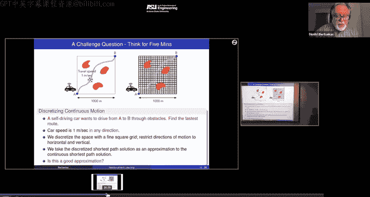
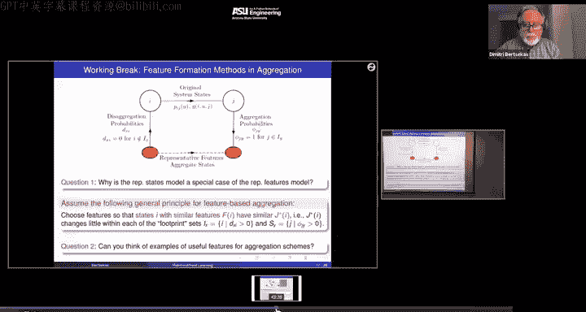
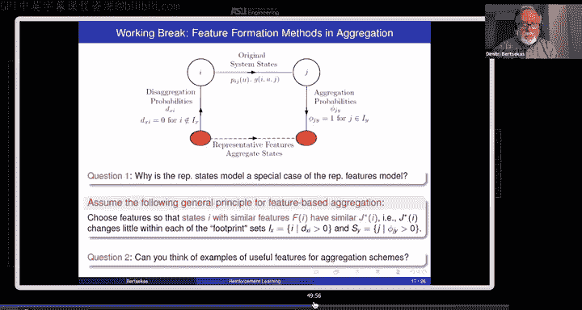
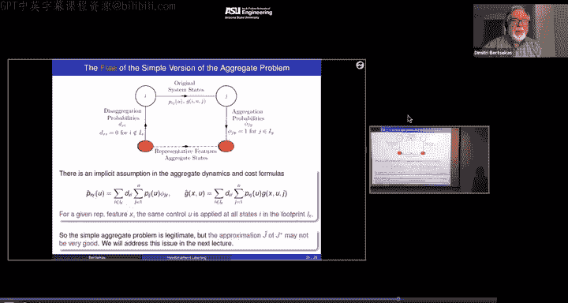
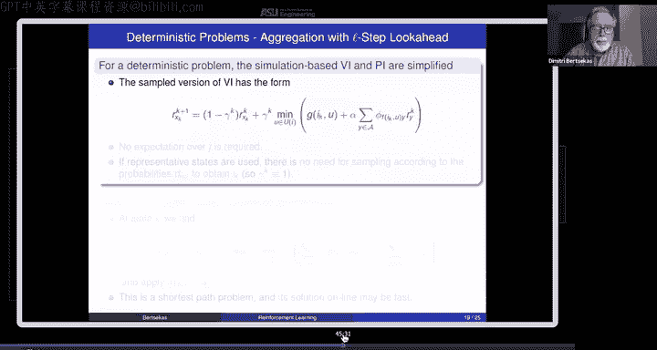
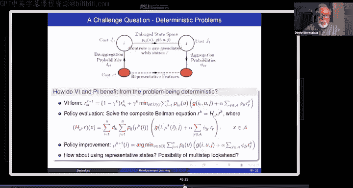
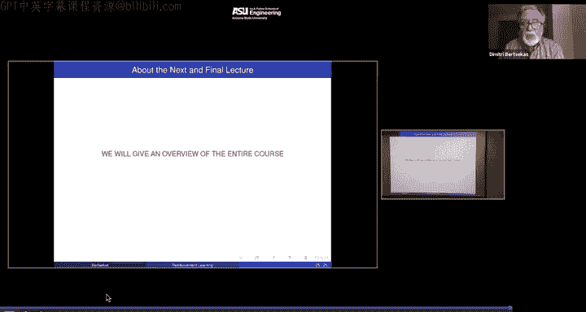

# 25：聚合方法与近似 🧩

## 概述

在本节课中，我们将学习强化学习中的**聚合方法**。这是一种基于值空间近似的技术，但在许多方面与我们之前见过的其他近似方法有所不同。我们将探讨聚合的本质、其基本形式（如代表性状态）、更一般的基于特征的聚合，以及如何构建和求解聚合问题。

---

## 聚合方法简介

聚合方法是一种**问题近似**形式。它通过将原始的高维动态规划问题近似为一个更小、更易处理的低维版本，然后精确求解这个简化问题，从而得到近似的未来成本函数 `J̃`。

它也与**参数化近似**相关，因为我们将看到，聚合产生的 `J̃` 可以被视为基于特征的近似。一个主要的特例是当 `J̃` 是分段常数函数时，这可以看作是使用0-1成员函数作为特征的基于特征的近似。

聚合可以与参数化近似（如神经网络）结合使用，例如，用神经网络为基于特征的聚合提供特征，或者在神经网络得到的 `J̃` 基础上添加局部参数化修正。

---

## 代表性状态聚合

上一节我们介绍了聚合的基本概念，本节中我们来看看一种简单的聚合形式：**代表性状态聚合**。

其核心思想是：对于一个可能很大的状态空间（例如，精细网格上的点），我们选择一个更小的、更粗糙的**代表性状态**子集（例如，粗网格上的点）。然后，我们基于这些代表性状态构建一个近似的、规模更小的动态规划问题。

### 构建聚合问题

为了构建聚合问题，我们需要定义代表性状态之间的转移概率和成本。这通过引入**聚合概率** `φ` 来实现。

*   **状态约定**：原始系统状态用 `i` 和 `j` 表示。聚合（代表性）状态用 `x` 和 `y` 表示。
*   **聚合概率 `φ`**：对于每个原始状态 `j` 和每个聚合状态 `y`，`φ_{jy}` 是一个非负权重，表示 `j` 与 `y` 的“关联程度”。通常要求对于每个 `j`，`∑_y φ_{jy} = 1`。在几何问题中，`φ` 可以基于距离或邻近关系来定义。
*   **聚合动态**：从聚合状态 `x`（在控制 `u` 下）转移到聚合状态 `y` 的概率，是通过考虑从 `x` 可能到达的所有原始后继状态 `j`，并乘以 `j` 与 `y` 的聚合概率来计算的。公式如下：
    `p_{xy}(u) = ∑_j p_{xj}(u) φ_{jy}`
*   **聚合成本**：从聚合状态 `x` 应用控制 `u` 的期望阶段成本，是对所有可能后继状态 `j` 的成本进行平均：
    `g̃(x, u) = ∑_j p_{xj}(u) g(x, u, j)`

基于上述定义的 `p_{xy}(u)` 和 `g̃(x, u)`，我们就得到了一个完整的、状态空间更小的**聚合马尔可夫决策过程**。

### 求解与扩展

求解这个聚合MDP（例如，使用值迭代、策略迭代），我们可以得到每个代表性状态 `x` 的最优成本 `r*(x)`。

为了得到原始所有状态 `i` 的近似成本 `J̃(i)`，我们使用聚合概率进行插值：
`J̃(i) = ∑_x φ_{ix} r*(x)`

在 `φ_{ix}` 为0或1的特殊情况下（即每个原始状态只严格属于一个代表性状态），`J̃` 是**分段常数**的：在每个“足迹”集（映射到同一代表性状态的所有原始状态的集合）内，`J̃` 取值为该代表性状态的最优成本 `r*(x)`。

### 误差界限与启示

对于分段常数近似，存在一个误差界限。如果 `J*`（真实最优成本函数）在每个足迹集内的最大变化为 `ε`，那么近似误差满足：
`max_i |J̃(i) - J*(i)| ≤ ε / (1 - α)`
其中 `α` 是折扣因子。

这个界限的**定性启示**是：为了使聚合近似效果好，我们应该选择代表性状态（或定义聚合概率），使得**真实最优成本函数 `J*` 在每个足迹集内部变化不大**。如果 `J*` 本身就是分段常数的，那么聚合方法就能精确地找到它。

---

## 基于特征的聚合

代表性状态聚合的一个难点在于，很难先验地知道如何选择一组合适的代表性状态。如果 `J*` 在某些区域变化剧烈，而在其他区域平缓，均匀的离散化可能效率低下。

本节我们将聚合思想推广到更强大的**基于特征的聚合**框架。

我们不再直接对状态空间进行离散化，而是对一个**特征空间**进行离散化。假设我们有一个特征提取映射 `F`，将原始状态 `i` 映射到特征向量 `F(i)`。我们在特征空间中选取一组**代表性特征** `x`。

*   **关联状态与特征**：对于每个代表性特征 `x`，我们定义一组与之关联的原始状态（其特征值在 `x` 的邻域内）。我们引入**解聚概率** `d_{ix}`，表示原始状态 `i` 与代表性特征 `x` 的关联强度（`∑_x d_{ix} = 1`）。
*   **构建聚合问题**：与代表性状态聚合类似，我们利用原始MDP的转移概率、成本函数、以及聚合概率 `φ`、解聚概率 `d`，来构建一个状态为代表性特征 `x` 的聚合MDP。其转移概率和成本涉及对原始状态和特征的双重期望。
*   **求解与插值**：求解此聚合MDP得到 `r*(x)`，然后通过 `J̃(i) = ∑_x φ_{ix} r*(x)` 插值得到原始状态的近似成本。

代表性状态聚合是此框架的一个特例（此时特征就是状态本身）。

### 特征选择策略

基于误差界限的启示，我们应该选择特征映射 `F`，使得**具有相似特征的状态具有相似的最优成本 `J*`**。

以下是一些实用的特征构造方法：
*   **评分函数**：使用一个对 `J*` 的近似函数 `V`（例如，某个启发式策略的成本函数、神经网络初步训练的结果）。将 `V` 的值域划分为若干区间，每个区间对应一个代表性特征。状态 `i` 的特征就是 `V(i)` 所属的区间索引。
*   **神经网络特征**：深度神经网络的隐藏层输出可以作为高度提炼的特征。我们可以对这些特征空间进行采样或离散化来获得代表性特征。
*   **多评分函数**：结合多个评分函数可以捕捉更复杂的 `J*` 结构。

基于特征的聚合可以看作是** rollout 方法的更复杂形式**。Rollout 使用一个基础策略的成本函数 `J_μ` 来近似 `J*`，并旨在改进策略。而聚合使用（例如）`J_μ` 作为评分函数来构建特征，然后求解聚合问题，其目标是直接近似 `J*`，潜力更大，但计算量也更大。

---

## 聚合问题的求解方法

我们构建的聚合MDP本身是一个标准的（但可能仍是随机的）MDP，可以用任何精确方法求解。然而，当原始状态空间极大时，计算聚合问题中的期望（涉及对大量状态的求和）可能非常昂贵。

### 基于仿真的方法

如果我们有一个原始问题的仿真器，我们可以自然地得到一个聚合问题的仿真器。这使我们能够使用**无模型（基于仿真）的方法**来求解聚合问题。

1.  **值迭代的采样版本**：我们可以使用随机近似算法。在每次迭代 `k`，随机选取一个代表性特征 `x_k`，从其关联状态中按解聚概率采样一个状态 `i_k`，然后根据贝尔曼方程更新 `r(x_k)` 的估计值，并使用递减的步长 `γ_k`。在技术性条件下，此算法能收敛到 `r*`。
2.  **策略迭代**：对于聚合问题，策略迭代通常更稳定。
    *   **策略评估**：对于固定策略 `μ`，聚合贝尔曼方程变为一个关于 `r` 的线性方程组 `r = A_μ r + b_μ`。矩阵 `A_μ` 和向量 `b_μ` 中的每个元素都可以通过蒙特卡洛仿真独立估计。然后可以通过矩阵求逆（或迭代法）求解 `r_μ`。注意，当折扣因子 `α` 接近1时，矩阵 `(I - A_μ)` 可能病态，需要小心处理仿真噪声。
    *   **策略改进**：利用评估得到的 `r_μ`，通过一步前瞻最小化来更新策略：`μ'(i) = argmin_u [ g(i, u) + α ∑_j p_{ij}(u) J̃(j) ]`，其中 `J̃(j) = ∑_x φ_{jx} r_μ(x)`。

对于**确定性**问题，这些算法可以大大简化，因为不需要对内部期望进行采样，计算效率更高。

---

## 聚合的变体

### 偏置聚合

如果我们已经有一个对 `J*` 较好的近似 `V`（例如，来自一个启发式方法或神经网络的初步输出），我们可以使用聚合来**修正 `V`**，而不是从零开始近似 `J*`。

其思想是修改聚合问题的成本结构，将 `V` 的影响融入其中。最终得到的近似为 `J̃ = V + 修正项`。如果 `V` 本身就很接近 `J*`，那么聚合只需要学习一个小的修正，从而可能更高效、更准确。

当代表性特征只有一个时，偏置聚合退化为标准的 **rollout 算法**。因此，具有多个代表性特征的偏置聚合可以看作是更强大、更通用的 rollout 推广。

### 时空聚合

这是一种同时压缩状态空间和时间维度的强大思想，特别适用于大规模确定性最短路径问题。

*   **思想**：在状态-时间图中引入一系列“屏障”，这些屏障由代表性状态-时间对组成，任何从起点到终点的路径都必须穿过每个屏障。我们将原问题分解为多个较短的子问题（屏障间的最短路径计算），然后将这些子问题的解（最短距离）作为新构建的、低维的“主问题”的弧成本。最后求解这个主问题（同样是一个最短路径问题，但规模小得多）。
*   **示例**：从波士顿到旧金山的自驾路线规划。我们可以选择几个主要城市作为中途点（空间屏障），并大致规划每天到达哪个区域（时间屏障）。先优化城市间的粗略路线，再详细优化每段城市间的具体路径。
*   **与选项（Options）的关系**：时空聚合在精神上与分层强化学习中的“选项”概念有联系，但通常基于确定性的、基于最短路径的框架，可能更易于理解和实现。

---

## 总结

本节课我们一起学习了强化学习中的**聚合方法**。我们从最简单的**代表性状态聚合**开始，理解了如何通过构建一个更小的聚合MDP来近似原始问题，并通过插值获得全局近似。

接着，我们将其推广到更灵活的**基于特征的聚合**，它允许我们利用问题领域的知识或从神经网络中提取的特征，来更智能地对状态空间进行分组。

我们探讨了求解聚合问题的**基于仿真的方法**，包括值迭代和策略迭代的采样版本，并指出了确定性情况下的计算优势。

最后，我们介绍了两种高级变体：**偏置聚合**（利用先验近似进行修正）和**时空聚合**（同时压缩状态和时间，用于解决大规模规划问题）。

聚合方法提供了一个强大而通用的近似框架，能够与神经网络、rollout等其他技术结合，为解决复杂的序列决策问题提供了丰富的工具箱。