# 26：强化学习课程总览与讨论  🎓

在本节课中，我们将对ASU《强化学习2022-2024》课程的全部内容进行回顾和总结。我们将按照课程讲授的顺序，梳理从AlphaZero到近似动态规划、策略迭代、多智能体问题等核心主题，并探讨其内在联系与广泛应用。

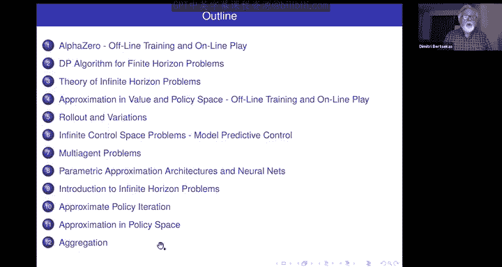

---

## 🚀 从AlphaZero出发：动机与应用

我们以AlphaZero这一令人惊叹的程序作为课程的起点。它不仅是强大的应用实例，也为我们理解更广泛的方法论提供了动机。AlphaZero涉及两种核心算法：一种是**离线训练过程**，程序通过此过程学习如何对弈；另一种是**在线对弈算法**，程序使用此算法与真实对手（或计算机对手）对抗。

这两种算法与动态规划中的基础算法紧密相关。我们首先讨论了有限时域问题的动态规划，然后总结了无限时域问题的理论，并后续进行了更详细的探讨。我们讨论了近似动态规划中价值空间和策略空间的近似思想，以及这些思想如何与离线训练和在线对弈相联系。

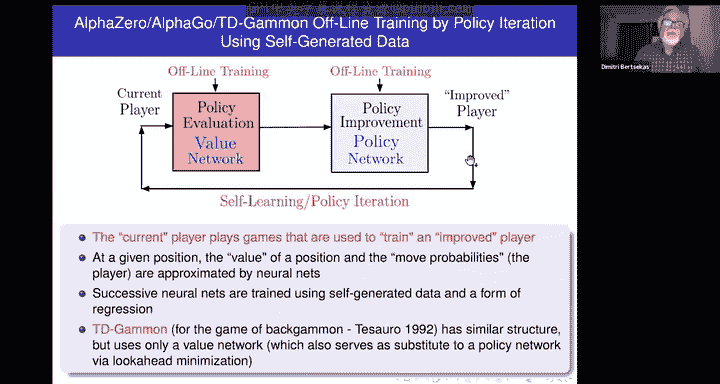

---

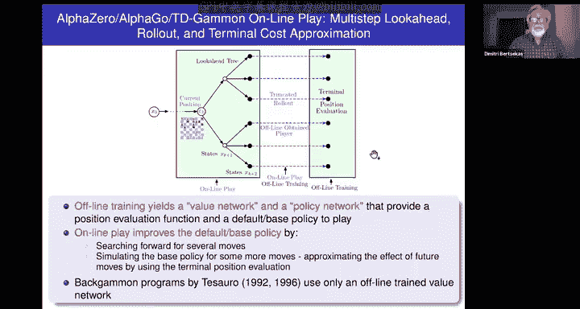

## 🔄 动态规划基础：有限与无限时域

上一节我们以AlphaZero引出了动态规划的思想，本节中我们来看看其数学基础。

我们的基本数学模型涉及一个动态系统，其状态在时间k为 `x_k`，系统从时间0运行到时间N（有限时域）。控制输入为 `u_k`，`w_k` 是具有给定概率分布的随机扰动（对于确定性问题，则没有随机扰动）。根据状态转移方程从 `x_k` 转移到 `x_{k+1}` 会产生成本，由于 `w_k` 的存在，该成本是随机的。整个N步系统轨迹的总成本是各阶段成本与终端成本之和。由于 `w_k` 是随机的，我们取该总成本的期望值，并希望最小化这个期望值。

我们寻找**策略**，即一系列状态函数。每个 `μ_k` 是一个闭环控制律，是 `x_k` 的函数。对于给定的策略，其成本由上述期望值给出，它是初始状态的函数。我们希望找到在所有策略中使成本函数最小的**最优策略**。

解决此问题的动态规划算法可以精确地产生从状态 `x_k` 开始的尾部子问题的最优成本 `J_k^*(x_k)`。该算法从终端成本 `J_N^*` 开始反向递推计算 `J_k^*`。当从N反向计算到0时，我们在时间0得到最优成本 `J_0^*`，根据定义，这就是从初始状态 `x_0` 开始的最优成本。

一旦我们完成了这个算法（这通常计算量巨大）并获得了这些最优成本函数 `J_k^*`，我们就可以在线运行时，通过观察当前状态 `x_k`，并最小化涉及当前阶段成本与从下一状态出发的最优成本之和的表达式，来生成控制输入 `u_k`。

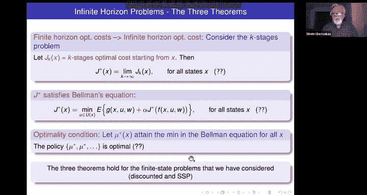

然而，问题在于精确计算 `J^*` 非常困难，这是主要障碍。此外，计算期望值和执行最小化也可能非常耗时。这些基本问题阻碍了精确动态规划成为一种通用、广泛有用的工具。

为了使动态规划成为一种易于处理、有用的方法，我们必须引入**近似**。主要的近似方法是用某个 `J̃` 来替换难以计算的 `J^*`。我们详细讨论了多种计算 `J̃_k` 的方法。在随机问题中，可能还需要近似这里的期望值计算。最小化控制输入 `u` 的过程（我们称之为三种近似）也需要处理。幸运的是，这三种近似可以或多或少地独立处理。

值得注意的是，即使在算法的精确版本中，**离线训练**（以获得 `J^*`）和**在线对弈/实时实现**（以获得 `u_k^*`）的概念区别也存在，并且在我们看到的近似方法中得以延续。

---

## ♾️ 无限时域问题：理论与算法

有限时域问题的处理方法可以扩展到无限时域问题。基本思想相同，但数学上更为复杂。

一般来说，在无限时域问题中，我们关注三个基本定理。第一个定理涉及有限时域最优成本是否随着时域趋于无穷而收敛到无限时域最优成本。第二个定理是贝尔曼方程，最优成本函数 `J^*` 满足该方程。第三个是最优性条件，即一旦通过最小化贝尔曼方程找到了 `J^*`，就可以获得最优策略。对于我们所考虑的有限状态折扣问题和随机最短路问题，在这些假设下，这些定理成立。

基于此理论，我们有几个基本算法，其中最重要的是**值迭代**和**策略迭代**。

值迭代从一个任意的初始成本函数 `J_0` 开始，根据贝尔曼算子不断迭代更新，生成一个序列 `{J_k}`，该序列收敛到 `J^*`。

策略迭代算法是我们使用最多的算法。它不是生成成本函数序列，而是生成**策略序列**。它从一个任意的初始策略开始，通过两个步骤生成新策略：**策略评估**（计算当前策略的成本函数）和**策略改进**（使用一步前瞻最小化计算改进的策略）。这个精确形式的算法在有限次迭代内收敛，速度很快，并且可以看作是求解贝尔曼方程的牛顿法。

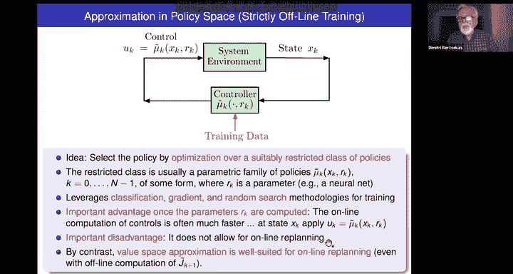

**Rollout** 可以看作是策略迭代的**第一次迭代**。完整的策略迭代需要大量计算，而Rollout则简单得多。然而，它仍然是一个牛顿迭代，这使得它非常高效，通常能显著改进基础策略的性能。

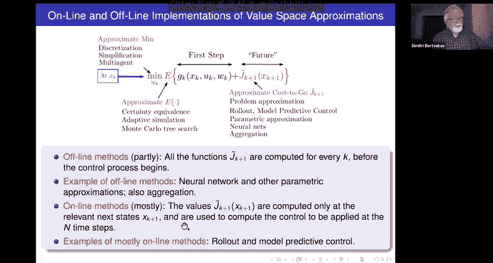

---

## 🛠️ 近似动态规划：价值空间与策略空间

我们讨论了策略迭代的近似版本，这是本课程的核心。我们生成一个策略序列：从一个称为基础策略的当前策略出发，我们生成大量关于其性能的数据，用一个价值网络（近似策略的成本函数）来表示，这完成了近似策略评估；然后我们通过策略改进过程生成策略数据，并用一个策略网络表示新策略。如此反复，使用价值和策略网络（可能是神经网络）进行近似。重要的是，这是**离线训练**，可能需要训练数小时、数天甚至数周，然后获得的数据用于在线对弈。

Rollout只是策略迭代的第一次迭代，并且可以以在线对弈的方式完成。Rollout通常能显著改进基础策略，因为它应用了牛顿法。

现在，让我们看看一般意义上的价值和策略空间近似，而不仅仅是策略迭代。

### 价值空间近似

价值空间近似涉及在线对弈（在离线训练之后）。在给定状态 `x_k`，它通过最小化涉及当前阶段成本和由近似值 `J̃` 表示的未来成本的表达式来生成控制。这里有三种近似：最重要的近似是 `J̃`，它主要通过离线训练获得。其他近似包括处理期望值计算和最小化过程。

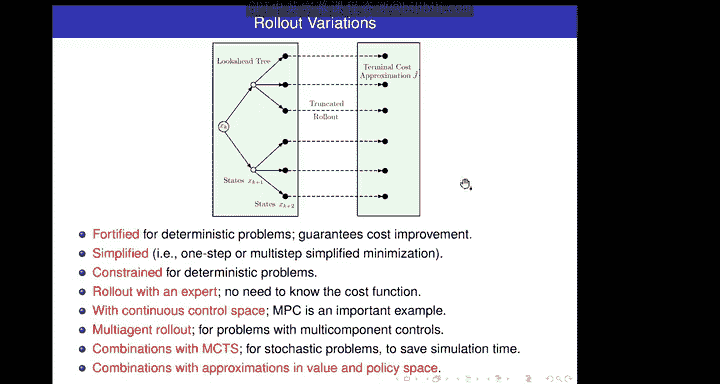

获得 `J̃` 的方法有很多：例如，使用**问题近似**（解决一个相关但更简单的问题），或使用**参数化近似**（如训练神经网络）。**聚合**是问题近似的一种形式。**Rollout** 和**模型预测控制**也属于这一类。大多数强化学习都关注如何近似 `J̃`。

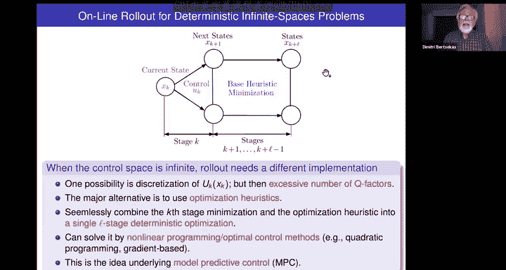

此外，我们可以进行**多步前瞻**，即最小化前L步的成本，并用近似值 `J̃` 表示更远的未来。这通常能获得更好的性能，因为你更精确地处理了更多的成本。

### 策略空间近似

另一种可能性是**策略空间近似**，直接获得一个近似最优的策略。这完全是离线的。在策略空间近似中，我们使用参数向量 `r` 对策略进行参数化。对于给定的参数集，将其代入系统会产生一个成本，我们通过最小化该成本来优化参数。

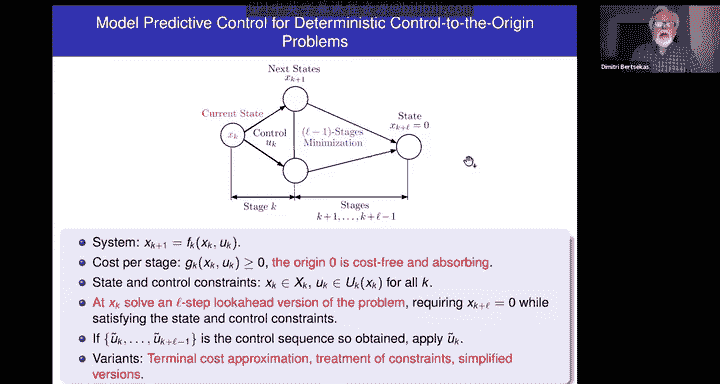

训练方法可以包括分类软件、梯度优化或随机搜索等。这些方法更多是通用的机器学习方法，而非像近似策略迭代或Rollout这样的动态规划特定方法。

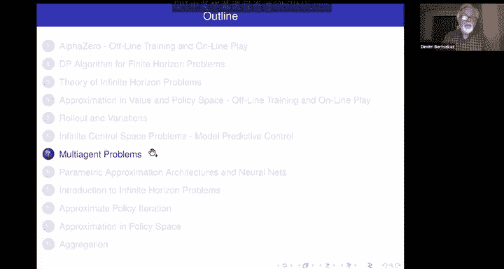

策略空间近似有一个很大的优势：一旦计算出参数 `r`，在线计算控制通常非常快，只需几毫秒或微秒。然而，它有一个重要缺点：它不允许**在线重规划**。如果问题数据发生变化，该控制器可能会做出错误的决策。相比之下，带有或不带有策略空间组件的价值空间近似非常适合在线重规划，因为它在最小化当前阶段成本与未来成本时会考虑变化的数据。

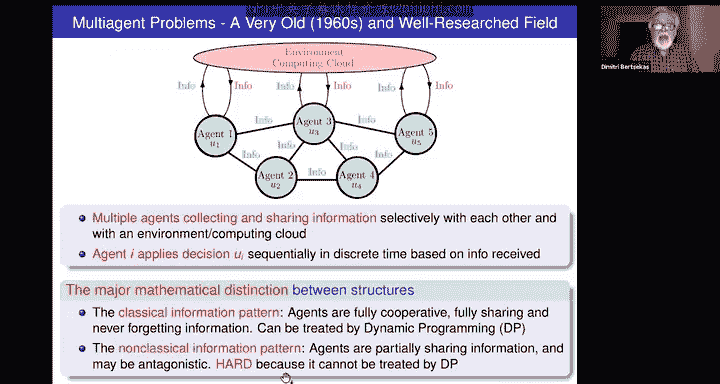

另一个缺点是，策略空间近似本身无法获得通过Rollout在价值空间近似中带来的性能提升。

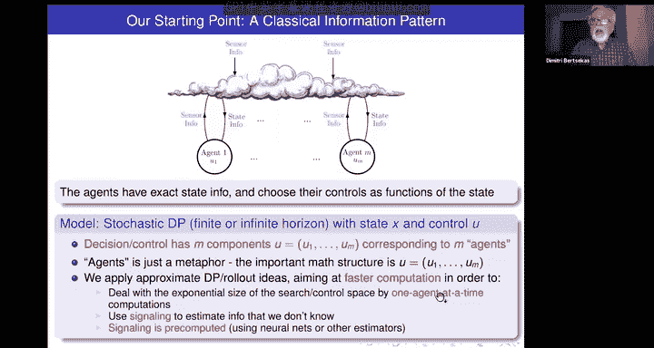

---

## ⚙️ Rollout算法及其变体

我们将Rollout的处理分为两部分：确定性和随机性。确定性Rollout更有效，也提供了更多选项。

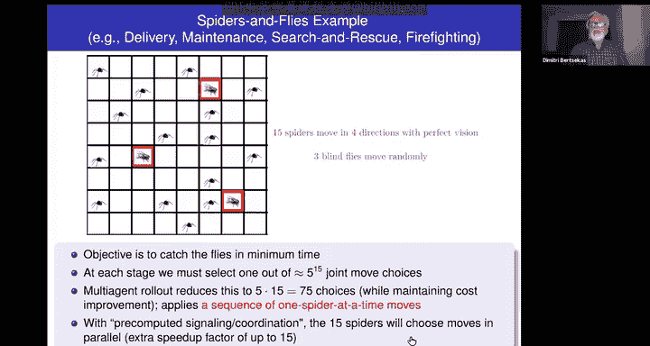

在纯形式的确定性Rollout中，我们从当前状态出发，查看所有可能的控制及其产生的唯一后继状态。我们通过从该后继状态运行某种启发式方法直到结束来计算一个Q因子（当前阶段成本加上启发式方法的成本）。我们比较这些Q因子，并选择具有最小Q因子的控制。然后我们移动到下一个状态，并重复此过程。

还有**多步前瞻**版本。由于问题是确定性的，前瞻树的规模较小，不会因随机扰动的分支因子而爆炸性增长，因此确定性问题在Rollout方面具有重要优势。

然而，确定性Rollout可能仍然耗时，因此我们引入了**截断Rollout**与**终端成本函数近似**相结合的版本。动机在于，长Rollout可能成本很高，而且理论上并不清楚增加Rollout长度就一定能提高性能。为了补偿Rollout的截断，我们使用终端成本函数近似来估计剩余阶段的成本，这也可以与离线训练结合。

Rollout有许多变体，包括用于确定性问题的**强化Rollout**（保证成本改进）、**简化Rollout**、带约束的Rollout、连续控制空间的Rollout（如模型预测控制）、**多智能体Rollout**、与蒙特卡洛树搜索的结合（以节省仿真时间）以及与价值和策略空间近似的结合。

在我看来，Rollout是最可靠、最易于实现的强化学习算法。它很少会让人失望，通常能带来相对于基础策略的实质性改进。

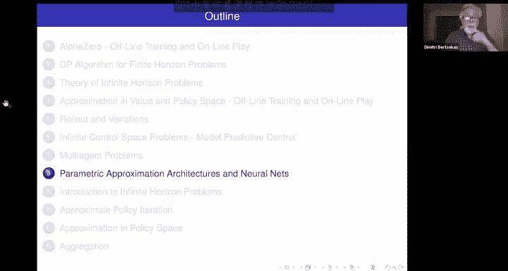

---

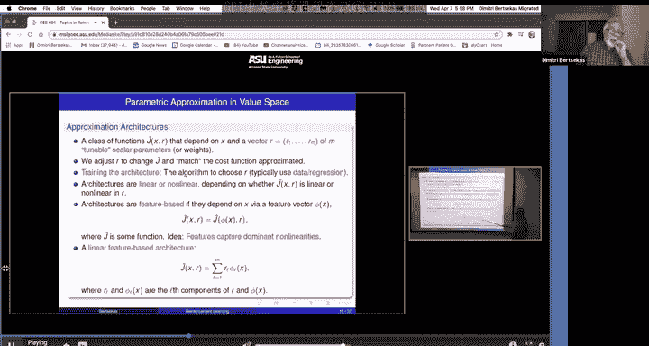

## 🌐 多智能体问题

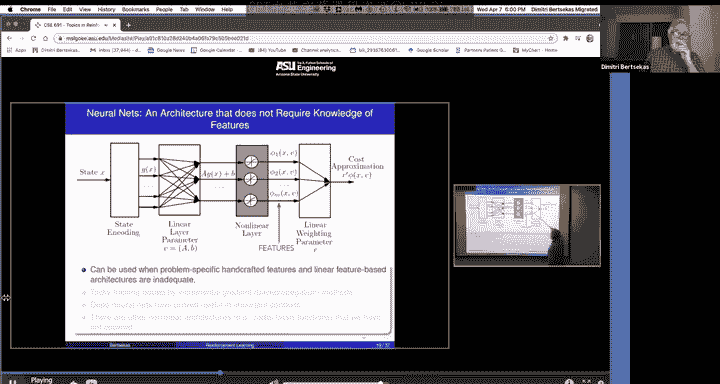

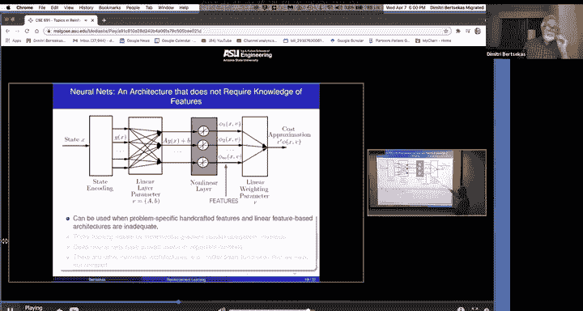

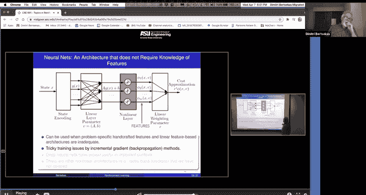

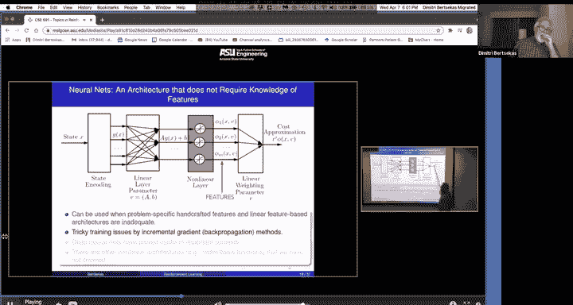

多智能体问题是当前研究的前沿。我们讨论了一种基于**一次一个智能体**进行控制计算的方法。

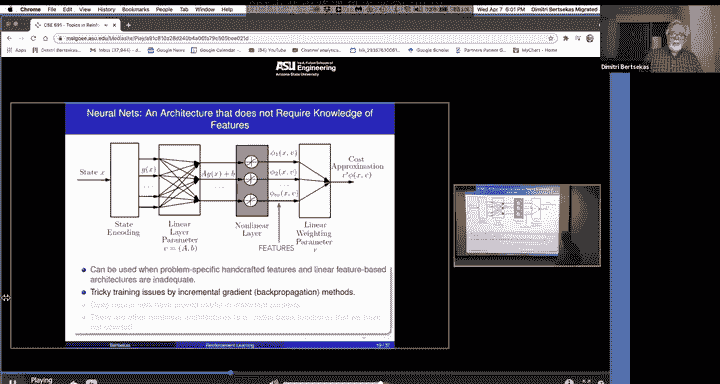

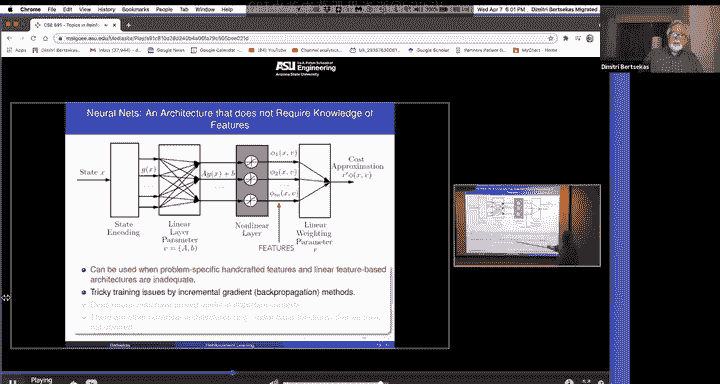

在多智能体问题中，我们有多个决策中心，每个中心涉及自己的控制 `u^1, u^2, ...`。智能体通过传感器从环境和彼此交换信息，每个智能体根据其拥有的信息应用决策 `u^i`。总体控制是所有智能体控制的笛卡尔积。

一个主要的数学区别在于**经典信息模式**（所有智能体完全合作、完全共享信息且从不遗忘）和**非经典信息模式**。经典信息模式相对容易处理，因为它可以通过动态规划解决。而非经典信息模式的问题极其困难。

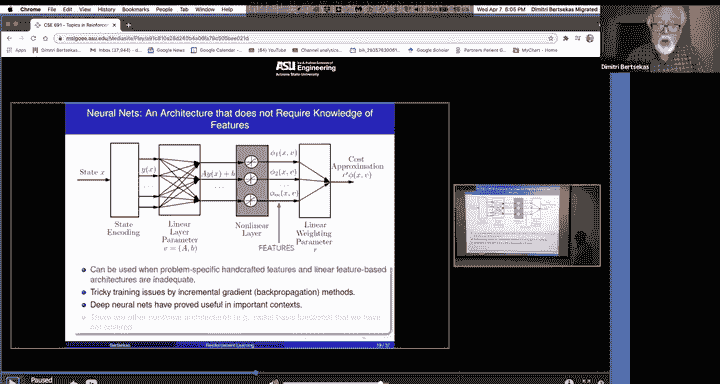

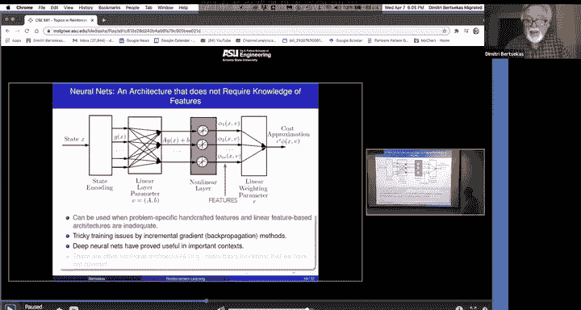

我们的方法是关注经典信息模式成立的问题。我们采用随机动态规划问题（有限或无限时域），状态为 `x`，控制 `u` 具有M个分量，对应M个智能体。目标是实现更快的计算，因为控制空间的大小随智能体数量M呈指数增长。

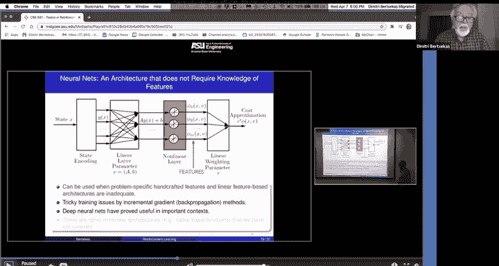

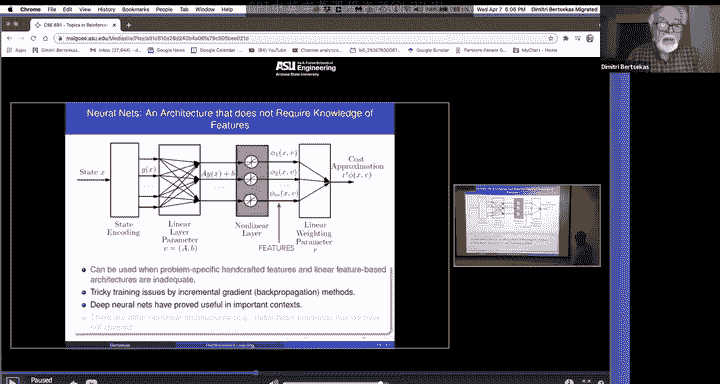

在我们的方法中，我们通过**一次一个智能体**的计算（例如在价值空间近似中的最小化）来处理这种指数级爆炸。在非经典信息模式或为了进一步加速计算的情况下，我们使用**信令**——包含对我们不完全确切知道的信息的估计。这些信令是预先计算的，可能使用神经网络或其他估计器。

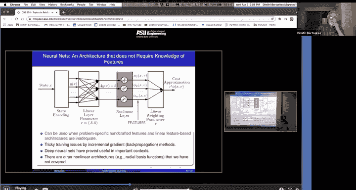

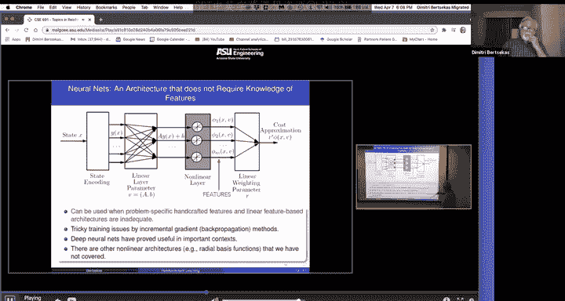

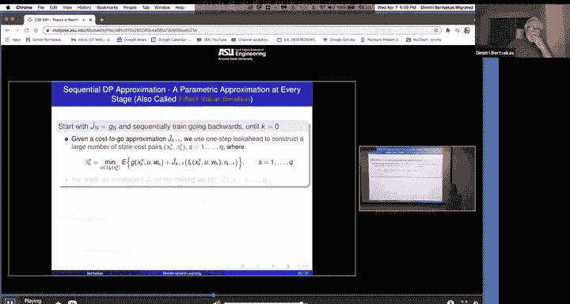

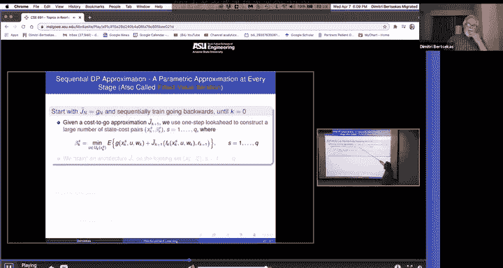

### 多智能体Rollout

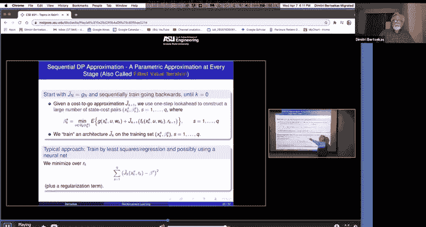

标准Rollout操作需要对所有M个控制分量进行联合最小化。多智能体Rollout则**一次一个分量**地进行最小化，这是一种简化的Rollout形式。

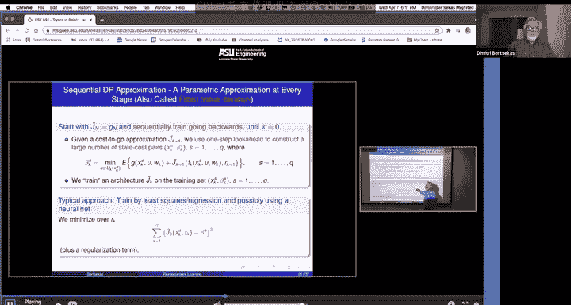

其运作方式是：第一个智能体在其自己的控制分量上最小化，假设未来的智能体将使用基础策略。第二个智能体进行最小化，假设未来的智能体使用基础策略，但前面的智能体使用已计算出的Rollout控制。依此类推，直到最后一个智能体。这一系列M次最小化提供了一个控制向量，以替代联合最小化得到的控制。

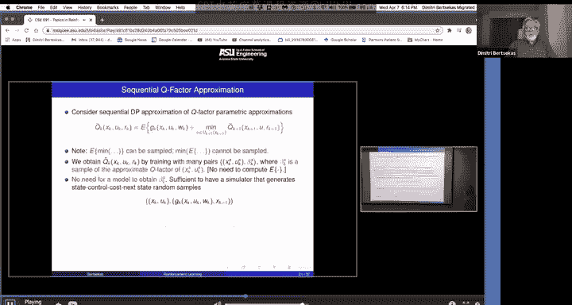

这种操作所需的计算量与M成线性关系，而非指数关系，速度提升是巨大的。多智能体Rollout可以保证成本改进，因为它本质上是对一个等价重构问题应用标准Rollout。

---

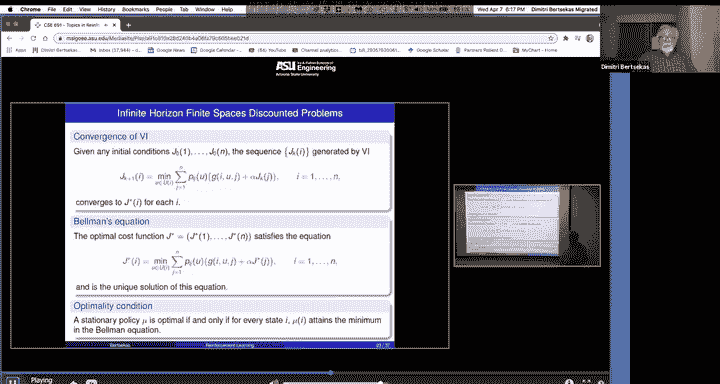

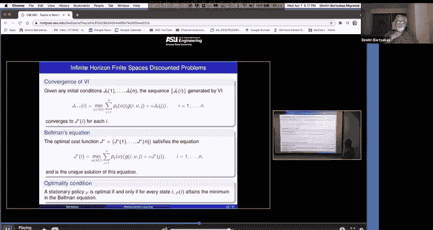

## 🧠 离线训练：神经网络与近似架构

离线训练涉及参数化近似架构，例如神经网络。它涉及一个参数向量 `r`（权重），目标是调整权重，使用数据找到合适的值，使得对应的函数能够很好地近似你想要逼近的目标函数。

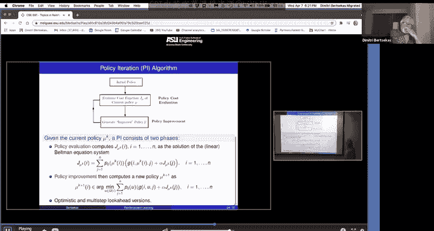

我们通过训练算法来调整 `r`。最常见的训练算法是使用输入-输出对数据，通过某种二次回归与近似架构进行匹配。

架构可以是线性或非线性的。通常，架构是基于特征的，它们通过一个特征向量 `f(x)` 依赖于状态 `x`。特征旨在捕获你想要近似的函数中的主要非线性，以便你可以使用一个简单的 `Ĵ` 函数（例如线性函数）。

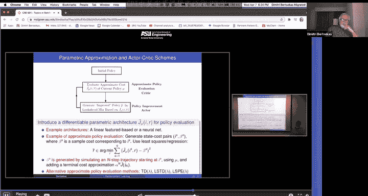

在缺乏良好特征的问题中，**神经网络**登场了。它是一个涉及单个非线性层和单个线性层的网络。**深度神经网络**则是这些线性和非线性层的串联。在产生输出之前，最后一个非线性层的输出被视为特征。因此，整个网络结构用于生成这些特征，然后对其进行线性加权以产生成本近似。

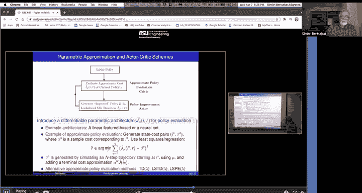

训练神经网络既涉及发现特征，也涉及找到加权它们的系数。训练问题是一个涉及大量权重的回归问题，解决方法通常是**增量梯度法**（也称为随机梯度下降）。反向传播是计算训练目标相对于这些参数的梯度的一种智能方式，本质上是链式法则。

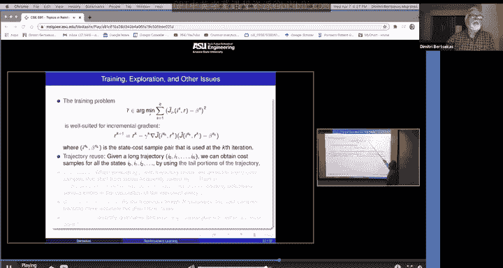

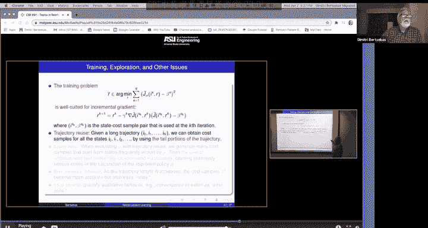

深度神经网络的成功，目前分析支持的最可能原因是**过参数化**——即参数数量多于数据量。这似乎避免了机器学习中著名的过拟合问题。

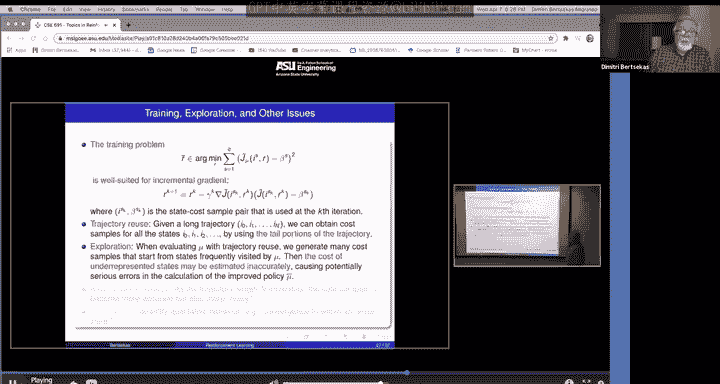

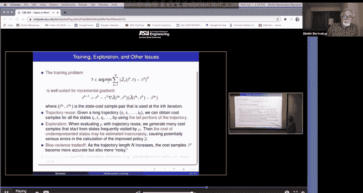

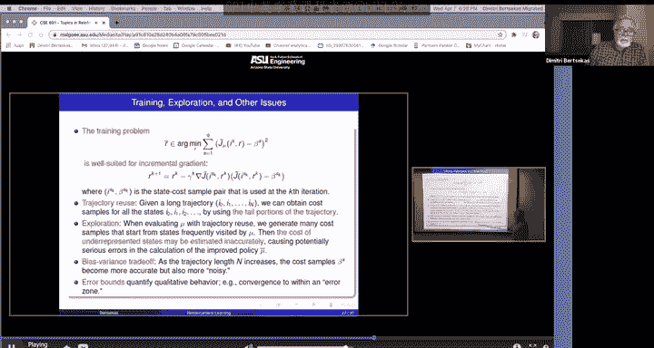

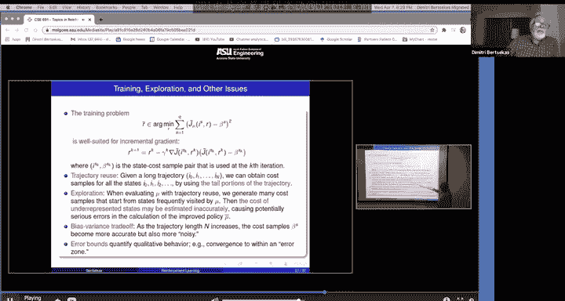

---

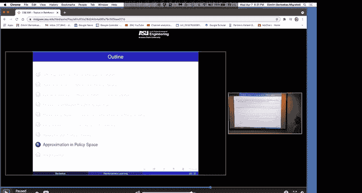

## 📊 无限时域问题的近似策略迭代

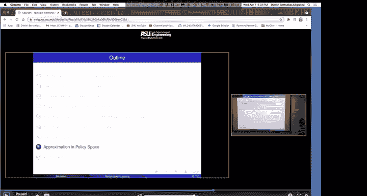

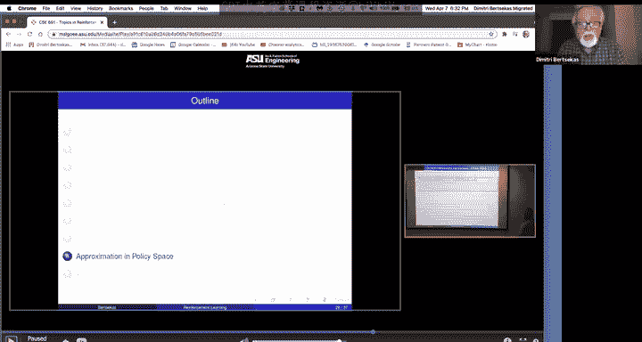

对于无限时域问题，近似策略迭代是一个核心算法。我们生成一个策略序列：首先评估当前策略（通过近似计算其成本函数），然后改进策略，如此反复。

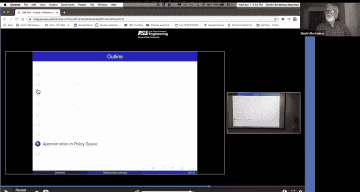

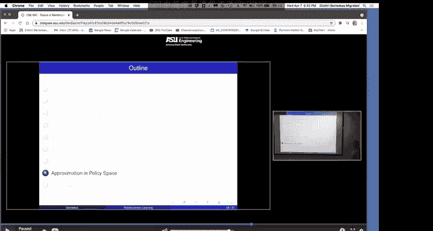

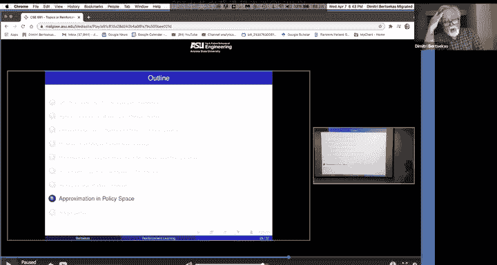

近似发生在策略评估步骤中。我们可能使用参数化近似方法来逼近对应于该策略的贝尔曼方程的解。例如，我们使用最小二乘回归，基于从该策略生成的数据（通过模拟轨迹并收集成本样本）来获得参数 `r`。

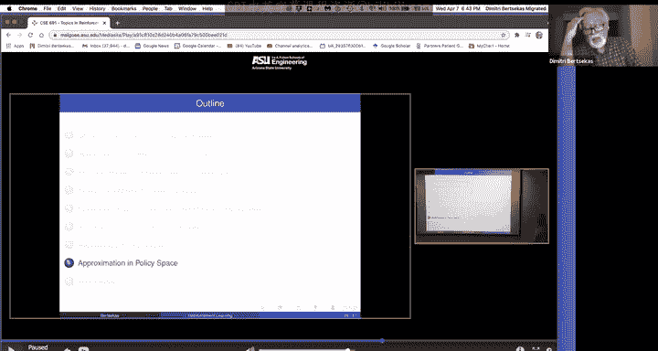

在文献中，你会找到许多不同的策略评估方法，特别是**时序差分方法**（如TD(λ)、LSTD(λ)）。这些方法在数学上更复杂，有有趣的理论，但可能比简单的模拟回归方法更脆弱。我们课程中没有过多涉及这些。

在生成样本对的过程中，有几个问题需要考虑：训练问题（通过增量梯度法解决）、**轨迹重用**（利用一条轨迹的尾部部分生成更多样本，节省计算）、**探索**（确保状态空间被更广泛地采样，而不仅仅是策略偏好的状态），以及轨迹长度选择（涉及方差与准确性的权衡）。

近似策略迭代方法倾向于在开始时单调收敛，然后收敛到某个误差范围内，这取决于策略评估的质量。

---

## 🎯 策略空间近似与交叉熵方法

现在，让我们转向无限时域问题的策略空间近似。我们使用参数向量 `r` 对平稳策略进行参数化，记作 `μ(r)`。目标是选择参数 `r`，以优化某些性能指标。

有几种情况可能适合使用策略空间近似：存在自然策略参数化的问题；具有自然价值参数化但策略训练方法更有效的问题；在价值空间近似之上使用策略空间近似以克服某些困难；向软件或人类专家学习；以及具有非常规信息结构、传统动态规划不适用的问题。

**交叉熵方法**是一种在策略空间近似中取得了一些成功的随机搜索方法。它不需要梯度。其基本思想是：在当前参数 `r_k` 周围构建一个椭圆区域，在该参数空间中生成大量随机样本。评估每个样本对应的成本（可通过仿真），选择一批成本较低的样本。计算这些被接受样本的均值，作为下一个点 `r_{k+1}`。然后根据被接受样本的协方差矩阵构建新的椭圆区域，进行下一次采样。如此反复。

这种方法非常简单，适合并行计算，并且类似于梯度法，因为它倾向于从高成本参数向低成本参数移动。它是无模型的，因为成本可以通过仿真计算。

---

## 🔗 聚合方法

聚合旨在形成一个降维、缩小规模的问题。一种方法是通过特征映射将原始状态映射到特征，对特征空间进行某种规则划分，并从每个划分单元中选取一个代表状态。

我们为每个代表状态定义一个“足迹”，即映射到该单元的所有原始状态集合。然后构建一个复合优化问题：从代表状态，使用解聚概率上溯到原始系统状态，经过状态转移，再使用聚合概率下溯到代表特征。这样就构建了一个状态空间为这些代表特征的复合系统，可以通过基于仿真的值迭代和策略迭代来解决其复合贝尔曼方程。

聚合旨在近似 `J^*`，而不是某个策略的 `J_μ`。如果有足够多的聚合状态或代表特征，可以获得任意接近 `J^*` 的近似。我们区分了**代表特征方案**和更简单的特例——**代表状态方案**。代表状态方案能力较弱，但更易于实现且计算量更小。最后，我们还讨论了涉及状态和时间压缩的**时空聚合**。

---

## ⚠️ 注意事项与未来展望

**注意事项**：所有方法都存在具有挑战性的近似问题。没有一种方法能保证对所有或大多数问题都有效。这里要做的是拥有一个包含多种方法的工具箱，并尝试为给定的具有挑战性的问题找到合适的候选方法。

为了选择特征，需要具备特定领域的知识，需要理解你的问题。训练问题并不像人们说的那么可靠，需要进行参数调试和大量试错。近似策略迭代可能产生振荡。探索问题可能是一个大麻烦，特别是在涉及离策略学习的Q学习中。评估成功具有挑战性，通常需要领域洞察力。

在游戏环境中取得了惊人的成功（如AlphaZero），但这些环境模型稳定、规则完全已知、且控制选项数量通常有限。对于具有无限控制空间的最优控制问题，一些在游戏中使用的方法（如蒙特卡洛树搜索）可能不再适用。部分可观测信息的问题仍然是一个巨大挑战。

**积极方面**：我们如今拥有强大的计算能力，包括非常适合采样和蒙特卡洛仿真的并行计算。尽管我们不能保证解决非常困难的问题，但至少我们有了可以尝试的方法，可以开始处理极其困难的实际问题。未来是令人兴奋的。

---

## 📝 总结

在本节课中，我们一起回顾了整个强化学习课程的核心内容。我们从AlphaZero的动机出发，深入探讨了动态规划的基础理论、有限与无限时域问题、值迭代与策略迭代算法。我们重点学习了近似动态规划的两大支柱：价值空间近似和策略空间近似，并详细剖析了Rollout算法及其多种变体。我们还探讨了前沿的多智能体问题解决方法、神经网络在离线训练中的应用、近似策略迭代的实现，以及策略空间近似的交叉熵方法和聚合技术。

通过本课程的学习，我们掌握了将强化学习原理应用于广泛领域（如游戏AI、机器人控制、组合优化等）的工具和视角。尽管挑战依然存在，但强大的计算工具和不断发展的方法论为我们解决复杂决策问题提供了坚实的基础。希望这门课程能成为各位在强化学习领域继续探索和创新的起点。