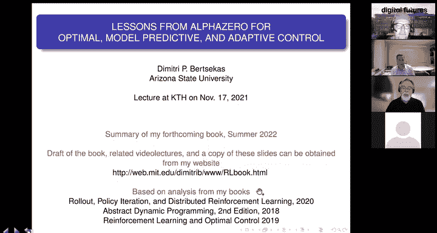
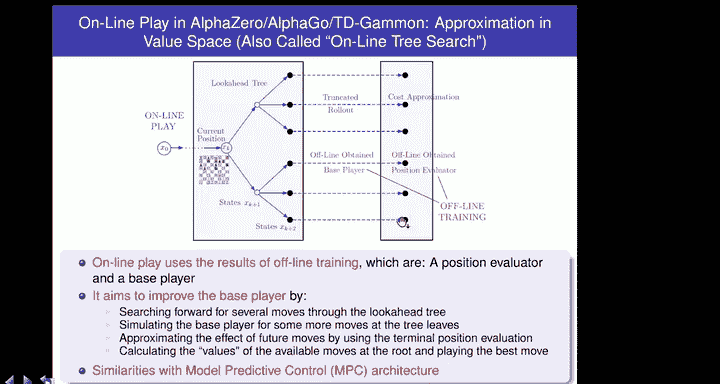
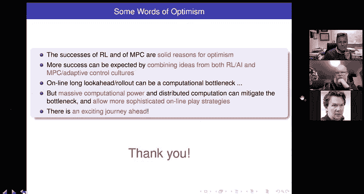

# 27：从AlphaZero中学习最优、模型预测和自适应控制的启示 🎯

在本节课中，我们将学习如何从AlphaZero和TD-Gammon等著名程序中提炼出通用的强化学习与控制理论框架。我们将看到，在线对弈算法本质上可以视为求解贝尔曼方程的牛顿法步骤，而离线训练则为这个牛顿步骤提供了起点。这一视角将帮助我们理解模型预测控制、自适应控制与强化学习之间的深刻联系。

---

## 概述与背景 📖

大家好，本次演讲的标题也是我即将出版的新书的标题。这本书旨在为强化学习及其与传统控制方法（如模型预测控制和自适应控制）的联系提供一个全新的概念框架。该框架主要基于可视化和几何解释，同时也有大量的数学分析作为支撑。

我想从两个卓越的程序开始：第一个是2017年问世并引起轰动的国际象棋程序AlphaZero；另一个是25年前的程序TD-Gammon，它玩西洋双陆棋，在当时极大地激发了人们对强化学习前景的热情。

AlphaZero和TD-Gammon这两个程序非常相似，尽管实现时间相隔多年，但它们都涉及两种算法：
1.  **离线训练算法**：程序通过大量数据、神经网络近似等方法学习如何评估棋局位置以及在给定位置如何选择走法。
2.  **在线对弈算法**：程序使用此算法与其他计算机程序或人类对手对弈，它基于多步前瞻、模拟和价值函数近似。

这两种算法都与动态规划、经典策略迭代以及强化学习类型的近似方法有着紧密联系。本次演讲的目标是理解这种方法论，它适用范围广泛，特别是与模型预测控制和自适应控制等控制系统设计方法的联系。

---

## 在线对弈算法解析 🧠

在线对弈算法是程序对弈时使用的核心逻辑。它利用离线训练的结果，具体体现在两个方面：使用**位置评估器**来评估棋局，以及使用**基础策略**在给定位置生成走法。

在线对弈旨在改进由离线训练得到的基础策略，其过程如下：
1.  假设经过K步后，我们处于当前位置 `x_k`。
2.  我们通过前瞻树向前搜索若干步（对手的应对步法），直到一定深度。
3.  从该树的叶子节点开始，我们使用基础策略模拟更多步。
4.  我们到达一些位置，并使用位置评估器对这些位置进行评估，以此近似未来步法的效果。
5.  我们将这些价值回传到根节点，计算当前位置每个可能走法的价值，并选择最佳走法。

这个过程在每个位置重复进行。不同程序的结构类似但也有差异：AlphaZero使用很长的初始前瞻部分，而不需要中间的模拟部分；AlphaGo使用了中间模拟部分；TD-Gammon则非常依赖中间的截断模拟部分，因为其前瞻树扩展很快，无法进行长前瞻。

值得注意的是，模型预测控制的结构与此惊人地相似，包含一个进行最小化的初始“控制区间”（类似前瞻），有时还有一个“预测区间”（类似模拟），以及一个终端成本近似。

---

## 离线训练算法解析 🏋️

以AlphaZero为例，其离线训练算法是**带有自生成数据的近似策略迭代**。

过程如下：
1.  生成一系列策略（玩家）。
2.  当前策略用于训练一个改进的策略，这个过程重复多次，直到停止，并将最终训练好的策略交给在线对弈算法使用。

策略迭代的每一步都包含两部分：**策略评估**和**策略改进**，这两部分都通过神经网络近似完成。
*   **策略评估**：通过让当前策略进行大量对弈来收集数据，并用神经网络表示其价值函数。
*   **策略改进**：使用多步前瞻最小化（一种称为蒙特卡洛树搜索的近似形式）来改进当前策略。改进后的策略也通过一个策略神经网络来表示。

最终，我们得到一系列价值和策略网络，供在线对弈使用。TD-Gammon使用非常相似的策略迭代算法进行离线训练，但使用的是TD(λ)方法，并且没有独立的策略网络，其策略功能通过价值网络结合一步前瞻来实现。

---

## 关键经验观察与核心观点 💡

以下是一些重要的经验观察，也是本次演讲的重点：

1.  **在线对弈性能远超离线策略**：AlphaZero的在线对弈者棋艺远超其离线训练出的策略。这是一个显著的事实，表明在线对弈在离线训练基础上带来了巨大的性能提升。
2.  **模拟部分至关重要**：TD-Gammon在加入中间的截断模拟部分后，性能得到了极大提升，从低于人类水平达到了超人类水平。

我们希望用抽象的动态规划思想和贝尔曼算子的可视化来解释这些现象，并从中提炼出可以推广到其他领域的见解。**核心观点是牛顿法将这一切联系在一起**。

以下是本次演讲的主要观点：
*   **在线对弈是牛顿法步骤**：在线对弈（特别是单步前瞻）正是求解问题相关贝尔曼方程的一个牛顿法步骤。对于多步前瞻，牛顿步骤之前会进行一些价值迭代，这在数值分析中称为牛顿-SOR方法。
*   **离线训练提供牛顿步骤的起点**：在我看来，在线对弈是真正的“主力”，大部分性能提升发生在线对弈阶段。相比之下，离线训练扮演次要角色。一个重要原因是，在线对弈的牛顿步骤是精确的，不涉及近似，不受神经网络训练误差的影响。
*   **牛顿步骤是强大的均衡器**：离线训练可以通过多种强化学习方法完成。这些方法的各种缺陷和误差只影响牛顿步骤的起点，而精确的牛顿步骤会“冲刷”掉这些起点误差，起到强大的均衡作用。
*   **连接不同领域**：强化学习/人工智能社区更关注离线训练问题，而控制社区（尤其是模型预测控制和自适应控制）更关注在线对弈和稳定性问题。我们试图通过这个框架来弥合这一差距。
*   **框架具有广泛通用性**：抽象动态规划是一个通用框架，可以容纳任意状态和控制空间、随机/确定性系统、混合系统、多智能体系统、博弈、离散优化等。因此，基于此框架的观点具有广泛的应用前景。

---

## 理论基础：折扣与无折扣问题 📐

为了提供背景，我们首先定义所讨论的问题。我们考虑一个离散时间系统：
`x_{k+1} = f(x_k, u_k, w_k)`
其中 `x_k` 是状态，`u_k` 是控制，`w_k` 是随机扰动。系统根据上述方程演化。

我们关注将状态映射到控制的平稳策略 `μ`，且控制必须满足约束。每次状态转移产生成本 `g(x_k, u_k, w_k)`，并以因子 `α` （`α ≤ 1`）进行折扣。从初始状态 `x_0` 开始，一个策略 `μ` 的成本函数 `J_μ(x_0)` 是折扣期望总成本的极限。

最优成本函数 `J*` 是所有策略成本函数中的最小值。我们主要关注三类问题：
1.  **折扣问题**：`α < 1`，`g` 有界。这是性质良好的情况。
2.  **随机最短路径问题**：`α = 1`，存在一个特殊的零成本终止状态。
3.  **模型预测控制类问题**：系统是确定性的，每阶段成本为正，原点为终止状态（调节问题）。

相关理论概要如下：
*   **贝尔曼方程**：最优成本函数 `J*` 满足贝尔曼方程 `J*(x) = min_u E[ g(x, u, w) + α J*( f(x, u, w) ) ]`。
*   **最优性条件**：如果对于每个 `x`，`μ*(x)` 在上述方程中达到最小值，则该策略 `μ*` 是最优的。
*   **主要算法**：
    *   **价值迭代**：从某个 `J_0` 开始，迭代 `J_k(x) = min_u E[ g(x, u, w) + α J_{k-1}( f(x, u, w) ) ]`。
    *   **策略迭代**：从任意策略 `μ_0` 开始，每步迭代包含：
        1.  **策略评估**：计算当前策略 `μ` 的成本函数 `J_μ`。
        2.  **策略改进**：通过 `μ_new(x) = argmin_u E[ g(x, u, w) + α J_μ( f(x, u, w) ) ]` 得到改进策略。

---

## 价值空间近似与牛顿法联系 🔗

在实际中，精确求解 `J*` 很困难，因此我们使用近似值 `J̃` 来代替。这引出了**价值空间近似**框架。

*   **单步前瞻**：在状态 `x`，我们执行最小化：`min_u E[ g(x, u, w) + α J̃( f(x, u, w) ) ]`，并使用最小化的控制 `u`，然后转移到下一个状态重复此过程。这定义了一个前瞻策略 `μ̃`。
*   **多步前瞻**：我们最小化前 `L` 步的成本加上由 `J̃` 评估的未来成本，然后只使用第一步的控制。

**关键事实**：前瞻策略 `μ̃` 的成本函数 `J_{μ̃}`，正是从起点 `J̃` 出发，求解贝尔曼方程的一个**牛顿法步骤**的结果（对于单步前瞻）。对于多步前瞻（`L > 1`），它是一些价值迭代后接一个牛顿步骤，即牛顿-SOR步骤。

牛顿法的特性是**超线性收敛**，误差减少得非常快。这意味着，即使起点 `J̃` 存在误差，经过牛顿步骤后得到的新策略的成本 `J_{μ̃}` 会非常接近最优成本 `J*`，误差相对起点误差极小。

---

## 抽象动态规划与可视化 🎨

为了在更抽象的层面理解，我们引入贝尔曼算子。

*   **策略 μ 的贝尔曼算子 `T_μ`**：`(T_μ J)(x) = E[ g(x, μ(x), w) + α J( f(x, μ(x), w) ) ]`。这是一个线性单调算子。
*   **最小贝尔曼算子 `T`**：`(T J)(x) = min_u E[ g(x, u, w) + α J( f(x, u, w) ) ]`。这是一个凹的单调算子。

贝尔曼方程可以写为不动点方程：`J* = T J*`， `J_μ = T_μ J_μ`。

虽然这些算子维度很高（状态数可能很大），但我们可以通过**一维切片**来可视化它们。考虑一个两状态例子，`J` 是二维向量。`T_μ J` 和 `T J` 也是二维向量。我们可以画出每个状态分量相对于 `J` 的图形。`T_μ` 的图形是线性的，`T` 的图形是凹的（是所有 `T_μ` 的下包络）。最优成本 `J*` 是 `T` 的图形与45度线的交点。

通过这种可视化，我们可以直观地看到：
*   **价值迭代**：相当于在 `T` 的图形上做阶梯状迭代，收敛到 `J*`。
*   **策略迭代**：相当于从当前策略 `μ` 的成本 `J_μ`（`T_μ` 与45度线交点）出发，线性化 `T` 在 `J_μ` 处得到 `T_{μ_new}`，其与45度线的新交点就是改进策略的成本 `J_{μ_new}`。这正是一个牛顿步骤。
*   **在线对弈（单步前瞻）**：给定近似 `J̃`，找到使 `T_μ J̃` 最小的 `μ̃`（即 `T` 在 `J̃` 处的支撑超平面对应的策略），然后计算 `J_{μ̃}`。这正是从 `J̃` 出发的一个牛顿步骤。

---

## 稳定性分析 🛡️

在控制问题中，稳定性至关重要。我们采用一种基于优化的稳定性定义：一个策略是稳定的，如果对于所有初始状态，其成本函数都是有限的（不发散）。在可视化中，这通常对应其贝尔曼算子 `T_μ` 的斜率小于1。

对于单步前瞻，存在一个**稳定性区域**：只有当起点 `J̃` 位于某个阈值（`T` 算子图形与45度线相切点）的右侧时，得到的前瞻策略才是稳定的。多步前瞻通过先进行价值迭代，可以将 `J̃` “推入”稳定性区域，从而扩大了稳定策略的适用范围。

---

## 模拟与策略迭代可视化 🔄

*   **模拟**：模拟就是从某个基础策略 `μ` 的成本 `J_μ` 出发，执行一个牛顿步骤，得到改进的模拟策略。如果基础策略稳定，模拟策略也稳定。
*   **策略迭代**：就是重复进行模拟。从策略 `μ_k` 开始，计算其成本 `J_{μ_k}`，然后执行牛顿步骤得到新策略 `μ_{k+1}` 及其成本 `J_{μ_{k+1}}`，如此反复。这本质上是纯粹的牛顿法，收敛速度很快。
*   **截断模拟**：截断模拟从某个 `J̃` 开始，先使用基础策略 `μ` 的贝尔曼算子 `T_μ` 进行 `M` 步价值迭代，然后再执行牛顿步骤。它可以看作是经济版的多步前瞻，因为策略模拟通常比最小化前瞻计算成本低。总的前瞻步数为 `L`（最小化步数）加 `M`（模拟步数），其和是关键。

---

## 线性二次型问题示例 📉

对于控制领域熟悉的线性二次型问题，可视化工具从贝尔曼算子变为**黎卡提方程算子**。

考虑一维线性系统 `x_{k+1} = A x_k + B u_k`，二次型成本。最优成本函数是二次的 `J*(x) = K* x^2`，其中 `K*` 满足代数黎卡提方程。该方程也是一个不动点方程，其算子图形是凹的。最优解 `K*` 是该算子图形与45度线的交点（正定解）。价值迭代和策略迭代在此语境下也有对应的可视化解释，并且策略迭代同样对应于牛顿法。

---

## 与模型预测控制及自适应控制的联系 🌉

*   **模型预测控制**：MPC的架构与AlphaZero非常相似，包括前瞻最小化（控制区间）、可能的模拟（预测区间）和终端成本近似。MPC侧重于连续空间应用、稳定性处理以及在线对弈，但也涉及离线计算（如终端代价、稳定策略）。近期“学习型MPC”利用数据驱动模拟，与强化学习的结合日益紧密。
*   **自适应控制（间接式）**：传统间接自适应控制在估计模型变化后重新优化控制器，这可能计算量大。我们的框架提供了一种替代方案：使用基于当前估计模型的多步前瞻和模拟（即牛顿步骤）来代替重新优化。如果参数变化不大，牛顿步骤与重新优化效果相当，但计算更简单。这利用了牛顿法的快速收敛性来避免昂贵的重新优化。

一个示例表明，当系统参数变化时，使用固定鲁棒策略性能会下降，而引入基于牛顿步骤的模拟策略，性能几乎与最优策略无异。

---

## 结论与总结 🎓

本节课我们一起学习了从AlphaZero等程序中抽象出的强化学习与控制理论统一框架。我们来总结一下核心要点：

1.  **在线对弈与离线训练结合**：在离线训练基础上使用在线对弈（牛顿步骤）能带来巨大性能提升。仅用离线训练可能因缺少误差校正机制而效果不佳；仅用在线对弈则可能因起点不佳而错过最优性能。
2.  **牛顿法的核心地位**：牛顿法为理解、分析和设计算法提供了新的视角。在线对弈的牛顿步骤是精确的，能够“冲刷”掉离线训练方法差异和误差。
3.  **弥合文化鸿沟**：强化学习/人工智能社区与控制社区（MPC、自适应控制）处理相似问题，方法也相似。通过结合离线训练和在线对弈的AlphaZero模型，可以架起沟通的桥梁。MPC可采用强化学习思想，而自适应控制可利用模拟（牛顿步骤）替代重新优化。
4.  **框架的通用性**：基于抽象动态规划的框架适用于任意状态/控制空间，具有广泛的应用前景，包括离散优化、整数规划、多智能体系统等。
5.  **计算与未来**：前瞻最小化和模拟可能是计算瓶颈，但分布式计算和并行处理能力可以缓解这一问题，使得更复杂的在线策略成为可能。未来通过融合不同社区的优势，前景非常光明。

总而言之，通过将在线对弈理解为牛顿步骤，我们获得了强大的视角来统一和推进强化学习、最优控制、模型预测控制及自适应控制领域的研究与实践。