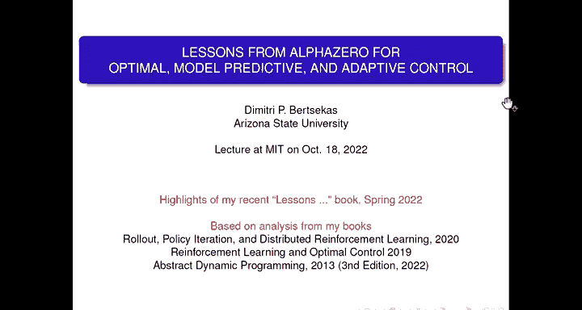
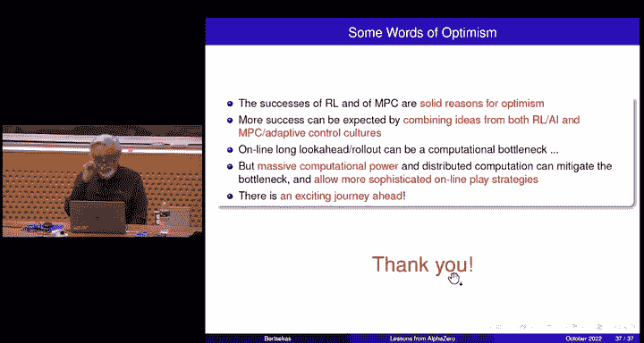

# 28：从AlphaZero看最优、模型预测与自适应控制 🎯

在本节课中，我们将学习强化学习（RL）与最优控制、模型预测控制（MPC）及自适应控制之间的深刻联系。我们将以AlphaZero和TD-Gammon这两个著名程序为起点，探讨其背后的通用方法论，并引入抽象动态规划框架来统一理解这些概念。

---

## 概述与核心思想

AlphaZero和TD-Gammon是两个里程碑式的程序，它们展示了强化学习在复杂决策问题上的强大能力。尽管相隔25年，但它们共享相似的方法论：都包含**离线训练**和**在线博弈**两个算法阶段。

*   **离线训练**：使用自生成数据，通过神经网络等方法近似价值函数和策略。
*   **在线博弈**：在实时决策中，结合多步前瞻（lookahead）、模拟推演（rollout）和价值函数近似。

我们将看到，这种架构与模型预测控制（MPC）有着惊人的相似性。更重要的是，**在线博弈算法本质上可以解释为求解贝尔曼方程的一个牛顿法步骤**。这一核心洞察将帮助我们理解为何在线算法的性能远优于其离线训练的基础策略，并为我们设计更通用、更强大的算法提供指导。

---

## 动态规划基础回顾

在深入之前，我们先简要回顾无限时域问题的动态规划基础。我们考虑一个系统，在时刻 \(k\) 的状态为 \(x_k\)，控制输入为 \(u_k\)，随机扰动为 \(w_k\)。系统根据方程 \(x_{k+1} = f(x_k, u_k, w_k)\) 演化。

对于一个给定的平稳策略 \(\mu\)（将状态映射到控制），其成本函数 \(J_\mu(x_0)\) 是从初始状态 \(x_0\) 出发的期望总折扣成本：
\[
J_\mu(x_0) = E \left\{ \sum_{k=0}^{\infty} \alpha^k g(x_k, \mu(x_k), w_k) \right\}
\]
其中 \(\alpha \leq 1\) 是折扣因子，\(g\) 是单步成本。

最优成本函数 \(J^*\) 是所有策略中成本的最小值。动态规划的核心——**贝尔曼方程**指出，\(J^*\) 是以下算子的不动点：
\[
J^*(x) = \min_{u \in U(x)} E \{ g(x, u, w) + \alpha J^*(f(x, u, w)) \}, \quad \forall x
\]
我们将其简写为算子形式：\(J^* = T J^*\)，其中 \(T\) 是**最小贝尔曼算子**。

对于固定策略 \(\mu\)，其成本函数 \(J_\mu\) 满足 \(J_\mu = T_\mu J_\mu\)，这里 \(T_\mu\) 是**策略 \(\mu\) 的贝尔曼算子**。

上一节我们回顾了动态规划的基本方程，本节我们将引入抽象动态规划的视角，以便进行可视化分析。

---

## 抽象动态规划与算子可视化

为了获得更通用的洞察，我们转向**抽象动态规划**框架。在这个框架中，我们专注于贝尔曼算子 \(T\) 和 \(T_\mu\) 的性质，它们将函数（成本函数）映射为新的函数。

关键性质包括：
*   **单调性**：如果 \(J \leq J'\)，则 \(T J \leq T J'\)。
*   **凹性**：最小贝尔曼算子 \(T\) 是凹的（作为一族线性算子 \(T_\mu\) 的下包络）。
*   **线性**：对于固定策略 \(\mu\)，算子 \(T_\mu\) 是线性的。

直接可视化这些无限维算子很困难。我们的方法是使用**一维切片可视化**：专注于单个状态 \(x\)，将成本函数 \(J\) 视为一个标量（在该状态的值），观察算子 \(T\) 如何将其映射为新的标量 \(T(J)(x)\)。

以下是关键的可视化：

*   **策略算子 \(T_\mu\)**：图像是一条直线（线性）。方程 \(J_\mu = T_\mu J_\mu\) 的解是这条直线与45度线（\(y=x\)）的交点。
*   **最小贝尔曼算子 \(T\)**：图像是凹曲线，由所有策略对应的直线 \(T_\mu\) 的下包络构成。最优成本 \(J^*\) 是这条凹曲线与45度线的交点。

基于值迭代的算法（\(J_{k+1} = T J_k\)）可以通过在曲线 \(T\) 和45度线之间构建“阶梯”来可视化。

---

## 在线博弈作为牛顿法步骤 🚀

现在，我们来到最核心的洞察。假设我们通过离线训练得到了一个近似的价值函数 \(\tilde{J}\)。

**一步前瞻（贪婪）策略** \(\tilde{\mu}\) 定义为：在每个状态 \(x\)，选择最小化“当前成本 + \(\tilde{J}\) 评估的未来成本”的控制动作。
\[
\tilde{\mu}(x) \in \arg\min_{u \in U(x)} E \{ g(x, u, w) + \alpha \tilde{J}(f(x, u, w)) \}
\]
这个策略 \(\tilde{\mu}\) 的性能如何？其成本函数 \(J_{\tilde{\mu}}\) 与最优成本 \(J^*\) 相差多少？

可视化给出了答案：从近似点 \(\tilde{J}\) 出发，找到凹曲线 \(T\) 在该点的**支撑超平面（切线）**。这条切线对应于某个策略（正是贪婪策略 \(\tilde{\mu}\)）的线性算子 \(T_{\tilde{\mu}}\)。该切线与45度线的交点，就是 \(J_{\tilde{\mu}}\)。

**关键发现**：从 \(\tilde{J}\) 到 \(J_{\tilde{\mu}}\) 的这一步，正是求解不动点方程 \(J = T J\) 的**牛顿法**（或更一般地，使用次梯度的牛顿法）中的一步！

这意味着：
1.  **超线性收敛**：如果初始近似 \(\tilde{J}\) 足够接近 \(J^*\)（位于牛顿法的“甜点”区域），那么一步之后得到的 \(J_{\tilde{\mu}}\) 将极其接近 \(J^*\)，误差会以超线性的速度减小。
2.  **对起点的鲁棒性**：只要 \(\tilde{J}\) 落在“甜点”内，不同的离线训练方法产生的差异会被强大的牛顿步“抹平”，最终性能几乎相同。
3.  **解释了经验现象**：这完美解释了为何AlphaZero的在线玩家（执行了牛顿步）远强于其离线训练的基础策略（只是牛顿步的起点）。也解释了为何TD-Gammon加入推演（rollout）部分后性能大幅提升。

---

## 多步前瞻与截断推演

实际算法（如AlphaZero）通常使用多步前瞻（L步）而非一步。这可以理解为在应用最终的牛顿步之前，先执行几次值迭代（SOR，逐次超松弛）。

**多步前瞻算法**：
1.  从当前状态 \(x_k\) 开始，向前看 \(L\) 步。
2.  对这 \(L\) 步使用精确的动态规划最小化。
3.  对于第 \(L\) 步之后的状态，使用基础策略（由离线训练得到）进行模拟推演若干步，直到终止，或用近似价值函数 \(\tilde{J}\) 进行评估。
4.  通过反向动态规划计算当前状态各动作的价值，选择最优动作。

**可视化**：这相当于从起点 \(\tilde{J}\) 出发，沿凹曲线 \(T\) 向上走几步（值迭代），然后再应用一个牛顿步。这被称为**牛顿-SOR方法**，它通常比纯牛顿法收敛更快，但计算量也更大。

**截断推演**是上述架构中的“中间部分”，它用基础策略的模拟来扩展前瞻视野，特别是在随机或分支因子大的问题中非常有用（如TD-Gammon）。

---

## 策略迭代与Rollout算法

理解了牛顿法框架后，我们可以重新审视经典算法。

*   **策略迭代**：可以看作是**重复应用Rollout**。从某个策略 \(\mu\) 开始，将其成本函数 \(J_\mu\) 作为起点 \(\tilde{J}\)，执行一个牛顿步（即基于 \(J_\mu\) 的贪婪改进），得到新策略 \(\mu'\)。不断重复此过程。
    *   历史注记：策略迭代作为牛顿法的解释早在1968年就在控制理论中被提出。

*   **Rollout算法**：这是策略迭代的**单次迭代**。你有一个基础策略（可能很简单），在线运行时，在每个状态都基于这个基础策略的评估（通过模拟）来执行一步改进（牛顿步）。这是一种强大且实用的在线优化技术。

---

## 自适应控制中的应用 🔄

自适应控制处理的是系统参数随时间变化的问题。传统间接自适应控制的方法是：在线估计参数，然后基于新参数**重新求解**最优控制问题（重新优化）。

我们的框架提供了更高效的替代方案：
1.  将时变参数 \(\theta\) 视为**部分可观测状态**。
2.  维护一个关于 \(\theta\) 的信念状态（概率分布）。
3.  在每一步，我们有一个基于当前信念的“clairvoyant”最优成本近似 \(\tilde{J}\)（假设参数已知）。
4.  然后，**不进行耗时的重新优化，而是直接执行一个基于 \(\tilde{J}\) 的牛顿步（即Rollout）**来生成控制。

由于牛顿步的快速收敛性，这种方法的性能几乎与完全重新优化一样好，但计算量小得多。这解释了为什么模型预测控制（MPC）在自适应场景中常常表现良好。

---

## 实例：Wordle谜题求解

我们将上述思想应用到了流行的Wordle猜字游戏中，将其建模为一个自适应控制问题：
*   **未知参数**：隐藏的目标单词。
*   **信念状态**：所有可能单词的概率分布。
*   **控制动作**：猜测的单词。
*   **目标**：在最少尝试次数内猜中目标单词。

我们使用Rollout算法，并尝试了三种不同的基础策略（例如“最大信息增益”策略）。以下是核心发现：

*   Rollout算法**显著提升了所有基础策略的性能**。
*   使用最佳基础策略的Rollout，其平均猜测次数（3.5231）与通过巨量计算得到的最优解（3.5084）**相差不到1%**。
*   Rollout求解**仅需秒级时间**，而计算全局最优解需要数天。
*   **牛顿步效应**：即使基础策略性能差异很大，经过Rollout（牛顿步）后，它们的最终性能变得非常接近，这再次验证了牛顿步对起点差异的“抹平”作用。

这个例子展示了该框架在复杂、大规模组合问题中的强大实用性和效率。

---

## 总结与展望

在本节课中，我们一起学习了如何通过抽象动态规划和牛顿法的视角，统一理解强化学习、最优控制与模型预测控制。

**核心要点总结**：
1.  **在线博弈的核心**是执行一个（或几个）求解贝尔曼方程的**牛顿法步骤**，这能带来超线性的性能提升。
2.  **离线训练**的主要作用是为牛顿步提供一个足够好的**起点**，但其具体方法在起点进入“甜点”后对最终性能影响不大。
3.  **架构统一**：AlphaZero、TD-Gammon和模型预测控制共享“离线训练/设计 + 在线优化执行”的基本架构，在线部分都包含前瞻、推演和价值近似。
4.  **桥梁作用**：此框架有助于**弥合人工智能（注重离线学习）与控制理论（注重在线稳定性和性能）之间的文化隔阂**。
5.  **通用性强**：基于抽象动态规划，该框架适用于具有任意状态空间、控制空间的极其广泛的问题，包括离散优化（如整数规划）。

展望未来，将离线学习与在线优化执行协同结合，是一条充满希望的研究与应用道路。希望本节课的分享能为大家在这一领域的探索提供新的视角和工具。