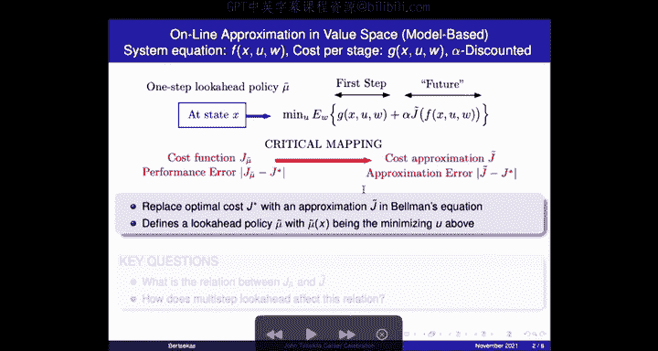
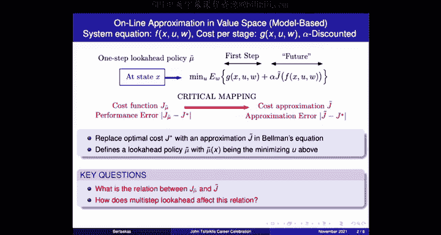
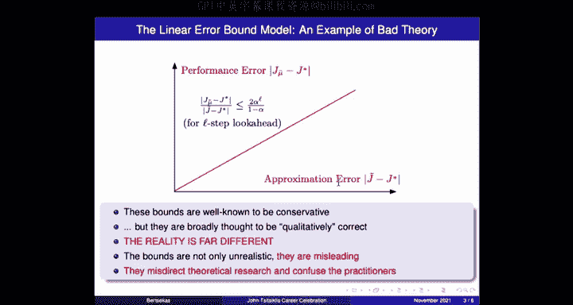
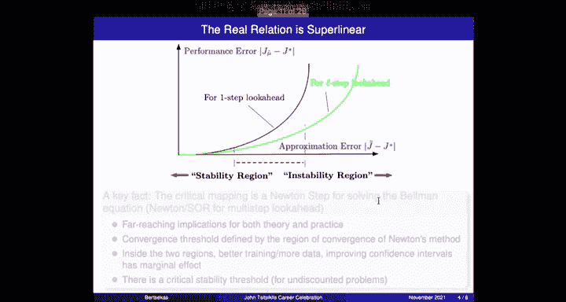
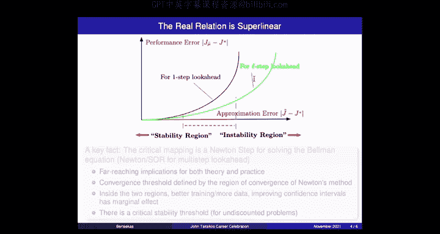
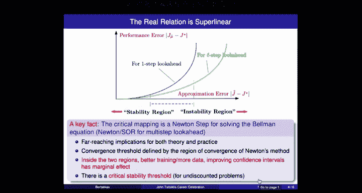
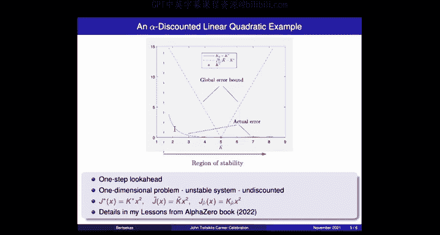
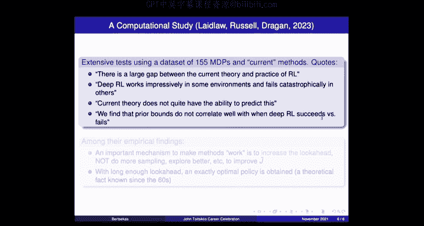
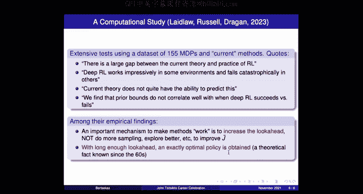

# 29：理论误差界限在强化学习中的失效 🚨

在本节课中，我们将探讨强化学习（RL）中主流理论与实际应用之间的连接问题。我们将通过一个具体例子说明，传统的理论误差界限往往与实际情况严重脱节，甚至可能误导研究和实践。

## 概述：理论与实践的鸿沟 🔍


在深入讨论之前，我们首先需要理解强化学习中的一个核心范式：**价值空间近似**。这构成了许多强化学习算法的基础。

上一节我们介绍了强化学习的基本框架，本节中我们来看看价值近似中的关键映射关系及其理论分析存在的问题。

## 价值空间近似与贝尔曼方程 📈

下图展示了一个在强化学习中常见的基本框架，涉及价值空间中的近似。


我们考虑一个无限时域上的折扣问题，其折扣因子为 **α**。系统方程由 **f** 描述，成本函数为 **g**。强化学习的许多工作围绕此图展开。

其核心思想是：我们用某个近似函数 **J̃** 来替代贝尔曼方程中的最优价值函数 **J***。然后，我们像在精确动态规划中一样进行最小化，只不过未来成本使用这个近似值 **J̃** 来估算。

用公式表示，在任一阶段，我们最小化两个分量的加权和：
```
min_u [ g(x, u) + α * E_w{ J̃( f(x, u, w) ) } ]
```
其中，**w** 是随机变量。如果没有随机性，则不需要期望算子 **E**。

## 关键映射：从近似误差到性能误差 🗺️

现在，这是许多强化学习方法的模型。其中存在一个关键映射，你需要理解：

你的近似函数 **J̃** 如何影响最终结果，即你得到的策略 **ũ** 的质量？这是你真正关心的问题。所有近似操作如何影响最终策略的性能？

这个关键映射就是将**近似误差**（**J̃** 与 **J*** 的差距）映射到**性能误差**（策略 **ũ** 的成本 **J_ũ** 与 **J*** 的差距）的函数。这是核心问题。



我们有以下一步前瞻策略（也存在多步前瞻，但为简洁起见不作展开）。关键问题是：策略性能 **J_ũ** 与价值函数近似误差之间的关系是什么？此外，前瞻步长如何影响这种关系？




## 传统的线性误差界限模型及其问题 ⚠️

针对上述问题，有一个标准的理论分析方法，即**线性误差界限模型**。

该模型认为，近似误差和性能误差之间存在某种线性关系。有一个源自20世纪60年代的经典界限（可视为一个“民间定理”）指出，两者的比值受一个与折扣因子 **α** 和前瞻步长 **L** 相关的量所限制。前瞻步长越长，界限越紧。这个量就是界限直线的斜率。

这是一个古老的界限。在我们早期的著作中，我们曾为此感到自豪，认为这是核心成果之一。当然，我们很清楚这些界限是保守的，真实关系远低于此界限。然而，我们曾认为它在定性上是基本正确的，即使不精确，也能反映大致趋势和定性结果。

但现实情况（我在亚利桑那州立大学讲授强化学习时才发现）却大相径庭。这个界限与现实**毫无关联**。真实关系**根本不是线性的**。

这些界限不仅不切实际，而且具有**误导性**。它们会将你引向概念上错误的路径。从这个意义上说，它们误导了理论研究，也混淆了实践者。




## 真实的超线性关系与牛顿法类比 🚀



真实关系不是线性的，而是**超线性的**。

对于一步前瞻，关系曲线如下图所示。换句话说，如果你保持较小的近似误差，那么你将获得极小的性能误差，在此区域内策略几乎是最优的，无论近似误差有多大，只要你保持在稳定性区域或收敛区域内。


同时，还存在另一个区域：即使你付出中等努力去改进近似误差，也可能一无所获，性能误差会灾难性地增大。



如果你使用多步前瞻，会得到更好的曲线。形状类似，但曲线更优。


关键事实是，如果你了解优化理论或数值分析，这会让你联想到**牛顿法**。牛顿法就是这样工作的。关键点在于：将近似误差映射到性能误差的映射，实际上就是求解贝尔曼方程的一个**牛顿步**。

在多步前瞻的情况下，该映射是一个**牛顿SOR步**（逐次超松弛）。它包含一个牛顿步，但前面有若干次一阶方向迭代，正是这使曲线向右移动。

## 对理论与实践的深远影响 💡

我认为，这对理论和实践都有深远的影响。

它表明，如果你处于“好区域”，即牛顿法的收敛区域内，那么无论你训练多久、如何改进你的置信界限，你都会表现得非常出色。另一方面，如果你处于稳定性区域之外，那么无论你做什么，你都将陷入困境，收集更多数据等方法也无济于事。

还存在一个中间区域，在那里你可能会幸运地获得良好性能，但并非总是如此。

因此，这里存在一个由牛顿法收敛半径定义的**收敛阈值**。在两个区域内，所有技巧、度量和数据收集手段的边际效应都很小。



至少对于无折扣问题，存在一个关键的**稳定性阈值**。这些问题总是需要稳定的压缩映射、稳定方程等。


## 一个简单示例：理论与现实的脱节 📉

为了给你一个直观的印象，这里有一个涉及一维系统的线性二次型问题示例，采用一步前瞻，但系统本身是不稳定的（若不加控制），且问题是无折扣的。

下图展示了经典误差界限给出的预测（即所有人依赖进行分析的那个界限），以及实际计算出的误差。两者之间**毫无关系**。这个界限与现实没有关联。

此外，这个界限还有一些细微之处。例如，右侧的界限比左侧的界限好得多。如果你研究牛顿法，你就会明白为什么这是真的。你还会在这里看到**稳定性阈值**。如果你的近似误差位于这个稳定性阈值的错误一侧，那么无论你做什么，都会得到一个不稳定的系统。

## 与实证观察的一致性及最新研究 🧪



这一切解释了我自20世纪90年代以来收集和持有的一些观察结果。所有经验都与这一分析一致。

但最近（几个月前）出现了一项有趣的计算研究，来自伯克利大学的Russell和Dragan教授（Russell是人工智能领域的知名人物），以及一名叫Lightlow的研究生。

他们进行了迄今为止最广泛的关于强化学习方法和问题的计算研究。他们编译了155个MDP基准测试集，其中一些规模非常大，均来自文献中可用的基准数据集。

以下是该论文的一些引述：
*   “当前强化学习的理论与实践之间存在巨大差距。”
*   “深度强化学习在某些环境中表现惊人，在另一些环境中却灾难性地失败。”
*   “当前理论无法预测这一点。”
*   “我们发现，先前的界限与深度强化学习何时成功或失败关联性很差。”





他们得出的主要实证发现是：使方法奏效的一个重要机制是**增加前瞻步长**。例如，AlphaGo的成功被认为是因为其具有很长的前瞻步长。有多种方法可以增加前瞻步长，包括使用某个策略进行推演。

因此，对他们而言，这是关键。计算结果表明：只要前瞻步长足够长，近似的质量就无关紧要。

他们得出了一些关于前瞻步长的结论（我并非完全同意所有结论），但一个突出的结果是：**无论近似误差如何，只要前瞻步长足够长，就能获得精确的最优策略**。顺便提一下，这是一个自20世纪60年代以来就已知的理论事实。



## 总结 🎯


本节课中，我们一起学习了强化学习中理论误差界限的局限性。我们通过分析价值空间近似中的关键映射，揭示了传统的线性误差界限模型与真实超线性关系（类似于牛顿法行为）之间的严重脱节。这种脱节导致理论界限无法预测算法在实际中的成功与失败，尤其是在稳定性阈值附近。最新的实证研究也强调了增加前瞻步长的重要性，这在一定程度上与我们的分析相吻合。理解这种理论与实践的差距，对于指导未来的强化学习研究和应用至关重要。