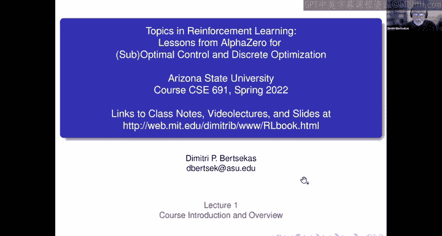
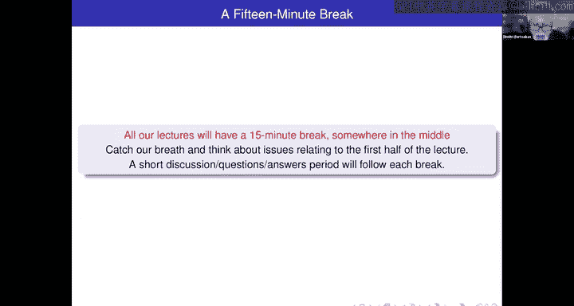
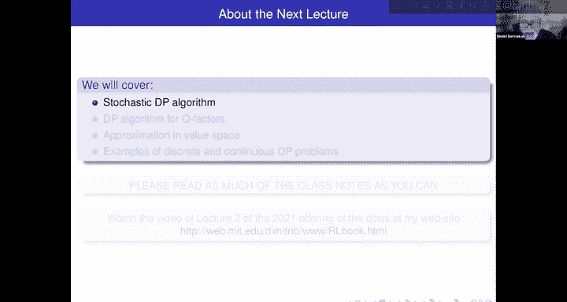

# 30：强化学习导论与课程概述 🎯

在本节课中，我们将学习强化学习的基本概念、课程的整体框架，并通过AlphaZero等经典程序理解强化学习的核心设计范式。我们将从历史背景讲起，探讨强化学习与决策控制、动态规划等领域的联系，并介绍牛顿方法在强化学习框架中的重要作用。

---

## 欢迎与课程介绍 📚

欢迎来到亚利桑那州立大学的强化学习课程。这是我第四次在ASU讲授这门课程，每次内容都有所不同。如果你之前上过这门课或看过相关视频讲座，本次课程仍会有新的内容。

课程笔记、视频讲座和幻灯片链接均可在我的网站上找到。对于拥有ASU账户并能访问Canvas平台的同学，相关材料也会发布在Canvas上，包括公告和其他资料。

第一讲将是对课程的介绍、概述以及对一些基本概念的讨论。

---

##大纲概览 📋

以下是本次课程的大纲：
1.  **从AlphaZero开始**：介绍这个几年前发布的卓越国际象棋程序，它激发了人们对强化学习前景的巨大热情。我将解释其两个主要组成部分算法：离线训练算法和在线对弈算法。同时，我将说明AlphaZero如何作为我们课程设计原则的指导范例，以及其算法如何扩展到更广泛的领域。
2.  **历史背景与基本概念**：深入探讨该领域的历史渊源和一般概念，包括其起源以及决策控制与人工智能社区中实践的强化学习之间的联系。
3.  **课程与其他领域的联系**：讨论本课程与各个领域的关联。
4.  **牛顿方法**：介绍一种将课程各个部分联系起来的数学算法——牛顿方法。它将成为我们使用框架的重要组成部分。
5.  **课间休息**：本次讲座大约两小时，中间会有15分钟的休息时间，未来的讲座也会如此。
6.  **具体技术问题**：介绍确定性问题的动态规划算法，并给出其在离散优化问题（状态数有限）中的应用示例。
7.  **课程组织事宜**：讨论课程的一些组织问题。

---

## AlphaZero与TD-Gammon：强化学习的范例 🏆

让我们从AlphaZero谈起。同时，TD-Gammon是另一个著名的程序。AlphaZero下国际象棋，而TD-Gammon玩双陆棋，这是一种涉及策略和机会的复杂游戏。

这两个程序相隔25年。AlphaZero于2017年问世，以其卓越的对弈质量和原创性引起了轰动。TD-Gammon同样令人印象深刻，它在25年前问世，当时也激发了人们对强化学习前景的巨大热情。

这两个程序在结构上非常相似，都涉及两种算法。有时人们没有意识到AlphaZero涉及两种算法。

*   **离线训练算法**：学习如何评估棋局位置，以及如何针对不同位置生成走子。该算法使用神经网络近似，并利用数据进行长时间训练，这是其主要组成部分之一。
*   **在线对弈算法**：离线训练在程序面对任何真实对手之前进行。在线对弈在离线训练完成后使用，用于与人类或其他计算机程序对弈。它使用多步前瞻、截断模拟和代价函数近似。

这两种算法与动态规划（策略迭代的基本方法）以及强化学习类型的近似思想（如神经网络近似架构）有着紧密联系。我们将在课程中尝试理解AlphaZero和TD-Gammon的方法论，以便将其应用于更广泛的领域。

例如，该方法适用于控制系统设计（我们将重点关注的领域），特别是模型预测控制和自适应控制。这些是已存在多年的成熟方法学。我们将尝试在AlphaZero和TD-Gammon算法的背景下看待它们。

我们还将讨论离散优化问题，如组合优化这类困难的NP难问题，以及如何通过模拟算法（这些程序，特别是TD-Gammon，也内在地使用了这种算法）来解决它们。随着课程的深入，我们将解释其原因。

---

### AlphaZero的在线对弈算法

现在，我将讨论AlphaZero的在线对弈算法，然后是离线训练算法。

在线对弈算法是图中蓝色的部分。它针对给定的棋局位置（更一般地，状态 `Xk`）生成一步走子。我主要讨论AlphaZero，但相同的架构也适用于其他程序以及更一般的领域。

蓝色的部分是在线对弈，它使用离线训练的结果（图中红色的部分）。它使用通过离线训练获得的位置评估器，以及一个经过训练、能够针对位置生成走子的“玩家”。

在线对弈旨在改进基线玩家，具体方式如下：在给定的国际象棋位置，它通过前瞻树向前搜索几步走子和应对走子，直到达到一定深度。然后，在到达该树的叶子节点后，它使用基线玩家再模拟几步走子，直到达到这些终端叶子位置。接着，它使用终端位置评估来近似未来走子的影响。

因此，沿着这棵树的任何一条路径，我们在末端都有一个位置评估值。我们将这些值反向传播到根节点，从而获得该位置每个可能走子的价值。我们选择最佳走子。这就是走子的选择方式。然后我们进入下一个位置，重复相同的过程，选择下一步走子，继续前进。

这里有一个复杂之处，因为这是一个涉及两名玩家的游戏。但让我们假设有一个固定的玩家，那么问题就变成了单玩家问题。当有两名玩家时，被称为“截断模拟”的中间部分也涉及走子和应对走子，并且两名玩家都使用基线玩家。

需要指出的是，AlphaZero的已发布版本不包含这个中间部分。原因是AlphaZero中的前瞻树非常长，因此不需要额外的模拟。另一方面，TD-Gammon非常关键地依赖于这个中间部分。原因是TD-Gammon涉及随机游戏，因此前瞻树扩展得非常快，在随机游戏中无法拥有很长的前瞻树。TD-Gammon依赖于以更廉价、计算量更小的方式生成走子来扩展前瞻。

这种架构类型与模型预测控制中使用的架构非常相似。在模型预测控制中，我们想要控制动态系统的状态（通常取自连续空间），使用连续空间的控制。我们在每个阶段选择一个控制。在模型预测控制中，存在针对少数步骤的前瞻最小化（称为控制区间），有时还会使用某个稳定控制器进行模拟（称为预测区间），以及终端代价函数近似。除了上下文不同（特别是离散状态空间与连续状态空间的区别）之外，架构惊人地相似。

在离散优化中，也存在类似的架构，它使用某种启发式方法作为基线玩家。在离散优化中，通常可能根本没有离线训练，只是使用给定的启发式方法进行模拟。然而，在其他方面，架构非常相似。

这就是我们的基本架构，也是在线对弈的工作原理。

---

### AlphaZero的离线训练算法

那么，在AlphaZero中，我们如何获得基线玩家和位置评估器呢？使用的是策略迭代算法，这是动态规划的基本算法，但采用了近似版本，并使用自生成的数据。

这里的算法生成一系列玩家。玩家是一个在给定位置选择走子的软件，我们也使用术语“策略”，就像在策略迭代中一样。其思想是，当前玩家被用来训练一个改进的玩家，然后这个过程重复进行，改进的玩家扮演当前玩家的角色，依此类推。

策略迭代涉及两个基本模块：策略评估（评估当前策略）和策略改进（生成改进的策略）。通过让当前玩家与自己进行许多对局来评估当前玩家。当前玩家的表现结果通过训练以价值网络的形式表示。基本上，我们从当前玩家那里获得大量性能数据，并通过神经网络回归拟合（或称为最小二乘拟合）来近似这些数据。然后，通过某种形式的多步前瞻最小化（特别是AlphaZero中使用的蒙特卡洛树搜索）来改进当前玩家。我们获得改进策略的样本（改进的控制），并用神经网络拟合以获得策略网络，该网络生成走子概率或在任何给定位置生成最佳走子。

这就是涉及一系列玩家的循环。最终，我们获得最终玩家，并将其提供给在线对弈算法，供其在自己的软件中使用。

TD-Gammon使用了与AlphaZero类似的策略迭代算法，只是它不使用蒙特卡洛树搜索。蒙特卡洛树搜索并非根本性的，可以用其他形式的搜索（包括穷举前瞻树搜索）替代。此外，TD-Gammon不使用策略网络，它通过价值网络复制了策略网络的功能。但从根本上说，离线训练的算法与AlphaZero相同。

模型预测控制和通过模拟进行的离散优化通常不使用如此复杂的离线训练形式，它们使用其他方案，有时非常基础。

---

### 关键经验观察

现在，让我重新审视这张图，看看在线对弈如何与离线训练连接，并给出一个重要的经验观察：**在线玩家通常比离线训练的基线玩家有显著改进**。

具体来说，在线玩家的下一步走子及其性能函数，要比位置评估器预测的或基线玩家获得的性能好得多。这是一个事实：AlphaZero的在线玩家下出了非凡的国际象棋，相比之下，基线玩家下的棋很平庸。两者之间存在天壤之别。这是一个重要的观察结果，它表明，如果在离线训练之上应用在线对弈，可以获得显著的性能提升。

有同学提问：我们能否从理论上保证在线对弈更高效？实际上，这将是本课程的主要内容之一，我们将解释为什么会发生这种情况，并将这一观察扩展到更一般的领域。这是一个支持我们将要发展的理论的经验观察。

另一个经验观察是，在TD-Gammon中，如果去掉中间部分（模拟），它的表现会差很多。TD-Gammon的创始人Gerald Tesauro有两个算法：一个在1991年，基本上只有离线训练或位置评估器，以及一两步前瞻，但没有中间的截断模拟。他在1991年开发的程序已经相当令人印象深刻，接近击败最好的人类，但总体上仍有一些低于人类水平的表现。在1996年，他引入了这个中间层（顺便说一下，“模拟”这个名称的灵感来源于Jack Baczynski），他发现引入这个中间部分后，性能大幅提升，以至于他的程序能够击败最好的人类，并且其性能自那时起就未被超越。在双陆棋圈子里，带有模拟的TD-Gammon被视为黄金标准，甚至被视为最优的，尽管它并非最优，但它下得如此之好，以至于被视为最优。

这些都是有趣的观察结果，我们在这门课程中希望解释这些观察结果，并在更广泛的背景下应用它们。

---

## 本课程的目标 🎯

那么，我们在这门课程中旨在做什么？我们将尝试进行统一，为大规模计算的几个领域提供一个统一的框架：
*   人工智能社区实践的强化学习。
*   优化和运筹学社区部分领域实践的近似动态规划。
*   控制系统社区实践的模型预测和自适应控制。
*   算法和计算机科学社区实践的部分离散优化、组合优化。

为此，我们将依赖于动态规划理论，包括精确、近似以及抽象动态规划理论。

本课程将大量使用可视化，基于贝尔曼方程、贝尔曼算子、动态规划等概念的直观可视化。尽管抽象动态规划的理论相当数学化，但幸运的是，它也允许直观的可视化，我们将大量依赖这些可视化来理解各种概念。

我们将从一定距离上遵循AlphaZero和TD-Gammon的设计范式，并基本上推广它们的架构。

最后，与牛顿方法将有一个重要的联系。这是你在微积分中学到的牛顿方法，但经过一些调整以适应动态规划的背景——应用于贝尔曼方程的牛顿方法，它连接了上述所有内容，并为之前有同学提出的问题（关于为什么在线对弈能改进离线训练）提供了数学解释。

在这样做的过程中，我们将旨在弥合不同社区文化之间的差距，并将强化学习应用于非常广泛的应用领域。

---

## 学科历史与跨领域协同 🤝

让我现在谈谈该学科的历史。当前的技术水平很大程度上得益于人工智能与决策控制之间富有成效的协同作用，特别是动态规划。

精确动态规划是一个非常古老的领域，可以追溯到20世纪50年代。你会听到贝尔曼的名字，他是动态规划之父；香农，信息论之父，顺便也是计算机国际象棋之父。围绕动态规划已经发展出非常广泛的理论，历时60年或更久。

强化学习在人工智能领域曾是一个停滞不前的领域，直到20世纪80年代。然后，在该领域工作的人们发现，他们所做的很多事情可以用动态规划的思想来解释。因此，在80年代末和90年代初，思想出现了汇合。这产生了很大的兴趣。但所有这些可能不会有多大影响，除了在90年代初，Tesauro的双陆棋程序非常令人印象深刻，激发了对强化学习和动态规划思想的极大热情和关注。许多人进入了这个领域，我也是因为对Tesauro的程序印象深刻而进入这个领域的。

90年代是一个非常活跃的时期。取得了突破性进展，发明了新算法，所有算法都被理解。考虑了许多应用，第一批书籍在90年代中期问世。随着时间的推移，发生了一些大趋势。机器学习在2000年代变得非常重要，使用大数据解决复杂问题变得非常流行。机器人学变得非常活跃，神经网络再次活跃起来，特别是深度神经网络，这带来了一些重大成功。所有这些都有助于在强化学习领域创造活动和进展。

最后，在2016年出现了AlphaGo程序，2017年出现了AlphaZero程序，它们真正将这一领域推向了前沿。强化学习现在是一个非常热门的领域，我将解释为什么会这样。

但在此之前，让我也提一下，围绕这两个领域之间的协同作用，结合了许多互补的思想。两个领域都有很多贡献。一是人工智能通过数据和经验学习的思想。模拟的思想非常重要，这在动态规划中是未知的；使用模拟以及动态规划中的无模型方法在当时是未知的。围绕使用特征、神经网络等进行近似的各种思想是由人工智能贡献的，然后是各种启发式思想，如A*搜索、游戏等。同时，决策控制提供了许多数学和基本概念，如最优性原理、马尔可夫决策过程或部分可观测马尔可夫决策过程的理论，以及策略迭代、价值迭代等算法。所有这些都是非常协同的，每个领域都从另一个领域借用了非常重要的组成部分来补充他们已有的实践。

---

## 为什么强化学习现在很重要？🔥

现在回到为什么这个领域变得重要。强化学习现在既雄心勃勃又具有普适性。我的意思是，它适用于非常广泛的问题，这是事实。对于精确动态规划，它原则上适用于确定性问题和随机问题；适用于具有离散状态空间的组合优化问题；适用于具有无限状态和控制空间的最优控制问题；涉及一个决策者或两个玩家的博弈问题。

然而，精确动态规划有一些主要困难：
1.  **维度灾难**：指随着问题维度的增加，计算需求呈指数级爆炸。
2.  **需要数学模型**：为了应用精确动态规划，至少在过去，你需要描述系统动态的方程，需要概率分布，而这些方程在实践中很难获得。

近似动态规划和强化学习通过两种方式克服了这两个困难：
*   **通过近似**：使用神经网络和其他近似架构来降低问题的维度。
*   **使用计算机模型代替数学模型**：基于模拟的计算机模型，通过计算机模拟数学模型的动态。当然，计算机模型也实现了一个数学模型，但它可以实现那些在数学上非常复杂、难以写出和理解模型。因此，在某些情况下，使用计算机模型代替数学模型非常方便。模拟和计算机模型是强化学习不可或缺的一部分。

---

## 当前技术水平与挑战 ⚖️

当前的技术水平如何？我们拥有一个广泛适用的方法论，因为它继承了精确动态规划的通用性。它可以解决非常广泛的具有挑战性的问题：确定性、随机性、动态、离散、连续，几乎所有优化问题都可以表述为动态规划问题，通常这是唯一的方法。因此，动态规划的范围非常广泛，强化学习的范围也同样广泛。

另一方面，**在这个领域，没有保证有效的方法**。你会在文献中看到宣传的方法，人们说它们在他们的问题上效果很好，但当你将它们用在你自己的问题上时，可能会发现它们不起作用。这可能有多种原因：方法可能不适合你的问题；你的问题可能非常具有挑战性；你可能没有正确实现，需要调整等等。实践表明，没有保证说如果你尝试一个知名的方法，它就会在你的问题上起作用。

另一方面，有足够多的方法可以尝试。每一种方法都有合理的成功机会。希望其中一种方法能解决你的问题。这取决于你对你问题的理解程度，你对方法的理解程度，以便将方法与你的问题匹配起来，也取决于运气，我们不要低估运气的作用。

理论在这里的作用是构建数学化的方法论。我们将通过数学和中心化的可视化来实现这一目标。这个领域有很多“艺术”成分。因此，理论有助于指导这种“艺术”，并区分合理的想法和疯狂的想法。在期刊文献中，你会看到许多没有坚实数学结构的疯狂想法，理论将有助于区分合理的想法和疯狂的想法。

---

##参考资料与术语差异 📖

让我也谈谈课程与其他领域的联系。我们的课程是研究导向的，旨在以研究生水平探索最新技术。我们将在一些主题上深入探讨，如我之前提到的模拟、策略迭代和牛顿方法。其目的是让你有机会探索你最近感兴趣的研究方向，因为它们与这个领域相关。

我们将使用的参考资料。正如我所说，我之前已经讲授过这门课程三次。这本书是第一次开课的成果，这本书是第二次和第三次开课的成果。而这本书是我现在正在编写的，是为我们现在这个班级的需求准备的。有一个相当完整的PDF草稿在课程网站上，你可以阅读。还有课堂笔记，其中包含了很多内容，并专注于我们将在本课程中讨论的主题。这些也在课程网站上。最后，还有很多其他材料，包括幻灯片、论文、以前开课的视频。所以总共有大量材料，足够你学习，除非你想更深入地研究这个主题，那样你就需要阅读这些书籍，并更深入地学习精确动态规划。我有一套两卷的动态规划书籍，总共超过1000页，包含了你可能想知道的关于动态规划的所有内容，也有很多关于近似动态规划的材料。最后，我有一本抽象动态规划书籍，与本课程相关，特别是与牛顿方法相关。第三版刚刚出版，课程网站上有一个PDF可以查阅。还有1996年的《神经动态规划》一书，它比本课程水平更数学化，但其中的思想在今天仍然相关。从人工智能的角度来看，有Sutton和Barto的书，1998年出版，几年前在线出版了新版本。它的风格不同，不那么数学化，更贴近人工智能的文化，在人工智能领域非常受欢迎，你可以查阅以了解另一种观点。我们将主要从动态规划和决策控制的角度来处理这个主题，但也会关注人工智能领域的发展，并尝试提供进入该领域的切入点。

---

### 术语差异与符号系统

我提到过，强化学习和决策控制之间有着非常富有成效的互动。不幸的是，这两个领域有不同的文化、不同的数学、不同的语言以及不同的术语。因此，我在这张幻灯片上准备了一个有限的术语表，以便你在两个领域之间翻译术语。你的课堂笔记中有一个更大的术语表。

一个令人烦恼但并非那么重要的区别是，强化学习使用最大化，而动态规划使用最小化。因此，在决策控制中最小化的阶段代价总和，在强化学习中转化为最大化的阶段奖励。状态代价转化为状态价值。代价函数转化为价值函数。所有这些都不是很重要，你可以很快学会在脑海中转换。

然而，不幸的是，术语上还有一些更显著的差异。在决策和控制中，决策由决策者或控制器做出，而在强化学习中，等效的术语是“智能体”。在决策和控制中，应用的是“控制”，而在强化学习中使用的术语是“动作”。决策控制使用动态系统的语言，如微分方程、离散时间方程、偏微分方程，存在某种在控制影响下状态演化的动态系统。在强化学习中，动态系统被称为“环境”。对于来自决策控制领域的人来说，这种转换有点难以适应，至少对我来说是这样。

关于方法，“学习”一词在强化学习中使用，它是名称的一部分，并且在许多不同的意义上使用。主要含义是：学习