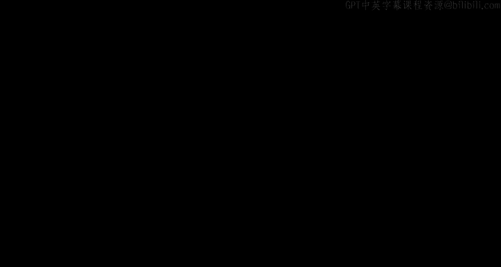
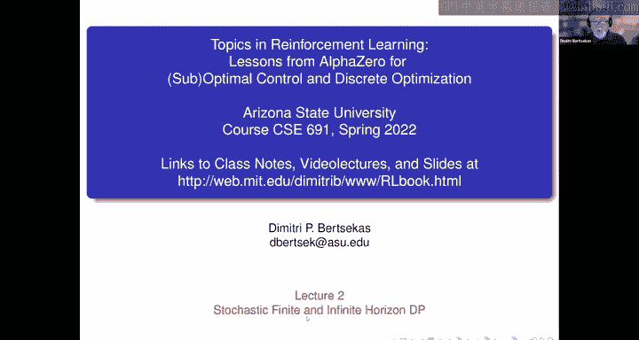
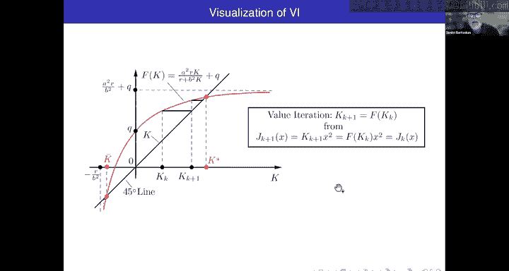

# 31：随机动态规划，有限与无限时域 🎯

在本节课中，我们将学习随机动态规划问题，涵盖有限时域和无限时域两种情况。我们将从确定性问题的回顾开始，然后引入随机性，并探讨一个重要的特例——线性二次型问题。最后，我们将深入无限时域问题的理论和算法。

---

## 回顾：确定性动态规划算法 🔄

上一节我们介绍了确定性动态规划问题。本节中，我们来看看其核心算法。

我们讨论的是涉及N个阶段的确定性动态规划问题。状态从时间0开始，一直持续到最后阶段N，由x0, x1, ..., xn表示。在状态xk下，我们施加控制u，根据一个方程转移到状态xk+1。该阶段对应的成本如上所示。

我们的公式允许任意的状态和控制空间。状态和控制可以是有限个值，也可以是无限个值。给定一个控制序列，会产生所有这些成本，并且还有一个终端状态成本。这是我们的成本函数。我们的目标是，对于给定的初始状态x0，在所有控制序列上最小化这个总成本表达式。

对于每个序列，这个成本是定义的，并且也是初始状态的函数。最优成本函数通过对所有控制最小化该表达式获得，它同样依赖于状态x0。我们用J*表示最优成本或任何最优的东西。

动态规划算法专注于计算所有尾部子问题的最优成本。它从一个只涉及终端状态的平凡尾部子问题开始，然后向后计算。对于每个阶段k和状态xk，我们通过如下方式求解对应的尾部子问题：对于每个可能的控制，我们计算该状态的阶段成本，并加上之前计算的、从下一个状态开始的剩余阶段的最优成本。

我们首先向后计算JN*，然后是JN-1*，一直到J0*，它是初始状态x0的函数。论证表明，这恰好是问题的最优成本。我们可以基于最优性原理来证明这一点，在课堂笔记中有更正式的数学证明。

你可以将此视为离线完成的计算。它必须离线完成，因为它涉及大量计算，你必须为每个阶段和每个状态进行所有这些操作。状态可能非常多，因此这可能是一个巨大的计算量。

同时，我们可以通过在线执行来构造最优控制序列。从状态x0开始，我们仅针对该状态进行此计算，并且我们已经从离线训练中计算出了J1*。我们找到u0*，这将生成下一个状态x1*。然后我们向前一步到下一个状态，再次进行此计算，使用我们已计算出的J2*，以此类推，直到最后，我们以这种方式构造出整个最优控制序列。

以下是关于Q因子的说明：
我们暂时不会使用Q因子这个术语，但稍后会有所帮助。如果你看动态规划算法大括号内的项，即你最小化的第一阶段成本和未来成本，它依赖于状态和控制。我们通过这里的表达式定义对应于xk和u的最优Q因子。如果我们知道Q因子，那么我们可以通过最小化这里的表达式来计算最优成本。因此，我们也可以结合这两个方程，用这些Q因子来写出动态规划算法。

Q因子定义如下：我们取k+1处的这个表达式，将其代入此处，得到此处的表达式。我们在此处对uk+1进行最小化，剩下一个依赖于xk和uk的项。这就是最优Q因子，它是假设我们从xk开始，选择uk作为第一个控制，之后最优行动时的最优成本。

现在，强化学习中有一类算法称为Q学习。这是Q学习的一种简单形式，但我们将讨论涉及近似和更复杂事物的其他形式。目前，我们暂且将其视为动态规划算法的Q学习形式。

---

## 近似与Rollout算法 🧩

计算J*k需要进行大量计算，因此这里的想法是在在线执行阶段用某种近似来替代Jk*。

我们从初始状态x0开始计算这个最小值。它涉及的不再是J1*，而是使用J̃1。然后我们找到这个控制，接着向前一步，从x0依次前进到x1、x2，依此类推，每次通过此计算选择一个控制，这正是动态规划公式，但用J̃代替了J*。

如果我们知道J̃，那么计算量比使用J*要小得多。但是，我们如何计算J̃呢？这是一个核心问题，也是强化学习中的主要议题之一。在许多强化学习中，我们试图做的就是找到合适类型的J̃，并以合理的计算量实现。

有几种不同的方法可以做到这一点。一种方法是我们称之为离线问题近似。这里我们使用一个更简单问题的最优成本函数作为J̃。我们通过精确动态规划离线计算这个更简单问题。我们简化问题、简化动力学、简化其他约束，得到一个更容易的问题，我们离线计算其解，得到解后将其作为J̃插入到我们的原始问题中。聚合方法是此类方法中的一种。

另一种可能性是通过更短时域的最小化来计算这些值，通过多步前瞻在线计算它们，并可能添加一个简单的终端成本。这通常是在模型预测控制中完成的，我们稍后会讲到这类方法。

另一种可能性是使用神经网络或其他类型的近似架构进行训练。我们通过从一类依赖于状态和参数的函数中选择这些J̃来计算它们。例如，这个参数是神经网络的权重集。我们训练神经网络，找到拟合数据的参数，然后将它们代入此处，这将成为我们的J̃。这是一种非常流行的方法，我们将在后面详细讨论。

另一种可能性是使用启发式方法的Rollout。我将演示并解释这一点，并将这些其他方法的讨论推迟到以后。

记住，我们想要做的是在线计算在每个遇到状态下的控制。假设我们通过在线执行生成一条从x0到xN的单一轨迹。我们从x0开始，在每一步我们到达一个状态，称之为当前状态xk。到达该状态后，Rollout算法执行以下操作：它生成该状态下所有可能的控制。然后，对于每一个控制，它运行一个启发式方法，从xk+1到xN生成一条轨迹，并产生与之相关的成本，即从该处到此处所产生的转移成本。因此，对于每个可能的控制，我们计算此项加上启发式成本，得到一个近似的Q因子。然后我们对所有控制都这样做，计算此项加上启发式成本。接着，从所有这些启发式成本中，我们找到最小化此表达式的那个，这就是我们在xk处施加的控制。因此，我们在这里计算这些Q因子，找到最小化Q因子的控制，向前一步，然后再次执行，从下一个可能的状态再次运行启发式方法，依此类推。通过这种方式，我们一步一步地生成一条完整的轨迹。

让我举一个例子。这是一个旅行商问题示例，与上一讲中使用的例子相同。它涉及四个城市A、B、C、D，这是一个城市间旅行成本的矩阵。我们将此问题表述为一个动态规划问题，其中状态是部分旅行路线。例如，这是涉及状态A、B然后C的部分旅行路线。这是涉及A、B、C、D的部分旅行路线，只能通过返回A来完成。因此，从每个部分旅行路线，通过添加一个符合条件的城市，我们得到一个更长的部分旅行路线，直到到达终点。这是初始状态，第一阶段、第二阶段等等。成本由这个城市间旅行矩阵给出，例如，从A到D的成本是20，我们写在这里。这些黑色数字是由矩阵给出的成本。

我们通过动态规划、精确动态规划解决了这个问题，这非常简单。我们计算了这些红色数字，这些红色数字是尾部子问题的最优成本。例如，这是从此处开始一直到此处的最优成本，8是从这里到...你实际上必须在这两者之间选择，结果证明这个是最好的。我们在上一讲中已经完成了动态规划算法，并计算了最优成本。

现在，我们将使用Rollout来次优地解决这个问题。在我们将要讨论的Rollout算法中，我们将使用一个特定的启发式方法，即最近邻启发式方法。在给定状态下，该状态对应于一个部分旅行路线，我们查看所有符合条件的下一个要去的城市，然后前往旅行成本最近的那个。

我们在这里为所有符合条件的城市这样做，并运行最近邻启发式方法直到终点，比较所有这些部分旅行路线的成本，然后选择在该成本方面最佳的城市。

现在，我将演示该问题的Rollout算法。让我们从初始状态运行基本启发式方法，即最近邻启发式方法。在所有三种可能性中，这是最近邻，成本为1，所以我们去这里。一旦到达这里，有两种可能性：去C或去D，最近邻是D。然后没有选择，只有一个选择，所以我们一直走到终点。因此，最近邻启发式方法生成了这条轨迹，我们称之为T0，在这种情况下成本为28。

现在，让我们从状态x0执行Rollout算法。我们必须生成所有可能的下一个城市，然后从每一个城市运行最近邻启发式方法。考虑这个分支。最近邻启发式方法查看这两个邻居，找到最近的一个并去这里，然后去这里，再去这里。因此，最近邻启发式方法将从这里生成这条轨迹，整体轨迹将是这条。红色是... 抱歉，是这条。现在，我们已经为下一个城市B完成了计算。现在，对于下一个城市C，我们必须再次运行相同的计算，从这里运行基本启发式方法（最近邻、最近邻、最近邻），所以这里的成本是28，而那个分支的成本是27，所以我们更喜欢这个分支而不是那个分支。再看看第三种可能性，我们去这里然后运行最近邻启发式方法，这成本非常高，所以我们拒绝这个分支。Rollout算法在初始状态x0处选择了这个分支。

现在，我们再次进行计算。我们查看可能的选择C和D，并从每一个运行基本启发式方法（实际上没有选择），然后比较这个分支和这个分支的成本。结果是这个分支。Rollout算法在这个城市将选择去那个城市，总成本将是13。因此，我们改进了之前的选择。然后，Rollout算法将移动到这里，接着除了去这里然后去这里之外没有选择。

我们从一个基本启发式方法开始，得到了这条轨迹。我们进行了一步Rollout，得到了这条更好的轨迹。然后，在这一点上，我们又进行了一步Rollout，得到了这条轨迹。每次我们都改进了成本，Rollout算法给了我们13，这也是最优成本，而基本启发式方法给了我们28的成本。

我们将在一般情况下证明，使用基本启发式方法的Rollout会改进启发式方法。其启发式的原因是，它更深入地展望未来，而基本启发式方法根本没有探索最优解所在的这个区域。Rollout算法探索了更多通往...的路径，并在第二步发现了这条路径，而不是第一步。这是计算过程，你们的第一次作业（下周截止）将要求你们对一个涉及五个城市的更复杂问题重复此计算。

---

## 随机动态规划算法 🎲

上一节我们回顾了确定性算法。本节中，我们来看看系统方程涉及随机参数Wk的随机版本。

系统演化如上所示，但在你选择控制后，下一个状态是不确定的，它受到Wk这种不确定性的影响。成本也是随机的，可能依赖于Wk。

这个Wk根据上下文可以是几种不同的东西。它可能是物理噪声（例如，如果你在处理飞机这类问题时的风噪声）、市场不确定性（金融问题）、库存需求、故障等等。实践中的大多数问题都涉及随机性。然而，出于方便和计算可处理性的原因，有时我们忽略随机性，将问题视为确定性的。但现在我们要处理随机问题。

关于成本函数：如果你应用一系列控制，你会在每个阶段获得成本，还有一个终端成本。然而，这些成本是随机的，因此为了得到一个与序列相关联的数字，我们必须取这个随机量的期望值，超过此处随机量的联合概率分布。

我们考虑策略。策略与控制不同，它们是选择控制的规则。一个策略π由N个从状态到控制的函数组成。它告诉我们在任何给定阶段施加什么控制，就像一个查找表。对于每个可能的状态，它给出要施加的控制。这就是我们所说的给定阶段的策略，整个策略是N个阶段的所有策略的集合。这也称为闭环控制，因为它考虑了当前状态的知识。也称为反馈策略。

我们假设在这里我们将观察状态xk，并相应地采取行动，了解该状态。这与在确定性问题中选择一个先验控制序列不同。在这里，通过使用反馈，在了解状态的情况下选择控制，由于问题的随机性质，对我们是有益的。如果我们选择一个先验序列而不了解状态，那么我们不知道我们会落在哪里，或者我们可能会做出糟糕的选择，但通过了解状态，我们可以做出更智能的控制选择，这样做在成本更小方面有好处。这就是为什么我们关注策略，策略绝对是比单纯的控制更复杂的对象。

现在，假设我们有一个策略π，我们将其代入成本函数，我们将在这里得到一个随机数，取该随机数的期望值，然后我们得到一个确定的数字，一个实数。它依赖于初始状态，这就是从状态x0开始的策略π的成本。在所有策略上最小化，得到一个仅依赖于初始状态的函数，这就是问题的最优成本函数。我们的目标是找到J*，并找到一个达到此最优的策略。我们将使用动态规划来实现。

以下是随机动态规划算法。与确定性算法类似，它产生所有尾部子问题的最优成本。这是从阶段k开始、状态为xk的尾部子问题的最优成本。我们向后计算。我们从只涉及终端成本的最平凡尾部子问题开始。然后，对于每个状态xn-1，我们计算阶段n-1的尾部子问题的最优成本：第一阶段成本加上从状态n开始的尾部子问题的最优成本（即这个）。我们计算Jn-1*并向后进行，这与确定性情况下的计算完全相同，只是我们引入了这个期望，因为问题是随机的。从x0开始的最优成本在最后一步获得。

这个算法将给出从每个初始状态出发的所有最优成本。同样，这对于确定性情况也是成立的。这个计算也会同时给出最优策略的组成部分。在每个阶段k，通过找到最小值并将uk*(xk)设置为达到该最小值的控制（对于每个状态xk，无论什么控制达到最小值，就是最优控制），可以与计算同时构造uk*。这是策略查找表中的一个条目。

这是一种方法，但还有另一种方法。你可以将这种向后计算视为离线训练：我们计算所有这些J*。假设我们已经计算了这些J*。我们可以通过在线执行、顺序向前来生成并实施最优策略。在每个阶段k，观察当前状态，并应用最小化此表达式的控制。通过这种方式，我们在线构造最优策略，进行N次最小化，每个阶段一次最小化，我们观察当前状态并进行此最小化以应用最优控制。

然而，问题在于我们需要知道Jk+1*。因此，我们无法逃避必须进行此计算，而这可能是压倒性的。它甚至比确定性问题更糟糕，因为我们必须为每个xk和uk计算一个期望值。

在强化学习中，我们试图通过使用近似成本函数而不是最优成本函数来绕过这个困难。近似成本函数可以通过多种不同的方式计算。许多强化学习方法正是处理如何计算这个J̃。还有其他可能性，我们可能尝试近似这个期望，这可能涉及大量计算。在某些情况下，我们也可能尝试简化此处的这个最小化，这在许多情况下也可能难以进行。

这是随机问题的精确动态规划算法。它在离线训练部分涉及大量计算。在近似值空间方法中，我们尝试通过使用近似值J̃代替J*来减少这种计算。

---

## 线性二次型问题：一个重要特例 📈

在进一步深入之前，让我们看一个例子：线性二次型问题。这是一个重要且有利的情况，可以解析求解。

考虑一个巡航控制问题，你有一辆车，你想保持其速度恒定在某个设定点。与之相关的系统方程是线性的，如上所示。xk是当前阶段k的速度减去v_bar（期望水平），我们希望保持这个xk尽可能小，即当前速度尽可能接近期望速度。我们有可以增加或减少速度的汽车控制，还有一些噪声，可能是风、路况等等。我们假设控制是无约束的，现实中并非如此，但我们假设它无约束，我们将解决问题并检查约束是否被违反。我们还假设扰动Wk均值为零，方差为σ²。

这是一个非常简单的问题。在实践中可能有许多困难，例如，今天的许多汽车涉及自适应巡航控制，不仅调节汽车速度，还确保与前方车辆保持安全距离。这涉及一个更复杂的系统，也涉及约束等等。然而，目前我们将专注于这个问题，但也将以一般化的方式来看待它。

首先，我们将要使用的成本函数涉及对偏离期望速度的惩罚，因此它是状态的二次型。有一个正系数调节惩罚的严重程度。此外，我们还希望使用小的控制，我们不希望大的控制或控制的大变化，因此一个合适的惩罚是这个带系数R的二次型。这就是这个示例中线性系统和二次型成本的生成方式。

但我们将看一个涉及一般一维系统的问题，其中状态前也有系数A，以及相同的成本函数。让我们看看动态规划算法，典型步骤如上所示。第一阶段成本，加上根据该系统方程从下一个状态开始的未来成本。我们从Jn* = Qn xn²开始，并根据这个方程向后进行。

这个问题的好处在于，动态规划算法可以以封闭形式进行，这些计算结果是容易的，可以解析完成，因为它们涉及二次型最小化，正如我们将看到的。这是最终结果的形式。动态规划算法给出的成本函数是当前状态的二次型加上常数。这个Kk是一个可以解析计算的正数，我们将展示这是如何完成的。此外，最优策略是线性的，由状态的线性函数组成，系数Lk也可以解析计算。

因此，成本函数是状态的二次型，策略是线性的。这是解决这个问题的关键，并且归因于此处的计算是二次型这一事实。注意另一件事：最优策略不依赖于Wk的分布，只要其均值为零。σ²不进入这些计算，除了这里的这个常数。因此，即使我们有一个零均值噪声，或者没有噪声，我们也会得到相同的策略。这被称为确定性等价。

我们说确定性等价成立，是指当你用其期望值替换不确定量时，最优策略不变。它并非对每个问题都成立，事实上，它很少成立。然而，通常它是其他问题的一种常识性近似思想，我们将在后续讨论中对此说几句。

现在，让我们验证这个计算，并展示为什么确定性等价对这个问题成立。

我们看这个系统方程和这个二次型成本函数，我们将从终端成本开始进行动态规划算法。动态规划方程对于阶段n-1如上所示。这里是第一阶段成本。这里是剩余成本，从下一个状态开始，即这个。我们必须进行这个计算。

首先，我们将xn²代入此处以代替这个。然后，我们通过提取涉及随机量W的项来简化这个表达式。我们展开这里的二次型。依赖于W的项涉及期望值，以及这个项（来自W与此表达式的乘积并取W的期望值），还有这个表达式（来自D的二次项）。

现在，这个项等于零，因为我们假设w均值为零。这个项不为零，但它是常数，这是wn-1的方差，我们称之为σ²。因此，这里的计算给了我们这个，其中我们提取了这个不依赖于un-1的项，我们抵消了这里的这个项，这是最后一项。

现在，我们以封闭形式进行这个最小化，它是u的二次型。我们设置这个关于u的导数等于零，如上所示，并求解使该表达式为零的u。我们得到的是最后阶段的最优策略。你可以看到它等于Ln-1乘以xn-1，其中Ln-1通过解这个方程、收集涉及u的项并求解得到。

因此，这是我们从动态规划的第一步得到的结果：一个线性策略，我们可以将其代入此处并进行所有计算，并且因为u在这个表达式中是二次的，在x中是线性的，我们得到某个在x中是二次的东西。就是这个二次型加上常数项。在进行所有计算、收集项等等之后，Pn-1的表达式如上所示。它涉及系统方程中的A和B，成本函数中的R和Q，这是从这个计算中得出的表达式