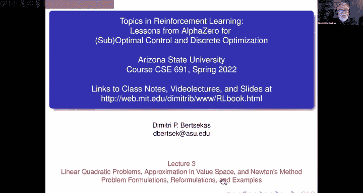

# 32：价值空间近似与牛顿法 🔄

在本节课中，我们将继续讨论线性二次型问题，并引入一个重要的概念框架：价值空间近似及其与牛顿法的联系。我们将使用线性二次型问题作为载体进行可视化，这些可视化将在整个课程中非常重要。然后，在课程的后半部分，我们将讨论问题表述和重构的例子。

---

## 无限时域问题概述 📖

上一节我们介绍了贝尔曼算子的概念。本节中，我们来看看如何用它们来概括无限时域问题的理论和算法。

我们有一个系统，其状态根据以下方程演化：
`x_{k+1} = f_k(x_k, u_k, w_k)`
其中 `x_k` 是状态，`u_k` 是控制，`w_k` 是随机扰动。在无限个阶段中，每个阶段 `k` 都有一个成本 `g_k(x_k, u_k, w_k)`，并可能乘以一个折扣因子 `α`。

我们引入了两个贝尔曼算子：
*   **最小贝尔曼算子 `T`**：`(TJ)(x) = min_{u∈U(x)} E[ g(x, u, w) + α J(f(x, u, w)) ]`
*   **策略 `μ` 的贝尔曼算子 `T_μ`**：`(T_μ J)(x) = E[ g(x, μ(x), w) + α J(f(x, μ(x), w)) ]`

使用这些算子，整个理论和算法可以概括如下：
*   **最优性**：最优成本函数 `J*` 是 `T` 的不动点：`J* = T J*`（贝尔曼方程）。如果 `μ(x)` 在上述最小化表达式中达到最小值，则策略 `μ` 是最优的。
*   **策略评估**：策略 `μ` 的成本函数 `J_μ` 是 `T_μ` 的不动点：`J_μ = T_μ J_μ`。
*   **值迭代**：从某个函数 `J_0` 开始，重复应用 `T` 生成序列 `J_{k+1} = T J_k`，该序列收敛于 `J*`。类似地，策略评估的值迭代应用 `T_μ`。
*   **策略迭代**：从一个策略 `μ^0` 开始，交替进行：
    1.  **策略评估**：计算 `μ^k` 的成本 `J_{μ^k}`（即求解 `J = T_{μ^k} J`）。
    2.  **策略改进**：通过 `μ^{k+1}(x) ∈ arg min_{u} E[ g(x, u, w) + α J_{μ^k}(f(x, u, w)) ]` 定义新策略。这等价于 `T_{μ^{k+1}} J_{μ^k} = T J_{μ^k}`。

---

## 应用于线性二次型问题 📐

现在，我们将上述算子具体化到线性二次型问题中。

我们考虑一个一维线性系统（无扰动）：
`x_{k+1} = a x_k + b u_k`
以及一个无折扣的二次型成本：
`g(x, u) = q x^2 + r u^2`，其中 `q > 0`, `r > 0`。

对于这个问题，关键事实是贝尔曼方程允许二次型解。
*   最优成本函数具有形式 `J*(x) = K* x^2`，其中标量 `K*` 满足**黎卡提方程**：
    `K = f(K) = q + (a^2 r K) / (r + b^2 K)`
    我们称 `f(K)` 为**最小黎卡提算子**。
*   对于一个线性策略 `μ(x) = L x`，其成本函数也具有形式 `J_μ(x) = K_L x^2`，其中 `K_L` 满足**线性黎卡提方程**：
    `K = f_L(K) = q + L^2 r + (a + bL)^2 K`
    我们称 `f_L(K)` 为**策略 `L` 的黎卡提算子**。
*   最优策略系数为：`L* = - (a b K*) / (r + b^2 K*)`。
*   值迭代算法对应于序列 `K_{k+1} = f(K_k)`。

---

## 可视化与牛顿法联系 🔍

上一节我们建立了理论框架，本节中我们通过可视化来深入理解这些方程的解、价值空间近似和各种形式的 rollout。

### 求解黎卡提方程的可视化

下图展示了如何图解求解黎卡提方程。

*   **最小黎卡提方程**：红色曲线代表 `f(K)`。方程 `K* = f(K*)` 的解 `K*` 是红色曲线与45度线（`y = K`）的交点。
*   **线性策略黎卡提方程**：对于给定的稳定线性策略 `L`（满足 `|a + bL| < 1`），`f_L(K)` 是一条绿色直线。策略 `L` 的成本系数 `K_L` 是这条绿色直线与45度线的交点。所有稳定策略的绿色直线都位于红色曲线上方。
*   **值迭代**：从某个 `K_0` 开始，值迭代 `K_{k+1} = f(K_k)` 在图中呈现为阶梯状的路径，最终收敛到 `K*`（前提是初始点在收敛域内）。

### 最小黎卡提算子作为下包络

一个重要观察是，最小黎卡提算子 `f(K)` 是所有线性策略黎卡提算子 `f_L(K)` 的**下包络**（即最小值）：
`f(K) = min_{L} f_L(K)`
这意味着对于任意给定的 `K`，红色曲线上的点是与某条恰好在此点与红色曲线相切的蓝色（或绿色）直线的切点。这条切线对应的策略 `L̃` 正是在该 `K` 值处达到最小值的策略。

### 牛顿法回顾

牛顿法用于求解方程 `y = g(y)` 的不动点。在当前迭代点 `y_k`，它构造 `g` 的线性化（一阶泰勒展开）：
`g(y) ≈ g(y_k) + ∇g(y_k) (y - y_k)`
然后求解线性化方程的不动点以得到下一个迭代点 `y_{k+1}`：
`y_{k+1} = g(y_k) + ∇g(y_k) (y_{k+1} - y_k)`
牛顿法收敛速度很快（二次收敛）。值得注意的是，即使 `g` 不可微（例如是几个可微函数的最小值），牛顿法也有相应的推广形式：在当前点，选择达到最小值的那个“活跃”分量进行线性化，然后求解。

### 价值空间近似即牛顿步

现在，我们连接这两个概念。考虑**带价值函数近似的一步前瞻**。

假设我们有一个近似的成本函数 `J̃(x) = K̃ x^2`。在贝尔曼方程中，我们使用 `J̃` 作为未来成本的近似，并进行一步最小化，从而得到一个新的策略 `μ̃`（其系数为 `L̃`）。这个新策略的成本函数 `J_{μ̃}(x) = K_{L̃} x^2` 可以通过求解 `K = f_{L̃}(K)` 得到。

**关键洞察**：从 `K̃` 得到 `K_{L̃}` 的过程，正好等同于对最小黎卡提方程 `K = f(K)` 在点 `K̃` 处执行一个**牛顿步**！因为 `f_{L̃}(K)` 正是 `f(K)` 在 `K̃` 处的线性化（切线），而求解 `K = f_{L̃}(K)` 就是对这个线性化方程执行牛顿步。

因此：
*   **价值函数近似 `J̃`** 对应于牛顿法的起始点。
*   **通过一步最小化得到的新策略 `μ̃`** 对应于执行一个牛顿步。
*   新策略的成本函数 `J_{μ̃}` 就是牛顿步之后的新点。

### 多步前瞻与截断 Rollout

*   **多步前瞻**：这相当于在执行牛顿步之前，先进行若干步值迭代。每一步值迭代都使用最小化操作，将成本函数近似向 `K*` 推进。起始点离 `K*` 越近，牛顿步的效果越好。因此，更长的前瞻步数通常能带来更好的策略。
*   **Rollout**：Rollout 是一种特殊的一步前瞻，其中价值函数近似 `J̃` 被取为某个**基策略 `μ` 的成本函数 `J_μ`**。因此，rollout 策略就是从一个稳定基策略的成本函数出发，执行一个牛顿步所得到的策略。这解释了为什么 rollout 常常能带来显著的性能提升。
*   **截断 Rollout**：在实际中，我们可能无法精确计算 `J_μ`，而是通过有限步的蒙特卡洛模拟或值迭代来近似。这对应于先进行若干步基于策略 `μ` 的值迭代（将起始点向 `K_μ` 推进），然后再从这个近似点执行牛顿步。截断长度 `M` 的选择需要在计算成本和策略改进效果之间权衡。

### 策略迭代即重复 Rollout

策略迭代算法可以看作是**重复应用 rollout**：
1.  从策略 `μ^0` 开始。
2.  **策略评估**：计算 `J_{μ^k}`（这相当于得到 rollout 的起始点）。
3.  **策略改进**：通过最小化 `E[ g(x, u, w) + α J_{μ^k}(f(x, u, w)) ]` 得到 `μ^{k+1}`（这相当于执行一个从 `J_{μ^k}` 出发的牛顿步，得到新策略 `μ^{k+1}` 及其成本 `J_{μ^{k+1}}`）。

因此，策略迭代就是完整的牛顿法，而 optimistic policy iteration（使用有限步策略评估）则对应于牛顿-SOR 方法。

---

## 问题表述与重构示例 🛠️

理解了核心算法框架后，我们来看看如何将实际问题表述为动态规划问题。

### 状态扩充

当系统动态涉及延迟的状态或控制，或者依赖于外部预测时，基本的 DP 公式可能不直接适用。解决方法是**状态扩充**：引入额外的状态变量来概括所有必要的历史信息。

**示例**：系统方程为 `x_{k+1} = f(x_k, x_{k-1}, u_k, u_{k-1}, w_k)`。
*   定义扩充状态 `s_k = (x_k, y_k, z_k)`，其中 `y_k = x_{k-1}`, `z_k = u_{k-1}`。
*   则新的系统方程为：
    `x_{k+1} = f(x_k, y_k, u_k, z_k, w_k)`
    `y_{k+1} = x_k`
    `z_{k+1} = u_k`
*   这样就将原问题转化为了一个关于扩充状态 `s_k` 的标准 DP 问题。代价是状态维数增加，计算可能更复杂。

### 多智能体问题

在多智能体问题中，多个决策者（智能体）共同影响系统。控制 `u_k` 是一个向量 `(u_k^1, u_k^2, ..., u_k^M)`。直接联合优化的控制空间大小随智能体数量 `M` 指数增长。

一种有效的重构方法是**序列化控制选择**：
1.  将一个阶段拆分为 `M` 个子阶段。
2.  在第一个子阶段，只有智能体 1 选择动作 `u^1`，系统过渡到一个“中间状态”。
3.  在第二个子阶段，只有智能体 2 选择动作 `u^2`（可以依赖于 `u^1` 的结果），依此类推。
4.  在第 `M` 个子阶段，智能体 `M` 选择动作后，才发生真正的状态转移并产生成本。

这种重构将控制空间大小从指数级 `O(N^M)` 降低到了多项式级 `O(M * N)`，但代价是状态空间变得更大更复杂。然而，对于 **rollout** 算法来说，这种重构非常有利，因为 rollout 在线运行时只关心当前状态下的决策分支数。重构后，每一步的决策分支数大大减少，使得 rollout 在计算上可行，且通常能保持与原问题 rollout 相近的性能。

### 部分可观测问题

在许多实际问题中，决策者无法直接观测到完整的系统状态 `x_k`，只能收到一个与状态相关的观测 `z_k`。例如，在停车问题中，司机只能看到当前所在停车位的状态，而不知道整个停车场的情况。

处理这类问题的标准方法是引入**信念状态**：
*   信念状态 `b_k` 是在给定所有历史观测 `z_0, ..., z_k` 和历史控制 `u_0, ..., u_{k-1}` 的条件下，真实状态 `x_k` 的概率分布（或后验估计）。
*   可以证明，信念状态 `b_k` 是一个**充分统计量**，它包含了所有对未来决策有用的历史信息。
*   信念状态的演化可以通过贝叶斯规则来描述：`b_{k+1} = Φ(b_k, u_k, z_{k+1})`。
*   这样，我们就将部分可观测问题重构为一个关于信念状态 `b_k` 的**完全可观测**的 DP 问题。

然而，信念状态空间通常是连续且高维的（概率分布空间），使得精确求解 DP 方程几乎不可能。这正是近似动态规划和强化学习（如基于价值函数近似的 rollout）发挥作用的领域。

---

## 总结 🎯

本节课中我们一起学习了：
1.  **无限时域问题的统一框架**：使用贝尔曼算子 `T` 和 `T_μ` 简洁地描述了最优性、值迭代和策略迭代。
2.  **线性二次型问题的具体化**：最优成本函数和策略成本函数都是二次型，由黎卡提方程决定。
3.  **价值空间近似的牛顿法视角**：这是本节课的核心洞见。我们通过可视化展示：
    *   带价值函数近似的一步前瞻等价于对贝尔曼方程执行一个牛顿步。
    *   Rollout 是以基策略成本为起点的牛顿步。
    *   多步前瞻和截断 rollout 对应于在执行牛顿步前进行若干步值迭代以改善起始点。
    *   策略迭代就是完整的牛顿法。
4.  **问题表述与重构技巧**：
    *   **状态扩充**：处理延迟、依赖预测等复杂动态。
    *   **多智能体问题序列化**：将联合控制选择序列化，以大幅减少 rollout 中的在线计算分支。
    *   **部分可观测问题信念状态化**：引入信念状态将问题转化为完全可观测的 DP 问题，为近似方法的应用奠定基础。

这些概念和可视化工具为我们理解和设计强化学习算法，特别是基于近似的算法，提供了强大的理论基础和直观指导。