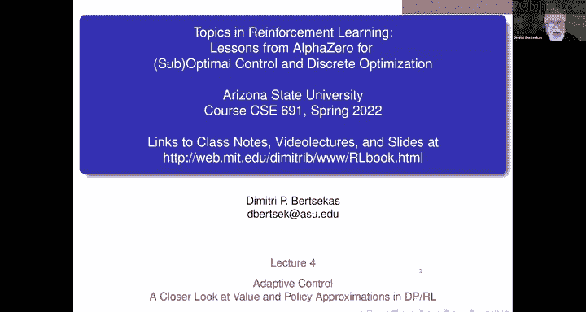

# 33：自适应控制、价值与策略近似 🎯

在本节课中，我们将学习自适应控制的基本概念，并深入探讨价值空间近似与策略空间近似这两种核心方法。我们将看到它们如何相互作用，以及如何在实际问题中结合使用。

---

##回顾与展望 📋

在前三讲中，我们介绍了强化学习的整体框架。第一讲以AlphaZero为例，介绍了离线训练和在线执行的概念。第二讲深入探讨了有限时域随机动态规划。第三讲则聚焦于价值空间近似，特别是在线性二次问题中基于牛顿法的近似。

本节课是概览性讲座的最后一讲。之后，我们将深入探讨具体主题，包括确定性问题的Rollout算法、模型预测控制、多智能体问题、神经网络训练、无限时域问题、策略迭代、策略梯度方法以及聚合方法。

---

## 自适应控制问题 🔄

上一节我们介绍了价值空间近似，本节中我们来看看当系统参数随时间变化时，我们应如何处理。这就是自适应控制的主题。

考虑一个巡航控制问题。汽车速度的简化模型为：
`x_{k+1} = A * x_k + B * u_k`
其中，`x_k` 是速度，`u_k` 是控制输入（如油门）。系数 `A` 和 `B` 可能因路况、载重等因素而变化。我们的目标是使速度接近目标值 `\bar{x}`，成本函数为二次型：
`g(x_k, u_k) = (x_k - \bar{x})^2 + r * u_k^2`

面对变化的参数，我们有几种策略：
1.  **忽略参数变化**：设计一个对参数变化具有鲁棒性的控制器（如经典的PID控制）。
2.  **在线重规划**：持续估计系统参数，并基于新参数重新优化控制器。这计算量可能很大。
3.  **次优在线重规划**：使用基于价值空间近似的次优方法（如Rollout算法）进行快速重规划。

一个关键见解是，对于线性二次问题，基于Rollout的近似重规划（可视为牛顿法的一步）效果非常好，其性能几乎与完全重新优化相同。

---

## 模型预测控制 🎮

模型预测控制是处理带约束控制问题的经典方法。其核心思想是，在每个时刻，我们只对未来有限步（L步）进行优化，并要求L步后的状态达到目标（例如原点），然后只执行第一步的控制。

这可以看作是一种特殊的多步前瞻价值空间近似：
*   **前瞻步数**：L步。
*   **终端成本近似**：一个启发式策略，用于在L-1步内将状态驱动到目标。

MPC非常适合在线重规划，因为它本质上是在线优化。现代MPC工具箱常采用带终端成本近似的AlphaZero式架构。

---

## 价值空间近似详解 🧠

现在，让我们回到价值空间近似的核心框架。对于有限时域随机动态规划，最优成本函数 `J_k^*(x_k)` 通过贝尔曼方程递归计算：
`J_k^*(x_k) = min_{u_k} E[ g(x_k, u_k, w_k) + J_{k+1}^*(x_{k+1}) ]`
在线控制时，使用 `u_k^* = arg min_{u_k} E[ g(x_k, u_k, w_k) + J_{k+1}^*(x_{k+1}) ]`

精确求解通常计算量巨大。价值空间近似使用一个近似成本函数 `\tilde{J}_{k+1}` 来代替 `J_{k+1}^*`，从而在线计算近似最优控制。

在这个框架中，存在三种主要的近似：
1.  **成本函数近似**：如何获得 `\tilde{J}`。
2.  **期望值近似**：如何高效计算或近似期望 `E[·]`。
3.  **最小化近似**：如何高效求解 `min_{u_k}` 问题。

以下是实现这些近似的常见方法：

*   **成本函数近似 (`\tilde{J}`)**
    *   **问题近似**：简化原问题（如缩减状态空间、简化概率分布），并求解简化问题的最优成本作为 `\tilde{J}`。
    *   **Rollout算法**：使用一个基础策略进行模拟，将其成本作为 `\tilde{J}`。
    *   **参数化近似**：使用神经网络或基于特征的线性组合来拟合 `\tilde{J}`，并通过离线训练确定参数。

*   **期望值近似**
    *   **确定性等价**：用随机变量的期望值或某个标称值代替随机变量，将随机问题转化为确定性问题。
    *   **蒙特卡洛模拟**：通过采样来近似期望值。可采用自适应模拟，专注于有希望的控制选项。

*   **最小化近似**
    *   **控制空间离散化**：将连续控制空间离散化，转化为有限选择问题。
    *   **简化优化结构**：例如，在多智能体问题中，采用逐个智能体优化的方式，而非联合优化。

这些近似方法可以灵活组合，构成了强化学习中大部分算法的基础。多步前瞻可以视为单步前瞻的特例，只是其终端成本 `\tilde{J}` 本身是一个更短时域子问题的最优成本。

对于无限时域问题，框架类似，但所有函数都是平稳的（与时域索引k无关）。

---

## 策略空间近似与价值-策略交互 🤝

上一节我们详细介绍了价值空间近似，本节中我们来看看另一种核心方法：策略空间近似。

策略空间近似的思想是，直接在一个参数化的策略类（例如，由神经网络表示的策略）中搜索最优策略。我们通过优化策略参数 `r` 来最小化期望总成本。常用方法包括策略梯度法和随机搜索法。

**策略空间近似的优缺点：**
*   **优点**：一旦通过离线训练获得策略，在线计算控制量非常快（只需前向传播神经网络）。
*   **缺点**：主要是离线过程，难以在线适应环境变化；且缺乏类似牛顿步的快速提升机制。

价值近似与策略近似可以紧密结合，形成强大的学习循环：

1.  **从价值到策略**：给定近似成本函数 `\tilde{J}`，通过单步/多步前瞻最小化可以得到一个（隐式的）前瞻策略 `\tilde{\mu}`。我们可以采样大量状态，计算对应的最优控制，将这些（状态-控制）数据对用于训练一个参数化策略（如神经网络），从而得到一个显式的、易于执行的近似策略。
2.  **从策略到价值**：给定一个基础策略 `\mu`，我们可以通过Rollout算法（模拟该策略并累积成本）来估计其成本函数 `J_\mu`，以此作为价值近似 `\tilde{J}`。

AlphaZero正是这种结合的典范：神经网络同时输出策略（先验概率）和价值估计；蒙特卡洛树搜索（Rollout的增强版）基于当前网络产生改进的（状态-动作）数据；这些数据又用于更新神经网络的参数。

如果没有近似误差，策略迭代算法能保证每次迭代都得到改进的策略。当引入价值与策略的近似后，虽然理论保证变弱，但在实践中这种交互式学习循环非常有效。

---

## 实施中的一般性问题 ⚙️

在实施价值空间近似时，我们需要考虑计算是在线还是离线进行。

*   **以离线为主的方法**：大部分计算在训练阶段完成。例如，训练神经网络来近似 `\tilde{J}` 或一个参数化策略。聚合方法也属此类。
*   **以在线为主的方法**：大部分计算在决策时实时进行。例如，Rollout算法和模型预测控制，它们主要依赖在线模拟或在线优化。

**关于“无模型”方法的讨论：**
术语“无模型”通常指不显式使用系统数学模型（`f` 和 `g` 的概率分布）的方法。如果有一个能模拟系统动态的仿真器（计算机模型），即使没有显式数学模型，也可以进行蒙特卡洛模拟来估计Q值。我们可以收集大量的（状态、控制、下一状态、成本）样本，然后拟合一个参数化的Q函数 `\tilde{Q}(x, u; r)`。在线决策时，选择使 `\tilde{Q}(x, u; r)` 最小的控制 `u`。

然而，这种基于采样和函数拟合的“无模型”方法，通常会失去牛顿步的快速收敛性质，其性能保证也不同于基于模型的价值空间近似。本课程主要关注**基于模型**的方法，但会利用仿真器进行蒙特卡洛模拟。

---

## 总结 📝

本节课中我们一起学习了：
1.  **自适应控制**：处理系统参数时变问题的思路，包括在线重规划和利用Rollout进行高效次优重规划。
2.  **模型预测控制**：将其理解为一种特殊的多步前瞻价值空间近似方法。
3.  **价值空间近似框架**：深入分析了其三大近似维度（成本函数、期望值、最小化）及各自的实现技术。
4.  **策略空间近似**：介绍了直接优化参数化策略的方法，并讨论了其优缺点。
5.  **价值与策略的交互**：阐述了如何通过价值近似产生策略训练数据，以及如何通过策略模拟产生价值估计，形成强大的学习循环。
6.  **实施考量**：区分了以在线和离线为主的方法，并探讨了“无模型”方法的实质及其权衡。

从下一讲开始，我们将深入具体主题，首先详细探讨确定性问题的Rollout算法及其变体。