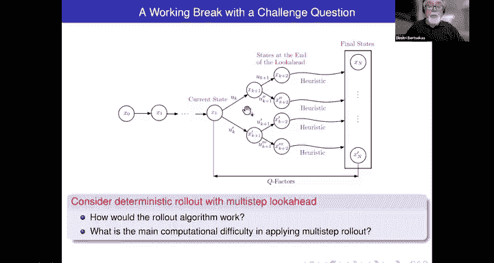
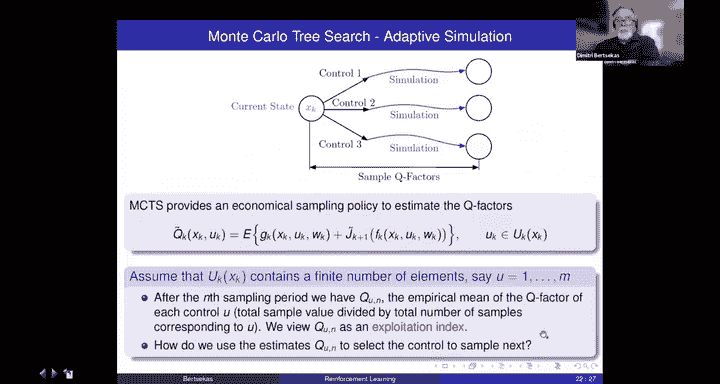
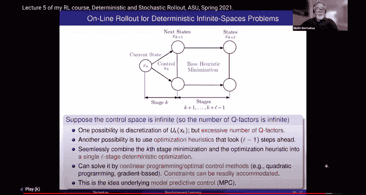

# 34：确定性及随机动态规划的Rollout算法 📚

在本节课中，我们将深入学习Rollout算法，这是一种在值空间近似框架下在线生成控制策略的重要方法。我们将从确定性有限状态问题入手，探讨其核心原理、成本改进性质，并介绍多种变体与扩展。随后，我们将转向随机问题中的Rollout算法，并讨论蒙特卡洛树搜索。最后，我们会简要介绍在无限状态和控制空间问题中的应用，为下一讲模型预测控制做铺垫。

---

## 🎯 确定性有限状态问题的Rollout算法

上一讲我们概述了值空间近似的通用框架。本节中，我们来看看Rollout算法，它是该框架下的一个特例。

Rollout算法的核心思想是：在给定状态 \( x_k \) 下，通过向前看一步或多步，并利用一个基础启发式策略（或其代价函数 \( \tilde{J} \) ）来评估未来代价，从而选择当前最优的控制动作 \( u_k \)。其数学描述如下：

对于多步向前看（步长为 \( L \) ）：
\[
\tilde{\mu}_k(x_k) \in \arg \min_{u_k} \mathbb{E} \left\{ g_k(x_k, u_k, w_k) + \min_{u_{m}, m > k} \mathbb{E} \left\{ \sum_{m=k+1}^{k+L-1} g_m(x_m, u_m, w_m) + \tilde{J}_{k+L}(x_{k+L}) \right\} \right\}
\]
其中，\( \tilde{J} \) 是某个基础策略的代价函数。

以下是Rollout算法在确定性有限状态问题（如旅行商问题）中的工作步骤：

1.  **初始化**：从初始状态 \( x_0 \) 开始。
2.  **状态评估**：在到达的每个状态 \( x_k \)。
3.  **控制评估**：考虑所有可能的控制动作 \( u_k \)。
4.  **Q因子计算**：对于每个 \( (x_k, u_k) \) 对，计算其Q因子，即：当前转移代价 \( g_k(x_k, u_k) \) 加上从下一状态 \( x_{k+1} \) 开始运行基础启发式策略直到终点的总代价。
5.  **选择控制**：选择具有最小Q因子的控制动作 \( u_k^* \) 作为Rollout控制。
6.  **状态转移**：应用 \( u_k^* \)，转移到下一个状态 \( x_{k+1} \)。
7.  **重复**：重复步骤2-6，直至到达终点。

Rollout算法之所以重要，是因为它易于理解和实现，非常可靠，并且具有广泛的适用性。它也是策略迭代等更高级算法的基础模块。

---

## ✅ Rollout的成本改进性质

一个关键问题是：Rollout算法能否改进其基础启发式策略的性能？即，从同一初始状态 \( x_0 \) 出发，Rollout策略产生的轨迹总代价是否小于或等于基础启发式策略产生的轨迹总代价？

成本改进并非自动成立。为了保证这一性质，基础启发式策略需要满足特定条件。主要有两个条件：**序列一致性** 和 **序列改进性**。序列改进性是更一般化的条件，我们主要关注它。

**序列改进性** 的定义是：对于每个状态 \( x_k \)，基础启发式策略的最小Q因子必须小于或等于从该状态出发运行启发式策略本身的代价。用公式表示：
\[
\min_{u_k} Q_k(x_k, u_k) \leq H_k(x_k)
\]
其中，\( H_k(x_k) \) 是从状态 \( x_k \) 开始运行基础启发式策略的总代价，\( Q_k(x_k, u_k) \) 是对应控制 \( u_k \) 的Q因子。

如果基础启发式策略满足序列改进性，那么可以证明，Rollout算法产生的轨迹代价序列是单调非增的。因此，最终Rollout轨迹的代价 \( R_N \) 将小于或等于初始基础启发式轨迹的代价 \( R_0 \)，从而保证了成本改进。

---

## 🔄 Rollout算法的变体与扩展

为了应对不同挑战并提升计算效率，Rollout算法发展出了多种变体。

### 简化Rollout
当控制空间很大，计算所有Q因子代价过高时，可以使用简化Rollout。

其核心思想是：在状态 \( x_k \) 下，不一定要找到最小Q因子的控制，而是选择**任何一个**其Q因子优于当前基础启发式代价 \( H_k(x_k) \) 的控制即可。只要基础启发式满足序列改进性，这种简化方法依然能保证成本改进性质，同时大幅减少计算量。多智能体Rollout是应用此思想的典型场景。

### 多启发式Rollout
在实践中，我们可能拥有多个各有优劣的启发式策略。

多启发式Rollout的做法是：在每一步，并行运行所有可用的启发式策略，然后选择它们所产生轨迹中代价最小的那个结果，作为当前步骤的“超级启发式”输出。这个“超级启发式”的结果可以作为Rollout算法的基础。

一个重要结论是：如果所有参与的基础启发式都满足序列改进性，那么由此产生的“超级启发式”也满足序列改进性，从而保证了基于它进行Rollout的成本改进性质。

### 强化Rollout
当基础启发式不满足序列改进性时，Rollout可能无法保证成本改进，甚至可能偏离已有的好解。强化Rollout提供了一种修复机制。

该算法在运行过程中，不仅维护当前已确定的轨迹（永久轨迹），还维护一个迄今为止找到的**最佳试探轨迹**。

在每一步，Rollout会计算最小Q因子对应的轨迹，并将其代价与当前最佳试探轨迹的代价比较。如果Rollout建议的轨迹代价更高，则拒绝该建议，转而采用最佳试探轨迹建议的控制动作。这确保了算法产生的轨迹代价不会变差，从而在任何基础启发式下都能保持成本改进（或不恶化）。

---

## 🎲 随机问题的Rollout与蒙特卡洛树搜索

现在，我们将目光转向随机动态规划问题。这里的核心挑战在于，计算Q因子中的期望值通常没有解析解，需要通过蒙特卡洛模拟来近似。

随机Rollout的框架与确定性情况类似，但Q因子的计算包含了期望：
\[
Q_k(x_k, u_k) = \mathbb{E} \{ g_k(x_k, u_k, w_k) + \tilde{J}_{k+1}(f_k(x_k, u_k, w_k)) \}
\]
其中，期望 \( \mathbb{E} \) 是对随机扰动 \( w_k \) 取的。\( \tilde{J} \) 是基础策略的代价函数，通常也需通过模拟来估计。

一个著名的早期应用是西洋双陆棋程序。该程序使用一个较弱的策略（基于时序差分学习训练的网络）作为基础策略进行大量蒙特卡洛模拟，评估每一步棋的胜率，从而选择最优着法。这展示了Rollout的强大，但也凸显了其计算瓶颈：需要对每个可能的控制进行大量模拟，非常耗时。

为了节省模拟计算量，**蒙特卡洛树搜索** 应运而生。它的核心思想是**自适应模拟**，即智能地分配模拟资源。

MCTS不再平等地评估所有控制，而是试图在**利用**和**探索**之间取得平衡：
*   **利用**：将更多模拟资源分配给当前看起来最有希望（Q因子估计值低）的控制。
*   **探索**：分配一定资源去采样那些模拟次数较少、不确定性高的控制，以免错过潜在的好选择。

一种常用的选择标准是**上置信界** 规则，它为每个控制 \( u \) 计算一个分数：
\[
\text{Score}(u) = -\overline{Q}(u) + c \sqrt{\frac{\ln N}{n(u)}}
\]
其中：
*   \( -\overline{Q}(u) \) 是**利用项**（负号是因为我们通常最小化代价，等价于最大化负代价）。
*   \( \sqrt{\frac{\ln N}{n(u)}} \) 是**探索项**，\( N \) 是总模拟次数，\( n(u) \) 是对控制 \( u \) 的模拟次数。模拟越少的控制，探索项越大。
*   \( c \) 是一个平衡常数。

算法会选择分数最高的控制进行下一次模拟。MCTS通过这种方式，旨在用更少的模拟次数达到与均匀采样相近的决策质量。

---

## ♾️ 无限空间问题与模型预测控制简介

最后，我们考虑状态空间和控制空间都是连续（无限）的问题，例如许多控制理论中的物理系统。此时，无法直接枚举所有控制来计算Q因子。

一种有效的方法是结合**优化**的启发式策略，并利用**非线性规划** 工具。这引出了**模型预测控制** 的核心思想。

在状态 \( x_k \) 下，MPC执行以下步骤：
1.  求解一个固定时域（例如 \( L \) 步）的有限维优化问题，优化变量是未来 \( L \) 步的控制序列 \( [u_k, u_{k+1}, ..., u_{k+L-1}] \)。
2.  该优化问题的目标函数通常为 \( \sum_{m=k}^{k+L-1} g_m(x_m, u_m) + \tilde{J}_{k+L}(x_{k+L}) \)，其中 \( \tilde{J} \) 是一个终端代价函数，用于近似 \( L \) 步之后的长期代价。
3.  只应用优化得到的控制序列中的第一个控制 \( u_k^* \)。
4.  在下一时刻 \( k+1 \)，基于新的状态测量值 \( x_{k+1} \) ，重复上述滚动优化过程。

可以看到，这本质上是一种特殊的多步向前看Rollout，其中基础启发式策略本身就是一个 \( L-1 \) 步的优化问题，而Rollout则将其扩展为 \( L \) 步优化。通过利用成熟的非线性规划求解器处理连续空间优化，MPC能够有效处理带有状态和控制约束的复杂系统。

我们将在下一讲中更深入地探讨模型预测控制。

---

## 📝 总结

本节课我们一起学习了Rollout算法这一强大而实用的工具。
*   我们从**确定性有限状态问题**入手，理解了Rollout的基本步骤及其**成本改进性质**所依赖的条件（序列改进性）。
*   接着，我们探讨了多种**变体算法**：**简化Rollout** 用于降低计算负担，**多启发式Rollout** 用于融合多个策略的优点，**强化Rollout** 用于保证在任何基础启发式下的性能不恶化。
*   然后，我们将Rollout扩展到**随机问题**，认识到蒙特卡洛模拟带来的计算挑战，并介绍了**蒙特卡洛树搜索** 通过平衡利用与探索来应对这一挑战。
*   最后，我们简要介绍了处理**无限连续空间问题**的思路，即通过滚动时域优化来近似Rollout，这自然引出了**模型预测控制** 的基本概念，为后续学习奠定了基础。

Rollout算法因其简单性、可靠性和通用性，在强化学习与应用数学领域占有重要地位，是许多高级算法不可或缺的组成部分。