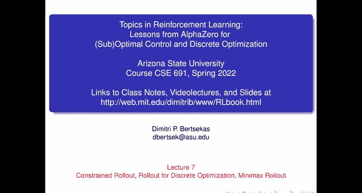

# 36：约束Rollout与极小极大控制 🎯




在本节课中，我们将结束对Rollout算法的讨论，并介绍其两种重要变体：**约束Rollout算法**和**极小极大控制**。我们将学习如何将Rollout方法应用于带有轨迹约束的确定性动态规划问题，以及如何应对由“对手”或“自然”引入的不确定性。课程的后半部分将聚焦于离散优化问题（如整数规划）的应用，并探讨极小极大控制与博弈论的关系。

---

## 约束Rollout算法 🧩

上一节我们介绍了标准的Rollout算法。本节中，我们来看看当问题存在对整个系统轨迹的约束时，应如何修改算法。

### 问题定义

我们考虑一个确定性最优控制问题，其系统方程为：
```
x_{k+1} = f_k(x_k, u_k)
```
一个完整的轨迹是从初始状态到终止状态的序列：
```
π = (x_0, u_0, x_1, u_1, ..., x_N)
```
我们有一个非常一般的成本函数 `G(π)`，它可能以任意方式依赖于整个轨迹。此外，我们还有一个约束，要求轨迹 `π` 必须属于一个给定的可行轨迹集合。

### 算法核心思想

约束Rollout算法的核心修改非常简单明了：
1.  在每一步 `k`，我们像标准Rollout一样，从当前部分轨迹 `y_k` 出发，考虑所有可能的下一控制 `u_k`。
2.  对于每个 `u_k`，我们运行基础启发式算法来生成一个完整的候选轨迹。
3.  **关键步骤**：我们丢弃所有违反约束的候选轨迹。
4.  在剩余的可行候选轨迹中，选择成本最低的那一条，并采用其第一步控制 `u_k`。

**算法前提**：我们假设基础启发式算法能够从初始状态生成一条可行的完整轨迹。

### 状态增广技巧

由于成本和约束可能耦合多个阶段（即未来的选择受过去选择影响），我们采用**状态增广**技巧。我们将时间 `k` 的状态重新定义为**迄今为止的部分轨迹** `y_k`。这样，新系统的动态变为：
```
y_{k+1} = (y_k, u_k, f_k(x_k, u_k))
```
原问题就转化为对这个新系统的最小化最终成本问题，且只包含最终状态约束。

### 算法步骤

以下是约束Rollout算法的具体步骤：

1.  从初始部分轨迹 `y_0`（即初始状态）开始。
2.  在阶段 `k`，对于当前部分轨迹 `y_k`，考虑所有可行的控制 `u_k`。
3.  对于每个 `u_k`，计算下一个部分轨迹 `y_{k+1}`。
4.  从每个 `y_{k+1}` 出发，运行基础启发式算法 `R`，得到一个补全的轨迹 `R(y_{k+1})`。
5.  将 `y_k`、`u_k` 和 `R(y_{k+1})` 拼接，形成完整的候选轨迹。
6.  计算满足约束的候选轨迹集合：
    ```
    U_k(y_k) = { u_k | 拼接后的完整轨迹满足约束 }
    ```
7.  从集合 `U_k(y_k)` 中选择使完整轨迹成本最低的控制 `u_k`：
    ```
    u_k ∈ arg min_{u_k ∈ U_k(y_k)} G(拼接后的轨迹)
    ```
8.  应用 `u_k`，更新部分轨迹至 `y_{k+1}`，并进入下一阶段。

### 示例：带安全约束的旅行商问题

考虑一个四城市（A, B, C, D）旅行商问题，目标是找到从A出发并返回A的最小成本环路。现在增加一个**安全约束**：整个环路的安全指数必须低于10。

*   **成本矩阵**：定义了城市间的旅行成本。
*   **安全指数**：每个环路有一个对应的安全指数。
*   **基础启发式**：一个给定的启发式规则，用于从任何部分旅程补全整个环路。

**Rollout过程**：
1.  从城市A开始，考虑下一步去B、C或D。
2.  对每个选择（AB, AC, AD），用基础启发式补全环路，并检查是否满足安全约束。
3.  假设从AC出发的环路违反约束，则将其丢弃。
4.  在剩余可行环路（如从AB和AD出发）中选择成本较低者，假设选择了AB。
5.  到达城市B后，重复此过程：考虑下一步去C或D，用启发式补全，检查约束，选择最佳可行路径。
6.  如此继续，直至完成环路。

通过这种方式，Rollout算法能在满足安全约束的前提下，找到比单纯使用基础启发式更好的解。

### 理论保证：序列改进条件

为了确保算法性能，我们需要类似标准Rollout的**序列改进条件**。对于约束Rollout，该条件修改为：
1.  在每一步，至少存在一个控制 `u_k`，使得生成的完整候选轨迹是可行的（即 `U_k(y_k)` 非空）。
2.  在这些可行控制中，至少有一个对应的Q因子（即补全后的轨迹成本）不差于从当前状态直接使用基础启发式得到的成本。

如果基础启发式满足此序列改进条件，则约束Rollout算法生成的轨迹成本不会差于基础启发式直接从初始状态生成的轨迹成本。

### 强化版本

当序列改进条件不一定满足时，我们可以使用**强化Rollout**。其核心思想是保留一个“当前最佳”的可行轨迹。在Rollout过程中：
*   如果找到成本更低的可行轨迹，则用它替换“当前最佳”轨迹。
*   如果某一步无法找到可行的候选轨迹，则回退到执行“当前最佳”轨迹的下一步控制。
*   这保证了算法始终能生成一条可行轨迹，且其成本不差于初始的基础启发式轨迹。

---

## 应用于离散优化与整数规划 🔢

约束Rollout框架非常适用于具有**组件结构**的离散优化问题，例如许多组合优化（匹配、路由、调度、装箱）和整数规划问题。

### 问题形式化

这类问题可以形式化为：
```
minimize G(u)
subject to u ∈ C
```
其中 `u = (u_0, u_1, ..., u_{N-1})` 是一个决策向量，其分量 `u_k` 通常取自有限集（例如，`{0, 1}`）。约束集 `C` 编码了问题的所有可行性要求。

我们可以将其视为一个特殊的确定性控制问题：每个阶段 `k` 的状态是人工的，仅代表决策进展到第 `k` 个分量，控制就是选择 `u_k` 的值。所有可能的决策序列构成一个树状图。

### 示例：设施选址问题

这是一个经典的0-1整数规划问题。

*   **决策变量**：`u_k ∈ {0, 1}`，表示是否在候选位置 `k` 建设设施。
*   **辅助变量**：`y_{ik}`，表示客户 `i` 的需求由设施 `k` 满足的比例。
*   **目标函数**：最小化总成本，包括设施建设成本 `∑ b_k * u_k` 和服务运输成本 `∑∑ a_{ik} * y_{ik}`。
*   **约束**：
    1.  每个客户的需求必须被完全满足：`∑_k y_{ik} = d_i`。
    2.  设施 `k` 的服务总量不能超过其容量 `c_k`，且只有建设了 (`u_k=1`) 才能提供服务。
    3.  可能有额外的公共政策约束（如区域建设上限）。

**Rollout应用**：
1.  将决策顺序定为按地点顺序决定是否建设。
2.  **基础启发式设计**：一个简单的基础启发式是，给定当前已决定的部分建设方案，对于剩余未决定的每个地点，**都假设建设** (`u=1`)，然后求解由此产生的线性规划（运输问题）以得到最优的 `y_{ik}` 分配和总成本。这个启发式总是可行的（因为建设所有设施总能满足需求）。
3.  在Rollout的每一步，例如在决定地点 `m` 时，我们考虑两个候选：
    *   `u_m = 1`，然后对剩余地点使用基础启发式（即都设为1）。
    *   `u_m = 0`，然后对剩余地点使用基础启发式。
4.  对每个候选，求解对应的线性规划得到总成本，并检查是否满足所有约束（`u_m=0` 的候选可能因容量不足而不可行）。
5.  选择成本最低的可行候选对应的 `u_m` 值。
6.  由于基础启发式是“贪心建设”的，它在这个问题中通常是序列一致的，因此Rollout能有效改进解的质量。

这种方法的美妙之处在于，它将困难的整数规划问题分解为一系列更易处理的线性规划子问题，并能灵活处理复杂的约束。

---

## 极小极大控制与博弈 🎲

现在，我们将目光从确定性问题和随机问题转向另一种不确定性：由**敌对对手**引入的不确定性。这引出了**极小极大控制**问题。

### 问题定义

在极小极大控制中，系统扰动 `w_k` 不再服从概率分布，而是由一个试图最大化我方成本的对手选择。扰动 `w_k` 属于一个可能依赖于当前状态和控制的已知集合 `W_k(x_k, u_k)`。

有限视野问题的目标是找到策略 `μ_k(x_k)`，以最小化**最坏情况**下的总成本：
```
J_π(x_0) = max_{w_0, ..., w_{N-1}} [ g_N(x_N) + ∑_{k=0}^{N-1} g_k(x_k, μ_k(x_k), w_k) ]
```
其中，最大化是对手在所有允许的扰动序列上进行的。

### 动态规划与值空间近似

类似于随机控制，我们有极小极大动态规划方程：
```
J_k(x_k) = min_{u_k ∈ U_k(x_k)} max_{w_k ∈ W_k(x_k, u_k)} [ g_k(x_k, u_k, w_k) + J_{k+1}(f_k(x_k, u_k, w_k)) ]
```
其中 `J_k(x_k)` 是从状态 `x_k` 开始的最优最坏情况成本。

由于精确求解 `J_k` 通常计算量巨大，我们采用**值空间近似**。一步前瞻控制为：
```
u_k ∈ arg min_{u_k ∈ U_k(x_k)} max_{w_k ∈ W_k(x_k, u_k)} [ g_k(x_k, u_k, w_k) + J̃_{k+1}(f_k(x_k, u_k, w_k)) ]
```
这里 `J̃_{k+1}` 是对最优成本函数的近似，可以通过离线训练（如神经网络）获得。

### 极小极大Rollout算法

Rollout是值空间近似的一种特例，其中我们用**基础策略**的代价函数来近似未来成本。具体步骤如下：

1.  在状态 `x_k`，对于每个可行控制 `u_k`，计算其Q因子：
    ```
    Q_k(x_k, u_k) = max_{w_k, ..., w_{N-1}} [ g_k(x_k, u_k, w_k) + ∑_{m=k+1}^{N-1} g_m(x_m, μ_m(x_m), w_m) + g_N(x_N) ]
    ```
    其中，`μ_m` 是给定的基础策略，最大化由对手在剩余阶段执行。
2.  这个Q因子的计算等价于在一个**无环图**上求解一个**最长路径问题**（因为对手要最大化成本）。可以通过对弧长取负号，转化为最短路径问题来求解。
3.  Rollout选择具有最小Q因子的控制：
    ```
    u_k ∈ arg min_{u_k ∈ U_k(x_k)} Q_k(x_k, u_k)
    ```

如果基础策略是序列一致的，那么极小极大Rollout能保证得到的策略在最坏情况下的成本不差于基础策略。

### 与博弈论的联系

极小极大控制与**零和博弈**密切相关。在零和博弈中，两个玩家（最小化者和最大化者）的目标完全相反。

*   **极小极大值**：最小化者先选策略，最大化者后选（知晓对方策略）。这是“保守”的最小化者视角。
*   **极大极小值**：最大化者先选策略，最小化者后选。这是“保守”的最大化者视角。
*   一般地，**极大极小值 ≤ 极小极大值**。博弈论关注两者相等的特殊情况（如通过混合策略），但这在带有近似的实际强化学习中通常不成立。

**对强化学习的启示**：
*   如果**固定一个玩家的策略**，那么另一个玩家面对的就是一个标准的（极小极大或期望值）控制问题，可以使用Rollout、策略迭代等方法进行改进。例如，围棋AI AlphaZero可以通过与特定人类冠军对弈来专门优化针对该冠军的策略。
*   然而，当**两个玩家的策略同时学习和更新**时（如AlphaZero的自我对弈），情况就复杂得多。虽然这类算法在实践中取得了巨大成功，但目前尚缺乏严格的理论保证其收敛性或性能边界。

---

## 总结 📝

本节课中我们一起学习了Rollout算法的两个高级扩展：

1.  **约束Rollout**：用于处理带有轨迹约束的确定性优化问题。核心在于在每一步筛选掉违反约束的候选解，并通过状态增广技术处理跨阶段耦合。我们将其应用于离散优化和整数规划问题（如设施选址），展示了其灵活性和实用性。
2.  **极小极大控制与Rollout**：用于应对由敌对对手引入的不确定性。其动态规划涉及最大化操作，Rollout算法需要计算对应于“最长路径”的Q因子。我们探讨了其与博弈论的联系，并指出在固定对手策略时，强化学习方法可以有效应用。


这些方法极大地扩展了Rollout算法的应用范围，使其能够解决更复杂、更贴近实际的问题。从下一讲开始，我们将进入课程的第二部分，深入探讨**离线训练算法**，特别是如何使用特征和神经网络来构建近似架构。