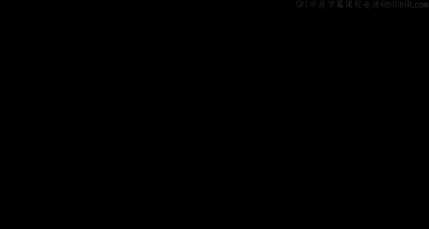
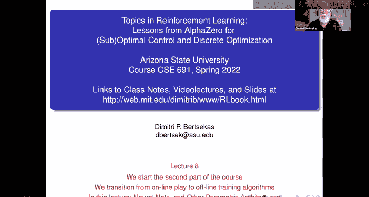
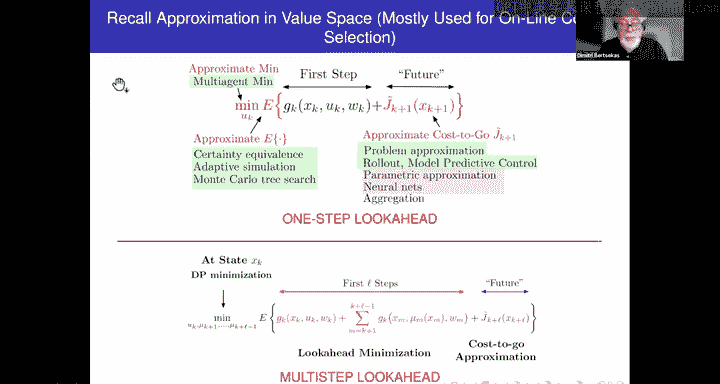
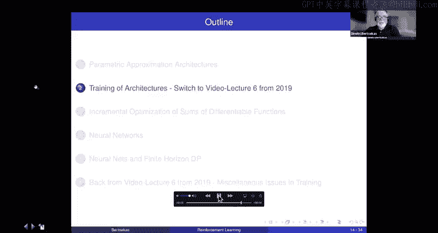
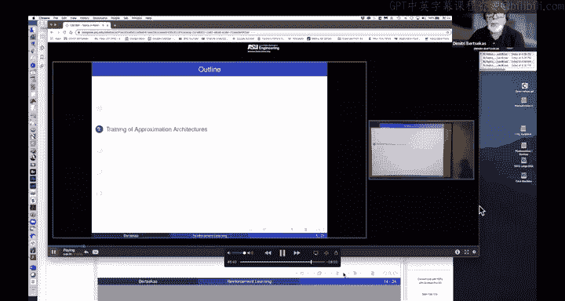
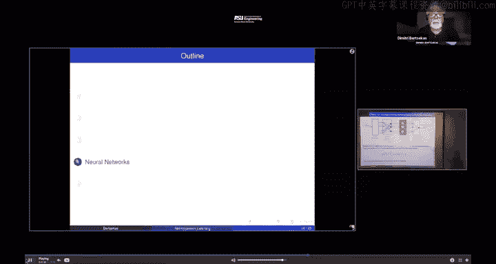
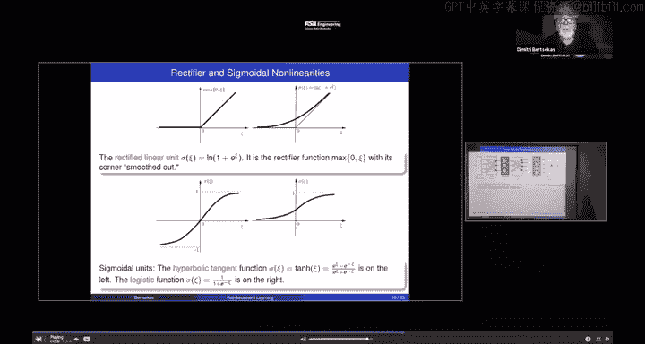
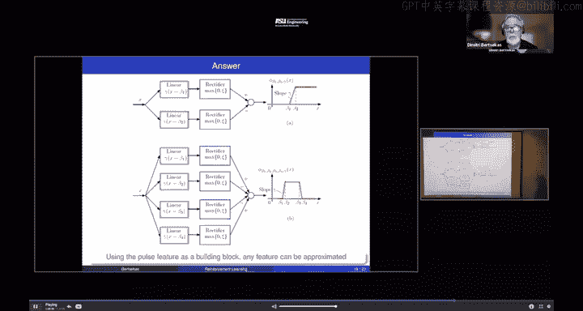
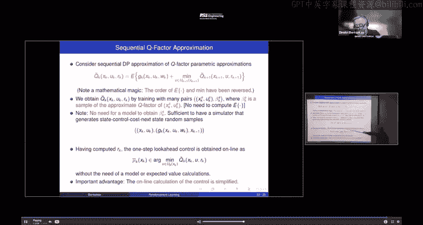

# 37：离线训练算法与参数化近似架构 🧠





在本节课中，我们将学习离线训练算法的核心概念，特别是参数化近似架构（如神经网络）在强化学习中的应用。我们将从在线与离线算法的区别开始，深入探讨如何利用数据训练模型来近似价值函数和策略。



---

##回顾与概述

上一部分课程我们重点讨论了在线执行算法。从本节课开始，我们将进入课程的第二部分，专注于**离线训练算法**。

离线训练算法的核心目标，是利用收集到的数据来构建**价值网络**（近似最优价值函数或策略的价值函数）和**策略网络**（近似最优策略或给定策略），以供在线执行阶段使用。

---

## 参数化近似架构简介

参数化近似架构的核心思想是，用一个由参数向量 `r` 决定的函数族 `J̃(x, r)` 来近似目标函数 `J(x)`。我们的目标是通过调整参数 `r`，使得近似函数在训练数据上的表现最佳。

### 架构分类
参数化架构可以根据几个关键属性进行分类：
*   **局部 vs. 全局**：改变单个参数是仅影响状态空间的一小部分（局部），还是影响整个状态空间（全局）。
*   **线性 vs. 非线性**：近似函数 `J̃` 对参数 `r` 是否是线性的。线性架构训练更简单。
*   **基于特征的架构**：这是非常重要的一类架构，其形式为 `J̃(x, r) = rᵀ φ(x)`，其中 `φ(x)` 是从状态 `x` 中提取的**特征向量**。特征旨在捕捉状态的关键信息。

以下是几种常见的架构示例：

*   **分段常数近似（局部、线性、基于特征）**：将状态空间划分为若干子集，每个子集用一个常数（即一个特征）来近似价值。特征函数是子集的指示函数。
*   **多项式近似（全局、线性）**：使用状态分量的多项式（如二次型 `r₀ + Σᵢ rᵢ xᵢ + Σᵢⱼ rᵢⱼ xᵢ xⱼ`）作为近似架构。这是一种通用但可能低效的方法。
*   **基于领域知识的特征（线性、基于特征）**：例如，在国际象棋程序中，特征可能包括“子力平衡”、“王的安全性”、“棋子机动性”等。这是AlphaZero之前主流象棋程序的做法。

---

## 训练参数化架构

给定目标函数和训练数据（状态-价值对集合 `{(x^s, β^s)}`），训练过程通常转化为一个优化问题，例如最小化平方误差和：
```
minᵣ Σₛ (J̃(x^s, r) - β^s)²
```



### 训练算法
对于线性特征架构，上述优化问题有闭合解（涉及矩阵求逆）。然而，当特征维度或数据量很大时，直接求解计算量巨大。



对于非线性架构（如神经网络），问题变为非凸优化，通常使用基于梯度的方法：
*   **标准梯度下降**：每次迭代需计算所有训练样本的梯度之和，计算成本高。
*   **增量梯度法**：每次迭代随机选取一个训练样本，计算其梯度并更新参数。虽然单个方向可能偏离整体梯度，但在使用递减步长时，平均来看能收敛到最小值附近。其计算效率远高于标准梯度法。
*   **随机梯度下降**：常指优化期望形式目标函数 `E[F(x, w)]` 的增量方法，每次迭代基于一个随机样本 `w` 的梯度进行更新。其思想与增量梯度法相通。

增量梯度法成功的关键在于其结构：在远离最优解的区域，单个样本的梯度方向与整体梯度方向大致相同；在最优解附近区域，虽然更新方向会“混乱”，但通过使用递减步长，这些混乱的更新会相互抵消，最终收敛。

---

## 神经网络作为通用近似器 🧠

当缺乏好的领域知识特征时，神经网络提供了强大的替代方案。它能自动从数据中学习特征表示。

### 结构
一个典型的单层神经网络如下：
1.  **输入编码层**：将原始状态 `x` 转换为适合网络处理的向量 `y(x)`（可能包含缩放或手工特征）。
2.  **线性层**：`z = A y(x) + b`，其中 `A` 和 `b` 是参数。
3.  **非线性层**：对 `z` 的每个分量应用非线性激活函数（如ReLU: `σ(z) = max(0, z)`，或Sigmoid函数），产生特征向量 `φ(x, v)`，这里 `v` 代表 `(A, b)`。
4.  **输出层**：对特征进行线性加权 `J̃(x, r, v) = rᵀ φ(x, v)`。

深度神经网络则是将多个“线性层+非线性层”堆叠起来，形成更复杂的特征层次结构，在实践中往往效果更好。

### 关键特性与训练
*   **通用近似定理**：只需一个足够大的隐藏层，神经网络就能以任意精度近似任何连续函数。这奠定了其理论基石。
*   **训练**：神经网络的训练同样归结为最小化平方误差和的问题。由于网络参数众多且非线性程度高，**反向传播算法**（本质上是链式法则的高效实现）结合**增量梯度法**（如SGD）是标准的训练方法。
*   **过参数化的新见解**：近期研究表明，使用参数数量远多于训练样本数的“过参数化”深度网络，结合适当的正则化技术，反而有助于避免过拟合，提升泛化性能。

---

## 在有限时域动态规划中的应用

我们可以将参数化架构（尤其是神经网络）嵌入到动态规划的反向计算过程中，这种方法称为**拟合价值迭代**。

### 算法步骤（逆向进行）
1.  从终端代价函数 `J_N` 开始（可能是已知的，或用网络近似）。
2.  **对于 `k = N-1, ..., 0`**：
    a. **生成训练数据**：对一批采样状态 `x_k^s`，利用下一阶段的近似价值函数 `J̃_{k+1}`，通过（近似）求解单步前瞻最小化问题，计算目标值 `β_k^s`。
    b. **训练当前阶段架构**：以 `{(x_k^s, β_k^s)}` 为训练数据，训练得到当前阶段的近似价值函数 `J̃_k`。





### 挑战与改进：Q因子近似
上述方法在计算期望和最小化时可能计算量很大，且误差会向后传播累积。

一个更有效的方法是近似 **Q因子**（状态-控制对的价值）。Q因子的贝尔曼方程是：
```
Q_k(x, u) = E[ g_k(x, u, w) + min_{u'} Q_{k+1}( f_k(x, u, w), u' ) ]
```
注意，这里**最小化在期望内部**。这带来一个关键优势：我们可以通过采样 `w` 来近似计算右侧的期望，而无需知道其精确分布，从而实现**免模型学习**。

对应的逆向训练过程变为：
1.  从终端Q因子开始。
2.  **对于 `k = N-1, ..., 0`**：
    a. **生成训练数据**：对一批采样状态-控制对 `(x_k^s, u_k^s)` 和噪声样本 `w_k^s`，计算目标值 `β_k^s = g_k(x_k^s, u_k^s, w_k^s) + min_{u'} Q̃_{k+1}( x_{k+1}^s, u' )`，其中 `x_{k+1}^s = f_k(x_k^s, u_k^s, w_k^s)`。
    b. **训练当前阶段Q网络**：以 `{((x_k^s, u_k^s), β_k^s)}` 为数据，训练得到 `Q̃_k`。



在线控制时，只需对当前状态 `x_k`，计算 `argmin_u Q̃_k(x_k, u)` 即可。

---

## 实践中的重要技巧



在实际训练中，直接近似价值或Q因子可能遇到数值问题（例如，在连续时间问题离散化后，单步成本远小于总成本，导致近似网络忽略控制的影响）。

常用技巧包括：
*   **使用基线**：在目标值中减去一个仅依赖于状态的基线（例如当前策略的价值 `J_μ(x)`），使要近似的量级更加平衡。
*   **优势学习**：近似 **优势函数** `A(x, u) = Q(x, u) - min_u' Q(x, u')`，即Q因子与其最小值的差。这能自动消除状态相关的大的常数偏差。
*   **差分训练**：直接训练两个状态之间的价值差，而非价值本身。

---

## 总结与下节预告

本节课中，我们一起学习了离线训练算法的核心——参数化近似架构。我们介绍了线性与非线性架构的区别，重点讲解了神经网络的结构、训练方法（特别是增量梯度法）及其通用近似能力。我们还探讨了如何将这些架构应用于有限时域动态规划，通过拟合价值迭代或更高效的Q因子近似来学习价值函数，并提及了实践中处理数值问题的关键技巧（如基线、优势学习）。


在下一讲中，我们将转向**无限时域问题**，深入探讨相关理论（如折扣问题、随机最短路问题）以及**策略迭代算法**的收敛性，为后续讲解近似策略迭代和Q学习奠定基础。