# 38：无限时域问题 🎯

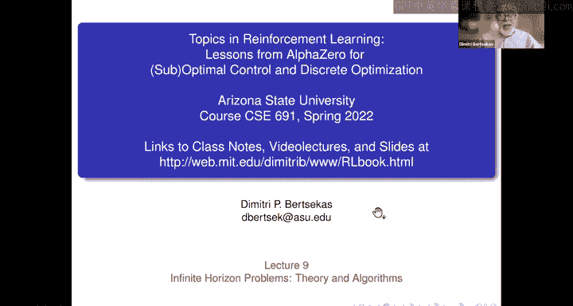

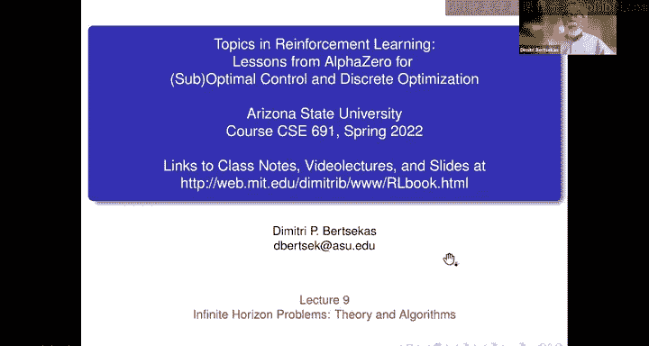

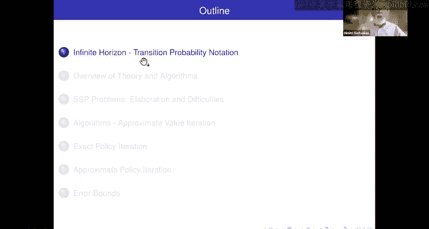

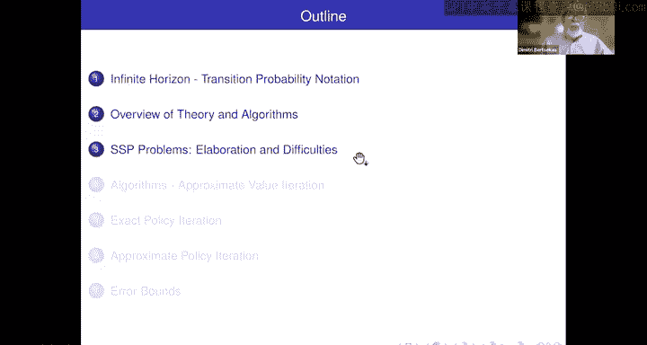

在本节课中，我们将学习无限时域问题的理论和算法。我们将从有限时域问题转向无限时域问题，并关注适用于强化学习的近似方法。

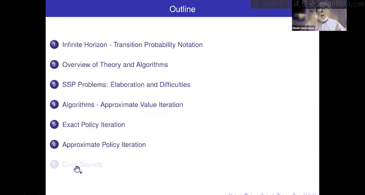

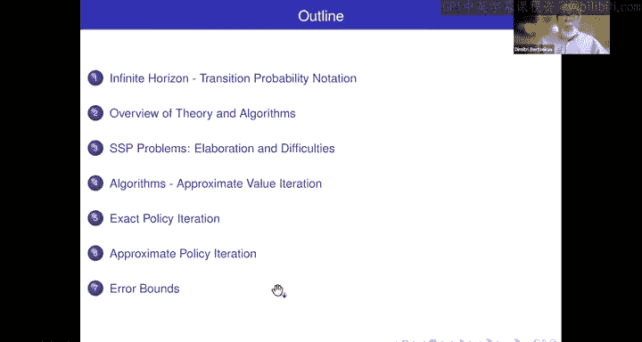

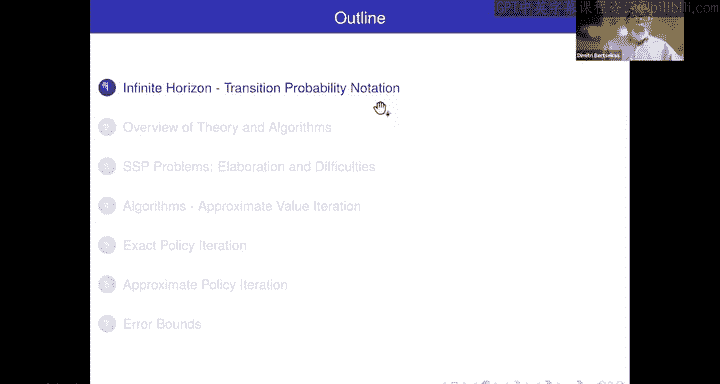

## 概述 📋

上一讲，我们从在线博弈算法转向了离线训练算法和神经网络训练。今天，我们将从有限时域问题转向无限时域问题，回顾这些问题的理论和算法，并关注强化学习中典型的近似方法。

以下是本节课的提纲：
*   首先，我们将介绍适用于离散状态问题的新符号表示法。
*   然后，我们将阐述无限时域问题的形式化定义，概述其理论和算法。
*   我们将讨论两种主要类型的问题：具有有限状态的折扣问题和具有有限状态的随机最短路径问题。
*   接着，我们将深入探讨算法，重点是近似值迭代和策略迭代。
*   最后，我们将讨论这些方法的性能界限。

## 无限时域问题简介 🔄

首先，为什么我们要使用无限时域？毕竟，所有实际问题都是有限时域的，即使时域可能很长，但仍然是有限的。

使用无限时域有几个原因：
*   无限时域可能是时域有限但非常长的情况的良好近似。
*   无限时域问题的理论更加优雅，符号表示也更简洁、更不复杂。
*   围绕其理论和应用有很多直观理解。
*   无限时域问题在数学上更加复杂，这为数学家提供了丰富的研究内容。
*   无限时域问题有一些很好的算法，例如策略迭代，这是强化学习的核心工作。

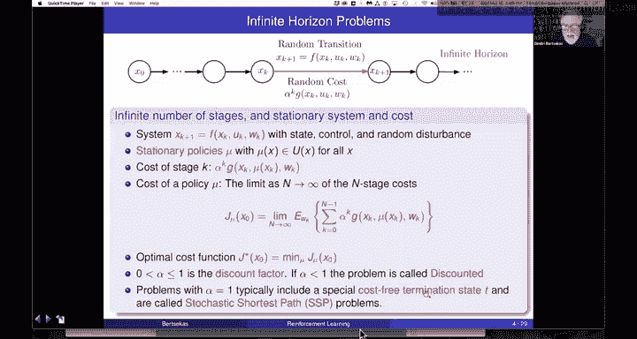

然而，文献可能会给人一种印象，即动态规划问题都是无限时域的。这并不完全正确，存在一些误解。

第一个误解是我们不需要担心有限时域问题。这绝对不正确，因为许多重要问题，包括离散优化问题和涉及时变系统的问题，本质上只能表述为有限时域问题。

第二个误解是我们可以只关注有限状态问题，因为计算机只识别有限状态问题。这种关注在源于人工智能的强化学习文献中尤为强烈。但在其他领域，如控制理论，问题在状态空间和控制空间上自然都是连续的。

第三个误解是我们可以只关注随机问题、马尔可夫决策过程。这绝对不正确，因为许多实际问题本质上是确定性的，例如确定性最短路径问题或确定性离散优化问题。

因此，我们将专注于行为良好的问题：有限状态马尔可夫决策问题，包括折扣问题和随机最短路径问题。这些是该领域的标准问题，也相对简单，因此我们有时间详细研究它们。

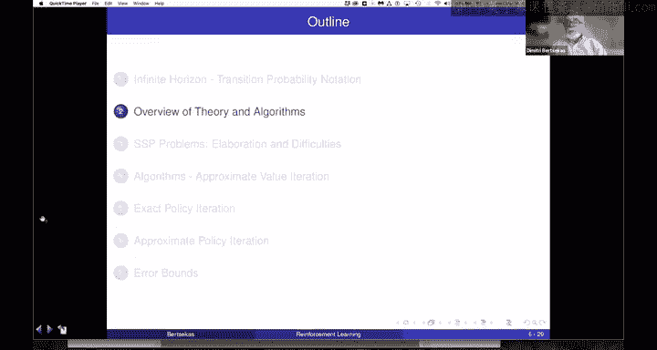

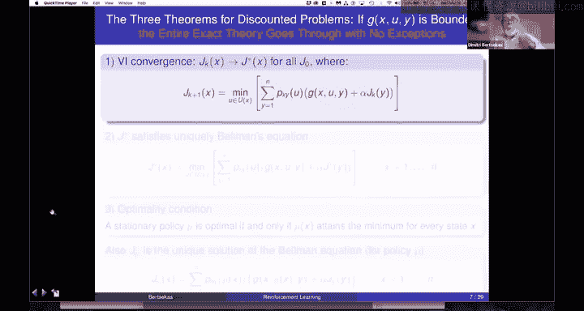

## 符号表示法 📝

我们之前使用的符号表示法适用于确定性问题和涉及无限状态及控制空间的问题。然而，如果状态数量有限，那么在随机问题中，使用转移概率符号表示法更好。

在接下来的讨论中，我们将假设状态数量是有限的，并用1到n标记它们。转移是从状态x到状态y。对于随机最短路径问题，除了这n个状态外，还有一个终止状态T。

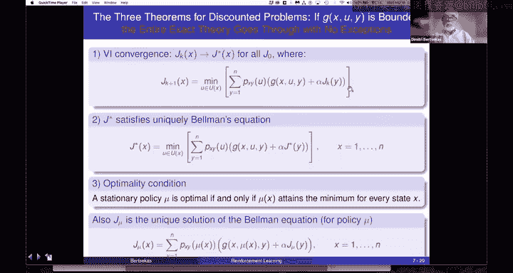

我们将考虑在控制u下从状态x到状态y的转移概率，记为 `p_xy(u)`。这是当我们在状态x应用控制u时，最终到达状态y的概率，对所有y的求和等于1。对于随机最短路径问题，还包括转移到终止状态的概率。

从状态x到下一个状态y的转移成本在控制u下记为 `g(x, u, y)`。

这两个符号系统在数学和功能上是等价的，但对于不同类型的问题，其中一个更方便。新的符号系统用一个三维矩阵（转移概率）替换了旧的系统方程和w的分布。

从旧符号系统转换到新符号系统的公式时，每阶段的期望成本被替换为 `Σ_y p_xy(u) * g(x, u, y)`。类似地，下一阶段的期望成本被替换为 `Σ_y p_xy(u) * J(y)`。

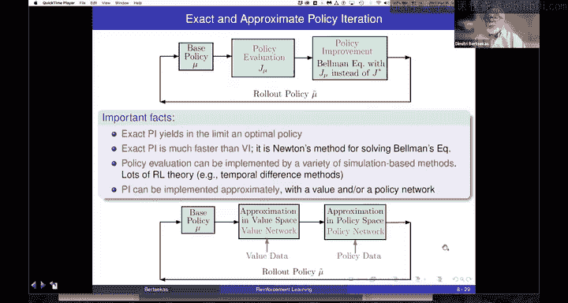

利用这个记忆法，折扣问题的贝尔曼方程在新符号系统中如下所示。它是一个包含n个未知数 `J*(1), J*(2), ..., J*(n)` 的n个方程组成的系统。这个表达式涉及第一阶段成本加上从下一个状态开始的折扣最优成本的期望值的最小化。

对于随机最短路径问题，有一个类似的方程，但必须考虑终止状态。第一部分是转移到终止状态的条件期望成本，第二部分是未转移到终止状态的条件期望成本。这同样是包含n个未知数的n个方程。

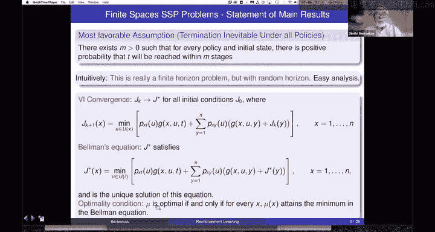

这种符号系统适用于状态有限的随机问题，但对于具有无限状态和控制空间的问题，尤其是确定性问题，则完全不适用。因此，根据问题的性质使用两种不同的符号系统是必要的。

## 理论与算法概述 🧠

回顾第二讲中无限时域动态规划的三个定理。

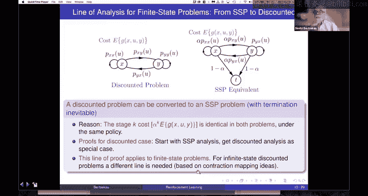

当问题是具有有限状态的折扣问题，或者更一般地说，如果每阶段成本有界时，这三个定理成立。对于我们将要讨论的有限状态折扣情况，整个精确理论成立，没有任何例外。这是随机无限时域动态规划中最简单的问题。

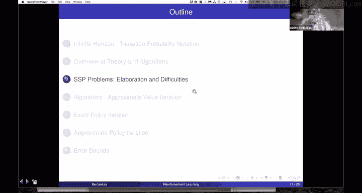

三个定理如下：
1.  **值迭代算法的收敛性**：值迭代算法顺序计算具有越来越大时域的最优有限时域成本。`J_k(x)` 是带有终端成本近似 `J_0` 的k阶段问题的最优成本。它通过向前推进动态规划算法获得，同时考虑折扣因子。这是值迭代，一个非常基础的算法，是我们熟知和喜爱的动态规划算法的无限阶段版本。
2.  **贝尔曼方程**：理论表明，`J*` 解决了这个贝尔曼方程，并且在折扣问题的情况下，这是唯一解。
3.  **最优策略**：如果你在这个贝尔曼方程的表达式中达到最小值，那么你就得到了一个最优策略。反之，如果你有一个最优策略，那么它必须达到这个最小值。这是一个充要条件。

此外，还有一个针对单个给定策略μ的贝尔曼方程。它取以下形式，我们只需去掉最小化，并将 `μ(x)` 代入u的位置。这个方程由策略μ的成本向量 `J_μ` 唯一求解。这个方程是线性的，可以通过高斯消元法等线性代数方法求解。而另一个方程由于最小化操作而是非线性的。

值迭代实现起来比策略迭代便宜得多，但策略迭代要快得多。它与求解贝尔曼方程的牛顿法有关。如果能够实现，策略迭代要快得多，并且在精确形式下，它能给出最优策略。

然而，在强化学习中，我们必须处理近似，因为我们研究的问题非常具有挑战性。通常，我们不得不求助于模拟，特别是在策略评估步骤。有许多模拟方法，我们讨论过简单平均状态和成本对的样本来通过蒙特卡洛模拟计算所需的 `J_μ` 值。还有一类重要的方法是时间差分方法，它们在历史上扮演了重要角色。

在近似实现方面，我们还讨论了使用状态和成本数据训练神经网络来近似目标函数 `J_μ` 的值网络，以及使用状态和控制数据来近似策略的策略网络。这些策略网络也可以被视为分类器，因此可以受益于分类理论中已知的软件和算法。

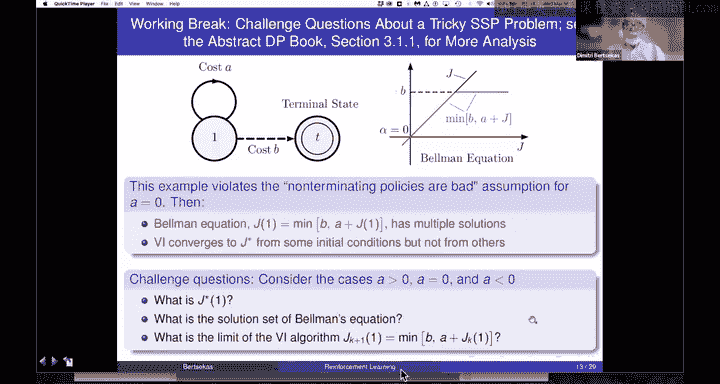

近似策略迭代的操作类似于精确策略迭代，只是我们在这里使用值数据训练值网络，在这里使用策略数据训练策略网络，然后我们获得一个近似rollout策略。如果我们只想做近似rollout，我们可以在这里停止，或者我们可以进入循环并生成多个基础策略和相应的rollout策略。

重要的是要记住，这个循环的第一次迭代可以用于值空间近似和在线博弈，用于实时控制系统。Rollout是一种一次性的在线博弈类型算法，不需要策略网络或值网络。一旦进入多轮迭代，除了拥有值网络或策略网络或两者之外，没有其他选择。训练具有数据的神经网络或近似架构意味着离线训练，你不能在线使用这种类型的算法，必须离线训练，并在在线博弈的值空间近似方案中使用你得到的最后一个策略。

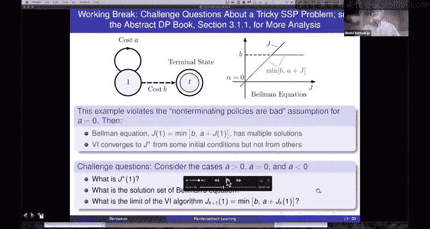

## 随机最短路径问题 🛣️

现在，我们进入随机最短路径问题，并研究其对应部分。

随机最短路径问题有一个最有利的假设：**在所有策略下，终止都是必然的**。这意味着存在一个阶段数M，使得对于每个策略和每个初始状态，我们在前M个阶段内到达终止状态的概率为正。这个假设表明，这实际上是一个有限时域问题，只是我们不知道何时终止。我们最终会以概率1终止，但只是不知道何时终止。此外，每经过M个阶段，已经终止的概率会增加，所以在很多阶段之后，尚未终止的概率可以忽略不计。

在这个假设下，分析相对容易，并且得到的结果是三个定理，除了这个假设外没有其他例外。值迭代对所有初始条件都收敛。贝尔曼方程涉及到达终止状态的期望成本，`J*` 解决了这个方程并且是唯一解。最优性条件是：策略μ是最优的，当且仅当μ在这个表达式中达到最小值。

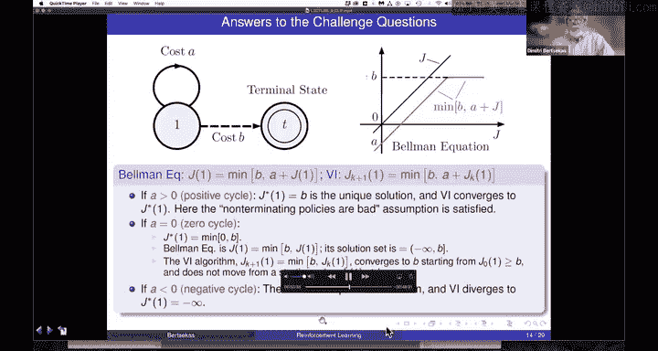

此外，分析足够简单，可以作为折扣问题分析的基础。思路是随机最短路径问题易于分析，易于理解，而折扣问题实际上可以转化为随机最短路径问题，存在某种等价性。因此，我们首先分析随机最短路径问题，然后折扣问题的结果就自然得到了。

这是我们的原始折扣问题，这是对应于策略μ的马尔可夫链，以及不同状态之间的转移概率。当我们在状态x并应用u时，这是不考虑折扣因子的每阶段期望成本。

现在，我们将其表述为一个随机最短路径问题，引入一个人工终止状态T。在每个阶段，从每个状态，都有一个概率 `1 - α`（α小于1）转移到T。条件是我们没有转移到T，转移到其他状态的概率根据原始转移概率。

这个随机最短路径问题与原始折扣问题等价，因为策略的成本在两者中是相等的，并且最优策略在两者中是相同的。原因是：折扣问题的第k阶段成本是这个期望成本乘以 `α^k`。而这个问题从x开始的第k阶段成本是期望g乘以我们尚未终止的概率，即 `α^k`。因此，只要我们没有终止，转移是相同的，成本也是相同的。所以两个问题是等价的，具有相同的成本和相同的策略。

这样，我们就得到了折扣情况的证明：从随机最短路径分析开始，然后折扣分析作为一个特例自然得出。这种证明思路适用于有限状态问题。另一方面，如果你有一个更复杂的问题，例如涉及无限状态的折扣问题，这种分析思路就不起作用了。原因是对于具有无限状态的随机最短路径问题，没有简单的理论。因此，对于无限状态问题，你需要不同的分析思路，这涉及压缩映射的思想。

## 随机最短路径问题的深入探讨 🔍

我们说过，当我们在所有策略下都有终止必然性的假设时，一切都很顺利。另一方面，许多感兴趣的随机或确定性最短路径问题并不满足这个假设。例如，一个具有环路的确定性图问题，那么就存在一个策略只是绕着环路旋转而永不终止，因此立即违反了终止必然性。大多数确定性最短路径问题都涉及环路，所以这个假设被违反是很常见的。

我们必须用其他一些假设来替换这个假设，这里有一个在实践中广泛适用的很好的假设。这个假设说：**不终止的策略是糟糕的**。可能存在一些不终止的策略，但它们对某些初始状态具有无限成本。更精确地说，这个假设要求每个不以正概率终止的策略对某些初始状态具有无限成本。在具有环路的确定性最短路径问题的背景下，我们要求绕环路运行有正成本，所以旋转是不明智的，应该避免。这是这个假设的一部分。第二个假设是：至少存在一个策略，在该策略下终止是必然的。这对于保持成本有限是必要的。

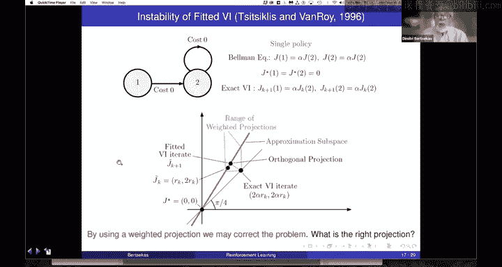

在这个假设下，主要结果，即三个定理，得以保留。另一方面，如果你试图超越这个假设，事情可能会变得非常棘手，可能会出现非常不寻常的情况，理论仍在发展中，特别是其近似版本。

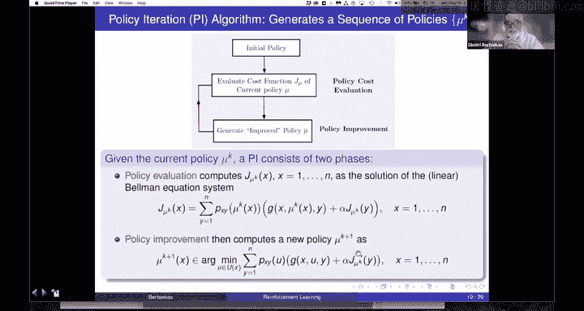

可能发生的情况：
*   贝尔曼方程可能有许多解，不止一个。
*   贝尔曼方程可能有一个唯一解，但该解不等于 `J*`。
*   值迭代和策略迭代可能失败，即使对于有限状态问题。
*   即使每阶段成本有界，也可能出现非常奇怪的行为。

所有这些对于数学家来说都是令人愉快的，但超出了我们课程的范围。

## 一个简单的例子 💡

让我们考虑一个简单的确定性最短路径问题。它有一个状态加上终止状态，有两个动作。一个动作让你保持在同一个状态，成本为a。另一个动作带你到终止状态，成本为b。所以，就静态策略而言，只有一个决策要做。

考虑a等于零的情况。那么绕环路旋转的成本为零。如果b为正，那么最优策略可能就是绕环路旋转。这个策略违反了“不终止的策略是糟糕的”假设，因为这是一个不终止的策略，但如果a等于零，它的成本为零，所以它对我们的一个初始状态没有无限成本。

这个例子违反了我们的假设，这是它的贝尔曼方程。由于只有一个状态，这个未知数是 `J*(1)`，它涉及在控制1的成本b和控制2的成本 `a + J*(1)` 之间取最小值。贝尔曼方程有多个解。值迭代算法收敛到 `J*`。`J*` 在这里等于a（如果b为正）或b（如果b为负）。但从图中可以看出，值迭代从某些初始条件收敛到 `J*`，但对其他初始条件则不收敛。

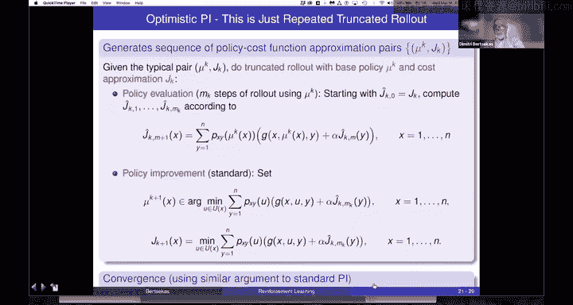

考虑a为正、为零和为负的三种情况。在这些情况下发生了什么？满足哪些假设？贝尔曼方程的情况如何？值迭代的情况如何？`J*` 是什么？贝尔曼方程的解集是什么？值迭代算法的极限是什么？

*   **a > 0**：`J*` 是b，因为另一个策略（停留）的成本是无限的。贝尔曼方程 `J* = min(b, a + J*)` 的唯一解是 `J* = b`。值迭代收敛到b。所有假设都成立，一切正常。
*   **a = 0**：贝尔曼方程是 `J* = min(b, J*)`。解集是从b到负无穷的所有数。有无限多个解。值迭代从高于b的初始值收敛到b，但如果从低于b的解开始，则不会移动。
*   **a < 0**：贝尔曼方程 `J* = min(b, a + J*)` 没有解。所有假设都被违反，不终止的策略是最优的，最优成本是负无穷。值迭代发散到负无穷。

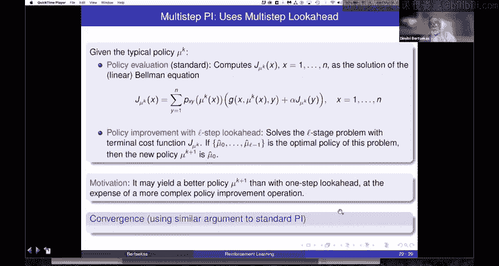

这是一个非常简单的例子，但也非常有启发性，可以消除你对动态规划和强化学习结果性质的一些先入之见。

## 近似值迭代 🔄

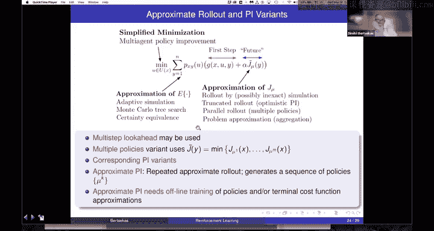

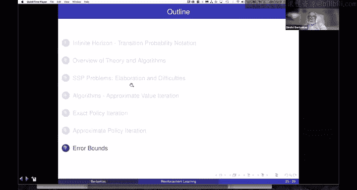

现在，让我们更多地讨论算法，特别是值迭代的近似版本。

我们在上一讲讨论了动态规划算法的近似版本，即所谓的拟合值迭代。我们将在无限时域问题的背景下讨论相同的算法，即拟合值迭代。

折扣问题的精确值迭代算法由这个方程给出。从任意的 `J_0` 开始，它生成 `J_1`、`J_2` 等等，每次应用动态规划操作，每次找到比之前时域长度多一阶段的有限时域问题的最优成本。

我们如何对这个算法进行近似？我们可以近似地进行这个最小化，然后称结果为 `J̃`。我们从 `J̃_0` 开始，然后通过在这里以某个容差δ内最小化来生成 `J̃_1`，然后我们转到 `J̃_2`，再次产生误差δ，依此类推。这与我们讨论过的使用神经网络近似和编码这些 `J̃` 的算法完全相同。

有人问过，这些误差会累积吗？在有限时域背景下，它们累积有限次，但在无限时域背景下，它们确实会累积。现在，我将给出一个它们如何累积的例子。

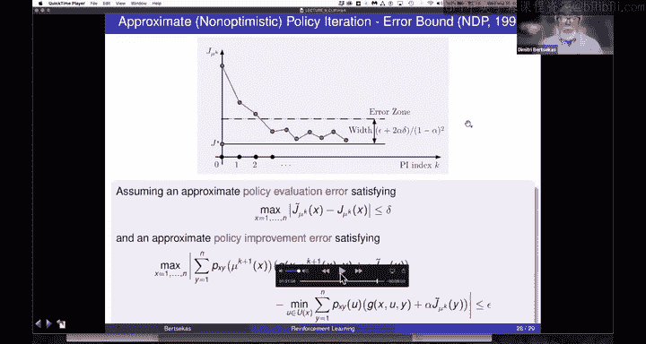

首先，是一个理论结果。如果你假设这个条件成立，那么你可以证明拟合值迭代的迭代值与最优成本之间的长期误差以 `δ / (1 - α)` 为界。这个结果说，如果这个条件成立，那么你在无限时域上产生的长期误差与δ成正比。

另一方面，这个结果假设这是真的。我假设你可以在δ内最小化，但奇怪的是，当误差累积时，这可能是不可能的。因此，对于某些自然方法，这个结果可能没有意义，因为可能难以在无限时域上维持这个方程，因为误差在 `J̃` 序列中累积，可能变得无界。

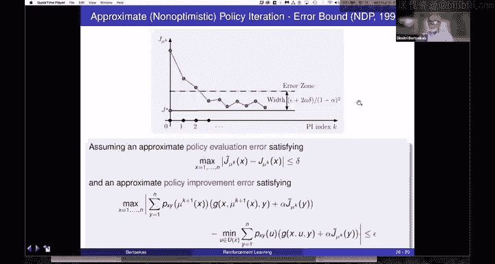

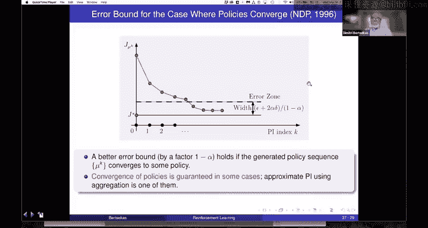

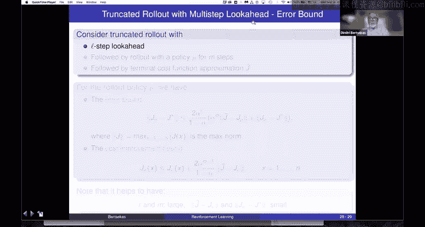

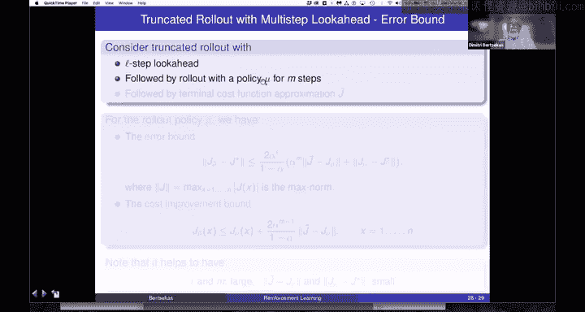

让我们给出一个简单的例子，这是强化学习和近似动态规划中的一个经典例子。我们从某个 `J̃_0` 开始，让 `J̃_k` 通过使用某种参数架构生成。给定参数架构，我们使用最小二乘拟合获得参数近似 `J̃_k`。我们将讨论拟合值迭代和近似，这里有一个例子。

这是一个旧例子，涉及拟合值迭代的不稳定性。这也是一个非常简单的折扣成本例子。它涉及一个单一策略和两个状态1和2。该策略确定性地从1移动到2，并确定性地保持在2，两种情况下的成本都为零。所以贝尔曼方程是 `J(1) = αJ(2)`, `J(2) = αJ(2)`。唯一的最优成本函数是零函数。值迭代算法形式为 `J_{k+1}(1) = αJ_k(2)`, `J_{k+1}(2) = αJ_k(2)`。从任何初始条件开始，值迭代收敛到零。

现在假设我们在这个值迭代中引入近似，并在某个子空间中近似值迭代。这个近似子空间由单个参数r定义，架构由权重1和2定义，形成一条直线。我们在这个线上进行拟合值迭代，它必须与向量(1, 2)对齐。对其应用值迭代算法，将乘以α。然后我们通过投影到这个近似子空间来拟合它，即最小二乘近似。

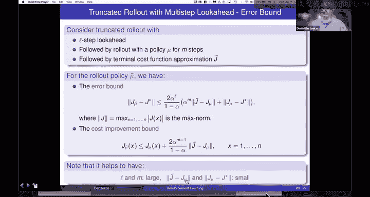

从这一点开始，我们进行精确值迭代，并通过投影到这条线上进行近似，得到 `J̃_{k+1}`。但我们开始和结束的点沿着这条线向那个方向走得更远，而不是向这个方向。换句话说，从这里开始，我没有更接近我想要去的地方，而是更远了。如果我从这一点做同样的事情，我将得到一个精确的值迭代，再次投影回来，然后我将得到一个更远的迭代，依此类推，迭代发散，误差当然随时间累积，我在前一页做的假设也被违反了。

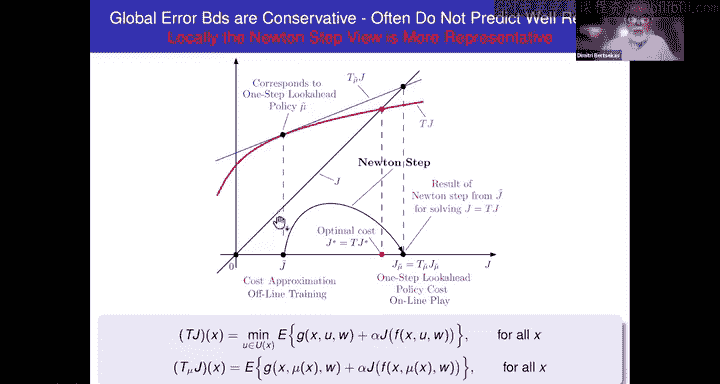

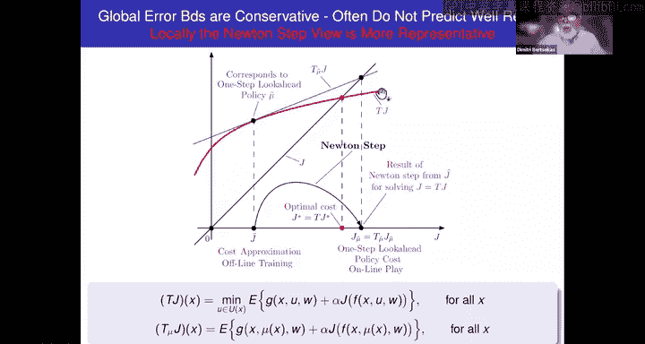

我们如何修复这个算法？这是一个严肃的研究问题。这里我们使用了在近似子空间上的正交投影。但也可以使用不同类型的投影，不是以90度角投影到这个子空间，而是以某种角度，这是一种斜投影。你可以使用的投影类型是从这里到这里，这是一个极端，你加权一个坐标，另一个为零，这里是你在投影中加权另一个坐标。那些映射到这个点以下的投影是有效的，能给你收敛。而那些以相反方式加权两个分量的投影则不收敛。

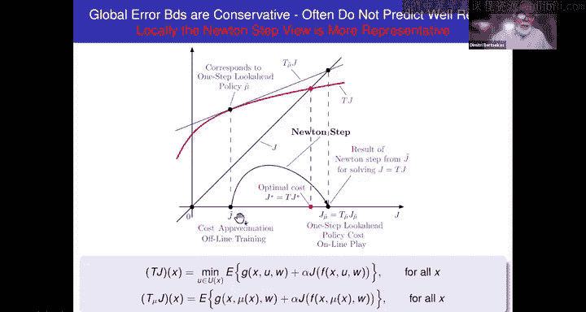

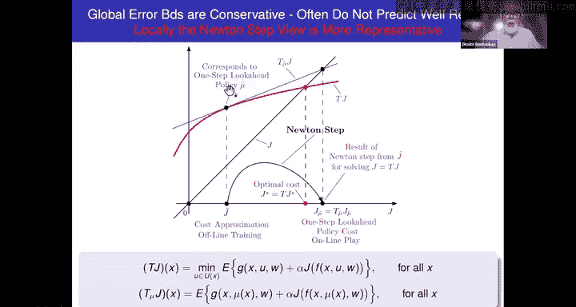

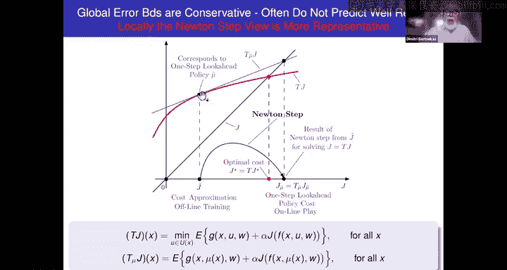

我们如何控制这个投影的权重？投影的权重实际上与采样频率有关。当你使用神经网络和最小二乘拟合等进行近似时，你如何使用更多的一个分量的样本与另一个分量的样本来控制这个投影的特性。如果你以正确的方式进行采样，那么你会得到拟合值迭代的收敛，如果你以不同的方式进行，你可能得不到收敛。人们已经发现，这种最优采样频率与不同状态在最优策略下的长期出现频率或重要性有关。

这个例子对拟合值迭代提出了很多质疑，并表明实际上让它工作起来相当复杂。因此，我们更倾向于对无限时域问题使用策略迭代方法，而不是值迭代。这并不意味着拟合值迭代不是一种合法的方法论，但这个例子对它提出了很多质疑，并表明实际上让它工作起来相当复杂。

## 策略迭代 🚀

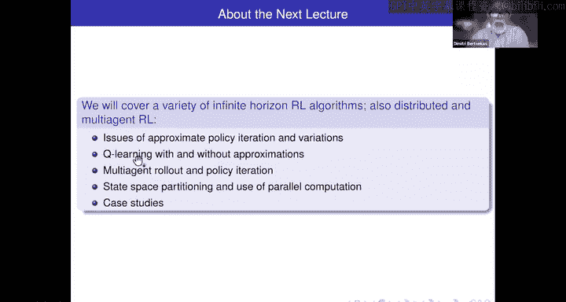

现在，让我们进入策略迭代，这是我们课程的主要算法。我们以前见过它，它生成一个策略序列。从某个策略开始，我们以某种方式评估它，然后通过策略改进生成一个改进的策略，并继续循环。

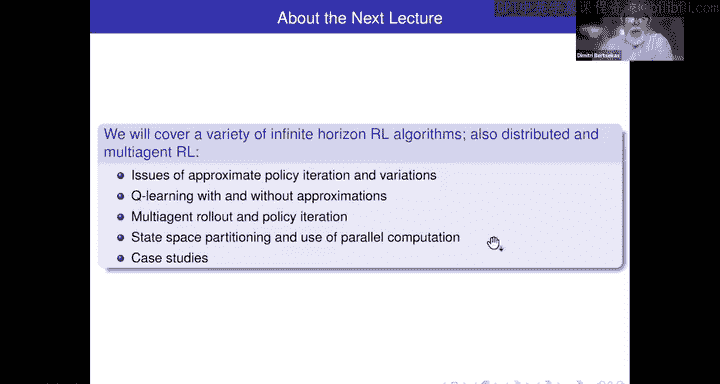

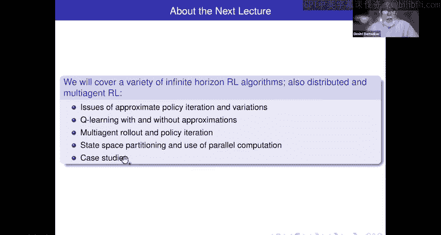

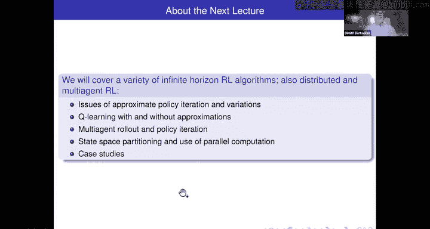

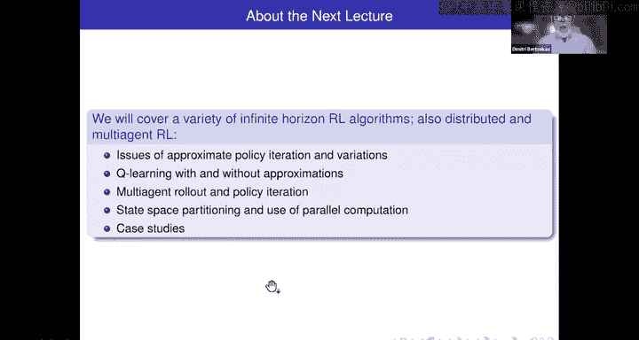

有两个阶段：
1.  **策略评估**：对于当前策略 `μ_k`，我们通过求解相应的贝尔曼方程组来进行策略评估。我们可以通过多种方式做到这一点：在基于模拟的蒙特卡洛背景下