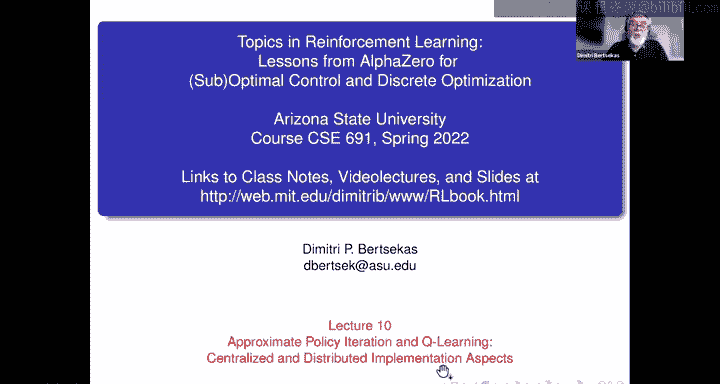
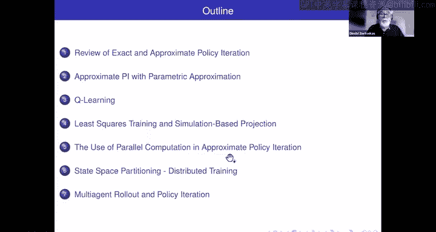
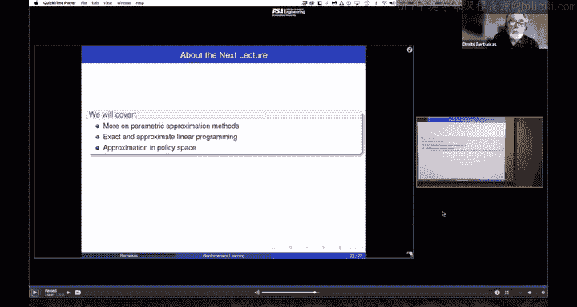
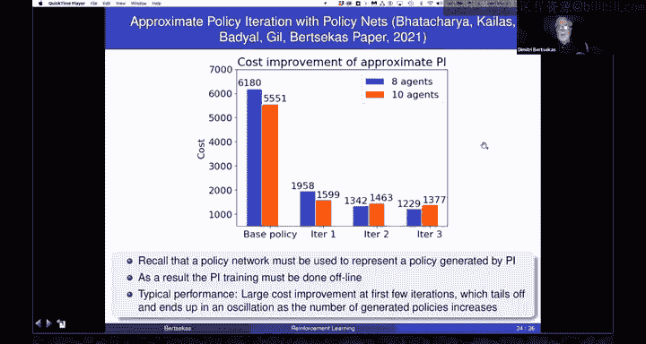
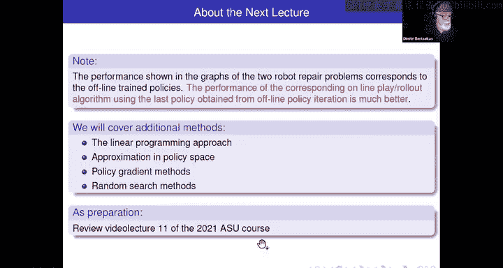

# 39：近似策略迭代、变体与并行计算 🚀




在本节课中，我们将学习近似策略迭代及其变体，包括Q学习。我们还将讨论这些方法的并行与分布式计算方面。



## 概述 📋

上一讲我们讨论了无限视野问题及其理论和算法，重点是近似方法。今天，我们将聚焦于近似策略迭代及其变体，包括Q学习，并探讨这些方法的并行与分布式计算方面。

## 1. 回顾：精确与近似策略迭代 🔄

上一讲我们介绍了无限折扣问题、贝尔曼方程、值迭代和策略迭代算法。策略迭代算法生成一系列策略，每个策略通过策略评估（计算其成本向量）和策略改进（基于当前策略成本进行一步前瞻最小化）来获得。对于大型状态空间问题，策略迭代无法精确实现，必须使用近似架构（如价值网络或策略网络）来近似表示策略和成本函数。

## 2. 近似策略迭代与参数化近似 🧠

近似策略迭代是一种离线训练方法，它生成一系列策略（通常一个比一个好），最终策略可用于在线游戏。更有效的方法是，将离线训练得到的最终策略及其成本函数近似，通过近似价值空间和截断前瞻方案用于在线游戏（如AlphaZero和TD-Gammon中所用方法）。

### 参数化架构

我们引入参数化架构来近似策略的成本函数。例如，对于策略 `μ` 和状态 `i`，我们使用参数 `r` 来近似成本值 `J̃(i, r)`。架构可以是线性特征基架构或神经网络。策略评估通过最小二乘回归拟合状态-成本对数据来完成。

以下是训练问题的公式：

```
min_r Σ_s (β_s - J̃(i_s, r))^2
```

其中 `β_s` 是通过模拟从状态 `i_s` 开始的轨迹（使用策略 `μ` 运行若干阶段，并添加终端成本函数近似）获得的成本样本。

### 实现中的关键问题

*   **轨迹复用**：一条长轨迹可以为多个中间状态生成成本样本。
*   **探索**：使用当前策略进行模拟会偏向于该策略偏好的状态区域。为了均衡探索，需要使用短轨迹和更多不同的起始状态。
*   **偏差-方差权衡**：轨迹长度增加会减少偏差但增加方差，需要在两者之间取得平衡。
*   **成本塑形**：通过引入一个函数 `V` 来修改阶段成本 `g`，可以改变成本值而不影响最优策略，但可能使近似更容易。

## 3. Q学习变体与SARSA算法 🎯

Q学习是近似策略迭代的一个重要变体，它直接近似最优Q因子，而不是特定策略的Q因子。

### 经典Q学习（查表法）

经典Q学习使用查表法表示Q因子，并通过异步动态编程和随机采样进行更新。对于选定的状态-控制对 `(i_k, u_k)`，生成后继状态 `j_k`，并按以下方式更新Q因子：

```
Q_{k+1}(i_k, u_k) = (1 - γ_k) Q_k(i_k, u_k) + γ_k [g(i_k, u_k, j_k) + α min_{v} Q_k(j_k, v)]
```

其中 `γ_k` 是步长。理论上，该算法能收敛到最优Q因子，但对于大规模问题，由于状态-控制对数量巨大，无法存储所有Q因子，因此不实用。

### 带有参数化近似的SARSA算法



为了解决大规模问题，我们引入线性参数化架构来近似Q因子：`Q̃(i, u, r) = φ(i, u)' r`。SARSA（状态-动作-奖励-状态-动作）是一种流行的乐观算法，它在每次迭代后都更新策略。

算法步骤如下：
1.  根据当前参数向量 `r_k` 和ε-贪婪探索策略，在状态 `i_k` 选择控制 `u_k`。
2.  模拟转移到下一个状态 `i_{k+1}`。
3.  根据当前Q因子近似选择下一个控制 `u_{k+1}`（例如，通过最小化 `Q̃(i_{k+1}, v, r_k)`）。
4.  计算时序差分 `δ_k`。
5.  更新参数：`r_{k+1} = r_k + γ_k δ_k φ(i_k, u_k)`。

其中时序差分 `δ_k` 的计算公式为：

```
δ_k = g(i_k, u_k, i_{k+1}) + α Q̃(i_{k+1}, u_{k+1}, r_k) - Q̃(i_k, u_k, r_k)
```

## 4. 投影视角与基于模拟的投影 📐

策略评估的参数化近似可以看作是在近似架构定义的流形上的投影。最小二乘训练是一种投影形式。对于大规模问题，精确投影无法计算，但可以通过蒙特卡洛模拟来近似。

考虑一个由特征矩阵 `Φ` 定义的线性子空间流形 `M`。向量 `J` 在该子空间上的加权投影可以通过求解最小二乘问题获得。其解析解涉及期望值，而这些期望值可以通过从分布 `ξ` 中采样状态并计算样本平均值来近似。这等价于用状态-成本对样本求解最小二乘最小化问题。

基于模拟的投影为时序差分（TD）方法等策略评估方法提供了概念框架。

## 5. 并行计算加速 ⚡

近似策略迭代和滚动的计算量很大。并行化是加速计算的关键。主要有四种并行化类型：

1.  **Q因子并行化**：在给定状态下，为不同控制并行计算Q因子。
2.  **蒙特卡洛并行化**：并行运行多个独立的模拟轨迹。
3.  **状态空间并行化（多处理器）**：将状态空间划分为子集，在每个子集上并行进行本地值和策略近似，处理器之间按需通信。
4.  **控制空间并行化（多智能体）**：针对多智能体问题，通过预计算信号（如使用神经网络表示其他智能体的滚动策略）来并行化智能体的决策计算。

### 案例研究：管道维修问题（状态空间并行化）

在一个涉及20个潜在损坏点、部分可观测的管道维修问题中，状态空间非常庞大（约 `10^15` 个状态，加上信念状态）。研究采用了状态空间分区，将状态空间划分为6个子集，并使用6个策略网络和3个价值网络进行近似策略迭代。通过分区和并行训练，在保持性能接近集中式方法的同时，显著加快了计算速度。

### 案例研究：多机器人维修问题（控制空间并行化）

在一个包含32个损坏点和4个维修机器人的网络中，采用了多智能体策略迭代与神经网络策略近似。通过使用神经网络作为其他智能体滚动策略的预计算信号，实现了智能体决策的并行化。结果表明，与基准策略相比，近似策略迭代能显著降低成本。



## 总结 🎓



本节课我们一起学习了近似策略迭代及其变体。我们回顾了策略迭代的基本原理，然后深入探讨了使用参数化架构（如神经网络）进行近似策略评估和Q学习的方法。我们还从投影的角度审视了训练过程，并讨论了如何利用并行计算（包括状态空间分区和多智能体并行化）来加速这些计算密集型算法。最后，通过两个机器人维修的案例研究，我们看到了这些方法在解决复杂实际问题中的应用和潜力。记住，离线训练得到的策略，结合在线滚动播放，往往能发挥最佳性能。