# 40：近似线性规划与策略空间近似 🧠

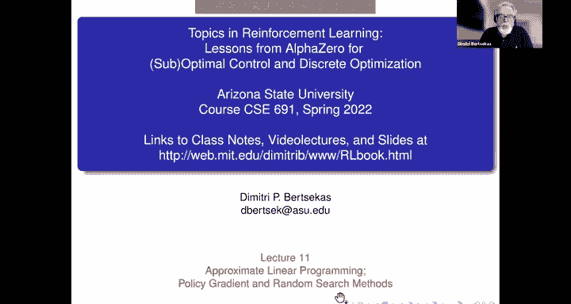

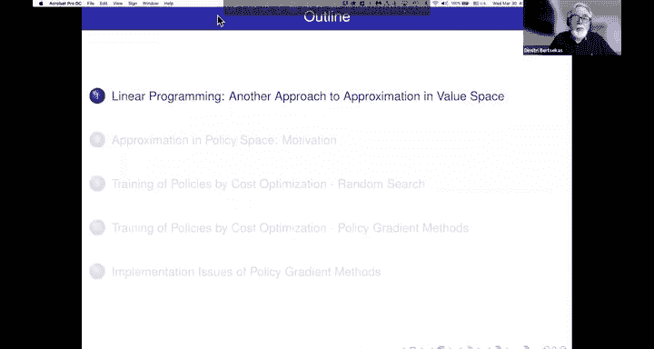

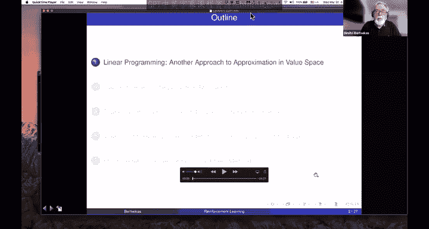

在本节课中，我们将学习两种新的强化学习方法：基于线性规划的近似方法，以及策略空间近似。我们将首先探讨如何将动态规划问题转化为线性规划问题，并讨论其近似形式。接着，我们将重点转向策略空间近似，介绍其应用场景、核心算法（如随机搜索和策略梯度方法），并分析各自的优缺点。

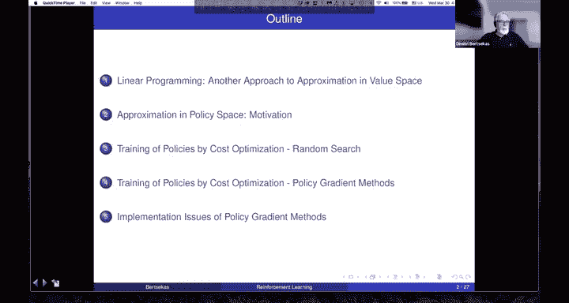

---

## 线性规划方法 📐

上一节我们讨论了值空间近似及其主要算法。本节中，我们来看看另一种精确求解无限时域动态规划问题的方法：线性规划。这是继值迭代和策略迭代之后的第三种精确方法。

### 核心思想与公式

考虑折扣无限时域问题。最优成本函数 `J*` 是一个 n 维向量。关键思想是：`J*` 是满足以下约束的最大向量 `J`。

对于每个状态 `i` 和每个控制 `u`，约束为：
`J(i) ≤ g(i, u) + α * Σ_j p_ij(u) * J(j)`

其中：
*   `g(i, u)` 是单步成本。
*   `α` 是折扣因子。
*   `p_ij(u)` 是转移概率。

`J*` 可以通过求解以下线性规划问题得到：
最大化 `Σ_i c_i * J(i)` （例如，`c_i = 1`）
约束条件为：`J(i) ≤ g(i, u) + α * Σ_j p_ij(u) * J(j)`， 对所有 `i`, `u`。

### 面临的挑战与近似方法

直接求解上述线性规划的问题在于：变量数（n个状态）和约束数（状态-控制对的数量）可能非常庞大。

以下是解决此问题的近似方法：
1.  **引入线性特征架构**：使用 `m` 个特征和对应的权重 `r` 来参数化近似成本函数 `J̃ ≈ Φ * r`，从而大幅减少变量数。
2.  **约束采样**：通过采样代表性的状态子集和控制子集，来减少约束的数量。这相当于用一个约束更少（因此更大）的多面体来近似原始可行域。

这种方法的主要优势在于可以依赖成熟的大规模线性规划求解器的可靠性。然而，其难点在于如何智能地选择采样的状态和控制，这通常需要启发式方法或利用已知的次优策略。

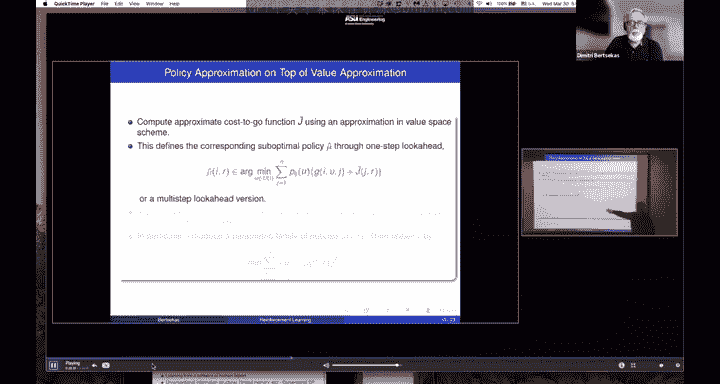

---

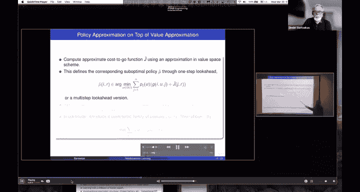

## 策略空间近似 🎯

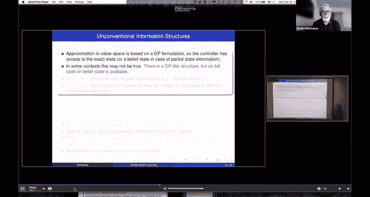

上一节我们介绍了基于线性规划的近似方法。本节中，我们来看看谱系另一端的强化学习方法：策略空间近似。与近似成本函数不同，这里我们直接使用数据来训练和近似策略。

### 策略参数化

我们使用参数向量 `r` 来参数化策略 `µ(r)`。每个 `r` 对应一个（通常是平稳的）策略。参数化的方式可以很直观，例如在库存控制问题中，策略可以是“当库存低于阈值 `s` 时，订购数量 `S`”，其中 `s` 和 `S` 就是参数。

另一种方式是通过值函数参数化间接定义策略。如果我们有一个好的值函数近似架构 `J̃(i, r)`，那么可以通过单步前瞻最小化来定义一个参数化策略：`µ(i; r) ∈ argmin_u [ g(i, u) + α * Σ_j p_ij(u) * J̃(j, r) ]`。

### 策略空间近似的适用场景

以下是策略空间近似可能更具优势或更必要的几种情况：
1.  **存在自然的策略参数化**：例如供应链中的(s, S)策略。
2.  **存在好的值函数参数化，但想使用策略优化方法**：例如俄罗斯方块问题，使用好的特征进行线性参数化，但通过随机搜索在策略空间训练。
3.  **在值函数近似之上进行策略近似**：用于简化基于复杂值函数近似策略的在线实施。
4.  **向专家学习**：通过监督学习，模仿人类或软件专家提供的状态-控制样本对。
5.  **非常规信息结构**：例如有限记忆、分布式多智能体系统，此时传统的基于动态规划的值空间近似可能不再适用。
6.  **模型未知**：当系统模型（转移概率）未知时，直接优化策略可能更直接。

---

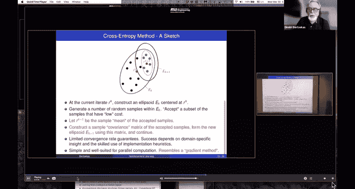

## 基于成本优化的训练：随机搜索 🔍

确定了策略参数化后，下一步是找到最优的参数 `r`。一种方法是直接最小化对应参数化策略的成本 `J_µ(r)`。这引出了基于成本优化的训练方法。

随机搜索是解决此类最小化问题的通用且广泛使用的方法。它适用于一般的 `min_r f(r)` 问题，即使 `f(r)` 不可微或包含期望。

### 交叉熵方法示例

交叉熵方法是一种随机搜索算法，其步骤如下：
1.  **初始化**：从一个参数向量 `r_k` 开始。
2.  **定义搜索区域**：围绕当前点 `r_k` 定义一个椭圆区域 `E_k`。
3.  **采样与评估**：在该椭圆内随机生成大量样本点，并计算每个样本点的成本 `f(r)`。
4.  **选择精英样本**：选出成本较低的一部分样本（例如前10%）。
5.  **更新参数**：计算这些精英样本的均值，作为新的参数向量 `r_{k+1}`。
6.  **更新搜索区域**：根据精英样本的协方差矩阵定义新的椭圆区域 `E_{k+1}`（通常按比例放大），并迭代。

这种方法理论上有良好的收敛性，不关心局部极小值，且易于并行化。但其收敛速度可能较慢，通常需要结合领域特定的启发式知识。

---

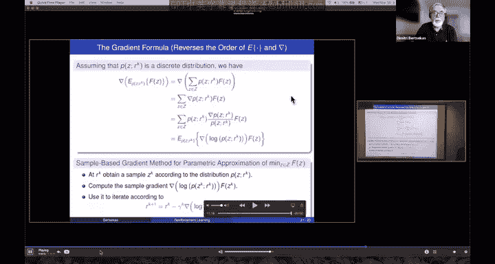

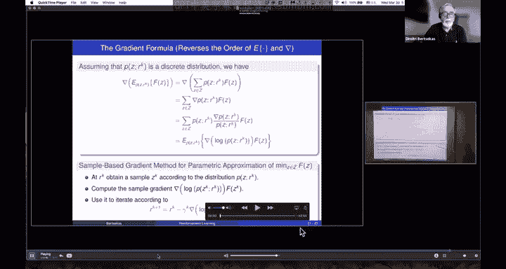

## 策略梯度方法 📉

另一种寻找最优策略参数的方法是使用梯度下降法，即策略梯度方法。其更新公式为：
`r_{k+1} = r_k - γ_k * ∇_r J_µ(r_k)`

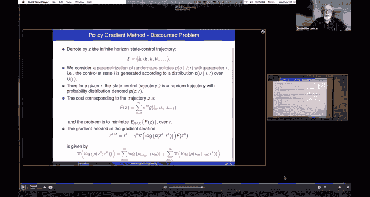

主要困难在于梯度 `∇_r J_µ(r_k)` 通常无法直接计算或写出显式公式。在随机问题中，通过有限差分和蒙特卡洛模拟来近似梯度的计算量巨大且噪声大。

### 梯度技巧与随机化策略

一个巧妙的解决方法是“梯度技巧”。它将原确定性最小化问题转化为对随机化策略概率分布的优化问题。

我们考虑参数化的**随机化策略**：在状态 `i`，以概率 `p(u | i; r)` 选择控制 `u`。对于折扣问题，最优的随机化策略与最优的确定性策略具有相同的性能。

设 `Z` 为一条状态-控制轨迹，其概率分布 `P(Z; r)` 由参数 `r` 决定。轨迹成本为 `F(Z)`。我们的目标是最小化期望成本 `E_{Z ~ P(·; r)}[ F(Z) ]`。

梯度技巧给出了以下关键公式：
`∇_r E[F(Z)] = E[ F(Z) * ∇_r log P(Z; r) ]`

### 策略梯度算法

利用上述公式，我们可以得到实用的策略梯度算法。在每次迭代 `k`：
1.  根据当前参数 `r_k` 对应的策略，采样一条轨迹 `Z_k`。
2.  计算该轨迹的成本 `F(Z_k)`。
3.  计算 `∇_r log P(Z_k; r_k)`。对于折扣动态规划问题，这个量有一个方便的逐步求和公式，涉及策略参数化 `p(u | i; r)` 的对数梯度。
4.  进行梯度更新：`r_{k+1} = r_k - γ_k * [ F(Z_k) * ∇_r log P(Z_k; r_k) ]`

这个算法易于编程实现，但通常方差很大，收敛可能很慢。

### 降低方差：基线方法与成本塑形

为了降低策略梯度估计的方差，一个常见技巧是使用**基线**。即从轨迹成本 `F(Z_k)` 中减去一个常数 `b`（或状态相关的函数），更新公式变为：
`r_{k+1} = r_k - γ_k * [ (F(Z_k) - b) * ∇_r log P(Z_k; r_k) ]`
理论证明，只要 `b` 不依赖于 `Z_k`，这样的更新仍然是无偏的。一个好的基线（例如一个近似值函数）可以显著减少方差。

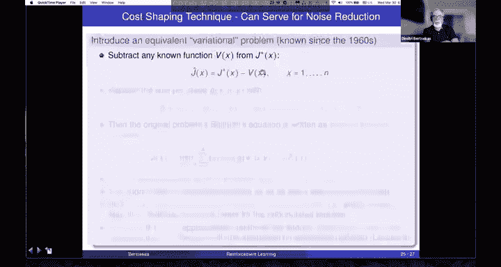

基线方法是更一般的**成本塑形**思想的一个特例。通过从原始成本函数 `J*` 中减去一个已知函数 `V`，并相应调整单步成本 `g`，可以构造一个等价的新动态规划问题。新问题的最优策略与原问题相同，但 `J* - V` 的形状可能更平缓，更利于近似方法的训练。

---

## 实施问题与讨论 ⚙️

策略梯度方法有一些独特的方面和挑战：
*   **它真的是梯度方法吗？**：更新方向依赖于 `∇_r log P(Z; r)` 而非 `∇_r J_µ(r)`，即使 `J_µ(r)` 不可微也能工作。名称“策略梯度”可能有些用词不当。
*   **从随机化到确定性**：算法优化的是随机化策略，但最终在线应用时通常需要确定性的策略（例如选择概率最大的控制）。
*   **探索与利用**：需要妥善设计采样过程，以充分探索状态-控制空间。
*   **噪声与批量处理**：单条轨迹的估计噪声很大。通常使用**小批量**轨迹的平均来估计梯度，以降低方差。
*   **步长选择**：步长 `γ_k` 的选择至关重要。理论要求递减步长（如 `1/k`），但实践中常使用启发式规则（如常数步长、分段衰减等）。

### 策略空间近似的角色：辅助而非主导

尽管策略梯度等方法很流行，但需要注意，直接使用离线训练得到的固定策略在线应用存在局限：
1.  **无法适应变化**：如果系统参数发生变化，固定策略可能失效。
2.  **未能利用在线优化**：固定策略无法享受通过在线一步或多步前瞻（包括截断的rollout）带来的性能提升。

因此，一个更强大的视角是：**以值空间近似为主导方法**，而将策略空间近似作为辅助工具，用于：
*   为多步前瞻中的截断rollout提供基策略。
*   为值空间近似末端的成本函数近似提供初始化或辅助。
这正是AlphaZero等成功系统所采用的模式：使用深度神经网络同时近似值函数和策略，但在线游戏时结合了大规模的多步前瞻搜索。

---

## 总结 🎓

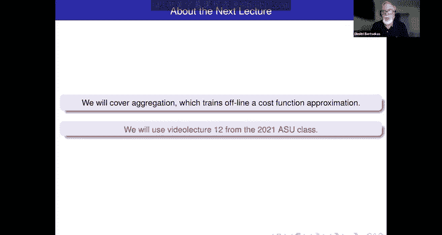

本节课我们一起学习了强化学习中两个重要的进阶主题。
1.  **近似线性规划**：我们将动态规划问题表述为线性规划，并通过引入线性特征架构和约束采样来实现近似求解。这种方法可靠性高，但如何选择代表性状态和控制是关键挑战。
2.  **策略空间近似**：我们探讨了直接参数化和优化策略的方法。主要算法包括：
    *   **随机搜索**（如交叉熵方法）：简单、并行友好、不依赖梯度，但可能较慢。
    *   **策略梯度方法**：利用梯度技巧和随机化策略，通过采样轨迹来更新参数。其实现简单，但估计方差大，需要结合基线、成本塑形、小批量等技巧来稳定训练。
    我们认识到，策略空间近似在许多场景下有用，但在一个完整的强化学习系统中，它常作为值空间近似方法的有效补充，共同构建更强大的决策智能体。