# 41：离线训练中的聚合方法 📚

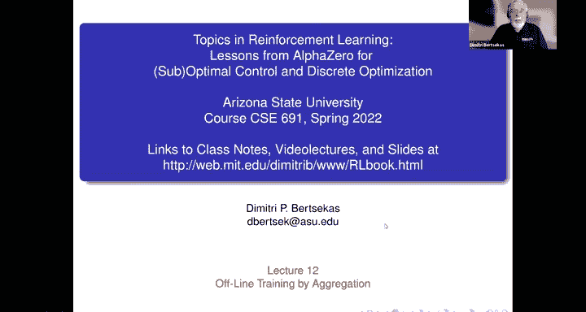

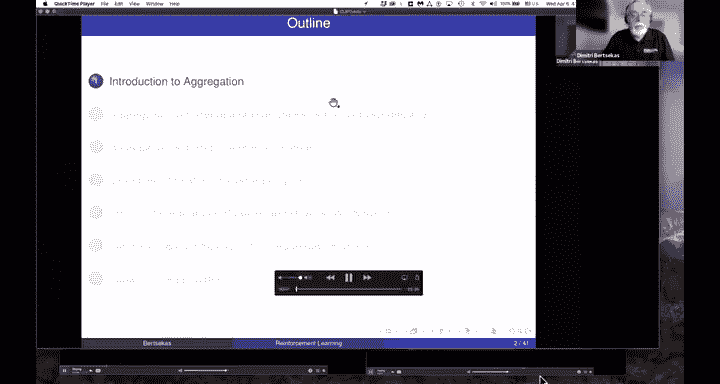

在本节课中，我们将学习一种称为“聚合”的离线训练方法。聚合是一种基于问题近似的技术，它通过构建一个更简单的聚合问题来获得近似的代价函数，有时也用于生成在线策略。这与我们之前讨论的基于神经网络和其他近似架构的离线训练方法在理念上有所不同。

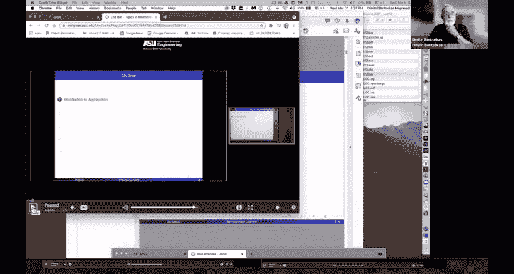

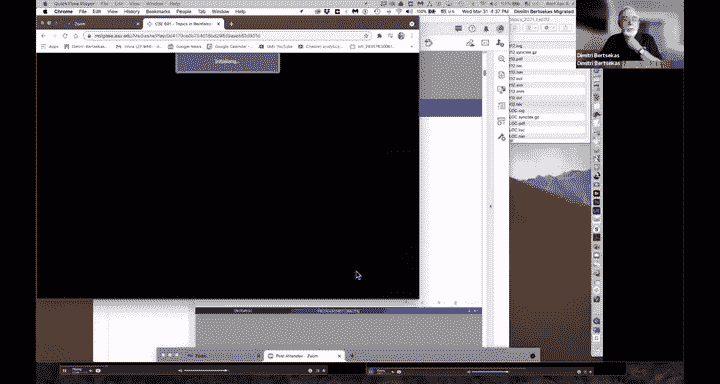

## 🎯 聚合概述与定位

上一节我们介绍了离线训练的各种方法。本节中，我们来看看聚合方法在强化学习整体框架中的位置。

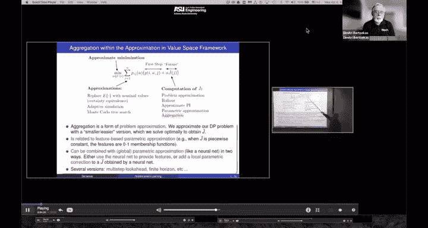

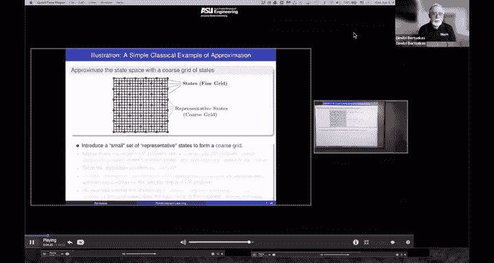

聚合实际上是一种问题近似方法。它通过将原始动态规划问题近似为一个更小、维度更低、更容易求解的版本来工作。求解这个聚合问题后，我们得到最优代价，并将其插值回原始状态空间，从而获得近似的代价函数 `J̃`。

聚合也与参数化近似有关，因为它产生的 `J̃` 可以看作是特征基的近似。一个主要的特例是当 `J̃` 是分段常数函数时，这可以视为使用0/1成员函数作为特征的近似。

聚合可以与参数化近似（如神经网络）结合使用，有两种方式：
1.  使用神经网络为基于特征的聚合提供特征。
2.  在神经网络得到的 `J̃` 基础上，添加局部分段常数或分段线性修正。

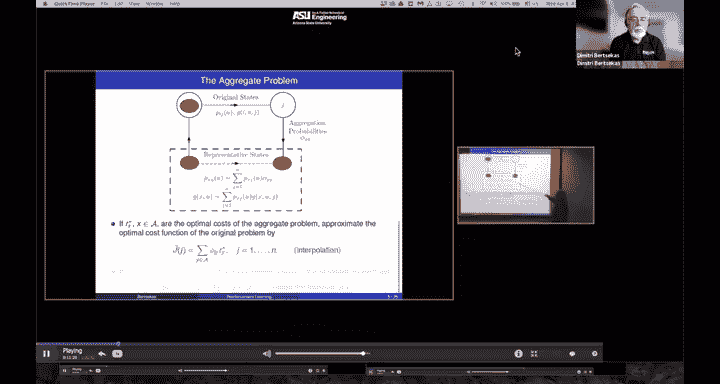

## 📊 基于代表状态的简单聚合

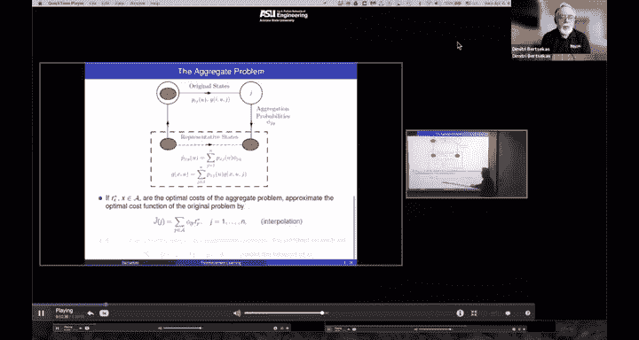

现在，让我们通过一个简单的例子来理解聚合的核心思想。这种方法可以追溯到动态编程的早期，即用更粗糙的网格状态来近似一个可能很大的状态空间。

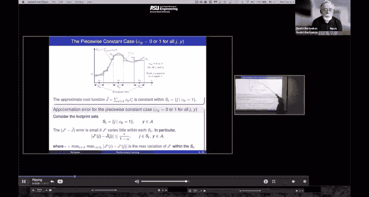

假设原始状态是网格上的黑色交叉点（精细网格）。我们选择其中一部分红色点作为“代表状态”，它们构成了一个更粗糙的网格。

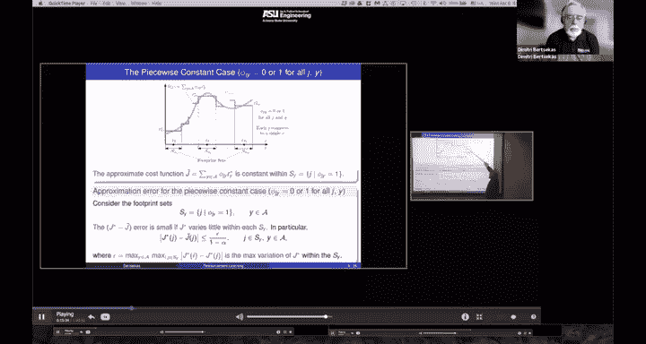

**核心思想是**：我们通过一个状态更少（即红色代表状态）的聚合动态规划问题来近似原始问题。为此，我们需要定义代表状态之间的转移概率和转移代价。

**如何定义聚合问题的动态特性？**
我们引入“聚合概率” `φ`。`φ_{jy}` 表示原始状态 `j` 与代表状态 `y` 的关联程度（非负，且对每个 `j` 求和为1）。基于原始系统的转移概率（绿色箭头）和这些聚合概率，我们可以推导出代表状态 `x` 到 `y` 的聚合转移概率公式：

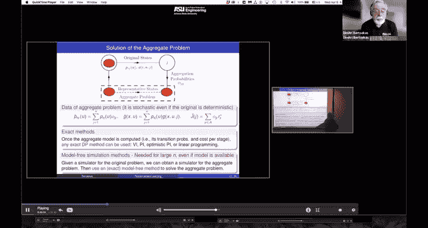

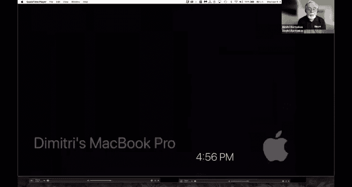

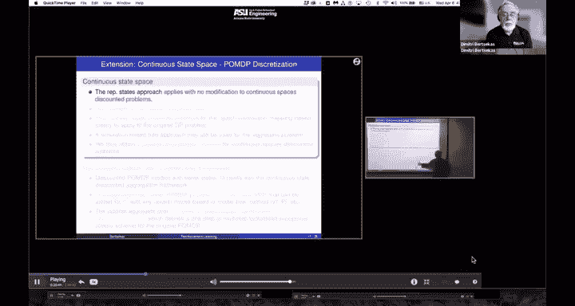

`P_{xy}(u) = Σ_{i∈I} φ_{ix} Σ_{j∈J} p_{ij}(u) φ_{jy}`

同时，从代表状态 `x` 出发，在控制 `u` 下的期望阶段代价为：

`g̃(x, u) = Σ_{i∈I} φ_{ix} Σ_{j∈J} p_{ij}(u) g(i, u, j)`

**如何获得原始状态的近似代价？**
求解这个聚合问题后，我们得到每个代表状态 `x` 的最优代价 `r*(x)`。然后，通过聚合概率 `φ` 进行插值，得到任意原始状态 `i` 的近似代价：

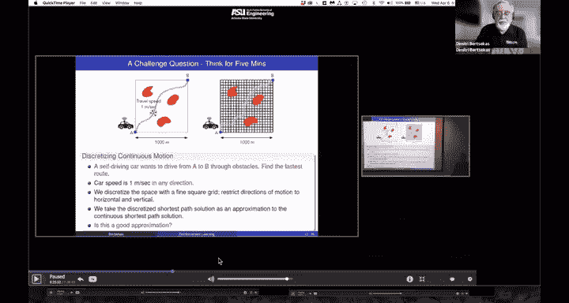

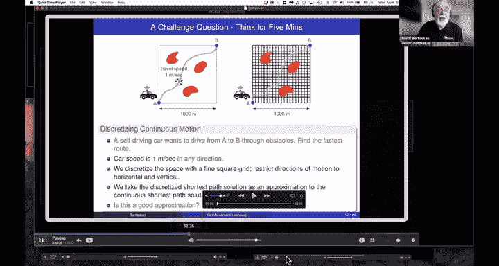

`J̃(i) = Σ_{y∈Y} φ_{iy} r*(y)`

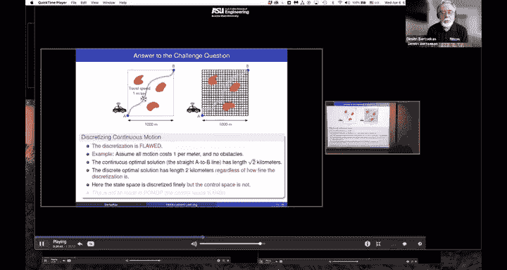

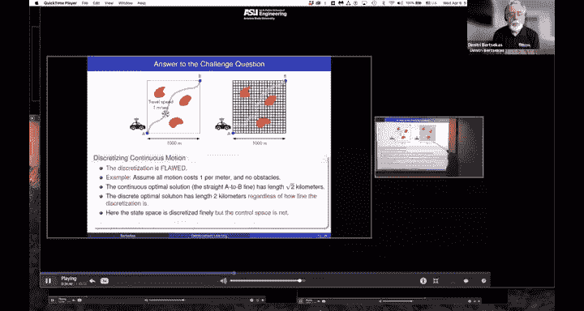

在 `φ` 仅为0或1的特殊情况下（即每个原始状态只属于一个代表状态），`J̃` 是分段常数函数，在每个“足迹”集合内取对应代表状态的最优代价值。

**关于近似误差的定性分析**：存在误差界表明，如果最优代价函数 `J*` 在每个足迹集合内部变化不大（变化最大值为 `ε`），那么聚合产生的近似误差将与 `ε/(1-α)` 成正比（`α` 是折扣因子）。这定性地说明，选择使 `J*` 在内部变化小的代表状态（或足迹集合）至关重要。

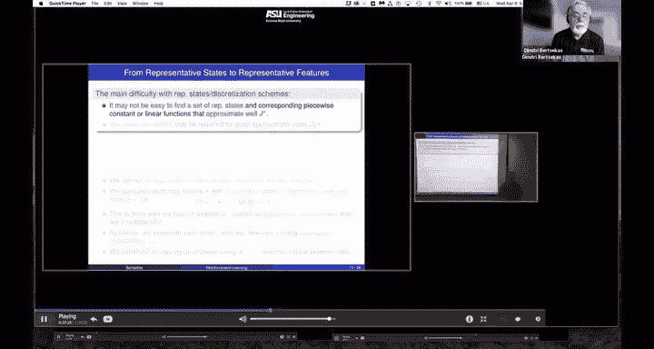

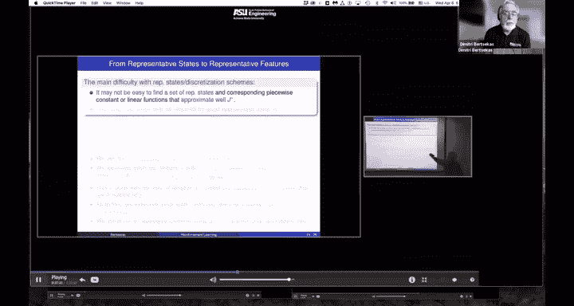

## 🔄 求解聚合问题的方法

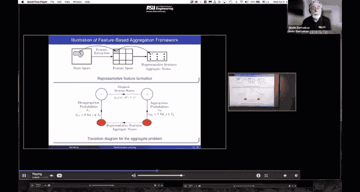

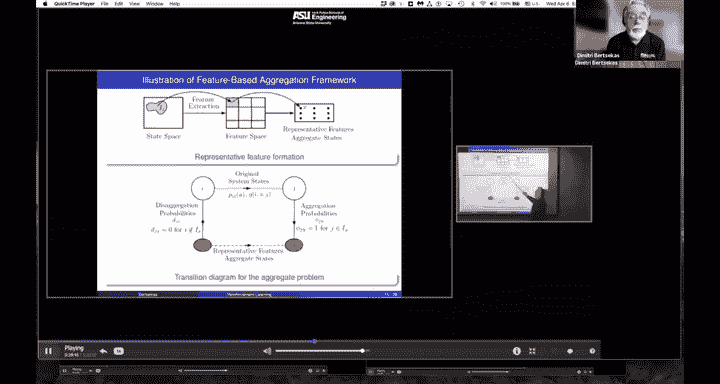

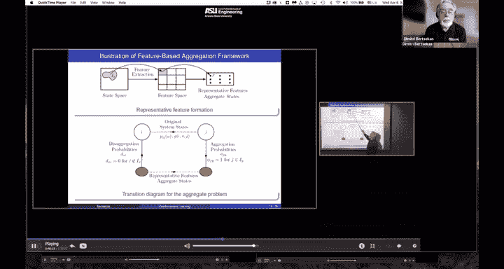

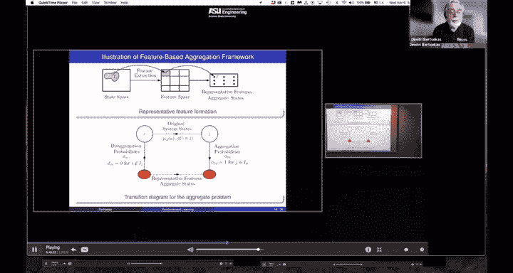

我们已经定义了聚合问题，那么如何求解它呢？聚合问题本身是一个合法的（但可能是随机的）马尔可夫决策过程，我们可以使用任何精确方法求解，例如值迭代或策略迭代。

**潜在的计算挑战**：聚合问题公式中的求和可能涉及大量原始状态。如果原始状态空间非常大，直接计算可能不可行。

**解决方案：基于仿真的方法**。如果我们有一个原始问题的仿真器，结合给定的聚合概率 `φ`，我们可以轻松获得聚合问题的仿真器。这样，我们就可以使用无模型方法（如基于仿真的策略迭代）来求解聚合问题，而无需显式计算所有转移概率。

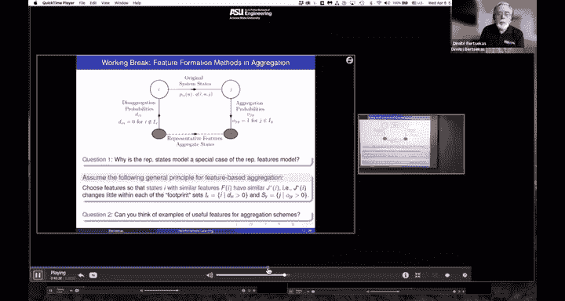

## 🌌 扩展到连续空间与POMDP

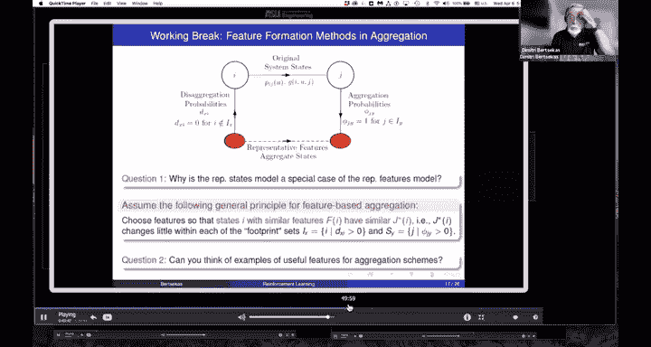

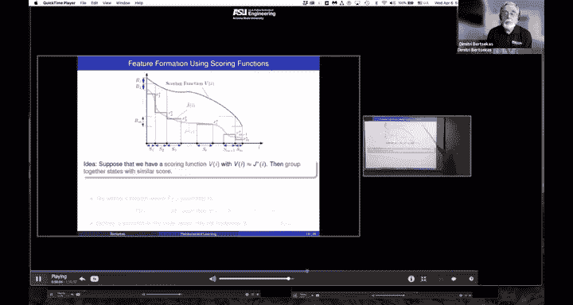

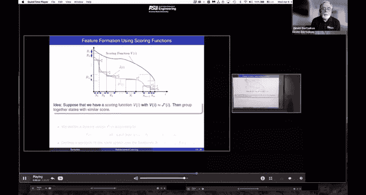

聚合框架可以自然地扩展到连续状态空间问题。我们只需在连续空间中选取有限数量的代表状态，并定义适当的聚合概率（例如基于距离的权重）。然后，我们同样构建并求解聚合问题。

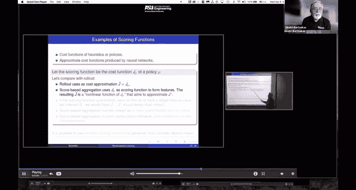

一个重要的应用场景是**部分可观测马尔可夫决策过程（POMDP）**。POMDP在信念空间（状态概率分布的连续空间）中求解。我们可以在这个连续信念空间中选取代表状态（即代表信念点），然后构建一个聚合MDP。这个聚合MDP是一个具有完美状态信息的有限状态MDP，更容易求解。求解后，再将代价插值回整个连续信念空间。

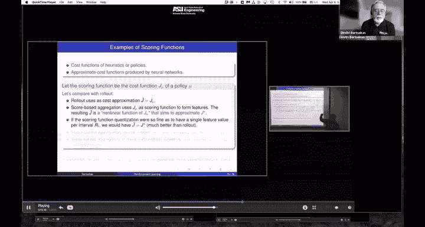

**一个警示性的例子**：考虑一个在连续空间中从A到B的最短路径问题，需要避开障碍物。如果简单地将其离散化为精细网格，并限制移动方向为水平和垂直，那么即使网格无限精细，最短路径长度也可能无法收敛到连续空间的最优解（例如，直线距离为√2，但网格路径至少为2）。这说明，为了通过离散化获得连续问题的精确解，通常需要采用随机化公式，并允许更丰富的移动方向，而不仅仅是网格化状态空间。

## 🧩 基于代表特征的更一般化聚合

基于代表状态的方法可能面临一个困难：很难找到一组合适的代表状态，使得分段常数或线性函数能很好地近似 `J*`。盲目离散化可能导致某些区域代表状态过多，而另一些区域不足。

更强大的方法是**基于特征的聚合**。我们不是直接离散化状态空间，而是离散化**特征空间**。

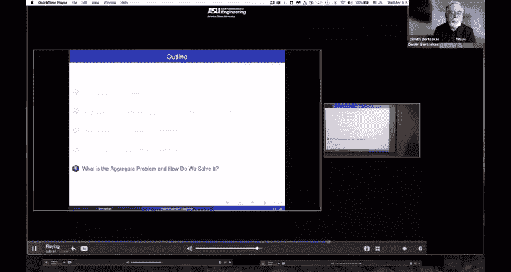

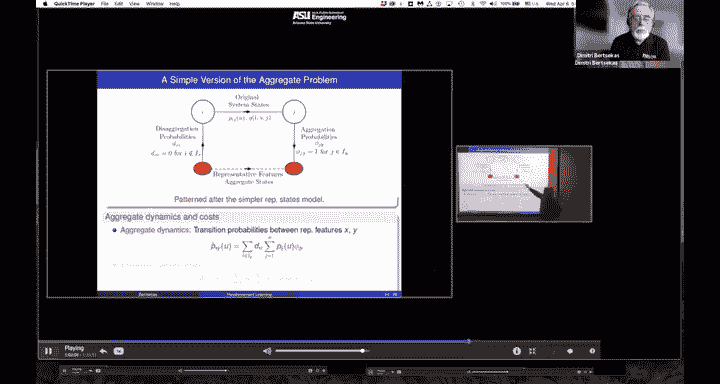

假设我们有一个特征提取映射 `F`，将原始状态 `i` 映射为特征向量 `F(i)`。我们在特征空间中选取一组“代表特征” `x`。每个代表特征 `x` 与一组原始状态关联（其“足迹” `I_x`，即特征值接近 `x` 的状态集合）。

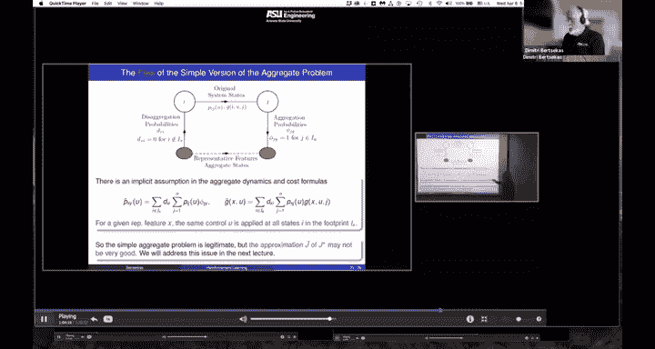

我们引入两种概率：
1.  **解聚概率 `d_{ix}`**：表示原始状态 `i` 与代表特征 `x` 的关联程度。
2.  **聚合概率 `φ_{jy}`**：与之前类似，用于从代表特征插值回代价。

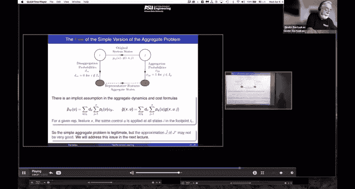

**构建聚合问题**：通过解聚概率、原始系统转移概率和聚合概率，我们可以定义代表特征之间的转移概率和代价，从而形成一个以代表特征为状态的聚合问题。

**初始简单公式的缺陷**：在上述简单公式中，隐含了一个假设：对于给定的代表特征 `x`，其足迹 `I_x` 中的所有状态 `i` 都应用相同的控制 `u`。这限制了控制的灵活性，可能导致近似效果不佳。

## 🏗️ 更精确的聚合：扩大化聚合问题

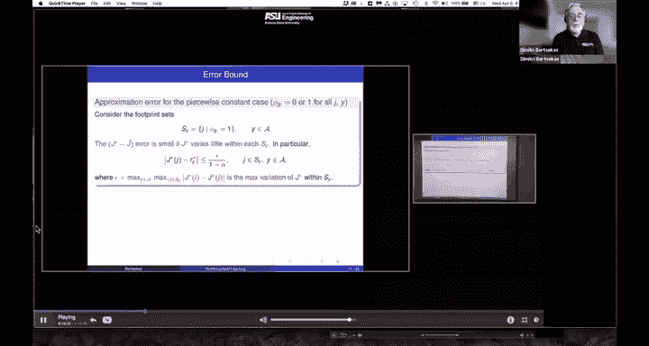

为了克服上述缺陷，我们引入“扩大化聚合问题”。其核心思想是创建一个包含两部分的扩大状态空间：代表特征层级和原始系统状态层级，并显式地建模它们之间的转移。

这导致了三个耦合的贝尔曼方程：
1.  代表特征层级的代价 `r(x)`。
2.  从代表特征出发，经解聚到达的原始状态层的代价 `J̃₀(i)`。
3.  经过原始系统转移后，准备聚合前的原始状态层的代价 `J̃₁(j)`。

通过代入消元，我们可以得到一个只涉及代表特征最优代价 `r*` 的复合贝尔曼方程。这个方程定义的映射仍然是压缩映射，因此有唯一解。

**关于近似误差**：对于聚合概率为0/1的分段常数情况，误差界与之前类似：近似误差小，当且仅当最优代价 `J*` 在每个代表特征的足迹集合内部变化小。这为选择特征提供了指导：应选择那些使得具有相似特征的状态具有相似 `J*` 值的特征映射。

## ⚙️ 聚合问题的求解：值迭代与策略迭代

**值迭代**：直接对复合贝尔曼方程 `r = H(r)` 进行值迭代在理论上是可行的，但因为 `H` 中包含外层期望，计算可能困难。我们可以使用随机近似方法，通过采样来更新单个代表特征的代价估计，并保证在步长适当衰减的条件下收敛。

**策略迭代**：策略迭代在聚合问题中更具吸引力，因为在策略评估阶段没有最小化操作，可以更轻松地进行蒙特卡洛采样。策略评估步骤涉及求解一个线性方程 `r = A_k r + b_k`，其中矩阵 `A_k` 和向量 `b_k` 可以通过并行蒙特卡洛仿真来估计。然后通过策略改进步骤更新策略。

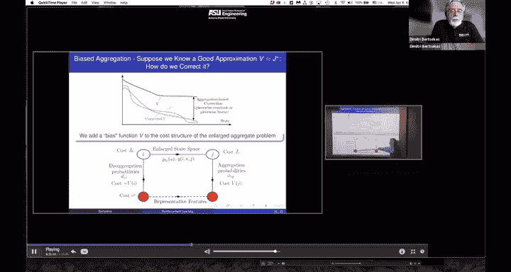

## 🧪 聚合的变体

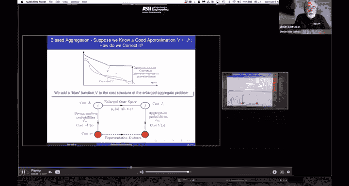

**偏差聚合**：假设我们已经有了一个对 `J*` 较好的近似 `V`（例如，来自某个启发式策略或神经网络的输出）。我们可以利用聚合来构建对 `V` 的修正，而不是从零开始近似 `J*`。这通过修改聚合问题的代价结构来实现，将 `V` 作为偏差项加入。如果 `V` 本身就很接近 `J*`，那么聚合修正后会得到更好的结果。当只有一个代表特征时，这种方法就退化为rollout算法。

**多步前瞻聚合**：在基本的聚合框架中，我们在“上移”（解聚）和“下移”（聚合）之间只进行一次原始系统转移。我们可以将其扩展为进行 `n` 次原始系统转移后再聚合。这相当于在空间和时间上都进行了聚合（将 `n` 个时间步聚合为一个转移）。对于确定性问
题，这特别有吸引力，因为多步转移中的最小化可以通过最短路径计算有效求解。这提供了在状态空间和时间维度上同时进行近似的更丰富框架。

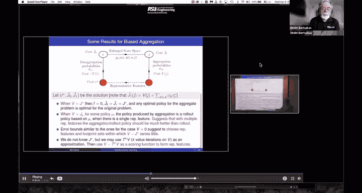

## 📝 总结

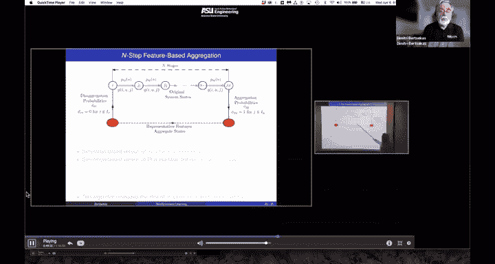

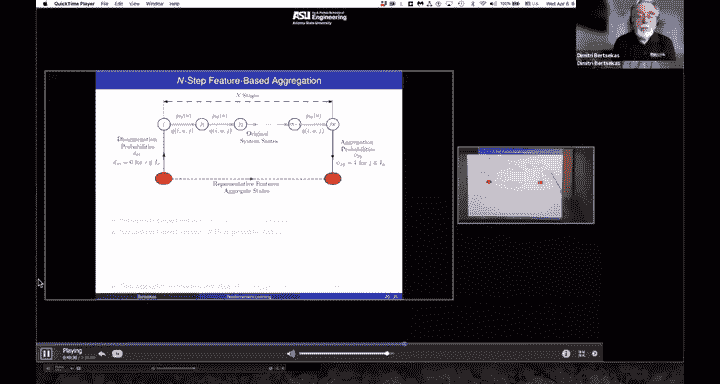

本节课中，我们一起学习了强化学习中的聚合方法。

*   我们首先了解了聚合是一种基于问题近似的离线训练方法，它通过构建并求解一个更简单的“聚合问题”来获得代价函数近似。
*   我们从最简单的基于“代表状态”的聚合开始，理解了其核心框架：通过聚合/解聚概率连接原始状态与代表状态，定义聚合动态，求解后再插值回原始空间。
*   我们探讨了将其扩展到连续空间和POMDP的应用。
*   接着，我们学习了更一般的基于“代表特征”的聚合，它通过离散化特征空间来更智能地对状态进行分组。
*   我们指出了简单公式的缺陷，并介绍了更精确的“扩大化聚合问题”及其求解方法，包括基于随机近似的值迭代和基于蒙特卡洛采样的策略迭代。
*   最后，我们简要介绍了聚合的一些变体，如偏差聚合和多步前瞻聚合，这些方法提供了更灵活和强大的近似手段。

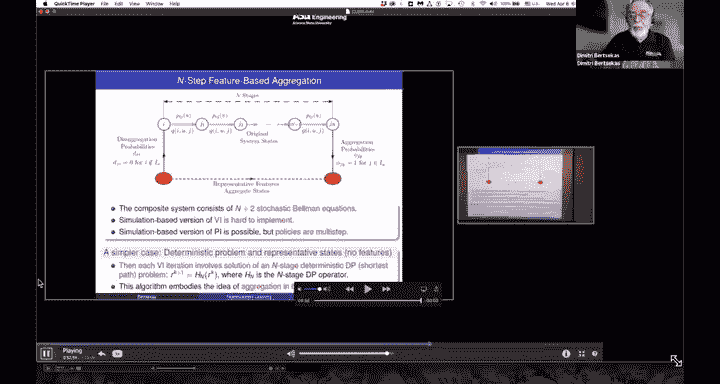

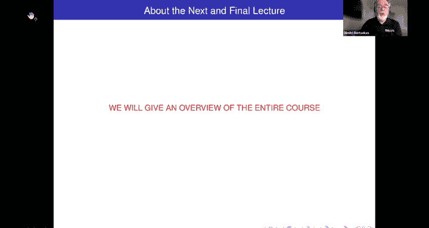

聚合提供了不同于直接参数化近似的独特视角，在特定问题背景下可能非常有效。它仍然是一个充满探索机会的研究领域。