# 42：课程总览 🧠

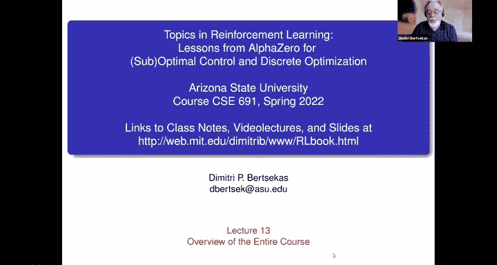

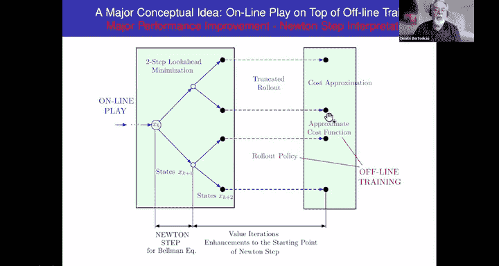

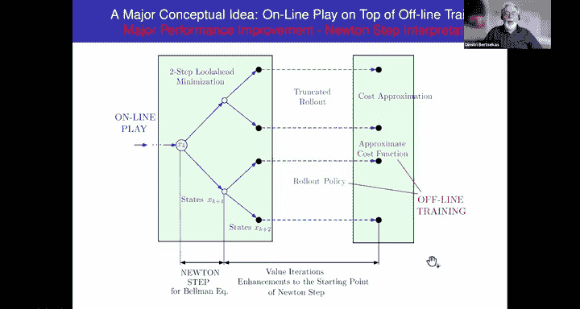

在本节课中，我们将回顾整个强化学习课程的核心内容。我们将从AlphaZero等程序出发，探讨动态规划、近似动态规划、Rollout算法、多智能体问题、离线训练（如神经网络）以及策略空间近似等关键主题。本节课是课程的总结，旨在将所有知识点串联起来，形成一个完整的知识体系。

---

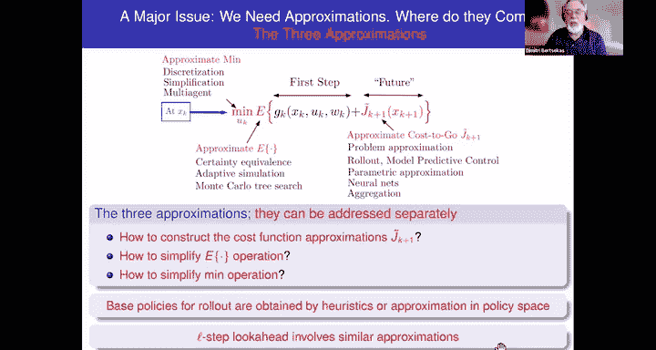

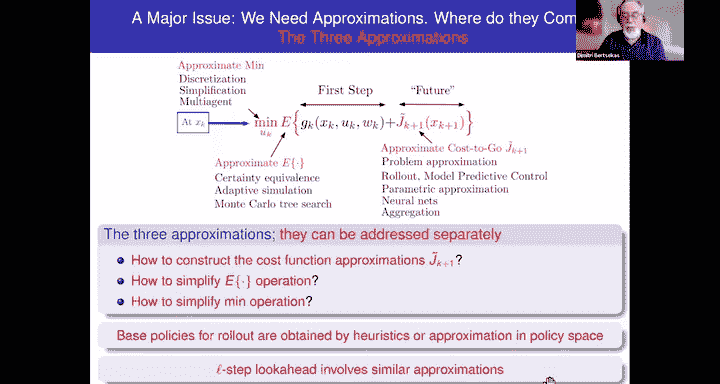

## 1. 课程核心架构与概念 🔧

在深入细节之前，我们先回顾一下支撑整个课程的两个核心概念图。

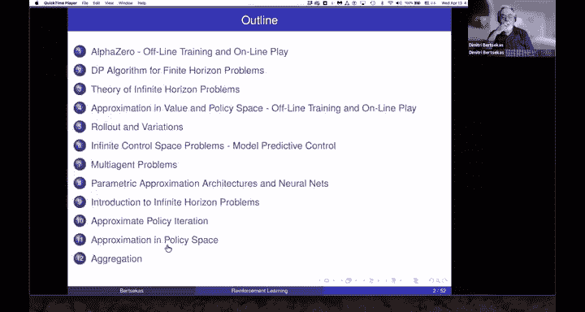

上一节我们介绍了课程的整体目标，本节中我们来看看支撑我们方法论的基本架构。

### 1.1 核心架构：离线训练与在线博弈

第一个图展示了我们的基本架构设计——AlphaZero的设计。其主要概念思想是，我们将在离线训练的基础上进行在线博弈，旨在显著提升从离线训练中获得的任何策略的性能。

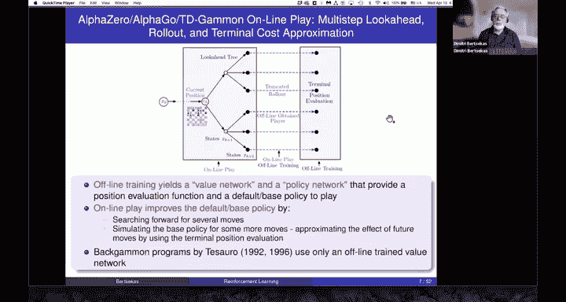

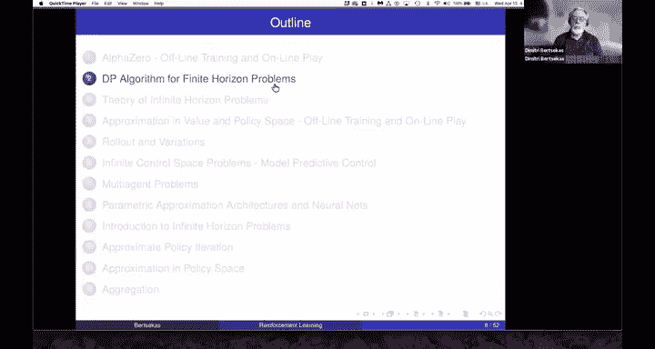

在线博弈算法（图中用蓝色表示）以两种方式利用离线训练：
1.  提供一个近似的最优代价函数。
2.  提供一个近似的最优或良好的次优策略（如果使用Rollout）。

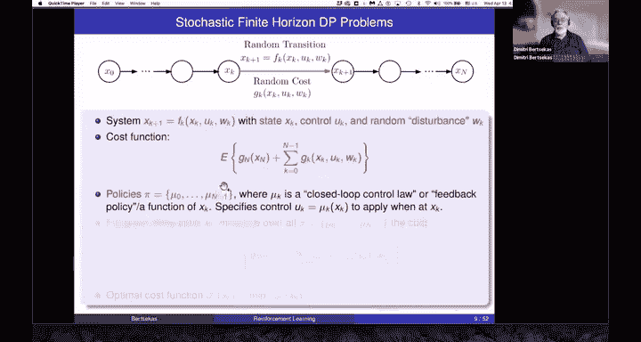

在给定状态 \(s\)，在线博弈算法通过向前看若干步（图中展示了两步）的最小化来选择控制 \(u\)，最后可能使用一个代价函数近似进行截断的Rollout。这可以看作是一个牛顿步，其起点通过向前看最小化和可能的Rollout策略进行了增强。这个牛顿步的数学解释是我们看到在线博弈性能相对于离线博弈有显著提升的主要原因。

### 1.2 近似之处：三步逼近

第二个图展示了我们需要在哪些地方引入近似。具体来说，在一个状态 \(x_k\) 进行一步向前看最小化时，涉及三个潜在的近似：

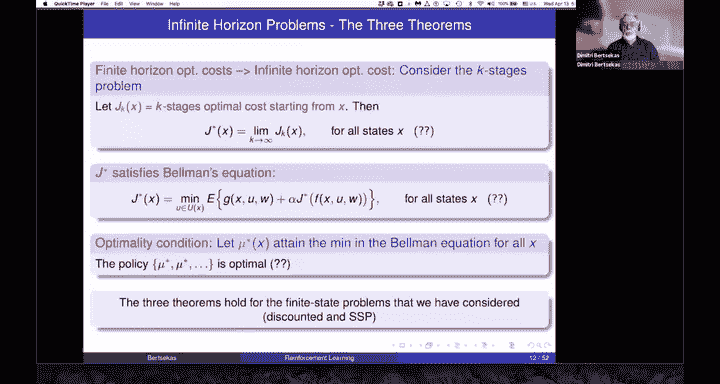

1.  **代价函数近似**：用 \(\tilde{J}\) 近似最优代价函数 \(J^*\)。
2.  **期望近似**：在随机问题中，计算期望值可能非常耗时，需要进行近似。
3.  **最小化近似**：最小化操作本身也可能非常耗时。

以下是处理这些近似的主要方法：

*   **代价函数近似**：
    *   问题近似（解决一个更简单的相关问题）。
    *   Rollout算法。
    *   参数化近似（如神经网络）。
    *   聚合方法。
*   **期望近似**：
    *   确定性等价（用确定值代替随机量）。
    *   使用模拟（如蒙特卡洛树搜索）。
*   **最小化近似**：
    *   简化（例如在多智能体问题中，一次只优化一个智能体）。

即使这个图展示的是一步向前看，多步（L步）向前看版本也涉及类似的近似，只是将剩余的 L-1 步折叠进了 \(\tilde{J}\) 中。

---

## 2. 课程主题路线图 🗺️

现在，让我们按照学期中讲解的顺序，逐一回顾和深化这些主题。

### 2.1 AlphaZero 及其相关程序 🎮

我们从AlphaZero这个令人惊叹的程序开始，并将其作为激励性应用，试图理解其方法论并将其推广到更广泛的背景中。

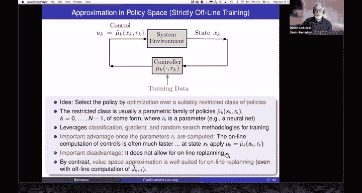

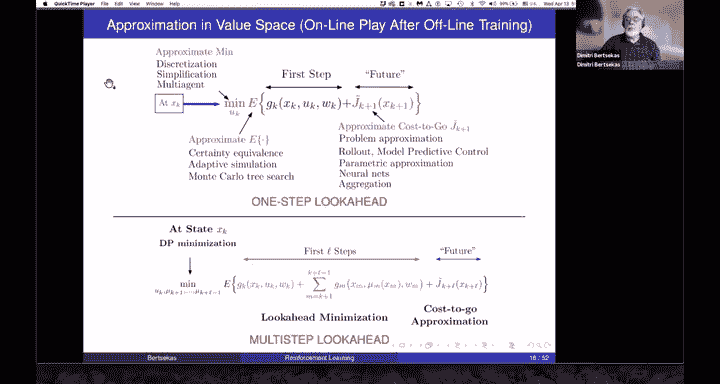

AlphaZero 涉及两种算法：
1.  **离线训练过程**：程序学习如何下棋。
2.  **在线博弈算法**：程序实际与对手对弈的算法。

这两种算法与动态规划中的基本算法相关。AlphaZero（及其前身AlphaGo、TD-Gammon）的成功基于几个核心思想：
*   **Rollout**：给定一个策略，通过向前看最小化计算出一个具有改进特性的新策略。
*   **策略迭代**：动态规划中的基本算法，涉及重复的Rollout。
*   **策略改进原理**：在此上下文中，每个新策略都比前一个策略表现更好。
*   **近似**：由于处理的是复杂问题，我们需要在值空间（近似代价函数）和策略空间（近似策略）引入近似，通常使用神经网络等架构。

本课程的观点是从AlphaZero出发，扩展并统一其底层方法论，使其能广泛应用于动态规划的各种场景，如最优控制、机器人学、规划、多智能体问题、组合优化等。

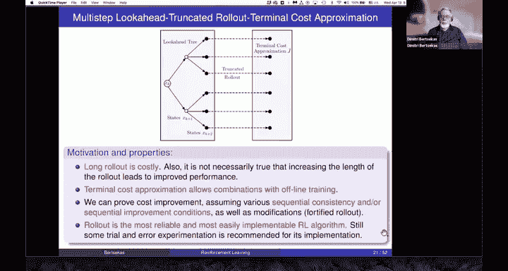

### 2.2 有限时域动态规划 ⏳

我们首先建立了有限时域问题的基本数学模型。

系统从时间 \(0\) 运行到时间 \(N\)，状态为 \(x_k\)，控制为 \(u_k\)，随机扰动为 \(w_k\)。目标是最小化总成本的期望值。

**动态规划算法**通过逆向计算来求解最优的“尾部子问题”成本 \(J_k^*\)，从终端成本 \(J_N^*\) 开始，逐步回溯到 \(J_0^*\)。公式如下：

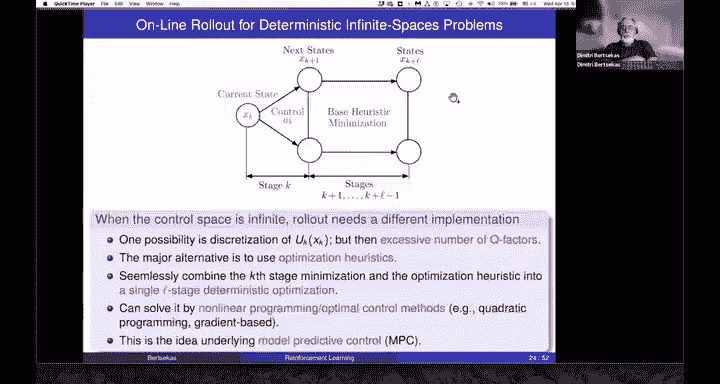

\[
J_k^*(x_k) = \min_{u_k} E \left\{ g_k(x_k, u_k, w_k) + J_{k+1}^*(x_{k+1}) \right\}
\]

在线实施时，我们在当前状态 \(x_k\) 执行上述最小化以生成控制 \(u_k\)。

然而，精确计算 \(J^*\) 非常困难，这阻碍了动态规划成为通用工具。为了使其可行，我们必须引入**近似**，主要是用 \(\tilde{J}\) 替代 \(J^*\)，并处理期望和最小化的近似问题。

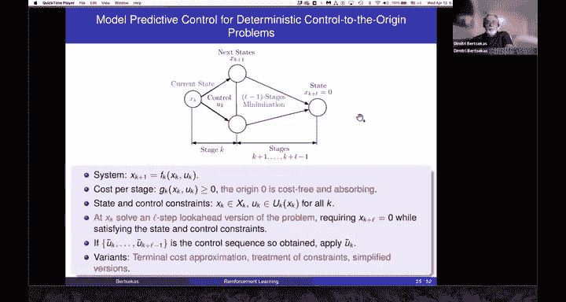

### 2.3 无限时域动态规划 ♾️

有限时域的思想可以扩展到无限时域问题，但数学上更为复杂。我们主要关注折扣问题和有限状态的随机最短路问题。

无限时域理论围绕三个核心定理展开（对于我们所研究的问题类型，这些定理通常成立）：
1.  **收敛性**：有限时域最优成本随时域增长收敛于无限时域最优成本。
2.  **贝尔曼方程**：最优成本函数 \(J^*\) 满足贝尔曼方程。
3.  **最优性条件**：一个平稳策略是最优的，当且仅当它对每个状态都在贝尔曼方程中达到最小值。

主要的算法是**值迭代**和**策略迭代**。
*   **值迭代**：从任意 \(J_0\) 开始，通过 \(J_{k+1} = T J_k\) 迭代收敛到 \(J^*\)，其中 \(T\) 是贝尔曼算子。
*   **策略迭代**：从任意策略 \(\mu_0\) 开始，交替进行**策略评估**（计算当前策略的成本 \(J_{\mu_k}\)）和**策略改进**（通过一步向前看最小化生成新策略 \(\mu_{k+1}\)）。策略迭代收敛速度快，可视为求解贝尔曼方程的牛顿法。

**Rollout 算法**本质上是策略迭代的**第一次迭代**。它从一个基策略 \(\mu\) 出发，通过一步向前看最小化产生一个新策略。由于它具有牛顿步的特性，通常能显著提升基策略的性能。

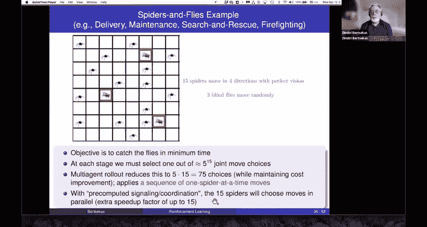

### 2.4 值空间近似 🧮

近似动态规划的核心思想之一是在值空间进行近似，用于在线博弈。

在状态 \(x_k\)，我们通过最小化“当前阶段成本 + 未来成本近似 \(\tilde{J}\)” 来选择控制 \(u_k\)。这里的 \(\tilde{J}\) 主要通过离线训练获得，方法包括：
*   问题近似。
*   参数化近似（如神经网络）。
*   聚合。
*   Rollout（结合了在线和离线计算）。

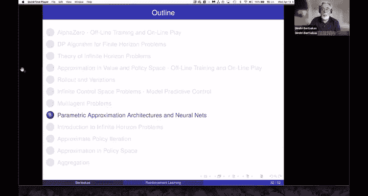

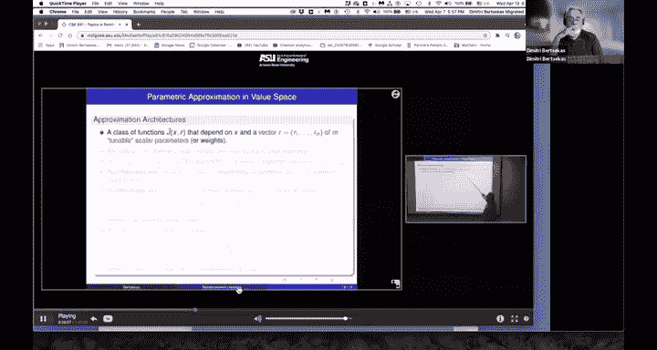

此外，我们还需要处理**期望的近似**（如确定性等价、蒙特卡洛树搜索）和**最小化的近似**（如离散化、简化）。我们还可以推广到**多步向前看**，这通常能通过更精确地处理更多步的成本来提升性能。

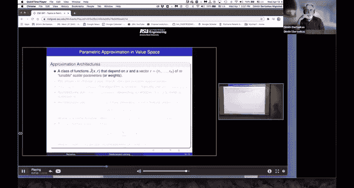

### 2.5 策略空间近似 🤖

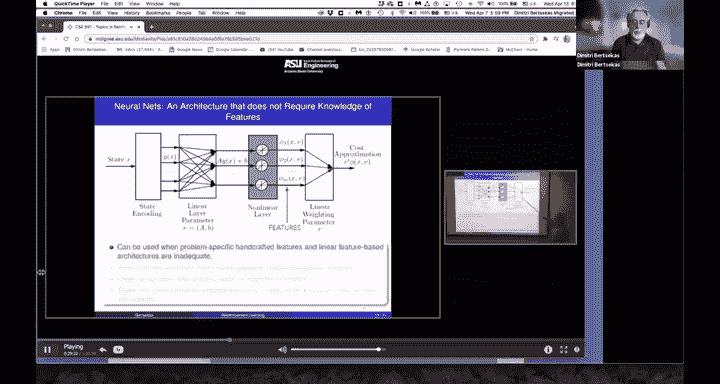

另一种方法是在策略空间直接进行近似，寻找一个参数化的近似最优策略。

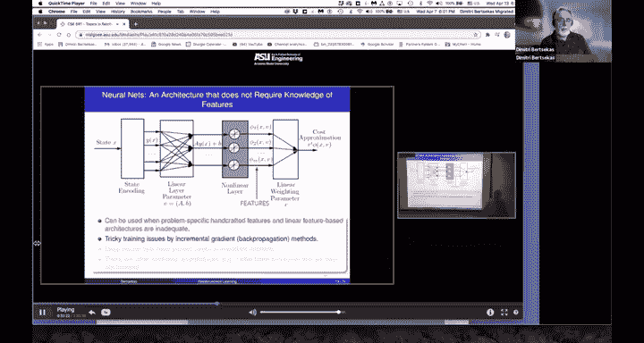

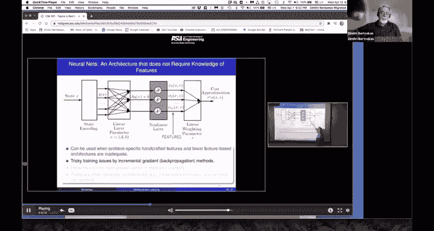

我们定义一个由参数向量 \(r\) 参数化的策略族 \(\mu(r)\)，然后通过最小化该策略产生的期望成本来优化 \(r\)。训练方法可以是梯度优化、随机搜索（如交叉熵方法）或分类方法。

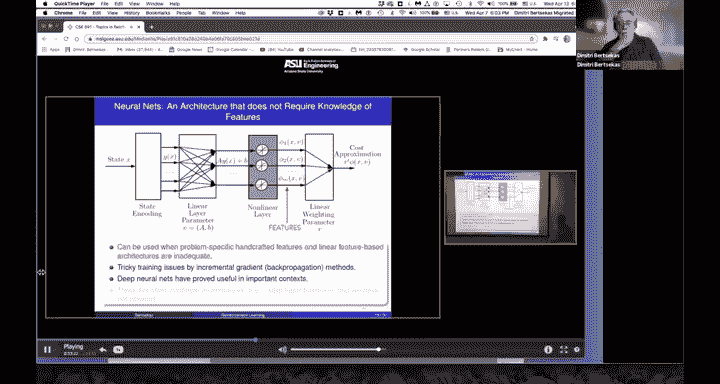

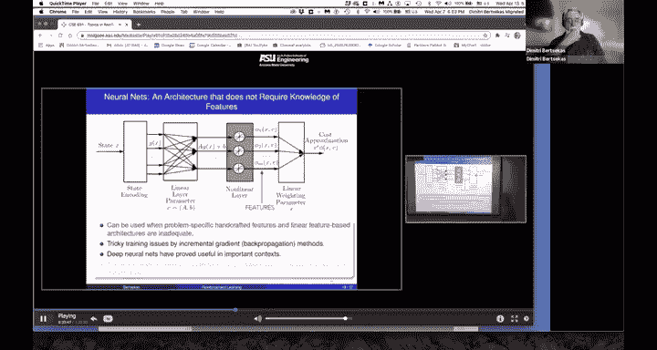

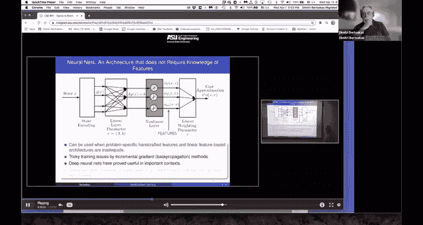

**策略空间近似的优点**：在线计算控制非常快，只需对当前状态进行前向计算。
**策略空间近似的缺点**：
1.  无法适应问题数据的变化（缺乏在线重规划能力）。
2.  无法获得通过Rollout和值空间近似带来的性能提升。

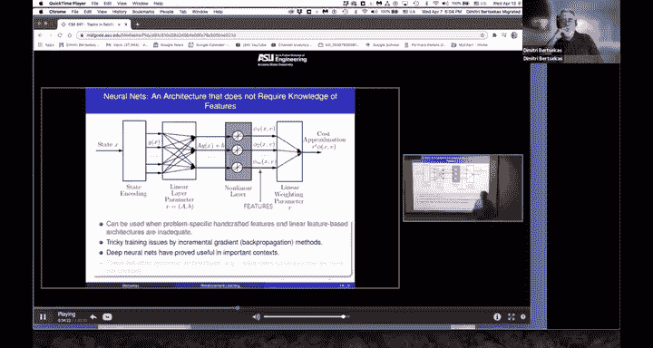

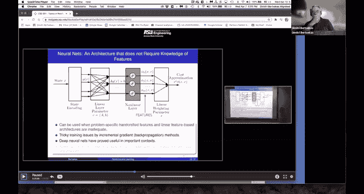

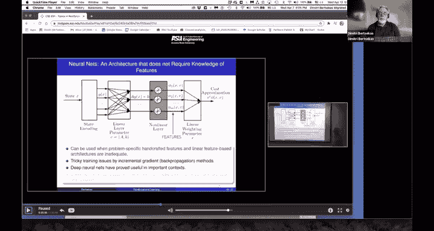

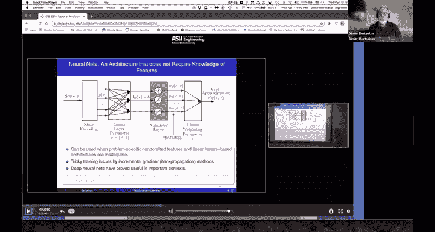

因此，策略空间近似通常不作为独立的在线博弈方法，而是作为值空间近似的一个组件，用于提供基策略或策略网络。

### 2.6 Rollout 算法及其变体 🔄

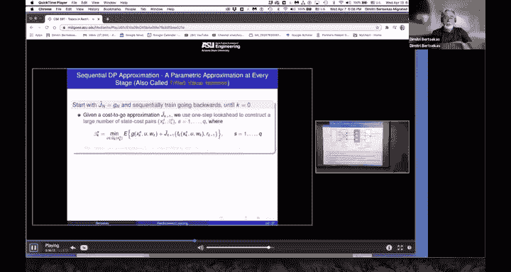

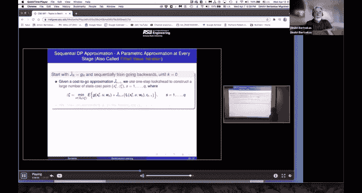

Rollout 是我们课程的重点，它是一种强大且可靠的近似动态规划方法。

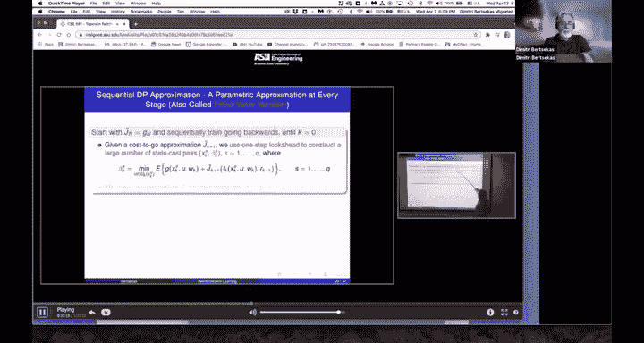

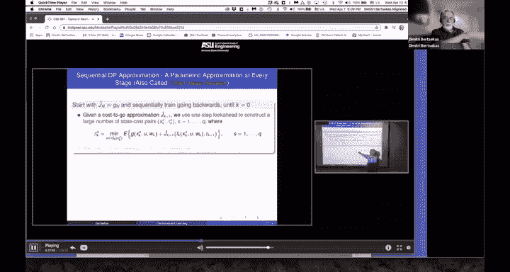

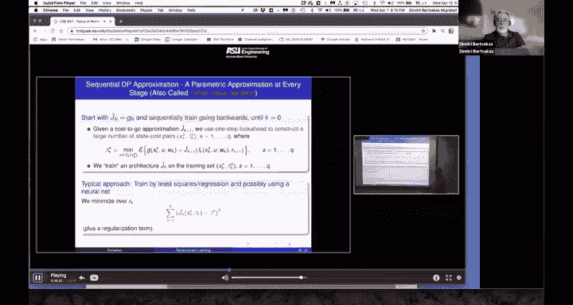

**确定性Rollout**更为有效。在给定状态，我们枚举所有可能的控制，对每个控制产生的下一状态，运行一个启发式策略直到终点，计算总成本（Q因子），然后选择最小Q因子对应的控制。为了减少计算量，可以使用**截断Rollout**并结合**终端代价函数近似**。

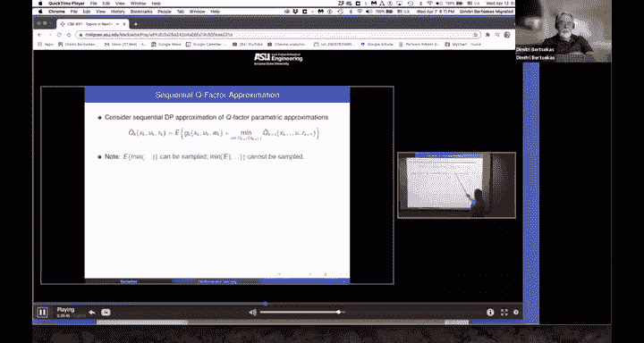

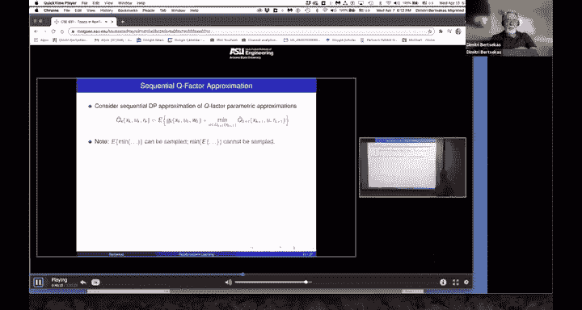

**随机Rollout**类似，但需要模拟多条轨迹来估计Q因子的期望值，涉及方差缩减等问题。

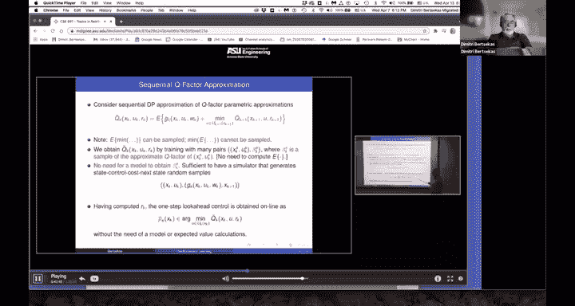

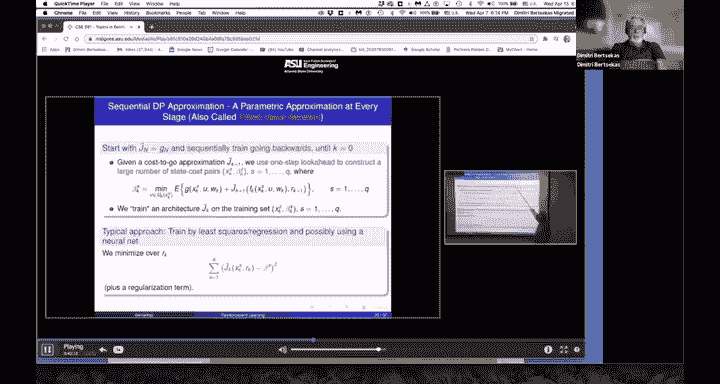

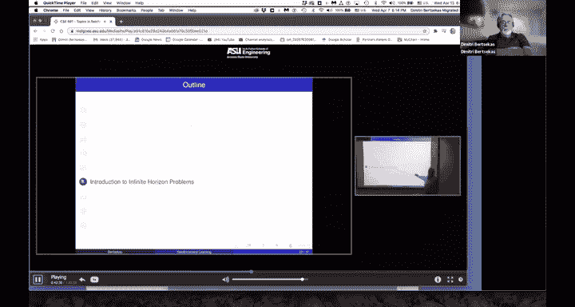

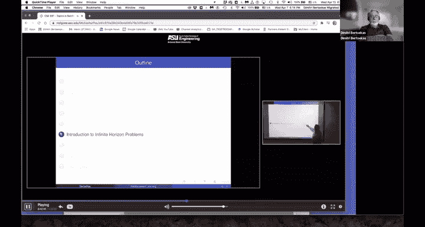

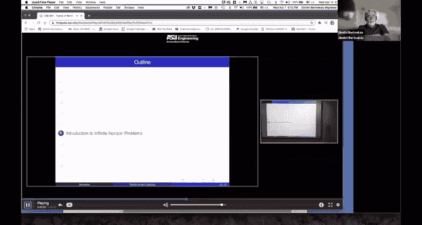

Rollout 有许多变体，包括：
*   **强化Rollout**：保证成本改进。
*   **简化Rollout**：只对部分控制进行最小化。
*   **多智能体Rollout**：一次优化一个智能体。
*   **连续控制空间Rollout**：结合优化启发式（如模型预测控制）。
*   **与蒙特卡洛树搜索结合**。

### 2.7 连续控制空间与模型预测控制 🎯

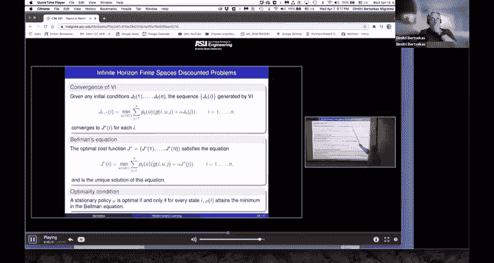

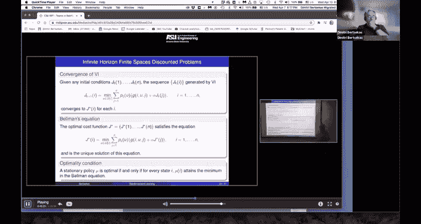

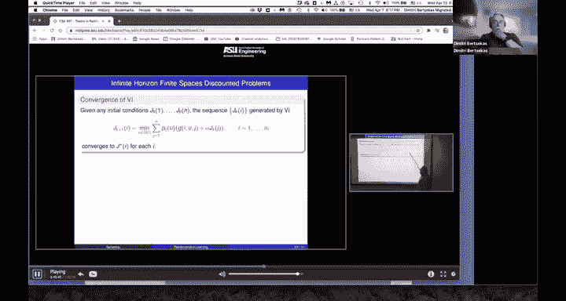

当控制空间连续或无限时，无法枚举所有Q因子。解决方案是使用**优化启发式**。

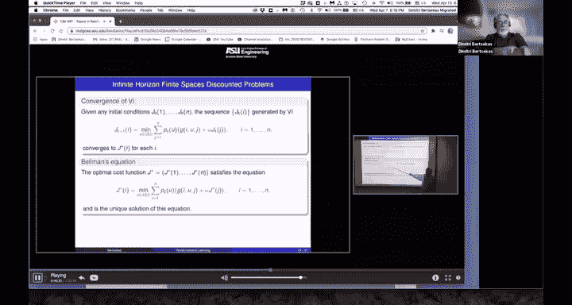

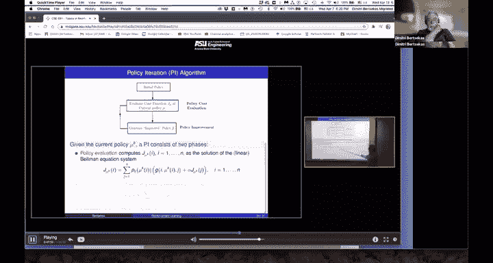

**模型预测控制** 是这类方法的一个重要例子，广泛应用于控制系统设计。其基本思想是，在每个时刻 \(k\)，基于当前状态 \(x_k\)，求解一个有限时域（L步）的最优控制问题，要求L步后到达目标状态（如原点），然后只实施第一步的控制，到下一时刻重复此过程。

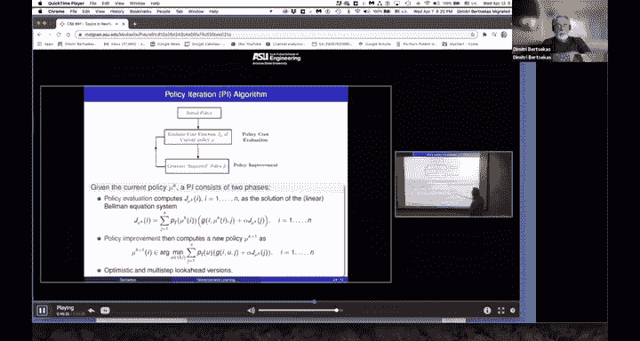

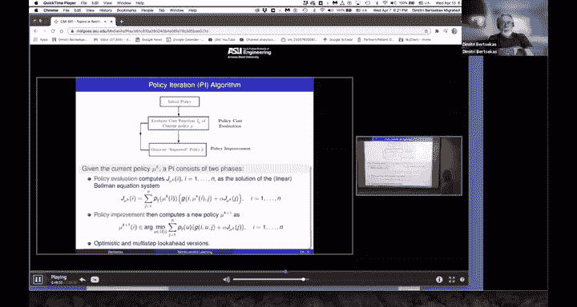

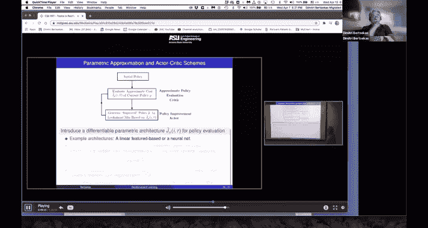

MPC 能很好地处理状态和控制约束。通过引入终端代价函数近似并满足一定的条件（如李雅普诺夫条件），可以保证闭环系统的稳定性。MPC 有许多变体，包括处理约束、多智能体、混合整数规划等复杂情况。

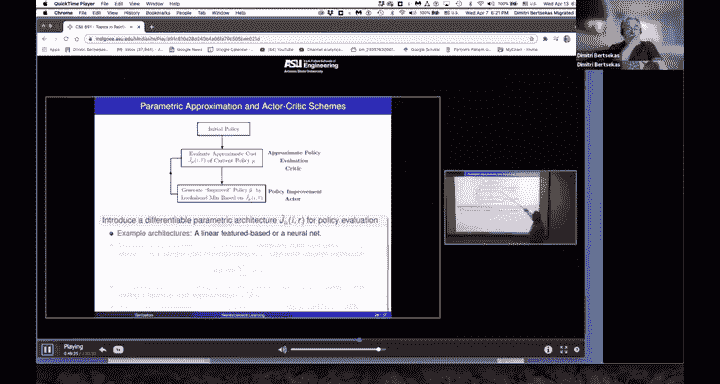

### 2.8 多智能体问题 👥

多智能体问题的核心挑战是联合控制空间随智能体数量 \(M\) 呈指数增长。我们的方法是采用**一次一个智能体**的计算方式。

对于经典信息模式（所有智能体完全共享信息）的问题，我们可以将其重新表述为一个等价问题，将联合控制的选择分解为 \(M\) 个顺序的、单智能体的控制选择，从而将计算复杂度从指数级降低为线性级。

**多智能体Rollout** 就是在这个重新表述的问题上应用标准Rollout。它仍然能保证成本改进的性质，因为本质上它只是标准Rollout在等价问题上的应用。对于非经典信息模式，我们可以引入**信令**（预计算的估计信息）来协调智能体。

### 2.9 离线训练：神经网络与架构 🧠

离线训练的核心是使用参数化近似架构，特别是神经网络，来学习代价函数或策略。

**神经网络**是一个强大的函数近似器，由权重参数 \(r\) 定义。训练过程是通过调整 \(r\) 来最小化近似输出与目标输出之间的误差（如最小二乘回归）。**深度学习**的成功很大程度上归因于**过参数化**（参数数量远多于数据量），这有助于避免过拟合并提升性能。

在动态规划背景下，有两种主要的训练范式：
1.  **拟合值迭代**：对于有限时域问题，从最后阶段开始，逆向依次为每个阶段训练一个神经网络来近似 \(J_k^*\)。使用下一阶段的近似 \(\tilde{J}_{k+1}\) 通过一步向前看生成训练数据（状态-成本对）。
2.  **拟合Q迭代**：类似，但是训练Q因子网络 \(\tilde{Q}_k\)。其优势在于生成训练样本时，只需要模拟“期望内的最小值”的样本，而不需要计算完整的期望，更易于实现且无需模型。

对于无限时域问题，**近似策略迭代**是关键。我们用神经网络近似策略评估步骤中的 \(J_\mu\)，通过模拟轨迹生成状态-成本对数据，并进行训练。**时序差分学习**（如TD(λ)、LSTD）是这类方法中理论丰富的分支，但实现可能更复杂。

训练中的挑战包括：训练算法（如随机梯度下降）、轨迹重用、探索-利用权衡、确定合适的轨迹长度等。

### 2.10 策略空间近似方法 🎯

对于无限时域问题，我们可以直接参数化平稳策略 \(\mu(r)\)，并通过优化参数 \(r\) 来最小化策略的期望成本。

**交叉熵方法** 是一种有效的随机搜索方法。它从一个参数点 \(r_k\) 开始，在其周围采样大量参数，评估这些参数对应策略的成本，选择成本较低的一部分“精英”样本，用这些样本的均值和协方差来更新下一个采样分布（椭圆区域），并迭代进行。该方法易于并行化，且是模型无关的。

### 2.11 聚合方法 🧩

聚合是一种通过构建一个状态空间缩减的“聚合问题”来近似原始问题的方法。我们将原始状态通过特征映射分组为“聚合状态”，并在这些聚合状态上定义转移概率和成本，形成一个低维的马尔可夫决策过程。求解这个聚合问题后，将其解映射回原始状态空间作为近似。

聚合方法旨在直接近似 \(J^*\)，并且只要有足够多的聚合状态，理论上可以任意接近最优解。代表状态聚合是更简单的特例。时空聚合则进一步结合了时间和空间的压缩。

---

## 3. 结论与展望 🌟

在本节课中，我们一起回顾了强化学习课程的全部核心内容。我们从AlphaZero的启发出发，系统地学习了动态规划的基础、值空间与策略空间的近似、Rollout算法及其强大变体、处理连续空间和多智能体问题的方法，以及离线训练中神经网络等工具的使用。

### 3.1 谨慎与乐观

尽管方法众多，但必须认识到：
*   **挑战依然存在**：所有方法都面临近似难题，没有一种方法能保证对所有问题有效。特征选择需要领域知识，神经网络训练需要大量调参，近似策略迭代可能振荡，探索策略难以设计，评估成功与否也非易事。
*   **成功有其背景**：AlphaZero等成功案例依赖于规则完全已知、模型稳定、控制空间离散的环境。将方法推广到连续控制、部分可观信息等更复杂问题，仍是巨大挑战。

然而，我们也有理由保持乐观：
*   **计算能力强大**：当今强大的并行计算能力非常适合蒙特卡洛模拟等强化学习核心操作。
*   **工具箱已就位**：我们拥有了一系列可以尝试的方法，能够开始解决那些曾经令人望而却步的复杂实际问题。

### 3.2 最后的思考

强化学习是一个充满活力且快速发展的领域，它融合了数学、计算机科学和工程学的智慧。正如课程中引用的各种名言所启示的：
*   数学是理解世界的基础语言。
*   学习与思考必须结合。
*   经验是重要的老师。
*   实用主义：“不管黑猫白猫，捉到老鼠就是好猫”。
*   机器学习如同“新的电力”，有潜力改变世界。
*   但也需清醒认识到，当前领域某种程度上仍像“炼金术”，我们在取得惊人成功的同时，对其深层原理的理解仍需深化。

这门课程虽然结束，但各位在强化学习领域的探索之旅或许才刚刚开始。前方道路激动人心，期待大家成为未来的参与者和贡献者。

**课程至此结束，感谢大家的参与！**