# 2025北京智源大会- AI与科学的共生未来 p02 国际嘉宾 -BV1NMNxzrENh_p2-

Okay， so yeah， so to begin， I think it's useful to think about how we got here， I mean。

 deep learning of course is everywhere now and basically in all aspects of society。

But there were really a few key events that were crucial for the success of deep learning。

 so in 2011 Alexnet was published so the first deep learning system by Cho Hinton and some of his students。

That won the INe Award and in 2013， NV published or released GPU， the G4 7 AD， which was。

 I think the transition point at which GPUs became really。

 really useful and you could basically get supercomputer for doing algebra operations。

For your desktop。And in 2015， Google released Tensorflow and these things made deep learning basically a commodity that was very easily accessible to many people and it became a huge wave and soon enough。

 of course it would reach the sciences。

And so I got extremely interested in this in year 16， 17， 2016。

 2017 and basically switched my entire research group to deep learning at that point。

Which was a big bet then because there was basically no deep learning in the sciences。

 but it turned to be out。To be a good bet to make and of course today when you think about AI for science。

 you may think of applications like drug discovery， protein design， materials， design。

 catalyst design， etc， and these are all very important and influential application areas where deep learning can be used and will be used to do things better and faster。

But there's in all of these application areas there's underlying technology and that's not just the deep learning technology。

 but for example， the molecular simulation technology。

 if you're looking at the molecular scale and that is something that has always fascinated me and B essentially that was essentially the focus of my research over the years。

So and molecular simulation basically consists of electronic structure。

 so basically trying to solve electronic structure problem。

 and the next level is force fields and molecular dynamics and the next level is to compute averages thermodynamic and kinetic properties of molecules and all of these then give rise to the properties。

Of a molecule material that are relevant in drug discovery or materials discovery。

And it's very beautiful when you look at the underlying equations because basically for each of these fields。

 you can write one equation that captures really the essential of it， so an electronic structure。

 you are solving the Schrodinger equation which shown in the left， which is this ironvalue equation。

And in blue you see the wave function that is the complicated object that you're trying to solve for and this is something where deep learning can help you because this is a very complicated high dimensional function and deep learning is very good in searching for complicated high dimensional functions likewise in force fields it's the energy function over a high dimensional space that we're trying to learn。

 also deep learning plays a huge role here and then when you want to sample the atom positions。

 for example， according to some probability distribution。

 this is something where generative deep learning can help you。Now。

 one example that I want to show you briefly is the application of deep learning for solving electronic structure。

 so for solving the Schrier equation。This is the non relativistic stationary Schroding equation。

 This is the most commonly used form of the Schroding equation when we want to compute states of meta。

And we can transform it into an optimization problem where we minimize an energy functional over family of functions of wave functions。

And these wave functions， unfortunately， have a very nasty behavior。 they are。Antisymmetric。

 so that means when you exchange the positions of two electrons， which are the R positions here。

They the sign of the way function should switch and that means this function goes through zero many times and sometimes very quickly and it's not very nicely behaved and it's very difficult to find all of these zero lines and finding them with high precision is extremely important to get accurate results or even physical results。

And so in 2020， we and also a Deep mindd at that time published the first deep learning architectures for solving this problem for molecules and those who are the polyt and feminite architectures。

And by now these are quite old architectures， but they were for the first time able to get really very high accuracy solutions for the electronic Schroing equation with deep learning with just basically using deep neural networks。

In order to solve this optimization problem， So that means you wouldn't actually really do learning in a classical sense where you learn over a training set and then make a prediction for a test that。

 you would just do sort of the machinery of neural networks and optimization。

In order to optimize these functions。

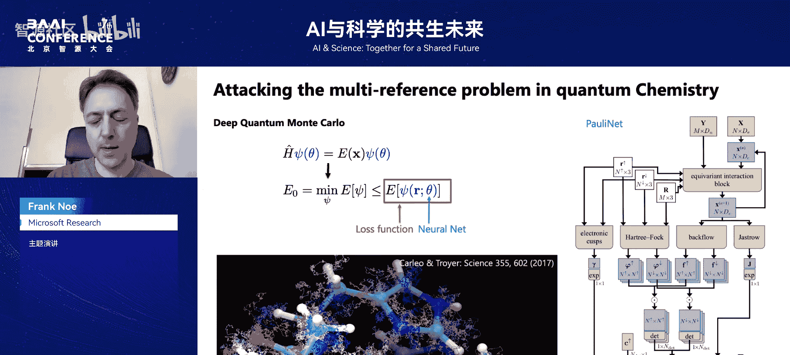

And now actually this field has progressed。To really much more something like machine learning。

 where you try to generalize the solution over multiple molecules。

Or multiple geometries of one molecule， here's one example that we recently worked on。

 this is a combination of predicting the electronic structure of a molecule。

Over many geometries in its conformal space， so in kind of different angles and bond lengths that it can have。

And on the and y axis you see two geometric coordinates now on the y on the z axis on top you see the energy and there are three curves here or three surfaces and these three surfaces are the ground and excited states of the molecule so this method can actually now simultaneously solve not only for the ground state。

 electronic structure but also for the excited states。And that as a function of the geometry。

 and all of this is captured by one neural network which represents all of these states simultaneously and everything is optimized simultaneously。

And the more complexity you represent by this neural network。

The more quantum states you solve simultaneously， and that means the more you amortize cost。

Compared of doing a higher accuracy quantum chemistry solution that you would need to do for every single point。

 if you would use a traditional method， you can find traditional methods that get you to the same accuracy。

 but then you pay the cost for every single solution every time。

And that's something that deep learning can do much better。Now， in the second part of the talk。

 I want to focus on molecular biology and biophysics， which is my main field of activity。

 and molecular biology can be roughly characterized as sequence structure and function。

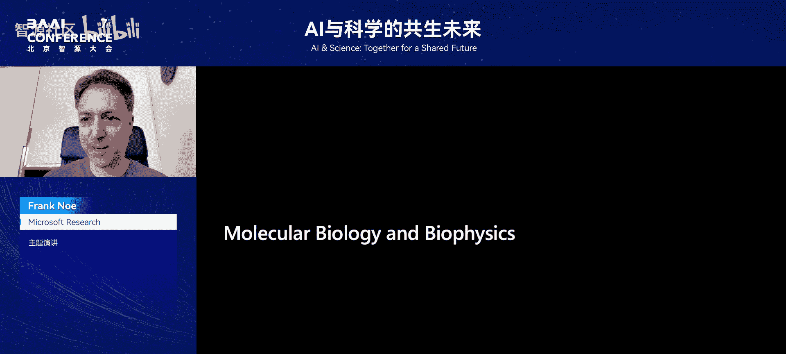

And I think it's fair to say that sequence and structure problems have been largely solved。

 or at least we have very good tools to solve them at scale。Squencing is clear。

 there's been the next generation sequencing tools developed during the human genome program。

And because of this， we now have very large sequence data sets such as Unipro。

Structure has been built on many decades of structural biology。With， for example。

 X ray and cryE methods deposited in the protein data bank。And then alpha fold。

And other tools later have enabled。The high accuracy prediction of such structures。

And this is of course， much faster than doing the experiment。

 and therefore is now possible also genomic scale， even though it's not always correct。

 right there are many。Complexes， protein complexes that are hard to predict。

 There are things that are intrinsically disordered。 So this has its limits， but it's gone very far。

On the other hand， for function for biomolecular function， we don't have anything like this。

 So by function， of course， function is a complicated term， So it needs to be defined， what is meant。

 What I mean is sort of how do things work on the molecular level So what are the different states。

 the different structures that a molecule， a biomolecule can be in。Open close， let's say。

 what are the different compositions， So complexes that can be formed depending on these different conformal states and what are the probabilities and the rates to transition between these different states under a certain set of conditions。

 if we would know that if we would have a scalable tool to simulate or emulate that we would understand on a fundamental level how biology works and that would give us a fundamentally different and better understanding of cellular function and dysfunction and how to design drugs and what is a good and a bad drug target。

嗯。And so the wish lists so what we would like to have is sort of a tool that we can specify。

 These are the molecules that we want just to， to model to emulate。Some proteins， liliggans。

 experimental conditions like the temperature， the pH or other the type of solvent that we're using lipid conditions etcter。

 and then we would like to have some system that would predict。

The ensemble of molecular structures that are consistent with this input and then have give us full access to all the the structures。

 the molecular structures in it。And the properties that come with it。 So， for example。

 a binding affinity or a binding energy between a protein and a liganant。

And of course there are many tools that can just predict the structure or just predict these properties or maybe even no two。

 yesterday Bs2 was released that dust both， but of course it's not really emulating the actual process and when you can emulate the actual physical process。

Well， then you can compute everything that you want to compute， right The question is just。

 can you do it efficiently？So we want a tool that can do this accurately。

 so close to a good experiment， a good quantitative experiment， but also scalably。

 so no more than a few GP hours for one computation experiment and that is currently not possible they are experiments that can get you very accurate。

Quantities such as binding energy， but they will be expensive and not scalable。

There are molecular dynamic simulations molecular dynamic simulation is a wonderful tool it can basically simulate the physics of any kind of molecular setup or biomolecular setup。

😊，And then basically you integrate the classical equations of motion and if you have a good force field。

 there are pretty good force fieldss now。You can in principle simulate the almost exact physics of the biomolecule。

 the problem is just it takes too long so ever since this paper this is metropolis' Monte Carlo paper from 1953。

Sampling of multi body systems in computers has been a problem， and it still is a big problem today。

These are two small proteins， Barneys and barstar， they are sort of a modeled system because they small and simple and easy to make in an experiment。

 and they bind very strongly。And if you simulate a system like this with molecular dynamic simulation。

 you need a solvent box that in total has about 100，000 particles， mostly water。

And if you simulate that on a GPU， it might take you a GPU year to simulate one event of binding and a million GPU years because it binds so strongly to simulate one dissociation event。

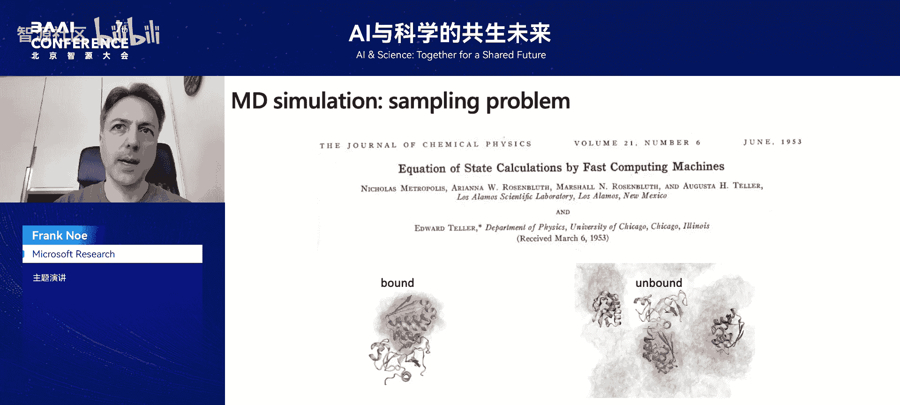

And of course， there are many ways to speed this up。 So this is not completely hopeless。

 but you can see this these things are extremely unscalable。

So many approaches have been tried to go around this issue。

You've mentioned Mark state models in the beginning。

 so this is one of the methods we've been working on for several years because it's basically a divide and conquer approach where you divide your state space of the molecule into substates and then you learn transitions between them with distributed simulations。

And using those， you can basically build a markov chain from this markov chain you can compute the properties that you're actually interested in。

 like a binding affinity， let's say。And with this kind of approach。

 you can tackle this barnish ba stop problem by running many simulations。

Building a map of state model or deciding which are the states that you haven't sampled well enough。

At adding more simulations and continuing this active learning process until you have enough data to connect the entire state space。

But it would still take you 20，000 GP days to collect those data。

 so that's still quite a lot of investment or 500 guules of energy。

 which is a substantial fraction of the energy you need to shoot a rocket to the moon。

So also not very scalable。Another idea that we've proposed in 2019 as the idea of Baltzman generators and Baltzman generators is basically sort of for molecules kind of the first idea how to generate their structures with deep generative networkve we'd used flows at that time because with flow。

 you would get an invertible mapping between the latent space and the real space。

And with the invertible mapping， that means you can compute the probability density of generating an output probability of the network。

 and you could use that to train the network to match a target density。

 So let's say you have an energy given and you have defined what is the probability distribution。

 you want to sample with respect to that energy， then you can train your flow to do that in theory without having had done simulations first。

In practice it helps very much if you have simulations in different parts of state space。

 so you don't get mode collapse， but you don't need a fully equid molecular dynamics ensemble to start with and so this can be very helpful。

But it turned out to be， even though we can go to maybe thousands of particles with this。

 it turned out to be not very scalable because Bman generators really tried to sample the exact probability distribution。

 And that's something so exact with respect to a given。

Energy function and that turns out to be very hard and you at some point at some system size。

 you just run out of basically probability weight or Monte Carlo acceptance rate。

And therefore we've now turned to a more empirical approach which is basically learning distributions from data and of course then we need to prepare the data in a particular way and to make sure it's good data and this leads me to biomolecular emulator。

 our current product that Microsoft research that's just been preprinted a couple of months ago。

And hopefully it will soon be published。

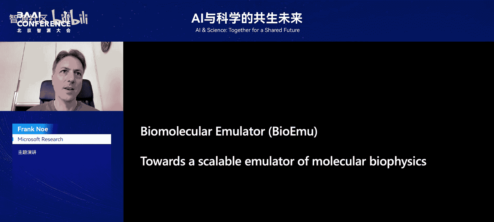

And this was developed by this team of about。12 people， these are all fully dedicated to the project。

 so we all work only on one project and the first step that was published is this biomolecular emulator。

嗯。And the basic idea of the first version of bioimu is very simple。

 so basically we are using a protein sequence encoder here we are just using alpha fold2 as a protein sequence encoder。

 so this is the alpha evil format encoding， we've also trained the end to end sequence encoder ourselveslf to basically test that if we do a very clean data split between for end test set and we have no sort of notion of evil format embeddings on proteins that might have been seen that everything still checks out and it does。

 but in the end we state with evil format embedding because it's widely used and it was relatively simple and good performance。

And then we train a diffusion model with a graph transformer representation on it。Now。

 this is in some sense similar to Alpha fold3， which also uses a diffusion model on a sequence encoder。

And then basically with this we generate structures and every time we generate a structure with a denoing schedule of a diffusion model。

 this is one point of non ensemble and then we do this many points for many points to compute the ensemble。

And then compute properties of it。And we do the training in a particular way。

 so this is the most important point it's trained very different from Al fold3， let's say。

 which is optimized for high precision structure prediction。

 so we pretrain on Al fold database but we prepare Al fold database in such a way that a model is encouraged to learn diversity conformational diversity and then we find tune on a very large set of molecular dynamics trajectories。

 many of them generated by us in a total more than 200 milliseconds of simulations for thousands of proteins。

And then finally， we find you in non experimental data and those are the data that we have the least of or the least information density。

 let's say， because they are each just one number。But we trust these data the most we think they are the most quantitatively reliable and so that's the idea here start with the qualitative data and with high quality data。

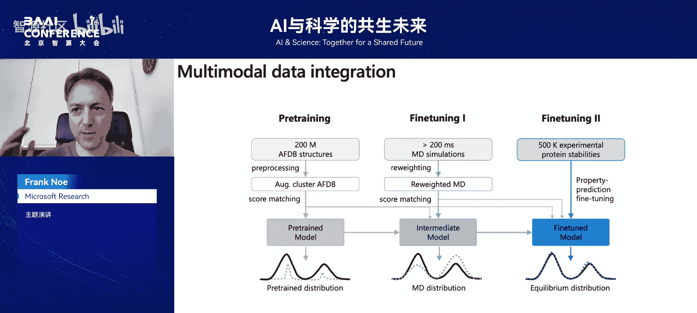

And then basically we are testing for three things， So first of all。

 we are testing if we can qualitatively sample different conformational states that are known to exist for proteins that are very different from any trained protein here's one example of a large conformational change here's the probability density in a lock plot so this is a free energy where on the top left and the bottom right you see that the two target states are being sampled and in between there are also other states that are being sampled and the dash line that's just sort of our our definition of success is a success threshold。

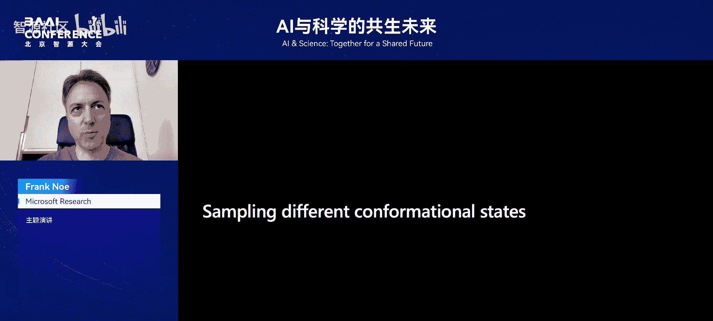

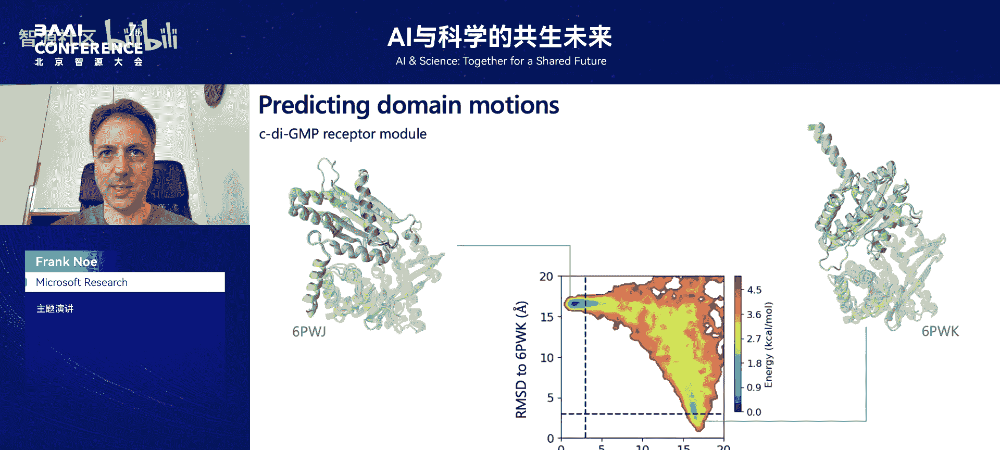

So there are also intermediate states that are being sampled that are experimentally not known。

 so these are predictions by the model and here you just see basically in a movie that shows you an interpolation between samples generated by the model that interpolates between these two known end states。

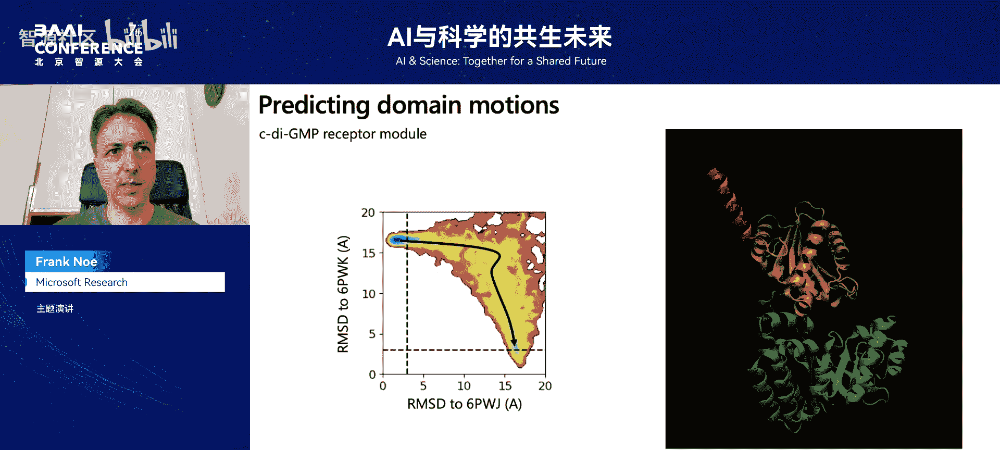

Now you can do this for different types of conformal changes like domain motion。

 these are very large scale confirmation changes and then we predict about 80 to 85% of them right within our success threshold we can do this for local unfolding where piece of the protein unfolds and maybe binds to something else this is of course something that like a tool like alpha fold would not predict because it doesn't really see if unfolded states in its straining data。

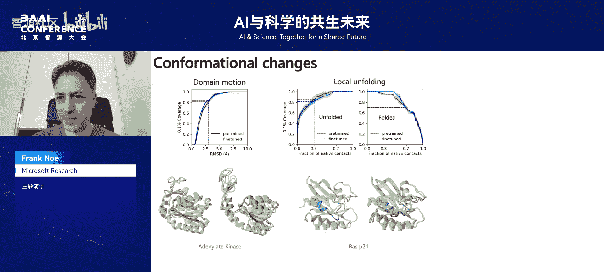

And then there are cryptic pockets， so this is where the conform changes to form a binding pocket for a small molecule。

 this is something that's very important in drug discovery to find alternative binding sites to target your molecule。

Now， of course， I was saying MD simulation is very short。

 so the question is can we emulate MD simulation and can we be faster？

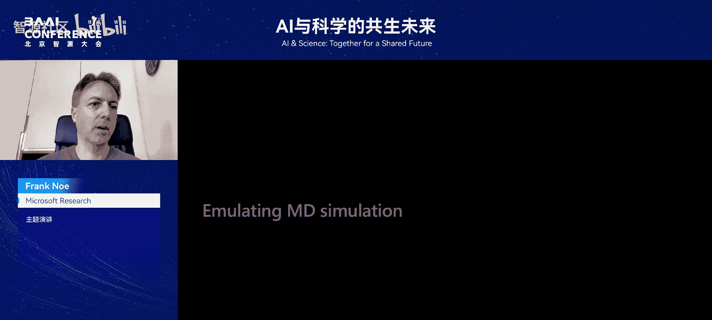

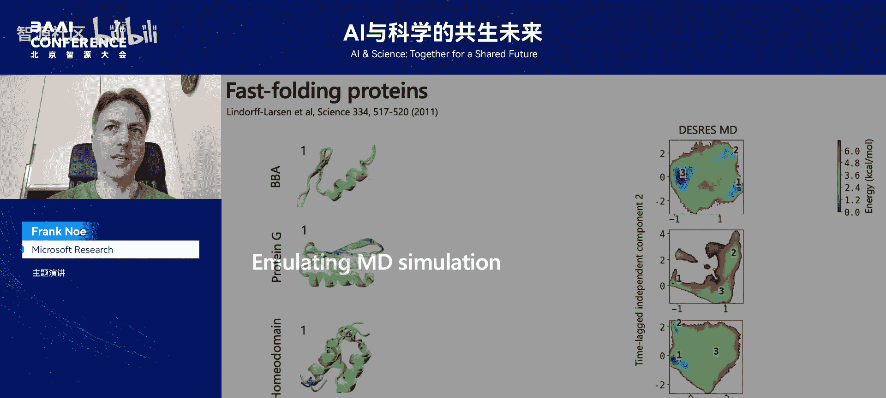

So this is an example of MD simulations of fast folding proteins that have been done by the shore research many years ago on their special purpose aren't on supercomputer and they are still some of the longest simulations that are published today and these are multimisecond simulations of small proteins where you reversibly fold and unfold and you see here again a free energy landscape where the different mini map show you folded states number one unfolded states number3 and twowi is an intermediate state。

And we can predict these states and the flexibility of the protein。

 but we can also predict with the higher accuracy， the free energy landscape。

 so the conformal space of the protein。And we do that with an error that is below1 kilo per mole。

 which is basically。AHigh accuracy， this is within sort of experimental uncertainty。

And we do this within around one or less than one hour on one GP。Whereas it would take 10，000 to 100。

000 GPU hours to MD simulate these systems on the same GPU。So it's a very large speed up。

 the size of the speed up depends， of course on the process that you're interested in can be larger can be smaller。

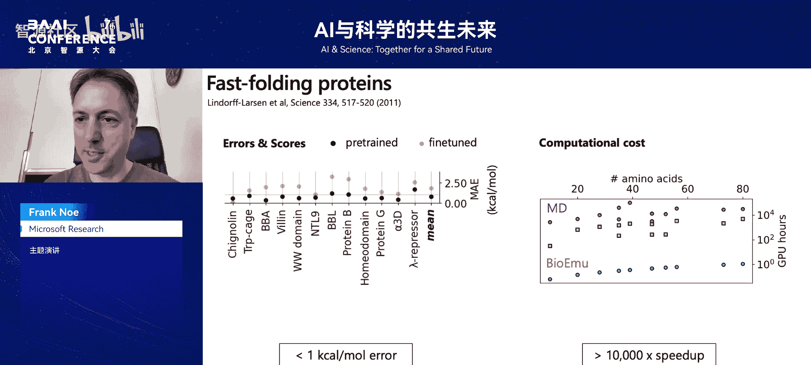

Now finally we can integrate and predict experimental data。

 that's what the third training stage brings in and this is very important because there are many ways to measure properties experimentally。

 but usually they don't give us structures they just give us numbers， some sort of averages。

 for example in this experiment that we've leveraged。

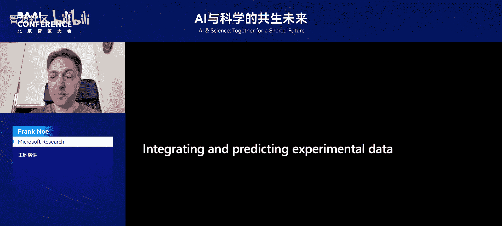

We are getting many， many numbers to tell us the stability of the proteins that have been measured。

 stability means just the ratio of folded and unfolded states。

And for this we had to develop a method， which is sort of a fine tuning method for diffusion models that shifts the distributions。

 sample distributions such that they are consistent with those averages。

And the way this basically works is we do sort of short rollouts and then we predict the final endpoint of the denoizing schedule。

Which， of course， if you do that after only a few steps， it's very inaccurate。However。

 the ability to predict whether it's going to be a folded or unfolded state。

 that is excellent after a few steps because it's a large scale structural property so you don't need to do a lot of steps before being able to predict that and that allows just to compute the prediction of whether a dennoizing trajectory will end up beinged and unfolded efficiently and it allows us to basically incorporate a loss function that backproagates through this short rollouts。

And that allows us to fine tune the diffusion model on these protein stabilities。

 and this is now the prediction on protein sequences that are again very distinct from the training data。

 these are errors well below 1 kilocallories per mole and correlations beyond 0。6。

We can also even predict the change in stability of single point mutants。

 so that was always something that people said， well Al 42 cannot do this because obviously it's not being trained on many mutants。

 but you can still use the Al42 representation and they have very good performance on predicting mutant properties。

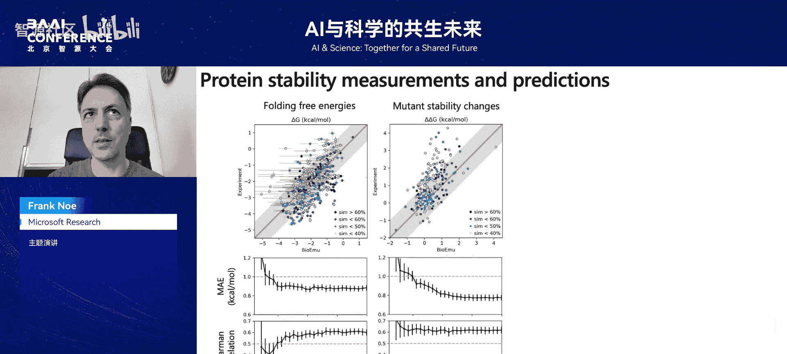

And now because we predict the entire ensemble， not just a number。

 we can go to the ensemble and associate structure and function so we can understand， okay。

 if this protein is less stable， why is it less stable。

 what is happening in the structure that makes it less stable and this is very valuable information for scientists and for drug discoverers。

And with this， I'm finished。With my presentation and I want to thank the people at AI for Science and thank you for your attention。

