# 2025北京智源大会- AI与科学的共生未来 p04 AI for Science时代下的科研“读、算、做”智能化升级：张林峰 -BV1NMNxzrENh_p4-

谢谢启微的介绍。呃，大家好，非常高兴能做这样的一个分享。呃，我我也基本上还是在沉浸在这个体验老师和frankno的对话当中。让我想到了很多早期探索AF science的时候。

然后我想可能我今天的介绍分两个阶段。也是我对于AF science的思考。呃，的两个不同的一个时期所侧重的事情。😊，第一个就是efci早期。

其实我们看到刚才这个frank所讲的很多很多的从量子力学到分子到大分子的采样等等。其实恰恰好也是我刚刚。从这个16年开始在北大，然后呃到priston这个做研究的时候，我所在的领域。

而且在那个时候其实我我基本上看frank几百篇 paper，我知少看他50篇，所以我基本上也是一个非常原生跟这在这样的一个领域去做起来的。而做起来的过程中。

其实第一个也就是也是我认为对我影响非常大的其实是我导师之一鄂为男老师带给我的一个一句话。这句话基本上就是在16年底告诉我的就是AI本质就如16年12年到16年底，这AI的前5年，我们看到的是什么呢？

是左边这一系列的进展图像识别人脸生成以及这种这样的游戏。😊，那它本质带给我们的是什么呢？是深度神经网络这样的一个工具。而这样的一个工具本质帮助我们做了怎样的事情。一句话来说是克服为数灾难。

而但着这样的一个视角，我们去看很多的科学应用问题的时候，它恰恰好是容易卡在这里面的。所以左下角是这个de的这个CEO这个所总结的什么是一个这个时代下的好选题，而这选题有三要素。

而且这个三要素它最近在这个的这个高等研究院，应该就是前天或者最近有一个采访也有重新的提到了这几点就是说一个好的问题，一个从AI上比较合适去解决的问题，可能可以去应该来说尽量的具备这三点。

第一点呢是巨大的组合的搜索空间，就是很复杂。这个很大的这个维度，很高的维度等等，这是第一步。第二个呢就是清晰的目标函。你要知道你要去冲着怎样的目标做优化。第三个要么有很多的数据。

要么有好的simulator来去。😊，把这个data perspective解决好。当然从这个角度来说，AI不只是可以被应用于图像、人脸或者是af go。

其实我们所关心的一系列的科学问题和工业研发的问题，在一些点上可能也具备这样的1个1233要素。而这样的一些具备这样这个条件的选题，变成了AF3早期的所谓的好选题。然这样的好选题下。

这个其实刚才frank所介绍的一系列的这样的一个这个尺度上的这样的一个这个问题，从最基本的学令方程的求解到密度范函分同学，一直到这个相对界观的采样和这个界观建模的问题。

到宏观的这样的一些连续介质力学等等。这样各个尺度上，其实过去都面临。这个精度和效率不可兼得，或者说所谓为数在难的问题。而AI给了我们一个统一的工具。

所以我在17年最主要做的事情就是把AI这样的一个神经网络的算法应用于各个尺度。当然后来做的比较多也是士科的名字来是用来做力学的但是其实无论是尺度往下走。

比如说这方程其实在这个之前两年就神经网络应用于这个原子尺度建模电子尺度建模的工作。WF其实也是这个老师带领我们去做的。所以说各个尺度上其实都做了很多的这个早期的探索。😊。

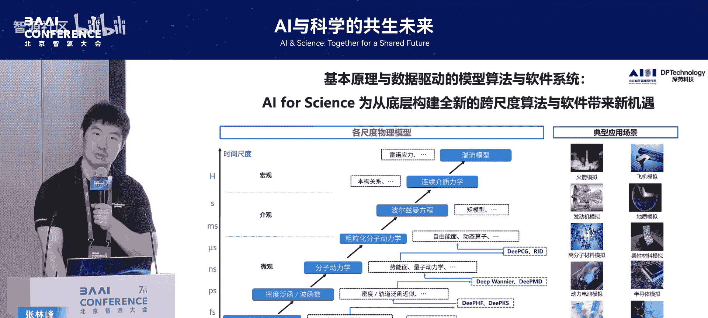

当然也是在这个基础上，18年呃，我们说这个。整系统性整体现在提出AFs在18年的夏天，呃，鄂文南院士和这个汤超院士他们呃组织的会议进行了系统的讨论。这也是刚开始的这样的一个领域的现状。

也是在这样的一个驱动之下，可能FF two这已经不用介绍了。已经诺贝尔奖了。其实我们看到两种类型的这种好选题啊，就是满足那三个要素的。一种呢就是呃数据非常well post呃。

对于af two的选题来说是。😊，21条序列和20万个人类已经解得结构的这样的一个蛋白质结构，是数据基础。从这样的一个数据基础出发。

我们要建模的问题是从序列到结构评估结构交建模的好不好的metrictri是非常清晰的。于是这几点都具备的时候，它变成了1个AI的好选题。那么类似的各个尺度上的求解。尽管很多时候数据是不ready的。

但是simulator是ready的。有些时候simulator比较贵，但是有好的策略去用simulator产生数据，用AI去做拟合做这种s model变成另外一条路线。

这这个呢其实是基本原理驱动的这样一些模式。而这些模式到20年都产生了广泛的结果。😊。

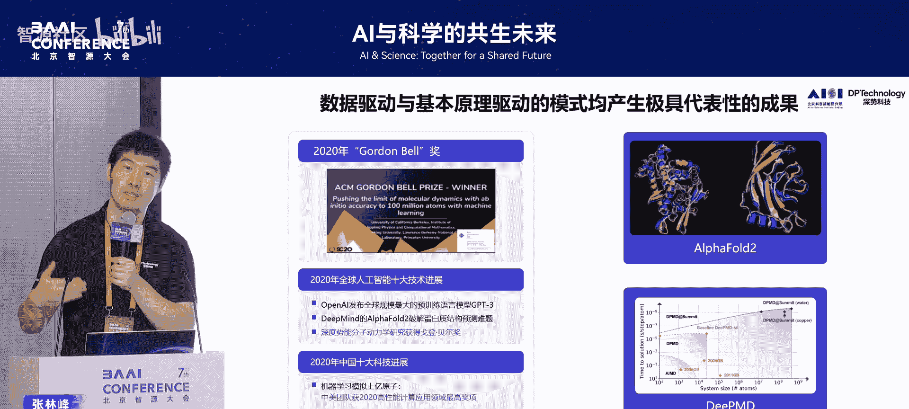

当然从这样的一个结果出发，我们的早期的实践，某种程度上好选题也意味着一个技术范式跟一个应用结合的时候的低垂的果实。当我们现在去看AI在普世意义上，我们也不只是说在谈论它。识别人脸下围棋这样的一个事情。

而是每个人都可以感知到他，每个人都可以跟他对话。对于AF scienceence来说，其实但凡往深走一点点，无论是从science的应用问题出发，还是说我们这样的一个应用能够走向落地的。

更有impact的这样的一个这个。发展来说，深水区意味着可能大部分的问题不是具备那1233个选题要素的。大部分问题反倒是要么没有足够的数据，要么其实你不知道要优化什么，他它的关联特别间接。

要么其实就是这问题可能不是说有巨高的维度，而是它可能有这个很复杂的关联，维数也不多不少，10个维数1个参数，50个参数等等等等，但是不好优化。这些问题其实变成了我们从AF往深走的深水区遇到的问题。😊。

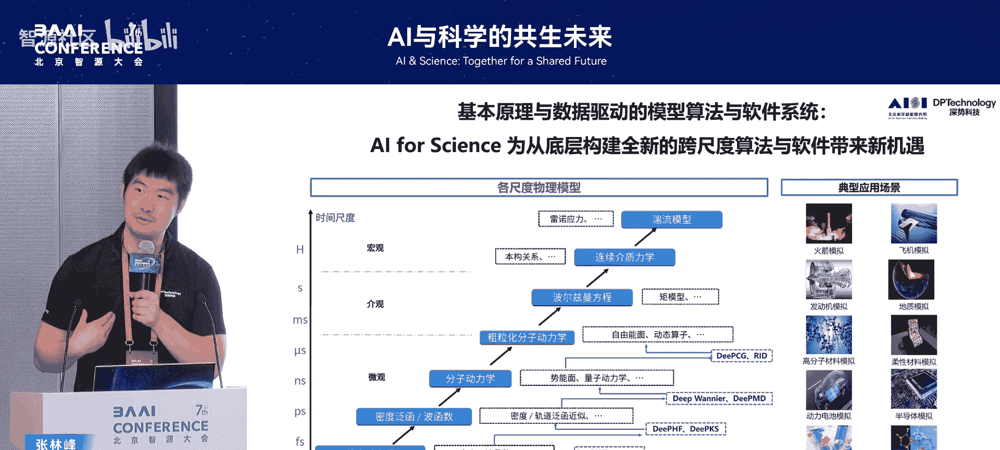

于是在这样的一个基础之上，一方面我们形成了一个开源的社区啊，这样的早期的工具，也得益于这样的开源社区已经被这个生化环材各个方向微观模拟计算的很多的呃用这个应用所采用。另一方面呢。

其实更关键更本质的一个问题是这个I for science下一步应该是怎样的。这样的一个问题，其实贯穿了我们前期的很多的思考。其实在这个这张图里面的最后。

其实除了AI for science之于数学和之于科学与工业这样的两个这个意义所在，也是伟南老师带领我们18年时候说的，就他还说给我的是AI for science之于中国。

因为AI是我们推动下一轮科技创新的。

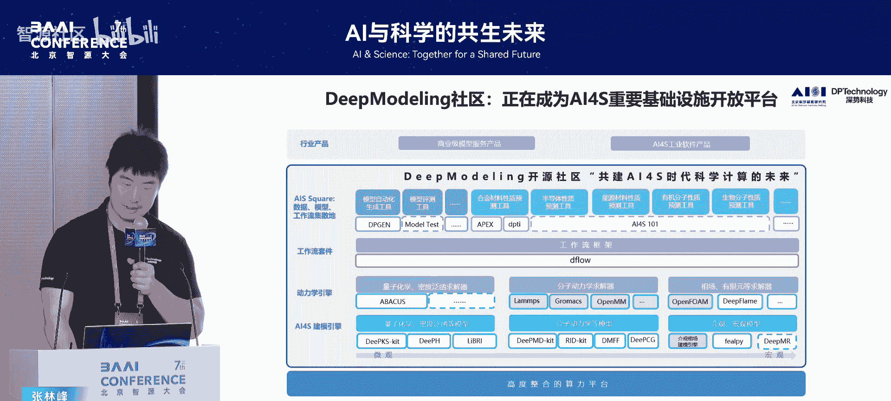

范式变革的一个重要的工具。但是这样的一个工具，怎样深度的推推动？其实是既要往宽走，面向所有的科学研究和工业研发，能够有一个公共的基础设施，又要往深走。而且这个往深走，不只是说在sence往深走。

还是要在落地上往深走。所以这样一系列问题，使得我们其实在20年21年是最绝望的时候，觉得早期有很多成就，对吧？就是呃哥登贝尔讲看起来是一个不大不小的讲，就是我其实也某种程乱入的。

因为我自己背景不是高性能计算，但是呃这样的一些讲和接下来我们要所谓的make larger impact以及更深入的落地，该怎么结合，这是我们想的很久的问题。😊，啊作为一个证据。

今天这个很有意思是22年初啊，这个非常我也是我现场想看发现的，就是在这个知乎上，我把把把这个问题想破了脑袋，想破了脑袋。而且其实我在也呆的蛮舒服的说一定要回国，而且一定要创业去把这个事情落地。

当时就不知道这个创业怎么去这个落地。当时在知乎上就看各种人说哎这个计算模拟真正能不能落地啊，就好多讨论，就有人这个非常有in，我就我其实不怎么用知乎。然后我在知乎上就问说这个哎你你好。

我叫张立峰是一个的方法的作者，我就关心这个。😊，计算能不能真正的落地。对，然后这个我觉得你的回答很多都很有inss，能不能这个多聊一聊，我就加了微信。呃，然后这位同学叫陆子恒。

然后我们也是网友5年来第一次见面。但是我基本上无所不用其极的去问了很多人这个东西真正怎么落地。然后我想可能一方面，我想到了一些答案。另一方面我觉得如果非要长话短说的话，我觉得纯计算是不可能落地。

就是我从计算机上模拟无数东西做无数的model去generate无数可能的蛋白也好，这个材料也好，如果他没有做出来。没有真正的去这个做出来之后产生对现实的经济社会的影响。那么他不算闭环，不算落地。

不算largest impact。那么如果是这样的话，就只有那么几个亮点的datainess非常好的突破，会是点状的突破。如何实现系统突破变成了我们新的一个阶段的命题，尤其是。😊。

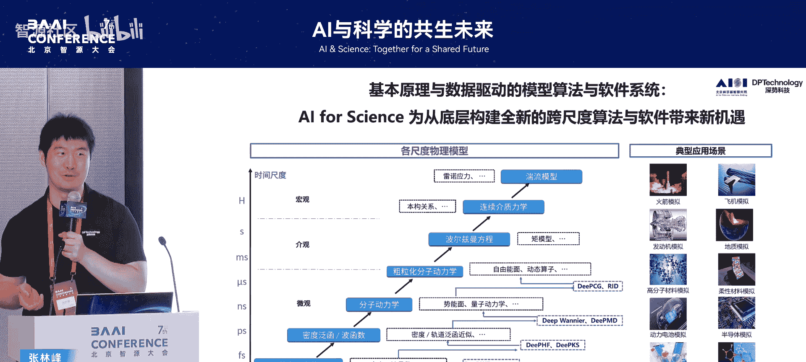

嗯，可能在一个这个从头要做的角度来说，这个东西怎么做起来，变成了一个我们共同思考的问题。

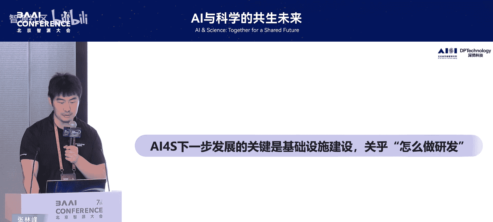

这是从21年起开始，我们重新去思考这个问题的时候，一方面已经有了不错的铺垫，不错的积累。但另一方面，我们究竟该怎样系统性全面性的去把F做起来，变成了一个新的起点。

这个起点就如同AI在17年开始左右的一个新的发展的特点。17年开始tenor这样的框架慢慢的开始走向成熟。然后。😊，transformer这样的模型开始走向统一然后18年开始GPT123。

使得我们把各个类型的模态和数据和算力和这个数。算法都更加的全要素的统筹了起来。在这样的一个全要素的统筹的基础上，我们才看到了现在的breakthrough。这是AIinfrra做的事情。

那么AI for science显然有AI for science infrra这些infrra做好之后，才能够有望让我们迸发出。更多的更系统化的更全面的一系列的进展。所以在23年的时候。

这个老师提出了所谓的这个四梁恩助，也是在中关村论坛上呃在这篇应该就是在这附近的这个一个报告后四梁是什么呢？

是我们做科研的基本的个型的基础设施基本原理数据驱动的型算法与软件以及实验就高效率高精度的实验方法，以及我们替代文献的知识库和数据库以及最后高度合的算力各种类型的算。那这样的一fr能够被整合起来。

融入到我们的应用中，真正的就跟之于AI一样，以及苦打至于这个I一样。那么这样的一些事情做好才能进入不同的境地。那么这样的一个积累是们过去5年的一个思考的起点。

所以当下其实也就是在最近终于这样积累开始走向一个新的阶段，就是推出了这样一个叫波尔的科研空间站。😊。

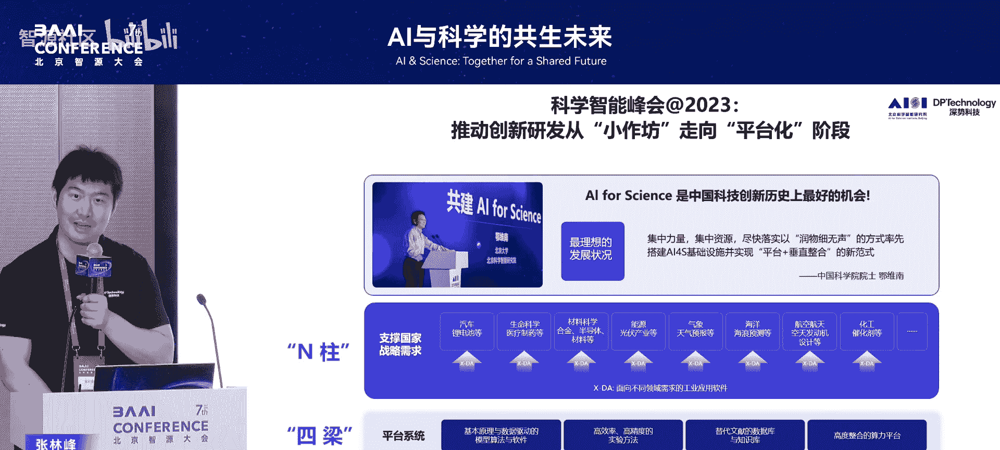

并且已经有了这个近百万的用户。然，他的几个方面就是图书馆教学楼实验中心计算中心恰恰好，也是各个类型基础设施整合的一个这个产品的形态。而且最开始不是朝着这个方向设计的，而是在这个过程中慢慢演化成的。

所以我下一半部分所想分享的就是说。

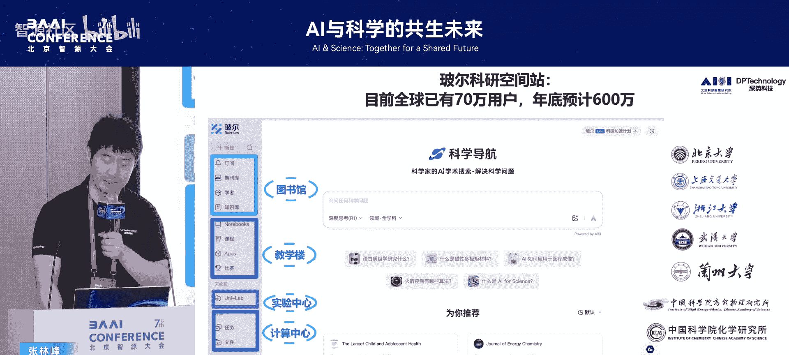

其实当下AF想要有足够大的imact，想要真正的落地，我们需要做好的是从这几个类型的基础要素怎么去连接到我们的。铺天盖地的应用当中。我想说的第一点就是说我们衡量一个模型，衡量一个算力，衡量数据的时候。

往往很难去有效的衡量。就是它有多大。如果我们要衡量它有多大的话，算力是多少P，对吧？数据是多少PB呃，模型是多少B对，这就是我们ively去看一个inrastructure有多大，好像越大就越好，对吧？

但是大不意味着有用，真正有效用起来意味着可能还需要做很多的事情，而且在同等的有用程度的。😊，前提下其实小更好。因为很简单，小的功耗更小。所以其实这是我们从头开始构思这个infrra时候的一个这个。

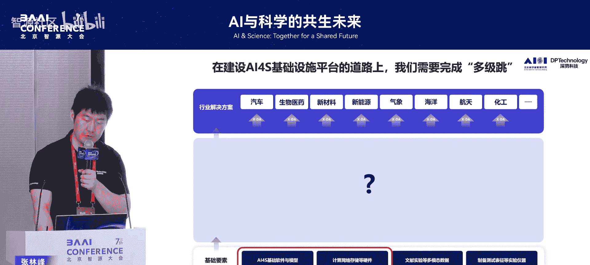

探索的路径。那么在这样的一个路径上，首先还是模型数据和算法。呃，早期还是以刚才所介绍的ten这样的一个例子为例。我们所需要做的权衡取舍是对于一个准确建模的物理方程求解的问题，精度和效率不可兼得。

而在这个基础上，那么第二个阶段，多级跳的第二步，也就是我们早期所取得的这个所谓的成就。其实是这个在量子力学和分子模拟之间有了一个AI的桥梁，使得AI能够学习量子量子力学的解。

然后并且进行进一步的大规模长时间的高效的。😊。

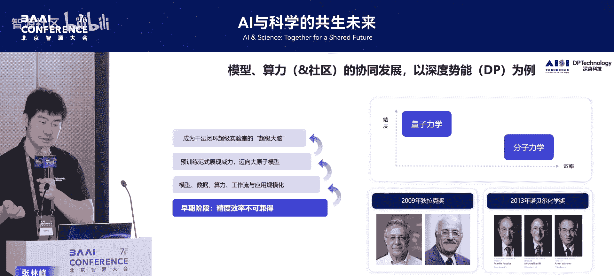

微观模拟，使得这样的一个工具能够面向我们看到的后来的这样的一个核金电池半导体这样的材料，化学化工呃的应用以及这个生物药的应用有广泛的影响。当然，从infr的角度，其实想要实现这样的一个广泛的影响。

而不只是一个个的影响的时候，其实既包括像这个哥登贝尔奖所做的高性能的这个在这个底层算力上的优化，其实还包括对于很多类型的科学计算代码的工程化。

以及在云上超算本地算力上的有效的适配优化调度以及互联这些方面的基础之上，构建的一系列的面向应用的工作流，是我们实际上跟应用连接的这样的一个基础设施。当然在这样的一个基础施的基础上也又过了几年又过了几年。

我们整个领域已经看到，其实我们已经不再需要说从任何一个应用出发去从头产生量子力学数据，然后再去训练模型，然后再去做应用。很多时候我们开放社区的这样的一个数据已经积累到基本上要覆盖整个元素周期表。

于是这样的一个元素表的覆盖的这样一个数据出发，我们就有望去实现一个更加统一的模型。这样的一个统一的模型，可以使得我们过去是一个一个的做。😊，探索做深入，而现在可以一批一批的做。

所以右下角是一个这个呃王涵以及这个目前浙大的校长马老师呃，前期的一个在精这个晶体材料的搜索高压的超导材料的搜索上的一个工作。其实以前每一个场景做这个搜索的时候，不同的组分。

不同的项都需要非常昂贵的计算来去探索。但现在其实一发现就是呃几十个上百个的新结构。这些方面其实有非常多的例子。我相信子恒也在这个方向做了非常多的探索。😊。

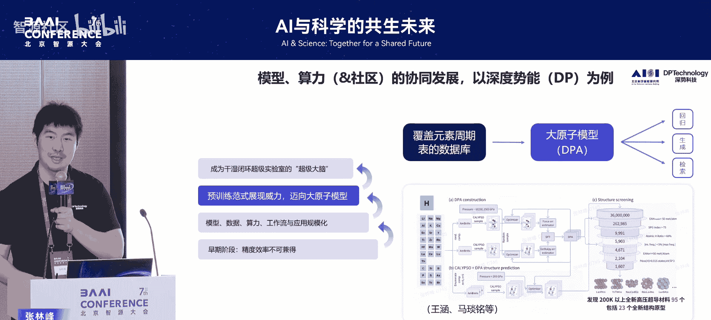

而在这个基础上，我们再去问，那么有了这样的一个模型，以前就是说能够通过simulation sayay something，然后获得一点理解，但是再往深走。

能够是否有机会能够真正深入的去对我们的生产制造产生影响。所以我们的预期是这样的，这也是从这个开放社区23年发布的一个计划。23年的时候，也把这个2425年和26年之后的这样的一个计划，直接写了下来。

我们希望能够沿着这样的一个路径去做。目前也是在一个不错的节奏上。在24年先把计算上能够充分探索的微观数据能够进行有效的探索，并进一步的。😊，在今年与大规模的实验和文献数据相结合，原子级的。

然后实现一个通用的跨模态能力。并在往后其实最后还是一个更加通用的设计，以及甚至说自动化的合成以及测试这样的一个具深的能力。

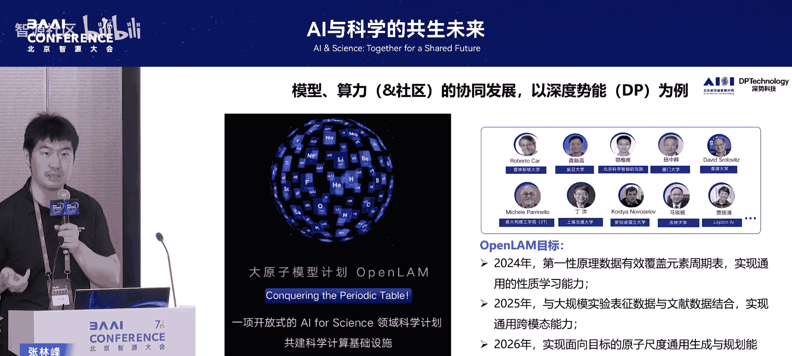

这些方面的能力，当他全面具备的时候，才是我们真正批量的没 progress的时候。当然在这个意义上，更多的ef science大模型正在构建和发展当中。

比如说unimo是一个这个分子层面上的统一的大模型。早期我们在。😊。

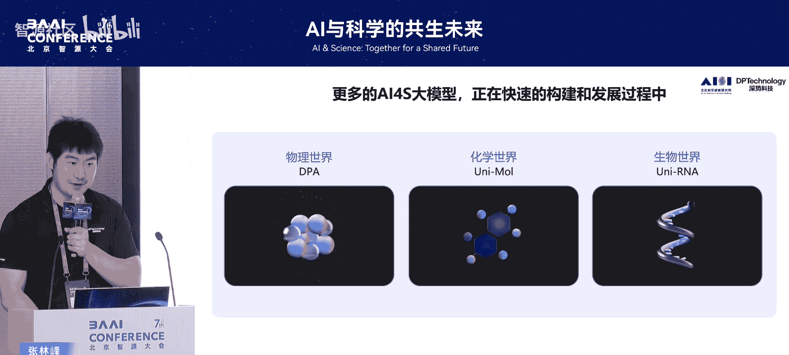

对这样的一个模型进行探索的时候，最主要的应用点是药物。那后来发现药物的整个这个研发的闭环里面，这只是其中的一步，可能还是在不同的步骤里面一个不大不小的一步。但是后来我们发现这个模型是很统一的。

很多地方都需要进行分子的设计。化工的分子ola莱这样的一个光电分子，像这个电解液、石油添加剂这样的一些分子。其实他们都有一个共同的。😊，online principle。

然后同同时呢在这个我们大量的模拟数据的基础上进行的预训练得到的这样的一个模型，能够更进一步的去统一各种类型的任务。所以其实在这样的一些方向上呃，已经有了非常多的落地的成果。但这是模型的部分。

围绕模型的部分和算力部分是耦合的。那么在模型发展和算力的这样的一个耦合过程中，相应的 infrastructurefrastructure是对应的模型软件相应的这样的一个持续的集成和部署，以及算力的。

😊，适配调度以及进步的这个工具化的这样的一个过程。

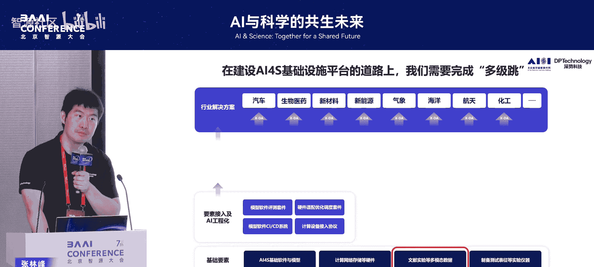

类似的，那么文献实验等多模态的数据，他们该怎么办？呃，其实我们同样的是在这个过程中，最近的波尔其实迎来了一个比较大的入口，也是在这样的一个工作的基础上。我们知道这个AI想要去这个呃真正的做好科研。

它确实应该站在前人的肩膀上，而存量的文献专利书籍等，就是我们前人的肩膀的基础。但是现在的AI是不是已经能够把这个基础，把存量的矿挖掘，把存量的基础吃好，其实不见得。😊，原因在哪里呢？

就是在这样的一个问题上，我们说最近比如癌症治疗有哪些创新方法，我们是可以就是说经过这样的一个多模态的检索以及。

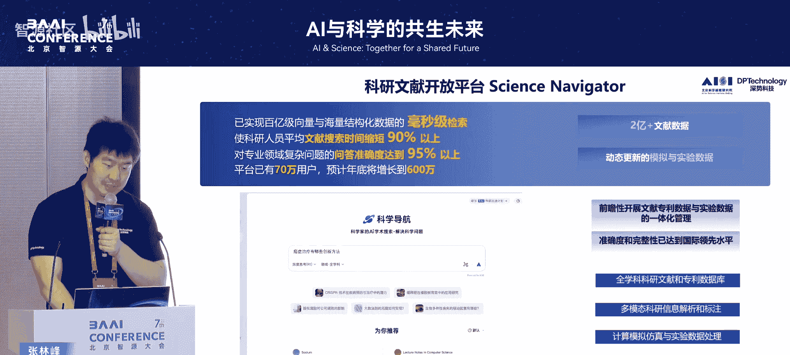

相应的这个召回和总结能力来去利用好AI。但是想要把这样的1个AI能力应用于所有学科和所有科学模态的时候，我们发现整个构建的过程是一个从头搭建。基础设施的过程。

啊这样的一个过程也是这个我们的这样的一个科科学导航。在过去探索过程中，最开始觉得就是AI大模型和数据整合，形成一个大的知识库。最后发现从第一步到最后一步，需要一个非常快的非常有效的探索过程。

因为最开始存量的数据，我们知道就是人类存量的这个英文文献中文文献等等。也就是E这个量级。而从E这样的一个量级出发呢。😊，AI模型现在不少这个通用的语料上已经做的不错了。

但是科学的语料包括比如说还是以这个分子的设计为为例，包括分子的分子式化学反应图谱以及表格等等，以及他们在非常长的文本里面的深度深度的关联。那么当下其实我们整个通用的模型在这些方面已经有了不错的进展。

但是还没有达到专家的水平。你要说给我一篇文章，然后一个模型说这里面的化学反应给我提出来，反应条件给我提出来。如果说那个化学反应不小心是在一个这个比较奇这个比较奇怪的排版里。

并且反应条件是在一个这个比如说箭头上等等的，其实相应的这个模型还不够。那我们最开始呢其实为了这个我同时呢我们又知道这个数据其实算出来的已经快用完了。那么存量的挖出来的还是很关键的。那么我们怎么挖呢？😊。

我们做了很大的这个也是过去5年可能有两三年时间主要在做模型，希望能做好这个识别的模型。但是也是从这个1两1两年前开始发现呃人工智能的这个低信元也是有多少人工就有多少智能。然后呃。😊。

这里面我们知道普通的模型需要需要很很很这个大规模的标注数据的标注，而同样的知识型的数据需要知识性的标注。呃，其实无论是向左边所举的这个例子，就是分子式的识别。

还是说到后来我们开始系统性的就可能我就不做展示了，就是就这个很多类型不同类型的数据库去做这个深入的挖掘的时候，其实本质上我们在做的一个过程，是把知识性的数原始的数据。

从这个基本的解析到专家的包标注再到这个模型的持续的改进的这样的一个专家模型数据的一个持续迭代的飞轮里面。这样的一个飞轮还在构建过程中。

其实今天也是那个刚刚我们把这样的一个呃数据挖掘和知识标注的平台叫做unimin发布了出来。当下呢其实也是在这个基础上，我们说存量的数据从AI的视角上是一定可以被挖完的。但是挖需要一个过程。挖完前和挖完。

后是AI产生影响，在AI for science上的一个巨大的转折点。在这些前面的这这些infrared building up的过程中，可能我们才能形成高质量的科学语料的数据。

并且进行一一系列的进步的这种发展，包括这个科学基多大模型。那它需要具备什么能力呢？就从当下的AI的里面也是非常之明确的科研的多模态识别能力强。但是这里面对于普通的AGI模型来说。

可能是文字视觉以及相应的这个多这个3D世界的感知等等。但是对于嗯科研来说，可能还包括非常多不同类型的表征测试仪器的这样的一个perception的数据。

它是被翻译成了电竞的图片呃这个普学的图片对天文望远镜的图片等等等等。高能粒子的这样的一些散射的这样的一些图片等等。这样的一些模态，在看懂的基础上才能进一步的去进行有效的推理。

想象化学家想这个脑子里设计分子的时候，他脑子里是一句话一句话说还是一个分子，一个分子的看其实是非常模糊的。我我问了非常多这个甚至好几个诺贝尔奖的这个化学家说你怎么想象你这个化学反应在你脑子里怎么发生的。

是一个非常多模态的过程。最后在这个基础上还需要运用最前沿的工具。而在这些积累的基础上，这些方面的infr都真正做好了。我们才能够从一个demo量级的事情变成一个覆盖整个科研再到工业研发的事情。😊。

而我们正在这样的一个过程中，我不能说这样的一个过程已经完结了。但是我想说这样的一个过程看起来是必要的。

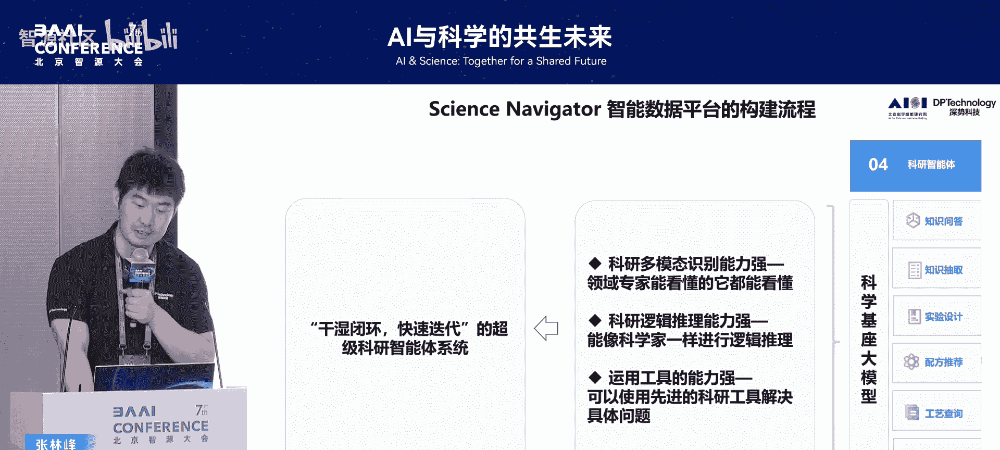

那么从这个角度出发，文献等多模态的数据。最后经过这样的一个知识型的标注挖掘和小模型大模型迭代的这样的一个这个提升之后，可能存量的数据终会终究被挖完。而增量的数据无外乎来自于实验或者计算。

那么就进一步的到实验的部分。实验的部分最开始其实我觉得这个作为一个可能最开始甚至不是叫计算背景，叫理论背景的的的这个同学来说，这个实验室离得最远的，而且我们其实在过去的几年时间里面。

也见证了一系列的这种所谓的自动化智能化的呃实验室的探索，更广泛的这个context底下，我们也见证了这个巨身智能，人形机器人的探索。更细分的这个方向也见证这个工厂早就自动化了，对吧？

然后那么这里面的探索有哪些类型的复杂度。😊，我想可能时间的原因很难展开，但是经过过去的一系列的踩坑。呃，所谓的踩坑就是我以为这个问题已经解决了，但事实上永远发现他还没有解决。

直到最后我们决定自己去解决解决它。因为这个东西解决不出来。那么你无论怎么设计出来，无论怎么知道前人在文献里面做过什么，你还是要解决这个设计一个东西做出来的问题。😊，但是怎么做出来？于是面向很多的场景。

到最后，那么生化环材通常是这个制备合成表征测试闭环的这样的一个迭代。那么面向这样的一系列的研发流程，我们所发现的是什么呢？是首先确实这个流程不同的流程复杂度很高。呃。

其次呢就是不就是其实工厂的这个生产呃，比如说药物生产或者说电池这个这个生产，其实它的复杂度更高。但是他在一个他他所做的事情是在一个稳定点附近的一个极致的扩展。而对于科学研究来说。

他反过来是在一个巨大的探索空间里面，希望进行最有效的探索。而巨大的探索空间里面，我们的自动化的仪器设备能不能够得到那个探索空间所对应的其实。类比于这个机器人来说，就是所谓的柔性问题。

但我觉得他可能比人形机器人面临的柔性的挑战要更低一点。所以或许这样的一个方向能够。更早的实现。但想要去实现的话，翻译再倒推回来，就是我们怎么去build整个自动化智能化的实验室。从每个应用来说。

只有整个闭环，其实不没有必要说一定不能人在。但是整个研发的闭环里面，每个周期的对应的通量效率。这是自动化解决问题，以及相应的通量效率积累的数据基础上能够有一个最佳的AI的反馈这样的一个这个。呃。

最最优的反馈这三个要素，通量效率以及这个反馈质量。这几个方面，如果能够形成一个有效的迭代，那么我们才能够系统性的。带动整个这个研发的。加速升级。从这个角度来讲，于是到最后我们发现，一方面各个场景得打通。

为了打通各个场景，各个上游的仪器设备，如果ready了，就可以直接搬过来组合做组合。如果不ready，那我们就要问自己要不要打通。打通的话，你就得把这个瓶颈问题解决掉。

于是在中间环节上诞生了一个新的东西，就是所谓的操作系统。因为我们看到就是底层的硬件，其实面向嗯。😊，这种各种类型的这种。科学应用来说有非常多非常复杂的这个非常多型号，非常多的功能。

非常多的组合起来的一个嗯。瓶颈。但是呢他们某种程度上，首先他们需要更好的组合，其次更好的打通到各个应用场景的时候，才能够实现更加高效的干尸闭环。呃，所以我我在我看来呃。

当下的这样的一个这个实践是非常蓬勃的。而且这个实践的基础之上。跨完这一步，我们才能迎来这个。真正从做的意义上的一个批量化的井喷式的成果的涌现。所以在最后就是这几个要素，其实最开始就是其实基础要素的话。

就是那摆在那的算力，摆在那的仪器，摆在那的dab。但他们怎么能够跟我们的应用连起来。其实多多少少都要经历这样的一个基础的要素接入AI工程化这样的一些接入工具化之后。

可能才是我们在面向任何一个场景的应用的接口。然后我们面向任何一个场景无非就是在做进一步的组合来去形成一个个的面向应用的解决方案。

当下当然最好的这个方式就是这样的一些工具都通过大模型的协议来去这个封装起来，成为一个agentread的东西。然后我们在上面基础上做agent这也是我们当下的一个最大的努力方向所在。😊。

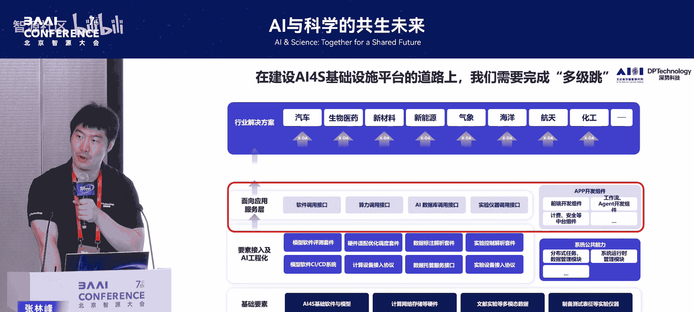

但是我想说，每个agent的这个工具是否solid这个工具as infrra是不是能够真正的去解决我们关心的问题，这是需要一系列的从读到算到做各个环节上的这infrra的打通的。而打通过程中。

其实像标注像这个嗯甚至从头设计一个反应器等等这样的一些事情，是往往是我们打通过程中必须或者必要克服的瓶颈。

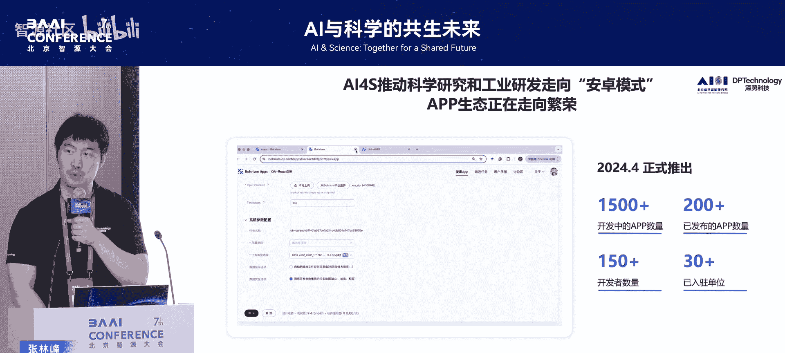

而在这样的一个基础上，我们才能够说所迎来所谓的这个AF系统性的落地。然后这样的一个落地，其实我们现在也看到了非常多的例子，就是我刚才所介绍的独算做的基础基础设施。

有些行业已经对于这个新的这个技术已经拥抱很久了。比如说药物，所以说各个环节上有相应的工具的需求的时候，我们能够快速的提供。同时呢有些方向正在快速的发展，像能源电池材料这样的一些场景。

他们对于工具的需求是非常呃迫切的。但同时呢很多工具也不可能说是35年去打磨。而在这样的一个模式之下，其实我们正在形成一个平台化研发的一个这个新的基础。😊。

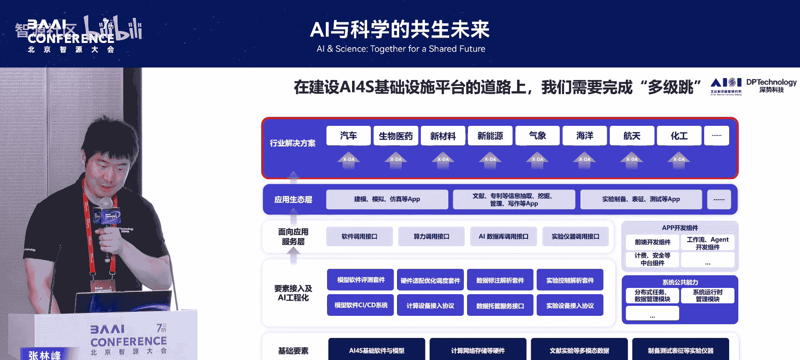

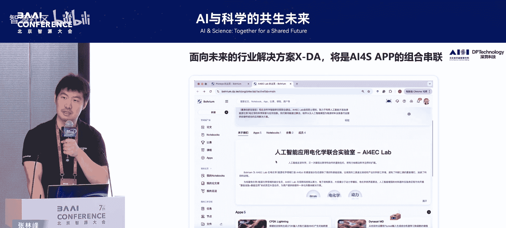

，那么刚才介绍这么多，每个地方似乎都有很多步要跳的多级跳。然后同时很多瓶颈要打通。那么是不是一个道阻且长的过程呢？呃，就是我觉得可能是不长的。然后呃原因也很简单。

就是说呃我们所看到的是其实必要而正确的事情也没多少。但是这些事情是需要人去做的。呃，刚才所介绍很多的这种所谓的 dirtyirty work，其实它比较麻烦的事情在于第一。😊，呃，不见得有人愿意干。

对吧？就是数据标注他这个需要这个高阶的知识。但是这个知识呢呃有这样的知识的人呢，可能不见得去愿意去干。第二，他也不见得好干。因为他其实每个瓶颈都涉及到瓶点前后的translation。

我把一个数据怎么标成1个AIrecogni的数据，其实需要对这个数据背后的场景问题和模型怎么去训练，以及相应的标注平台怎么去构建，都有很多的进一步的要这个思考和探索的点。而这些点。

但是我们都知道打通了之后，打通前是完全不一样的。😊，而打通这个事情，在我看来，因为我们有更广阔的这个大学生的群体，有更广阔的生产制造的这种呃这个这样的一个这个仪器设备的研发的这样的一个基础呃。😊。

我想我们可可能是从这个呃AI for industry这样一个路线上是有很多的优势的。最后其实在做做的过程中，我们也会看到非常多的，要么就是说这东西究竟怎么做，仿佛就是一个高高楼大厦，你就一定要这么建。

还是说每个人究竟怎么投入进来。那么我们始终的经验是发现一个开源开放的体系是非常关键的。无论是说现在的这个国际环境下，还是说我们真正把整个事情做起的逻辑上。所以我们的开源社区其实过去是软件为主。

现在是整个独算做。比如这个暑假就是最近就在做这个实验室的突围计划，就其实我们可能看就是如果建一个自动化智能化的实验室是非常贵的，不是每个地方能做起来。

但是其实我们有1万的存量的生化实验室和400万的存量的化的博士生，然后研究生那么每个地方其实打通必要的瓶颈，只是一个很小成本的事情，经常是几几千块钱甚至1万多块钱的一个这个。😊。

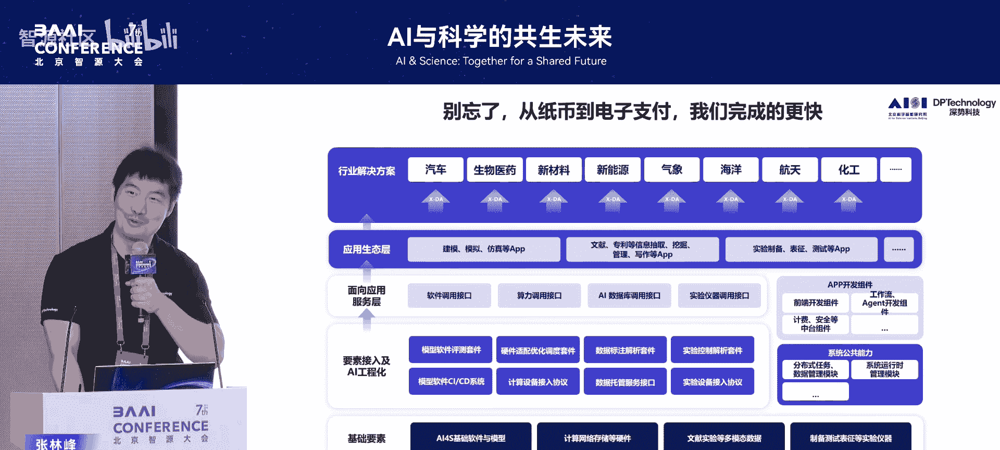

一页工作站或者说一个这个自动化测试就能够解决这样的问题。但是这些方面呢需要我们一个一个的去做好。那这些方面呢。

我想可能也是我们最近希望能够通过一个共建基础设施同时开源开放的方式来去推动AF science下一步的系统的落地。最后我想可能AF science，我想现在有很多的这个声音有很多的关注。但同时有很多的。

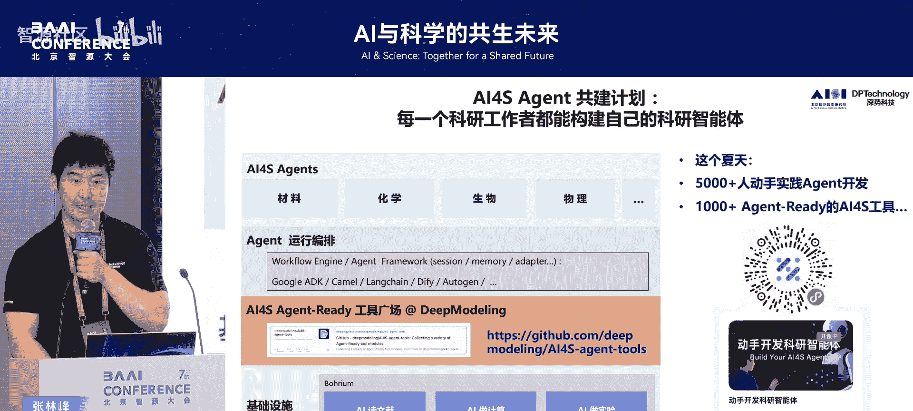

硬呃这个硬的瓶颈是要突破的，而突破完带来的一个最大的可能性就是研发。无论是科学研究还是工业研发的全面的转型升级和大科研时代的到来。好呃，我介绍到此结束，谢谢。请问现场有什么想要提问的吗？

我们有55分钟的是QA时间。嗯，好嘞。啊，没有。哎，你好啊，非常感谢你精彩的分享。我有一个问题，就是说像啊我们在训练或者是构建这种大模型的时候。

这个有2块就是data就是啊论文啊论文的copyright或者是这个数据呃，其他这个science的这个数据啊，这个一般如何去解决这个copyright或者是如何去收集，这个是第一个。

然后紧接着和这个和非常相关的，就是说我们在做你刚刚也说就是说呃similulator这个也是非常重要的那similulator的时候如何我们如何去确保这个similulator和真实世界呃，是一样的。

就谢谢。好第一个问题是这样的，就是我们其实很难去直接获得或者说呃分发版权的数据，这是需要被许可的。所以其实现在从AI的角度，恰好是读完一个paper之后，形成的知识型内容是可以被整合的。

正是说我们读完一个paper之后，能说他说点啥。然后所以说知识型数据是这个可以进一步的构建成为一个呃相应的这个产品也好，或者说一个dabase也好。同时呢这个产品假设说呃是面向所有人的。

那么我们可以索引到相应的paper，但是paper的相应paper的下载是不行的。下载和分发不行。所以这是为什么说最近其实呃有非常多的高效。

可能接下来会有更大一批全部的入驻了我们的平台所谓的入驻其就是你能搜到相应的文章的时候，你能够进一步的去这个就相应的学校的老师同学可以下载相应的PF来去进一步的构建自己的知识库智能体等等。

所以说这个部分是版权数据的一个当下的一个这个与AI结合过程中的一个这个解决方案吧。对，然后从更长期的角度上来讲，可能确实呃您刚说的第二个问题，这个模拟究竟能有多有用，确实是我们面临很多的这个挑战。

其实有一些非常正面的实现。比如说宏观世界的？现在已经很少说设计个飞机，你不通过模拟直接去造了对？然后微观的很多场景里面。😊，比如说一些像半导体精密的器件非常微观的时候。

反倒模拟能够比较准的去给出来一个预测。这些方面其实也不乏相应的这种正面的案例。但是就说如何让这样的一个正面的案例乘以10乘以100。

这个时候其实当下的AI技术可能能够带给我们的还是说因为过去数据的大模型积累的这样的一些AF大模型能够更好的跟数据结合，把这个模拟的知识先吃进来之后，实验的知识可能变成微调等等等等。

这样的一些策略下会有呃新的方案。其实我想可能现在很多的呃实际的策略也是在这个逻辑下去展开的。现场还有哪位想？嗯。哎，这边。好，那感谢我哎林峰，我也也有一个问题啊，就是当年咱们在网上聊过这事。

然后其实一一直也在思考啊，就是这个咱们在一直在说F chemistry其实整个行业一直在呃等待或者期待一个真正的through的一个一个案例能够justify整个领域整个行业的存在，它的商业价值。

那从这个角度去考虑你你你非非常非常有经验。就是你会觉得这样一个呃能够 justify这个行业的一个大through。

它会出现在呃一个什么样的形式出现是比如说没有I他就找不到这样一个IP一个非常点点上的IP的出现，带动一个比如比如说很大的市场，还是说他以一个更多平台的方式在各个环节上去对这个上面进行加速。

那可能就这个这个。问题。对。嗯，对，首先首先那个去呃这是一个很难的问题。然后呃我想我们的路线是一个参考。对，然后这个路线下我我会认为我们有很多的，首先第一还是全要素的整合，也就是独算做真正能够实现。

工程化对，就是我给我冲击最大的一个例子是我自己做MD。因为当时是我的博士一年级。然后大家觉得呃这个导师们都对我最开始拿写的这个呃de非常满意说你好好做吧。

接下来5年你的就做这个但是同期116年底1底的出的时候有orflow然后后来大师被拐跑了。然后说哎你拐跑之前留下一句名言说你必须得用tenorflow。当然现在没人用sorflow。

但是我就信了这个这句话，然后很显然现在这句话之后，一个月之后就可以毕业了。😊，因为为一个之后做完这个东西，而且是一个开源的，大家都用的。后来 to be这个开源大家都用的东西。

而且加速了我所在的这个组模拟16个量级。对然后换句话说有这样的ra没有这样 infrastructure区别是巨大的那 infrastructure是什么想打通这样一个 infrastructure需要解决的问题是什么？

那么无论是说从文献的角度还是计算还是说实验的角度。我想刚才所介绍的并不是解决方案，而是这些问题反正我们就需要解决解决完可能才有批量的这个可能性然后我们是在一个解决的过程中然后如果非要给一个timescale的话。

我觉得读的部分存量的就是这一两年做的部分如果说人形成是5到10年的话，那么。😊，实验室自动化一定比人体机电人快，就是3到5年。😊，然后批量的新发现，无论是化学反应生物，还是说生产级的。

比如说某个配方的快速研制，我相信在这样的一个新的structure下和现在是完全不一样的。当然这只是说说而已，对吧？就open eye。19年说TPT two的时候也没那么有底气嘛。好。😊，哦。

那个张老师哦，我有一个快速的问题呃，就是其实我没有做过特别多和F相关的工作。然后我比较好奇，就是像在AF里面和类似于大家用LM做reasoning这个他们就是独特的挑战。

或者是一些比较本质的区别什么或者说像样ing模型可以直接用在AF里面做推理这是个非常好的问题。其实我觉得呃刚才所说的第一步就是现在的大模型可能有两个地方是非常。有丰非常丰富实践的。第一个就是预训练。

对吧？然后预训练当然预训练的方式，以这个preding next word这是一个非常关键的事情等等等。第二个就是reaing。😊，嗯，对于AFs来预预训练部分，我刚才所说的是你需要多模态的感知能力。

才能把这个多模态的信息吸收进来，再去想，对吧？想一个化学问题，你脑子里如果没有分子，或者只有smells是和人想反正是不一样的。我不知道可一定行不行，但是我不太确定。然后假设第一步的感知能力解决之后。

第二步其实对于reing来说。至少在一个RL的s up底下，它的verifier是比较麻烦。也就是哎什么是 ground truth对吧？就是做数学证明的时候对或者不对，做代码的时候对或者不对。

是容易 verify。但这个分子分子合成靠不靠谱，你要不不合成，你不太知道。于是我刚才说这feedback in terms of这个通量效率和它的 qualityality是一个feedback loop的一个这个重要的因素。

于是你会发现有两种，一种就是feedback这这这三点做的好的和这三点做的不好的。做的不好的，你只能期待这个RL的magical的 generalization的能力。但是这个是或许有，但是可能更难见。

呃，更难见证。所以说很多的地方是卡在这种feedback。有些feback是需要专家，他长期上来说是一定会有的，但是短期内比较慢。所以呃可能从。reing的角度的话。

那我们就看这个feedback的set up是怎样的。对哦，好的，谢谢张老师。嗯，那么最后一个问题吧啊，感谢啊。那个我我想问一个问题，就是因为AF应该是一个比较庞大庞杂的一个世界。

那么在您的呃愿望里边或认知里边呃，绅世绅世科技他是一个什么样的角色，或者说您的对他的一个期待是什么？😊，呃，首首首先其实目前首先这是针对不同的发展阶段的。

我觉得当下最关键的是infrastructure呃，而 infrastructurefrastructure就的构建路线是我刚才所给出来的。然后甚至很难去说自己要构建这个inrastructure。

但是一定要推动整个 infrastructurefrastructure的构建，推动的方式是自己解决瓶颈问题。比如说标注以及我们整个社区能够真正把这个呃。问题能以开源开放的方式来去推动。包括绅士。

包括我所在的这个北京科学智能研究院，其实我觉得是在这这样的一个逻辑下去努力的。当然，如果说还希望做什么事情呢，一方面就是自己得真的在一两个方向内用新的范式真的去最后回答那个什么是大的act。

什么是让产业让这个science都呃变得不同的事情。这是要回答好的。但是更广泛的影响应该是apply到足够多的研发型的活动当中的研发型bo在science方面and在这个工业研发的里面。

