# 2025北京智源大会- AI与科学的共生未来 p05 Drug-the-Whole-Genome：后AlphaFold时代的AI药物研发：兰艳艳 -BV1NMNxzrENh_p5-

好的呃，非常感谢奇瑞的介绍，也很高兴。今天呃再次来到智援大会呃，见到很多老朋友也也认识了很多新朋友，还有很多网友见面。然后今天其实这个会场，我是很有感触的。因为早在19年包括21年的在这个会场上。

我们当时在做悟道大模型的时候，悟道2。0的发布，就在这个会场。当年的时候大家在讨论 language model啊，该怎么样做。然后会呈现一个什么样子的状态。当然还没有今天这么成熟的那个状态。

但是我想那会儿是一个让我们很骄傲振奋人心的时刻，就是我们中国的大模型的军团开始慢慢的成立了。所以今天也非常高兴的看到，我我在楼下的时候看到那么多具深智能的这个机器人。

我想我们这个作为中国的AI人是骄傲的。😊，所以呢再回到这个场地，我也就更加的骄傲。我觉得我们今天在谈论的是未来一个更加重要的事情，就是AF for science的这样的一个topic。

那我今天呢想啊希望带来一个具体的工作。然后我和我的课题组，其实从21年开始，我们从呃从事AF for science，尤其是for drug的这个方面的一些研究。

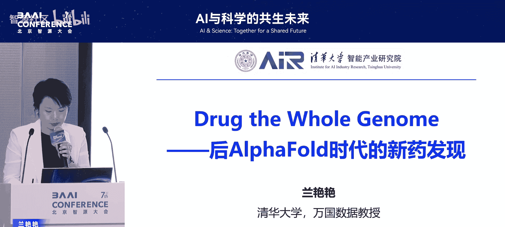

那么当当前我想我们今天讨论这个topic，大家都看到都有一个共识，就是AI会持续的在科学的领域发挥非常重要的价值。我们也期待。会引领一场新的科学的革命。那么其实我们清华A尔和智源呢是比较早的。

然后就致力于。专注这个领域的一些探索或者是研究。那我们在21年8月份的时候，A尔和支源成立了我们叫做健康计算联合研究中心。那目前我和启维是这个中心的联席的主任。那在这个中心里面，我们希望去。

面向生命科学和产业。大家在健康这一块的一些实际的需求。啊，我们致力于去发展新的人工智能的核心技术。那希望尤其是在呃健康医疗和新药研发，这样两个非常重要的领域去产生新的应用的技术和突破。

那通过过去几年的研究，我们也持续的在一些点上做了一些事情。那所以呢今天非常的高兴，然后带领呃代表我们这个联合计算中心，然后来发布我们叫drug clip这样的一个模型。😊，那他呢是面向药物研发的。

叫做药物虚拟筛选的这样的一个重要的步骤。我们把它叫做下一代大规模药物虚拟筛选引擎。那这个下一代体现在什么地方呢？首先从呃筛选的速度来讲。他比传统的方法速度提升了1的66次方倍。筛选的效果来看。

我们也刷新了多个标准数据及的性能的指标，并且完成了在多个靶点上面的是实验的验证。那我们这次发布也会把我们所获得的所有的这些数据免费的向全球开放。希望真正的赋能，我们先要研发这样的一个行业。

那下面我就来介绍一下我们为什么要做这个事情，我们怎么用AI来做的？然后他做完了之后能干什么？好，首先大家arefo应该是刚大家都有在说，它其实应该是说掀开了。

整个AF for science的一个非常重大的突破。同时我们也说开启了药物研发的一个新的时代。但是从结构像刚才这个呃frank讲的，从结构到功能是一个很难的事情。😊，从结构到药物的发现。

就是一个更长更难的这样的一件事情。但是阿给我们提供了一个巨大的可能。这个可能体现在什么地方呢？刚才林峰有讲到，对作要来讲，靶点的或者说正确的靶点的查找。和确认是一个很有挑战的一件事情。其实在今天。

对药物发现而言。如果我们有一个非常准确的靶点，我们用现在的这个手段虽然慢一点，但是药务研发这个问题早早的就解决掉了。那么我们怎么样能够说beyond我们现在的这些手段。

更大规模的、更快的覆盖更多可能性的靶点。就成为一个非常挑战性的问题。那ar的出现给我们提供了这个可能。为什么呢？我们在以往的人类基因组，或者是说我们crisr这样子的一些技术，已经让我们能够充分的探索。

疾病和靶点之间的一个关系。我们知道人类的致病基因总共就有2万多种，对吧？那而 food呢，他完成了一个很重要的事情，说我可以把所有的这些蛋白全部都预测了。当然我有可能得到的是不准确的结构。所以接下来。

对我们来讲，又是一个机会，又是一个挑战的地方。就是。我们能不能为所有的这些可能的8点？都能找到有用的分子或者有用的药物。这是我们想做的一件事情。当然我们在做这件事情的过程当中。

我们就发现事实上并不是我们并不是第一个提出来要干这件事情的人。但早在2001年的时候。这是基于结构的药物设计的两位先驱。就我们现在整个药物设计里面非常重要的基于结构的这种方式，就是由这两位科学家所提出。

并且发扬光大的那他们也是福泰公司的这个创始的这个团队。所以他们在2001年的时候就提出来了一个梦想或者一个愿景。这个院检叫做化学基因组学。那这个名字呢？他就是想说，我能不能对所有可能的8点。

都把可行的药物找到，所以跟我们想做的事情是完全一致的。但是经过了这么多年的发展。我们到了哪儿呢？我们到今天为止，仅仅以肿瘤这样的一个疾病为例子。其实我们也可能就只覆盖了40%左右而已。

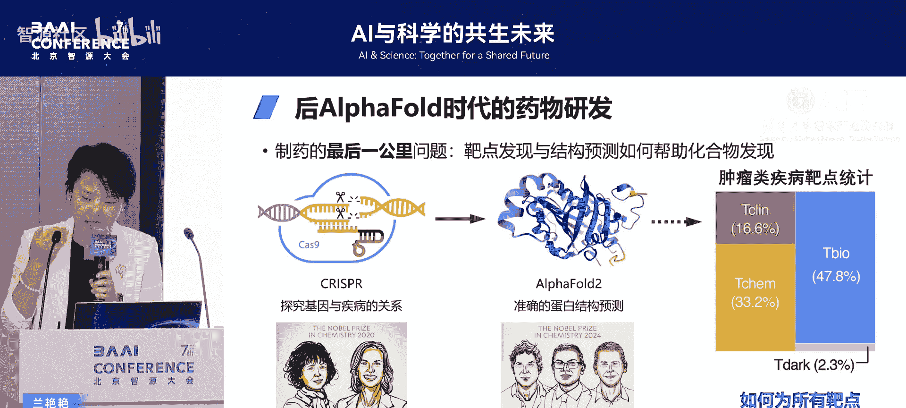

所以20年传统的工具来干这件事情是很困难的。所以这个时候。有可能有人会问，那为什么这么困难？我们在这个。虚拟筛选里面最常用的是分子对接的软件。那当前最大规模的一个筛选的。

他所使用的这个方法呢叫做wat flow。这是发表在nature的2020年上面的一篇paper。他完成了一个蛋白口袋，就只针对一个靶点的筛选。当是他筛选了11个小分子。用了1万个CPU的核心。

也要花整整两个周的时间才能完成这样的一个对接筛选的一个情况。所以我们要把2万个靶点所有的都筛选一次。大家可以想象是需要上百年的时间的。

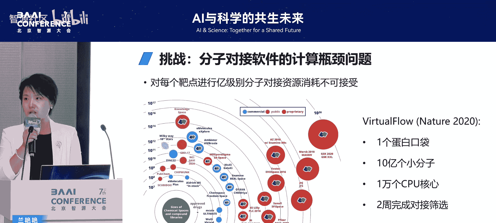

当然近年也开始不断的有深度学习的方案，甚至大模型的方案到这个问题上来去做，但是仍然不能满足我们的需求。为什么呢？要不然他就是要严重的依赖于3D的分子对接的构象。要不然就是。

我仍然需要大量的复杂的神经网络的计算，才能够获得这个结合能的一个预测。所以这样的挑战使得都不能够满足我们的需求。

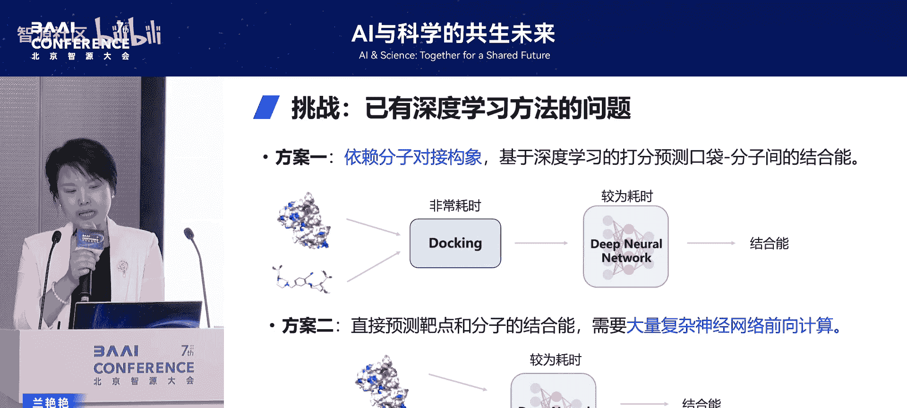

所以我们就提出来了叫做一个基于对比学习的方法。当然熟悉我们clip的方法，应该也知道大家为什么这个名字。叫做d clip，对吧？那我们在图文领域就有非常成功的经验。我们把蛋白和小分子表达到影空间里头。

我们在这个影空间里头用一种对比学习的方案去学什么样子的能结合什么样子的。

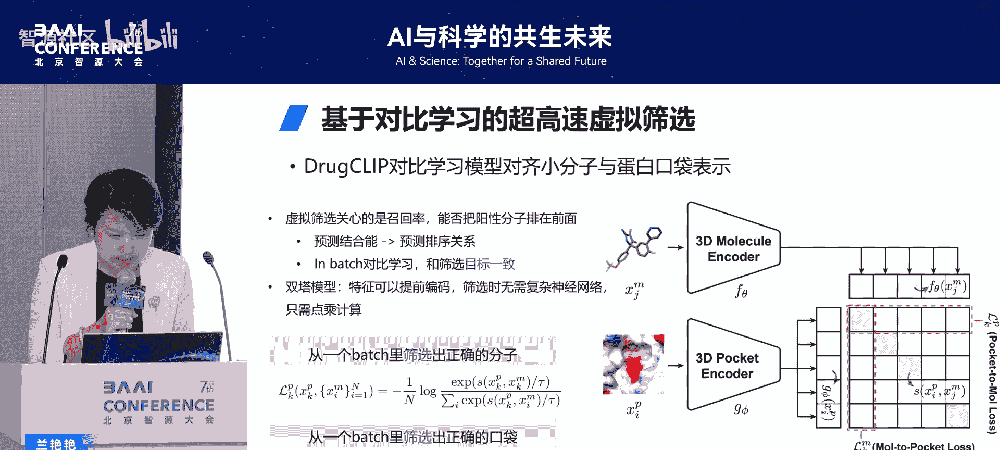

不能结合。当然，只干了这件事情，其实还不够。为什么呢？就刚才大家有谈到在要的这个领域，数据太少了。高质量的数据也太少了，所以很难学到你想要的东西。那在我们的方法里面，我们还提出了呃，基于合成数据的办法。

例如。我们想要蛋白和小分子的结合的这样的一些数据，很难拿到。但是我们可以从单纯的蛋白质的数据里面构建很多口袋和小分子的结合的这样的一些成对的数据。那虽然他的模式不一样，但它背后的物理的规律是非常相似的。

这样就可以使得我们在成mining的这样的合成数据上完成我们的训练的过程。

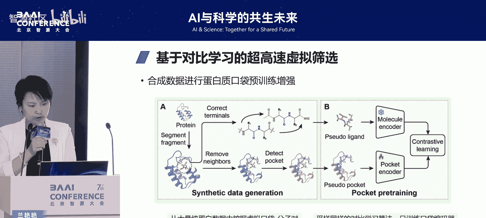

从而提高我们的方法的效果。那这个方法。由于他可以把我们所有关心的蛋白和小分子都表达在影空间里头，我就可以offline的在我大规模的集群上完成这样子的一个计算。从而使得我在提供筛选服务的时候。

一个非常快速的方式就可以完成筛选这样的一个步骤。

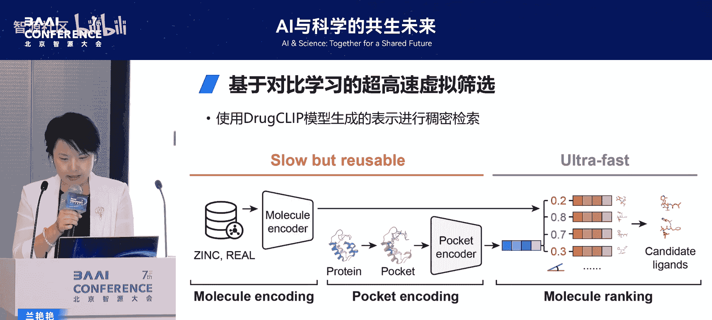

当然我我们来看一下这个速度。呃，我们跟传统的基对接的方法。和基于深度学习的方法来相比。大家可以看到这个筛选的速度都是一个大大提升的这是因为传统的方法是指数级的方式的提高。但是我们的方法随着数目的增多。

仍然保持一个线性级的这样的一个要求。

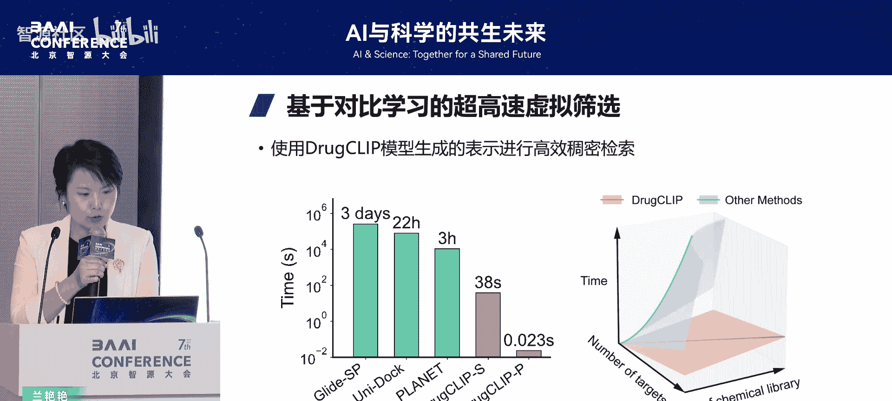

那具体而言。我们和传统的呃基于对接的GPU加速的方法，深度学习的方法，主动学习的方法来比较。

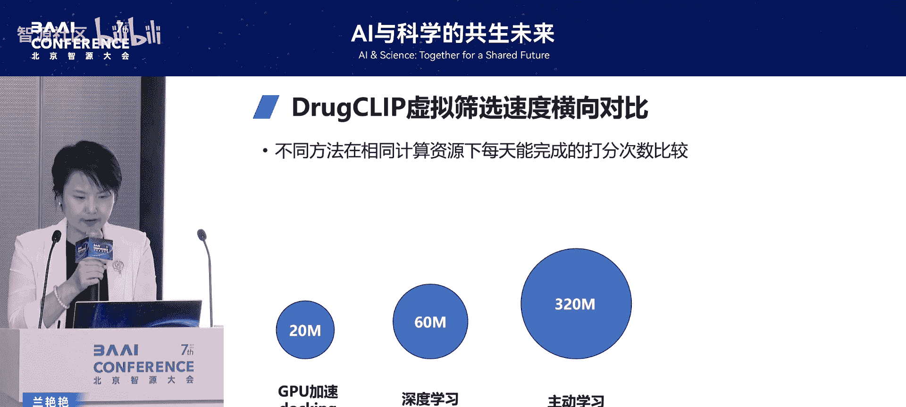

我们用同样子的计算资源能完成的打分的次数大约是十的60次方呃66次方。然后。

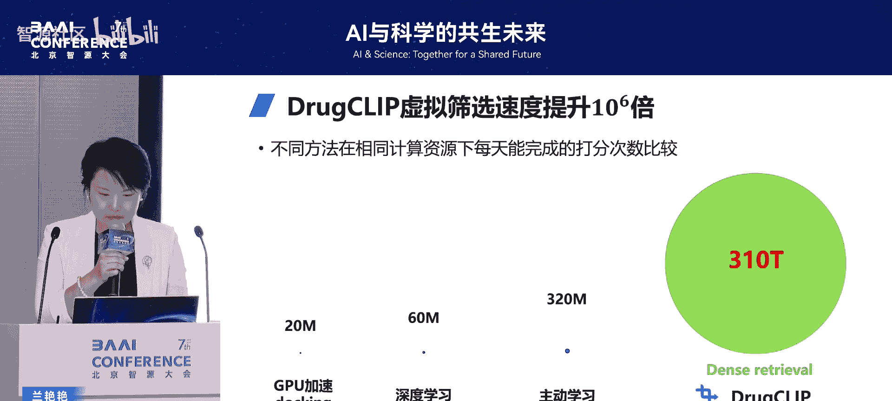

这样的一个加倍的这这样的一个对比。当然，速度快并不是我们这个唯一的一个要求，我们一定要要求它的精度。所以我们也在标准的药物筛选的benchmarkDUD和 PCCBA数据集上完成了评测。

我们也对比呃常用的商用的这个对接软件gide，然后和深度学习的方法，主要c都取得了更好的性能。

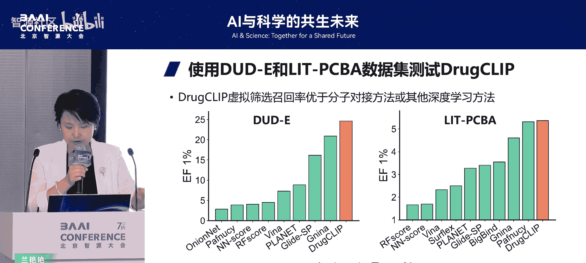

并且dug clip在很多noisy的靶点和新的靶点上。还有有一定的结构误差的这样的一些靶点上都取得了好的泛化性能。这使得我们可以充分的应对实际的需求。

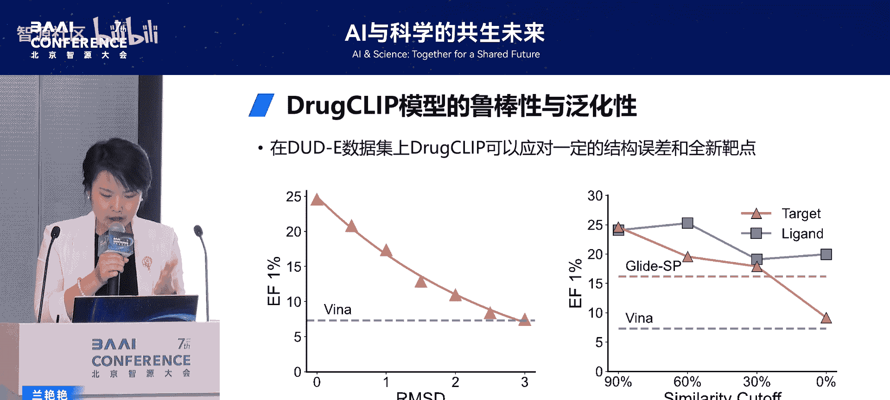

当然，我们只在benchmark上面的结果是远远说服不了我们的生命科学家，或者我们的药学家说我们产生了一个好用的工具。😊，所以我们也致力于在不同的靶点上和很多的团队来合作，来做了一些事实验的验证。例如。

我们在HT2A这样的一个呃精神病呃，非常重要的这样的一个靶点上。我们用我们的方法筛选了78个小分子，送去了呃，包括合成，还有是实验。我们以接近12%的呃hrate，然后获得了活性的化合物。同时呢。

大家也可以看到，其实一个虚筛的这个软件，它就能够筛选到施纳摩尔级这样的一个有高清和力的分子。

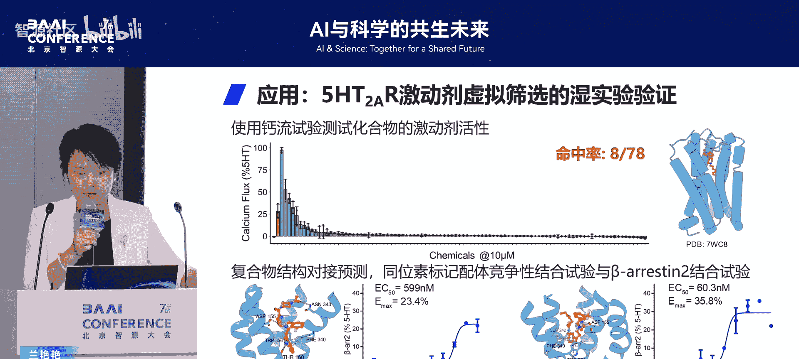

那另外呢，我们也和清华的闫创业老师的团队合作，在重要的呃抑郁症和多动症的靶点NET上面。我们筛选到15个高活性的小分子，并且有12个它的活性是超过了现有的药物安非他酮的。

那严老师的团队也帮助我们使用冷冻电竞，解析了复合物的结构。从结构上面我们可以充分的看到，我们筛选到的化化合物覆盖到了非常重要的这些相互作用的信息。当然刚才说到的这个还远远不能够满足我们刚才那个愿景。

我们因为对于阿尔 four的预测出来的结构来做虚拟筛选，事实上还是一个很大的问题。因为结构发生一点点的不准确。将会对传统的对接的方法或者深度学习的方法有很大的这种性能的下降。所以在我们的模型的基础上。

我们又提出来了一个叫做G pack的方法。那这个方法通过生成式小分子的办法，把它对测链和整个的结构符合物的结构进行进一步的。调整和优化。

从而可以帮助我们找到一个更精准的我们想要筛选的或者对接的这样的一个结构。

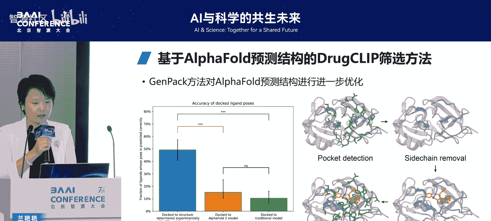

从实验结果也可以看到，用了我们的方法之后，能够把呃从这个准确度从19提高到38，大约是两倍的这样的一个一个状况。

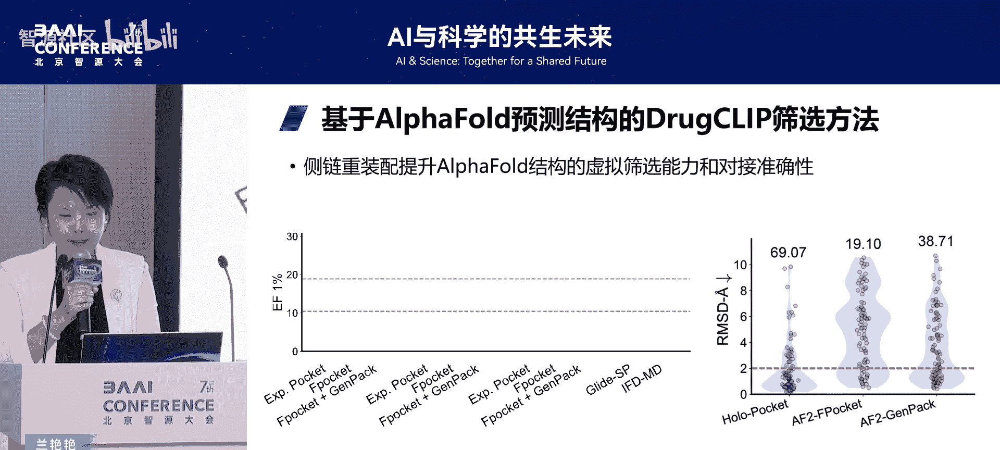

所以有了这样的一个方法之后，我们就可以真正的来看我们对阿的预测出来的结构。也就是说没有任何一个药企会做这样子的结构，或者我们人类历史上从来没有研究过的这样的一些靶点。我们能做的怎么样？

所以我们与清华的刘磊教授的团队，然后我们做了一个叫做基于tri12这个靶点。的一个虚拟筛选。那这个靶点它的重要性在于，首先他自己就是肿瘤当中非常重要的一个通路。其次呢它是1个一3的泛素画眉。

那大家可能对这个名词稍微有点陌生啊，在我们计算机的这个会上。但是如果一说这个protect或者一说分子胶这种新的这个药物治疗的方式，大家可能就非常的熟悉。他就是要用到这个泛素化酶这样的一个重要的载体啊。

去把这个靶点和小分子拉近在一起。但是事实上，在这方面的一一个重要的研究难点就是没有结构，没有精准的结构，导致我们只能使用er的预测出来的结构来进行筛选。所以这恰恰是我们的方法所擅长的。

所以呢我们以呃这个h rate超过了17。5%，筛选到了呃有多个有活性的小分子，其中有两个活性在1微模，也通过各种不同的这个荧光的实验。然后其他的下游的化学实验。

去验证了我们的分子对于我们的靶点的有效的抑制作用。好，在刚才讲到的所有的这些技术里面，我们终于说从我们的试试验也能看到我们的算法的有效性了。于是我们就致力于希望做一个全基因组的药物虚拟筛选。

我们把2万个刚才说到的人类致病的这个基因全部都拿出来，用Rfo预测了一下它的它的结构。那预测这个结构之后呢，大约有1万多个，它是知信度比较高的。因为有很多柔性的地方。我们在一个5一的小分子的库上面。

用我们的方法完成了这样的一个筛选的过程。那这应该是当前呃目前我们最大的一个虚拟筛选的呃规模了，因为他超过了10万亿次的打分。那对比我们人类目前已知的知识，我们在cbo上有众多我们以往的这些知识而言的话。

其实我们会覆盖了非常多。我们人类从来没有研究过的靶点，或者没有研究过的family或者有的family当中很难研究的靶点。而且非常 amazing的一件事情。

这是我觉得AF scienceence非常重要的一个价值就是。😊，这么大的一件事情。但事实上我们的计算资源需求的是很少的。我们在巴卡的这个服务器上，一天内的这个时间就可以完成全部的一个检索的过程。好。

所以我们也在今天郑重的，然后把我们的这个数据库免费的来进行发布，并且我们还开放了这个在线的这个服务。也就是说，如果有药企或者实验室，然后想要自己定制他们的分子库，或者定制他的蛋白的靶点的话。

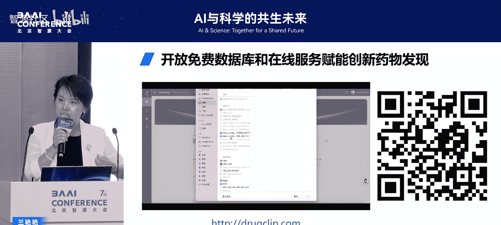

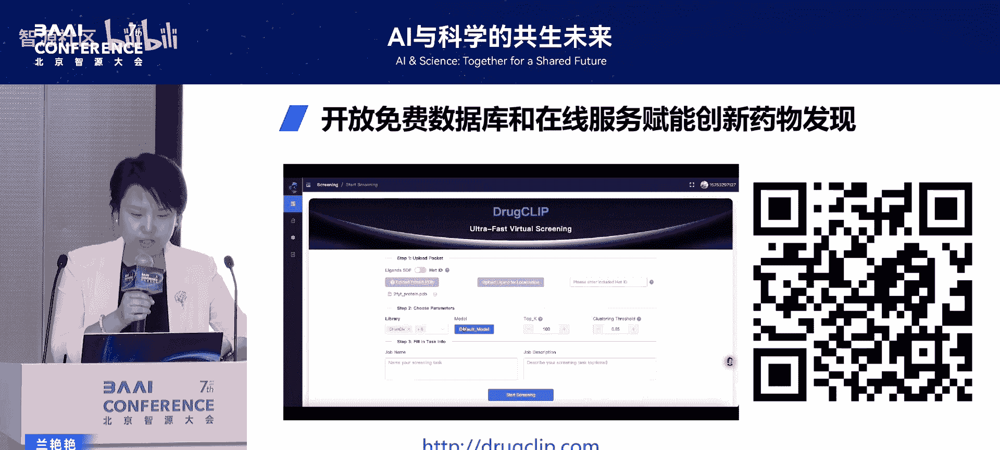

都可以在我们这个系统上面非常快速的完成。在任务提交之后，我们的系统。还能够支持对小分子的可视化，然后对蛋白与小分子的结合作用的可视化以及对接的对比。

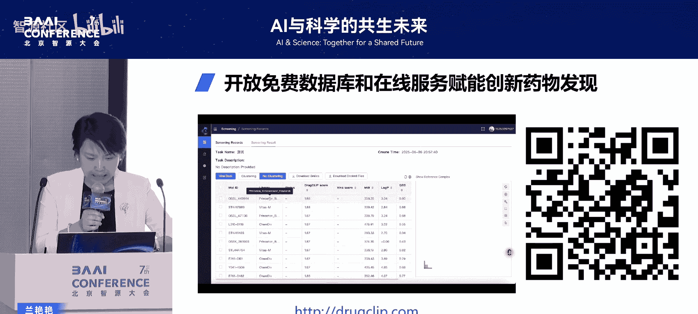

方便药呃药化的专家来更好的来看筛选的这些结果或者未来的改造的空间。那我们也很希望通过这种免费的呃在线服务的方式，能够更好的赋能。

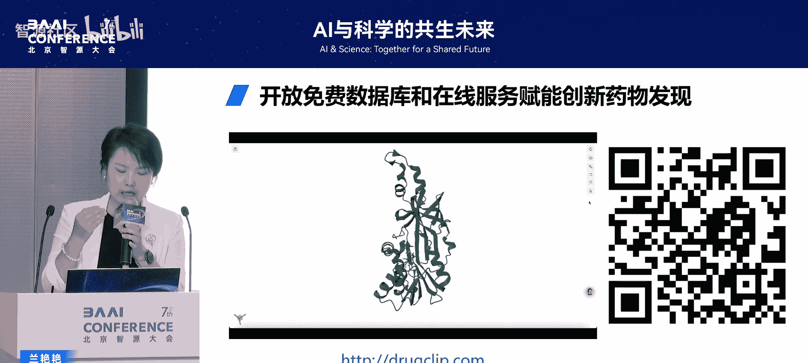

好，所以这里面我们已经看到了很多啊非常非常有趣的一些例子啊。例如说这个这是这是从我们这个完全就是这个数据库里面，然后我们挑出来的一些比较好玩的case，可以给大家简单的介绍一下。例如我们会看到。

首先GNK3呢，它是一个非常常见的激酶的靶点。就是激酶是我们我们最常见的一类靶点的这个类型。那拿我们的这个。数据库的结果，我们就可以看到我们在GNK3的这个靶点上面，我们会筛选到很多的小分子。

他确实会具备了呃激酶当中很熟悉的或者是化学家很想要的这样的一些相互作用。或者再举这个SLC这样的一个例子。它是一个美白相关的8点。在这个板脸上还没有这个可行的这个药物，我们也跟相关的团队正在合作。

这个strain也是肿瘤里面非常非常重要的一个靶点，也是还没有结构，还没有药物。所以这里面有很多可以探索的空间啊。好，那我就简单的呃介绍一下这个未来我们想要做的事情。

刚才其实无论是从一开始铁岩跟这个frank的discussion，还是林峰的这个对话里面。我们都有说到，就是AF for size。可能经过了几年的发展，我们都看到在很多的点上面也产生了一些突破。

也有一些作用，或者我我们也能够产生一些对行业有价值的这样的一些工具，对吧？但可能大家都想问。就是我对药这个问题能不能或者什么时候能够真的解决，真的有价值。但虽然我想这个问题是很难回答的。

但是我会持续的看到我们的技术是在向前发展的。那么例如说对于我们的dr clip而言，我觉得后续有三个非常重要的方向是可以去发展，让我们更加的逼近。AI能够找到好的药物或者产生好的药物的这样的一个过程。

例如说。这是我们最近在做的一项工作啊，就是airfo其实出来之后有很多大家非常的关心啊。😊，因为R做的是一个结构预测的问题，对吧？但他具对要的这样的一件事情呢，比如说我想做筛选，我想做生成。

它还是非常不一样的这样的一些目标。但是R three又学到了很多的knowledge，学到了很多结合的patter。😊，所以他就有点像我们在大语言模型一样，他刻画了很多语言的知识。

但是这些语言的知识能不能有用？怎么用是一个非常重要的问题。那这是我们会关心的重要cl的下一步。我们最近的一个工作，我们也是基于R food出来的这个paed的reation。我们在这个后面。

可以给他加不同的这个训练的方式。例如。我们可以拿cambo这种蛋白和小分子的结合的这样的一些数据来进行训练。或者我们来进行这个有竞争性的训练。我们会发现。

那这样子我们排出来的这样的一个结果是非常接近于FEP的FEP是什么意思呢？FEP可以认为是。在药物发现的这个领域，非常精准的一种物理的办法，它可以实现小分子活性的一个很好的排序。

当是他的问题就是跑的太慢了，我们很难拿它来对一个大规模的进行一个筛选。所以是否能产生1个AI的model，能够接近，甚至能超过FAPP。我想这是很多这个AF for drug的人的一个梦想或者一个想法。

但是我们已经看到这件事情很近了啊，我我我在想啊，就通过刚才大家讲到reasoning，它很像reasoning的一个过程。那通过更好的这种reasoning model的design。

可能未来这个事情很快就会得到一个解决。第二件事情就是大模型它的出现，它的价值。是因为我们有数据的scaling law或者我们有这个primeter的scaling law，对吧？

那么在虚拟筛选的这个领域。也是一样的。我刚才有说我们d clip做到了5亿个小分子。那nature的这个watert flow做了11亿个小分子。但是他是单拔点的，但是他筛选的数据库是要更大的。那么。

能不能用AI的办法穷尽我们当前所有的可合成的化合物？我们来探索一下。我们在这个领域的边界在哪里？我们能不能找到一些可能不一样的一些东西，我觉得这是非常有意思的一个问题。所以呢从我们d clip开始。

其实已经具备了这样的一个能力。我们目前正在跟大米合作来探索这个千亿甚至万亿的小分子库。我们希望在这个过程当中能够获得虚拟筛选的一个s low，能真正的发现一些有价值的东西。

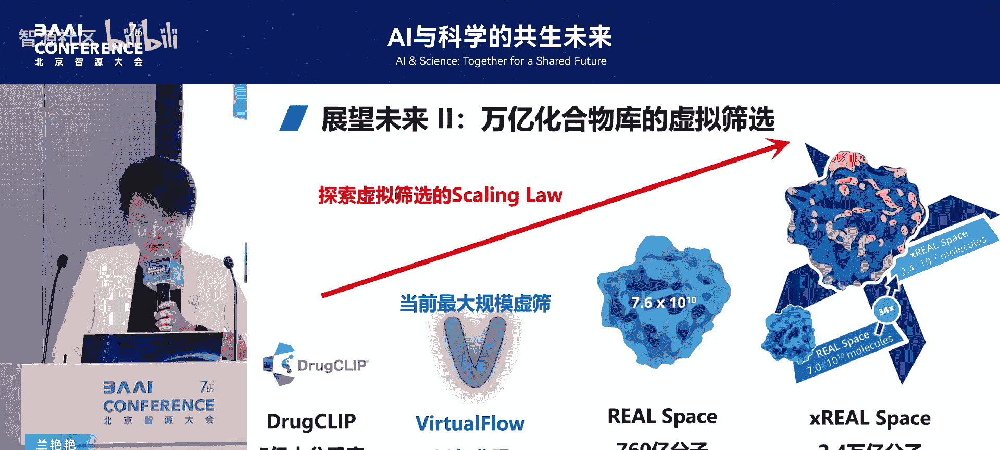

第三个，这这是我最感兴趣的一件事情。当然我们正在做，刚才林峰讲，我非常的同意就是。😊，AI for science单独拷AI行不行？我我也是非常认同那是我我认为是不行的。呃。

我们一定是要跟这个或者试实验或者某种模拟试实验的方式，那个模拟试实验的方式也可以是AI哦。但也就是说我们一定是要把数据驱动的这套方案。和我们现实世界的反馈连接在一起。我们都是可能在座有很多人搞计算机。

搞AI搞互联网的。我想大家对于这个系统性的思维很清晰。比如说我们一个搜索引擎，我们一个chGPT。这个系统什么就这个技术还是那个技术，但是他什么时候真正的能达到可用？能产生拆GPT的那个moment。

是因为我们能够很容易的收集到用户的反馈。s认当他可以在线使用的时候，拆GBT当他有大量的用户在使用deep sick当有大量的用户反馈来继续improve的时候。

那这个应用的那个成熟了moment是到了，所以AF size也是一样的。即使我们现在有很好的AI的办法来探索数学呃数据里面的这个规律。但事实上。我们距离实际的人体的场景到底是什么样子？太远了。

所以如果我们要真的去呃改进。药物研发的一个效率或者一个成功率。我们一定要做的一件事情就是要把实实验，要把临床阶段的很多的考虑，很多的数据。拿到前面去。

要跟我们的AR的 modelel共同来形成一个circle来来来共同的发展。所以我我也很高兴看到我们d要c事实上是可以来做这样的一个探索的。怎么来做呢？😊，例如我们现在已经有很多很多的主学数据。

有很多很多的文献数据。那过去的十年，在这个里面，其实积累了大量的生物信息学的方法。即使不是我们AI的方法。他们能够帮我们找到很多potential的 target。

那在这些potential target的基础上。人们以前没有办法对这么多的靶点来完成一个发现。但是今天我们有了d clip。我们可以对每一个靶点都在所有的这个数据库上完成一个筛选。

形成一个定制化的library。这个定制化拉尔有什么好处？我可能只形成了100个或者是1000个小分子库。那形成了这个之后。我就可以来采用类似于现在的类器官或者是器官芯片，或者是各种表型筛选的。

更接近我们人体的这样的一些工具去产生反馈。而且更重要的是，这个反馈的结果不仅仅只是帮助我找到了活性的小分子，它可以通过drug clip当中靶点和小分子的打分。

帮助我们有可能能从那么多potentialtt里面来找到新的tart。那我想一旦找到新的targe，这是我们最大的价值。那后续我们要做noble的 designign。

我们用任何的方法都可以用AI的方法也可以，可能用现在的方法也是可以的。

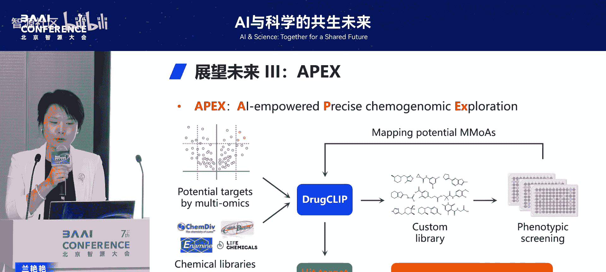

啊，所以这是我今天的介绍。然后也非常感谢呃，在这个项目团队当中的核心成员，我的学生高博文、贾颖军、谭海川、红星、朱文玉以及我们的合作伙伴。还有呃清华A尔和智源健康计算联合研究中心的呃管委会的老师们。

还有要感谢智源人工智能研究院对呃我们中心和这个项目的大力的支持。😊。

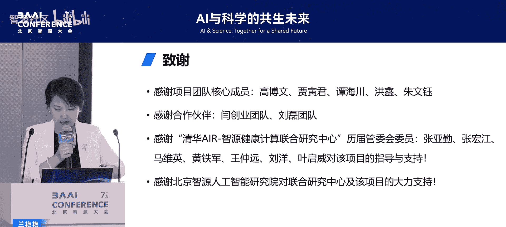

那我们也非常的希望啊，在今天这个发布之后，有所有对AF drug discovery或者是d clip非常感兴趣的老师和同学，可以跟我们来共同，大家一起来探讨。

我们是不是能够产生1个AI赋能药物发现的一种新的方式，或者是新的路径。好，我就讲到这里，谢谢。

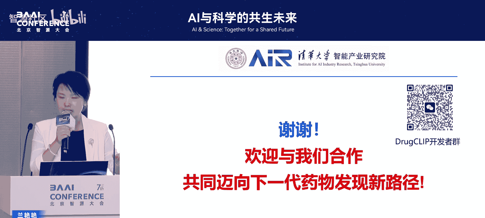

好的，谢谢谢蓝老师的这个精彩演讲。然后我们时间有限，我们就在现场接受一位提问吧。😊，谢谢老师啊。我想请问一下，就是呃呃像一些不可成药的一些靶点啊，比如说像这个P53啊，然后这种。

然后用您的这个呃您是在虚拟筛选上方面有一些进步啊，然后在这方面这个能不能够解决。然后第二个就是目前来I辅助的药物设计，不管是过去的像个最早采用了这个分子势能自由能。然后到现在这个引入。

还有虚拟虚拟分子库啊，目前来说全世界没有这个临床三期取得成功并且上市这样一个药物。很多在实验室阶段这个AI这个模拟数据非常好表现非常出色的分子进入临床阶段都都不断的啊。

然后这个您对这行业的未来是怎么看的啊。😊，好的，谢谢您的问题啊。第一个问题。😊，南成药的这件事情，我想每一个模型一定是有它的局限性的。对主要c我觉得这么看的。如果是它在一个合适的小分子的口袋的结构上。

那，他是可以来做的。即使这个结构可能现在还不太准。例如我们刚才看到的有噪声或者预测不准，甚至是apple的情况，这些可以称之为一种类型的难成药吧。那d clip它是可以解决的。

但是你刚才说到的另外一种难成药，比如说它就是一个非常平缓的这样的一个结构或者类似的那那可能d现在无能为力。但是我们可以用刚才我讲到的tri12的那个例子。

d可以在分子胶或者是protect里面发挥一些作用。那显然这些新的技术是完全的target到南成药的这样的一些靶点上。啊，第二个问题。呃，这也是就是呃我经常会被问到的一个问题啊。因为AIDD的这个行业。

大家会看到大家既抱有希望啊，大家又又很多时候产生了失望，对吧？就像你刚才讲到的。但我个人是这样的，我对这个技术是抱有充分的热情和希望。

我觉得这一定是解决AI呃解决drug discovery的一个必行之路。为什么呢？因为我们传统的方式我们传统做药的方式，我们传统的依赖于科学家来做当前科学发现的这样的一个模式。

他的局限性是没有办法被改变，或者没有办法快速的进行加速的。所以我们想要完成在要的这个我把它叫做呃叫做这个science里面的圣杯级的这样的一个问题啊，就是这么复杂的一个场景。他要考虑到生物学的问题。

化学键的结合的问题，还有安全性等等很多的这么复杂的一些问题。其实我们我们有可能只能依赖于AI。我认为它不是一个most important的。

可能是一个甚至唯一我们能够有期望快速的改变这样的一个行业的一条路径。当然我们只是看到现在的AI的模型还没那么好。事实上大家来讲AIDD这件事情没有几年嘛。但是所以我一定是呼吁。

就是这个这个技术的成长是需要时间的。😊，而且这也是AI for science里面，大家经常会会讲到的一件事情。AF for science绝对不是现在in general的 AI的方法。

直接应用到这个领域就就OK的那如果是这样太简单了。他其实有很多自己的问题没有解决，有很多自己的特点需要考虑。这也是为什么我们要特别的design这个领域当中的PT是什么？这个领域当中的deep是什么。

怎么样能让他发挥作用。所以我特别的呼吁，就是大家要给这个这个技术的成长一些时间。当然同时你刚才提到的特别好，就是我们看到的临床123期很多的数据。即使我们现在很多AIDD的方法还是在早期发现的阶段。

但是下一步。我们是需要把临床阶段的很多的数据，很多的建模融合进来，完成一个呃，这样我们才有可能会完成一个闭环吧。好，谢谢。

