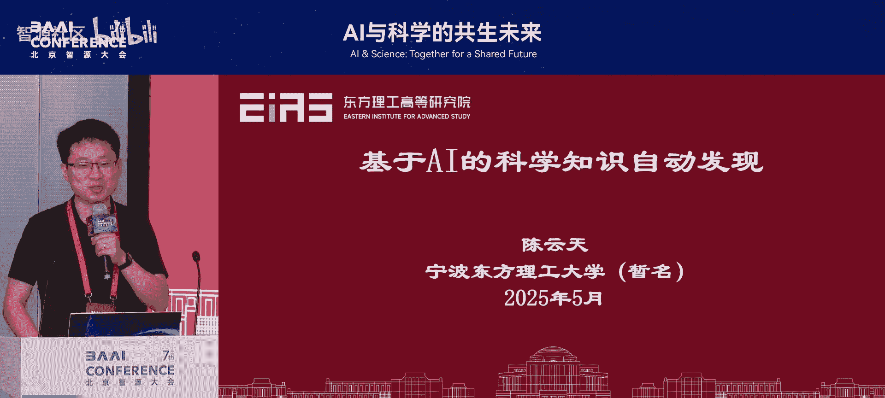
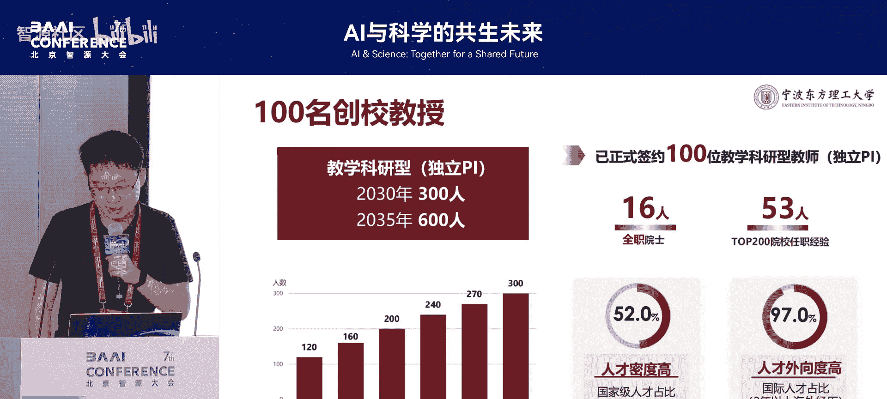
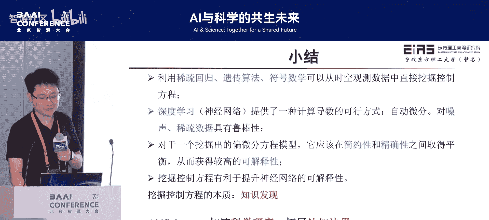

# 2025北京智源大会- AI与科学的共生未来 p06 基于人工智能的科学知识自动发现：陈云天 -BV1NMNxzrENh_p6-

啊，非常荣幸啊，能有机会在这里给。呃，给大家进行这个介绍。我今天报告题目呢是基于AI的科学知识自动发现。那在整个报告开始之前呢，我先简单用一分钟讲一下我们学校。

因为我估计大部分人可能都没有听说过这个这个东方理工，他是个非常新的学校。这是我们学校一个照片了。这个东方理工呢是咱们这个国内新片界的首富于云荣先生，然后自己捐了呃几百个亿成立的一所新的大学。

然后刚刚这个建校三年不到吧。呃，目前一共有100名这个PI就是全都是全职的呃老师。然后呢，其中有16名是全职的发达国家院士。然后这个现在目前超过一半的人都是国家级人才。然后呃目前这是部分老师的名单。

我就不展开了。然后目前的话就是每年教育部特批招200名200多名博士呃，今年年底在校生就会达到400多人，大概是这么一个情况。呃，一个比较新的一个学校，也希望大家以后多多支持。😊。

好，那我讲一些我今天的这个呃正式的内容。那我其实做的这些研究呢，一直都是在做一件事情，就是怎么把这个领域知识啊，一些物理啊、化学这些知识跟这种人工智能的方法进行融合。呃，其其实包含两部分了。

一个是从左到右，左边的那个绿色的是这个领域知识的空间，包括控制方程啊不变性啊等等。右边的呢是这些AI的一些技术，对吧？各种各样的AI模型。那么从左到右的这个箭头呢，也就是我们常说的这种知识嵌入。

就是比如构建一些具有物理常识的AI模型，让它能够有更准确或者更可靠，对吧？那我今天讲的呢，其实是反过来是从右向左，就是下面那个绿色箭头，它做的是什么呢？是从观测数据中去提炼物理知识。

有时候我用AI的方法自动的去里面去找这个背后的比如控制方程啊，是什么东西来推进这个人类的认知。然后他用的场景有很多了，包括一些新的原理发现可解释性、反问题、仿真模拟等等。😊。

那么这是我整个研究一个大架构。但由于时间原因，我今天只讲啊从右到左的这个绿色的箭头。好，那我们为什么做这个事情，对吧？这个这个motivation到底是什么？其实这么一页就可以给大家讲清楚。

就是一个简单的科学小故事吧。我们知道说这个以前读高中历史的时候，讲这个科技史，然后有说这个地谷，对吧？地谷在这个16世纪，他观测了几十年这个火星运行的轨道数据，这火星到底每天晚上他看到底在哪。

然后他想去总结出一些规律，但很遗憾他去世之前，他也没有总结出来，所以他就把这些数据传给了自己的学生开普勒开普勒在地谷去世之后继续这个研究，用了18年的时间，纯粹去凑凑出来了这个行星运行的三定律。

包括什么椭圆轨道啊等等的这些这些方程，在这个基础上才有了牛顿去这个推导公式推出来了万有引力。所以一般虽然说牛顿在苹果树下被苹果砸了一下脑袋，他想啊有可能有引力这么一个东西，对吧？

但是他这个公式肯定不是说牛顿在树底下被砸了几万次。然后他去看不同的苹果大小和他脑袋的这个。😊，疼痛的感觉，然后去算出这个Y引力的公式是什么样。它不是的，他是推出来的。

所以这就是对应的两种比较常见的这个科学发现的方法，一种是归纳总结，一种是演绎推理。我们希望用人工智能把第一个环节归纳总结给加速。因为人工智能很擅长这个。而我们人其实不擅长这个。一旦这个数据的维度。

比如说在四维5维或者更高维度，然后非线性的强这个也变得更强的时候，我们人脑实际上是处理不了了。但是人工智能是有可能做这件事情的，这就是我们的一个大的motivation。😊，所以从本质上讲。

这个问题就非常的清晰。就是说如果我们能够看到这个数据的这个情况，数据的分布，一个观测数据，比如长这个样子，我们有没有可能把它背后的控制方程，比如这是一个波动问题，那它背后的这个控制方程我给找出来。

其实就做这么一个事情。😊，如果能做这件事情的话呢，其实也在人工智能角度来讲，也是一种可解释性。为什么呢？大家想我们一般都说人工智能在解决很多科学问题的时候，它的缺陷在于什么？在于黑箱，对吧？

但如果我们把这么一个黑箱，比如一个神经网络，它的输入和输出啊，直接拿出来。然后我们去找方程，我们找到了一个方程。那这意味着什么呢？意味着我们就把一个黑箱的神经网络找到了一个数学的方程形式的替代模型。

一个sgate model，对吧？他们其实是等价的。😊，那如果是这样子的话，我们其实从某种意义上讲，就对这个黑箱进行了可解释性。对吧所以这个本质上来讲，它也是一种可解释性的方法。

这个领域有非常多的技术了，这个我就不展开了。呃，我们当时在上挂了一个简单的一个小的总结吧，里面有这个介绍。但是呢我想说的是什么呢？是这个问题大概可以分为两个维度的困难，一个维度是方程结构的复杂性吧？

你代数方程常微分方程偏分方程，你的方程本身可以变得越来越复杂，然后另外一个维度呢，纵坐标这个维度呢是方程系方程系数的复杂度，比如说你可以是常数对吧？你也可以是一些可以数学表达的系数，什么意思呢？

比如说sinesine对吧？你用一个方程来表示它这个里面的系数怎么变它还有一种更复杂的场景是什么？是无法数学表达的。比如举个例子，D底下这个地下水或者污染物的运移，这个地下渗流问题，它符合达系定律对吧？

达西定律里面的系数是什么？是那个KK是什么？是渗透率场渗透率场在处理的时候，一般把它视为一个。😊，二维或者三维的随机场，你没法把它写出来一个方程，它就是一个随机分布的一个场。那像这种东西。

它是个更复杂的一个系数。所以就是说。😊，这两个维度，一个是结构的复杂度，一个是系数的复杂度。从这两个维度就可以去描述了各种各样的这种找方程的一个问题。这个领域其实早期有很多研究了。

然后这个呃大概0506年就有一方一些这方面的工作，也发了一些非常不错的像pe啊或者是这些期刊，呃，他们当时的方法是什么呢？说我找方程，那好，我写一个候选集，对吧？你比如说我方程比如偏分。

它就是一级导数二级导数三级导数，正你就你就把常见的都给给出来嘛，平方立方都给出来，然后候选集大概有二三十项，然后在里面做析数回归对？就是你你找这些候选集能拼出来的方程我一定能找到。

就是早期的这些研究都是用这个思路去做的效果也不错。但是呢这个这一类方法有一个很大的问题，就是说他要求你的候选集里面包含的所有函数项啊。

就是你最后要找的那个方程里面就是所有的出现的项在那个候选集里要有这就一个什么问题。就是如果我们能够给出这个候选集，其实这方程我们是知道的，对不对？你去你去便利，你去凑也能凑出来。😊。

如果我们是真的想找一个我们不知道的方程，比如一个未知的物理过程，化学过程的方程，你也写不出这个候选集来呀，对不对？所以这就导致所有能找的能解决的问题，都是我们已经知道的问题。

所以我们不知道的问题我们也解不出来，这个这个变成没有意义的一个屠龙之树了。所以这个领域就陷入了一个瓶颈。😊，但后来呢随着领域的发展，这个逐渐又出来了两种新的方法。呃，第一种方法。我先看一下最左边的A吧。

左上角的A，这就是我刚才提到的这种稀数候选集的方法，就是你你给一个候选级蓝色的范围里面有各种各样的函数项，反正只要这些项能组合出来的，我就稀数回归就就可以了，领回归也可以无所谓。然后这个B这一类的话呢。

就是后来的演化出有一些遗传方法。就比如说我有一级导数，那我有二级导数，那他俩一组合三阶导数就出来了，对吧？我有平方项，我有一阶导数，它俩一组合平方乘一阶导数的这个交互项就出来了。

所以理论上讲就是通过遗传算法是可以就是把每一个方程项当做一个基因片段来处理的话，其实是可以实现这个后选集的扩充的，而且是理论上是可以扩充到无穷大，对吧？你你你比如接数你就可以无穷维嘛。

呃所以当时呢就带来了很大的一个改进，也解决了一些问题。😊，不过呢这一类方法还是有一个局限，就是说大家想它其实处理不了复杂的结构，比如说我一个复合函数的求导，对吧？我一个复合函数，它求导你怎么办？

然后比如说我这个这个这个这个这个分式结构怎么办？比如年轻重力的方程是分式结构，对吧？比如说这个答系定律，它其实是个复合函数求导，这些方法这这些方程其实你是不可能找到的。所以就有了第三类方法。

就是基于符号数学去做。那它的特点在于什么呢？在于我只需要去给定你的运算符号和运算对象，你比如说我运算的对象就是XVXYZUVWHP等等这些物理量。然后呢，我的这个运算的符号呢。

就比如加减乘除偏导什么这个ssine，然后平方立方，对吧？就是只要你定下来这些东西，这些东西不变。那理论上讲，只要是这些符号和对象能够组出来的数学上可行的方程，它就都能找我后面会讲这个具体怎么做。😊。

做的就是他这是一种符号数据的方法去做。所以呢就是呃这就是刚才我讲了一下他的一个大的背景。那么我个人对这个问题的看法是这样。就是如果我们想去找方程，其实里面最核心的就是两个问题，一个叫做表示。

一个叫做优化。为什么这么说呢？大大家想我们让AI自己去找数据背后的方程。那首先AI得理解方程，但是比如我们写一个偏方程，写个常文方程，我给到AI去并不知道这是什么，对吧？计算机它没法很好的处理这个东西。

所以我们首先要解决一个表示的问题，就是我们怎么样能够把方程转化成一个AI善于处理的表示形式。这就像我们很多做比如生物医药等等这些方面的时候，你首先你那个分子结构，你得让AI能处理，对吧？😊。

这是表示的问题。第二就是优化。当我们找到了一个表示方法的时候，我们怎么去呃用一种优化的方法找到一个最好的表示。这个表示能够符合我的观测数据的数据分布，对吧？这样的话，我们就把这个问题解决了。所以呢。呃。

符号数学的方法就是说它的背后的核心逻辑就是把它转化成一个二叉数。因为二叉数本身啊是这个呃计算机非常善于处理的一种一种这个表示形式。所以呢刚才我们这个问题就是从这个观测数据怎么找背后的方程。

其实转化成了什么呢？转化成了第一，我们任何一个方程其实都等价于一个二叉数。我后面会讲怎么做的这个事情。然后呢，我们的这是表示优化的话，就是我们可以用各种方法遗传算法强化学习啊。

甚至一些大模型的一些这个方法都可以。然后呢让他去找到一个二叉数。这个二叉数或者说一组二叉数能够最好的描述了我的观测数据，然后再把这组二叉数转化成一个方程，这事就解决了。是吧？😊。

所以这就是这张图其实比较核心，就是说表示和优化这两个问题只要解决了，那我们就能通过二叉树为桥梁，把方程跟数据分布建立起联系。那怎么做呢？我们看这个首先说表示的问题，我先给一个大家结论。

就是右下角的那个方程偏U偏X加上U的平方的整体偏X，它是个负函数修导这玩意儿它跟中间的这个二叉数是完全等价的。😊，啊，我为什么呢？我们可以看啊，我们先定义一下二叉树，就是一个二叉树。

我们认为它所有的叶子节点，就这些白色的圆圈必须是运算的对象。比如UVWXYZ对吧？就这些你的这些物理量化学量这些东西。😊，所有的中间有颜色的节点都是运算的符号，加减乘除偏导这一类符号有两种。

一类是这个意元运算符。比如说呃平方立方sine cosine什么意思啊，就是他自己跟自己能玩，对吧？就是这个这个意元运算符，还有一些是二元运算符，就是说比如偏导一定是谁偏谁对吧？你缺一不可。

你不能说我偏导只有一个对象，那这这东西不成立在数学上，那只要定下来这个就好办了。好，我们现在看一下啊，我们现在我我现在就给大家讲，这为什么跟右下角那个方程是对应的。

我们先看这个中间的这个数最上面咱们从这个根节点开始，我们用前序遍利，前序遍利其实就是红色的这个箭头，让每一个节点被经历过一次，而且每个节点都可以被经历。

那我们前序遍利去看最开始的第一个是什么是偏导绿色的偏导对吧？偏导是什么？偏导是个二元运算符，所以我们需要有两个运算对象，那我们就沿着红色箭头往下走是什么？是橙色的加号，对吧？😊。

加号这个符号可以被偏导处理吗？那肯定不行啊，你能不不你不能对加号做偏导，你没有没有数学含义，所以我们就只能沿着红色箭头继续往下走，是谁是蓝色的偏导，对吧？我也同样的，我不能对偏导做加。

我既不能对加做偏导也不能做偏导做加，所以还是不对，我会再往下走，再往下走是什么？是这个白色的U对吧？最左下角的这个白色的U哎，白色的U是可以被偏导处理的对吧？这是可以的呀，你可以对U做偏导。

但是呢偏导是个二元运算符，你需要两个东西，所以我们再继续找是谁是X对？红色箭头再往下找是X这可以啊偏偏X这个是这个相当于你偏导这个符号，它的两个需求都被满足了，所以你就可以画个圈。

把它包起来变成一个新的对象，那这个对象的名字就叫偏偏X然后我们看这个东西的上一个节点是谁是橙色的加号对吧？橙色的加号是二元运算符，它需要有两个对象。现在你有一个对象叫偏偏X它被封闭起来形成整体。

另外一个对象是谁。😊，这红色箭头继续找，是这个这个黄色的这个土黄色的乘号，对吧？但是乘号是不能被加的，所以我们只能再往下找是谁沿着红色箭头是U，再往下找，又是个U，那U乘以U，它是可以的对吧？

所以这个土黄色的乘号，它就被封闭起来，它又形成了一个整体，现在我们有了两个整体，一个叫做偏U偏X，一个叫做U乘以U，然后这两个东西的上面的节点是橙子的加号，加号下面有两个运算的对象之后，它也被封闭起来。

所以呢我们可以把这个橙色加号这块也变成了一个相当于端节点，最后它跟什么？它跟这个最后一个X一起变成了这个偏这一大堆东西偏X，对吧？所以可以看到这个数其实结构很简单，那就变成什么呢？

就变成了偏U偏X蓝色的部分的偏U偏X加上土黄色的U乘以U，整体在被绿色的偏导进行计算，对吧？这不就是右下角的那个方程吗。😊，对吧。真正做的时候，其实比这个简单，就是我刚才只是把这拆开给大家看。

其实真正做起来特别特别容易。就我们把这个二叉数啊，我们沿着这个红色箭头前序编利，我把它写下来，写下来是什么呀？是偏导加号偏导UX乘UUX对吧？是一个字符串，这个字符串就是右上角那个字符串。

我们先忽略所有的括号啊，就是这么一个字符串，我们这个字符串从左到右去看，一旦满足它的运算对象的数目，我们就拿一个括号把它括起来，那就变成什么偏导加号偏导UXO偏UX蓝色的部分，我可以拿个括号括起来。

然后再往下看乘UU哎土黄色的部分，拿个括号括起来，这样子就有了两个运算对象。那你那个加号也就被中括号括起来，就是橙色的部分，对吧？然你最后整个大括号括起来绿色的部分。

所以通过刚才我们这么一种符号数学的操作，我们可以建立起字符串，二叉数结构和数学方程三者之间的一一对应关系。😊，这个大家都都OK吧。好，我看大家都点头，那很好。那所以呢我们就建立起这么一个表示关系。

当然这个很重要，就是字符串二叉树和方程互相可以一一转化，一一一一的这个映射是有的。😊，那我这边就讲完了，因为后面就是优化优化大家在座的都做计算机的这优化太简单了，对吧？各种各样的优化方法都可以做。好。

我们先看几个例子啊，就是比如说最右边这个这一列是不同的函数项，很复杂各种形数都有它对应的字符串和对应的二叉数就是如表格所示，就可以看到它是可以对应的。那好，我们刚才讲优化优化呢有我我今天主要讲两大类吧。

一类是遗传类的优化，一类是强化类的优化遗传方法的话，逻辑就非常简单了，就是我我不细展开了时间原因，就是说我们大家可以想干有二叉数嘛，那你二叉数就可以做遗传算法嘛，它跟那个基因片段一样吧？

首先你比一个方程式A加B等于C加D一个是E加F等于G加H交叉就什么A加一等于F加D对吧？这个就是可以互相换嘛，还有什么呢？就是你的节点可以变。比如上面你这个二叉数长这个样子。

你把那个偏导符号变成了乘法符号，它都是二元运算符，所以你可以随便换对吧？因为算。😊，对象都是两个嘛，但是它对应的那个方程结构就产生了非常大的变化。下面把U节点变成X节点运算对象改变。

它对应的方程也产生了非常大的变化，对吧？所以这个也是可以直接变的。还有就是整个top结构直接变了，对吧？我把你这棵树重新生成一下，那这个top结构就变了。所以通过这些方法呢。

我们就可以实现这个数不断的演化，然后用遗传算法去根据它的适应度就可以去优化。😊，呃，举个例子，比如这五个方程，这五个方程左边三个都是呃呃流体力学里面常见的方程，右边的话一个分式结构。

一个复合函数都是比较复杂的。尤其是你可以看到右边两个从数据分布上来看还是很像的。但是方程结构非常不一样。用这种方法只给这个只给模型这个数据分布，就是第二列只给他第二列，然后让他去找第一列。

最左边那一列的方程，这是找到的方程和真实的方程的对比，可以看到就是只是数值上略有一些数值误差，但是整个结构是是非常正确的。😊，那这是我们取其中一个方程的优化过程来来展示一下，可以看到这棵树就一点点在变。

对吧？它在演化演化到最后哎，找到了一个最合适的结构。😊，然后这是一个具体的例子。比如年性重力流这个问题。这个问题其实在很多场景里都有用。比如说呃这个比如黄河大家大家知道这个泥沙的沉积很严重。

这就是个年性重力流。比如说一些比如油气开采，它的这个地下的这个压力过程，它也是个年性重力流支撑剂的这个过程。然后包括一些污染物啊等等都会有。但是这个过程它只有长期行为的方程。

短期行为的方程以前是没有的然后我们就用这种方法去找就找到了一个方程。这个方程它不但适用于短期还适用于长期，所以是一个全释行为的方程。而且呢这个方程更有意思是，如果你去跟它已知的这个方程去对比的话。

它会多了这个蓝色部分标出来的这么一项，这一项其实我们如果从物理上去看的话，会发现它是一个跟年性相关的作用在扩散项里面的一个量。而且它的系数常为负。换句话说就是我们以前短期行为，之所以做不准。

是因为我们对扩散过程，年性对扩散的抑制作用，我们其实是低估了。😊，所以我们只要加上这一个反扩散的补强项，他就做准了。当然这一项不是我们人拍脑袋拍出来的，这个是AI自己算出来的。好。

然后后面是强化强化为什么要做这事呢？因为强化效率高一些，对吧？这个这个强化这块我可能不讲它的技术细节。但是呢我讲一下它的逻辑。刚才我们讲了什么东西是互相转化的来着方程对吧？

然后二叉数还有什么字符串二叉数我们刚才用强用这个遗串算法已经讲了。那字符串我们可不可以操作对吧？这个东西其实跟现在这种各种这个大模型其实很类似啊，吧？GPT啊什么的，它都是给你一个一串话。

然后你估计下一个字是什么，再估计下一个字再估计下一个字，那我们刚才也也说了这个方程可转换成字符串呀，对不对？我们是不是也可以同样的去字符串的角度，我去不断的去估计下一个字符串里的这个字符是什么，对吧？

是哪一个运算符号还是运算对象。😊，那这样子的话呢，我们就提出了一种架构，我就不稀展开了。总而言之，就是他去逐渐的去估你下一个字符是什么？然后呢，用这种方法然后去做这个概率采样，然后去产生整个方程出来。

同样的，刚才这5个呃提到的基础的问题，我们同样可以去做，但是差别在于什么？在于效率的提升。我们的计算时间可以增加几倍，甚至有些时候能增加一个量就减少一个量级。这个事情非常重要。为什么？

因为找方程这件事情，只要方程存在，理论上你是一定能找到的，只要给我足够长的时间和足够多的计算资源对吧？只要这个方程存在，大不了我把所有东西便利嘛？不有一一个说法，什么给一个猴子，一台电脑无穷的时间。

那他一定能把莎士比亚全集给你敲出来，对吧？一样的道理，所以方程你一定能找到的，但是难在什么？难在有限的时间，有限的资源下，你把方程找出来，所以计算的效率是非常重要的一件事情。😊，然后呢。

因为我们效率高了，所以我们就可以解决一些非常复杂的问题。比如这两个方程都是非 separationpar，就是向分离的问题啊，非常复杂。一般的方法肯定是找不到的。但是用了刚才我们这个方法。

我们这个方法的首字母拼在一起，就是discover这个词。当然当时拼了好久，然后起了这么一个名字。然后用这个discover这个方法找这两个方程是可以找到。他可以看到它的这个非线性是非常非常强的。😊。

还有呢就是说如果我们想用在真正的实际场景里面这个方法，刚才我们都是仿真数据嘛。但是刚几位专家也都提了仿真数据大家觉得不够好，对吧？我们还是要做一些实际的场景。实际场景有什么问题？就是高噪音且稀疏？

且且已有方强化容易到局部最优过的问题。个问题偏算法我今不展开主要讲一下高噪声和稀疏的这个问题因为我们的数据嘛往往是高噪音和稀疏的我们提出了一个架构叫 discover就是 discover这个架构呢它其实逻辑挺有意思？

就是他把刚才我最早有一张图讲知识知识发现其实把俩合在一起它的辑是什么？首先我们有一些数据左下数据可以到非常稀疏，而且有很的噪音这个数据直接想去找方程那是非常难的。

以我们做了一个神经网络个神经网络去学这个数据然它本身会作为一个数据生成器会生一些数据，但知道神经网络我们参数量不是特别大的情况下，它其实本身是。😊，可以去做数据的插补的。所以对于系数数据。

它可以补出数据来，而且呢它本身有一定的平滑性质，对吧？神经网络本身能做一些平滑，所以如果我们的噪音是高斯的，那么而且我们实验中的噪音大部分都是高斯的。

所以这情况下本身也以去造通过这一就以把这个数据变得更好。然拿这个产生的更好的数据我去找那个方程找出来的方程肯定还是不对的数据不好嘛，以出来方程不对，但是它不管怎么样比之前要强一些。

而且这个方程本身相当于一种降维对不？以前我们一个神经网络多少少参数这个几百几千太少了，一般都不得百万的参数量，但是呢你一个方程可能只有十几个参数最多了，几个到十几个。

以你本质上是一个降维是把它里面的共性问题抽丝剥茧拿出来这个方程然不准。但之前好一它式放到就生成的数据们找出来。😊，不太对的方程，但是这可以迭代。我们数据变得好一点，但是不太好。

然后我们找了一个好一点的方程，但也不太好。然后我们再把这个不太好方程放到放到数据生成器里面，我们再产生一些略微好一点的数据。这样迭代显来之逐渐的我们就可以从非常稀疏和高噪音的数据里面找到方程了。

我们还是就是用了很多的例子，我就不展开了。然后我们看几个比较有意思的。比如说我们只要看右下角就行了。右下角黑色的点是所有的训练数据。红色的线是真实的这个方程对应的线蓝色的线是我们找出来的。

可以看到虽然很稀疏，很高噪音，但是它一样可以把这个方程找出来。😊，还有像这个KS方程，KS方程很难，为什么？因为它有四阶导数，大家可以看到左上角它有四阶导数，四阶导数对噪音是非常敏感的。

但是用了这个方法的话，30%的高斯噪音的情况下依然可以找到。这个是目前领域里面唯一可以做到这一个这一个高噪音程度的方程。😊，还有就是NS方程，就是流体力学里面最基础的右下角是卡门窝基，对吧？

就是我就看圆珠绕流的卡门窝基，哎，我就能够把这个NS方程给重新学出来。😊，同样的这个方法也可以做这个方程组。因为什么？因为我们可以看到刚才每一个方程其实对应的我是学了一个agent出来。

我们其实背后是个agent。那如果我是一个多个agent去学呢，对吧？我这个多智能体联合优化呢，其实本身就可以去找方程组啊，所以这个也是可以的。😊，还可以结合大原模型啊，这个也是挺有意思的一件事情。

我们这篇文章当时投稿的时候，从投稿到接收只花了31天，就是很快。当时呢我们就是说这个大言模型啊GPT4，它其实是呃用很多文学的东西训出来的。它的数学能力是相对比较弱的。但是我们提出了一种pro的架构。

只要用这个架构去做，我们就可以有效的把方程的这个寻找过程。然后让大模型掌握。最后呢我们也是一样能找出这些方程，而且可以做很多ODE。这是我们当时做的一些ODE的问题。😊。

最后呢我们还有一些这个就是自己训了一个方程的GPT就是呃我们从数学手册里面找出来了，我们已知的所有的我们能找到的比较多的方程，然后我们给做一些增强，然后从头训了一个GPT出来。

然后这个方等于他所有的训练数据都是来自于方程，所以它本身掌握了很多方程的知识。有一些甚至我们都没有名字的方程，我们也可以找出来。还有就是可以做一些复杂边界的。

比如说我们给给出来的这个数据是一个非常复杂的边界情况。然后我们去找他背后的方程，他也能找出来。😊，我给几个例子，比如说风力发电风力发电机组它背后的这个尾流的影响是非常大的。

但是我们其实缺少它的尾流的描述的方程。我们只知道它是一个双高斯分布，但是我们不知道它的分布的参数是什么样。用这个方法，我们可以非常快速的找到它的这个高斯分布里面对应的参数长什么样子。

而且呢效果比以往的理论方法是要强非常多的。😊，还可以做什么？可以做格林函数。这个偏数学我就不给大家展开了。总而言之就是说呃一般在解PDE的时候，格林函数非常重要。但是很遗憾的是，并不是所有的问题。

所有的方程都有格林函数。但是我们知道格林函数是可以找的，我们就用这个方法去找格林函数先找我们引入一些物理的约束就不展开了。我们比如说拉普拉斯算子和这个赫姆霍斯高频赫姆合斯算子这两个格林函数是已知的。

然后呢我们假装我们不知道我们去找发现我们能找出来，而且找的是对的，这验证了我们方法可行，然后我们就去找了未知的。比如周期性的赫姆合算子，它没有格林函数。

然后我们找到了我们知道的领域里面第一个针对这个问题的格林函数，还有就是带边跳跃边界条件的二阶微分算子一样的也是可以找出来。😊，然后还有呢就是做一些本构，比如材料的本构。

像这个地下渗流里面这个土壤水分的保持留模型，这个呃lnewton模型啊是大家一直在用的。但是呢我们认为它可能不是最优的。我们用了一些新的技术，这就不展开了。因为文章也在投稿中。

然后我们是找到了一个更好的一个newton模型。还有就是化学，就是刚才林峰也讲了很多这个可能跟一些化呃这个化学啊等等相关的。我们也做一些合作，做一些自动实验平台，做高通量实验。然后后面去找。

比如说我们可以在一些呃薄森色普的数据里面，我们去找他背后的方程。然后我们做了一个自动实验平台收集数据，然后去找发现了这个领域里面第一个建立起呃薄森色普跟这个物质之间的呃方程的一个一个方程组。😊，然后呢。

我们在这个基础上又做了什么呢？跟柱层析。我们知道就一般大家做化学实验也是先做TLC再做CC对吧？但是CC很耗时间，大家过柱子是很痛苦的一件事情。

我们一样可以去用我们是用了这个呃4900多组这个TLC数据，还有5900多组这个CC的数据，然后呢我们去建立起了领域里面的第一个这个TLC和CC之间的方程。所以以后大家只要做完TLC实验。

然后找精度要求没有那么高。拿这个方程一算，就知道如果我们过柱子，它的保留体积保留实验大概是多少。可能就不需要去每一次都过这个柱子了。这个也是今年年初刚发的一个。😊，对，然后这也有一定的可解释性。

因为你本身上找出来是个方程嘛，对吧？然后这是我们的工具，我们全都开源了，就是直接就是呃用我们这些方法可以去尝试的挖一些自己数据里面的各种各样的方程。😊，然后这是一些呃哦，我们这个也是受到一些关注。

比如说参考消息和南华早报这个大陆和香港发行量最大的两个报纸都纸质版报道过相关的一些成果。大概就是这样，谢谢大家。😊。

嗯，现场有想要提问的同学吗？嗯，好。呃，陈教授好呃，非常感谢您精彩的讲声。呃，就是我是一个学生。能不能向您请教一下。您觉得open AI在未来他做科学知识发现的就是核心算法和数据来源可能会有哪些呢？

您觉得如果他都能做这些那科学家做什么事情会更好呢，谢谢呃，好的，谢谢这个问题。我感觉这好像在我以前创业的时候经常会被问阿里和腾讯如果做你这个事情，你怎么办？这种感觉是这样。

据我所知enI还没有做这方面的事情。他可能就是未来也许man会做但openI我感觉他可能不太会往这个方向去涉足。但是不管 openen还他们如果做这个的话，大概率还是会跟领域科学家去合作的。

因为这个领域里面呃算法是一方面，但是对领域的认知其实特别重要。就像的那些很多比如说气象相关的研究或者数学相关研究，他都是跟气象学家或者数学家去合作的这个东西不完全是一个纯AI的事情。😊。

所以你要有很多know how啊，在这种情况下的话，可能他们自己我个人认为短期内比如三年5年内，其实很难去把这块完全都解决掉的。这是我个人的一个看法。然后数据上的话也是no how的一部分吧。

你像刚才我们最后的那些化学的呀什么的，你得做很多化学高通量实验呃，这个大概率还是领域的人去提供的对。😊，嗯，谢谢。

