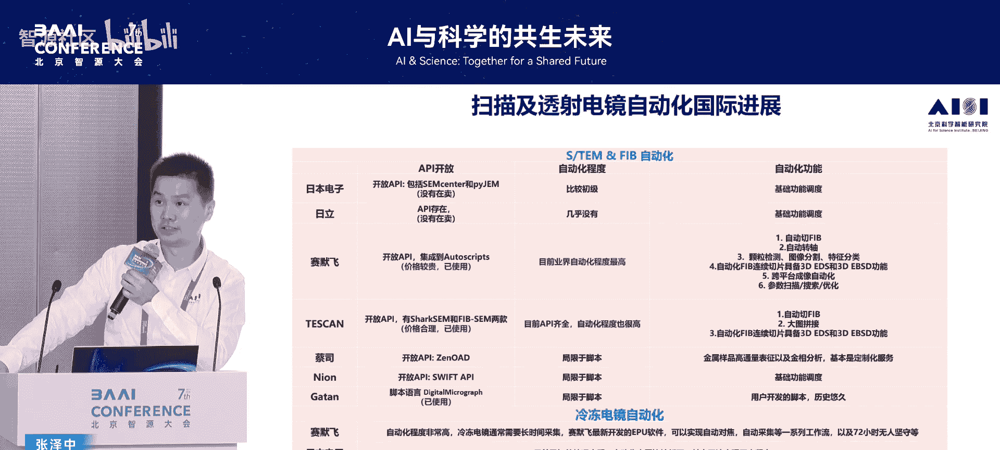
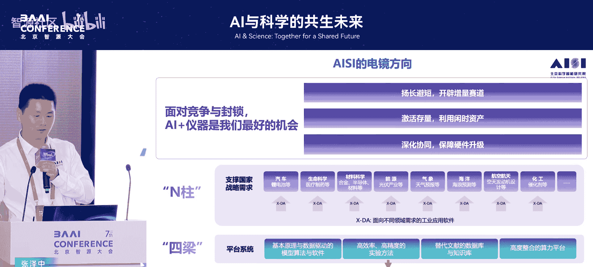
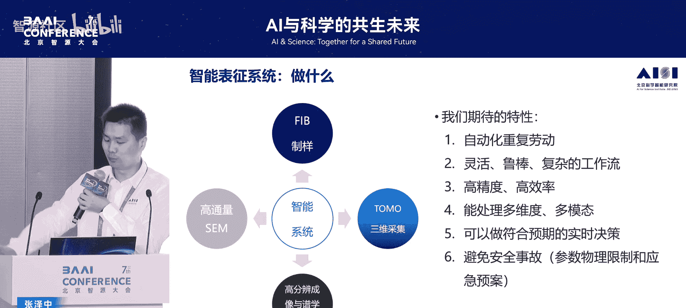
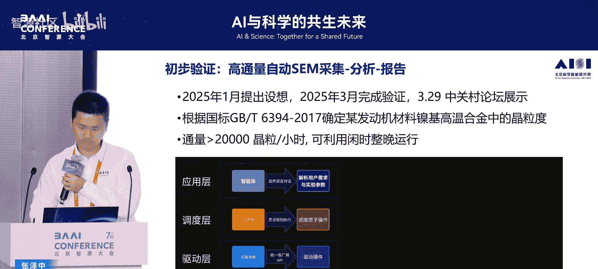

# 2025北京智源大会- AI与科学的共生未来 p07 从观测到智能：AI时代下的电镜表征：张泽中 -BV1NMNxzrENh_p7-

嗯，大家好，那个我们现在讨论一下AI时代下电定脚声，以及在这个过程中，我们如何去助力国产的仪器的研发。嗯。说AI for science是AI和科学研究的双向闷附啊，这个创造了百优。

对于无论是AI而言还是science而言，都是百年未有的机遇。尤其对科研，它可以加速，同时产生的成果可以赋能工业。对于AI加仪器来说，也是一个双向奔赴。特别对我们国产的高端仪器。现在到了突围的时候。

我们认为这个AI加仪器会提供最好的突围的机会。然后在这个过程中，嗯，我们AISI希望这个能贡献出核心的力量。我们秉持着开放开源的心态，希望能和大家一起共赴一个未来。我这里先提供嗯从我个人角度。

提供三个表征的例子。我们当我们说电竞表征的时候，我们在谈什么。然后再从时代的角度，我们的国产仪器发展如何做AI加仪器。表征当然测涉及到大量的测量。这第一个例子是呃作为一个本科生。

比如说你要观察一个动态的实验，这是一个呃结角正八面体的一个几何体。在纯绿里面你一加热它就会缩小了。这个做本科生的那个呃同学可能知道就有很多这种体力活交给本科生去做。那么。

你得去手在当时是手工测了测了上万次，然后由测出来的这个间距去。算出这个几何体的表面积和体积以及对应的能量。当然，现在在AI时代可以自动的去识别这个事情。当你做了大量的测量以后。你你得去发现背后的规律。

需要从现象到本质。这里可以看到这个几何体。其实首先它只是在这个横方横轴方向上上有一个缩小，变成一个这个e。这平分结构以后，然后再保持着这个平衡结构继续缩小。这背后其实是啊你如果在数学上面做一下推导。

你会发现这样缩小，它的呃能量是最优的路径。所以在第一个阶段的时候。你可能是把这个电竞作为一个观测的工具。比如说你手机的一个相机用来去拍你想拍的东西去研究。你的对应的。背后的物理和化学。

但是当你对这个电竞有更深的了解的时候。就不简简单单作为一个相机了。你需要知道这个比如说相机的每一部分的组成，以及背后的光学原理，对于电子显微镜而言也是如此。这里面有很多参数，你得去巧妙调节各个尺度。

各个参数，以及如何运用这个显微镜去发现新的东西，而不是仅仅观测一个已经存在的东西。这举的一个例子是在旅音合心里面，我们偶然的发现了一个条纹像。然后经过各种测试了以后，发现引入缺陷是调控相变的关键的路径。

我们不仅在薄片里面实现了这样的相变，同时在快递材料里面啊，也完成了这个这个转变。这个像他的意义是在于啊，无论是李莹还是吕童，其实是人类。最熟悉的这个核心体系。而在。100年后。

女仍可以在一个非常简单的体系里面发现新的相，新的相变路径，而且它还是有一定的这个通用性的。就是它可以在不同体系下面发现这样的新的新的像。这背后呢你需要做大量的计算。

去计算这里面的相面路径和这个缺陷产生了什什么样的作用？当你用使用表针清晰的看到了这个像，它其实是在密对面上面有一个双层的结构。所以我叫这是一个斑马，而且可能是世界上最小的一只斑马。嗯。他有什么意义呢？

我们材料里面最关键的就是呃寻找这个构效关系。我们是什么结构，对应是什么样的啊，能效也好，或者是什么样的功效也好。铝银合金自己作为一个2元合金，它是没什么很大用的。

你往你往铝合金一个很轻的很便宜的金属里面加一个很贵重的金属，自然是很划不来的事情。但是在铝合金。几乎所有的可热处理的铝合金里面，你只要加上微量残杂了影都会发生很神奇的效果。

这里画的那个一个图是你只要加0。5%的音，你可以把那个呃强度提高20%到30%，跟你加入的银完全不成比例。其中原因是银会吸出在这个吸出像的界面。所以你这个不需要那么多音。

你就可以彻底的改变这个合金的行为。这也就是我们材料里面最核心的一个事情，就是你必须要清晰的看到它微观的结构，你才能理解哦，为什么会发生这样的啊性能的变化。第三个故事是OK你也知道怎么拍照了。

你也知道这里面的拍照的原理了。当当现有的东西无法满足你的需求时候，能不能造出新的东西。这个造出新的东西，需要你了解对应的底层的物理。对于表征而言的话，对于电竞表准，那就是电子是如何被。物质散射的。

这里举的一个例子是电子能量损失谱。呃，之所以做这个事情是因为我们的电子能量谱损失谱。第一个是被商业。给垄断的，而且这个垄断的数据库因为是大概40年前做了，所以就嗯。它的计算的精度非常有限。

可以看到是这个左下角就是它能覆盖的动量能量空间就只有那么一小点。所以我们在做非常精准的定量实验的时候就不够用。那不够用，那只好自己重新造。我们先我们用这个迪拉克方程，考虑了完整的相对论效应啊。

包括这个轨道的相对论以及入射电子的相对论效应。对于所有的元素，所有的谱线都做了计算由。做的嗯能量空间和动量的空间，还有采样的精度都比原来大了很多。

可以看到这个呃右边右上角的这个图里面的每一个点都是实验的值。然后线是我们算出来值跟实验是非常之匹配的。这个做出来以后就。嗯，就是为了使大家更好的用我们把这个数据库开源了。然后可以一键的替换。

现在在开源的软件以及商用的软件都能够支持。简单的总结一下这个三个故事，就是打个比方啊那个庖丁解牛。庖丁捡牛说那个呃杀一头牛有三个境界。第一个你是把牛看成一个整体。第二个。

你是非常清楚牛的每一个部分的结构。第三个是你能做到以无后入酒间。其实我觉得还有一个境界，就是你从分子原子程度，你从牛的基因的程度彻底的了解这只牛，你甚至可以从头去构建这只牛。

那对应到这个电竞电子显微镜的时候，那就是如果你能彻底的从头造一个电子显微镜，你可以说你已经彻底了解显微镜了。对于。我们这简单介绍一下啊，普遍存在的几种电子显微镜。一个是扫描呃电竞。

就是它是去把我们电子数汇聚成一个很小的一个一个斑吧，然后去扫描这个物体的表面，去探测其呃二次电子或者被散色电子的信号，去看到物物质或者是生物的。表面的形貌。在观察这个材料的断口啊，缺性啊。

然后搭配上EDS呃EDS去分析的成分，甚至去呃搭配这个呃被散射电子的探测器去看这个晶体的结构呃，晶体的朝向。和看这个加上加热拉伸去看这个原味的动态的实验。就可以做很多的这样的改装。

这里面呢科研或者说工业的痛痛点就是这个显微镜这个它的原理是很简单的，但是往往是要大批量的处理图像，而且要多信号的呃同步的去分析。这个很耗时耗力。呃，第二种显微镜是这个汇聚树离子汇聚离子树显微镜，它可以。

用一离子树从旁边从左边在这张图上面去啊喷射出来，然后把我们的那个呃材料里面精准的进行一些切割钻孔雕刻。这是我们做半导体。比如说它的缺陷分析最关键的一个设备，就是它可以非常准的切出我想要分析的区域。

但是这个这个仪器啊很很麻烦的事情就是它切出一个这样的薄片电子数可以打穿的薄片是非常长的流程，大概一般需要4到6个小时。然后很密集的操作耗时耗力。所以在半导体的场线上面。

基本上你有多少个实验人员和多少台这个仪器它的能切的上线就被决定的。而且这个上限是非常低的。第三个就是呃透射电子显微镜以及它的扫描模式。这个显微镜呢是原，如果你要看原子尺度的东西，这是。唯一的方式。嗯。

它可以表证在原子尺度表证物质的结构、成分、缺陷、价态和电子的密度态，而且它提供了非常多的信号模式，衍射成像电子能量损失。特征X射线是啊原子级结构最全面最核心的工具。这个显微镜的研制不只是对于本身。

同时呃我们面向各种各样的材料，半导体、冶金化工国家的各重大需求，它都是其中最。皇冠级别的吧，这个呃表真仪器。我们国家其实是。有非常曲折。但是也很辉煌的电竞研制史呃，1958年的时候。

我们当时就提出要11国庆献礼，所以就72天的时间啊研制出了一台中型的透射电竞。呃，当时是仿制的，因为时间很紧，然后第二年就从从头自己设计了这个更大型的电子显微镜。但是呃后来因为文哥。

所以我们这个电竞停产，接着改革开放。我们因为停产了那么久，所以说我们的这个指标其实是很勉强的。跟上国外，但是国外的做的更新，做的更好，他的研发迭代更快。在改革开放之后，我们的电竞也就是逐步落了下来。

但是近年来其实我们有非常令人。更奋的进展就是呃18年以后，我们电国产电竞行业涌现了这个30多家的企业，其中10多家这个SCM已经在投产了，然后也有两家的TM。

包括这个广州汇聚和国一的联合的一台120千伏的电竞和伯众轻功的一台电竞。所以在接下来的5年时间里，我们国我们国家的电竞是进入了历史性的突破期，就就是是否能化简成蝶，再次一举这个需要做相当多的事情。

无论是硬件软件还是这个的智能化。一会我会着重讲一下智能化这部分。从那个市场的数据和形式来看的话，呃，我们的电竞规模大概是世界的一半，而且。每年在上升，我们进口的。价格都非常高，因为都进口的都是整齐。

然后出口的价格非常之低。因为出口大多数都是零件。呃，扫描电竞是需求量最大的，单价也比较低。国产现在已经足够能够满足需求了。离子树的需需求和透射电竞差不多。啊，国产现在也慢慢能起步。

透射电竞基本上是被国外垄断的。我们是刚刚能造出来，在高端的球插电竞能看到原子级的，我们现在还没有替代。同时呃这个因为现在国国家强调这个国产化，所以很多那个国外的品牌也在做本土化。在这样的市场竞争下。

国产厂商那个之前的纯粹的国产牌或者低价牌就不好使了。那么我们必须要创新的发展，有独门绝技，才能在接下来5年脱颖而出。从布局上面看的话，我们的最高端的电竞是还处于整机可用性的追赶的一个初级阶段。相比国外。

他们基本上每个厂都有独门绝境。而我们没有。然后其中关键的子系统，比如说求插矫正电竞，我们现在是没有知道。然后呃各种先进的谱学电子能量损失谱和特特征X射射线，现在也没有布局。

所以电子电子应是一个复杂的系统工程。呃，我们需要。不只是考虑展机，也要包含其关键的子系统。在自动化方面，其实我们相差没有那么多。国国内外的厂商也是近几年开始尝试啊，进展不是很不一。

我们的追赶其实是完全可能的。

在这样的背景下面，我们嗯AI成立了这个表征的团队。我们认为这个AI加仪器是最好的机会，可以扬长避短。养我们这个智能化、自动化的擅长的部分，开我们这个硬件目前的短板，从而给硬件成长一个时间和空间。

后它可以激活我们的存量。我们那已经买了大量的国外的电竞，但是电竞是高就是强烈依靠嗯这个人去操作的。我们的仪器其实晚上都是闲置的，这是很重大的国国有资产的一个浪费。我们如何应运用好这个闲时。

一个是对于科研仪器本身来说，另外一个是对于AI来说，它可以生产大量的数据。那这个数据是可以用于这个呃。就是之后的。这个模型的训练和演化了。同时我们得嗯在其其中的关键的子系统，我们得进行呃设计。

使得我们能够顺畅的一个往高昌高高端的电竞前进的时候，能够顺畅的升级。在AA嗯大的方向来说的话，它是分为四个方向。这个我们要做四梁，四个粮是那个基本的原理和数据驱动的算法以及软件高效率高精度的实验方法。

替代文献的嗯数据库与知识库和整合算理的平台去支撑N个组，就N个。

国家的战略需求。对于表征方向的话，我们立下了是4个啊。四个方向。从散射物理定量算法啊到自动化和电子光学。这四个方向之所以这么立，是因为我们瞄准的是AI加仪器。散生物理和定量算法是我们的底层能力。

自动化可以帮助我们实现国产仪器的赛道的切换。电子光学去补补齐目前的短板。然后共同去助力国产仪器的啊。高端化智能化的未来。出不去吗。我这里主要讲这个呃自动化的部分，因为时间有限，我要讲自动化。

这个自动化我们讲呃这四个方向，那个高通量的SEM肺部质样tomo的三维的一个进的采集，以及高分辨的成像和普学。我们期望的是呃很多自动化的劳动，呃，就是我们要自动化那些重复的劳动。

而且这个自动化得足够的灵活呃，足够的鲁棒与。面对电竞里面复杂的工作流，我们希望高新度、高效率能处理多维度、多模态的事情数据。而且当出现问题了以后，他需要做实施的决策，而这个决策必须要符合预期。

不能是大模型急性的做啊这个crazy的事情，要避免安全事故。

止吧这里举一个例子，就是我们自动自动化以后是一个怎么样的流程。我们有各种各样的仪器产生的数据需要标准化。然后我们可以批量的高通量的去产生，产生完数据以后，我们就可以放到模型里面去训练。

然后微调成呃各种下游子任务的模型。然后这个过程中会。开启一个数据的飞轮，就是我数据做的越越来越高通量，实验越来越自动化。那我训练的模型就越来越好。那我做的下游任务就更更加精准。嗯，这里在高通量方面。

我们做了初步的验证，这个大概花了两三个月的时间吧。然后在一个嗯。已经大学的一个双数电竞上面。使用这个API去调动这个电竞的底层，然后上层架了一个大语言的模型，就是使得你只要对这个呃进行对话。

它就可以驱动电竞。需按你想要的参数和模式去呃拍照，然后拍完照以后，他会进行这个数据的分析。分析完了以后，会按照国家标准出这个结果。呃，可以达到一个很高的通量，而且可以整晚的运行。

当然这个是个很刚才简单举的是一个很简单的任务。我们现在看一个更复杂的，更复杂的就是刚才说的肺部要切到。😊，6个小时的东西。就是国外他们也有这个自动化的fib，但是那个是一套程序。

你写的都写的都是hard code的一些参数。就是。那参数全部你在实验开始之前全部都得定下来。然后他按照这个参数去跑。这样跑当然会遇到很多问题，就是你哪你可以想象你的车轮子即使掉了，但是你。

根据你之前的指令，他可能车还得继续跑在路上。所以我们希望结合国产的这个肺博去做更先进的自动化。这里简单的演示一下，为什么说这个切肺部很麻烦，他需要转到不同的角度去切出一个三维的呃物体出来。

并且把这个呃这个薄片给转移，以及镜像进一步的剪薄，使它能达到电子能穿透，并且看到原子体的一个程度。我们现在在那个呃这个。纯规上面已经完成了这个自动化的初步的工艺的测试和参数的调优。

这个肺部系统它嗯其实涉及了一系列的这个呃架构的事情，就是我们底层是需要调用这个智能的模型。上在应用的时候，我们相当于需要有工艺的参数，有工艺的流程，然后。我们要根据视觉判的模型去判断我们切的是不是成功。

切的不成功，我们应该怎么处理？切的成功的话，应该进入下面一个怎么样的流程。而这里面其中的每一个流程呃都是很麻烦的这大概有12个子流程，然后每一个流程大概有这么这么长。对。嗯。

其中最困难的地方就是前续的步骤的失败的偏差，会导致后续工艺的失败。所以我们每一道工艺都需要非常精准的判断。而且虽然你说这个去识别用AI去识别一个呃。这个二维的图像进行分割，这是机器学呃。

这是人工智能里面非常。非常现在非常普遍的一个任务了。但是这里面的难点是切削是一个三维的过程。我们操作员在做这个切削的过程中，他是在自己的脑中完成了二维到三维的转换。

但是你的视觉模型并不直接就是做这个转换。第三个是这个工艺和材料的关系非常大，不同的材料需要不同的切削工艺。当你一个芯片，它叠了十多层材料以后，这个切削工艺是一直在连续在不断的变化的。

而且我们这个采集数据。嗯，的成本是很高的。因为刚才说到要4到6个小时才能切出一片，然后你高价值的数据极难获得极高成本。我们需要去大量的模拟这些图像。但是这个模拟的双触电竞的方法，现在还有待开发。嗯。

我们需要做非常结构的化的数据才好，把整个流程变成一个呃可自动可持续学习的一个过程。这里关于这个三维的，我们做了这个呃就是根据我们输入的这个切缺的参数嗯，进行了三维的可视化，以及它可以生成这个三维的模型。

我们可以用这个三维模型去生成对应的视角的二维的图像。这部分应该是现在来说没有什么问题了。嗯。OK这个是肺补这一部分。然后嗯关于这个。三维的电竞，就是我们看的都是三维的东西。

但电竞你在每一个视角看的都是一个二维的投影。而且这里面造成了进一步的实验的挑战是这个电竞的API它必须要连接电竞，我才能工作。那也意味着我的开发得上机才能完成。这个限制了我们的开发进程。

所以我们开发了一套这个包含公务样品平台呃，样品台，然后相机的一个三维的模拟沙盒，每个都可以独立的运动。然后这个大大大的加快我们自动采集的这个开发进程。然后我们在清华的电竞上面也完成了初步的尝试。嗯。

电竞在高高分辨的时候可以做，就是它无论低分辨还是高分辨，我们都可以做多模态的事情。然后这里面问题遇到了一个问题，就是呃它的这个对焦。啊，自动对焦是一个问题，你不可能以同样的焦距去拍一个很大的区域。

那么我们这里就需要结合这个AI去优化成像的条件，而这个优化不一定是一个大模型，它有可能是一个呃贝噎斯的小模型。我们电机里面有，哪怕你再好的环境，它还是存在着自己自身就有抖动。

这个这个就使得我们的图像是会发发生畸变。这个畸变我们其实是可以测出来，然后进行矫正。矫正了之后呢，会有一个什么效果，可以看到这样是同一样同样的数据，就是呃这里面的这个数据量是一致的。

但是矫正之前我们是看不清这个铝原子的。矫正之后，我们可以很清楚的看到铝原子原子级的金隔。这一些都做了以后嗯，可以做什么呢？就是我们可以进行原子级的观测。我们把。对应的原子结构给定量出来。

最后根据我们的原子结构，我可以结合一系列的这个呃这个我们在AISI开发的这个原子结构电子结构的方法去计算对应的啊物理的性质。那么我们的原子观测和我们所擅长的原子级的计算就可以彻底的打通起来。呃。

除此之外，我们还得培养人才。啊，我们自然是很难说在那个课堂上面去教学生如何去搭电子显微镜。因为这里面涉及高真空和高电压的事情，在课堂上面也。这个1一个学期肯定做不完。

所以我们选择是扫描透视呃扫描隧道显微镜。它简单来说就是跟你用手去触碰这物质的表面一样，它会发生一个碎穿电流，当你隔得足够近的时候嗯。他也可以打到原子机，而且我们用的成本极低。现在做了呃有两个组。

然后分别不同的方案啊，里面每一个组大概花的都不超过5000块钱。啊，现在已经进入了一个软硬件联调的阶段，也就是啊出信号，这里面的主要的挑战是如何把一个平安量级的信号放放大成一个可探测的信号。

又设计了小信号的1012次方的放大啊，现在也基本上完成了。接下来的话需要把这个接上agent，使得我们的一个很低成本电竞变成一个智能的电机。呃，我们当下在北京其实就前几天发布了这个高端仪器的行动计划啊。

这个所以不只是这个AI与仪器的双向奔赴，也是AI加仪器与北京的双向奔赴。然后在这个过程中，我们相信年轻，相信开放力量，相信AIII会发发挥啊核心的贡献。好，就这样，谢谢大家。感谢张老师的精彩的分享呃。

现场有嗯。😊，你好，张老师，我是一位投资人。我想问你一个问题，就是呃像现在这些医药大模型，如果应用到呃，比如说像GE联影这些医学器械领域或者进合医学史的话。

中间的壁垒是不是就是您所讲的这些电竞仪器去进行一些模拟和数据的初步的器材的转化？嗯。对于医学来说，嗯，电子显微镜以及生物的冷冻电镜其实是自动化做的比较好的部分。因为它的目标非常之明确。

所以他的电竞是可以这个24小时，甚至是72小时连续不停的转的。但是这个他的电竞转，它是可以解结构的。比如说我们熟悉的施一工老师而，是这方面的专家啊，但是这个结构解出了结构，如何和药学联系起来。

这里还涉及到这个呃我如何结构到性质的一个转变。这个之前啊兰艳艳老师也提到这个方方面啊，我是专门做这个啊材料电竞的。所以对这个医学方面的事情，可能还需要那个大家啊就是更专业的专家去点评这个事情。对好。

谢谢啊。