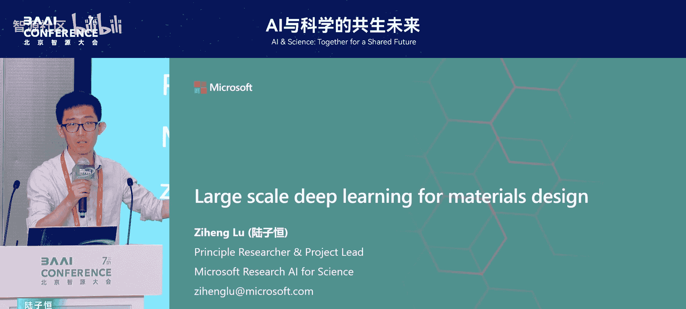
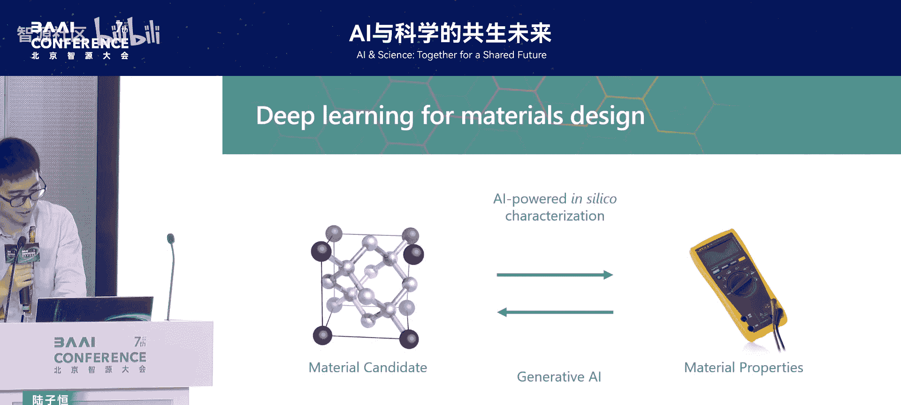
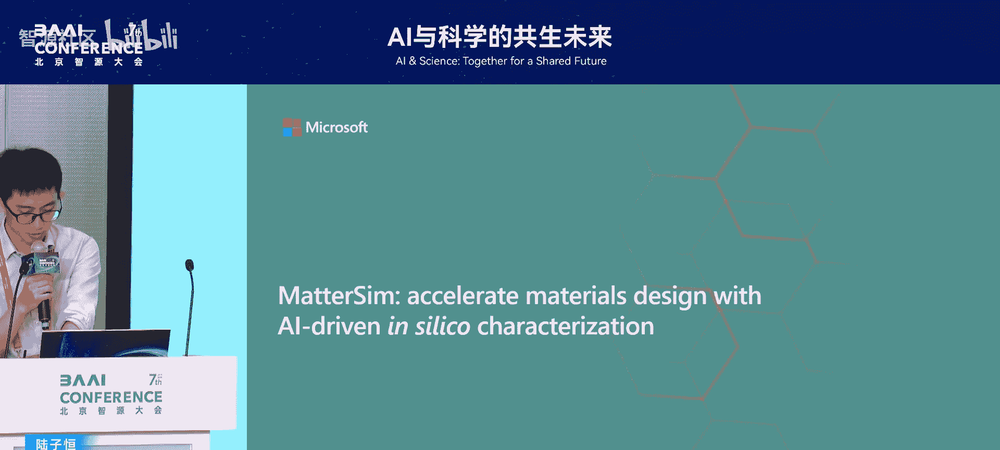
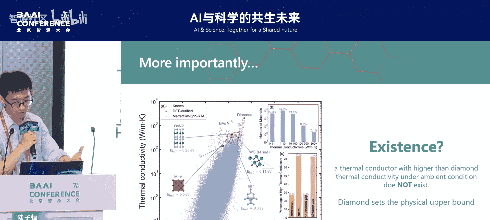
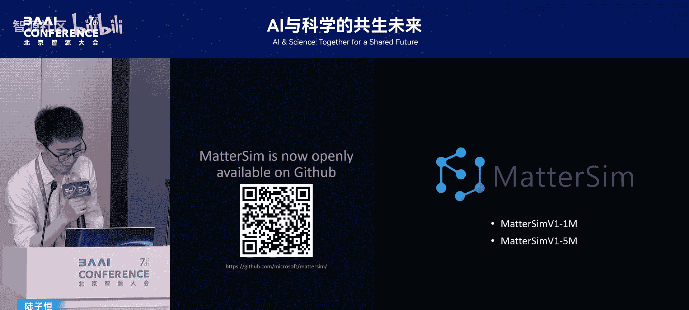
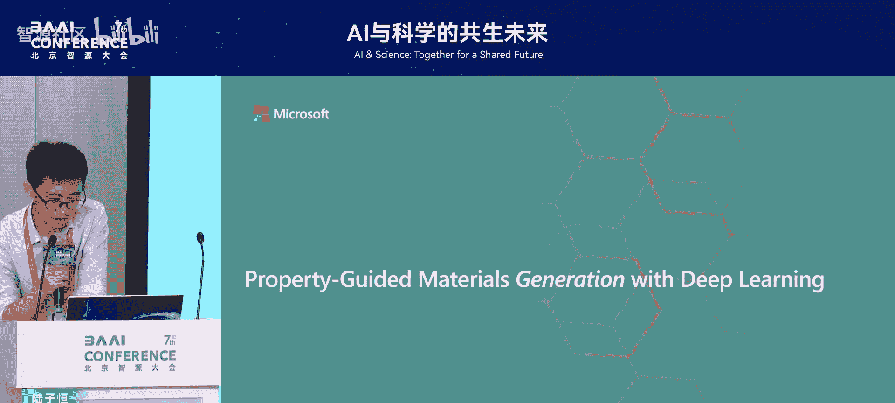
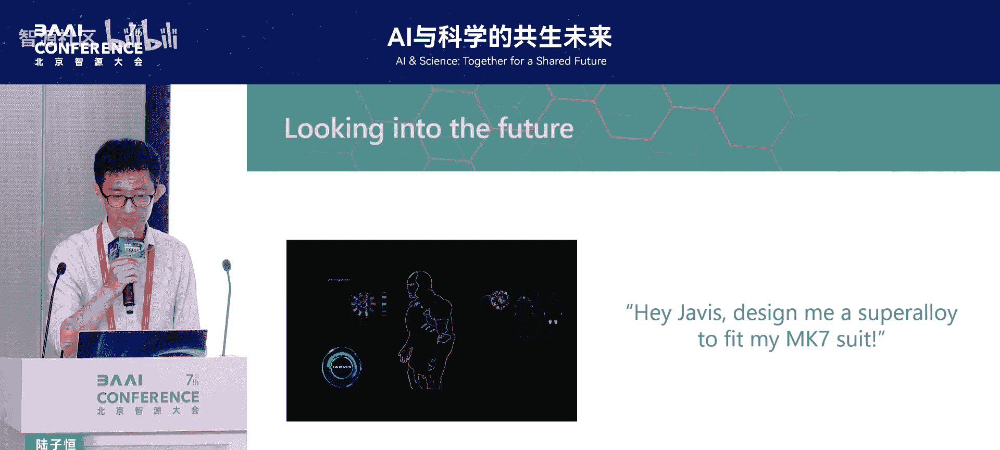

# 2025北京智源大会- AI与科学的共生未来 p08 大规模深度学习加速材料设计：陆子恒 -BV1NMNxzrENh_p8-

🎼，非常感谢启维。然后刚刚张老师给我们讲了一下这个材料表征方面的一些内容，特别是AI，包括自动化怎么去加速这个事。

那今天呢给大家我给大家聊聊的呢是反而是更多的在设计层面就是怎么样利用非常大规模的深度学习，真正的去尝试去找到一些新的材料的IP一些尝试。那这里面两个关键词。

个 scale deep learning术是我们怎么样用算去换来真正的新的I把这种大大规模的这基术设施的这个换成我研研发的时间的加速。好，那我们不多说这个废我们直接开始好，那这个材料设计啊。

那我们呃这个这个快速准确高效的去设计一个新的材料呢，一直以来是咱们这个材料科学工作者以来这个这个这个梦想，也或者说理想吧。在这个过去的几个世纪里，其实呢我们人类已经发现了一系列比较重要的材料。

大家可以看到这张图啊，人类的很多这个文明是按照材料来命名的。其实这里面想讲的意思是呢，任何一款真正就一款新的材料，它往往能带来就是一整个市场的变革，甚至是整个人类社会的变革。那如果我们去回顾一下。

就是我们真正在做材料设计。过去几十年里在做这个过程中，我们常常去回答的一类非常关键的非常典型的问题是什么样的？是这样的，是我能不能我怎么样去找到一个好的散热材料比现在所有的散热材料都更好。

它能让我的芯片散热更快。换句话说呢，也就是说。在给定的这个deevice，给定的这个任务需求，给定的场景下，给定的性质需求下，我能不能找到怎么样找到一个更高更快更强的材料。

那这个问题其实一个非常贵非常价值连城的问题。因为找到一个新的材料，往往意味着一个整个行业的革新。但是这个问题呢其实不是那么好回答，非常的昂贵。一般来说呢，我们认为去设计一款新的材料。

一般来说都要耗时呃几十年，甚至是就是花很多很多的钱，millions billionions of dollars，这个是非常贵的一个事呃非常痛苦。究其原因呢呃可能我觉得两点吧。

第一点是这个材料空间的这个空间非常非常大。如果去想一想，我们真正在做材料设计的时候在干什么事啊，实际上是在元素这个材料空间，这个元素周期表里面选出一些元素来。

就或者说在我们实验室里ca precursor这个前驱体，把它放到我们的反应器或者炉子里哎进行反应。反应完以后呢，拿出来进行表针。就刚刚张老师说的，可能我们现在有自动化表针，它的效率会高一些。

那把这个表准材料拿出来以后，我人类进行分析分析完以后，我就知道可能他能不能满足我的这个这个这个这个需求，然后再进行迭代。那这个里面呢就涉及到非常大的组合空间问题。

118度就100多个元素有很多很多不同的组合。那这是一个纬度非常非常困难。实验非常的慢。那第二个问题是呢在做实验的时候，其实它增加了更多可能的自由度。也就是我烧炉子哎，我得烧它多少度，烧多时间多少。

这个就是咱们研究生非常非常痛苦的一个事，对吧？那这又增加了另外一个自由度。所以说整个材料的这个呃设计啊研发过程非常非常痛苦的。那刚刚是第一个问题啊，就是我能不能我怎么样去找到一个更高更快更强的材料。

那其实在这个问题之外呢，有一个或者他的背后有一个更加深层次，更加尖锐的问题。通常之前比较少问到。但是呢刚刚呃兰老师也也提到在药物里面可能也存在了是这样一个存在性问题。那比如说是不是存在这样一个。

导热材料，它比我现在的金刚石导热性更高，或者换一句话说，大家更更更更fa一点的是，是不是真的存在一个在常温下可以超导的材料。那这个事情为什么要提他？是因为第一他满足我们人类最基本的好奇心。第二个呢。

他有更深层层次的这个现实意义。那我们是不是还要再投入我们未来的几代的科学家，投入 billions of dollar，几十年去寻找那个在不在的材料，就是这个存在性问题。好，对于这样存在性问题呢。

其实比刚刚那个寻找这更高跟快更强更加困难。这个事情呢之前基本无解。因为这个刚刚说的材料空间巨大无比。这有一个estimation啊，可能是1的22次方到10的120次方。我待会根据不同的这种想法。

它组合数太大了。那呃之前林红也说到，那机器学习其实非常适合解决的一类问题，就是这个指数爆炸，组合数非常多的问题。那今天呢其实也就是跟大家聊一聊，是不是有可能在这样一个机器学习开始爆炸。

这个深度学习开始爆炸的一个年代，我们有可能尝试用机器学习去tackle一些刚刚那个两个比较困难的问题。好，那刚刚说啊这个材料设计非常的痛苦，非常困难的研究咱做生化环材，特别是材料研究生特别痛苦啊。

那这个在一个理想的世界里，如果我要设计材料是什么样子的呢？那其实他在一个理想的世界里，我们可以这么讲想，我我本身也是材料呃材料出身啊，那我会想想我会有些intuition。

我知道我脑海里可能有一个材料一个一个structure一个compposition，那我可能就会大概去猜这个材料比较好。但是我要验证这个猜想，我就要把这个东西送到实验室里面去慢慢做很慢很慢。

那这个就是一个正向的过程。那如果我有办法用我的算例。😊，代替或者部分的代替，把这个这个实验室送到这个这个把材料送到实验室这个过程就是我不做实验，只要我脑海里有个材料，我能比较快的去知道它的性质。

它的这个这个这个这个property。那这个可以让我的整个pi designign pipeline快100倍1000倍，对吧？那这个就会快很多，这是第一个方向。那第二个呢是反过来一个事。

那可能我不是一个特别好的一个。今天是一个scientist，我我我intuition不是特别好，我不知道哪个材料好，对吧？我不知道哪个材料热导性高，哪个材料能抄导，这真不知道啊，那怎么办呢？

是不是有可能。😊，让AI去generate一些新的 ideaD。比如说现在特别火的geneative of AI，那就是反方向的一个问题，是不是能给定一个性质指哪儿打哪，我要你抄导的材料。

你给我propose idea。好，那这也就是我们这边做的两个主要的一个一个思路吧，两个方向，一个fly well一个是正向的given a structure用AI power的这个呃in characterization快速的准确的预知材料的性质。

那第二个方向呢就是在这个基础上用这个性质去geide我se for一个真正的有用的材料的IP好，也就是现在比较火的genrativeI啊。

好，那么先讲正向的一个事，这个正向的事呢，就是假设。😊，我脑海里哎，我猜这个FCC的qubbic whatever一个structure，一个atomic composition，它可能比较好比较牛逼。

那是不是真的厉害？我可以不可以在尽少的做实验的情况下知道这事儿。那这个可能就联系到我们最近做一个模型啊，叫m呃，模型名字不重要。但是看看我们做了什么事吧。好吧。好，那统计物理学告诉我们。😊。

一旦我知道了一个体系的最基本的物理学量，比如说能量力 stresses magneticag moment factor这 whatever一些基本的物理学量统计物理告诉我们。

经过exble average，那我就能。in principle可以知道这个材料的宏观的性质。好，那这样的话说，如果说我能快速的准确的知道这样的fuamental的性质。

我就有可能去用计算的能力把材料的性质给预测出来。这件事呢听起来是比较tri比较traight forward的。但是实际我们在做的时候，真正能做这种比较精确的预测的这个方法呢。

叫呃其实是解血电方程或者它的一些变种。那这个事提到血电方程，那这事就很麻烦了，特别贵，对吧？除了这个单次的特别贵之外，还有一个更大的问题是这里面涉及到inble统计物理。我对一个宏观性质不是算一次。

不是做一次的计算，是要进行大量的戏综的平均。呃，林峰可能已经走了，但他这个事应该深有体会啊。对，所以说这个东西就是昂贵到不可接受。

所以很难在过去的在过去的几个的这个时代里面是非常难去成体量的去做这样的搜索，或者比较准确的做这样搜索，总要借助一些非常bteful，非常不准的一些猜测。那为那那现在深度学习进来以后。

是不是有可能tle这个问题呢？那我回过头来真正用机器学习解决的问题。现在看就非常简单了。我要做的就是given a structure一个简单的结构。我要让机器学习绕过确定要方程。

直接去infer这些比较简单的物理量，只要他做的足够的准，足够的快。我结合统计物理，至少热力学原理上告诉我，我可以知道它的宏观性质。那这可能是我们正向的一个想法。当然这个不能解决所有的问题。

能解决一些非常fuamental的问题。好，那刚刚这事说下来，好像听起来对，特别是咱们做M同事，这听起来非常非常的耳熟啊，give a structurepredt a property。

这这不就是supervise learning吗？听起来非常简单，只要我有一个手段能大批量的生成我想要的这个基础的性质。那这事就结束了，对吧？听起来非常简单。😊，呃，但实际上呢呃有它的难点。

甚至是我觉得非常非常大的一个难点，就是就是这个数据。因为我想要的并不是对某一个单一体系一个体系，某一个我猜到的材料，它的这个整个的性质的描述。

而是整个元素周期表所有的元素任意的组合在任意温度任意压力下的反反应。那这个事情就非常麻烦了，又涉及到一个组合爆炸的问题了。那这里面呢就需要一些比较巧思去进去了。所以说我们就最终呢就呃就尝试去这问题。

使用了一个这个这个大家大家做MR比较熟悉的一个主动学习的方法。也就是呢我去训练一个比较简单的先收集过比较简单的数据去训练一个基的模型。

后通过一些的知道让我的模型知道我是不是不用再去为这些新的数据打la了。那不用打嘛，那就就。就就就不用靠这个算例去生成这个数据，对不对？那这样做下来呢啊当然这里面还有一些比较好那个细节的detail。

那大家有兴趣可以看看我们的文章啊。那这样最后做下来呢，我们会发现我们只需要原来1%或者个位数的这样的数据量就能把整个可能的这个材料空间采样的相对比较完整，比较完备。😊，好。

即使是刚用了一个所谓的比较聪明的方法，其实我们依然花了非常非常非常多的钱去采这个数据。因为这个真的是化学物理体系真的很复杂。那这里面我们大概有是当时啊是有17 million的这个数据。

另外呢我也想提一下这个数据有一个非常独特特点，就是它是用active learning采出来的。所以说它数据点之间是highly non correlatedrelated。

就是说数据之间的联系是比较差的。因为它也具有代表性，自然联系就比较差。那这样呢其实学起来这个模型就不是特别容易scale，我们花了很多巧思去去设计这个模型来fi这个data。那最后呢我们就做了很多事。

最后用这个数据和这个呃设计出来的这个架构训练出来，我们这个模型叫。😊，它呢是一个深度学习的原子模型，它可以capture人类所能掌握的，能够能够能够控制。

可见的未来能控制的这些所有的温度压力范围内任意材料任意元素的这个interaction。呃，这样的其实说起来稍微有点这边没没放那些PP啊，说起说起来稍微有点这个这个呃虚啊。其实他干了一件什么事呢？

就是given a structure。😊，How可 predict。这些fuamental property，最简单能量利益stres再再再再复杂一点。

比如说它的呃磁呃电等等等等的这些这这些基本的atomic level的性质。好，那因为我有比较准确的比较呃广泛的这个材料空间的覆盖呢，我现在就能真的把一部分的实验不是所有。

这这个也确实不能这么 claim。我们能把一部分比较重要的实验去拿到计算机上去做借助们模型。比如说这边边举些例子，比如说新材料发现啊 prediction啊机械啊传输啊自由能啊像像图啊。

这些各种各样的性质，特别是这个自由能啊，今天可能没有机会展示讲啊，这个东西可能是物理学界的一个圣杯吧。对那也就是说右边一张图是大家不是特别喜欢的，就是这个liboard就是我们也有和一些一些in啊。

包括通用的模型做一些对比，它性能还是相对比不错的对这个我觉得不重要，主要是他能做什么事啊。好，刚说了，我们其实最后去在这个模型它能干的事，就是 a。predt这些基础的物理量。

或者说再跟进一步借助统计物理，把一些实验搬到计算机上 characterization。好，那现在剩下来的就是哎我们这个模型真的是不是能在单点上去prove它的价值找到一些真的突破。

那这里面呢我们找了这样一个问题，就传传输很多企业啊，包括咱们国家都非常重视的一个问题，就是热传输芯片能不能散热更快。那其实这这这这个涉及到一些基本的物理的很有意思的问题啊。

在过去的几十年甚至几个世纪里呢，其实真正发现散热特别快的材料很少啊，比硅高的也就50个50个不到啊，非常非常的少，这么多年下来了。那。所以呃特别是在大概呃可能1900年左右呢。

人们发现金刚石就我们手上女孩手上戴的那个钻石啊，它是导热率，目前来说基本上是快体材料里面最高的那1900年之后，就再也没有发现比它热导率高的这种快体材料了。

那一个fuamental的大家特别学界猜测的问题，就是是不是diamond的就set这个upper limit。fuundndamentally是不是他就是热传输物质热传输的一个极限？

或者说我人类还需不需要花未来的几十个 billion一代一代的科学家再去追寻那个可能存在不存在的材料。好，这是就是我们尝试他可的问题。就回到刚刚两个问题。第一个是我们能不能找到一个新的材料。

它更加适配于我们芯片的散热。第二个问题是存不存在这样一个limit金刚石是不是这样一个limit。我们下一代的材料学家还需不需要去花自己的小半辈子所做这个事。好，那这个时这个时候呢我们回顾一下。

刚刚说了一点，就是怎么去把这个AI的amulator啊用在这个把。呃，这个实验搬到计算机上去做。他fuundmental呢就涉及到我们把这个。infer一些基本的物理量。

然后通过统计物理的方式去计算出这个这个结果。那对于热导来说，它也是这样。那细节这个这里面的物理不不多说啊，如果这儿有做物理对方程可能比较熟悉。

就是我们用的这一个叫man transport equation。然后里面呢有一项非常非常好时，最好使那项是是计算这个浪之间就原子振动之间的这个相互的tter。

那这一项呢我们就其实是用统计物理的方法结合我们的AI把它大大的加速了，可能上上千上万倍。那因为有AI才能做到这样一件事。因为有那除此除此之外呢。除了这个加速以外，因为他非常快。更重要的一点是。

因为这个模型的scalell，包括它cover的非常的广，它真的能够做到它的ar和实验是匹配的。这个是之前非常非常难做到的一点，也是大规模的机器学习所带来的一个变化。那可以看到。

我们在实验上就这个单独的性质上，我们没有在热岛这个性质上用过模型啊，就是拿过来裸着就这接用了。它大概和实验上的 error大概是在40个瓦特 perter per k这样的一个量级给大家一个啊。

这个40的，一般来说，金刚石的热岛大概在几千。所以说这个 error相对来说是能比较能接受的。好，有了这样的 emulator。有这样一个工具，我可以把一部分实验重要的实验搬到计算机来做了。

我现在做了一件也比较快的做了，现在做了一件非常非常暴力的事情。😊，我把元素周期表。所有的可能的2原材料就原子数少于小于4个的一些就是一些知道一些 physicalical constraint这样的材料进行了暴力的穷举。

而且这里面可以说一下，他暴力穷举，不是说我们对已有的数据库某一个数据库进行了穷举，而是对这个材料空间所有可能存在的energyloc mini进行了穷举。用我们用一些比较粗暴的这个search的方法。

就是保证这次se完以后不会再存在新的可能性了。好。这样呢非常暴力啊，大概做了其实也做了两年啊。然后我们花了发现呢这个这个这个空间里大概有30个 billionllion的local mini非常非常非常的多out of这30个 billionloc mini呢大概有half a million crystal。

我们认为有可能有一定的可能比较小概率可能存在。我们对这 million crystal做了很多筛选，最后在236K就是23万个。😊，晶体的这种材料上对它热导进行了incical的表证或者计算。

非常非常大的量。那传统意义上可能人类探索过的也就百来个，那这样就是一个很order的一个增量嘛。在这23万个材料里面呢，我们发现真正热岛高于100的硅大概100出头吧，高于100的只有1%。

这就是为什么我们人类花了这么多年没有找到新的。太 rare耳了。全部是孤岛，非常非常难找。如果你不通过这种暴力的穷举，一个一个一个看的方法，很难把这种新的体系给挖出来。

很可能就是某一天新的爱因斯坦爱因斯坦能能想到这个事儿，但也有可能就忘掉了，对吧？我们最后发现呢。得到两个事儿。第一个事呢，就是既然进行了暴力的横举。

一定会有一些promising candidates出来。其中一个好消息是呢，我们发现了一系列材料具有非常高的热度。😊，大概最高的目前发现的新材料大概在八九百呃，金刚石呢可惜的是在1000多。

所以呢没有超过那个半儿。那这个待会再说。第二个呢，我们发现一个更有意思的一类材料，可能会就是咱们这个lea这个工作的一个一个一个一个同时啊，可能会会改写教科书啊。这事就是发现了一类新的材料。

它的热岛的传输的channel呢，不仅是通过。不是单单通过electron或者通过lauce，而是通过两个bos之前这个事情是没有被发现过的。这个是您确在物理里面之前不能说被block吧。

至少没有被describe过的一个现象？那这我们也也做了一些背后的物理。那这这这个就暂时不说了。好，所以说呢呃都多说一句，为什么说这事。

因为这个新的机制很有可能对我们的芯片的散热界面上会有 fundamental的 change。好。刚刚说了就是说哎收了这么多材料，20万的材料，花了好多好多钱，对吧？终于说找到一系列新的有意思的材料啊。

有些也在合成啊那。😊，这个事情是不是就呃是不是我们最关心的问题？当然关心企业关心，我们也关心这涉及钱，涉及产业。但是作为一个scientist，打心底里，我真正care的是那个existence的问题。

就是我们人类有没有摸到那个边界，是不是还要花几代的人去找这样一个高于金刚石的一个canidate。刚刚说了，其实我们对这个可能的一个空间进行了一个暴力的穷举。那琼举之后呢。

呃我觉得我们基本上可以下到这样一个 conclusionclusion，就是diamond基本上是set常温常压下无机晶体的一个热导的上限。所以这个事呢，我觉得我们可能是也是呃这这两年来。

我们觉得自己能回答的用AI去能能探索到这个材料里面关键问题的一个边界。其中的一个可能边界就尝试去回答这个存在性的一个问题。好，刚刚讲的都是这个正向的模拟，就正向的这个ization模？

好多说一句打个广告，大家有兴趣就是可以看看我们这个都开了两个模型好，刚刚讲都是正向的那时间原因我这个另另一个方向快速点说就是你除了正向的这个加速以外。

那我总要有一个想法去这个新的可能是我拍脑袋想出来的能张老师拍出来的可兰老师拍出来的可能各位科学家拍出来的那也有可能拍不出来，对吧？

刚刚讲热导呢，他有一些物理的背景在，所以说他真正热导高的可能就是那些相对比较简单的结构，所以我才有可能进行穷举。但是对于更加复杂的材料，比如说国态电解质，比如说有一些小分子。

比如说有一些液晶咱们各种显示的东西，它的这个想要的性质往往出现在更复杂更多组合数，更多元素的这些材料里。那这样暴力穷举的路子呢？😊，will never work。他不可能。😔，工作。

那这个时候就要聪明一点的ide上了，就是我怎么样才能去更好的traverse这个space。那这里面呢就是property guided materials generation with deep learning。

就是材料的生成。

好。就是刚刚说就是这这些快点过，就是哎我现在要做的是。拓展到整个采购空间。太大了，我模型再快，我再有钱，就是有钱到那种咱们这种大公司也做不动，把人类所有的店搞进去也做不动。那怎么办？

就是我现在要做的就是指哪儿打哪，我不再是全部看一遍，而是需要一个好的这个ge model，given the property， given这给我一个性质。

我就要很好的快速的准确的知道那个candidate在这个化学空间的哪里。好。这个东西呢，其实大家做一下，这个已经好好多好几年了，这事相对来说成熟了，对吧？那做一个类比。

就是说哎我在图片里我可以take一个数据集去去用what whatever model去他的这个图的就可以照出来很多新的这个图片长得跟他很像哎，这种我要train卡通头像。

我可以generate很像的这种卡通头像，并且他之前不存在那更有意思的呢是我可以让他告诉他，不要gene这种男头像女头像。裤子头像丑子头像，漂亮头像对吧？这里面有很多定语。

这事儿在材料在晶体上是不是存在呢？呃，就是我能不能去generate稳定的晶体。搞band gap的晶体，搞热岛的晶体。更有利于what液晶显示的晶体对吧？那这个事情原则上是共通的。但是早期的时候呢。

我们并不是那么的确定这事儿能不能做。所以我们比较早的时候呢做了一些探索性的工作。呃，就这个工作叫ditribut。然后我们有些作者也在这个下面对在支援这边对吧？

然后这个工作呢就是我们当时做了一个粗粗糙的一个在单个体系上做了一个实验，就是在探上碳是一个非常多可能的结构的一个一个可能的空间。

我们想想知道的就是能不能 given一个探的structure database。😊，给我一些property，我指定。你这个生成模型就是要给我生成某些性质的碳。那我们做了一些基础的实验。

确实发现这事呢是可能可行的。比如说我要零，就能给我生成出来石墨金刚什墨烯个就能生成这个金刚石暂时女孩手上带的这个东西。那这两个是我已知的case我验证了没有问题。那比如说我作为做材料的。

我自己都不知道两个EV是什么东西没听说过我是不是生成这个东西真的有这个性质呢？试了一下，通过了一些这个量子化学的计算呢确实发现哎我生成结构确实具有这这个电子福特的这个性质。

所以说呢 in principle。我只要 given data， givencomp power，我是可以去做材料的inverse design的。好，那下面的事儿其实思路打通就是钱资源高，对吧？

就是这个meag这个model。我现在现在做的是就是我把整个材料空间里面所有mat projectject啊，一些常见的稳定的所有的材料构型。

全部喂到一个genative model一个 frameworkmework里面去。包括它的原子type进行一个一个生成式的一个回归。然后我就会发现哎这个模型具有非常强大的能力。我可以。

裸的生成比较稳定，有可能不一定概率特别高，有可能合成的材料，至少非常make sense的材料。除此之外呢，我们做了很多modular的探索。

比如说我现在可condition chemistry我实验里只有我就能生成。比说我iphone手机里面用的说我这个可以玩一些高级的我质再比如说重要的我能con一个数字property我要一个不含有这个re earth element的这个非常贵的金属的一个强磁体我做了确实是有可能做的所以也就是说材料的d的性质追的性生成呢是有可能他能帮我们人类去探索一些可能材料科学家之前忽略的或者说比难找到的这行的好。

那刚说了这个是一个其实做这个。呃，除了做材料以外呢，现在更更加我也不能说更加，就是另外一个想法呢是我们人类其实有一个自己的语言。那材料。protein drug所有的这些东西。

其实它自然的也在自然自然中也是有一有一些dibution，有一些feature的那有没有可能把自然的语言和这个呃科学的实体结合在一块。

这也就是我们natureMlearning the language of nation。我们把很多很多不同 domain命的语料，通过一些方式把它融合在一起。

然后让这个模型具备了同时去呃理解人类的语言和所谓的这个自然的说的有点夸张，就是一些一些科学实体的一个性质的这样一个工作。那这样呢我们能避免两个问题啊，第一个是 domain命。

每一个 domain命里面的数据其实比较少的。第二个呢确实是可以进行人类的交互呢，这就带来一个什么事。我们期待可能在未来的几年里，真的结合自动化实验室啊，有可能迎来这样一天。

就是我天就真的坐在办公室里嘿就是对我的这个AI说vis你能不能帮我去des一个super一个超级核心来下一代的这个太空外衣这个战甲。这事我觉得真的有可能最后说一句呢。

就我们认为可能在未来的几年呢材料啊这这是我们团队啊，就是非常比大的一个团队，这个工也算是一个曼哈顿工程吧。对在未来的几年呢，可能会在材料领域，我们是真的期待会有1到2个明星级的IP包括从产业化上走出去。

那也希望各位同仁能一块把这个行业给推出来。对，可能要材料呢真的也就是在抓个之前晚个几年的这样一个状态是非常非常有ex的一个好的。

呃，就到这里。啊，感谢子恒的精彩的演讲。我们现场有时间呃，时间只能提供一个问题，有是谁想问吗？😊，呃，我们先看有没有其他。嗯，老师你好，我想问一下，我们这个模型算这种多分子多多原子体系。

以及那种比较重的原子效果怎么样？呃，这你这这这个问题非常好啊，但是但也比较，我只能说蛮好的。不好意思啊，就是这个因为模型开源了，就是它效果好不好。

我我一般给出的回答是t规模记都能别果电脑跑常快试可直接上多下游的包国内老师也在用可以直接试和你的实验计非欢迎您给我们提供feedback到底好不我们己也只知道一分我还有个问题我就了解到一比重重计算就个是刚问的一分事的完。

我个点像的计算能解决一部分问题一一部分非常非常重要的问题。但他不能解决ever那这个模型出来能可以直接和验。😊，的去反可以去做，那这是可能的解决方式之一。呃，还有一些比较有意思的解决方式。

就比如说我可以结合不同的泛函的精度去做一些crossover，这个都是有可能的。就是这这个领域，我觉得如果做一些amental science发可以可以做出非常有意思的成果。对。好好好，谢谢老师。

