# 2025北京智源大会- AI与科学的共生未来 p09 Uni-3DAR：基于自回归建模的统一跨尺度 3D 生成于理解：么琳 -BV1NMNxzrENh_p9-

非常荣幸能够来到智源大会，然后分享一个深世科技近期的一个工作。我这个工作可能偏学术一点，叫做uni3DAR。

它是一个利用auto regressive进行跨尺度3D建模的一个理解和生成并行呃呃并通用的一个模型。

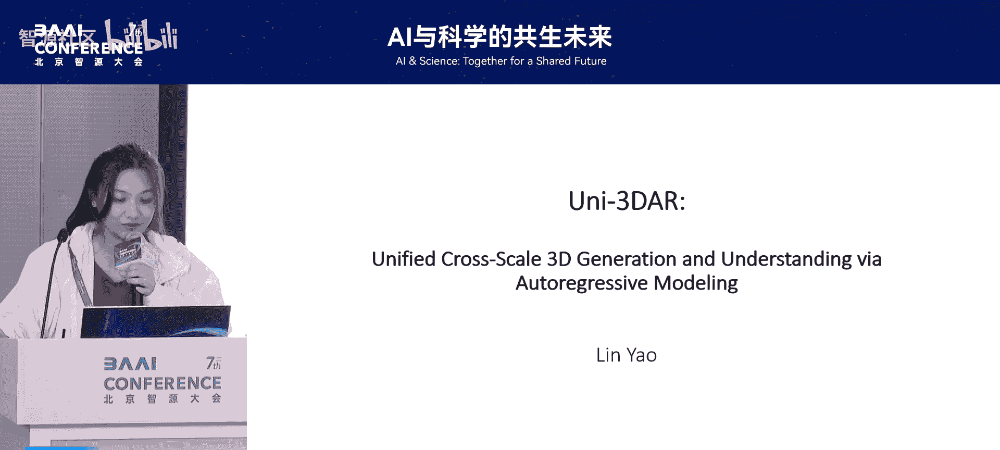

首先，3D建模其实是一个非常基础的任务。不管是在呃微观还是在宏观上都有非常多的应用。在微观上来说，比如说蛋白质的折叠、分子的doing、分子的设计，还有关于晶体的一些任务。在宏观上。

比如说一些3D的基础建模，还有数字孪生机器人自动驾驶、虚拟世界等的一些工程都涉及到这个方向。

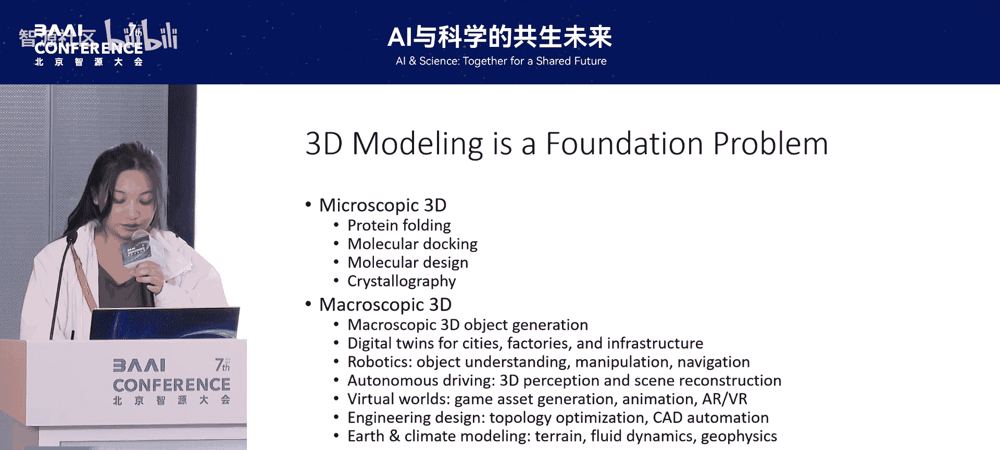

但是问题在于，通常来说，不同对于不同的方向都会有它自己独特的3D表征。然后呃对于不同的方向，也会有不同的模型去适配这样不同的任务。而我们的motivation是我们希望即使是宏观和微观，不同的表征。

不同的任务，我们希望能够用同样的事情去表示不同的表征，我们能用同样的表征去去进行一个表示。然后不同的任务，我们能能够用一个统一的框架，统一个模型去把它完成。

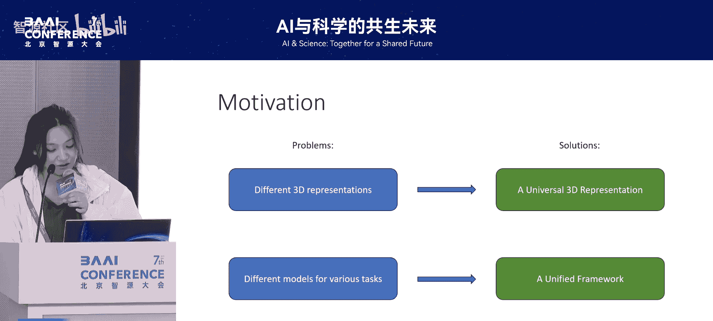

然后现在这个这个图就是我们的框架，它其实主要是有三部分构成，一个是token，就是我们如何把现实中的3D事物变变成一个无损压缩的ED表示形式。

然后token后的这个sequ会进入我们的模型这个模型是基于autoregressive的一个模型，然后会用我们独特的一个ma prediction的机制去做。然后最后是它的任务。

这个任务可能是一个生成性的任务。比如说我输入一定的条件，让它去生成对应的分子或者生成对应的晶体，也可能是一个理解性的任务。比如说我们输入一个晶体或者一个分子，去让它说呃整个的这个晶体，它可能有什么性质。

比如说它的碳的吸附性体吸附性或者说每个原子，它的比如说自身电子或什么是多少。

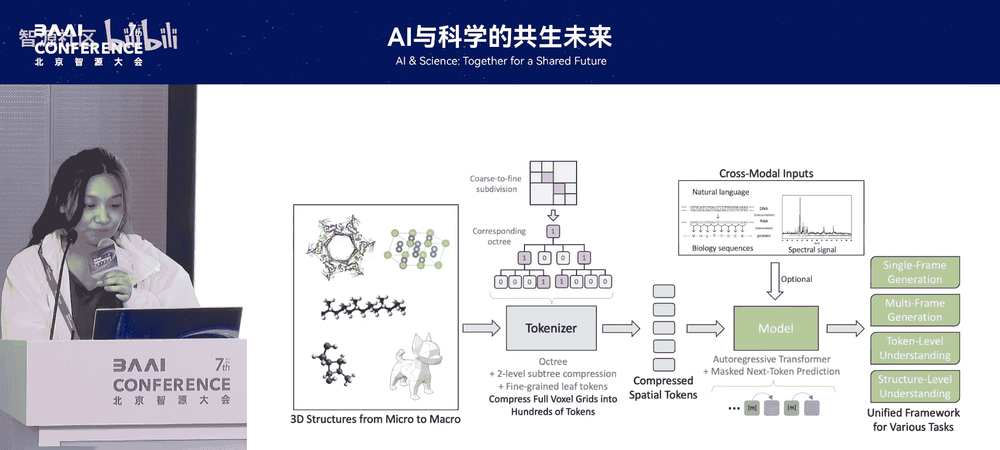

然后下面我我来讲一下我们到底是怎样做这个工作的。对于ED或者2D的数据来说，它其实是天然能够被深度学习模型所呃直接当做输入去编辑的。呃，ED来说呃，非常简单，它是一个复杂度为N的一个东西。然后2D来说。

它会是一个N方的东西。即使比如说一个2D的图像，它非常的大。比如说是1024乘1024这样子一个高清图像。我们仍然能够用一个方法叫做ch去把它压缩。比如说我有1024乘1024的图像。

然后16乘16是一个ch。然后经过这样子的ch之后，这个很大的一个数据量会变成一个很小的数据量仍然非常适用于模型的建模和输入。但是对于3D来说，这个事情变得非常不一样了。

因为3D如果是一个你以一个立方体去看它的话，编长为N的话，它会是一个N的3次方的复杂度。这个复杂度如果直接经过任何处理的去进行一个模型的输入的。

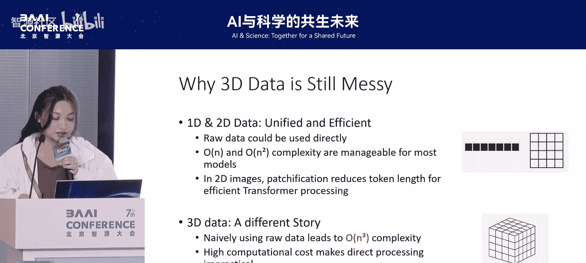

话它的计算量会会是非常大的。当然，前期的前期人做了一些工作，然后。不用不让模不让3D模型以一个三次方的复杂度去进行输出。后这些工作包包括work point cloud plan这些方式。

比如说大家非常常见的point cloud机制，也就是说我们把3D模型建模成一些点云，然后点云的数量肯定是远远小于这个东西的体积的，然后这样子就可以作为一个很好的输入了。

然后对于然后对于宏观呃这个是一个宏观的一个角度的一些做法。对于微观来说，通常大家就会呃以原子的角度去做。比如说这个模这个分子有多少个原子，这个晶体有多少个原子。

我们会以原子作为一个 nodeode去进行输入，然后忽略掉这些空的节点。然后这样子也是一个非常有效率的输入。

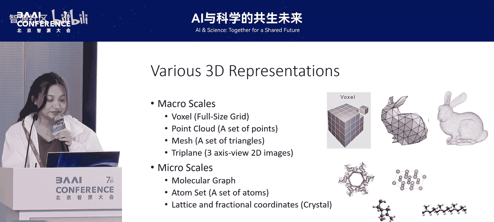

那么这些这些这样子的输入会有什么问题呢？当我们只只把飞空的这些节点进行输入的时候，它其实是非常具有稀疏性的，这是非常好的一点。然后这种稀疏性的表征，它能够非常快速的计算。

然后也非常适应于一些理解性的工作，比如说分类或者回归。但是当我们想要做一些generation生成类的工作的时候，我们发现。这样子的表征其实带来了很多的困难。

比如说呃当我们把这个生成的表征定义为一个autoregressive模型的时候，这些3D的表征，它其实是缺乏一个自然的输入顺序的。

因为比如说我们auto regressive是一个one的 sequence。那么这些3D的散点，哪个是第一个输入的哪个是第二个输入的这个顺序性其实是非常令人混淆的。

然后第二个问题是呃autoregressive transformer这种表证，它非常善于处理这些离散的数据。但是对于3D建模来说，比如说原子的位置，它其实是一个连续性的东西。

那这个连续性的东西如何被建模也是一个非常让人苦手的点。那么如果我们不用autoregressive模型，而使用diffusion模型，这个事情会是什么样呢？

首先这个diffusion模型它的输入和输出的尺寸是一样的。那么比如说我们要输出一个晶体，比如说它包含100个原子，那么输入我们也要预先预设这个东西有100个原子。然后第二个问题是呃。

diffusion模型，它需要一个很好的从一个呃随金的no，然后到真正我们想要生成的那个不管是晶体还是分子也好，一个分布，它要有一个很很好的呃很好的那个优化通路去做它。然后这个事情呃。

当然也有很多文章去研究它。但是这个路径的设设置的好与坏，其实非常影响它的那个最终的效果。

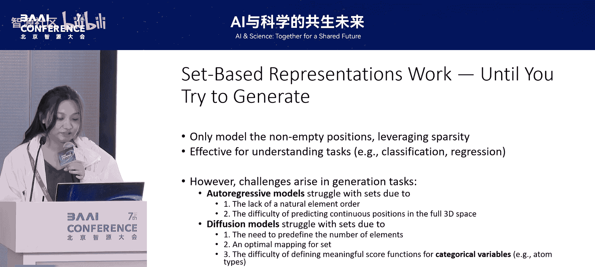

然后。所以说我们可能不希望采取diffusion的方式去做。然后我们如果我们仍然采用auto regressive的模型这个方式去做的话，那么我们就必须要去。给定这个3D3D建模一个顺序信息。

然后让他能够一个oneD sequence的顺序去把这个3D去生成出来。

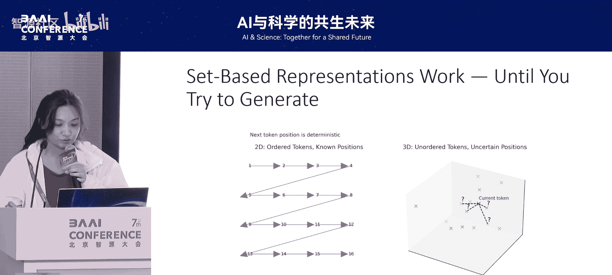

嗯，我我我们会在做模型的时候思考怎么样算是一个好的3D表征呢？然后我们我们的方法上用了一个fn details，就是我们不光有一些粗力度的表征，也有细力度的表征，这样子它能够提供好的表现力。

然后我们即使有粗有细力度的表征，它仍然是一个非常有离散性的，非常有稀疏性的东西，这个稀疏性让它能够非常快速的去计算。并且因为我们是一个3D表征，并且没有经过一个非常复杂的过程仍然保留的它全部的3D信息。

所以说它对模型是容易理解的。

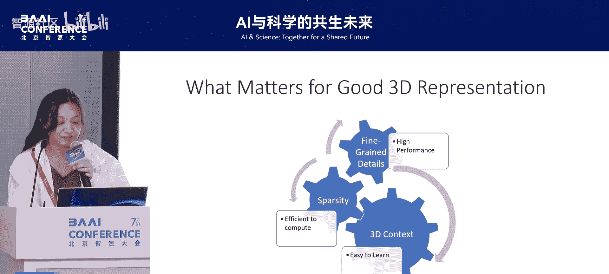

然后这个这个图就是我们如何去做的这个tokenizer，就是我们自己的模型是1个3D建模。但是为了让大家理解，更好的理解，我们可能采用一种偏2D的呃图，让大家去理解。就像第一个OK能看到鼠标。

像第一个图来说，我们有一个边长为8的一个呃一个格子，里边有两个轻。我们如何能无损的表达。就是这两个轻的编码，把这个一个2D结构变成一个弯D sequence呢。😊，首先我们把最大的这个边糖为8的格子。

然后就是分分成4个格子。然后我发现这两个氢落在了第一个格子上和第四个格子上。然后我们继续把那个飞空的格子细分，就是把第一个格子再分成4份，然后发现这个氢落到了呃更细的一个格子上。

然后同理在就是中心点为66的这个格子，同样再继续进行4分，然后发现这个氢落到了中心点为55的这个格子上。然后通过这种嗯分叉数的方式。我们可以从一个很高的维度，很粗糙的一个维度变成一个很细粒度的维度。

然后就最后一步，我们在一个最细分的这个格子上，我们可以进行下一步判断，就是说这个这个原子到底是什么原子。然后它在这个最细力度的格子的偏移是多少。然后给定这个这个原子最终的一个位置。

然后最上面的是一个平铺的表征。然后下面的这个B图是它的二叉树呃，八叉树或者说呃二维的话应该是四叉树的一个表征。😊，就是他从呃level零的一个最粗力度，然后到level一就更细了一度。

然后到level2就更细了一个力度。然后到最后一个f grade层，就是在最终这个小的方格内确定这个原子类型和它最终的位置。

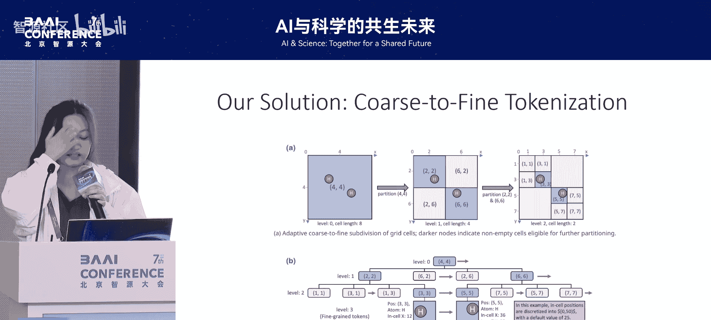

然后下一个图就是因为我们是一个从树状结构撑平成一个弯D sequence的过程。你也能够看到就是从从这44的节点，然后变成后面这个四个节点。然后呃有有蓝色颜色的就是飞空，然后有白色的是空。

然后下下一个的话就是这样子的算是一个广度广度优先搜索数吧，然后把它平撑成平摊成这个弯D sequence的过程。

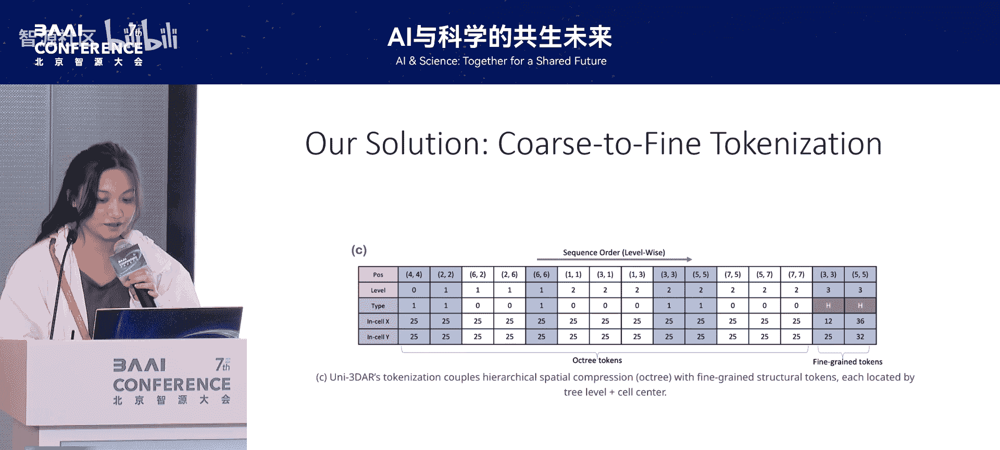

OK然后我们发现。😊，这个过程仍然是比较缓慢的原因是，比如说我们有一个节点，然后我们会做4次banary运算，banary prediction去预测它是n or而飞空。这个事情其实是很麻烦的。

但是我们就是那那这个4次的二进制运算，我们其实可以认为它就是二的4次方个类嘛。比如说。飞空空空飞空就是1001飞空飞空飞空飞空就是1111这样子的东西。

其实我们可以把一个banary classification变成了一个二的4次方进制的一个东西。当然我现在说的是因为我在一个嗯二维去做。如果是如果是三维的话，就是一个八叉数的东西。

而不是而不是一个四叉数的东西。

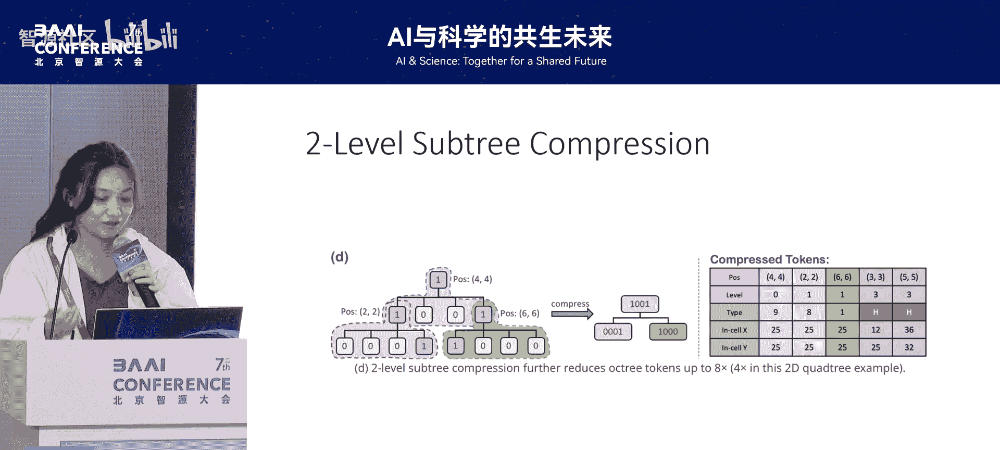

然后这样子我就把我们上图中可能需要13个token去表示的东西，然后简化成了5个token去表示，这就是它就是如何在二叉树的基础上进行了一个tto level的 sub compression。

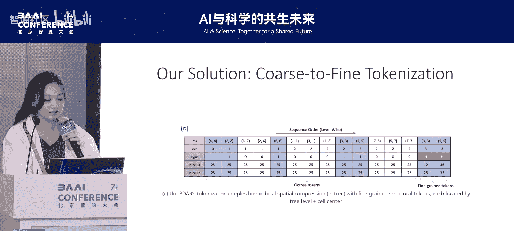

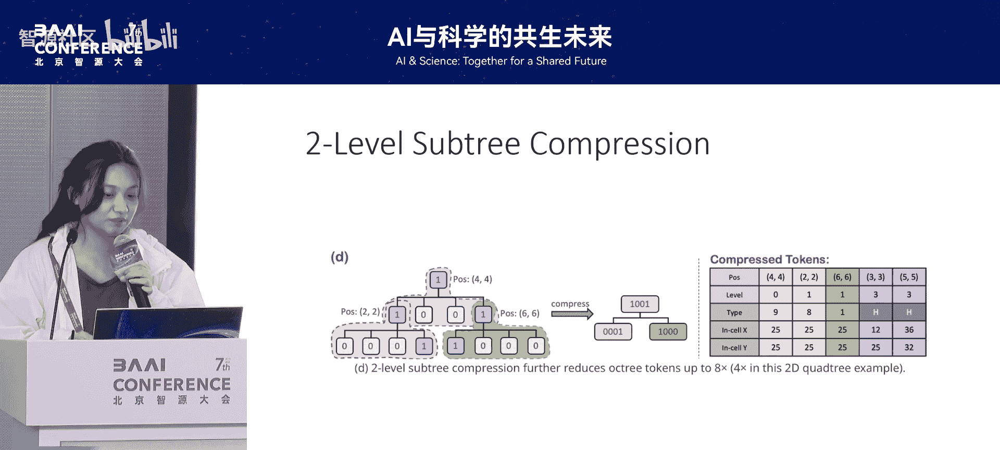

OK然后这个是如何从那个最粗力度到细力度的过程，然后在处理细节上，我们会对呃宏观和微观稍有区别。在宏观的时候，在微观的时候，就是如同我之前上文说过的那个样子。

我们用我们在最细力度的那个表格上直接预测它的item type and就是它里边的那个坐标3D格内坐标，然后这样子去拿到了它的结果。但是对于一些宏观的东西。

我们可能就只预测类似于里里边的一个点就是用VQVAE把这个cube呃进行一个编码和解码的方式去做了。这个是微观和宏观上的差异。

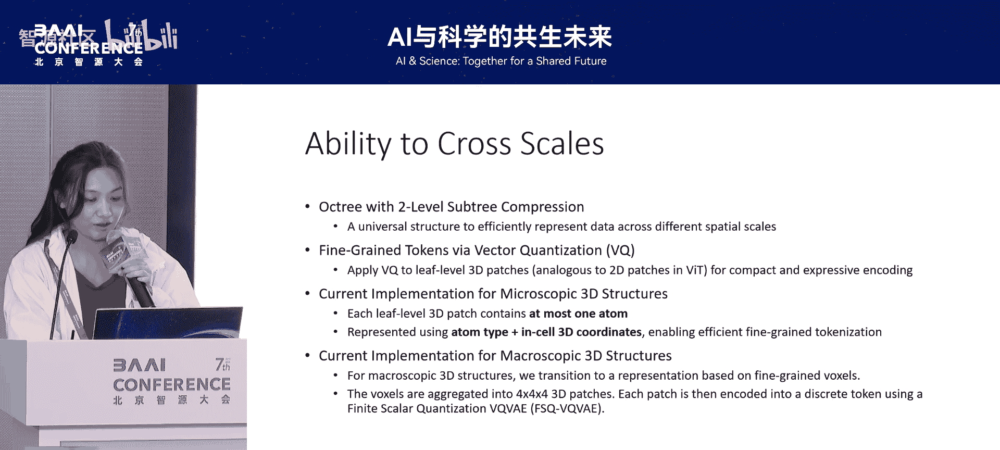

好的，那我现在总结一下我们这边。做token的一个工作，就首先做了一个oc，它是他能把3D到2D不是3D到1D进行一个完全无损的压缩。

然后第二个f grade token就是把呃oc tree最后那一层最细力度的层，然后到底是一个什么东西，它是一个原子，还是说它是一个呃点云还是一个什么进行一个更细力度的呃。呃，预测和表征。

然后做了一个tto level of compression，就是我们在做auto tree的时候，不再是做N个 binaryary prediction，而是作为一个二的N次方分类这种方式。

这样子能够减少token的数量，从而增加这个东西的效率。在这三个东西的基础上，我们就是做了1个3D到ED的完全无损压缩。并且它这个东西也做成了一个跨尺度的东西。它适用于各种不同的尺度。

不管是宏观还是微观，就不管你有多大或者多小，都能靠这套嗯表征来进行表示。

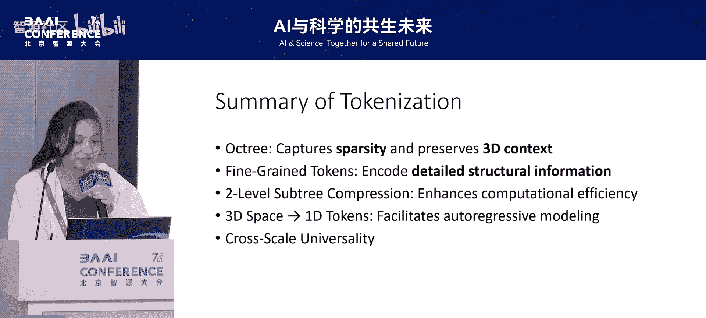

好的，然后上面我们说了如何做tokenizer，下面我我们来说一下这个模型是一个怎么样的设计。

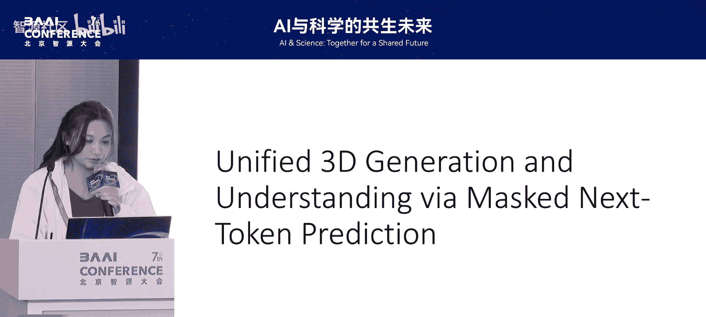

然后这个模型的设计可能要先从两个故事讲起，一个是bt和GPT就最开始transformer出来的时候是bt这个东西非常的火。因为它对理解模型有着非常高的指标，可能不需要多久的训练，就能达到非常好的效果。

然后GPT是在生成领域一直非常火。但在理解领域，它一直指标超不过t，然后直到随着数据量的增大，随着模型参数的增大，出现了一个scal的效果。

然后让它让GPT模型即使是在理解的领域也超过了t这个然后第二个故事是GPT for里还有GPT的一个故事。就是最开始的GPT它的呃文本和图像其实是分别的两个模型。当它需要呃产生图片的时候。

它会GPT four然后去生成一些文字，然后用这个文字进入里这种文声图的一个模。然后再去生成图。但这样子这种二阶制的东西非常伴随着嗯信息的损失。然后呃后来他们自己也意识到了问题。

然后在这这PT4O的时候，其实把那个呃图像的理解和图像的生成全部都集中集合到了这个这个里边，然后终于说这个东西的就是图像生成效果非常好了。是或者说改图效果非常好了。

不会出现以前就是用户觉得的一些图生成的绿顺不对马嘴的一个现象。然后这个这个事情跟我们说就是一个统一的就是理解和生成并重的统一的，并且是一个N的 toN的模型是多么的重要。

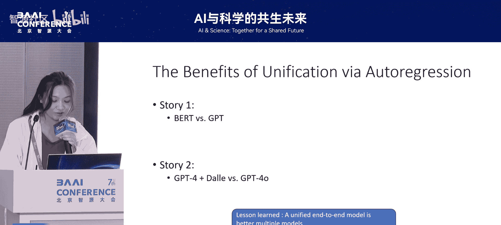

然后所以我们我们就是也是希望用一种auregressive的这种transform的方式去做这个事情。然后呃有一个当我们把我们的token neither用到这个模型上，我们发现了一个很细节的问题。

就是说呃它的坐标因为有一些空有一些飞空嘛，飞空的就不会再被呃再被下面去预测去去提及了这个事情呃造成一个问题是，比如说我们第一个token是呃44这个token，然后然后因为他他预测了它预测的值。

比如说是1001嘛，然后我们下一个是22。然后再做下一个的预测的时候，我们发现就是6226这种东西被跳过了。然后直接会跳到66。然后这个卡还好，因为他们本身是一个负节点的子节点。

比如说从66跳到33这个事情，呃，这个下下一个点到底是什么，会变得更难预测。因为你会发现。33是22的这个的子节点，这个东西就是需要。

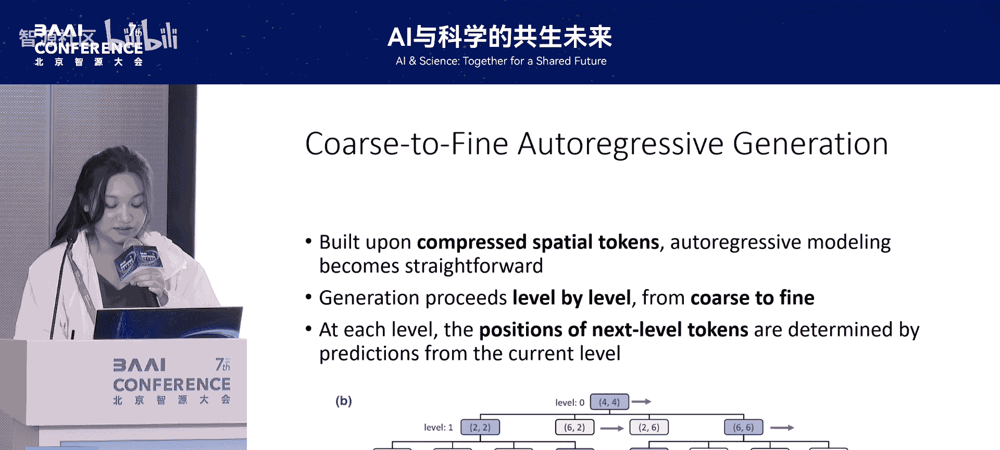

这个东西就是他它有一定的灵活性，就是说我要下一个要预测的token。和他和上一个并不是一个非常有顺序性的关系，而是他会有灵活调整的一个关系。

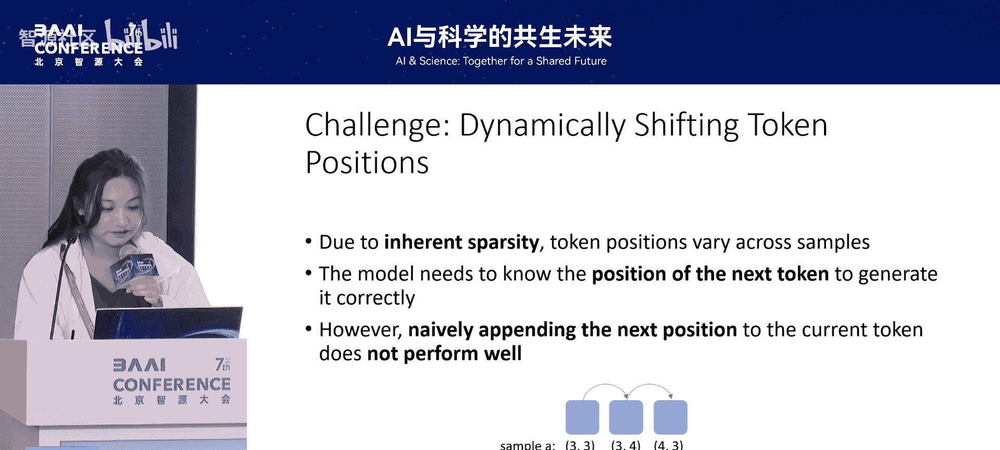

然后在这个基础上，给nex token给nex token prediction它提供了一个难题。比如说我们就是要做传统的nex token prediction。

那我我因为我下一个我的pos根本不知道嘛。那我只能下一个的下一个token，我的pos也要预测。然后这个他这个下一个 token那个就是是不是空或者什么什么样也也要预测，然后要预测的东西就会非常的多。

那但是我们发现下一个token这个东西的位下一个 token的位置，这个东西是已知的。就是说我们在4次预测成1001之后，下一个就是token肯定是2266这种我们可以维持一个候选列表去给下一个东西。

这个东西是不需要预测的所以说我们希望加以改进。

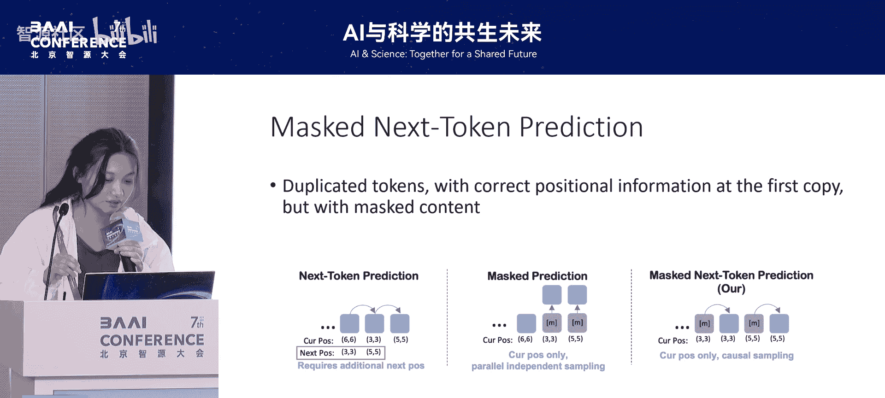

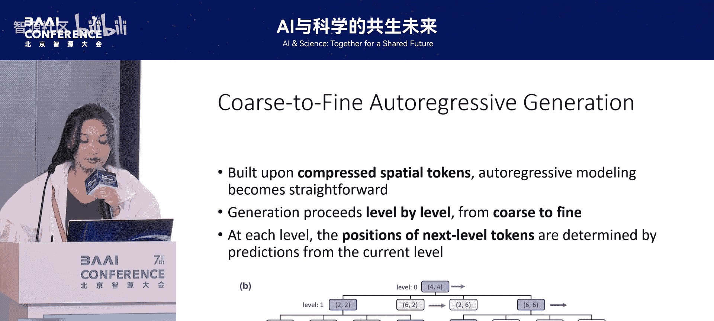

然后如果说我们用musask prediction的方式，就是呃我我给他的位置，然后让让他去预测他的那个结果的话，但是这个结果无法从output这边加回到input这边，然后使得嗯。嗯。

使得使得我们这个输入input这边就会就会只有只有它的那个位置信息，而没有更细节的信息。这样子其实也是很难预测的。所以说我们进行了一个融合。

变成了一个master network prediction的方式。他的做法是就是我们会先给他的pos位置，然后下一个去预测。比如说下一个预测这个格子的呃空和飞空，就是一个二的N次方分类。

就是呃2D来说，就是比如预测1001或者1101，然后在下，然后再给下一个的位置去预测这种东西就完美的解决了问这个问题。因为呃这个这个东西预测出来的东西会在input的这个格子内被加回来。

就是说虽然这第一个是位置信息，加上呃musask信息。但是第二个位置就有了位置信息和它中间的格子到底是什么信息。这样子在input的一个领域内，是他能够看到前面的全部信息的是不遗漏的。

并且不需要预并并且不需要额外预测那些我们已知的pos信息这样子的东西。

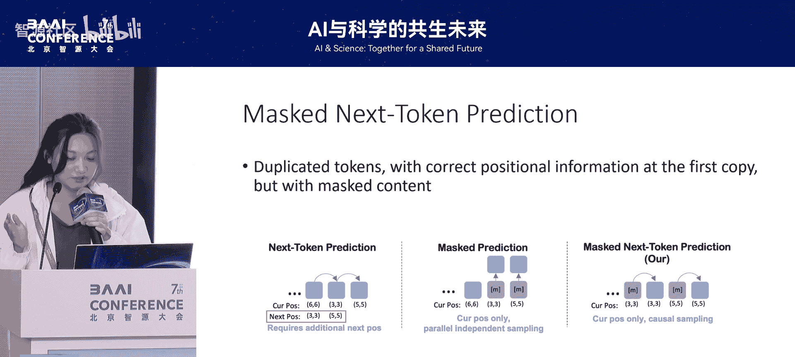

OK然后。因为我们的输出呃，因为这个模型它需要贯彻理解和生成嘛，它其实所以它分为sing from generation multi frame generation token understanding structure level understanding。

就是当比如说你有一个分子的话，你可能只需要这个token只见一棵树去表征就行了。但是比如说你你要输出的是生成的是两个分子，你就可能是建两棵树，就是my frame。如果你是输入了一个分子。

想要去做呃理解任务的话，想要每个分每这个分子里的每个原子都要进行一定的分类或者regress的话，就是token level understanding任务。如果你输入了一个分子。

然后你想要这个整个分子信息的话，就是struct level understanding任务。就我们对每个任务都进行了它的适配，就前面可能有一些多模态的condition。

然后呃下面就开始我们第一颗树的信息，第一棵树的。还有它的fungry token，这是组成了它的第一棵树。如果后面有别的树的话。

就是is此类推就structure two structure three这样子。

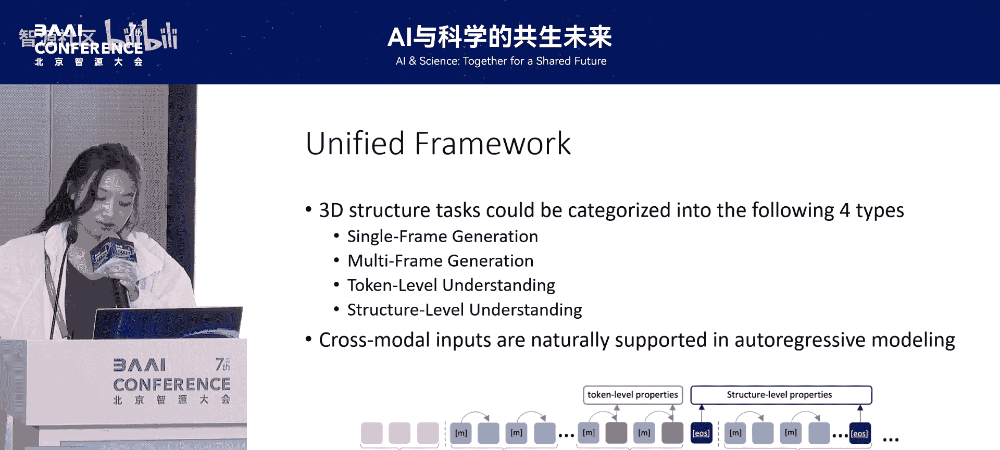

OK然后然后这样子回头一看，我们的模型是不是就比较理解了。就是我们如何用token把一个 three变成了一个oney sequence。然后如何用我们的model和我们。

特别化的mus token prediction去完成这个东西的呃预测和建模。

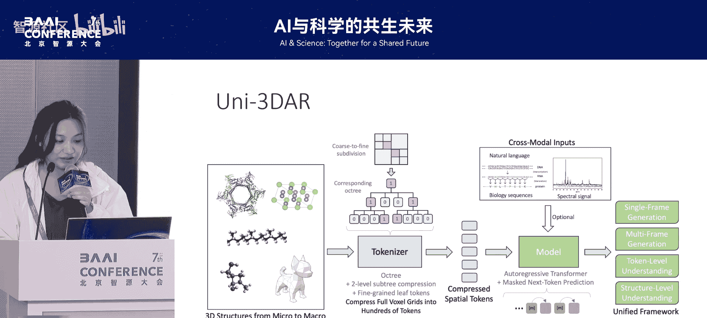

嗯，值得一提的是，因为通常的transformer用的是那个弯 d rope嘛，然后我们用的是3，我们需要做的是3D建模，所以我们把它改成了3D的信息。3D的ro。

然后但是这个嗯其实苏建林那边应该也他也提过，在他那篇论文里。

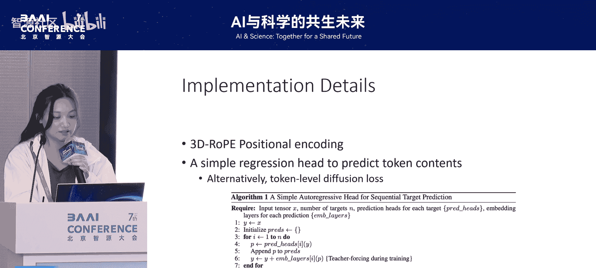

然后后面就是我们的一些。指标上的呃评测，我们做了那个分子的理解呃，分子的那个无条件生成和，然后这这个是分子的无条件生成的结果。然后这是晶体的有条件生成和无条件生成的结果。

然后这个是那个shiftnet的结果。呃，这个是分子都ing的结果。

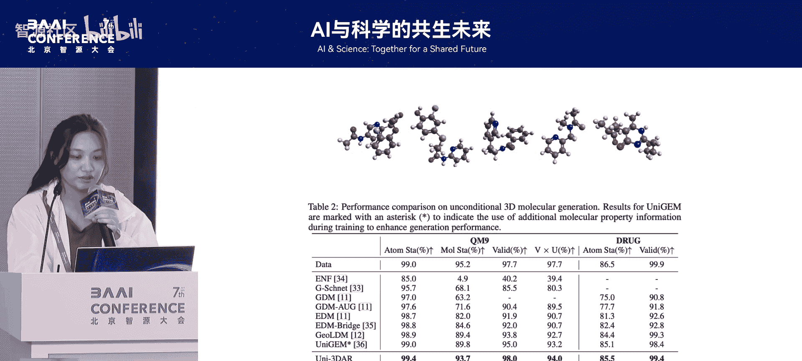

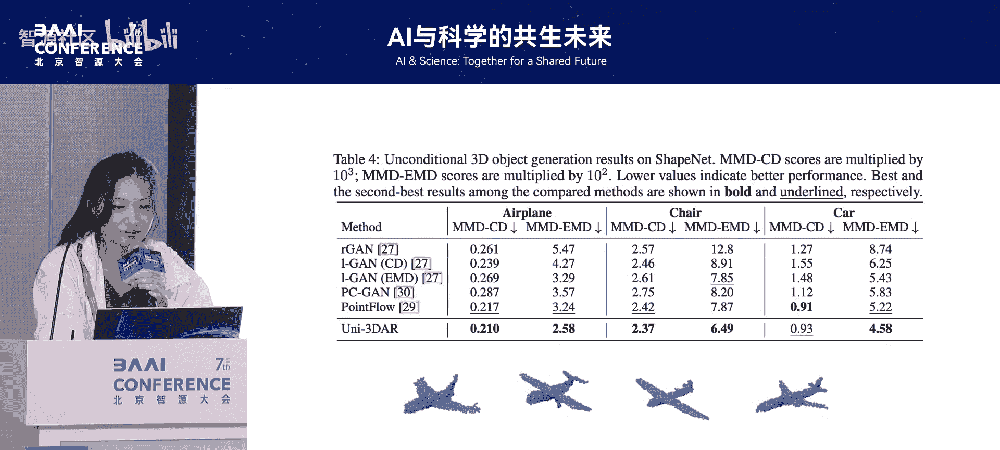

这个分子口袋和分子doing的结果。

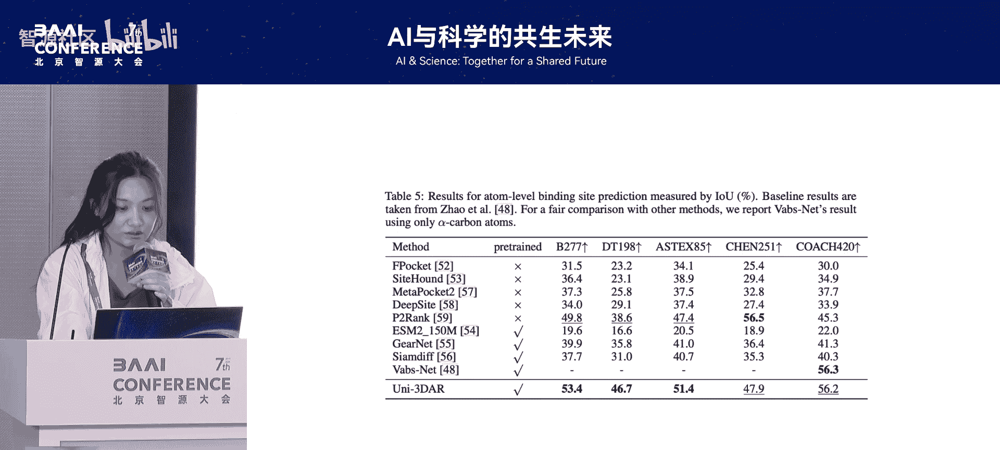

然后这个是polymer。

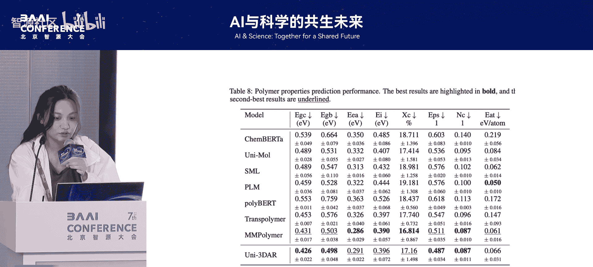

的结果。然后后面有一些就是我们的我们的inference的会呈会大的话，也会呈现一定的限性。这个说明了我们模型的一些鲁棒性。然后在理解和生成任务的时候，他们其实是能够促互相促进的。

就是说当我们做理解任务的时候，我们同时把生成任务的那个呃lo并行着训练。它会使我们的理解任务有更高的指标。

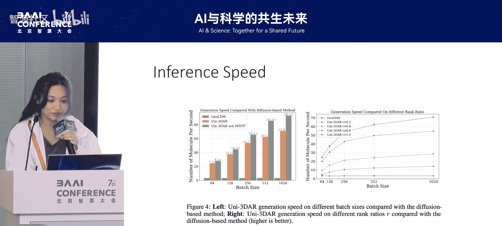

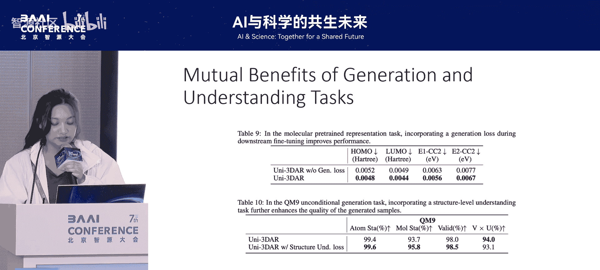

然后这边是我们的lation，就是我们之前提的一些一些t，比如说或者一些什么东西，就是加了会比不加要好一点呃，好很多。然后我们同时因为我们是直接做了预测，就是我们的模型。

然后可能直接过了一个嗯线性分类器，然后直接拿到了它的分类。然后因为之前有论文就是MAR那篇论文说可能就transformer，然后加上一个usion loss要好。

但是我们自己自自己也加了这个发现和加不加差不多，这个东西也也说明就是当我们用这套token和用这套transformer，我们的性能已经足够去解析它不需要其他额外的trick了。

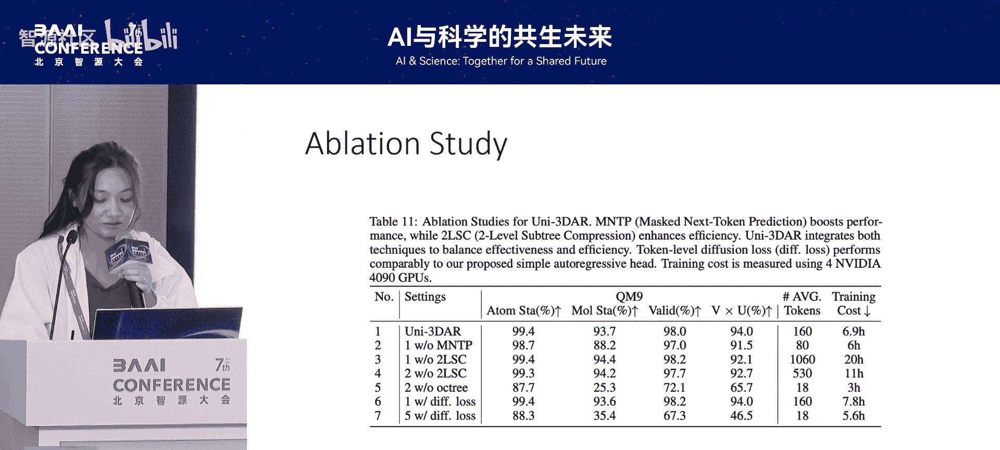

然后差不多就是这样。

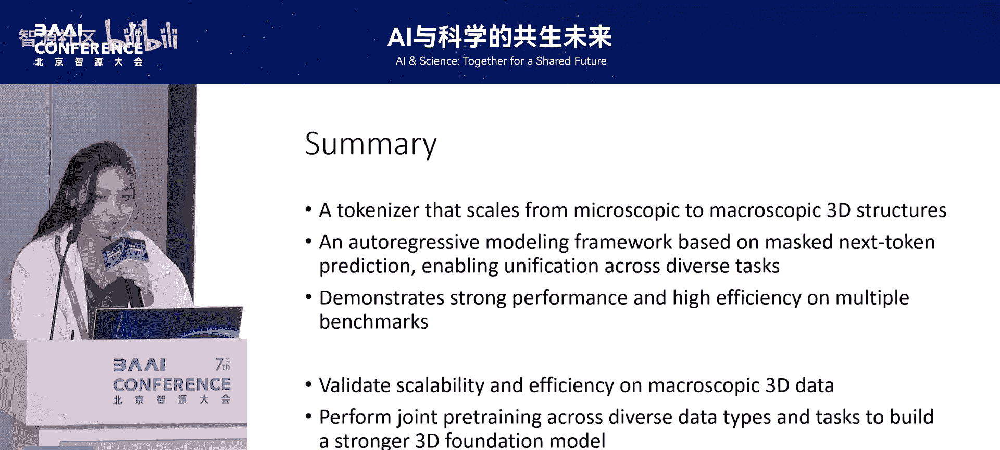

好，谢谢10的精彩分享。我们现场有。有。那我来问个问题吧呃就是呃呃非常好的一个一个工作。我这也是确实现在我们整个这个因为解决3D问题。

所以我们确实整个AI界需要一个去解决3D问题的一个核心的这一个那我相信un是一个非很好的探索。但我其实刚看到有个核心的问题就是其实底层的最核心建模在3上面。

其实现在目前是采用然后当然我相信在解决大部分的重构问题问题上面这个这个这个表达不会有任何问题。但是比说他会在底会有一个物理并不是很友好的就是它不具备拓普的可性。句话说修改的于点名而言。

没有性和个an他他他有这个拓普的呃问题。所以。😊，我们不确定啊，就比如说再往前走，我想要去解决一下底层的这个。嗯更加微观前面上的问题。比如刚才说们说的材料，在电子云前面上的去解这样问题。

依然认为呃这条线是一个非常非常核心的线，以及它的未来的这个走向会什么样子。😊，呃哦。就是首首先可能纠正一点是因为呃我们其实有它有它的那个不变性和协变性在。

因为就是这个roP机制本身是带有一定的平行不变性的。然后我们也通过一些数据增强。比如说我们会随机旋转它，然后让他这个网络其实有就是一定的斜变性在。

然后然后也对比如说嗯point或什么做了一些就是不是point cloud还是什么做了一些处理嗯。然后想一想。嗯，我感觉可就是。这个representation对于一定的灵活性还是有的。

但是确实有可能会后续看一些能不能结合其他的表征，或者说其呃呃不通过AR或者其他方法去做一些更好的扩展。嗯，了解了解谢谢。好，哎，还有。哎，你刚才提到这是一个这个跨尺度的。但其实你如果训练的话。

你会发现你可以这个ts可以是微观的，也可以是宏观的。但你没法同时表征宏观和微观因为是这样的，因为你你如果是用8叉数来表整个空间分割的话，如果是宏观和微观尺度差异过大。你用末顿码去编码整个空间的话。

它的int值是不够的。对，尤其是你GPU如如果GPU训练的话，你是没法用指针来做的。然后指针地址肯定够的。但是in值的36位64位是不够的。嗯，理解就是对于相近的，比如说那个分子和蛋白这种肯定是可以的。

但是比如说是就真的微尺度和宏观，比如桌子椅子这种确实是呃不太能做的这个东西呃差异太大了，确实是还有一个就是比如说刚才那个拓扑的问题啊，你可能可以。结合ve set去。

因为其实CV领域本身就有呃ocnet之类的，就是它有一分片连续的一些呃函数可以连续性的去表征3D结构。再一个是呃你这个东西它呃他那个是包括那个旋转的问题。你是不是可以就因为本身某一个分子的结构的话。

它呃呃就是它其实可以用smile或者是之类的这种的结构化文本表示嘛。那但它其实是旋转是对对分子的局部结构是没有影响的。是不是可以考虑用局部坐标器，然后用用来来去表整个分子之间的关系。嗯，可以的可以的对。

就是非常非常有用的建议，好，谢谢。