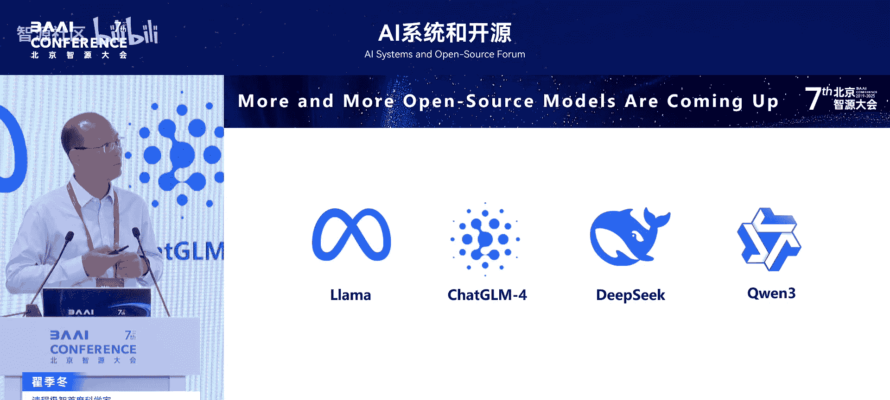
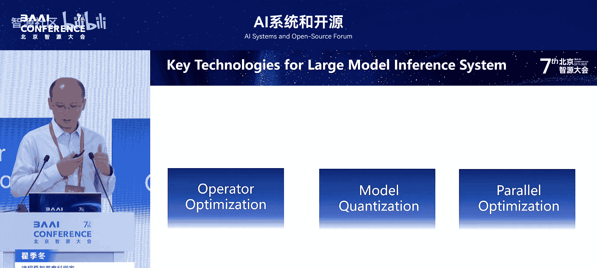
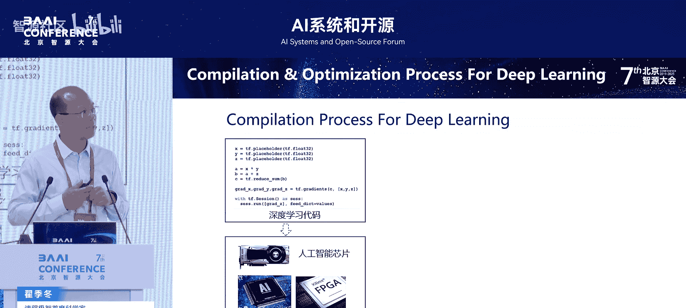
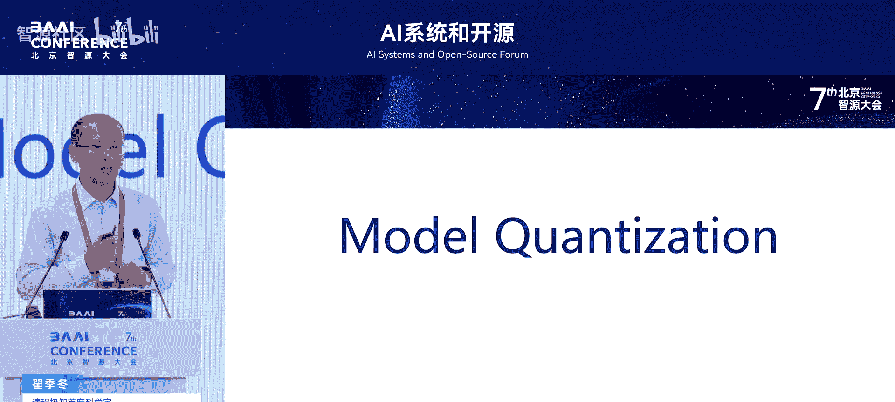
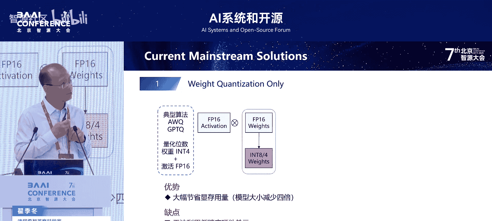
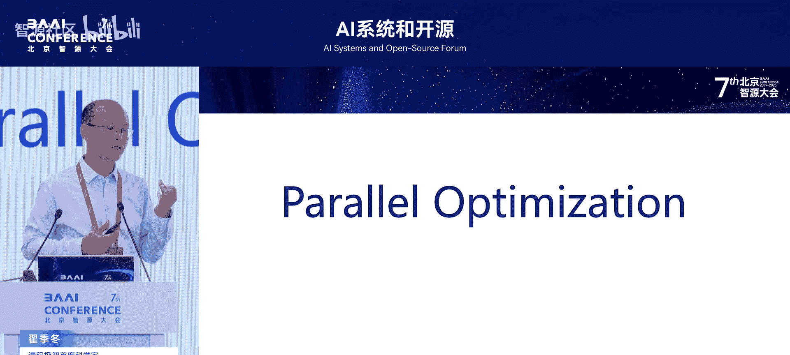
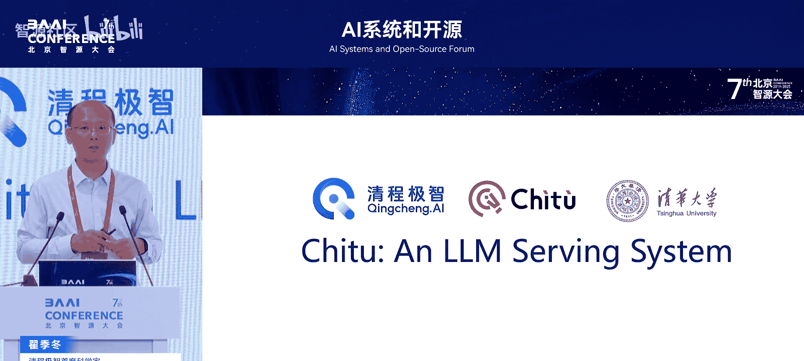
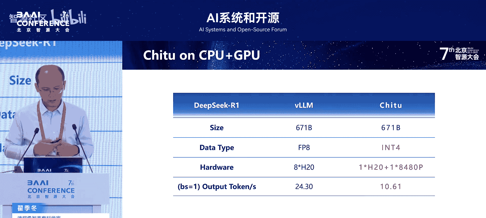

# 2025北京智源大会- AI系统和开源 p02 大模型推理系统关键技术：翟季冬 -BV1g6NjzZEsj_p2-

翟老师翟继东老师，清华大学计算机系常聘教授呃，国家杰出青年科学基金获得者。清华大学计算机系高性能所所长。我觉得我我每一次介绍翟老师。

我都喜欢最后就说那句担任清华大学学生超算团队教练指导的团队13次获得世界冠军。同时，翟老师也是清城极致首席科学家。好，用热烈掌声欢迎翟老师给我们带来。第一个。😊，呃，非常感谢这个李院长的介绍。

然后也非常荣幸在这个咱们致研的大会上介绍一下我们最近做的一些工作呃。哎这个是直接往前。诶。啊，好，那个我我今天的这个报告题目是呃大模型推理的一些关键技术，主要是围绕着这个大模型推理相关去展开。

然后大家看就是说其实我觉得今年呢一个从过年到现在一个最大的这个变化。大家知道就是deep seek这个从过年那天开始这个一直到现其实应该是过年之后的一两个月，我觉得非常的这个这个火爆。

然后而且呢我觉得随着deep seek这个开源呢，其实也带动了中国的很多模型开源。大家看到包括像上海的基业星辰，然后包括像阿里也开源了一系列的模型。

所以说我觉得其实今年呢其实是我们能看到非常多好用的这个模型开源。然后这个开源呢，其实我觉得它带来的一个非常大的好处，就是说大家已经有了很多免费的好用的模型去尝试。

然后大家就开始去尝试这个各种AI的下游的应用。所以说有人说2025。

5年是这个人工智能应用的元年。也就是说其实我们有了像deep seek这些 foundationation model。那大家其实就在很多领域探索，在比如说交通啊、医疗啊，教育啊，各行各业的应用。

然后我们来看一下现在大模型的这个发展呢，其实我觉得有几个趋势。一个趋势呢，大家看就是说这个像模型的尺寸，还是在持续的增长。比如像deep seek这个V3有671B。

然后另外一个呢就是说我觉得模型的结构呢，其实也是有一些变化。比如说这个像MOE然后或者像多模态里面有这个MOT，就是说也是引入一些非常复杂的一些结构。然后同时呢其实我们能看到这个大模型呢。

其实有展出不同的形态。比如说多模态视频，就是说还是在复杂性方面带来了很多一些新的一些挑战。然后我们就回到其实跟我们今天论坛主题比较相关AI系统。其实大模型推理呢，它非常这个具有挑战呢就。

就是他推理的成本实际上是非常高。我这里其实给了几个数字，一个是这个chaGPT这是其实比较早的数据。他每天呢大家用这个chaGPT它推理的这个开销几十万美金。然后呢，他在知乎上写过一个这个博客。

然后他讲了说他每天的这个成本也是大约是这个是几万美元这样的一个开销。然后大家知道实际上大模型在推理的时候用面给其实它90%以上的这个开销都是这个算力的这个开销。因为在这个AI的芯片上运行。

然后那这样的话呢，其实我们如果希望大模型能够最后落地千行百业，一定是希望说把大模型的推理的成本要显著降下来。只有这个推理的成本非常低。这样的话呢，其实我们能才能在很多领域用下来。

然后我今天呢其实重点讲一下跟大模型推理，怎么去把它的性能和成本降下来的三个关键的因素。第一个呢是。这个算子的优化。第二个是这个模型的量化。第三个是这个并行的优化。首先我们来看这个算子的优化。

算子的优化呢，实际上在大模型推理里面呢，实际上至关重要。这个大家知道，其实dep seek在开源周的时候，它每天开源了一个代码。那其中呢这5天呢有两个是这个算子，有包括这个flash mRA。

然后还有这个是这个矩阵程，其实这个大家可以感受到，就是说算子，就是说我们要想把这个大模型的推理的性能发挥的极致。那你中间每一个算子的性能，一定要把它做的非常的好。

但是另外一个方向我们来看，其实我们就以英伟达为例。现在其实硬件呢，因为我们其实要在这些AI芯片上去跑这些大模型推理。那硬件的发展呢其实有几个趋势。第一个呢大家能直觉的感受到。

就是它的峰值的性能在持续增长。然后内存带宽也在增加。但是另外一个呢，大家如果说在这个英伟达GPU里面就写过代码就会发现，其实它从最开始的像CP的这个架构提出来扩大 call。

它已经最近这些年之后增加了很多硬件单元。比如说tener call，这个大家应该是耳熟能详。然后还有像tenser memoryac这个加速的单元，什么异步的拷贝。

也就是说实际上呢在它这个芯片里面就增加了很多很多这个硬件的这个新的功能单元。那它这个带来的一个挑战什么。也就是说你要想在这个像英伟达芯片上想把这个算子，写到发挥到硬件的极致，这件事情就变得越来越难。

我这里其实给大家一个例子，大家知道其实。这个自动的这个边有一个叫tton是opI写的，他希望就是程序员来写这个python代码，然后他自动的帮你转换成高效代码。然后这个大家看这个曲线。

这是写这个MRA然后下面就是tton生成的性能。上面是这个dC团队手写的这个M大家可以看到这两个之间的gap越来越大。为什么呢？就是因为现在的AI芯片，它增加了很多硬件功能。

那自动的代码生成越来越难把这些新的硬件能利用起来。然后我们简单快速回顾一下，其实大模型整个它的推理过程。其实对于大部分程序员来说，它在拍套里面写的是python代码。

然后编译器呢实际上会把它先转换成一个体系结构无关的图。那这个图呢我们就可以做一些体系结构无关的优化。比如说算子的合并啊或者算子的分裂等等。然后这个图再往下呢，其实我们就可以调一些算子库。

那下层呢就可以做一些算子代码生成的这个。

优化。然后其实在图层呢，其实已经之前有很多类似的这个工作。比如像他so一些。然后他核心要做的事情，就是说我要把大模型的这张图，我可能会做一些，比如说我把一些算子，它没办法把GPU利用好。

那我通过做一些合并，然后能够充分的发挥硬件的这个性能。然后再往下呢，其实就是每一个算子这个代码的生成，也就到了这个代码生成这个阶段。那代码生成，其实它就会跟芯片结合的比较紧。

我右边呢其实给了一些这个flash m里的代码片段，这个大家如果去读一下，就会感受到它为了把这个GPU的性能发挥到极致。它就要写很多，比如说一步流水啊一系列的优化。那这些优化呢。

其实都是为了把底层的硬件显著的发挥出来。然后实际上呢，我们实验室呢其实过去几年呢也在算子优化方面做了一系列工作，然后上面几个是在图层做的工作，然后下面是在代码生成。然后今天因为时间因呢。

我我重点只讲一个在图层的一个工作，叫flash tenor是今年的呃呃今年我们开源的一个项目。然后它的核心呢，其实简单的背景，就大家能看到，就是现在大模型发展的有一个趋势。

就是这个long contest这个长的上下文呢，它体现在两方面，一方面呢就是输入变长。比如说我们把一个PDF文件喂给它一个法律条文，问问它这里有哪些关键点，然后这是输入场。

然后还有一些是深度思考输出很长。比如说我让它输出一个特别长的，那这些都体现在长上下文。那长上下文就是我这里其实给了像拉马模型。它不同代季的变化，能看到这个它支持的这个上下文的长度呢是越来越长。

那上下文的长度增加呢，实际上它给在底层的运算带来。什么挑战呢？其实就是之前很多计算密集的这个算子就变成仿存秘集。比如说我左边给了一个例子，那可以在这个举阵相乘的时候，就会产生大量的这个仿存的这个操作。

那这样的话呢，其实去把一些算子做合并做fusion就可以来充分的利用底层内带宽实际上是一个非常有效的办法。但实际上呢就之前我们发现呢很多在这个图层做nal fuion的这个工作呢。

它基本上是做的比较粗力度。我这里给了一个例子，这是HRO的这个模型。然后大家一看就我上下呢实际上是两种fuion的策略，向上呢就像flashten一样，我把这些算子都合并起来。但是呢它的效率非常低。

那为什么很低呢？这个我我核心呢就是说它这里边有两个规约的这个操作，叫reduce零和reduce一，它实际上是在不同的维度规约，如果简单的合并之后呢，并应度就很难打上来。那还有一些工作呢。

就是下面这张图片，我把它拆分成几。算子，然后它的效率也不高，在A100上只有应峰值的3点几。那它的主要原因就是因为不同的这个Knal之间要传大量的这个内存操作，导致效率效率。然后其实针对这件事情呢。

我们做了一个工作叫flashtener。它的核心呢就是说我们在之前粗力度的这个合并上。其实我们做了一个相对比较细粒度。就它的核心的idea是这样子。

就是说我会分析这里边就是说在大模型里张亮的这些细力度的一些属性。比如说规约操作，我会看它是到底在哪个维度进行规约。然后我同时会在这张数据流图上，然后通过数据流的思想。

再来把所有的这些张量的这些它的一些变化的一些属性，都把它分析清楚。然后最后再来执行这个各种图层的变换。这个大家感兴趣，可以看一下我们今年的这个文章。然后这个大家可以看一下效果。

我们在像英伟达的A100H100上，然后对于典型的模型都做了。其实平均都有1。5倍到。86倍的性能提升。然后大家可以看一下，我刚才举的这个HRO的这个例子。大家看这个例子的话。

其实那在我们的这个这个系统里面，我就会把它合并成两个 kernelnal。那这两个 kernel呢大家看的话，其实它俩呢实际上中间前面的部分会有一些重复。

但是呢实际上我会把这个reduce零和reduce一分到不同的 kernelnal。虽然他们重复计算了一些。但是我可以让这两个算子，它的效率都发挥的极致。所以说刚才讲的这点呢，其实给大家讲。

那要想把大模型的推理的性能做上去。那算子的性能非常重要。那第二个点呢，我想强调就是这个模型的量化。大家知道现在模型越来越大。然后另外呢大家其实能看到一个非常明显的趋势，就是AI芯片里边它支持很多低精度。

比如说像这个我以英伟达的B200为例，它有这个FP8FP4，就是有各种低精度。那所以说大家能感受到，我如果把模型变成低精度的描述，那我记存储的空间。

变小。然后同时呢其实低精度的这些这些它本身可以提供更高的性能。所以说模型量化呢实际上是提高大模型推理性能一个非常重要的手段。那模型量化呢，它主要有三条三个办法。

第一个办法呢就是大家知道大模型里面有很多weight权重，它就只把这个权重量化，我们就叫做weight only。但是呢那我把weight only只把weight做量化的时候，我算的时候。

比如说我把它量化成in4，那我还要在算的时候还要反量化，然后再跟激活相乘。所以说它实际上是只能降低存储，不能带来这个计算太多的好处。然后另外一条这个量化的路线呢，就是把weight和激活。

就是权重和激活都量化。它的好处就是说我可以享受硬件低精度带来的高性能。然后但是它的缺点就是说这个模型的精度会有一定的下降。而且可能对于有些模型来说下降了很多。然后第三条路线呢，其实就是混合精度。

大家知道其实在。

大模型里，无论是激活还是这个这个这个权重，它就有些点呢，它我们可以简单把它叫成离群点。那这些点呢我还是比如说可以用LP16来描述。然后其他的我把它变成in4或者是in8。那这种方法呢叫做混合精度。

它的好处就是说模型的精度呢，基本上跟原先不量化的时候持平。然后好处呢，我又可以享受这个低精度的硬件。但实际上呢就是说你真正去跑一下这个facebook有一个开源的库。然后如果你用这个库呢会发现。

其实它混合精度的性能，就是它这个性能做不上去。后来发现呢就是说这个混合精度呢，就相当于权重里边我既有高精度的浮点，也有低精度的那这个时候这个矩阵程就不是特别好写。

而且这个out也会分散在这个比如说张量里的不同的位置。那所以说呢其实针对这个事情呢，就是说它的挑战什么？我刚才已经讲清了，就是说你要从一个大的这个权重或者激活里面找到这些离群点。比较难。

第二就是说其实我因为有一些离群点，那我把这些离群点刨掉之后去访问，它会引入一些稀疏的访问。那这个访存效率比较低。然后第三个就是说因为我这里有高精度计算低精度。那这种混合精度计算。

也很难把硬件的效率发挥起来。所以说针对这些挑战呢，只要我们从这个包括调度，包括变优化几个层次呢，我们就做了一个系统叫missQ是这个是去年年底我们开源的一个工作。

它的好处就是说我既能享受这个混合精度带来的模型的精度的提升，然后同时我也可以把硬件的这个效率发挥的极致。这个大家可以看一下这个结果，我们其实在英伟达穗源一些AI芯片上都做了。

这个其实呃有相对差不多有跟这个之前的量化有1。5到1。6的倍的提升。然后同时呢就是右边这个表格显示模型的精度，这个值越小越好。然后上面是最上一行是FP16，也就是混合精度，我们能达到的这个准。

确性跟IP16基本相当，但同时我们就能把达到量化的这个效果。然后下面呢就讲一下第三点就并行。其实刚才讲了两点算子。然后讲了这个量化。第三个其实并行。那为什么并行很重要呢？我们就以deep seek为例。

大家知道deep seek呢其实它的模型有671P非常大。我要想把这个模型推理跑起来。如果跑一个满血版，那我就需要好几张这个H100才能把的话，就要至少放下这些参数就得需要八九张。那这样的话呢。

你涉及到多卡去推理的话，那就要把这个并行做好。然后我们来看一下，这是deep seek推理它官方给的这个数据，它实际上是用了一个PD分离的策略。

也就是preview它用一些GPO32个GPUdecode用了144个GPU然后大家可以看，就是说它preview呢是它用了一个在attention阶段是四路的张量并行，将八路的数据并行。

然后ME这个阶段呢，是用32路的专家并行。然后到了decode的阶段呢，他把它attention变成四路的张量36路的数据并行MOE是144路的。

专家并行。也就是说它采用了一个静态的这个并行策略。然后我们来看呢，实际上呢大家可以想，其实大模型在推理的时候，它的场景实际上是非常的这个多样。比如说像平时我们跟一个这样的一个AI的机器人聊天。

基本上我问他的问题也很短。比如说今天什么天气，他回答的我也很短。大家可以简单理解就是输入短输出也短。但是呢比如说假如说你是做研究的，哎，你给他一篇论文，你说帮我生成一个摘要，那它就是输入很长，输出很短。

然后还有一些呢像深度思考。可能你给他一个简单的问题，它会输出很。那这个是输入短输出长。那这个实际上是从用户感受到。那如果从计算机的这个负载。那实际上呢它会对应着它会memory棒的。

就是仿存密集型还是计算棒的。那这样的话呢，其实你就需要去调整这个并行策略能带来更好的这个性能提升，我其实这里给了一些数据。就是说这个针对这个呃这个bb seek这个模型，其实我们。

在这个请求量不一样的时候，就左边那张图片，你会看到它的性能会有差别。实际上呢就是英伟达在他们少儿时间的这个大会上发布的这个dnamo这个系统，其实它前面有一个planner这个模块。

它的核心就是会根据这个用户这个推理的请求特点来调整这个并情。所以说实际上呢就是说那真正要把推理的性能做好。那实际上你要根据这个负载去调整并策略。

然后其实今天呢主要重点讲了在大模型推理里边三个非常关键作用。三件非常关键的技术就是包括这个算子，包括并行，包括模型量化。然后实际上呢我们团队呢就是说从清华，然后包括青争极制。

然后我们一起开源了一个大模型推理的系统叫赤兔。然后这个赤兔推理引擎呢，我可以介绍一下，就是说我们实际上呢大家知道其实在推理里面，我觉得做的比较好的，名气比较大的是博克利。这一个组有两两拨人。

一个是做的是VM，一个是SG浪，都是出自这个博克利这两个组。然后那我们其实在从清华角来说，我们也开源了一个自己就是这样的推理的引擎代码也放到gethub上面。就大家都可以下载我们最新的代码都在上面。

然后这里面呢，其实我们还是有一些自己的关键技术。比如说前面我讲的，包括在底层的编译优化，包括刚才提到的并行，包括模型的量化。我们把这些技术呢都实现在了我们这个推理引。

。然后同时呢其实我们的推理引擎还有一个好处，就是说大家知道中国的这个AI芯片实际上是多样非常多样化。有像华为的航武纪的。然后比如说海光昆仑天数木兮等等。

那我们其实想办法那把我们推理引擎都去尽量的去支持这些国产的芯片。然后同时呢向上也支持各种各样的这个模型。然后这个大家可以看一下数据，就是说大家如果在网上下载我们最新的这个这个赤度推理引擎的话。

我们现在已经支持像华为木兮的一些芯片。比如说大家可以看这个是在华为的这个深腾90B上。然后如果要跑这个dep seek这个R one满血版的话，90B需要32个卡。那如果用我们去跑的话。

我们是要用了MP4，然后同时用了我们混合精度的量化，我们只需要8个卡。然后大家看其实这个模型的这个精度，就是都是用这个MMO这个LU的这个nch mark。那我们的这个精度和它原始没有量化的版本。

基本上还是很接近。然后同时呢我们原先是用32个卡在这个VRM里跑，因为VRM也支持华为的升腾，但是用我们只需要8个卡，而且性能还比这32卡会快3。26倍。这个大家可以去试一下。

然后如果是像千问32B的话，那用我们的这个IP4的话，我们只需要一块角0B就可以这个跑起来。然后这个是在木西的平台。木西的平台如果跑第c满血版的话，需要32个这个C550的卡。那用我们只需要16块。

而且我们的这个性能其实还是要比这个这个32块还要好一点。这个大家可以去尝试。也就是说哎我们这个里的核心的实际上我们因为木西的卡它本身不支持这个IP8，我们做了一个在线的编译转化变优化的一个工作。

可以把这个算进行一些优化。所以说其实用一半的卡，还可以达到跟他32卡的性能。然后同时呢，其实在我们的这里面，其实我们也支持异构调度，也可以用单个GPU把这个这个呃deep seek跑起来。

然后这个是我们用单个英伟达的H20，然后可以去呃这个跑起来这个deep seek这个吞吐能达到这个10。61这个水平。

然后这个是我们就是做这个推理引擎的一些想法。就是我们其实有三点想法。第一个呢就是说其实我们因为是一个开源的系统。那当国内呢出来出呃发布新的这个模型的时候，那我们会尽快的支持。

然后第二个呢就是说我们其实还是希望做到极致的优化。就跟今天我前面讲，就是说我相信大模型推理如果能用起来。那一定是大家希望说推理的成本越低越好。这样的话我们才可以享受大模型给我们带来的好处。然后第三个呢。

其实我们也会去做各种国产化的适配。就是说让我们的这个因为我觉得这方面呢，其实对于国外的项目来说，它不见得会支持更多的国产的芯片，然后这个是我们吃兔的一个ro map基本上呢会从三个方向。

大家可以看最底层的就是dversity。那我们会支持更多的。我们现在已经支持华为木西，然后这些芯片。然后后面呢也会对像这个穗源AMB等一系列芯片支持。然后第二个就是低成本。低成本呢我们做了好多事情。

包括边优化，包括量化。然后再往上呢，其实就是大规模。我们现在呢其实也在在白卡千卡更大的规模，类似于像PD分离的技术，也在我们这个尺度推理引擎去实现。然后好，那我下面就总结一下，就是说今天的这个报告。

我觉得就是说大模型呢其实包括AI最后它能够落地。那把大模型的推理的成本降下来，其实是非常的重要。然后如果要降低大模型推理成本，实际上我们需要充分的去挖掘算法，软件硬件的协同优化。而且呢在这个过程中。

其实设计良好的系统软件，对于发挥底层的硬件呢其实至关的重要。好，我的报告到这里。好，谢谢大家。好，谢谢谢谢白老师。😊。

