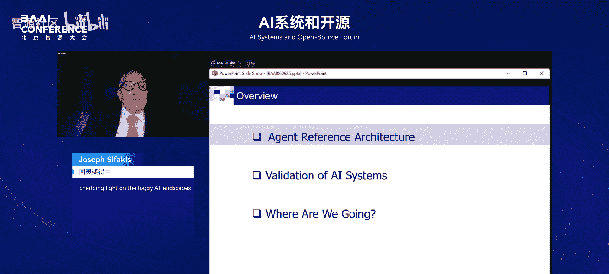
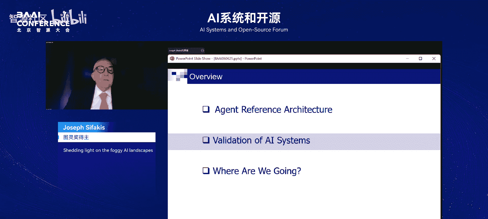

# 2025北京智源大会- AI系统和开源 p03 Shedding light on the foggy AI landscapes：Joseph Sifakis -BV1g6NjzZEsj_p3-

接下来实际上是我们这个论坛一个众磅的嘉宾呃，他是呃jo呃jose。joseph呃，他是呃2007年的图灵奖得主，也是欧洲科学院、法国科学院、法国工程院和美国国家工程院的多个国家的院士。

那呃他们在获得图灵奖的时候，是因为开发模型检查方面发挥了重要作用，检查了硬件和软件行业广泛采用的呃高效的验证技术。呃，但今天那个jophine他肯定给大家带来比较耳目一新的新的topic。呃。

我觉得大家可以留心的去听一下。然后呢呃等会最后joine还希望能够跟大家有一个线上的QA的交流。sohi  jo can you see。Yes， yes。

 can you hear me can you hear me very good very good Okay Okay so ask me yeah please let me start let me start okay so let me start thank you for this invitation I would like to say that I'm not an AI person I am a systems engineer and so this talk is motivated by observations about the evolution of AI that I make with my eye of systems engineer of course now I would like to say that a present there is a great deal of confusion about the ultimate goal of AI and many people consider that this is AGI that has many different definitions but roughly speaking AG is a system that can perform any intellectual task a human can so can out there for humans in different tasks。

And I think that these AGI definitions are misleading because the implic assume that human intelligence can be defined as the ability to perform an un defined set of tasks separately for me this is not human intelligence which tasks exactly how many tasks AGI definitions also suggests that it can be achieved only through machine learning so machine learning is the end of the story and scaling up modern size inevitably would lead to higher intelligence。

 I have a different opinion I think that the goal of AI should be building machines with human level intelligence。

 of course we should agree what is a human level intelligence but I think sufficiently good definitions are already given in dictionaries and these definitions existed before the advent of AI it's the ability to learn understand and think about the world and do and do and achieve purpose by acting on the world。

Can perform impressive tasks， can I perform humans in the execution of this task。

 but they cannot surpas humans in terms of situational awareness。

 adaptation to changes and creative thinking I think it's very important to have a clear idea of what intelligence is if we don't have this。

 we cannot develop a theory about how it works。Now I believe that AI is still in its infancy because we have only building blocks to build the complex intelligent systems。

 AI so far has focused on assistance that are conversational systems。

 you ask questions you get answers and that's it and we would like to have something more we like to have for instance。

 AI monitors that are streamers okay that receives streams of events and then can make predictions and AI situations and of course the ultimate gain goal is to have autonomous AI I hope you understand this and today the impact of AI in real economy is limited the AI industrial revolution has only just begun and its realization depends largely on our ability to develop AI in agents and to build autonomous systems something else that I would like to clarifies the distinction between technical and non-technical systems。

 Tra ACT systems are taking。We can understand their input output behavior they can characterize it by predic can verify their behavioral things like that nontechnical systems have their inputs and output domains defined in terms of sensory and linguistic data now it does not make sense to say that safeGPT is safe in the same sense that an aircraft is safe just because you cannot formalize its input output behavior from a technical point of view but what is new with AI and this is a great thing is that AI enables the construction of non-techn system but also of technical system you see a chest plain system is a technical systems because we understand clearly the rules but we cannot solve with ICT technologies so AI is great but we should understand the differences and limitation and of course autononmous systems share a characteristics of technical and nontechnical systems so I think that the concept of autonmous systems。

is well understood the idea is to replace human operators in complex organizations they are composed of agents。

 each agent pursues its own goals and of course the agents should coordinate to meet global system goals and we talk about collective intelligence and these systems are highly complex。

 often critical because they replace humans distributed dynamic configurable systems that never stop and always evolve Now another important issue is transness of AI systems Transence of AI systems。

 what it means it means that we should be able to guarantee for instance safety of AI systems and probably you know that there are a lot of discussions about safety of AI systems international sumits text and I think most of text believe that we can achieve safe make safe LLMs for instance in the same way we make safe e。

Those are airplanes， airplanes， and this is wrong guing。

Another important thing about AI systems because they are intended to mimic human eyes that we have to consider human ecentric properties so if you visit webage of big tech companies they talk about responsibles AI that is characterized by a set of properties that are difficult。

 if not impossible to assess and people talk about AI alignment with the human ethical values all I can say about this work is interacts completely foundation。

 It's completely empty technically speaking because it ignores a basic epistemic principle if I claim that my system is ethical for instance。

 I should explain what ethical means we don't even understand what it means for humans black act ethically and of course you should provide a equals validation method So this is just just wishful thinking so this is。

An overview of my talk， I will talk mainly about agents because I've been working on autonomous systems for more than 10 years now。

 so Ill present my view about agents， I will talk about validation and AI systems and I will conclude。

Now。I think that AI agents have attracted the growing interest with the advent of LLMs。

 which is an important landmark in the evolution of AI in fact。

And today we have agents that can solve some problems very produce some services interacting with static digital world to what we have is not satisfactory most agents are built based on architectures where we have an LLM and the LLM is augmented with knowledge integrated by engines or stored in a memory and of course now the array paradigm is very famous so I believe that we need a reference architecture。

 the idea of reference architecture is very common in systems engineering。

 you build a reference architecture for complex systems so what does a reference architecture。

 reference architecture will characterize agent intelligence as an emerging property of computation of as the composition of functions so this is my dream how to。

Characterize this as a composition of functions that are independent of any way to implement them by AEI or traditional systems and of course reference architecture should be sufficiently general to cover all aspects of human intelligence in particular the two systems of Kne and you problem know now if we have a reference architecture。

 this could serve as a basis to characterize autonomy as a compositional functions and also to compare different solutions so if somebody comes with a solution we will have some reference to do that and also I think hopefully we can also address agent correctness problem by compositional reasoning but I don't have time to discuss this。

Now， this is。Bbstract view of my agent reference architecture。

 what does an agent it interacts with the world that consists of environments。

 external environment and internal environment I hope you understand the distinction and then you have stimuli produces actions and here the architecture structure around the longterm memory where I put a knowledge about the world can be symbolic knowledge also about the world and you see the different types of knowledge I can have here and the reactive behavior consists of a mod situational awareness and decision make and so this is quite standards from robotics and then what is new here is the proactive behavior so the proactive behavior is what does the proactive behavior produces new goals and these new goals can emerge from the analysis of the self- state of the agent。

Needs。And and so making an， you choose between different goals and you provide new goals。

 What is very important in this organization is the role of the memory because the knowledge of the memory is used to control to enrich the knowledge of each behavior and also to control semant quarter what these two behaviors are doing Now let me give you a more detailed view of my reference architecture So here you see that the situation awareness consists of perception。

 reflection。 I mean， this is standard terminology， So the purpose of reflection is to produce a predictive model of the world based on which you will see which goals are applicable for each applicable goal you will start a planner that will generate action So this is quite standard then what is maybe new is this that I have this practical behavior So everything starts by。

The knowledge by the agent of its purposes so what I'm doing as an agent what I'm is my purpose the purpose is to drive a car so are all the my existential conditions fulfilled do I have four wheels in in good state so if an existential condition is so existential conditions are can be exist of Kpis I mean I know how these all these things can be implemented so if an existential condition fails then a need will appear and I suppose that in the memory needs you have associated meta goals sets of goals and of course you have to check the feasibility of this meta goals so their intent appears and the intent is to execute a meta goal and you have a system that can be a classical system that analysis。

s chooses between goals and the elected goal will be passed to the gold manager to be to be treatedd so this is mainly the idea and of course this is what I've shown you is an agent without interaction with other agents and humans I have a more elaborate model unfortunately I don't have time to talk about that especially this module human agent interaction is very I mean it's very interesting to see how we can define it now just to explain further explain this idea of the proactive behavior so I propose this proactive behavior because I'm inspired from human human proactive behavior so if a human has a need so an existential condition is not to feel hungry so a mental goal is to find food now there may be different solutions to find food and you should make an analysis so there are in fact in the。

We have decision making and choice making so this is the choice making process and the decision making concerns the achievement of a goal and here you see another example it's so network services is that generating I have a self healing goal better goal this can be achieved by different pursuing different goals and how I choose new goals now。

In order to。Build agents I think that there are two important challenges One is to be able to generate good planners。

 good planners， good goal managers now I see many papers that try to do planning by using chain of thought or tree of thought I think this are names I mean these solutions will not work if the environment is dynamic in fact planning is a game to play a game between an agent and this environment and for this you need a very complicated predictive model sometimes this is called look3 and once you have this you have to analyze this this look at head3 and define what we call winning start or winning policies now explicitly building the look3 involves the exponential complexity if you know the rules of the game。

Then you can apply some heuristics as they applied for Alphago。Also。

 it should be understand that Go involve safety and ir reachability and optimization。

 I see some people using， for instance， reinforcement learning for planning。

 but reinforcement planning can optimize solutions can find optimization solutions but cannot cannot guarantee the safety and this is very important。

 So we need to develop technology for that in my opinion。

 the planning should be performed by realtime software。 this is my opinion。

 The other important thing is that we need technology for knowledge management and you have to how to store then the knowledge in my the memory So in theal memory of my agent we know that combat techniques are not good enough to account for seman subties So we should look for solutions。

With knowledge graphs， but even knowledge graphs I think should have some kind of hypergraphs that can represent memory relations between between entities and then we should develop retrieval mechanisms retrieval mechanism that very very important so we know that cosine similarity will never work to capture semantic sub so we should have a retrieval mechanisms that capture different relations and consistency checks so that's very。

 very important so when I update my memory and I add the new knowledge there is this consistent to the already stored knowledge now you should realize that when we deal with agents you deal with different types of knowledge I deal a classification here you have types of knowledge characterized by the degree of validity generality that can be domainspec they can have different modes of use。

I hope you understand that this classification， you have concepts or entities that can be concrete or abstract。

 you can have knowledge that is database and model based。

 you can have a declarative knowledge about the states of the God and procedural about the methods action predicates and then of course some of the knowledge of the agent can be subjective so the agent believes that this happens or has to do something and and objective。

 I mean agent independent knowledge Now this is my vision。

I would like to connect the world of knowledge and for these existing logics provided a very good classification of what happens。

Tell us how to deal with the different types of knowledge。Of human mind， okay。

 and natural language is knowledge， I want to give details， but what I'm saying is obvious。

If you are familiar with logics， we have basic knowledge about the states of the world。

P the case and then temporal logic about sequence of states of the world special knowledge。

 epistemic knowledge， I know something， I believe something is true is different that and something is true the on knowledge on the other hand we have natural language a natural language embody some knowledge the problem is how to link the two words so I'm shown these operations here formalization and normalization the meaning is obvious so what I would like to have is LLMs that can decompose a text into chunks with the context and distinguish changes of context with actions understand temporal modities space modalities I hope you understand that is we don't have this today。

Now this is not enough so of course we need engines for formalization verbalization。

 but we need also chunking techniques if I have a document I would like to have to split it into a chunks what we have today is very bad I mean for technical for technical systems is very bad I mean you have only syntactic criteria then how to extract specialized knowledge from a document。

 for instance， how to check the consistency of the knowledge of two documents given a different criteria because I can have different criteria here and then of course synthesis we your synthesis this is very。

 very important and I'm not going to comment this in detail but I hope you understand these are hard problems but if we're going to build agents we will need to solve this problem now let me give you even a more concrete example of what I need so I am。

And I O am engineer for autonomous network， so here I write a text and the text is a scenario about how to reconfigure。

My network， sorry want to configure the network I write a text。

 I have an LLM it will generate knowledge graphs that summarizes my ideas and then of course here in the long term my memory I have solve the rules about the connectivity of the network about I mean properties。

 behavioral properties about my ro tables， whatever okay so I would like to have a tool there before the expert pushes the button and they configurefigures the network to make sure that this is okay and we don't have such a thing and just try to figure out how many different problems you have to solve to have this now。

To conclude about autonomous systems， if autonomy is characterized by situation awareness and decision making。

 as you see here， you see here I can have an increasing situation awareness。

 this is open world situation awareness of humans。Then I will need agents。

 I need agents that can meet a goals， single goal or many goals。

 so we are struggling here to get this but what is the most important thing is this is that you need the systems of agents and systems of agents where the agents are soundly integrated so today we have many examples that show with cell trading cars that this is not possible okay all the problems that you encounter with robotaxes in San Francisco they cannot robotaxs cannot behave socially okay they block police cars okay or they are doing other things that that that create problems to traffic so this is my view for collective intelligences were quite far from that so let me talk about the validation of AI systems。

By digital of AI systems as I said， we should distinguish between technical systems and non-technical systems so I'm considering here the examples of selfdiving cars because these trigger a lot of discussions some people have arguments of this type for instance I've driven many many miles and so my car say these arguments are completely void I mean are completely nonsense because it's not enough to drive billions of autonomous miles you should provide some evidence based on coverage criteria that dis simulation deals fairly with the many different situations that the car can encounter we have no fear about that I mean working for yearss on this problem so we need some sampling in theory also we don't have repeatability but what I would like to emphasize is that even if in the case we have some。

Some concrete results， it is impossible to obtain the reliability guarantees of the order over 10 to the minus eight failures per out of operation required for critical systems now let me talk about validation of AI systems with respect to human centric values。

This is a very very important question what are the distinctive human features that machines have difficulty approach so you know that many people consider that I perform humans in a behavioral Q&A test like the two test is a proof of machine intelligences this is completely nonsense of course I mean has been criticized many times but what distinguishes how I can decide whether an agent is has the same capabilities abilities than a human of course we can imagine that an LLM will be able to pass final medical exams as successfully as a student' this is not impossible but does this mean that the LLM should be allowed to practice as a medical doctor I think no and the obvious answer is done because。

Those humans act rationally humans are bound by a value system。 We know that they know the rules。

 Okay， and this is very important。 this is the reason we trust them。

 So this is the issue of trust and machines。So if we want to study these properties these are not behavioral properties are cognitive properties the big difference between behavioral and cognitive properties is that cognitive properties depends on the agent's knowledge and particular in particular humans have a value system to decide about what is the right thing to do or not and as you see here I distinguish between normative properties that are risk related properties so this is the analog of safety and security and useless properties related to the intent and goal now let me try to say a few words of course I could talk。

Only about that okay what it means for an agent to act ethically an agent is equipped with a value system。

 a set of rules， so I suppose that this value system is in the me I can do that and value scales to estimate the cost and benefits of its actions so if it acts ethically this means that is aware of conflicting actions so here you see examples of complete conflicting actions you see shall I obey red light or a red light because I am in a hurry or other dilemmas you have now when you decidely you use your internal knowledge about the rules so if I tell you the earth is flat this can be alive but also this is because I never heard about that or I' am doing something wrong perhaps。

doing something wrong so this is the issue of responsibility because I'm not aware of that so deciding ethicalally means that you know that you know how to you know what you know and also another characteristic of humans is a their rationality。

 rationality means many many many things optimal decision making coherence competence level。

 this is very， very important when a humans pass a test at a certain level this implies passing a test at a lower level and this is not true for AI agents so for instance a mean testing AI agents for driving cars and AI agent can avoid very critical situations and can do stupid things okay in very simple situations now it will probably skip this this slide that talks about formalization of cognitive properties。

It's possible we have all the ingredients to formalize， we have logics for that。

 of course we need to build the logic based on some predicates that depend on agent knowledge and agent intentions x execute action A says agent x says that p is true。

 knows that p is true， the value for y x doing alpha is this or y believes that x doing alpha is wrong and of course we can say the agent is dishonest。

 if it says P and knows that p is not true what is responsive and then you can have theories about that。

 but this means that the validation of cognitive properties requires the evaluation of the atomic predicates and the agents in all should be explained。

If you ask me to do this exercise for LLMs I don't know how to do that now I have a few minutes to conclude one important thing is that AI meets systems engineering。

 we should make AI and systems engineering it's obvious to me and this will become more obvious with agents now the question is how we do that there are some problems that I mentioned here particular link in symbolic nonsmic knowledge The other problem is systems validation It's clear that we should not expect to apply formal methods and things like that we have a shift from rationally to m we should have theories about that and it's clear that we do not have the degree of transness we have for traditional systems theoretically but then you should compensate this by using knowledge I don't have time to talk about that Also we need technical standards I know that in the US they are fighting against standards because they say。

hinder innovationI think this is a silly idea I mean if we have standards this will challenge us to find good solutions and the absence of regulations will lead to poorly engineered systems that will compromise the future now let me finish by saying a few words about multiagent systems。

Mul-agent systems require cogence between many different areas of knowledge I hope this is well understood because I see some people trying to use exclusive AI This will never work I mean it's obvious and take a look at a protocol I mean if you analyze characteristics you see that you need to solve a lot of problems we don't know how to solve and these are problems by the way that our own years ago I mean even in the framework of symbolic the frameworks that are symbolic and model based and the solutions feasible will require the combination of symbolic and data driven techniques this will take some time and on that I would like to thank you for your attention Thank you Thank you Thank you Joe。

And since Joseph want to have some inter Interlock with the audience here。

 any of you want to raise the question around the content introduced just now， yeah。Okay， thank you。

Well， thank you very much， Joseph， for your fabulous speech。 and I was wondering about you mentioned。

On the goal， the purpose that it has and also it's like mega goal so I wonder how do you think can an AI and identify the mega goal and what if like it falsely identify a mega goal for example if I want ask for a bottle of water but it brings me to well it doesn't have water so it brings something else but I was trying to like yes that's a good question yes I understand a question particular question so there are two solutions in fact so I need water either I provide this information either the AI has imagination and can find the different goals that will satisfy my need for water I don't think that the AI is developed at that point to expect this a very a very down with solution that I would recommend is to start in memo。

The meta goal。 So for this need， it just look for this goal。 Okay， and this is just very simple。

 Okay， then then it you don't need any AI to do that。Okay， okay， I hope you understand this。 Okay。

 it's clear。 don't try to solve all the problems by AI so my my try to ask AI to do things that are reasonable to do I think AI is not good at that and there are things that in essence we should implement by using traditional techniques。

Okay， thank you。 Any， any questions。And and Jo Jo， actually， I have one question。

 you introduce the agent and also you introduce the reference architecture for the agent。

 And since today， we also see have a big trend to develop the physical robot and we also will see the some in a lot of complex situation or scenario。

 we will let the multiple robot to work together to finish some complex task。

 So do you think this agent reference architecture can be migrate to the physical robot scenario or how will see the any other challenges if we really want to develop the this physical agent for the robot。

Oh， yes， I mean that the reference architecture is a pattern。

 provides patterns and says in order to build an intelligent agent， you need perception。

 you need a reflection， you need a gold management， you need planning。

 Okay so they don't say how you will implement this。

 Okay and also it provides this in organization around the memory。

 So if you want to use a architecture， you use a architecture。

 if you want to use a monolithic solution， you use a monolithic solution。

 does not say anything about the type of solution， you will adopt。

 it provides all the elements that are needed to build an intelligent agent。 Okay that's it。

 now I think that in a robotics already they use the reactive part of my。The reactive part。

 but the reactive part as I explained， is not enough is not enough。

 you want to have robots that are self- healingaling。

 Now the important question is how you have agents， multiagent systems I did not talk about that。

 but in order we have multiagent systems you need network technology。

 you need to put a lot of things together and if you look now at the proposals you have。

 you have MCP， you have A to way， I think that they provide infrastructure by they don't solve the problem The problem is。

 for instance， how to interpreter messages because the messages now convey knowledge Okay how to extract the knowledge how to deal reably with this knowledge Okay。

 so things like that。 what it means trust between agents These are all the problems。

 can AI help us solve this problem We don't agree even on what it means trust Okay so there is a lot of great。

I modestly propose just a model for our nation。okay， thank you。 Thank you， Joseph。

Any more questions from our audience。Okay， if not， Joseph I think for your excellent presentation and okay。

 and thank you very much。 Thank you very much。 Thank。 Thank you。 Thank bye， bye。😊，Bye。

