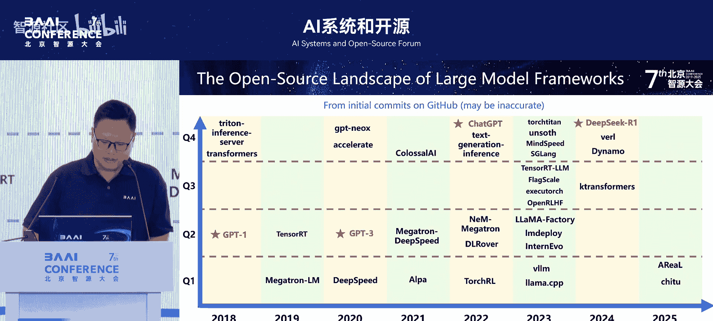
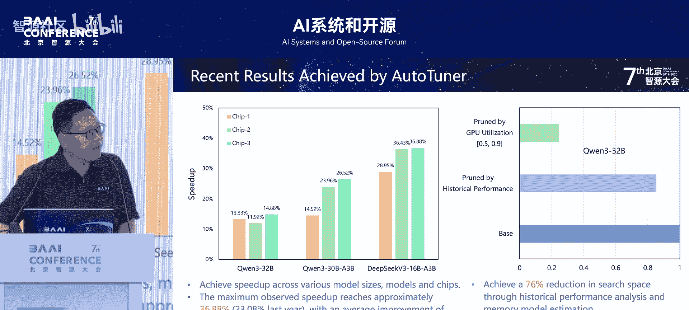

# 2025北京智源大会- AI系统和开源 p04 FlagScale-多元算力时代的新一代开源大模型训推一体框架：敖玉龙 -BV1g6NjzZEsj_p4-

那接下来我们到了第三个演讲。那我们第三个演讲嘉宾是来自智人研究院呃，负责AI框架研发的负责人敖玉龙博士。那他带来的演讲是frs skill多元算力时代的新一代开源大模型迅推一体框架，谢谢。🎼啊。

等一下等一下，我我我我补充一句，我们今天其实每一位演讲嘉宾有20分钟，但如果我们演讲嘉宾希望留一些时间跟我们观众互动的话，他可以就只要不花完这20分钟，我们都可以有时间跟呃我们的听众互动，谢谢。😊，嗯。

大家下午好，呃，非常呃荣幸能代表团队跟大家分享一下呃，我们跟呃开元社区的呃成员一起做的这样一个呃大模型的B行训练及推理框架。呃。当然首先第一个问题就是说呃大家也比较呃关心的个问题。

就是说我们为什么还要再做一个新的框架。因为现在业界已经有了呃各种各样的框架。那为了解决这个问题的话，我觉得我们可以呃回顾一下，就是最近几年呃关于框架这个领域。呃，一些呃开源的这样一个情况。呃，呃。

其实看这张呃全景图的话，我们会有很多很有意思的结论。比如说大家可以发现，就是chGPT出来之后，呃，在这个系统领域有一个大爆发。呃，不管是训练推理微调还是强化学习等等，涌现了很多的这样一个框架。呃。

甚至说推理单独这个方向都出现了像VM啊SG浪啊，包括等等一系量这样非常大家常用的这样一个框架。

那呃。我们其实从前面这样一个前景图呃，包括呃结合产业的一些观察，我们其实能看到三个关键的这样一个呃碎片化的挑战。那第一个挑战就是说呃尽管有很多的框架。

但是呃对这个大模型开发的全流性支持其实还存在的一个碎片化。呃，比如说像ron这种呃最开始是主要做训练。但是现在也能支持一些推理。但是他这个呃支持的呃还是不如专门的推理引擎呃，更呃彻底。呃。

那为了解决这个问题，其实英美达也开源了一个叫moron这样的一个全命周期的这个框架。呃，但是他的问题就是说它比较跟呃的这样一个stem比较耦合在一起呃，是具有呃呃它的应用场景还是有一些受限的。

那第二个挑战就是呃就是对同一个任务，我们其实面临的一个。选择性难的问题。什么意思呢？就是大家呃就是说呃普通用户可能他在VM或者SG浪选择已经很困难了。其实对我们开发者来说也是一个很挑战的问题。

到底选哪个更好。那更何况还有像拉maCPP这种呃也是一个非常优秀的软件。那这三者中我们到底选哪一个这也是呃第二个碎片化的问题。那第三个就是前面就是呃翟老师也讲过了，就是说呃AI不同于以往。

就是说随着呃呃这个模型它不收敛或者模型还存在这样一个迭代。那硬件我也我觉得也会跟着呃发展，而且呃在性能，然后兼容性以及信贝尔比之间呃做权衡呃权衡的化应该还是会涌现出大量的AI硬件的呃。

那每个硬件其实都有自己的这个呃开发的这样一工具链和一些优化策略。呃，那这个碎片化其实也是一个挑战。呃。

flex skill呢其实就是希望能够通过一个全新的设计和实现来解决上面我们认为呃比较重要的这样一个三个挑战。就是我们提出了这样一个呃框架，其实可以称之为meta framework。呃，什么意思呢？

就是下面可以跟大家详细的介绍一下。呃，为了解呃解决上面的三个挑战，其实我们在架构设计上有两个呃关键的创新创新吧。第一个创新就是说呃三层这样一个呃 architectureitecture呃。

呃最前端的话是我们希望给用户提供这样一个统一的这样一个接口。呃，并提供一些自动化的能力。就是对于普通用户来说，它其实呃不ca后变的引擎是什么？也不ca它的呃具体的呃针对某训练推理，还是用不同框架。

它只需要呃提交自己的任务就可以。那中间层的话，我们是叫这个呃多多引擎，就是说涵盖了就是训练压缩推理和服务的这个全流程。呃，最后的话就是说为了解决这个多芯片这样一个碎片化问题。

我们底层会利用像呃资源资研的跟产业伙伴合作的呃统一的算子库和统一的通信库。那这个架构的设计的话，就是基本上是能够解决前面呃两个挑战中。呃，三个挑整中两个，就是说一个是呃全流程的问题。

另一个就是呃玻芯片的问题。那还有一个问题就是多后端选择，就是说比如我们最做推理，那该选择哪个后端呢，这就会呃需要另一个架构设计上创新。

就是呃flag skill的话就是实现了一个呃pl in based的 architecture。呃，这个插件式的架构的话，好处就是呃它能够将各种各样的后端呃，呃集成到flag skill当中。

但对用户来说还是一个统一的界面。那呃我们这个呃设计的这样一套呃unified plug in management system的话，是基于大家熟知的ge这样一个工具。呃。

对于开发者来说是很贴合他日常这样一个使用习惯的这个学习成本呃非常低，就无论是增加删除还是修改以及使用呃，都是非常的呃呃简单的。我们的目标还是希望能够成为呃M这个系统领域的这样一个VS code的。呃。

除了架构设计之外，其实要实现这样一套呃呃解决这些碎片化问题的话，其实还有两呃一些关键的技术。这里的话我们希望跟大家分享就两类吧。第一类就是如果通过自动化技术来解决这个跨芯片的这个任务的无缝迁移呃。呃。

其实这是一个M乘N乘K的问题。什么意思呢？就是说我们面临的输入是不同的模型，有不同的集群规模以及不同的芯片。那么我们还是希望能在呃给定一个特定的任务，我们找到最优的这样一个并策略和优化策略。呃。

在去年的时候，其实我们已经呃跟大家呃分享了一个统一的这个的这样一个framemework。呃，那呃今年的话我们对这个做了一次呃升级。就是我们对它的搜索空间做了一个扩充，能够支持呃呃最新的一些模型。

比如像d的呃千分3的呃，呃同时我们也对这个呃memory model做了一个呃这样一个重新的这样一个实现。呃它的准确度。相比之前有个极大的提升。呃，可以看到这块的一个数据是。呃。

这是我们下面是我们理呃理论上预估的呃，这块的话是我们实际跑出来的，其实基本上是非常就99%以上的这个呃准确度。那最近的一些结果就是说在一些新的模型，比如千vin3和deeps呃，我们在三款不同芯片上。

相比如厂商嗯给的这样一个呃专家的这个配置。我们能够呃做到了呃最最高是36%的这样一个性能提升。然后呃平均是23%。呃，呃也分享一个比较有意思的，就是说我们这套系统就是一个厂商他呃他们的专家去优化了很久。

然后我们也建议他们使用我们系统。后来他们相比他们专家提升了40%这样性能，还特意给我们发了邮件表示感谢。呃，就是我想跟大家分享是这是一个可以实际使用的这样一个系统。😊。

呃，那更进一步就是说在推理这个方向的话，我们也对我们的这个au tune做了一个升级，就是我们不断支持训练，我们还支持支持这个推理。呃呃，同时呃基于我们这样一个架构上的这样一个插件式的这样一个设计。

我们能够像把VMSG浪那么CCPP这样的不同后户端也集成进来。这样的话，我们其实呃呃对auto tune这一块的实现呃呃做了一个这样一个改进。呃，相当于说一个非常之通用的这样一个auto tune。

它能支持不同的任务，不同的后端。呃，左边这张图的话是跟大家分享是呃在不同的芯片上，就是说呃推理的这个auning的这样一个结果。呃，其实我们可以看到就是呃对于小白用户来说，他如果选了一个最差的配置的话。

跟一个最好的ning出来最好的话，它性能会差3倍以上，那我们也跟默认的就是说一些呃这样一个呃引擎，它会提供它所谓的最优的这样一个默认的配置。那我们一般会有2%到20%这样一个性能提升。呃。

对于多后端的话，就是呃其实我们在多后端这个事情是呃呃是有一个大家也会quest一个问题，是不是一个推理引擎能解决所有的问题。呃，我们实测的结果是很难。呃，比方说这里面有拉maCPP有VM浪。

其实大家都有各自擅长有领域，有的在总的吞吐，有的在这个端到端延迟，有的是在这个呃首次的这样一个输出这之上。呃，前面讲的是呃一类的这样一个技术。

怎么做通过自动化的技术来在跨芯片实现一个一致性的这个性能的提升。那第二类技术就是也是呃比较关键的，就是怎么把不同的芯片结合在一起来实现同一个任务的训练和推理。呃。

智源在两年之前就呃跟嗯大家去分享了这样一个产业可落地的这样的异购回训方案。其实它有两个核心的这样一个技术挑战。呃，第一个就是呃如何设计一个呃易购的必行策略，能实现负载均衡。

第二个就是能实现跨芯片的这样一个通讯。呃，从从2023年起的话，其实我们已经呃提供了各种各样的并行策略呃，数据的异构并行策略数据维度的异购。

然后的异购以及ten的异购呃其实能已经能满足大家各种各样的需求了。但是的话较真的听众他可以发现一个问题，就是说呃你为了解决一个碎片化问题，似乎又带来了各种各样的碎片化。就是这么多的策略，我该选哪一个呃。

那在呃为了解决这个问题的话，其实呃我们最终还提出了这样一个呃应该算业界最通用的这样一个多维度的这个异构并行策略。那基于这个并行策略的话，其实我们能够呃满足就是说用户不同维度这样并行维度这样一个异构性。

同时呢它能支持超过两款以上的这样一个硬硬件的这个异构混讯，并且对这个硬件的配比这个要求降到最低。呃，目前的话是一个全场景的覆盖。什么意思呢？就是说呃这套呃并行策略的话。

既能支持呃像den斯的模型拉va千问这样拉va千问这样的结构，也能支持像DMOE这样的结构。呃，同时它能支持像GDR base的通信，以及通过CPU中转。呃，前面是必音策略。

那另一个关键技术就是呃跨新的这个通信。呃，这块的话，其实我们在去年12月份也联合呃合作伙伴一起开源的flex six，这是一个跨新的这样一个通讯库。呃，它跟厂商的通信库是呃兼容的。

同时我们也提供了这样一个呃flex six call这个呃跨新易构的能力。呃，其实做跨新这块的话，怎么能做到一个很好的性能？呃。

这块的话我们是呃呃设计了一个创新的这classster to cluster这样一个通信算法。呃，它其实呃他将整个易购集群分为一些子classster。

就每个class内部是一个同购的classster之间是一个异购的那对于同购这样一个呃内部的通讯的话，我们会复用厂商这样一个原生的这样一个优化过的通讯库。那对于易购之间的这样一个通讯的话。

我们呃自研的一个高性能的这样一个P two P实现。在这个两个基础之上的话，我们就是能够实现一个非常高效的这个呃异跨新的这样一个通讯。呃，这是一一些结果。左边这个图的话，其实想跟大家分享一下。

就是说呃在flexs呃，相比如厂商原生的这个通讯库，我们基本上是能做到这样一个零开销。呃，右边的话是易购。易购的话其实没有可对比的那我们其实跟峰值这个性能做了对比。其实也能达到非常这样高的水平。

有的能达到90%以上。呃，目前整个这样一个通讯库其实已经适配了呃6家不同的这样一个厂商。呃，同时的话我们也实现的就四款不同芯片之间这样一个跨新的互联高效通信。呃。

在框架这个层面上我们不能不仅能原生支持拍，同时也被集成到飞讲这样一个3。0的正式版本当中。呃，通过flex skill加fex six这样一个合力的话，我们是呃在易购混讯上也是呃做了很多的实验呃呃。

左上角的话是一个呃den和MOE模型的这样一个对比。我们的这样一个混讯的效率，大概呃den的话会高一些，大概9呃5%左右。那系数的话其实也接近了90%。呃，相比业界来说，我们这个模型大家看到是非常小。

之所以这么选择的话，其实在很多的用户他的现实中，它的模型是很小的。他也有一些异构硬件，他希望也能获得一个很好性能。呃，同时我们对lo做了一个严格的对比大概过了1。2T这样一个token呃。

在这个模型效果的话，我们是每100B做了这样一个地。就是说大概有10个数据局，每个数据局我们都测一下，然后平均一下基本上在零附近左右呃，也充分说明了这个异构混讯的可落地性。最后我们也是在不同的配置下。

在不同模型下跟业界有一些，就是说优化后的这个基于CPU中转的这个方案的这个呃对比，我们基本上还是能获得一个性能的提升。呃。那呃相当于呃两年之前，我们是呃非常激动的跟大家分享这个异购混心的技术。

那今天也想跟大家分享一下，就是说呃易购的这样1个PD分离这样一个技术，也基本上也是开源到我们的flag skill这个框架当中PD分离大家都不兴奇。就是说带了这个领域之前的话其实像面也是在做这个方向。

呃，他们还是主要是呃在这个呃同购的这样一个呃芯片之间做这样一个异购。就是我们上面可以看到就是这个芯片可能是来自于同一厂商通信的话一般也是基术厂商提供的这样一个通讯库。

那结合着这flag skill和flag six的话，就我们实现这个呃不同厂商，就比如这样一个可以放在一个芯片之上。那ding的可以放在另一个芯片之上。

他们之间的通信的话是通过我们的这个异构统一通讯库ag来进行我们目前的话其实是。😊，能够呃在两个不同的芯片，就是天数跟木西之间做到这样一个呃跨呃异构的这个PD分离。嗯。

flag skill可能呃相比呃从一开始设计之初的话，就想真正的被产业呃所使用。呃，我们在过去的呃一年之中的话，也呃在不同领域取得了一些呃成绩呃。呃，这里话这里选择了几个呃案例跟大家分享。

首先第一个就是说我们支持了峨妙13这个讯推，这是世界第一个就是原生的这个多模态这样一个世界模型。呃，同时我们也支持了呃呃巨深领域的这个跨门体rober brain的这个1。0和2。

0的这样一个训练和推理。呃，目前的话它是呃最最强的开源这样一个跨门体的一个大佬模型。呃，可拉VL的话是一个呃在这个同赛下，我们是能做到这样呃。呃，so塔的结果呃，这块的话。

其实我们不但在英伟达上做了同样的这样一个训练。我们还是验证了这个框架的这个呃芯片的迁移性，也完整的做了一在一个呃新的非应用的啊芯片上做了这样一个训练的效果的对齐。呃。

open seek的话是一个新的尝试，就是呃是一个想基于开源这个推动下一代模型这样发展的这样一个呃社区呃呃等一会会有那个同事就流管跟大家进一步的分享。

那我们也是作为这个呃项目的这样一个stem的一个支持者。呃，目前的话，整个flag skill的话，其实支持了大概呃8款呃不同的芯片。呃，除了对呃呃上层的这样一个模型用户的这样一个呃支撑之外。

其实我们整个flex skill也可以作为这样一个呃系统的这样一个大的这样一个开发软件的一个使用。那我呃。这里展示的就是整个呃智源呃新推出的flag release这样一个流程。

那那这是一个就是面向多芯片的一个多模型的一个发版平台。flag skill的话，其实作为其中的一个呃关键的模块支撑的这样一个模型的迁移和自动的部署这个功能。嗯。

还有一个就是也愿意跟大家分享的是在呃巨深这个领域，尤其端云系同这一块的话，flex skill也是取得一些新的呃突破。呃，这块的话大家可以看到，其实主要是两方面。

一方面是我们呃支持就是说呃巨深这个方向去构建了一个基于MCP协议的这样一个呃跨本体的巨深这样一个呃应用技能的这样一个商店。同时我们也实现一个非常高效的这样一个端云协同。嗯。最后就是一个快速的总结。呃。

首先就是flag skill，包括flag six，它是flag O这样一个核心组件。那flagOS其实是一个呃面向多芯片的这样一个统一开放的这样一个呃呃全站的这样一个软件站。呃。

那今天的话还是希望大家能对flex skill有一个更全面的了解。那呃呃我这块再强调一下，希望大家有一个认识。

首先flex skill是一个全新的 framework它的核心的目的是想成为这样一个M这块的 code它有三个核心的能力。第一个就是说可以支持这个后端的可插拔。

第二个就是说能够有提供优酷这样一个自动并行和优化的能力，来够实现不同芯片这样一个一致性的性能。呃，最后的话就是说我们还是呃能够把不同芯片给组合在一起来实现这个训练，同时也能实现这样一个推理的部署。

最后flexq作为这个flag个软件站包括这个社区的份子我们还希望能够跟大家一起构建这个开源统一的这样一个也希望跟大家一起来探索就是I系统领域的这样一个前。年的设计和开呃开发呃。最后最后还要做一个广告。

就是前面讲的还是蛮快的。但是呃比较幸运的是呃，今年就是支源还提供了一个呃t tutorial这个环节。呃，这块的话就是明天呃这个环节呃是有两个特色。

第一个特色就是说我们会对呃flex skill包括flex six里面核心的这样一个设计，包括实现跟大家做一个详细的分享。呃，第二个就是说我们提供了呃像呃摩尔现程的AIPC华为的PC。

包括一些天数的这个端测芯片放在现场。就现场是带大家手动的去做一些这样一个训练和推理的这样一个实操。对，就是做一个广告。谢谢。😊，好，好像还有点时间，我看看那个现场有没有人想提问的。好，那没有。

那我我我觉得是不是就刚才提到了frs skill可以支持多种后端的那个呃推理引擎加速，是不是前面翟老师介绍的赤兔回头是可以集成到frres skill里头。打步。对对，好，谢谢玉龙。

那我也做一个小广告哈啊，第刚才玉龙提到的那个明天的to是明天上午对，明天上午在外面的开放空间。那呃智源研究院刚才提到的fly o除了玉龙这边负责的这个框架和通讯库。

其实我们还有另外一部分是算子和编译器啊，基于on的算子和编辑。那那个呢会在明天下午同样这个房间，我们明天明天的传天这个房间是pito day呃，实际上有很多也是跟系统软件。

很多很有重要性的代表做明天从上午到下午。那呃那一块会在明天下午呃智源研究，我们另外一位负责人会介绍呃算子库和编译器这块。😊。

