# 2025北京智源大会- AI系统和开源 p06 TileLang：以Tile编程为核心的高性能AI 编译生态系统：杨 智 -BV1g6NjzZEsj_p6-

那我们呃接下来下一位嘞呃呃演讲嘉宾是来自北京大学的那个杨志老师。那杨志老师给我们带来的是tline以t编程为核心的高性能AI编译生态系统。

tland这个话题也是最近今年上半年也是比较受大家关注的一个工作，谢谢。😊，啊，那感谢林月的介绍和邀请啊，非常荣幸能来这里给大家介绍一下这个新的编程语言啊，tell编程语言tll浪。啊。

然我先讲一下这个为什么要提出挑浪啊。我们现在遇到一个趋势，就是写算子，其实越来越难啊，这个主要有两个原因，一方面是现在大家设计的这种新的算法，比如attention啊，量化、技数化。

它都要去考虑硬件的体系结构啊，所以。他这个嗯编程的时候，我们对算法人员的硬件也并不是现在像黑盒一样。然后第二个就是这个。啊，硬件变得越来越复杂啊。

比如说我们在GPU里引入这个ter call以及各种这个跳的指令啊，所以其实这个写硬件的这个代码也越来越难。那这样的话，我们对大家就遇到这么一个问题，就写算子的时候啊，就是说我要么去用这个高级编程语言。

比如说triton，那它呢是这个硬件当黑盒，然后呢我很容易实现啊，但是这个效率现在在这种新的算法上啊，其实发现性能问题越来越严重。然后呢要么就是我去写哭打啊PDX啊那这个我们可以把这个性能手搓的很高啊。

但是呢开发周期比较长。那现在像我们业界想一天就去迭代一下模型啊，那这个这个就会大大的推迟我们这个模型迭代的进度。

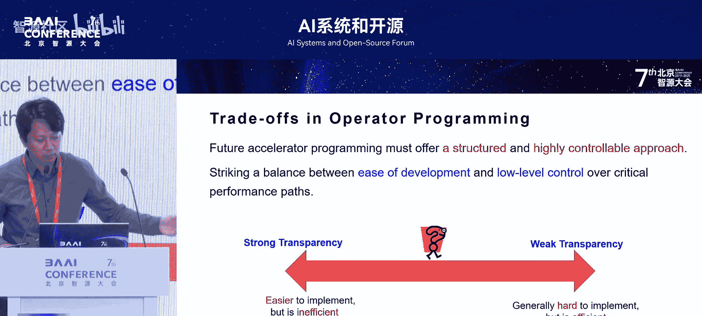

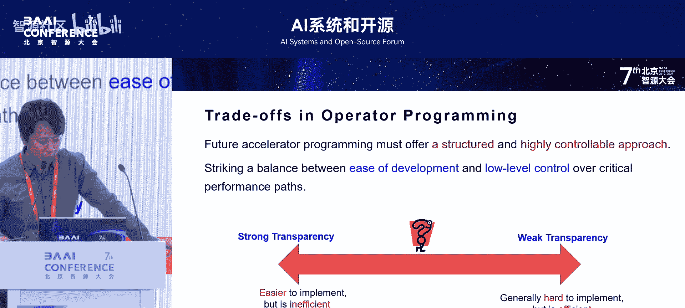

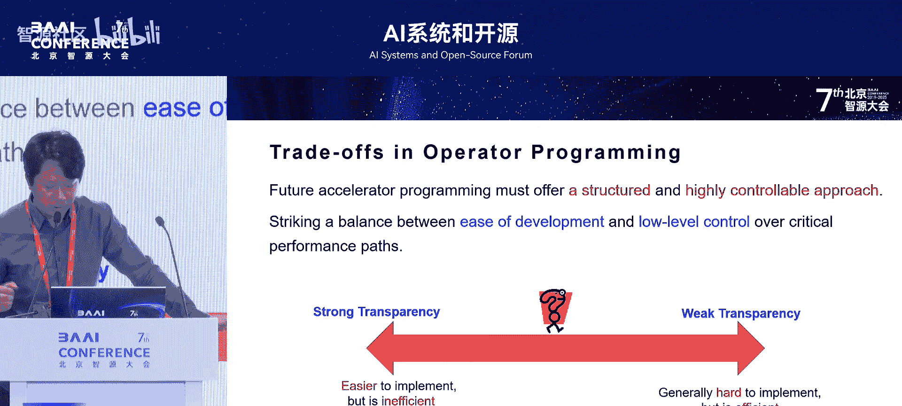

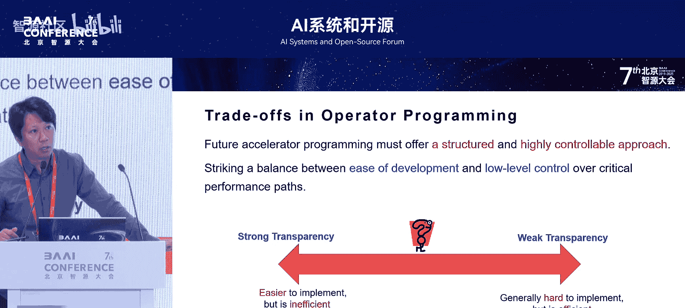

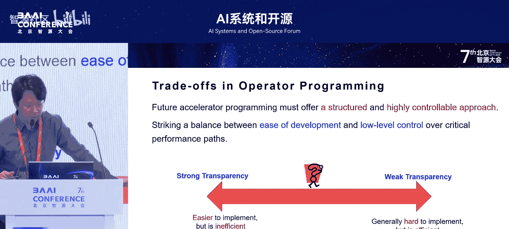

啊，所以我们在讲有没有一种新的tra off啊，那就是说我们既可以比较方便的编程。同时呢我们用性能上可以在一些关键的性能路径暴露给用户啊，用户可以控制。然后这样性能也可以补上来。

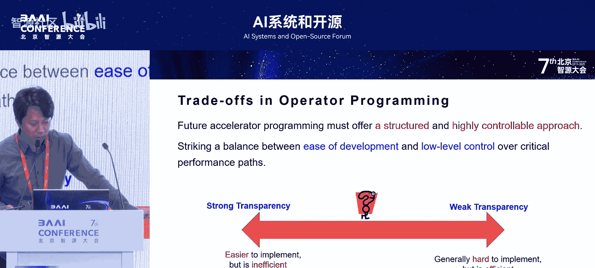

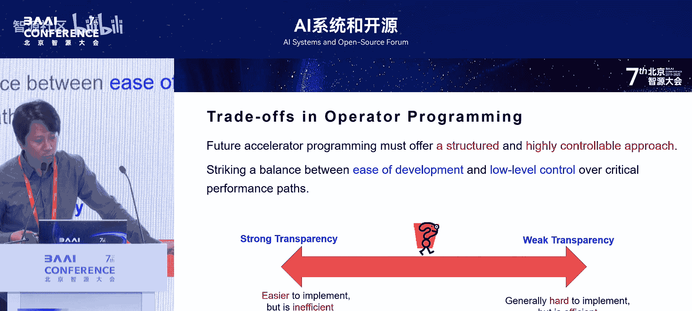

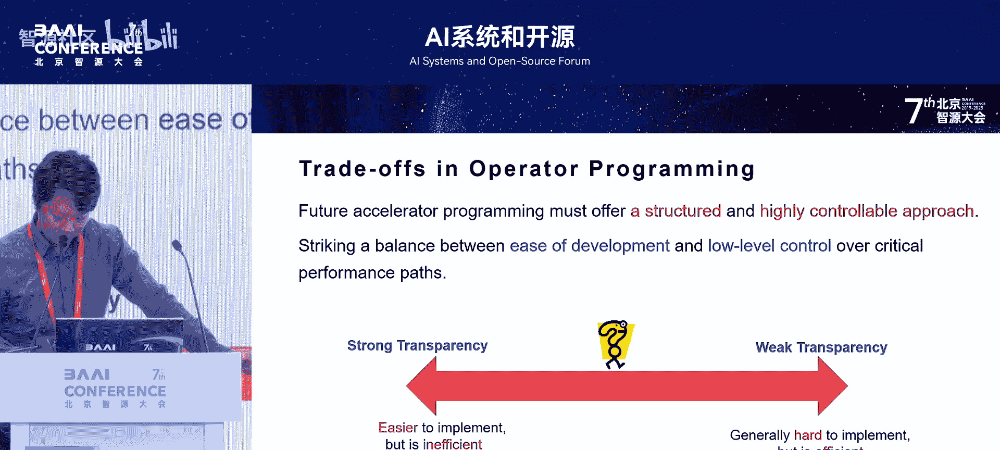

OK那所以他浪呢就是提供了这么一种新的选择。那他浪这个项目呢是在今年年初开园的啊。然后他现在还是一个初期阶段，但是呢已经有40多位的这个contributor啊，所以我们非常感谢这些贡献者。

那同时我们也欢迎更多的贡献者来去一起drive这个开源项目。那今天呃由于时间的关系，我就主要讲一下t浪的这个核心设计理念。那t long本质上可以等价于它暴露出来一个这个虚拟机啊。

这个虚拟机我们叫tell what machine啊，我后面就叫tell VM。那这个TVM呢，它呃主要包含两个抽象，一个就是左边的这个。他执行的这个tel task。

然后又另一边是这个执行这个telll task的一个tel hardwareOK那么这个telll task呢，它最主要的特性就是它一个多级tll。

那么它每一级t呢对应到左边这个tel hardware的一个memory层级。那左边这个tel hardware呢，它也是按照tel的力度去搬运和计算这个呃这个tel的这个task。O。

那么可能有点抽象，但是我们对到GPU上其实很直观啊，这个多级的tll taskask对到GPU上是什么呢？比如说我们在global memory上啊，我们其际操作的就是tenser。

那如果我们再往上走一级，走到share memory，那这个我们就对的是thread block tell。

O那么这个下面这个global tell是由spe block tell组成那spe block可以进一步再打开对到这个resistor。那resistor成级呢我们又有两种tail的抽象。

一种叫walkptail啊，它可以直接用这个tensor call来计算。那另一种呢我们再把whatp tell可以进一步打开打开成spe tell。

那这个s tell呢它可以去到这个kuta call上去执行。对，所以我们这种这个映射是非常直观的。OK那么有了这个跳VM以后，那么t浪本质上就是在暴露怎么去操控这个跳VM的这些API。

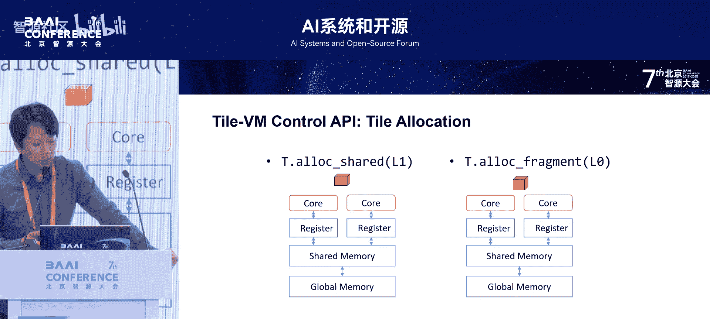

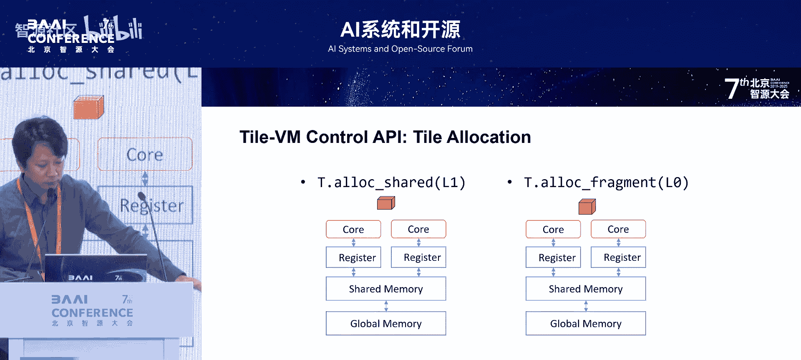

我简单介绍一下。那么第一个就是我们可以声明一个tel的这个所在的这个memory层级啊。第一种呢就是我们可以把它声明到这个shareed memory上啊，比如lo share。那第二种呢。

我们可以把它loccate到这个memory上啊，呃就register上啊，我们叫loc fragment。

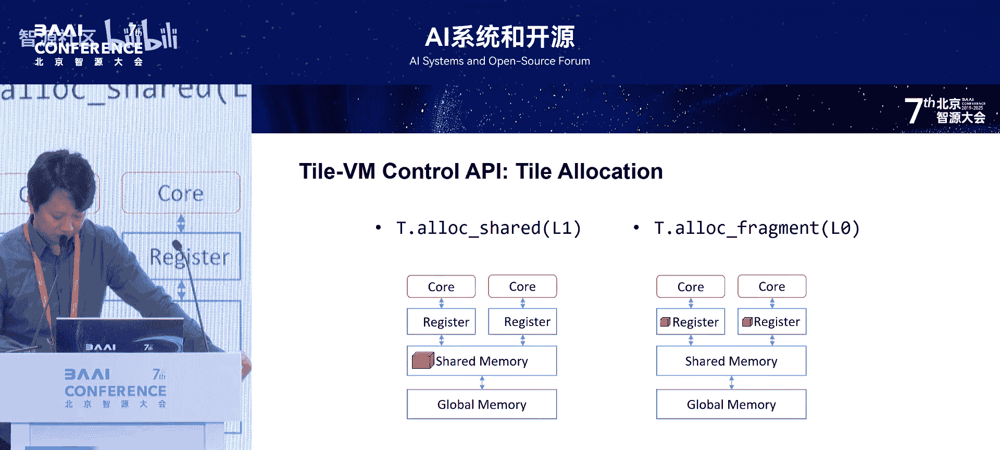

那通过这2个API呢，你可以控制这个跳到底应该在哪一级上。

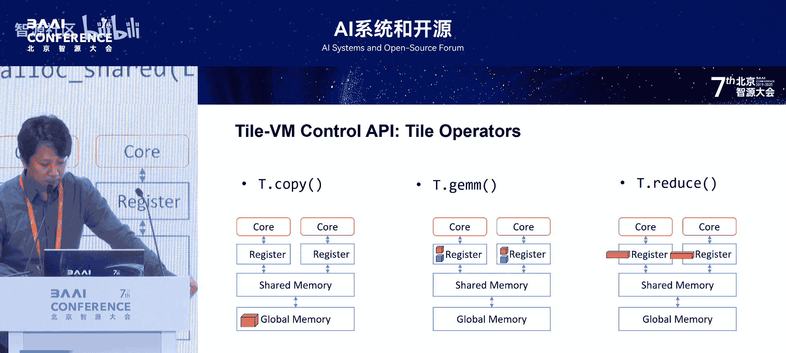

那接下来呢我们可以有telll的这个操作啊。那第一个呢就是telll的这个copy啊，我们可以指定它从哪个位置搬运到哪个位置。比如从global搬运到share啊，那我们可以调用这个TMA的指令。

然后第二个呢就是这个sm运算。我们调ja以后呢，他就可以运算这个呃乘法啊，把两个tailll做在reistister做完计算，然后acum到regor上。那第三个呢是这个reduce啊。

我们可以通过reduce操作呢，把它调到call上进行reduce，然后呢再写回来register。

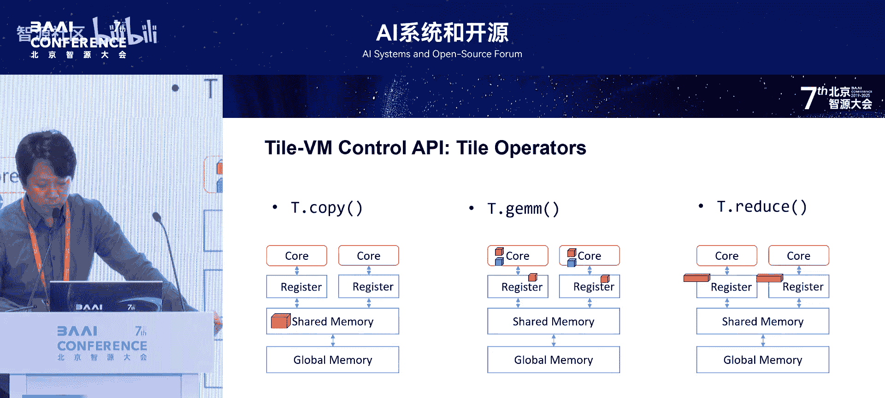

那第三种呢就是对这个tel的一个schedule的操控啊，我们第一个提供了一个叫pily。pi它的作用呢就是它可以把这个两个telsorry这有动画。呃，把两个t的计算呢给它拍起来啊。

就比如说在第一个他在算计算的时候呢，同时可以去调TMA去搬用第二个tll。然后呢，它跟第一个t的计算可以overlping啊，可以显示的暴露给用户。那第二个schedule语音呢就是这个T点par。

那么它可以把一个ca上这种串行的计算。

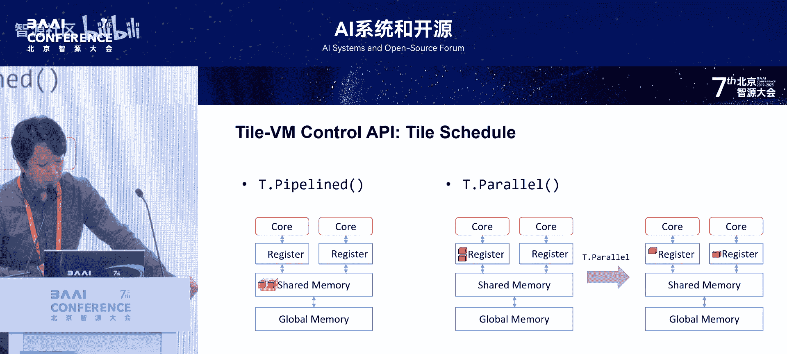

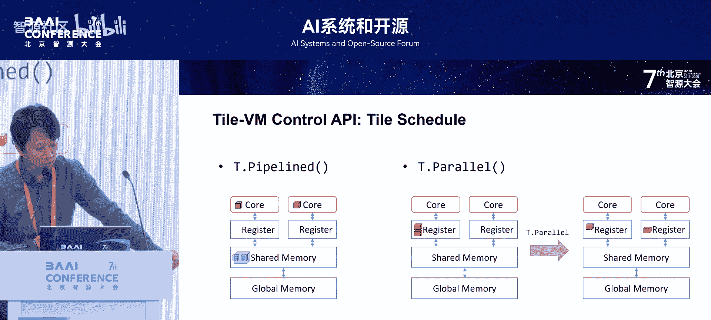

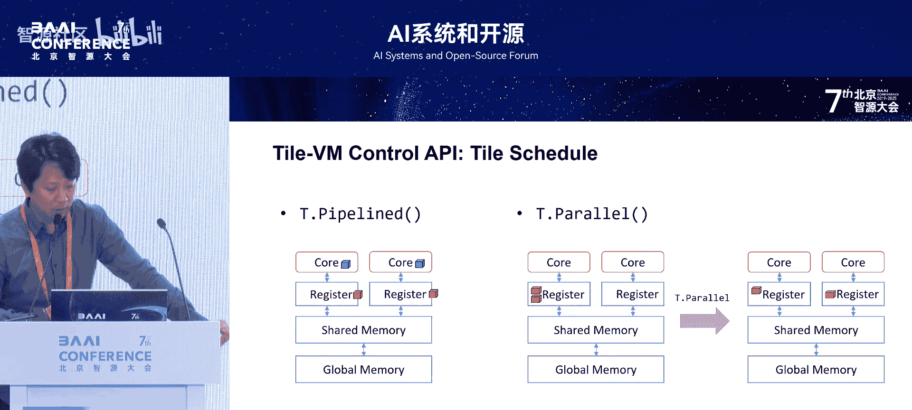

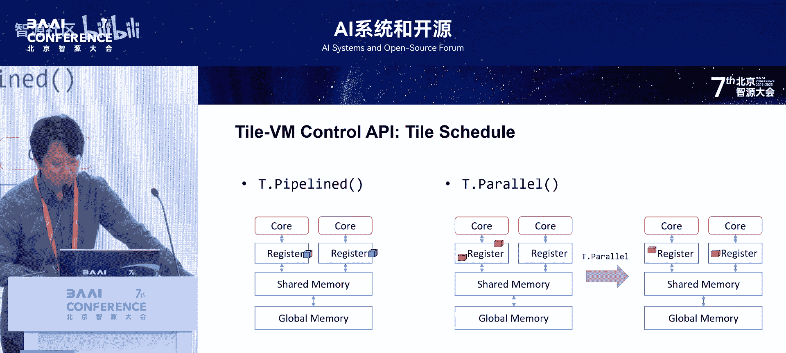

然后呢，给他去并发到这个。就是多个括上，然后做一起一个并发计算啊，可以把一个串行的变成一个并行的这么一个调度语义。

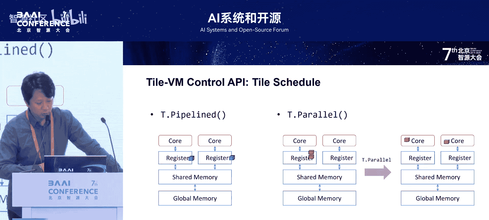

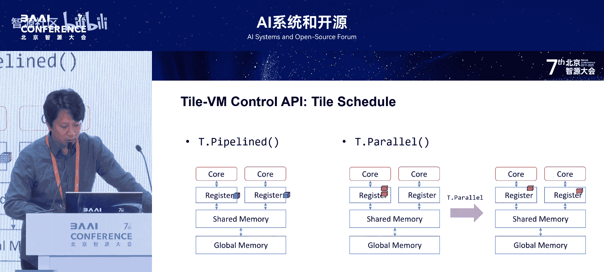

OK那么这个t基本就是最关键的这个KPI呃API就是。

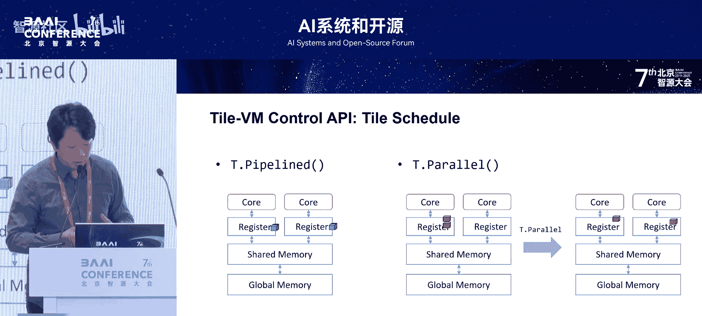

这几个API，然后我们可以用它来编写这个挑down的程序来操控这个跳VM。

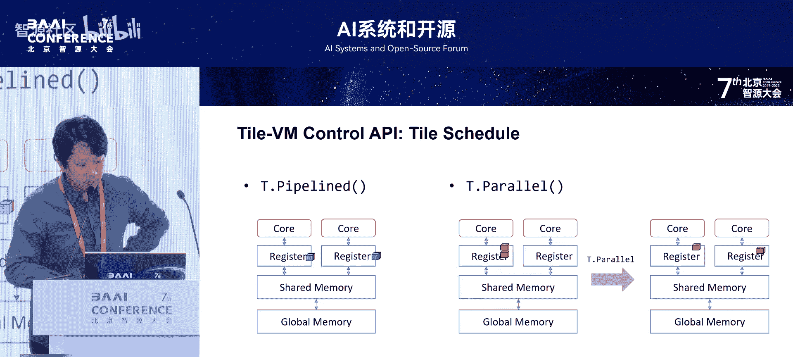

OK那么这是一个tll浪的一个程序的例子啊，左边是triton，右面是tll浪啊，可以简单对比一下。那么triton里面它不含任何硬件的东西啊，只需要你关注计算逻辑。那么t浪呢，我们可以就是相当于硬件。

它可以有一个跳VM的有一个操操控啊，比如说我们可以定义我们的这个做一个乘法的ABC他们分别到在哪一级memory层级。然后我们也可以定义它采用什么layout。然后我们也可以定义它的这个s这个计算次序。

然后呢增加这个cach的locity。然后呢，我们也可以调这个piline，然后呢，把这个这个搬运和计算让它over啊，所以它本质上暴露了一些硬件的操控。那当然在代码量上呢，他并没有比triton多。

OK那么我下面演示一下，就是说这个telll浪程序是怎么在teVM上去跑的对，那上面呢这是一个简单的乘法，我们就把ABC然后声明到这个不同的层级AB呢放到这个share里面。

然后呢C到 resistor里。然后开始执行的时候呢，我们就去调这个copy，然后呢就可以把这个AB的两个t呢拷贝到share里面。然后呢，我们接着再调copy，把这两个sha拷到register。

然后这时候我们就可以调这个jam。然后呢，这样我们就开始计算啊，把这两个t呢从reister读出来，然后做计算，然后呢写回到register。然后呢，我们就可以反复的这样做计算。

然后把这个C一直acum到register上啊，做完了AB的两个这个行的一个大跳和列的一个大跳。OK那么当计算完以后，这个t我们就把它copy copypy好，copy到这个从register。

 copypy到share，然后再从sha copypy到这个它global里面写出的这个sd的sor里面去。O那么这是一个简单的乘法例子。那下面是一个稍微复杂的MOA的例子啊。

这里主要是享受它它可以做自动的fuion。那在MLA里面呢，我们先啊要做两个乘法，一个是Q乘KV，一个是QPE乘以KPE啊。所以我们先把它这个从从这个global里面啊。

把这四个tensor拷贝到这个sha里面，然后呢开始调这两个jam去做O那么这样我们就把它从register里面做两个乘法，做完乘法以后，那这个Q的这个结果写到register。

然后再拷贝到这个share memory里面。然后这时候呢，我接着就可以再算一个jam啊，这个KV去乘以这个Q。那么这时候我们就直接从这个shareed里面去把这个KV读出来啊。

那这时候就自然的去做了fuion。然后呢，他们在做乘法，然后呢，做完乘法以后写到resgistister里面。然后最终呢这样反复当所有的这个Cac完，我们再把它从这个register里面copy出来。

copy到share啊，然后呢最终copy到global。OK那么当然这里面这个jam也有一些。嗯暴露的一些这个annotation的东西，然后比如layout啊，怎么去切啊。

然后我们都可以去呃用户去指定。那么为了这个呃。让大家更方便的去去来操控啊，我们提供了两个核心的机制。第一个核心机制就是tell evaluation。我们这里有一个co model啊。

然后你可以给一个tell program因为里面有很多大家需要指定的notationtel size怎么去做啊。然后呢你就可以输到我们的 model里。

我们 model就可以给你输出出来说哎你这个程序如果这么去设置fig那么你最终的latency是多少啊，你的 call利用率是多少。

你的各级的这个利用率是多那cach利用率是多少所以这个programr就可以根据这个信息，那重新去调自己fi自己的这个tell program啊。

然后这样就可以帮助用户快速的去找到一个更高效的这一个tel的一个配置。然后第二个机制呢就是跳infrence啊，就是当用户指定好了一些layout。啊，包括怎么去切的telling size。

那这个时候呢，我们可以把它就是整个这个计算，比如MLV我们可以。变成这么一个t graph。那我们一旦用户指定了一个operator，它怎么去设置了以后。

我们可以从前项和后项两个方向推导它上游的operator该怎么设，下游的oper该怎么设啊，O所以这用户只需要在这个里面设置一两个config啊。

基于我们的cos model设一两个config剩下的都可以完全用这个t量来自动推导啊，这里包括telling怎么去切，然后layout怎么去设we策略怎么去做啊。

都可以用tel量的这个auto inference机制来设置出来啊，极大减少了这个manu的 overhead。那么现在t long呢呃它核心的这个设计的这个呃原理啊，我就简单这么介绍一下。

那么现在t浪有三种编程模式，因为我们是一个多级tel的这么一个task可那所以我们可以根据用户的需求，给他暴露不同层级的tel比如说对一些programr，他不希望去操控硬件，他只希望快速实现一个算法。

我们可以暴露最global memory的 tell。那这个时候他就只需要写一个表达式啊，然后就可以生成这个这个硬件的代码。然后呢，对一些这个算子开发人员，那他希望去操控tel提升一些性能。

那这时候我们就可以暴露这个sha block level级的这个telll。

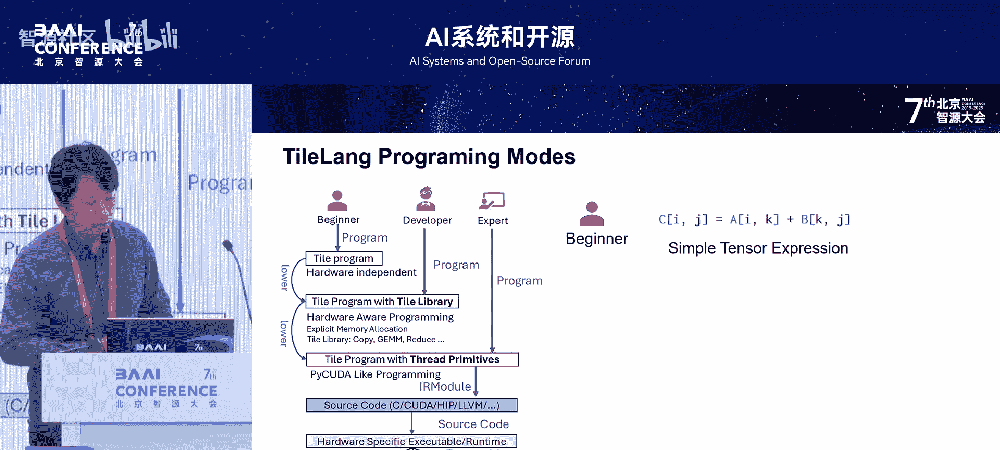

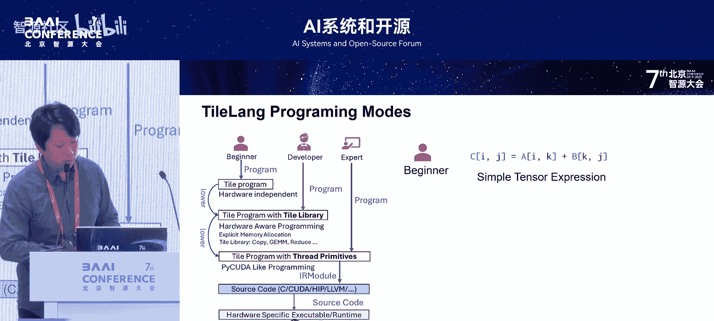

啊，然后呢他就可以去来操控，然后实现了这个算子的一个性能提升。那么对一些算子，他希望更进一步的极致的性能优化，就是这种exportt。那么这时候我们可以暴露它更低level的 tell。

比如说这个Wp level啊，就是reitor level的这些t，那么它就可以像右面一样，它去操控一个这个reitor level的一个t啊。比如说我们要做一个量化的这个cast反cast。

那这时候呢我就可以把reitor tell level暴露给他，那么它可以跟这个呃ku达编程有有些类似可以直接调ku达的PTX指类。啊，所以不同的编程啊呃我们都可以提供。

然后下面呢就是呃讲讲一下这个大概的一个performance。然后呢，我们把这个众轴呢就是相对pyto原生算子的加速比代表性能。然后横轴呢是编编码的这个行数啊，代表这个编程的难度。

那所以越往这个左上角就证明你越好。因为你相当于用更少的代码实现了更高的性能。O所以越往左上角的点是越好的trare off点。然后呢。

我们可以看这里蓝线的部分大部分就是这个t longO那么呃这里我受了几个典型的，比如说jam然后这个低精度混合精度的jam。

然后这个呃mar headten和MLA然后还有block pass我们我对比我们可以看就是这个t都在这里面左上角的位置啊，要相对于triton，还有一些手写库啊，还有一些这个这个呃场商自己实现的库啊。

都要。达到了一个更好的tra off点。然后这是在H10版上，那么在AMD上啊，也是同样。那么我们都在这个啊像混合精度啊这个mtyhead late attention啊。

然后blockpa attention这事呃，我们达到了更好的tra off点。嗯。然后呃。那么t浪现在其实有很多应用啊，但是呢由于初期呢大家都还在验证阶段啊，所以我就挑一个例子啊。

比如说在这个微软啊这个训练的这个低比特模型上啊，原生低比特这个benet B1。58B上啊，然后呢我们可以用t浪实现它里面最核心的这个吸收乘法。呃，jaV，然后呢，我们可以实现啊就是相对原声。

你直接调调拍 touch啊，大概要实现1个20倍的加速O所以啊。未来这些关键的算子，那么他们性能需求很强啊，如果用涛浪实现的话，那么会带来比较大的提升。然后呃，最后呢可能讲的比较快。那么最后呢就是。啊。

讲一下这个挑浪，他我们现在。啊，要做的一些工作啊，那t浪本身不只是一个语言啊，虽然我今天只是介绍了一个语言和compiler，但其实它上游和下游都是有很多工作，然后是整体是一个生态。

那现在呢我们一方面在做这个library啊，就是基于tel浪来开发高性能的这个transformer的这个库啊，这里有这个高性能的attention库，还有这个混合精度乘法的这个呃乘法库。

然后这个乘法库呢，其实它现在已经集成到这个VLM里面的这个呃公共的版本里去了。OK那现在也在推其他的框架的接入。然后呃另外一部分呢，就是做这个多GPU啊多多硬件的支持啊，现在就是不光GPU啊。

国产的芯片我们也在开始适配。啊，然后他们基本上都是基于这个share memory架构的啊，所以都可以用现在这个跳VM抽象来cover。那同时还在做一部分就是通讯啊分布式。那分布式这块呢。

就是说我们针对mar gPU note，我们最终可以把mar gPU note这种分布式环境以以一个telll VM给统一的暴露出来啊，就是还是可以看成一台机器。

只不过这一台机器它是一个分布式memory。然后我们可以在这里面直接去写这种通算融合的算子啊，以及针对这个分布式memory的一些chedul优化啊OK那么整体上这个这个的介绍啊，就这么多。

然后啊剩点时间就希望大家多问些问题。好，那个看咱们现场有哪位要提问的。杨老师感谢您精彩的工作。然后那个我可能有两个问题。一个问题是我我之前看到那它的底层现在是基于TVM的。

然像那个呃有些像像比一些那个手写的编程语，们可能R就种技术路编器选型有经验嘛。然第二个问题是那个看那个那个公开了一篇个论文就是那个叫正那个它现在它针对些种的这种就是坐标很难计算，很容易做错的一些问题。

就设设计了一些新的代的模式。说可比合未来可合I自动去生成这关的这有没有考虑未来有没针代码生一些额外的工作怎待工作很好的。😊，问啊就第一个问题啊，我们觉得反正TVM和MR本质上最终都是一个实现的问题啊。

以前大家用TVM或者说不怎么用TY的原因是TVM的上层的这个er表达式抽象限制了新子的开发啊，所以大家后面就转到R上了但是现在呃只是复用了一下这个TVM最核心的一部分啊，大概只有5%的TVM代码啊。

只用了它最最终的那个schedule和code啊，所以上面它那种表达我们都是用tel的这种新的抽象给替换掉了。所以他的现在它的这个表达性并不是问题。啊，所以这个呃。我觉得在这种情况下。

就是这个MR和TM本身各自有各自的优势啊，都是。这个新的有潜力的就是都可以比如说TVM可以make again makeake again这种这种潜力。那当然这个最终这个抽象方法它不一定只是用TVM啊。

我们也可以用MLR的一个实现。那这时候只是由于人力的问题啊，就是我们现在还没有做。然后第二个那个啊其实大大模型扣扣的这部分我们也在看。但是现在有一个问题，就是我们觉得特别底层的东西还是用这个大模型去写。

不太现实啊。因为像像一些公开的，他可能只是针对这种啊，比如说LP32这种来去写。那么他那些没有什么telll的指令啊，所以这种和或者特殊的 layoutout，所以这种还是比较方便的。

但是呢如果说一旦设计下面很复杂硬件的这种指令和 layout，你直接去扣站到下一层啊，目前看起来还没有到那个程度啊，所以未来我们也是希望就是扣站到tll，然后tll再直接调边一起扣站到下层。嗯。

然后还可以再提一个问题，看有哪位。好，那呃谢谢谢谢杨志老师。的确刚才其实啊前面一个问题，我觉得那个那那位呃听众提的其实很不错哈。这个TVM和MLIR实际上是就这里头并不是单纯的ton和的问题。

还有TVM和MLIR的问题。呃，我觉得是这样的哈，就是那个呃呃我我觉得就这有两点。第一点是说呃获许tton从chton的编译器来看的话，也有它进步的空间。

所以呢这个呢也邀请大家明天下午关注一下这个智源研究院介绍的f这个ton的这个增强版的这个编译器哈。那第二个呢其实也越发呃印证了我们等会最后的那个论坛呃一个圆桌论坛的一个讨论的一个重要性。

因为的确在这个跨架构的往前走的这个统一生态上面，我们会看到有不同的技术路线都是很好的技术路线。呃，如何各取所长。😊，如何往前走？其实这一一呃一直以来也都是产业很关注的问题。大家可以拭目以待。

最后一个论坛，大家各位老师怎么去回答这个问题哈？😊。