# 2025北京智源大会- AI系统和开源 p08 Architecting the Future Open Source AI and Open Standards at the Core of Intelli -BV1g6NjzZEsj_p8-

Okay， let's come to the next one。 Next speech is from Matt White。

 and Matt White is executive director of the Py Foundation and general manager of AI at the Les Foundation。

 And he also is the director of generative AI Common under the Les AI and data Foundation。

 And by the way， he is also the chair of tomorrow's Py Day in this same room。

 So let's welcome Matt White to give us the speech。😊，Good， good afternoon everyone。

 thank you for coming today。嗯。I'm going to ask a quick favor， could we close this door？嗯。

Block out some of that noise。All right， I'm going to talk to you this afternoon about open source and open standards as it relates to AI。

Something that is obviously very clear at this point is that open source is eating the world right and。

Estimates put the use of open source software and enterprise in an industry around 80%。

 so 70 90% of that code is built on open source， and so there's also this differential of maybe 20% that is custom code that is used to enhance that open source or built upon that infrastructure。

And so what's really interesting is that。In open source， as opposed to open source AI， you know。

 open source， we can build these models and these models。

With open source tooling and then they go in generate more code that we can then put in open source and then use that code to build agent frameworks and then the agents then go and create more open source code so we have this very virtuous cycle of open source right and so I think with open source AI it's really important to embrace these concepts of openness and there are huge benefits for open source AI right and so there is a lot of innovation in this space right now as obviously with deepse and a lot of other labs B AI and others here in China but also globally there's a lot of initiatives like LLM360。

 which is out of the UAE and thenluuthther AI in the US and a lot of new labs that are springing up here and there。

And so。All this open source AI creates a vibrant ecosystem and creates it democratizes access to these tools that you can then use for learning for research purposes。

 and then ultimately if under permissive licensing， you can use it for commercial purposes as well。

 and so this really creates a very vibrant startup ecosystem。嗯。When we talk about open models。

 these models provide more transparency right in terms of what they're capable of doing。

 what data they were trained on， and really gives these folks that are involved in security。

 access to do red teaming and other functions that expose potential vulnerilities and models and ways that the models can be aligned a little bit。

Easier and so。Open source AI also has this very strong nature for cross industry。

 cross country collaboration that is very important。

 And so we always want to embrace these principles of a shared responsibility and accessing。

 you know， tools， no matter where you are in the world and being able to work collaboratively。

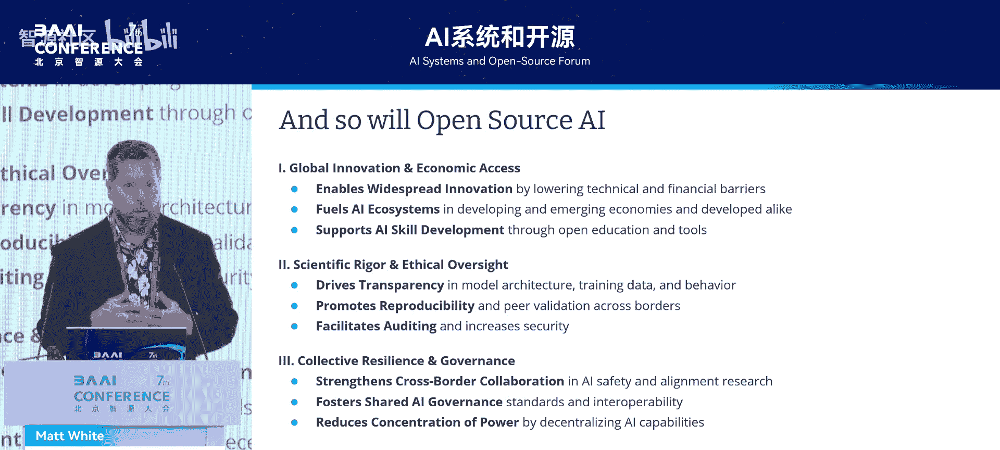

So as we're seeing， open source AI is having a movement， right？

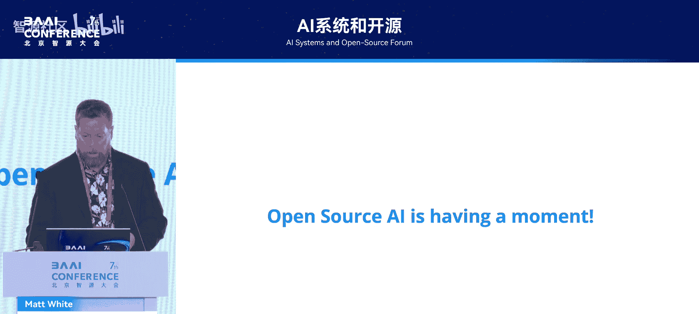

喂。That moment isn't coming without challenges。 There are significant challenges in the space of open source AI。

 and right now there's not a very strong definition of what open AI really is or open source AI really is。

 This is led to open washing where people organizations will release a model。

 They'll call it open source， but it doesn't embrace open source principles， right。

 implements restrictions and things that are not consistent with the open source community。And so。

There's a lot of these new licenses out there as well that are been created that impose restrictions and create challenges for folks when they take a model and they want to try and use it for specific purposes。

 but fundamentally they cannot do so because there are restrictions in place。嗯。

And so you know how did the Linux Foundation， how did Pytorch。

 how do all these organizations work to to try to resolve this and what we did was we started we came up with these concepts of completeness and openness This is really to help clarify what the term open means and so in completeness what we mean are。

A research papers complete are they fully reproducible is the work well documented。

 but also when we look at models and the components that are released with models are all of these components being released or some amount of those components being released。

 this is what we call completeness and this really lends itself towards the transparency piece towards reproducibility。

And then there's this concept of openness， so openness is really a binary variable right it is either open or it's not open and this relates back to the licensing so this is when you have a permissive license。

This means that the model is open because the permissive license doesn't impose restrictions upon any downstream users。

And so from this work， we developed the model openness framework this was released about a year ago。

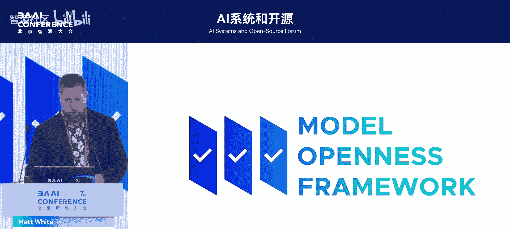

And we identified 16 core components of a model release。

 and so this is everything from the evaluation code， the model architecture。

 and other code artifacts。To the data sets that are used to train。

 to fine tune for alignment and so forth。And then documentation that should be coupled with a model release。

 right， the research paper， data cards， model cards。

And then we looked at what are the acceptable licenses for any which one of these components。

 and so this table is rather busy， but effectively we took the components。

 we distilled them down to domains， and then within those domains we looked at content type and we had to debridge the content type to the actual licenses that were most appropriate for that modality。

And so in this case， what's highlighted in yellow is really what's the most important here is that we came down to data documentation and code as core components and the licenses that were most appropriate for those particular modalities。

And then so from this work we developed three classes。

 so what we have this entry level class which is open model， this includes the model architecture。

 model parameters， and some documentation around that to ensure that folks know what they can do with the model and how it was produced。

And then we go a step up above that， which is open tooling。

 so open tooling includes the training code inference code provides more visibility。

 provides more transparency and provides more reproducibility。

 and then that leads right up to class one， Open science。

 which is you've released all of the components that were involved in your research。

 including a very detailed research paper， all the data sets that were involved and obviously it's nice to have intermediate checkpoints。

 not necessary， but it's great when people can go back and look at the training process and resume it from some point in the past。

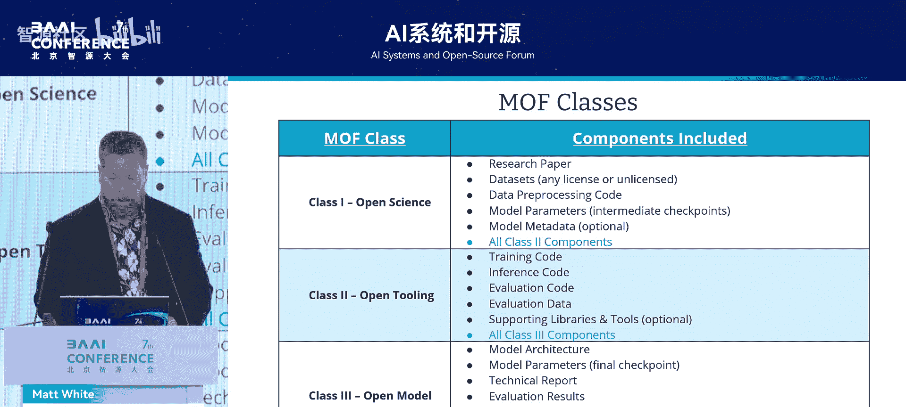

And so implementing the MoF was fairly straightforward。

 it required you to put the licenses that you're going to use in your repo and using the model openness tool that we have on our website。

 generate this MoF。 JON file， which is really an index pointing to all of the different components you've released。

 and then the license that's attached to them。And then we able to sign a class out of these three classes and then you are issued a badge right that that badge you can use in your GitHub repo。

 it's a Markdown file and Markdown text sorry， and you it very clearly states what model。

Class you qualify for。

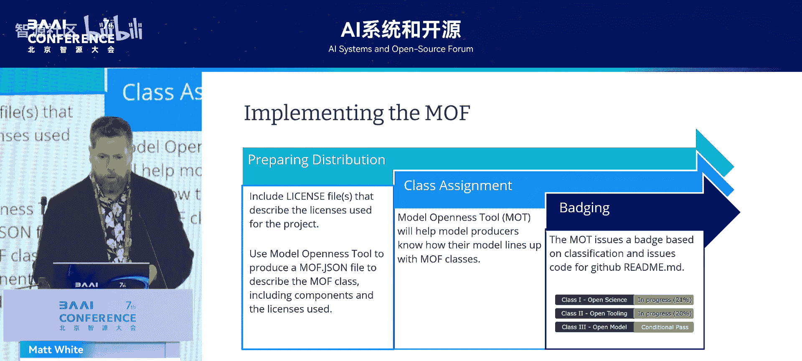

But in implementing this， we found that there were some challenges。

 It became a little bit more complicated for model producers to go through and generate this JO file。

 They had to use the model openness tool， select different components。 and there's a very like。

We're very accustomed to just looking at the license file that's inside the。

 the base of the repo and。For this reason， it made it very confusing for model consumers。 Oh， well。

 you know， like where are the model or where the license files。

 they have to navigate the entire structure of the repo to find those license files。

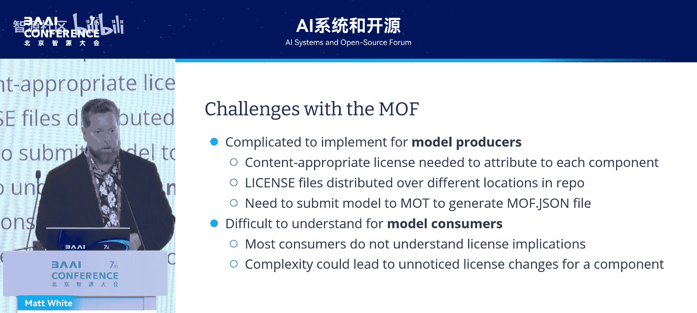

And so there continue to be challenges。And。Now there were challenges with licensing that we were looking to address。

These sort of dovetailed from the model openness framework， but。

There's open licenses that are you know we're always designed around software paradigms right and they're Apache 2。

0， MIT， you know the BSD licenses。We're always designed with a word software in mind and in some cases。

 documentation。But machine learning models are much more complex and they don't directly map to software artifacts。

Model parameters themselves can not be copywritten or patented， they are high dimensional data。

And models with restrictive licenses were being fine tuned and then converting their licenses to more permissive licenses。

 which is not something that you're allowed to do。And so traditional OSS licenses cover basically this。

 right， code and documentation。But this is what models can contain right there are a lot of artifacts。

 and so we saw this earlier on， but there's code data and documentation artifacts。

And so out to that work， we developed the openMW license。

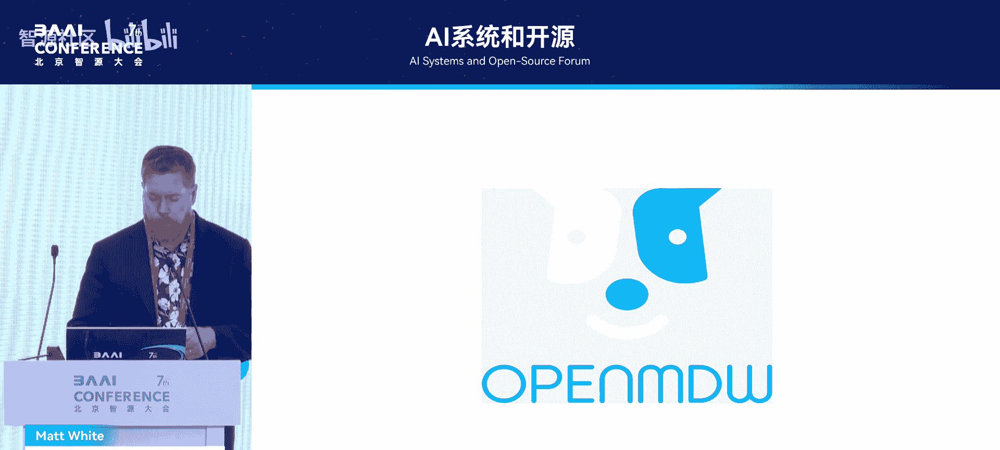

And so we did a survey of you know what was out there in terms of licenses that would be out there available for models and all of them。

 about 13 of them were all restrictive licenses， not a single one was permissive。

 and so we set about to develop this license。That is fully permissive。

And designed from the bottom up to be applied for machine learning models， so deep learning models。

 you know classical machine learning model， statistical machine learning models。

It covers all the components that are in the moth， so the 16 components that I showed earlier。

And that includes the model， architecture， data， the weights and so forth。Collectively。

 we refer to these as model materials in the license。It does cover all of the release components。

 but it doesn't require you to release all components。

 so where the moF is around is basically looking at classification of how many components you've released in open licenses here we're just addressing the licensing side of it。

And then there it's it does include like。A termination clause for patent litigation。

 so if somewhere does sue you as the model producer for patent infringement。

 they would lose all rights to use your model。It does cover patent database and trade secrets as well。

And it's very easy to implement。 It is a single license file that sits in the repo of your Github repo or wherever you've you know on hugging face or so forth。

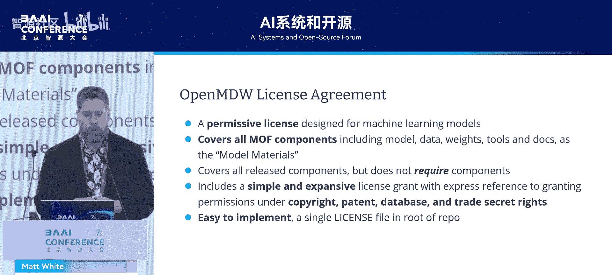

And so this is the license。It's less than a page， it is very succinct。

 it's very MIT like in its nature， we do have a fair bit of disclaimers。

 one thing is that when you build a model and you release it and you're releasing under this license。

 if you're going to release your data sets as well， they will be covered under this license。

Unless you use another license to override it and so the Open MDDW license is a global license。

It is you know it'll cover all components you release， but it is 100% compatible with other licenses。

 so if you want to cover your data sets under a different license acc by that is totally acceptable。

And so this license is very extensible and easy to understand。

And so just a quick look like comparing the OpenMDW license to other licenses in this space that have been used。

 so traditionally Apache2。 NMT have been used in the past maybe five or six years to cover models now we've already established that they are not comprehensive enough to cover all artifacts and so the scope of openMDW does cover all of these artifacts where others do not Openrail does cover all the artifacts。

 but it is a restrictive license。we are targeting OSD conformance。

 this license does meet the definition of for the EUAI Acts open model definition。And。

I think you know we have this very specific model disclaimer for AI， there's a data disclaimer。

 there's a lot of things in it that。Are not covered in other licenses。

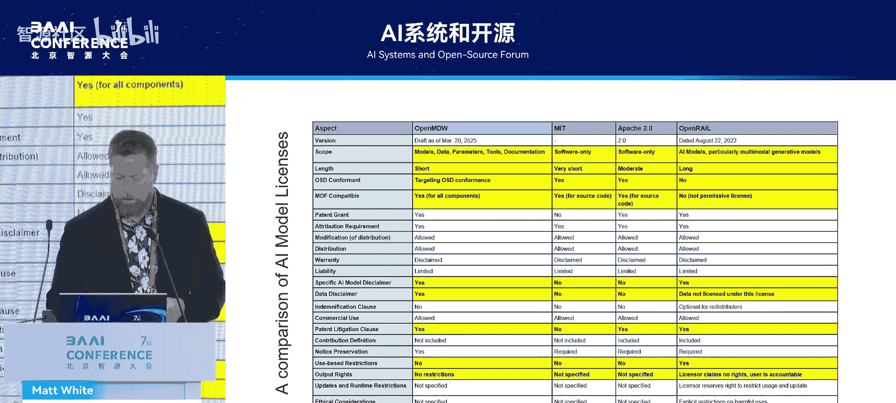

And so I'm going to just quickly touch on some of the projects that we have here at the Linux Foundation that are involved in open source AI。

 so some of these are in the PyTtororch Foundation， some are in LAI data。

 some are in CNCF and other foundations。But we're continuing to develop a very strong ecosystem of highly interoperable。

Projects that support AI research and productionization， chief amongst these Pytororch。

 VLLM Jupiter is also a part of the Pytorch or sorry part of the Linux Foundation。

And we recently brought deep speed onto Pytorch Foundation， as well。And it's not very well known。

 but the Linux Foundation actually is the home to over 200 different open standards。

And so as we look to a world where AI is more integral and there's a lot more innovation。

 there's a lot of interoperability and infrastructure that's being built and new application frameworks。

 it's important that we look forward towards open standards。

 right it's not something we've been spending a lot of cycles on in AI research。

 but now it's becoming more important， so we have MCP， A to A agency。

 there's a lot of work being done in this space， some of it around context。

 some of it around you know agent communications。But it's important that we also work collaboratively on open standards。

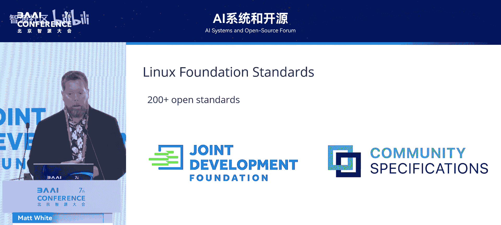

And so I'm going to leave you some final notes， one is use open source licenses where they're appropriate。

 right， please embrace open source， we need to continue to build a very rich open source AI ecosystem。

But I would say。You know strongly consider using OpenMDW for your model releases right if you don't want to release your data that is perfectly acceptable。

 but you know look at a model license that is more appropriate you know instead of Apache or MIT。

I think it's very important that we still embrace global collaboration in open source in an open source AI this you know。

 these are great times to be alive right now in AI。

 but it's a much better time when we're all working together towards collective goals。

And we definitely want to start supporting more vendor neutral open standards right and so specifications will be developed。

The community will embrace them， but moving those specifications into an open standards body is the right path forward right。

 this is how we were able to build the internet on open and interopable protocols。

And always build and just deploy responsible and trustworthy AI systems， right。

 adopt responsible AI frameworks like the generative AI Commons， you know。

 generative AI responsible framework。 These are great places to start when you're looking at adopting you know。

adopting frameworks in in generative AI。And so with that。

 I'm going to ask that we move from open source AI just having a moment to open source AI becoming the standard going forward。

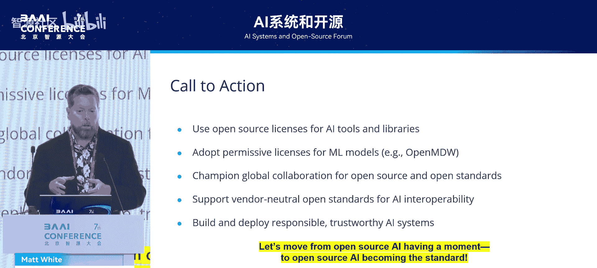

And if you'd like to learn more about the Model openness framework or OpenMW。

 feel free to scan these QR codes。

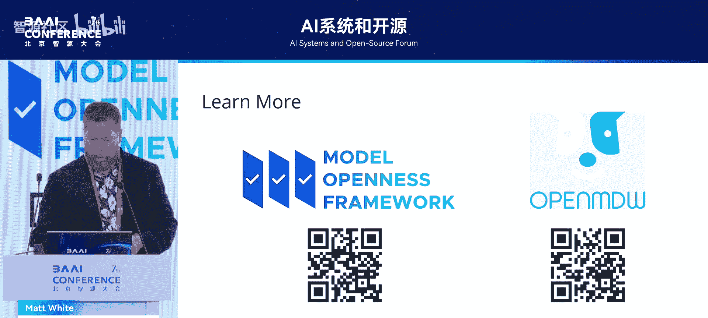

And with that， that was my talk today andll look forward to seeing you here tomorrow。Any questions。

Yeah， please。We， we have very curious about the MOF， MOF。 So we have the build O O。

Our team have built the first model past class one standard。 So aqui2 B。

 So during the process one question is the M is。To evaluate the openness of the model after the training。

 So do you any consideration to evaluate the openness or guide or give some guidance during the training。

In the model model training。 So this is the first question。

 and last question is we are we are build up raising a project name open to trend model next generation model in a open source way。

 So could you give me give give us some guidance to do the open source。More correctly， or more。

Acceptable。Thank you，Yeah， so during the training process I think you want to you know training takes some time right and if you're doing pretraining and so you want to start to plan to release all those artifacts。

 if you're going to aim for a class one， then that's open science or right you have to release all of all of the components the one thing that we really need to make sure is that all of those components are released under open licenses。

So what OpenMDW does is it takes away the guessing and just says， hey。

 everything that's released is going to be covered by this license and this license is an open license otherwise you're you going to docc by4。

0 maybe for data or CDLA and there's just a lot of options that you you don't really want to be spending your time like trying to figure out which license is used for each thing right and so I would say you know plan to if you're going to go for class one。

 release all your datas and make sure that they are covered under an open license。

And then the other question is like doing open source you know， correctly from day one。

I think we're maybe a bit challenged in the industry is that we don't always release our tools。

That we were like you know， even our scripts like data preproces scripts and a lot of other tools that we develop in the process of innovating and building new models or new new technologies。

And so those don't necessarily need to be released with your model。

 but I would still suggest that you release them in open source and help enrich the ecosystem。

And another area that I think is really important is that if you're using like a framework like Pytorch or you're using VLM for serving and you're able to find。

Opportunities for optimization or you've built no new module or something like that that you contribute that back to the open source ecosystem right it's very important that we continue to reshare our innovations and allow others to build on top of those。

Okay， good。 Thank you。 Yeah， any more questions。If no， okay。

 then actually met tomorrow will be hold to host the very important P day conference。 and。

 and especially as such as the H G land K transformer V I M。

 those very important topic also be list in tomorrow's session。 So， yeah， so thank you， Matt。😊。

