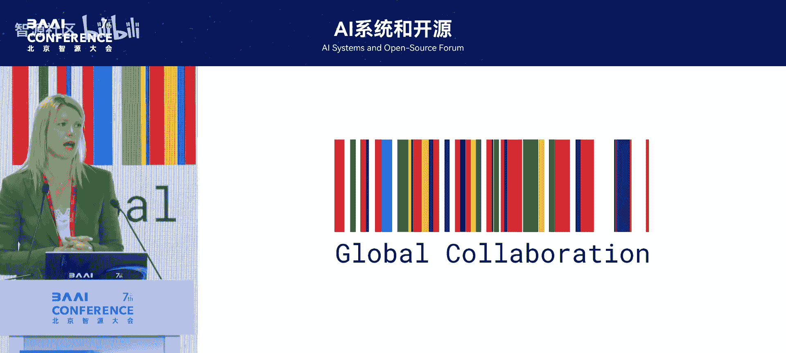
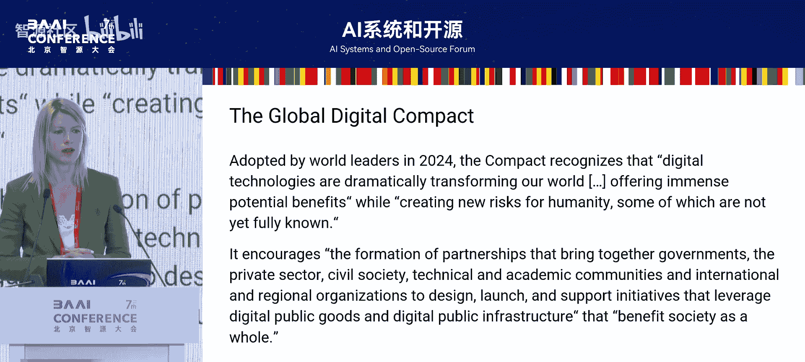
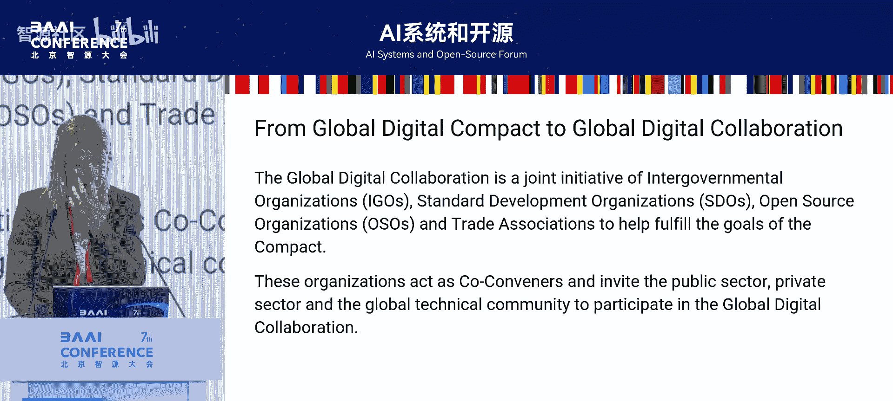
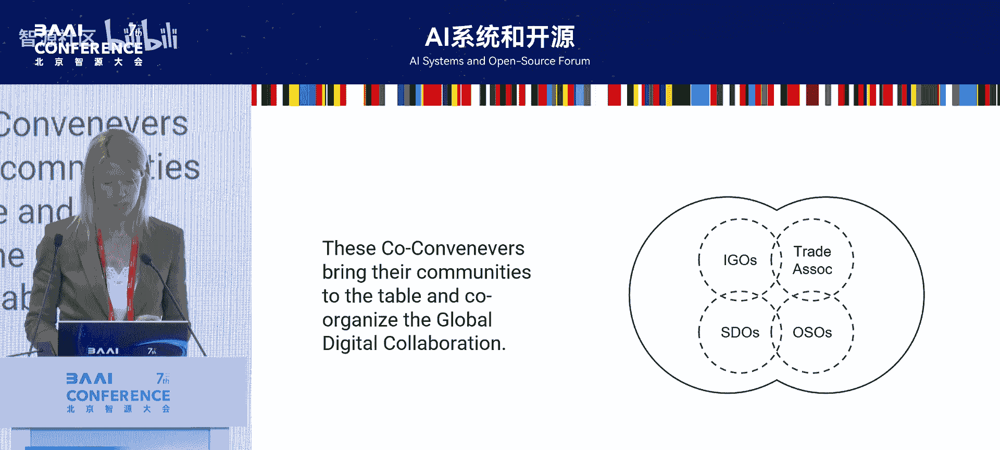
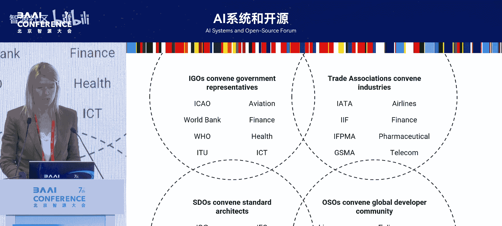
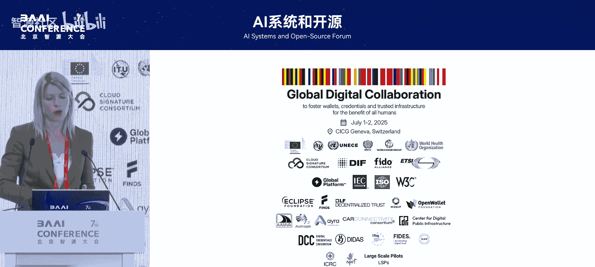
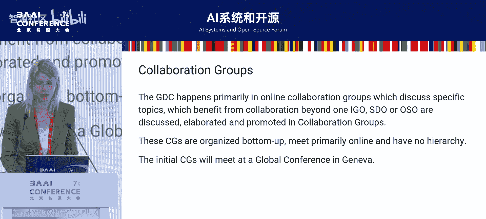
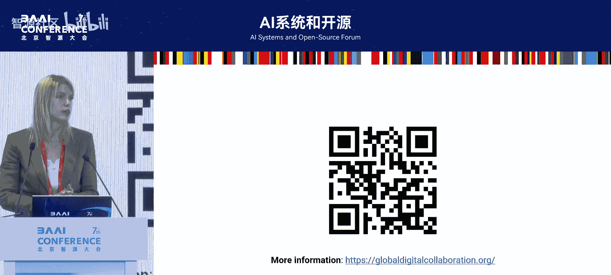
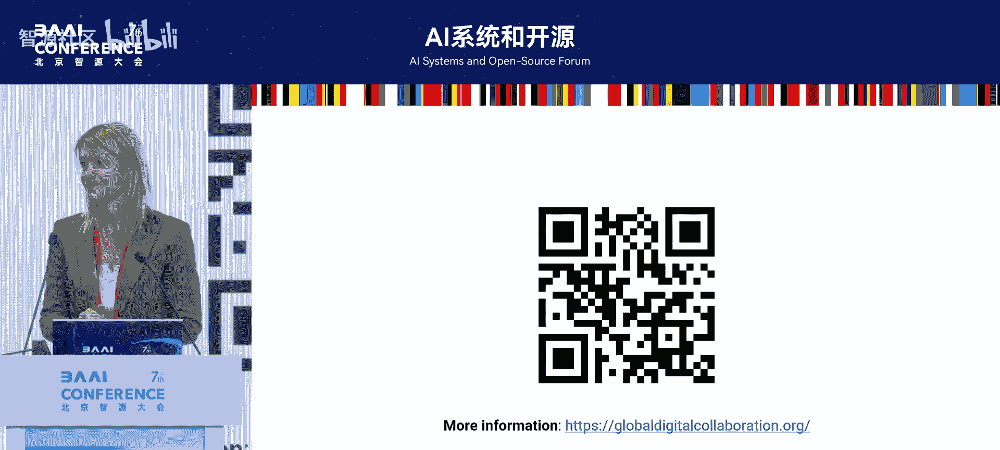

# 2025北京智源大会- AI系统和开源 p10 Bridging Borders Open Source and AI Powering Global Digital Interoperability：Rut -BV1g6NjzZEsj_p10-

The next speaker speaker is is how to pronounce the last。Rth， O， okay， Ruth。

 Ruth is the senior advise at the Open Wall Foundation。 and today she brings us the topic。

 brging the border open source and AI power and global digital interoperability。

 and more important is she will introduce， share us the the some new initiative activity around how to global the collaboration for the open source。

 So I think each of us can pay attention for this topic and see what will be the new opportunity we if we want to participate more global the open source。

 okay。😊，hear me ladies thank you everyone and thank you for having me today so today we will share with you some of the new initiative basically based on recent experiences in terms of governance but working together towards advancing interoperability and so we will share with you some of that information and the stage of that planning as well。

😊。

I move it， right， okay。So some of you may be aware of the global digital compact that was agreed last year。

 but by most of the stakeholders around the world， some of you may be familiar with more than a decade ago about the Wiis that was born in 2005。

 basically at that time， the world was quite different as we live today， but。

In the initial step of the WiISis， if you may recall。

 there were a lot of challenges in terms of how to address the governance and management of the internet resources as part of critical critical resources for the societies and so at that time it was raise the problem on how to how to minus those and ensuring a violence governance of those resources and so the evolutionvolution of that has been that today last year it was a the global digital compact basically。

Trying to update and be more accurate in terms of the current needs and how that project evaluated over the time and so the text there ensures that to make a mandate or a cultural to action to the different stakeholders and stating that how the digital transformation has been a huge benefits to our life。

 but also that digital transformation brings new risk in terms of fraud in terms of different challenges for security and how to balance the different。

Pain points on different development and so that mandate basically called to the different to work together and to be very inclusive in terms of all the the relevant industrial parties and the relevant entities that work in this field and so that specifically it' called for partnership between the product and public sector including the academia the civil society as well。

 and so that a huge call to action and huge challenge。

 but so given we try with different experiences in relation to how to bring governments on board in the Open Wall Foundation that is part of De Leence Foundation in Europe and so the thing is at that time a lot of government join the committee but then they have。

well， the thing is that because of my domestic policy we cannot join a nonforprofit organization and issues like that and so with okay we need another type of governance and reviewing the different models in terms of how to bring together stakeholder from the product and public sector and taking those lessons learns from different models as maybe familiar with with the ICN model for the internal resources they have a government and committee within their structure but from a government perspective they say oh that this is not enough。

 this is okay yes we are part of this structure and model but then we are not in equal foot off with the res or other stakeholders in that specific DNS space and the same that other way around happen with the Internet government。

One forum that was part of the outcome of the initial wishesis。

And some companies feel that in the Internet governance forum。

 know they'll feel very welcome or at least not as government agencies and so we find that there are a lot of challenges in terms of how to work together how to sit together and address these common problems but but in any whole food team。

 so agreeing from horizontal perspective and not I mean inviting from the product sector or the other way around where not everyone feel that that they have the same opportunity to participate so。

So with that background on a bit of history， basically we tried to provide a structure and basically a pathway on a concrete pathway for the global digital compact to what we call the global digital collaboration and so we believe that the only way forward is that the different stakeholders。

 the tech companies， the developers， the open source organizations， the standards。

 development organizations， government， international government organizations。

 civil society and academia， the only way is that they work together in one neutral space and that they could agree on an equal footing and that that they feel that their are part equally on this structure so that's why this initiative was born。

in initial stages， but one of the specific outcomes is the Geneva conference that will be held in July 1 and second and as always say。

 okay， let's bring this initiative officially on July 2 that's the plan but so far the recent let's say one month and a half that we have been planning for this huge event has been a very interesting experience on how the different stakeholders have been contributing to the agenda and how Google。

 Vi， Huawei， supported this initiative and also how the World Bank。

 South Korea and Samsung stick together on a panel discussing how to better collaborate and address the common challenges and so in this exercise of collaborationlabo。

And trying to align on approaches that the first experience will be this Geneva conference and that initiative will be formally launched on July 2 at the end of the slide you will have more information in relation to how to register to that event you have the website that this global collaboration you will see there agenda of that of that event。

And one of the interesting and quite unique characteristics of this mall is that we don't want to rein the will because there are a lot of good organizations and good initiatives and great communities surrounding these topics already so that is to avoid duplicating efforts and how we do that so each of the coconveners of these initiatives that includes the standard development organizations。

 the open source organizations such as the AI or Leard Foundation。

 they bring their communities into this structure so it's not that we are building a new things so each of the entity that are part of this coconveners will be part of that so the idea of I mean from these lessonser learn in terms of trying to identify the best mall。

 we saw that yeah there are a lot of great development。

But sometimes development initiatives are working in silos and so how we break out that silo and we say。

 okay let we need to work together but to coordinate from a high levell perspective and so each coconvener which will be part of this structure will be the voice and representative of its own community。

 so that's quite unique in terms of governance and that's how we see according to the different inputs we have received from the stakeholders but that will be a good way to work together and to coordinate from a high levelvel perspective。

And so you see that as I commented before there's a lot of initiatives already or structures that are organized by one side or the other。

 but so far hasn't been a global home to bring together the public and private sector in a way that could horizontally contribute and agree on different things。

 and so this is the global collaboration basically is calling for a joint governance from both sides。

And the different essay holders as we see in terms of group of S holders is the trade organizations。

 the open source organizations such as BEI and Li Foundation。

 standards development organizations and also in intergovernmental organizations and so the different communities participate through these membership and that's the way we thought that to simplify the governance and also to try to。

To come with a tangible outcome， otherwise will be just another good forum and a nice forum to chat about the same topics。

 and so that's how we believe will help to ensure we can agree on the high level things。

And so this is basically the the so now you see like the small communities or big communities of each of the entities that we see the groups that will be part of these global corration as I comment。

 the trade associations could be the IatA that's the airlines are part of。

Of that structure and so in this case it will be aatta part of the global collaboration representing the airlines there。

 but it will not be the airlines coming to these specific instructor。

 so the same with as I commented on open source organizations that combined the different developers。

 open source developers like the host of this event and so they will bring the different communities to the table and try to address the discussions as well and same with the SEOOs and IGOs such as the World Bank in relation to finance or the World Health Organization bringing the different health ministries representation in relation to。

To their needs and and discussion items， so that's how we envy such that you will look in terms of representation and participation in this global digital collaboration。

And this is like so it will be launched in July 2nd and so far the event is looking like that in terms of organizers so we called co organizers so far we have more than 40 entities that are organizing it。

 and so how it works basically for example。If you are a Ministry of Health and you are part of the health。

 the Worldhar organization， you will register through their registration system to this event。

 because that's the way we see thats each of the co organizers should encourage participation。

 but also administer who will be representing their area or their domain in this big。

big event that has a lot of issues to discuss in relation to wallets to digital credentials and mostly how to together to build trust and how to foster the digital infrastructure。

And so this is hosted by the Swissfederation and also supported by Google Waiwei Master Car Visa and so there you can see the agenda and it's very interesting to see。

How the different organizers identify the key use cases in relation to what's going on in each of the jurisdictions。

 so they won July 1 the different entities and government agencies will be discussing and sharing what's going on in terms of which are the policies that they have in place。

 which is the regulation and then sharing also on a panel with the developers of the wallet or development in relation to digital identity。

 so we think it's a very much a panel sharing was's going on in each country or in each region。

 and so there you will have the European Commission sharing recently release UD wallet regulation along with industry stakeholders。

And trying to share how the different largesh escape pilots are。

Are evaluating in terms of outcomes and inputs that they are providing to that implementation and then also South Korea will present along with Samsung。

 Ohio and others the US Department of Com and Security will also share what's going on in their jurisdiction and the challenges in relation to the emerging standards and the gaps with implementation as well。

 Australia will share their initiative from the Atraro perspective， the mobile driver's license。

 which is a key aspect in relation to the In credentials and wallets and。And then Japan as well。

 India and others that have raised their hands2% on day one and then during the afternoon of day one。

 it will be more sector driven or more use case driven so there we will have trade associations that will share which are the current challenges of the of the digital。

Tranformation in international trade and also we will have the Red Cross sharing the current challenges on probability with trying to from the humanitarian perspective and how to help refugees and to bring them on board with credentials that are not compatible with the local government credentials for example。

 and so trying to share those use cases as well as from the financial perspective， we will have。

The World Bank sharing with some countries from the global south。

 how those countries are trying to participate securely in the digital economy。

 the constraints and challenges in relation to connectivity in relation to capacity building from their perspective and trying to identify。

 which are a good set of requirements or a good set standards to build their solutions to their societies。

As you can see， it's a very varied agenda because it goes from the health credentials to educational credentials with organizations such as Federation of Uni and also CA keys and cross borderor interoper led by OECD thats basically you may be aware they provided a lot of good mappings around the world。

 trying to map policies and framework from the US to Europe map in the different development and policies in relation to the G7 countries and so on。

 and so leveraging that and say okay， this is a partial mapping of policies and developments。

 how we could better align in terms of policies in terms of legal frameworks in terms of technical frameworks to move forward towards interoper。

So they are working with different countries， those that are willing to2 months on cross borderor recognition of credentials。

 and so you will see that on day one as well， and they two is more a deep dive of those topics and so for example。

 the standards development organizations， the first day will be a quick snapshot of which are the key SEOs that provide standards in relation to digital identity and wallets。

 but then on day2 they will share which are the standards， why for example。

 the ISO 19013 more those that are relevant and the different initiatives the countries and some entities are working towards making that standard available for free。

 for example， so examples of motorcycle collaboration。

To2 interoperability beyond cost and problems and so。The agenda is available。

 we are still working on the the of course on the final details it's an in person event so far we don't expect an hybridd model but because it's the first one and it's quite huge and we want to engage onsite discussion。

 but you will see on the last slide the QR code where you can register through the organizers depending on I mean if your organization is part of IGO or an AGO or part of let's say。

 of BAI。

And one of the the so this is basically the current stage and what we want to achieve in terms of the outcomes。

 so the they two will be there will be like wrap up sessions basically identifying which are from those tracks that will be addressed on day one and they two。

 which will be the core areas that the different stakeholders would like to work together and identifying。

 create the different collaboration groups that will be together again all the IGLs and also and the different government agencies trying to work。

 let's say on AI models or on。The different requirements for your phone。

 making sure that they support biometric and security in terms of devices for example。

 so yeah the topics it a a very long list of issues and you can you can check those but here is the QR code to resist do I encourage you to see more information and let me know if you like a more detailed information about this thank you okay thank you Ruth and because the time so we if you have any question and if you have any inches to participate this new initiative yeah you can discuss with Ro of thank you thank you again。

