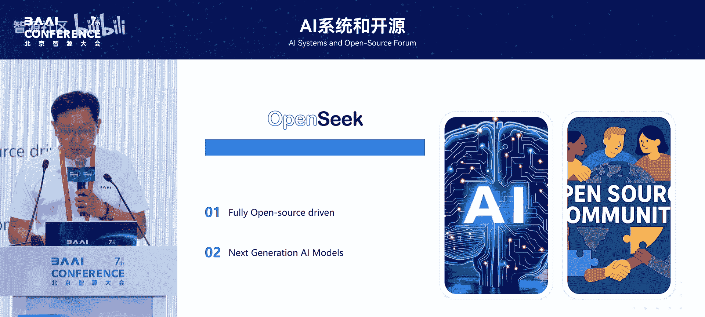
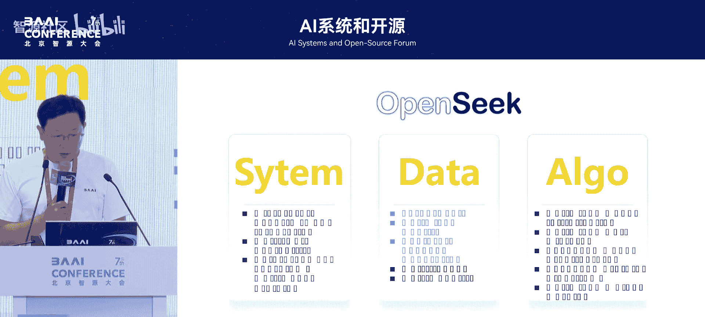
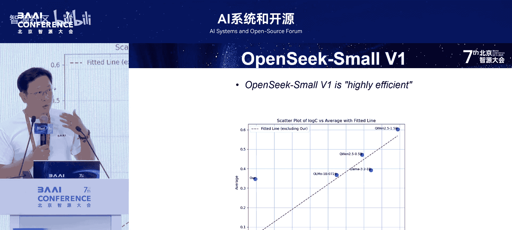
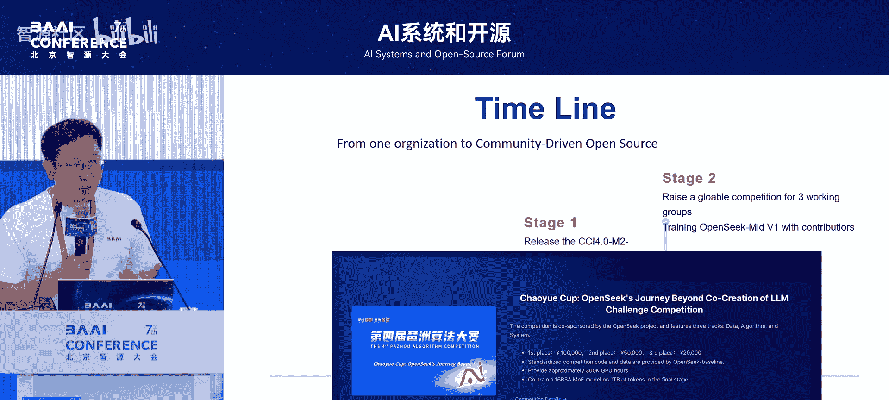

# 2025北京智源大会- AI系统和开源 p11 开源共建大模型项目OpenSeek：刘 广 -BV1g6NjzZEsj_p11-

🎼那我们到呃今天presentation环节的最后一个也是压轴的一个呃，有请来自呃智源研究院负责数据研究的呃负责人刘广博士，他带来的是共建大模型项目open sick，谢谢。嗯，大家下午好。

然后我是来自智源研究员的刘广，然后是非常感谢大家坚持到现在，还在听这个我的一些分享和汇报。😊，然后我给大家带来的是一个主题是说我们open seek这个项目，呃，大家肯定都觉得大模型离大家非常的近。

又非常的远。非常近的原因是说呃现在各种开源的模型API都大家都可以接受到可以用。但是呢又感觉到非常远，就是为什么就是因为我们要去训一个模型，实际上他的门槛还是非常高。

就比如说研究机构或者是像我们这样的研究机构，或者是一些学校的学生，他去丛零训一个模型，其实是会遇到很多的挑战。😊，所以open sick这个项目其实就是希望能够通过开源社区的方式去训一个模型。

因为现在绝大部分模型的训练还是非常集中。就比如说deep seek，比如说千问他们的团队训练一个模型的时候，是要集一个公司甚至很多呃资源呃非常高门槛的去做这个事情。所以说我们希望把这个门槛降低。

把这个成本打下来。

嗯，那这么这种方式开源的方式去训这个模型有没有一些先例呢？其实在国外，在欧洲h face做过这个类似的事情，就是big science。他们这个组织是做了一年时间的这个工作。

然后集合了大概60多个呃不同的国家，地区1000多个呃不同的研究人员，分成30个工作组，然后呃投入300万美金呃，330万欧元去训了一个大模型叫bllog。同时他有个数据集叫叫做rose。

所以这是一个前面的一个先例。那我们op seek会希望去怎么去做这个事情呢？就是在我们参考了big science的一些呃前面做这个这个开源共建模型的这个一些经验，也结合了现在实际的一些情况。

我们提出一种呃混合的模式去做这种开源模型的训练。就一方面肯定会有一些呃主要的一些路径的判断。我们会结合开源社区的反馈意见，以及本身我们有一些模型团队经验经验的同事，一起去做这个呃最终路径的选择。

技术的选择。同时会呃基于不同的一些开源渠道，就是吸收更多不同来源的一些贡献者去做共同贡献。就比如说。呃，个体就是个人的用户或者是一些机构，我们都是去欢迎一起来共建这个模型的训练。

同时呃这个资助的来源也不只是来源于一个机构或者单一的一个一个一个团体或者是个人。我们是各种渠道的呃资金来源都是欢迎。那我们其实已经呃把这个项目运行的一段时间，可以看到从今年2月份开始，呃。

大概过了有5个月的时间，我们其实在法国的cos会上去做了一个第一个阶段的一个发布，就把我们第一阶段的数据。我们过计量大概有呃35T呃，大小的数据，其中包括了4。2T的中文的呃数据，呃，把它做了一个发布。

就CI4。0这个数据集，是双语数据集，包括中文和英文。嗯，同时我们也训了一系列的小的模型，其中包括一个非常小尺寸的在40G呃显存单卡就能跑起来的一个小模型，也是为了去拉低这个。参与者的门槛。

同时我们也发布了一套就是公开的标准化的数据和代码，希望大家能够很好的去把这个整个模型训练这一套去呃用起来，然后去接触到。然后在这个阶这个阶段之后呢，我们可能会筹集一些资金，然后联合一些比赛的方式。

去把我们整个paperline通过比赛通过这种方式呃，就是有一些奖金，有一些算力支持，让开发者和供献者能够更快的去投入到这个项目中来。这是我们的第二阶段想去做的一个事情。

那呃我们去做这个事情肯定会有一些呃挑战，或者是有些目标。呃，基于之前或者是基于现在整个呃大模型训练的基础的挑战就是数据。然后系统还有就是算法这三个方面都有很多的挑战。

其实呃deep seek给了我们一个很好的一个启示去应对这些挑战，就是提升效率，就是把数据的效率提升，把系统效率提升，还有把这个算法效率提升。

那我们是会围绕这三个呃挑战以及效率提升的这个工作去呃设置的三个工作组。呃，这三公组不好意思，就是这个字体有些问题啊，这三公组其实我们不是加密啊，就是是有一些工作列在这里。

就是具体的呃就是系统侧肯定会有很多应对的一些挑战。比如说我们对MOE像这种高效率的结构进行一个支持。对数据怎么样去构建更大规模高质量的数据，以及呃算法册也也有些挑战。

就是为什么就是因为V3给了我们很多启示。就是他在呃MOE的这个结构上以及它在MAFPR这种高效训练上做了很多的一个改进。但是呢现在还有很就是很难有一个完全可以复现的这么一个开源的训练的代码。

甚至是推理代码也很难去去做一个复现。所以说我们希望能够即可开源社区的力量去把这个模型训练这一块呃的效率提升上去，能够达到接近甚至是超越它论文中报道的这些数值。😊。

然后现在的进展是说有flex skill团队，就是之前那个做了个报告的敖玉龙博士，他也介绍了很多呃一些进展，就是我们以经于他的框架的配合，以及我们的数据集做了一些模型的训练。

现在已经支持了呃dep个V3这种结构的呃一个训练。但是在效率上在就不断的优化。然后在近期也会去对deo pipe这种呃高效并行策略进行一个支持。当然我们还有很多挑战。

很多很多工作需要去联合开源社区一起去开展。

在数据上我们也做了一些分析，现在deep seek B3其实是MOE的结构，然后千万三也是MOE的结构，可以看到这个这个图的横坐标其实是算力的投入。纵坐标是它这个模型的MU的一个表现。

可以反映出模型的一个性能，就是算力投入越多。呃后，这这个表其实可以看到，随着算力投入越多，其实模型性能是在稳步上升。但是我们也可以看到，就是在同样算力投入下MOE结构，就得红色的这些模型。

它实际上是更加高效的。它在同样算力投入下，它的模型表现会优于这些dens的模型。所以说我们希望去打造高效的数据集。😊，呃，高效的一些模型训练的呃策略以及高效的模型的这个结构。嗯，那数据需要什么？

现在大家都去比较关注的是推理模型。那推理模型的数据呃有一些研究，就像是这下面有3篇，比如分别来自于斯坦福essial AI，还有就是呃就是他们都反映了一个问题。

其实模型的推理能力可能不仅仅是强化学习阶段带来的。所以说怎么样去在这个数据集构建的过程中去把这个呃推理能力去加入进去，其实也是一个很大的挑战。😊，我我们对现在开源的数据集也去做了一些呃简单的一个分析。

就传统的像派p这种数据集，它是一个混合的多多种不同来源的有book有vicki，但是它规模非常小，这种数据集呃是呃质量其实也有有待提升。因为它的这个呃质量过滤其实做的不是特别的完善。

同时他对于这种COT类型的数据，其实没有太多的考虑。而像特别大规模的像re帕jama，它是一个特别大规模的一个数据集。但是它的质量就就是就是呃它的质量可能噪音会更多，需要更精细的处理。

就因为它它规模非常大。所以说呃它的来源也比较单一。所以说我们需要做更多的一些处理，才能够去提升它的质量。然后最近呢有一些泛 webb，像lim种CC，它它它已经结合了一些数据合成的一些技术。

以及一些精细的处理，去对数据质量进行的提升。所以说我们借鉴了这个现在数据级的一些发展状态，提出了三个点，就是我们需要一些呃多来源和大规模的一些数据集。同时希望对质量进进步的做优化提升。

同时也希望能够对推理这方面做一些呃增强和优化。所以说我们提出了呃。提出了这个C加14。0这个数据集，它有35个TB的尺寸，同时在这4个分方面上都做了一些优化。然后这个数据集的话是分成两个部分。

就是就当然是属于我们open stick阶段一的一个成果。它分成了1个base和1个COT这两个呃子集。其中base的话是5。2T的呃中文的数据。其实我们是联合了大概有20多家呃机构，他们捐捐赠的。

通过开源的方式捐赠了很多的呃高质量数据。然后我们一起把它开源开放出来。呃，同时还有就是这个COT的数据，我们有大概通合成了4。3亿的呃COT的数据，都包括了数学，包括了代码。

也包括了很多网页以及Vki和论文。就这种这种数据是呃就是相当于现在传就是现在比较主流的，或者是建的比较多的，单纯从某一个领域的COT来说，它的多样性会好很多。

同时我们也升级了我们整个数据的处理的流程和peperline，从数据的那个获取呃去重以及多个不同来源针对性的去做不同的处理。再加上针对性的数据的合成。就这里整个line的话是我们都呃是完全的开放了出来。

就是在我们的open seek这个项目中，那个data目录下，我们把所有的这些处理工具以及模型，甚至模型的一些训练数据，我们都做了一个呃统一的开源和开放。同时这个数据集我们也做了一个开放。

就比如说CS4。0的MQ以及CCS4。0MQ的COT这两个版本。那整个的一个配比就是用千万的tokentoken就是呃编码之后大概是有6。4TB的这个尺寸，同时涵盖了不同的领域的分布。

基本上是一个高质量的可以直接拿来用的这么一个状态。我们也做了一些实验去分析和对比。因为我们就是的点，就是一个是我们数据质量会比较高。那在经过这个实验，我们就用0。

5B的模型从零开始训对比了呃之前纯重文的CS3。0HQ以及分。我们其实这个数据集能够在20倍数据规模参数数据规模的这个训练的情况下，能达到一个比这些数据集更好的一个效果。这验证了我们这个数据的质量。

同时我们也提出了一套基于AI那篇文章中去对模型的反思能力这种评测去做了一个分析，就发现这种小模型加了COT在我们合成的COT训练之后。

它的反思能力确实会有一个稳步的提升不加COT就可以看到右右侧这边的这曲线蓝色的部分就是加COT的它的反思能力会有一个稳步的提升。但是没有加COT的话，就是它的反能力可能会稍微弱一些。😊。

同时算法这部分的呃就是我们呃公开了两个不同的模型，就是相当于我们算法组的一个工作的一个结果。其中这个被呃这个base line就是bline的意思是说，我们会把它用于呃，他们这这两个模型其实都是1。

4B非常小小小尺寸，可以对这种非常呃低资源的这种需求去做模型训练，从零开始训或际训练都是非常呃就硬件友好的。同时它的结构是deep seek V3的这种ME的结构，它并且还是有很多。

就是很多就是呃我们一些工程化的一些呃trick的支持。所以说这两这个这个b的话就是我们会持续不断的去迭代。

同时用于后续我们的整个呃open seek项目的一个分析和比较用于开源社区去复现这整个流程去TPR去改进我们整个open sick这个项目做提供一个很好的一个基础。同时我们训的这个0点呃0点呃0。

72T token的这个呃数据也是验证了我们的数据这个数据和模型结构的高效性。可以后面可以有个介绍。那这个line其实是为了解决刚才说了这个模型或者是大模型，感觉大家都离得比较远的这个问题。

然后离得比较远，就是因为门槛比较高。那如果说我们有个非常低门槛的一个呃条件，让大家都可以在单卡上去跑起来去玩起来这个模型的整个训练。那其实这个门槛就降降低。

大家都可以真正的加入到这个开源的项目中来去针对大模型的一些呃项目进行上手进行改进，进行复现。所以这是我们整个Pperline的一些基本的一些设置。

比如说数据的配比模型的参数oneDB还有结果评测代码都是全部开源了。对，同时那个我们呃去了0。72B的。这个token之后的这个小模型，我们也跟同等尺寸的模型的去做了一个比较，就可以发现。

其实呃横坐标是这个呃scaling，就是它的那个算力的这个呃这个投入。纵坐标是它的在11个变成m上的一个平均表现。就可以看到，其实在我们这种呃数据以及模型结构的情况下，它的效率还是非常高的。

是明明是优于之前的那些小模型的。

然后整整个项目现在的情况是说，我们有一个呃微信群，大家可以加群去了解一下。就是我们有大概200多位贡献者，同时来自不不同的一些机构。同时我们分成三个working的呃三个工作组去针对不同的方面去优化。

其中系统测试由呃玉龙这边的flex skill团队做了一个很多的支持。然后数据和算法团队分别不同同学正在往前去推进，推出这个 pipeline，然后完善文档。

同时我们会举行呃每两周的一个双周会去不断的去迭代，去讨论我们下一步应该做什么，然后同步一下进的进呃进展。呃，我们也非常欢迎更多的贡献者加入到我们这个微信群来，或者加入我们的讨论。😊。

然后呃就是就到现在这个阶段，下一个阶段，其实大家嗯我们的数据已经ready了，我们的代码已经ready了，但是就缺的就是算力。所以说怎么样去通过一种合理的方式，合法的就是比较好好的方式。

让大家能更好的去加入到这个呃呃open seek这个项目中来呢，我们做了一些设计。就是我们联合了琶洲算法大赛，就一起去举办了一个就是open seek的这么一个赛道，它也是分成三个不同的方向，就是数据。

然后系统以及我们的那个算法，三个赛道，然后去针对不同的。😊，我们这个不同的挑战，然我们op需要应对的一些问题呃和去去针对设置一些赛题，去呃让贡献者，让比赛参与者去有一些算力的支持。同时也也有一些奖金。

呃，琶洲算文大赛这边我也也顺便宣传一下，就是说他是已经举办了第四届前面几届大大家可以去扫码呃参赛报名，也可以通过这种方式加入到我们opan seek这个项目中来。

它是已经举办了第四届是一个国际性的一个比赛。参赛队伍和和人数也是在逐步的增长，到去年的已经是6000多个不同的呃团队的加入。对，然后再呃简单的介绍一下。

我们整个open seek这个项目其实是呃是受到了呃在f open这个体系下，同时也是受到不同的团队的就op fly open不同团队的一个支持。我们也是会持续的呃针对整个大模型全站的开源开放。

去持续的往前做努力。啊，非常感谢。好，谢谢谢谢卢管博士。时间可能足够看有没有问题，只够提一个。好。😊，哎，老师您好，我是这个国家电网大数据中心的。然后想请问一下，就是咱们在做那个预训练开源数据集的时候。

呃，然后咱们的核心之一是质量高。然后嗯质量高呢一方面是来源比较的多样。另一方面我们对这个语料本身的一个质量，就是从咱们角度来讲，因为这个评测的指标现在市面上有很多。呃。

那咱们采用的是一种什么样的评测体系，以及尤其是针对比如说非。数学代码的这种纯语料的部分，咱们是怎么把控它的这个质量？谢他，谢谢。对，就是就是数据质量这个问题，实际上是一一直在迭代和演进的。

我们其实是结合了规则和模型两种方式。就是规则的话就是我们有人工的一些规则做前期的过滤，就是传统就是我们写了很多的正则或者是一些规则去做过滤，去把一些有噪音的数据去除。这是一部分。另外一部分是通过模型。

就是用大模型去对它的教育水平，就对他对它的那个知识密度信息含量等等做一些分区分。然后通过大模型的方式，然后去针对一些小模型去做分类，这是两种做了一个结合。然后同时我们也去人工再去做抽查。

去抽查这个模型判断的结果跟人是不是一致。我们一致力达到比如说80%以上，我们才可以觉得这个质量是比较高。现在是我们只通过这种方式去呃迭代和优化我们的数据的质量。好好，谢谢好，也谢谢刘广博士。

因为时间关系，我们只够提一个问题哈。那的确open sick这个项目帮助我们从这个开源模型走到了下一个阶段，就是说不单我们把所有东西都开源。我们连这个训练过程也全部开源出来。

让所有的开发者和研究人员都能够参与到这个开源的项目开源的模型的一个呃创作过程中。😊。