# 2025北京智源大会- 下一代AI路径探索 p02 关于下一代生成模型与架构的思考：石佳欣 -BV1c5NxzqESk_p2-

我们首先这个第一位报告的嘉宾是呃。深度呃是deep mind的呃石佳欣。啊，石佳新博士啊，那线上能连上吗？哎，哎，嘉欣能听到吗？哎呀好哎好，好，可以听到。对。😊，好像有回音，你看这么。喂啊。啊，嘉欣。

你再说一下。嗯，能听到吗？啊，现在可以了啊。啊，好的好，我简要介绍一下那个呃石嘉欣博士是现在在在在d mind啊做这个啊深度生态模型的前沿的研究。啊后他是呃清华大学啊毕业啊。

也是在我在我们组啊毕业出去了。然后然后在那个应该在深度生态模型前面啊还做了非常多的出色的工作，包括获得ip的呃结束论文奖。然后啊在这个特别比如像这个扩散模型，用于这个离散数据建模上啊。

有很多这个呃前沿的研究。啊，那我就不多说了。然后这个时间啊给到嘉兴博士啊。谢谢周老师的介绍。然后呃大家好，那个我是石佳欣。然后我一直都在从事一些生成模型概率推理和呃算法架构方面的一些研究。

所以今天我想带来的这个分享是关于下一代的生成模型和架构的一些思考。然后这个talk的重点可能是思考，而不是去介绍具体的工作的特别细节的东西。然后嗯希望能够引起大家的一些呃想法和讨论。嗯。

然后呃在具体的进入内容之前，我想声明，就是今天所讲的所有的东西是我个人的一些研究的思考和见解。然后不涉及任何机构的呃立场研究和观点啊。然后嗯大家都知道，就是从GPT系列开始啊。

这种大语言模型驱动的人工智能的规模化的扩展，实际上已经发展了快4呃4到5年了，对吧？然后现在大家在具体的研究和开发当中也都会看到的一个问题是啊我们现在这种大模型的啊。

但是很快就要用完互联网上所有的数据啊，这个在左边的这个图里面其实展示的就是红线是互联网上现在数据增长的一个速度的一个曲线。然后南线是一系列大圆模型使用的这个数据量。

然后你可以看到用这个图来做一些projection。你得到的结论就是说再过四年我们就能用完所有的数据。然后这个是很可怕的。因为大家都知道大模型的扩展定律是随着模型大小的增长，这个数据量也要相应的增长。

然后如果没有更多的数据可用了。那这个扩展的定律也就呃也就失效了。对，所以模型进化的速度也会停滞。所以一个很重要的研究问题，或者说呃现在呃一个大家都关心的问题是什么呢？

是我们需要找到能够更有效的去利用数据的模型，也就是说能不能就是发明新的模型能够从现有的数据当中去挖掘出更多的值。

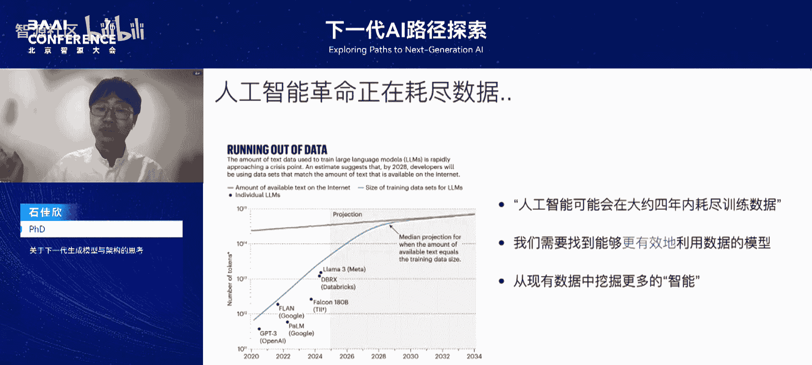

然后这里的模型实际上我们是在啊讲生成模型，就是现在叫的这种生成式AI那生成模型的原理是什么呢？实际上它非常非常的简洁。它就是说我们要对呃我们想要感兴趣的这些高维的数据。

我们要对它的各个分量去你和它的联合概率分布。那么现在这些语言图像视频这样的大模型甚至包含呃还包含人的这个action，那比如大家叫世界模型，那么它的原理都是为了你和这个概率分布。那只不过其中每一个分量。

它可能对于比如语言语言里面它就是一个词一个token，那在呃图像上视频上它可能是一个像素，然后或者是它是一个action，对吧在语言模型里面，那就是比如让我们model这样一个句子，只相于生。

那实际上这里的每一个词实际上就成为了这里的一个分量。然后他们实际上是模型是要去抓住这些分量分量之间的一个。啊，它的一个依赖关系，它的一个呃联合分布。然后但这个联合分布实际上可能是非常非常复杂的多封的。

甚至即使是两个分量之间的依赖关系，也可能是非常复杂的。比如就像右边这个图啊啊展示的这样。

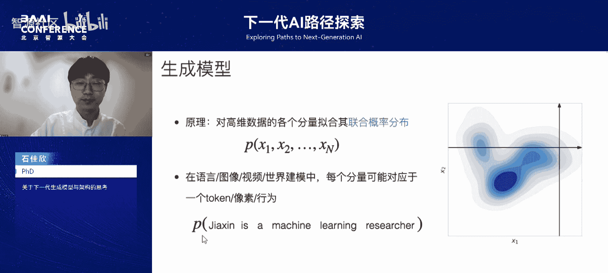

那基学习里面有很多很多方法能够去帮助大家建模复杂的联合概率分布。那其中一个现在比较呃wellknow的想法就是自回归模型。我们叫au model啊，也就是现在大语言模型产生方法。

那它的idea就是什么呢？它是说在一个给定的次句下面，比如说对语言来讲，它就是从左到右，那么我们将这个联合分布分解成各个分量对应的一个条件分布对吧？那比如说在现 learning research。

那这里每一个条件分布对应的，就是一个给定之前的词，然后去预测下一个词的分布，然后呢给定前面到ine learning这里那下一个词很有可能就是research对吧？

那这个条件分布实际上具体大家是怎么去刻画在模型里面，然后大家会用一种叫做transformer的网络架构去建模当前词和以往词间的一个复杂的依赖关系。然后用这种最大自然的方法去从数据当中学习网络参数。

所以实际上这个架构它本身。真的一个建模的能力，实际上就决定了我们这个生成的模型，能够啊啊拟盒数据分布的一个能力。然后这个拟盒能力啊决定了模型最终能够学习到多少只了。

然后这里需要强调的就是他我这里讲的这个拟合能力是指拟合这个数据，它啊生成这个数据本身它所依赖的那个啊真实的分布，它的能力，而不是去拟合你拥有的训练数据的能力。然后这两个是要分开。

因为如果你只是单纯的去拟合现在拥有的这些训练数据，那你最终可能得到的啊，就是一个过拟合的结果，对吧？在极限的意义上，所以你不是说拟合的越好，就会有更好的质能。而是说如果你真的能够把这个分布拟合的很好。

那你可能就会得到更多的值能。那这个拟合能力决定了你的你的上限在哪里。

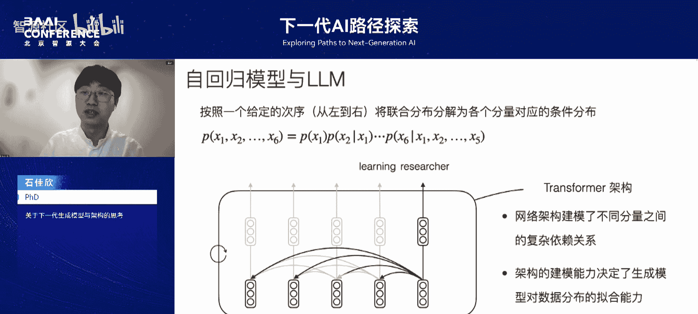

然后大家可能都比较熟悉transformer啊架构的细节。然后这里我只是简单重复一下，因为之后讨论会涉及到这些location啊。

transformer主要是通过self attention来啊这一层来建模分量之间的一个依赖关系。那么他首先把所有时刻的分量都映射到三个向量的表示cur key和value。

然后这是左边啊左边第一啊前面三个前面三个式子KVQ所代表的意思。然后在每一个时刻呢啊都通过当前的时刻啊和所有的呃当前时刻的一个cur去和过去所有的key进行比较。

然后通过s max来分配给对应value的一个权重。然后通过这些权重进行加权平均得到当前时刻的一个输出。这是最底下的那个对左边最底下的那个式子和表达这个计算过程。这个计算过程会被复制很多份。

然后就是所谓的注意力头，就是每一个注意力头，实际上是为了表达不同的查询最象。然后attention机子最早在引入的时候，它其实就是通过啊啊受人的注意力的启发来去设计的。它不是说从哪里推出来的。

也不是啊有一个很rirous的一个一个一个一个呃设计，它完全是一个经验设计的结果。嗯，然后最后通过实验验证了它的有效性。

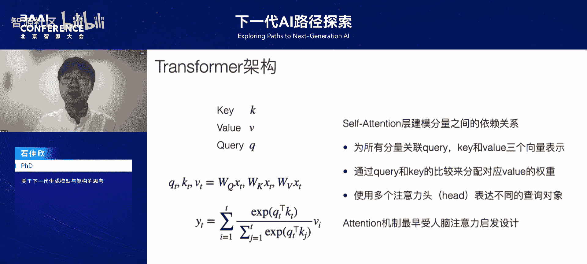

那既然今天的主题是所谓呃是关于下一代的AI技术路线。那一个自然的问题，就是下一个transformer这样的架构什么时候能出现，对吧？它是什么？所以这个问题其实已经啊就是motiv很多人去研究了。

然后这里是一个啊不完整的列举，就是说现在的这个架构设计领域，其实上分了好多好多不同的流派。然后总的来看呢，基于selfatten的自注意力的机制，就是现在这种原本的transformer。

它仍然是大家就认为的最优的选择在所有的任务上面。然后但但是与此同时，那很多人也都意识到，就是说我们现在模型的一个多模态的你和能力啊，实际上是受限于这种selfat机制的时空复杂度以及硬件的规模。

尤其是大家去处理一些很长时间的很高维的数据的时候，大家会发现就是要使用这样的transformer，我们就不能在很细的力度上面去使用它，就是因为受到了这个。复杂度和硬件的限制。那因为这个原因呢。

实际上线性和压二次的注意力机制成为了现在的一个研究热点。比如说上面大部分这上面列举的这个大部分的工作都是在考虑怎么样把啊时空复杂度降到一个线性的水平。但实际上目前看来，这些新架构的长上下文的召回能力。

仍然是显著落后于原本的这个transformer的架构的。然后并且在我看来还有一个就整个领域还有一个更大的问题是什么？就是架构设计目前还是主要由这种经验驱动的模式，就是我们还是在创 error。

然后它限制了我们去系统的理解和改进这样的设计啊。

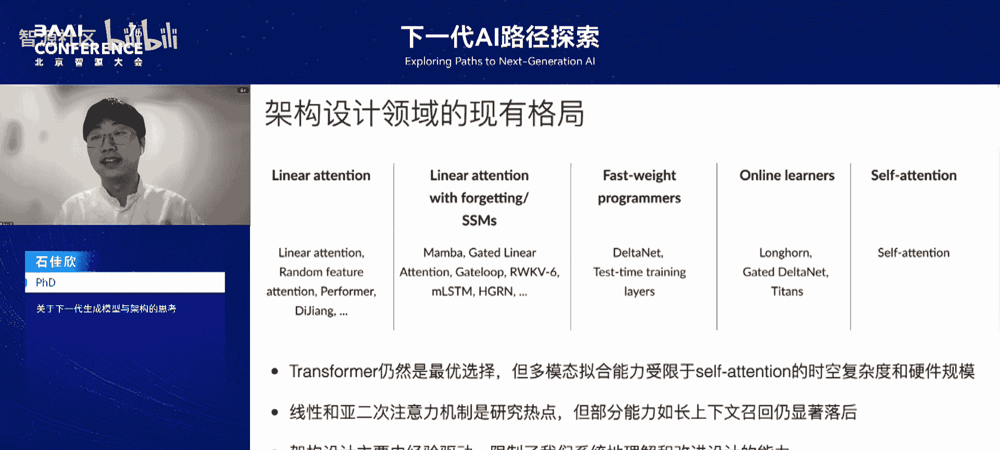

然后啊给一个具体的给一些具体的例子啊，就这里列出了一些新的架构设计的一些基本的思想。比如你可以看到就是呃in attention，然后它的原始的idea是什么呢？它就是说我从self这个这个式子出发。

然后我注意到这中间这个s max计算和T相似度的这个部分，如果我们把它线性化，就是我们把它直接变成这个Q和K的一个呃累积，那么整个计算实际上就可以化简为一个非常啊简洁，而且具有线性复杂的形式。为什么呢？

因为我们可以把K和V啊就放在一起。然后把这个呃求和的部分就变成一个状态。然后这个状态它是一个D乘D的一个me。

我们把叫ST那么实际上你会发现这个状态是可以通过是可以通过呃啊每个时刻进行增量更新来获得的也就。就说他不需要你在每个时刻去重新去看以前所有的呃分量，你只需要在这个时刻对它进行更新就行。对。

然后这个更新是通过使用当前时刻对应的啊，V就是value和当前时刻的 key所对应的这个外机啊啊啊进行的。然后啊然后往一旦有了这个状态之后，要获得当前时刻的输出。

你只需要把它和呃当前时刻的这个curry做一个累积就行。然后所以你可以看到整个这个计算，它是线性复杂度的。然后它跟刚刚的那个self attention的一个机制啊的平方复杂度是不一样。

这是linear attention设计的一个一个mo。然后还有一个牛派，它不是，它是这个我们叫状态空间模型啊，SSM大大家叫啊，也有人叫minRN。

然后他的idea其实就是从这种原来的循环神经网络RN来的那RN里面我们有一个隐含状态。然后它随着时间会不断的被新的数据所更新，对吧？它这个一般它这个啊原始的RN里面这个更新的过程是一个非线性的过程。

然后所谓状态空间模型就是说把这个非线性的更新变成了一个线性的更新。然后最后你可以看到得到它得到的最终这个形式，实际上也是一个不断的更线性更新一个已有的状态。

然后再通过这个状态去读取输出的一个这样的一个计算模式。然后还有一个呃历史上的工作，这个是在91到92年，然后。呃呃有一有一个概念叫做fast的快速权重。然后最近也是大家会去重新去看这个想法。

然后也有一些新的架构是基于这样的思想。那他的想法是什么？他的想法是说我把神经网络里面的权重分成是快速权重和慢速权重。然后对于啊慢权重就是大家熟知的神经网络里面原始的那些，就是比如说MLP啊。

然后这个呃里面这些权重是慢速权重。然后快速权重是什么？快速权重实际上就对于之前我们上面RN里面这个状态，就是说快速权重是通过慢速权重的啊输出来进行快速更新，而不是通过训练进行更新。

而是在inference的时候啊进行更新。那这个叫快速权重。你可以看到就是把如果你把这三个架构的这种啊计算模式进行比较的话，你会发现他们就有极大相似性。首先他们都是通过这样一个更新。内部状态。

然后线性更新内部状态的一个模式。然后其次他们尤其是in attention和 fast wait，他们都是通过当前数据的表示的外机来对这个啊状态进行更新的。所以他们其实非常非常的像，那这些项目。

但是他们又是从不同的角度去啊被发现和被啊提出了，所以我们就在思考就是说所有这些架构设计背后，它是不是有一个啊基本的原理。然后这是是所谓的我们叫science architecture design。

然后我们想问这样一个问题。那那我们如何来去探索这样一条科学的进行架构设计的路呢。那我们首先来看一个例子。然后这个也是啊啊大元模型里面啊，大元模型使用当中，大家会注意到它的一个它的一个能力。就是说。

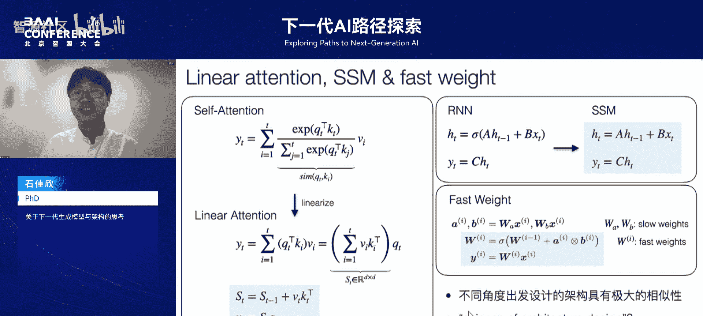

因为他能够预测下一个词。那很多时候比如说你需要预测下一个词，比如这里这个例子里面就是在讲啊这个叫deesty这一家人啊，然后他们的事情对吧？然后那每次出现mr d。

然后这个地方deny这个词是被啊划分成了三个token，那么第一个token是空格和D那每次出现mr啊空格和D的时候，那下一个token要预测是什么的时候，那其实上一个呃正确的方法是什么？

就是去我最近的上下文里面去找这个mr上一次出现的时候，下一个token是什么，对吧？那这样的话我找到了上一个如果是mrs啊。

那么很有可能这个地方我想预测的下一个token也就是这个S啊就跟着D的这个东西，对吧？所以啊其实这是一个很很直觉的想法就是说预测下一个token常常需要使用上下文线索去我们以前看过的这些token当中就是去记忆当中去。

检索啊后这个呃这个行为我们把它叫做socci recall。然后实际上呃很多这种理论研究表就是在训练完成的这个transformer架构当中，实际上存在一个专门实现这样功能的一个注意力的头。

然后这个头大家给了他一个名字，叫induction head。比如说这个功能实际上是一个非常非常基本的功能单元。在这样的大模型里。

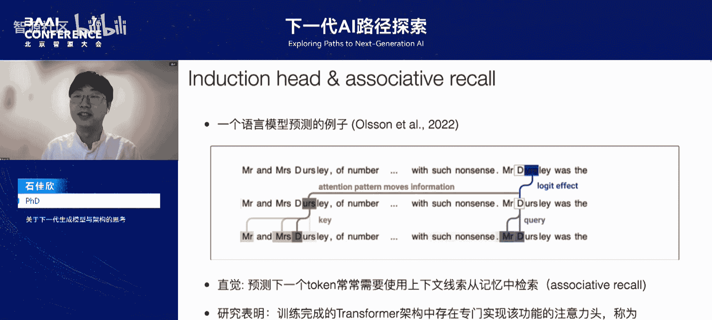

那么基于这样的一个想法，就是说啊我们可以看到架构设计的一个核心的要素是要实现一个联想记忆。也就是说我们叫soative memoryory。

那这个sative memoryory的功能是把输入数据当中的上下文的映射关系，变成key和value去存下来，存到一个memory当中，然后这个memory这里我们用这个M这个function来表示。

那么当有一个Q来的时候，这个memory的函数就会把它映射到对应的value。然后这也就是啊从记忆当中，我们所谓的从记忆当中把它检索出来。那它实际上数学上可以这样来实现，对吧？

就把它抽象成一个从啊已有的KV队去构造这样一个啊函数，然后再从这个函数当中啊给出对应输入的输出这样一个简单的操作。

那我们提出了一个叫做test time regression的这样一个架构设计的框架来做这样一件事情啊。然后假设首先假设我们有一系列的这个建职队就是KV队啊，他们的呃因为为了方便起见。

就是很多时候我们记忆当中的很多东西，它不是同样重要，对吧？就是有时候你可能觉得这件事情是更需要记住的那件事情是我可以忘掉对或者说你不想忘掉。但是它会随着时间的呃嗯慢慢的流市会忘掉的东西。

那么他这个东西实际上是用一个重要性的一个一个值来体现我们把较纲嘛，给每一个KV队的ign这样一个呃重要性。那如果我们函数MT来表示存储这些建职队的一个影响 memory。

那么他实际上应该满足的条件就是M在输入为KI的时候，那它的输出就应该近似的是当前的valueVI对吧？他应该满足这样一个条件。所以构建这样一个associative memory的呃过程。

实际上就可以归结为如下的一个回归问题。我们把它写成一个回归问题。就是说我们要找到这样一个函数，啊这个函数，它能够拟合上所有我见过的这样的KV对的映射。然后当我来了一个新的Q之后，我就去用这个函数映射。

去找到对应的这个啊我要我要我要检索的那个值，对吧？然后你也可以把它写成一个回归的优化问题。那就是右边这个式子所展示的这样一个优化的啊minization的问题。

然后这里显然如果你一旦有了这个KV这个呃不是这个呃回归的想法之后，其实上就有一个函数空间的区别。函数空间的区别就是什么呢？我可以选择一个线性的函数去做线性回归。那这个时候它肯定是更受限的。

当然我也可以选择一个非线性的回归，对吧？那这个可能我就能够更容易的你和我所见过的那些KV的，尤其当他们的映射不是线性的。所以他就存在一个表达能力上的区别。

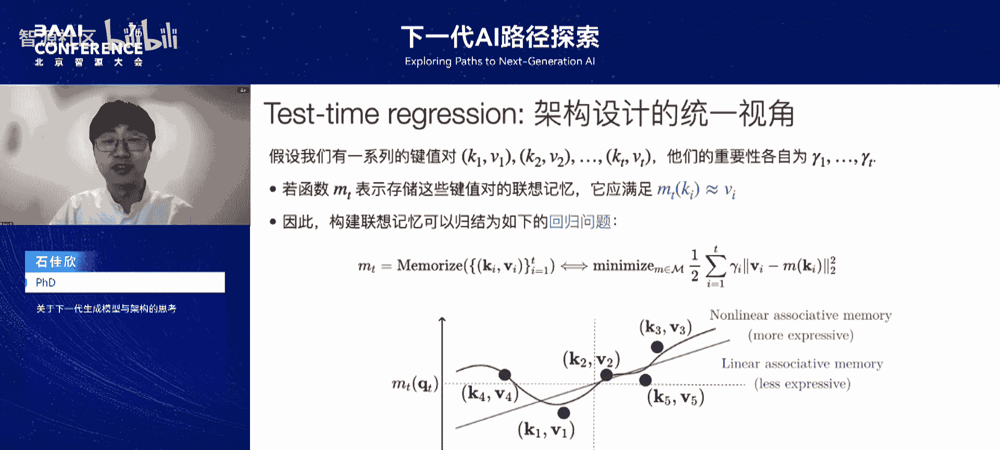

那么啊我们有了这样一个大致的想法之后，实际上就可以啊使用我们所谓的三步法来设计一个具有associative memory的架构。那这个架构这个这个三步法，就是基于刚刚这个回归问题里面有三个东西。

有三个要素是我们要确定。第一个要素是我们需要分配给每一个KV的pe，他们有一个相对的重要性啊，对吧？就是这个所谓的伽马。然后第二个是我们需要选择一个函数空间来做这个优化问题来解这个优化问题。

去找到这个方ctionM。那么这个函函数空间我用RM来表示。然后第三个呢是我需要选择这个回归问题的一个求解算法。那这个可以是比如说梯度下降，也可以是直接去做二阶的啊方法。然后对这种二二次型的问题。

那二阶的方法实际上就对应的解析的解。然后这种情况下面，实际上我会得到嗯得到最终的这个算法，我们把它直接就变成网络的一个前项过程。啊，这就是我们最终所需要得到的这个架构。

然后有了这样一个呃recipe之后呢，我们来看其实上两个例子，以以前的这些呃新的架构设计，实际上我们可以用这个框架来做一个简单的理解。那比如说我们现在啊第一个想讲的例子是啊线性啊注力。

就是in attention。然后它有一些变种，我们大叫gty的 attention，实际上它对应的一些就是现在比较热门的架构。那么实际上我在这个我们的呃framemework里面。

getating attention，它就等于一个加权的线性回归问题。然后只不过你最后把这个加权信息回归问题的解法写成了一个啊写成了一个架构。那么首先我们会。抱歉，首先我们会选择一个线性的函数空间。

然后就是说我们在选择怎么记怎么去做这回复问题的时候，那个functionctionM是一个线性函数，然后它就对应了一个对于一个D为的K向量来说，它就对应了一个D乘D的这样一个metris。然后第二呢。

我们需要选择过去分量的一个重要性啊，这个时候我们选择这个重要性是一个很简单的一个遗忘。根据这种人的这种遗忘的性质来选择这样一个重要性。就是说嗯分量的重要性会随着它与当前时间的距离而递减。

就是我们会随着时间慢慢的把以前的东西忘掉。那这个是怎么实现呢？在数学上，它就是由一系列的伽mma的沉积来实现。就是当前的啊时间T的。然后在当前时间T，我们去看第啊I个时刻的对应的那个KV pair。

它的重要性就等于这中间所有的啊这个啊伽马函数的一个乘积。啊，这个伽马函数字在0到1之间，如果这个区间足够长，比如说他们距离足够远的话，那这个成绩就会越来越小，对吧？

所以它就是一个实现了这样一个遗忘的一个一个功能。然后当然它也可以，就是说当你的这些所有这些伽mma都取一，那么你就不会遗忘了，你就会给所有的example，都所有的分量都Aign一个同样的重要性。好。

最后呢有了有了这两点之后，我们就可以解这个问题。那解这个问题我们采用的解法是一步的ful batch的呃梯度下降。就是说我们直接去算一步的梯度下降。然后这个学习率是比如说我们取贝塔。

那这个时候我们选一个初始点，假如说我们就取零。然后那么我们得到的最终的这个M matrix的解，就是右边这个形式。你可以看到它实际上就是一个啊一个some。

但是它里面的实际上每一个 term都是V和K的一个一个外机，然后它前面有一些伽马的对吧？然后有了这个形式之后，立马我们就能把它再写成一个增量更新的形式。

就跟我们最早看到ing attention的那个形式一样，就我们可以把这个MT写成是MT减1经过我的刚ma factor啊乘起来之后，再用啊我的K和V的外机去进行更新。

然后我当前时刻的输出实际上就只需要通过这个状态MT和我的的成积来读出。然后当刚ma等于一的时候，你可以看到这个形式exact就recover了我们原来的啊 attention。然后当刚ma小于一的时候。

这就是啊我们叫的 attention就是有这种遗忘性质的tention。然后这一这个实际上是很多很多新架构的一个基础。就比如说大家看到很多新架构在他们的开始的版本或者最新版中，他们都会有这样一个。

基于 getting any attention updateate。然后接下来你就会问说那是不是啊我可以就基于这个，然后去改这里面的每一个component，对吧？

我可以把批量替度下降换成是 eitherer是随机梯度下降，或者是自适应的学习率，或者是我可以用二阶方法我可以去求解细节了。嗯，当然可以。然后实际上如果你这样做了，你就会得到现在架构设计里面。

一些更新的更门的算法。比如说datanet，然后其实datanet就是我刚刚提到的best wait的一个现代化的版本，然后还有longho对吧？然后还有me layer，然后所有的这些新的词就会出现。

但实际上它都被统一在这样一个框架里。

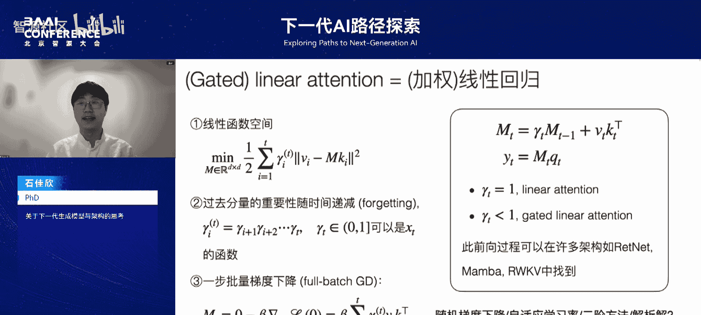

然，具体的细节我就不再啊去描述了。那我们来看一下，就是当我们走出了这个啊线性的这个这个这个想法之后，我们能得到什么。然后一个很自然的问题是你能够得到线性的ten。

你能不能得到原始的self那实际上我们能得到原的se。只不过我们要加一个条件，就是说我们需要使用现在的一种新技术，就是大家现在大语言模型里面常常使用的一个稳定transer training的技术。

就是在进入这个tenion之前，我们会把Q和K进行一个经过一个的一个规化的啊的的变换。然后这个叫Q。然后有了这个之后，实际上我们会发现啊self就等于在这上面去做局部的多项式。然后这样也是三步。

首先我们去选择这个函数空间，函数空间是选择在以queary当前的curory为中心的一个局部的P阶多项式啊，这个是非参的回归里面经常会用的一个一个常见的函数空间。

然后你可以看到它的形式是下面这个多项式的形式。然后其中这个大MP就表示一个P阶的多线性映射啊，这里面的它的自变量啊，K实际上是在Q，就是当前cur这个地方，就是以这个地方为中心的。

然后这个回归问题就是刚刚那个回归问题，只不过我们现在M就不是一个简单的mtrix乘上K了，它是一个就是一个多项式，是这样一个一个函数。然后所以啊第二步我们来选择这个分量重要性。

然后在这个问题里面分量的重要性实际上就要按照常见的这种途径里面非常回归的方法去选择，我们把它选择为啊由啊高斯的RBF的呃 kernel来决定。然后这个 kernel的意思是什么呢？

就是说啊如果这个呃这个PKI你我们当前的cur的距离决定了我们决定了它在这个回归问题里面有多重要，就是我们优先拟合这个局部，然后在随着距离来衰减，对吧？然后这个S就是一个所谓的 basis。

然后当我们使用了这样一个QK的时候，Q和K的都是一。那这个实际上就正比于exentialK和Q的一个呃累积。然后有了这两点之后。

我们可以去求这个问题的在P等于零条件下的就是在这个多项式就取零多项式也都是一个常数的时候的一个解，你会发现这个解exactly就是啊self里面大家做的这个操作，就是我用一个sof max。

然后over这个exential product去找到每一个value的权重，然后再通过加权把它们结合起来。啊，右边这个图展示的就是说啊。这个横线就是我们现在做的这件事情，就是这个临接的一个一个礼合。

然后但你也可以就是把它变得更高，就变成一个线性的拟合，变成一个二次的合，它就会越来越flex。对。

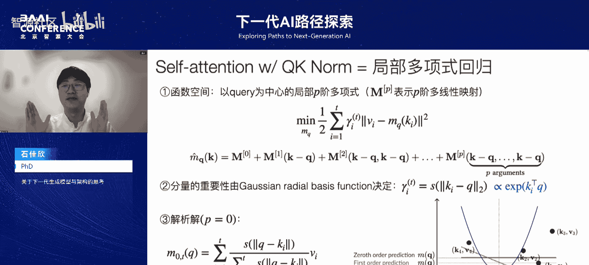

但我想说的就是通过刚刚这两页的介绍，我们可以看到，就是在test time这个 framework下面，我们可以做架构的一些比较。然后与此同时呢，我们刚刚讲到的自注意力的本质。

实际上是非参的局部的多样式你它的记忆容量。因为它是一个非参的回归问题。所以它的记忆容量实际上是能够自适应数据的增长。反应到这个transformer架构里面就是self这个架构里面。

它就对于你总是会暴力的去啊啊umerate以前见过的这些ex，对吧？就是你每新来一个你就把它和所有以前见过的key进行比较。然后所以这样的一个平方的复杂度，实际上是因为它是一个非参模型。

而它的容量也能够因此而受到一定的着数据增长这样一个一个优点。然后这也是常常统计里面讲非参模型优于参数模型的地。然后线性注意你就恰好你就相反，就它是一个参数模型。

它里面的容量就由它这个地层地的metrictris来决定。所以当前的transformomer自注意力虽然是一个相对于mining attentiontion更加呃非常更加flexible的一个一个一个呃方法。

但是它仍然只是按照我们刚刚讲，它仍然只是一个临接的多项式回归。那一个很自然的想法，就是说在这个框架里面，实际上我们给出了设计高阶自注意力架构的一个路线。

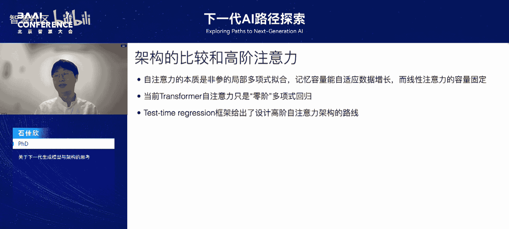

然后这是一个理论的工作，我们没有做很多大规模的验证。但是我们做了一些啊架构，在一个简单的非评论时间的序列的记忆问题上面去验证了它的一个表现。

然后这里嗯你可以看到这个时间训练是通过啊的记忆问题是这样做到的，就是它的key实际上就是一个longs stationary的一个auregressive的一个一个process。

然后它的呃value它对应的值就是通过nmalize这个 key得到它的一个很简单的一个映射。然后为了记忆这个iner。

我们就使用了我们刚刚提到的这些architect去去做这个prediction的问题，对吧？我们使用了线性注意力，我们使用了啊selfat。

我们使用了一个self attention对应的是临间的啊非常回归。那我们使用了一阶的非常回归对应的selfat来做这样一个拟。

然后你可以明显的看到就是说他们有这样一个啊他们的最小的er上面有一个这样的次序，就是说min attention有最大的arrow，然后selfat会啊比它更好。然后如果你用更高阶的self。

那么实际上你会得到更小的啊arrow rate啊，这样就其实某种程度上讲，就是在啊这个数值模拟上面验证了。我们刚刚讲到这种。soci memory里面不同啊啊算法设计所导致的最后你和能力的一个不同。

OK然后这就是啊在这个工作里面啊，我想强调的所有的呃内容。然后这个呃这一页sdes实际上是想向大家展示一下就是。这个test time regression的框架啊，实际上统一了我们现在所有。

几乎就是大家能见到的啊所有的新的模型架构，然后他们的basic idea，然后都在里面。然后我们可以把它划分为parmetric regression，就参数的回归和非参回归。

啊在参数回归里面你可以找到就是啊优化方法的不同，有 batch。然后有二阶方法也有解析解这样。然后这个文章的啊标题和啊你就放在这里。然后感兴趣的话，大家可以去啊读一下。

就是这个文章里面是对每一种架构都进行了仔细的推导。OK然后嗯除了呃刚刚我讲的这种自回归的架构设计，我觉得是一个呃未来啊，我们需要更多sciize的方向以外呢，我还想就是呃用这个时间剩下的时间来讲一讲。

就是在自回归模型这种范式以外，我觉得下一代的呃生成模型可能会有怎样的发展。然后我觉得其中一个呃呃非常有潜啊逆的方向是什么呢？是我称为叫做从单一次序到任意次序的生成。那所谓单一次序就是自回归模型里面。

它总是按照一个six order去对数据的各个分量去进行建模。就像我们刚刚这个句子一样，它总是去预测下一个词。那么所谓的任意次序，就是说我不再按照这样的固定次序。

而是按照一个希望我们的模型能够按照任意的次序都能够很好的建模的数据。那为什么我们想这样做呢？我下面给了两个例子，一个是啊这里是一个maninecraft里面游戏里面的一个场景。

就是想象我们比如说即使我们人或者一个agent到了一个新的环境。当你要去explore这个环境的时候，那你需要的实际上是啊。

不是像transformer架构这样去按照一个固定的次序来去啊熟悉这些这个世界，对吧？很多时候你是按照一个任意的次序去慢慢的熟悉这个世界。就是说当你对它足够熟悉了之后。

实际上你能够按照任意的次序去进行prection。然后这也是我觉得我们现在很多世界模型，它有的缺陷。就是说它可能基于啊最后波模型，它往往需要进行一个固定次序的啊啊建模，而不能够进行这种任意次序的建模。

但是在我们这种生物智能里面，我觉得呃比如人是很容易进行任意次序的建模。然后另外呢就是除了文本这样的数据，我们还有很多很多其他的数据。比如 size里面。

我们有这样的 scientificentific data，比如分子蛋白基因。然后所有这些数据，我们在科学上面实际上并不能够啊分析出来，应该按照什么样的固定的次序或者自然的次序去进行建模。然后我们。

也不了解它的一种规范次序应该是什么样的，这实际上是一个科学问题。那么在这些问题上面，我们都需要去不断的发展一个叫做任意次序的生成模型。

然后现在我觉得任意次序生成模型一个显著的代表就是我们这里讲到的这种掩码扩散模型。然后它的基本概念呢，在2021年就已经被提出了。但是很长时间啊，大家都认为它不工作，然后最近实际上三个同期工作。

证明了正确的训练这种模型，实际上我们如果能正确的训练它，它实际上是工作很好的。然后这三个工作，它实际上就证明了掩码扩散模型。如果你对它进行最大自然的学习。

就等价于使用随机采样的野码比率来训练一个bt这样的语言模型。那么当下很多热点的扩散语言模型，比如nadad等等，实际上它都是野马扩散模型。然后但是呃我想说的一点就是说其实语言是一个单一次序为主的啊模态。

然后是一个我们很多的语言数据它都是从左到右的次序。它有一个很强的这样的bios。所以它实际上不一定是扩散啊野马扩散模型的一个最优场景。然后我觉得呃扩散野马野马sorry野马扩散模型的未来。

实际上更有可能是去充当在这个世界上面帮助我们去探索新世界的一个真正的一个多模态的模型啊所需要的一个基石。

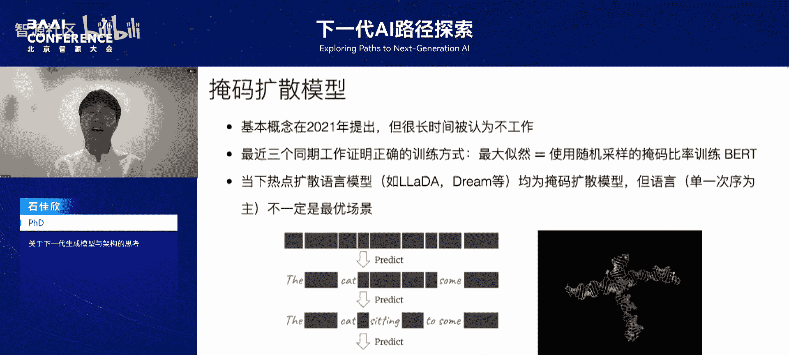

然后嗯最后我想讲的就是除了次序以外啊，就是我们还有一个叫做超越次序的生成模型的一个想法是什么？就是说这个模型除了按照一定的次序去生成以外，它还要能够能够插除以前生成的结果，并且去重新生成，对吧？

这种时候我们把这种能力叫做自我纠错的能力。那现在的很多啊野码扩散模型当中，大家也会看到一些所谓的啊纠错方法，比如说啊啊remaking，就是说我去给一些维度，当我们预测。

比如说这里给出的一个语言预测例子的什么什么table jump，然后这个table实际上是一个错误的预测，table不能跳。那么这个时候我们怎么样去把它重新变成一个msask。

然后再去啊去掉这个野码来预测。然后实际上现在绝大多数的野码扩散模型当中使用的这种啊纠错的办法，都是一个随机选择的方。就是我们称之为uninformed correction。

就是说我随机的去把这些啊分量进行掩码，然后再重新生成它们。所以实际上你在做这件事情的时候，是并没有意识到你产生的这样一个错误，对吧？这种是我觉得现在的模型里面有了一个很大的问题。

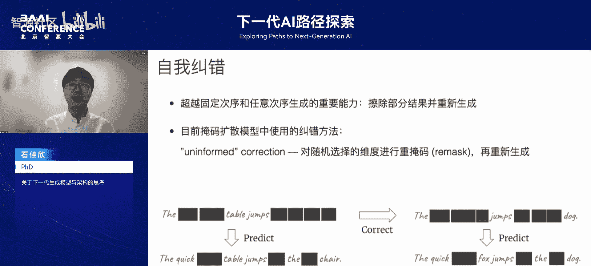

然后所以我想讲的最后一个，我觉得下一代生成模型一个嗯很啊有潜力的方向是我们想要去做这种自我纠错。但同时我们想要的是informed correction。

就是说我们想要我们的模型能够通过上下文正适应的去决定纠错的范围。然后这里给了刚刚那个例子的一个一个新的状态，比如说the orangerange box jump啊，do到。

然后很明显这个道就是第二个道第一个do就是一个错误啊，它可以很容易的被啊上下文识别出来，然后找到并且修正它，对吧？然后那我们想要做的就是说能够通过现在状态直接去定位这个错误模型能够自己定位这个错误。

而不是说通过随机的去撒一些mask，然后再通过解码来啊修正这个错误来希望我们能够啊啊随机的能够解决这样的错误。那这样子显然是一个不够智能的啊解决方案。

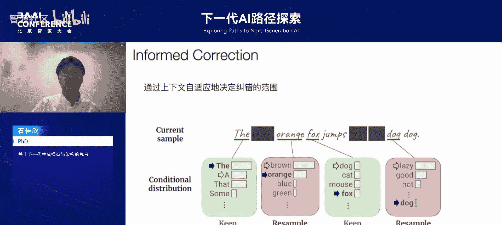

OK然后我觉得呃今天所有想讲的呃这些思考都在这里了。然后呃我们再在结尾把它总结一下，然后大概就是三一个呃要点。一个是我觉得我们需要更多的science architecture design。

就在我们刚刚讲到这种t time regression实际上是提供了一个可能的视角。然后其次呢我觉得我们要超越这种al aggressivegressive的建模。

一个很呃重要的方向是我们要用任意次序的生成模型去取代之前的这种固定次序的生成模型。然后最后呢我觉得我们需要的是模型能够具有自我纠错的能力。然后现在的呃这些任意次序的模型。比如呃野马扩散模型。

它有一定的纠错能力。但它的纠错能力基本上都是unin correction。然后我们觉得是需要一些informed correction，来继续提升我们生成模型的建模。然后这就是今天报告所有的啊。

谢谢大家。

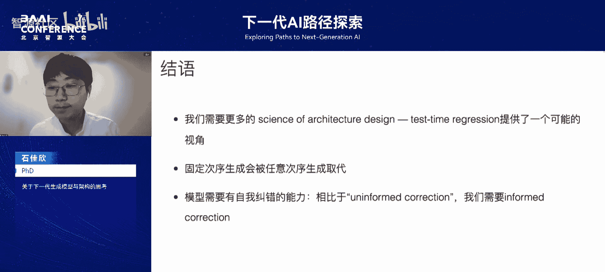

好啊，谢谢嘉欣给我们啊讲了一个关于架构的呃非常系统深入的一个一个工作。我觉得呃特别有一点啊，就是因为现在大家都在讨论各种的这种架构啊，刚才嘉兴呢实际上有一个非常好的一个视角。

就是从这个social memory啊test time regression啊，来去统一的来去看这个但看的统一的视角的一个好处，就是说我们可以去啊可以去opimize可以去去去提升啊。

但最后也讲了一些，现在在扩散模型里面，大家用野马的这种方式来做离散数据，包括。未来还可以去做这种呃任意的次序等等这些工作。对我看一下大家有没有什么问题，就是关于这个架构的哎。呃，石佳欣老师好。

我是中国人民大学的本科生欧静阳。然后呃听了你的talk我也是非常受启发。对，然后我的问题是就是说对于现在的呃编码扩散模型，或者说是呃任意秩序的这种模型，有没有可能就是呃设计一种专属的架构。

然后从而能够得到一些明显的性能提升呢？谢谢。啊，谢谢你的模型。然后呃我先说一句，就是我们刚刚讲到的那三个呃呃同时改进呃野码扩散模型的一个，其中一个就是您的工作，对吧？然后呃对非常好的工作，然后。

就是呃其实我觉得刚刚这个问题确实是一个很好的很好的问题。就是呃在大家可以看到，就是其实它也对应的这种我刚刚提到的这种固定次序和任意次序的区别，反映到这个这个 architectureitecture。

反映到这个架构里面固定次序其实就对应的tention里面这种caus attention，就是顺序atten的。然后任意次序实际上是对应的这种bydirect attention，就是双向的at。

然后它在架构上面是有很大的区别。然后我们实际上很多工作也都观察到，包括之前也有很多工作尝试去做任意次序的。但是是caus attention。对。

就是任意次序的这种deder架构deder only架构。然后那。这些尝试其实大家发现都是失败的，就比如说sigGPT对吧？大家去做了这样的尝试之后，发现它其实不如你去做双向的tention建模更成功。

啊，这里面有一个很大的问题，就是它涉及到这个架构本身的一个稳定性，就是架构现在目前来讲，它的优化还是非常非常不稳定的，就包括在trans本身里面就为了能够去sbilize它的train。

实际上大家还是要采用很多很多的技术。然后但对于这种你每次需要去啊不停的去permute你的输入序列的时候，这种啊自回归的固定顺序的架构，实际上是需要一个革新的。

然后当然我也没有一个啊具体的方案来做这件事情。但我觉得这是一个很好的问题。就是说这种固定次序的架构，怎么样能够让它能做任意次序的问题，而不是像现在一样去用 direction双向的ten。

那我觉得这是一个很有呃很有影响力的。方向。然后也是啊我们接下来啊大家都应该去问的一个问题。然后它有一个什么样的好处呢？就是它会得到更多的training signal。

就是因为你的casal transformer，相当于在每一个位置都会得到训练的信号。但是比如说像我们这种掩码扩展，或者是像berrt这样的模型。

它只会在对一个data只会在那些你mask的地方得到训练的信号。啊它俩得到的呃训练信号还是原来这种causal的啊 architectureitecture更多一些。然后我觉得嗯非常好的问题。

但是嗯我没有一个啊完美的答案，但是我觉得这是一个嗯很好的方向。对。再我再问一个问题吗？呃，嘉欣你好，很感谢你的分享啊。我在深圳做那个健康管理AI的研发。我想问一下。

就是说呃最近其实我也测试了很多不同的架构，不同的像transformer还是ku就我发现一个很大的特点，就比如说针对已有数据的一些训练，大部分的模型能够你和根回答的非常好。但是一旦把套全新的数学题库。

或是一些没他没有见过的知识去交给模型，它的整个就说做出来题验那个正确力，比如3%至5%。也就说现在的模型，我感觉更多的只是像一个压缩的一个信息检索工具。

而不是一个真正的像人类智能量的具有强大的泛化能力这样的一个工具。你怎么去看待这个问题。还有就是以后这些架构的研发如何去解决这种问。其实我觉得你问的问题和我一开始就是motivation里面提到的问题。

某种意义上讲是同一个问题。就是说我们现在在这种已有的数据上面，按照自回归的模式去得到最后的模型，它的极限，可能我们已经触碰到的，就在这里对吧？就是说它能够很好的去记住我们的模型。

但是它却呃记住我们所有的数据。但是它却不能够很容易的去啊像人一样泛化到更复杂的啊更呃out of distribution的数据上面，我觉得这里面实际上最大的一个问题就是我们的训练办事的问题。

就是我刚刚想要说从这里去最开始想要去问的那个问题，就是说在现有的数据条件下面，我们怎么样有一种新的模型的啊思方法，能够帮助我们去更好的利用现有的数据能够更容易的泛化。那我来举个例子。

那什么样是错误的泛化。就是比如说。大家在去拟合啊数学或者拟合代码的时候，那总是按照比如说智慧规模型，你总是按照一个固定的次序去拟合。但是可能你人在写这些代码或者在推导这些数学的时候。

你的次序和你最重要auory model去拟合的次序，它是不一样，对吧？那这个时候实际上它的这种分布的一个这种模型本身的一个missspecation。

实际上更容易导致它会过拟合和更不容易geneize。那怎么样能够让你啊训练的时候的次序和啊这个数据本身生成的过程，它的次序能够吻合。那也是我觉得大家应该去问的一个问题。

比如说我觉得我们就会最近会去想怎么样做一个啊auory model。它的这个次序是能够根据你的数据去adappt，对吧？那这样也是我们正在去去看的一些方向。嗯，好呃，因为时间原因。

可能我们会拿先到这个地方。好，再次感谢嘉欣给我们带来的进展报告。好，谢谢嘉欣，谢谢大家嗯。😊。