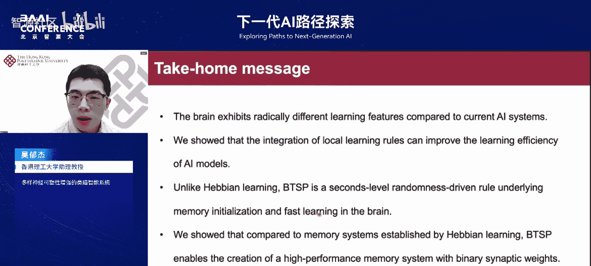

# 2025北京智源大会- 下一代AI路径探索 p04 多样神经可塑性增强的类脑智能系统：吴郁杰 -BV1c5NxzqESk_p4-

好，那我们下一位呃报告的嘉宾是呃香港香港理工大学的吴玉洁啊老师。然后吴玉杰老师应该是清华可能做力脑啊最早的那个培养了一批的优秀的学生。然后现在也在香港理工大学啊做这个助理教授。

然后今天给我们带来的啊报告也是多样神经可塑性增强的力脑智能系统。那我们能连上吗？哎，玉洁能听到吗？可以听到啊，我这边说音还可以吗？啊，可以啊。

那啊对玉洁也是在那个nature啊以及nature指刊发的多篇的这个啊重要的论文啊，然后也是newcomp的副主编啊，也是斯坦福大学全球前排名前2%的科学家啊，那我们有请玉洁博士公问做报告啊。

OK首先非常感谢朱军老师的介绍。那么我相信在场的很多老师都是计算机的背景。那么我的这个分享可能这个视角会稍微有点不同。我主要想从计算机科学和呃呃应该是神经科学和脑科学的角度来和大家讨论一下。

我对下一代AI路径探索的一些思考。

那么我将主要呃分享两个部分。那么在第一块，我想讨论一下内脑智能对历史现在以及未来发展的一些潜在的影响。那么第2块的话，我也和大家汇报一下，我们主在这个内脑智能以及内脑学习方面的一些探索。

OK我们知道从AI发展的角度而言，其呃其实大脑智能起码扮演了两个很重要的一个角色。那么第一个就是其实大脑是咱们AI发展的一个很重要的参考系。对，如果我们去看维基百科，甚至很多教科书。

我们知道AI的定义其实还是基于人类智能。我们会把AI描述成为执行类似于人类智能任务的一个基。对吧其实所以也就是说历史上很多人工智能的发展，还是以这个人脑智能作为一个很重要的参考系。那么第二点。

其实大脑智能启发了很多重要AI技术的一个发展。那么基本上我们可以把大脑的重要机制归纳出来三个方面，就感知计算和学习，我们知道在感知层面，很多视觉听觉的神经网络，都有借鉴到大脑的一些感知处理机制。

比如说准积神经网络和我们的这个视觉皮层的这个机制，就紧密相关。那么在计算层面，那么大脑也有很多优秀的计算特性。比如我们所谓的纯算一体稀疏并行的计算的特性，对吧？他们其实也有一些很多相关的这种AI的研究。

比如说纯算一体的计算架构，事觉驱动相机一组器等等。刚刚我也听到有一个老师在问这个群体智能和这个脑区协同一些关联性，所以可以说这个大脑的智能和这个AI的发展还是关联性很紧的。那么最后一块是学习机制。

其实呃学习机制可以认为是我们。破译人类智能发展通用智能的一个很重要的一个环节。但由于目前这个实验观察的呃观测技术的有限，其实这一块的研究还比较初步。但尽管如此。

我们也看到很多优秀的AI算法是和大脑学习紧密相关。比如我们常见的神经图粒肌，还有一些受大脑将成机质启发的强化学习的一些技术。所以总而言之的话，如果是从以以史为鉴。

其实AI历史的发展和脑科学的发展存在着很多高度一致性。那么现在呃随着这个大模型的涌现，也越来越多人开始相信那个通用人工智能，很有可能会在未来会实现。

那么可以说大模型和大脑可能是目前最接近通用人工智能的两个主要的一个参考系。那么从呃从论的角度角度而言，其实在计算效率和复杂的一些推理上面，可能目前人类还是比较有优势。但更重要的是。

这两个系统潜在的计算机制存在着很多根本性的差异。那么基于这些差异，在有一在一些顶尖的那个研究机构，我们也在过关注一些比较前沿的AI计算呃的一些架构，比如说transformer。比如说meber。

我们会对比这些架构和大脑计算的异同。这对我们探索新型AI提出了很多一些新的思路。比如说我们考虑对比transformer架构。海马体学习记忆的一些差异。这一个分析有有助于我们更好的理解大脑智能。

甚至于改进我们目前的transformer的一些设计。同时我们也会借鉴海马体的记忆机制来发展一些这种脑启发的这种reck检索增强模块，使得大模型能够更好的服于人类。那么此外的话。

我们知道大脑它其实是在一个资源有限条件下的一个高效的一个学习系统。所以如何借鉴大脑的学习记忆机制，对于发展在线终身的这种AI系统，也具有很重要的一个参考啊意义。

那么接下来我想啊展示几个呃比较好好好的一些例子给给大家作为一个参考。那么首首先的话我们知道transformer架构是目前大模型架构的一个基础。那么来自牛津大学的。win等人他们就提出来了。

其实transform里面的这种自自注意力机制和大脑中海马内秀皮层的记忆和空间表征等等都有很多异曲同工的一个地方。我们知道自注意力机制它重要的是有三个矩阵对？

本质上是用单的ry历的这个memory key做点击，然后最后的话通过V进行一个加权呃汇总。其实这个机制可以被呃经典的网络呃来实现。那么在人的文章里面，他们就指出来了，其实Q的操作，可以用这种学习。

一种经典的大脑学习方式进行实现。那么同时的话海马体的这个检索过程，可以很好的模拟这么一个query的一个检索过过程。那么此外的话我们常见的这个位置码，我们认为它他对这trans提供了很重要的顺序信息。

类似的在大脑里面我们也发现了网格细胞可以实现啊用一种递归的方式实现类似的这种循环位置。码的一个特性。那么在近些年来。

那个诺贝尔奖获得者啊hope feel呃教授他从计算和神经元的角度提出来这个统一的现代modern hope feel网络。其实在这个框架下面。

我们可以发现transformer它其实是可以在一个神经元回路的层面呃进行一个实现。比如说呃transformer里面的QKV的一个操作，可以对应到这个两层神经元网络的一个前馈和一个反馈的连接过程之中。

那么这些呃关联性的研究会对我们如何来看待大脑智能，以及这个新型的AI架构都提供了一些新的思路。那么。那么在计算智能上面，AI和大脑有什么显著的差别呢？对那么在这里的话。

我们也提出来了这个一个叫做外生复杂性和内生复杂性的一个概念。那么我们知道是我们现在大模型取得成功的一个很重要的一环。那基本上我们是把这个神经元的参数增增加层数增增加。

那么这个就是我们通常所所说的一个外复杂性。我们把这个模型做的更大更复杂。但其实在大脑里面我们还存在另外一种呃，我们我们我们认为的一种计算方式，我们把它称为内内存复杂性。

因为在大脑里面一个单个的神序元内部就包含了非常丰富的计算的一些机制。我们相信大脑里的这种内复杂性可能揭示了通往这种高级智能的另外一个拼图。为了说明这一点。

我们在文章里面也展示了如果我们利用比较复杂的HH神经元。那么在多个机器学习任务上，它可以实现比他就是比参数量大4倍的简单的神元一样甚至更好的一。性能。那么类似的像有一些呃国外的科学家，比如说Uta。

他们也会发现了一个单一单一的输出的一个结构，可以等价于三个全连接结构的一个计算下效益。那么在最近的这个NC的文章里面，他们也发发现了我们可以通过引入输出的模块。

用更少的参数量可以实现相近甚至更好的一个机器学习的一个性能。那么现有的AI智能已经足够强大了。那么在在未来大脑智能在哪些场景上面可能还会存在一些优优势呢？要回答这个问题，可能我们要看到。

其实目前大脑和目前AI学习有一个本质的区别。就是大脑学习的这个学习目标和AI是不一样的。在进化过程之中，我们大脑的一个主要目标是如何更好的生存和这个适应环境。啊，目前的AI学习更多是说我有足够的算利。

我怎么样能够在特定的某些甚至某类数据上面取得一个更好的一个性能。所以如果我们考虑一个计算资源有限的一个环境。其实大脑的很多学习和记忆的机制可以被借鉴过来。那么近些年来。

我们也有很多工作来指导我们如何借鉴大脑的一些一些学习记忆机机制实现更好的一个终身学习的一个系系统。比如说这里的话我有我列举的两个，一个是关于怎么样学，一个是关于怎么样记。

那么在左边的话是来自自动化属于三老是组。对我我们们我们考虑呃测到这个行业机制的。一个启发。我们考虑当我们学一个新的任务的时候，我们可以把我们要学的个任务呃存储在和之前旧任务正交这个空间里面。

那么右边的话呢是来自这个清华中艺和这个朱军老师组。我们来考虑从这个果营呃汲取灵感出现出一种主动一忘的一个机制，它可以更好的一万旧的任务，同时增强我们对这个学习的新任务的一个灵活性。

那么放眼未来呃呃关于下一代人工智能从电脑从电脑智能的角度出发，有哪些方面可能会对AI的发展带来重大的影响。那么我个人认为可能学习算法的创新会是非常非常关键的一环。因为我们知道现在到目前物差反向传播算法。

还是当前AI学习和取得这个强大性能表现的一个基础。但我们可以想一下，如果我们构建一个非常复杂的一个系统。啊，然后你每次学习的更新都要呃所有的参数来参与，这其实是非常低效的。

那么其实那个很多神经科学家也认为在大脑里面其实我们是没有这种物差反向传传播。与之相反的是大脑里的学习有很多独特的一些特征。比如我们大脑里存在非常多非常丰富的多尺度的突出可塑性机制。

比如在下面我列举出来的一些比较典型的一些突出可学学习学习方法。我们比较经典的，我们把它称为是客步学习，或者是那个SCTP学学习。它的一个假设是说，如果突出前后两个。资同时发放。

那么我们的权重就会得到增强。那么近些年来我们也发现，除了赫部学习，我们也会有些新的呃非赫部的学习，我们把它称为BTSP的一种学习。那么和赫部不同的话，它其实是和突出前刺激。

以及另外一个完全随机的一个信号啊呃来驱动的。那么如果我们对比这个赫部学习跟这个BTSP学学习的一个时时间窗，在右边我们可以发现，其实这个BTSP的这整个的学习的这个时间窗是远长于赫部学习的。

它是一个秒级赫部是一个好毫秒级。那么这些差异也体现了大脑多尺度学习的一个特性。那么此外这大脑里面，我们也有很多这种自上而下的这种呃神经地制的一个集机制。这个其实是对一个复杂系统。

如何在动态环境里面做灵活的适应，具有很重要的一个帮助。那么此外，像在今年ss的文章里面，威廉等人他们也提出来，其实在一个单一的神经元里面，我们可能也会有很多丰富的这种学习机制。呃。

比如比如说像中间这个图，我们展示了一个呃典型的呃金字塔神神经元。那么下方是我们这个搜码。那么他们发现在这个远离搜码的区域，更多的是这种非赫部的学学习，而靠近搜码的区域，更多是这种赫部的学习。这有意味着。

其实其实在大脑里面一个单一的神经元都可能会包含非常丰富的学习方式。那么似乎这些特性目前很少被现有的AI模型所利用到。所以我相信随着科学研究的不断深入。那么我们对呃大脑里如学习，如何计算，会有更深的理解。

那么这些insight会帮助我们更好的呃设计电脑智能系统，以及下一代AI系系统。那么这些是我对呃下一代呃AI系统的一些简单的一些思考。那么接下来我主要啊重点的分享我们组在这个方向的两个研究。

那么第一块我想讨论的是如何我们我我们们我们如何把这种不同的这种突出可塑性的机制整合到现有的AI模型里面去来提高它的一些通用学习的一些能力。

那么第二个我想来讨论的是我们如何样来更好的学习和建模这种比较新的这种秒级的突出可塑性机制，理解他们在这个功能层面上的一些含义。因为其实这种可塑性。对对于我们如何记住一个东西。

以及到到里面如何做技忆都有好决策，都有很很重要的一个指导意义。OK那么在第一个工作里面，其实我观察到的还是这个AI学习和我们生物学习的一个异同。

因为我们知道呃我刚刚有谈到我们目前AI的学习主要还是用一种这种误差反向传播算法来来来进行剔度更新。这意味着我们要把这个输出的这个的一个信号一层一层的往下往往前传。所以我把它认为是一种全局的一种学习方法。

那与之相反的话，在生物里面很多学习是一种局部的，也就是说它只和你前后两个神经元有关。这么做有什么样的好处呢？首先你的学习可以变得很高效，你可以进行很多并行化的学学习。

同时你可以具有很快的一个实时更新实时呃适应的一个能力。那那另外一方面，这种局部学习。目前为什么没有成为主流。因为在很多任务上面，它其实还是有比较差的一个任务性能。那么BP的优势是什么？

它会有一个比较好的一个非线性拟合的能力。但同时它其实需要很多的这个data进行一个学学习。所以。我的一个研究问题在在于有没有可能我们把这两种不同的学习方法整合到1个AI系统里面来实现这种混合互补的一种学习。

那么我们在呃大脑里面，我们发现这个东西其实是有可能的。它的一个基本的一个出发点，就是我刚刚谈到的这种神经递质的调节的一个效应。因为神经递质本身可以传递自上而下的这种奖励或者说是监督的一个信号。

那么同时它可以调节我们这种局部可塑性的一个行为。那么授时启发，我们就呃发展了一种这种混合的一个呃学习单元。嗯，因为我们考虑的是一个内脑的模型，所以这个这个单元是建立在这个脉冲神经网络上面。

那么基本上这这个混合单元里面，我们会有两个不同的呃权重分支，你可以认为对应的是一个慢权重，一个是快权重。那么慢权重我们假定它是可以用BP来进行更新的。那么快权重我们认为它是用一种局部的学习来进行更新的。

同时这个慢权重的超参数，我们也把它在一个原学习的框架下面进行统一，其实它也可以在学习过程中进行缓慢的一些呃微调。呃，这里有一些推推推推导的过程，我就不展开讲了。更多的话我想说。

如果我们把这种仿生的局部学习整合到一个呃基于BP的框架里面，我们可以给这个模型带来什么啊，这个工作其实是我们做的比较早的一个工作。所以我们主要讨论的还是在一些小模型上面的一个尝试。

我们发现了这种局部学习的引入，可以在四个方面有可能能够帮助这个AI的系统提高它的一些性能表现。那么第一个我们考虑的是这种序列决策的一个任务。基本上我们会把会会给这个网络输入一个序列，然后让它做分类。

然后我们来对比它的一个分类的一个性能。我们发现黄色这些这根曲线代表的是个混合学习，可以明显的好于单一的局部学习和全局学习。这背后的几率也非常的呃直观。因为。这么一个局部学习模块的引入。

可以认为是引入了一个快速记忆的一个模块。所以在当你在处理序列信息的时候，如果前后两个神经元都发放，我们把他们俩那个连连接关系记录下来，其实是它保留了有部分有效的这种序列的一个关系。

这样我们这样其实是可以帮助你后续进行序列的一个处理。那么此外的话，我们也把这么一个局部学习系统呃来测试它的一个鲁班性。那么这个和别的鲁班性的测试也比较要相似。我们考虑会在测试集上面加入不同的这种噪音。

比如说我们会把一些图片进行一些遮掩，同时也会把它加入不同的高斯噪音。那么右边的话我们会记录啊不同的模型在不同噪音条件下的一个性能。呃，这个黄色的设是我们所谓的这个混合学习。

我们可以发现随着噪音等级的增加，我们这个模型可以取得一个更好的一个性能。那么为什么这这么一种局部学习的加入，可以取得一个更好的一个性能。

我们也在这个损视函数的这个框架下面进行的一个那一个延延展性的一个分析。我们假设这个局部学习的这个增量，其实也是某种影视的梯度。那么通过反向求积分的方法，我们可以求得这个局部学习对应的影视函数的表达式。

最终我们得到的是说这种这个局部学习，它其实是在优化一种特殊的正则项。那么这个正能项其实和我们那个常见的记。模型里的这个能量函数是非常接近的。那么利用记忆模型里的一些结论。

它可以支撑就为什么我们的模型会有更好的一个鲁班性。那么往后的话我们也把这个模型啊把它用到了这种小样本学习的场景里面，我们考虑的也是一个一个toy test，就是。

那么这里它会包含了1600多类不同的类别。那每类的话只有20个样本。如果你直接训练一个既由BP的一个网络。其实这个网络是基本上不太能收敛，所以它基本上是一个瞎猜的水水平。

当我们发现如果你把这么一个局部学习和全局学习整合到一块。其实它可以达到一个接近人类的一个水平。它背后的原理其实也是类似于这种memory module的一个想法。当我每个类别只有很少的样本的时候。

那么这个情况下局部学习的的记忆模块就就起到了一个非常关键的作用。如果我们只看少数的样本，它可以把这些样本的特征很好的记录到它的这个呃记忆模模块里面去。那么我们给他们一个测试样本的时候。

它其实是可以很好的和之前看到的样本做一个点击，进而产生一个有效的归纳偏，帮助我们来解决这么一个小样本学习的任务。那么最后的话我们也把这么一个模型用到了这个连续学习的一个场景。

我们知道对于一个传统的基于BP的一个网络而言，如果你让他学习很多个不同的任务，它会出现很严重的灾难性遗忘问题。我们发现如果把全局和局部学习整合起来，其实给了呃连续学习一个非常好的一个解。

我们一个基本想法就是当一个新任务到来的时候，只有部分稀疏的连接，会收到这种全局的信息进行更新。那么我们会复用别的突出的连接来来通过这种局部学习的方式进行微调，更好的适应这个新的一个任务。

那么我们也在这个比较简单的上面做做测试。我们发现随着这个任务的数量的增加，我们的这个连续学习的模型可以提出明显更好的一个性能。OK那么所以关于第一块。

我们如何把这个局部的呃神经可塑性机制整合到一个小的AI模型里面。我们的一个实验观察呃，发现其实这种神经地质的一个回路，可以给我们提供一个很好的一个解决思路。那么接下来我想分享的是另外一个呃课题。

就是如何能够更好的理解和建模大脑里的这种新的飞鹤部的学习机制。那么这个机制它其实是基于一个呃2017年的一个神经科学实验。那么研究人员发现在小老鼠体内存在一种新的可塑性机制。

我们把它认为叫做行为级别的一种可塑性。那么在这么一个实验里面，我们会把小老鼠固定在这一个线性跑步机上面跑。那么同时的话，研究人员人员会记录小老鼠这个C one皮层的一个神经元活动。那么如右图展示。

那么在这里面不同的颜色代表着小老鼠不同神经元活动的强度。我们可以看到蓝色代表的是比较弱的神经元活动。然后X轴对应的是这个线性跑步机上面的一个位置。那么外轴对应的是小老鼠跑步的圈数，所以你看到前十圈。

小老鼠的神经元活动是蓝色，遇的是比较弱的一个神经元活动。那么在第1一圈，我们给他的一个外界的刺激，我们发现小老鼠的神经元活动发现了快速的变化。这也就暗示着在它的体内有一些这种快速可塑性机制发发发生。

那么通过实验记录，我们发现这么一种。机制和客普学习有着很明显的差异。如我刚才所介绍的，它是一个秒级的可塑性，也正因为他这么长那个学习窗口，我们发现这么种学习机制，它可以很好的支持我们进行小样本学习。

尤其说我们只对第十一圈刺激一次小老鼠会记忆这个刺刺激。然后它做后的成经活动都会出现持续性的变化。那么很重要的一点是这这么一种学习机制，它其实是不依赖于突出后程人的一个发放。

这个是我们认为和赫学习的一个很本质的一个差别。那到底这个BTSP学习规则它长什么样子。那么在20121他们就测量了这个BTSP的一个学习行为。那么我们可以看左边这个图这个图有两个很重要的规律。

第一个首先这个X轴代表的是突出前刺激，还有另外一个学机信号的一个关联性。也说如果在零这个位置意味着这两个信号是同时发生的，也就味着一个很强的一个刺刺激。那么外轴是摩定位的改变量。

它正比于我们常见的这种权重的改改变量，然后不同的曲线代表的是不同的初始化的权重。那么大于零的区域意味着权重的增加，那么小于零就是权重的减弱。那么我们发现对BTSP而。

首先不同的曲线暗示着这个BT的学习行为本身就和我的初始权重有关系。第二点我们发现了学着这个输入前刺激和这个学机信号之间。的的的刺激逐渐减弱，我的学习也逐渐的从这个突出的增加，变到了突出的减弱，对吧？

所以说这个是呃也就是说BTSP首先它是受到这两个刺激的影响，同时它和我的初始化群重有关系。但实验上的BTSP是的学习规则比较复杂，有没有可能把BTSP用到我们的那个机续学习任务。

有没有可能更好的理解它对生物智能智能的一个启示。所以在我们的工作里面，我们主要想推导出一个呃能够处理的简洁的一个BTSP的模型，能够更好的帮助我们理论分析和实习的应用。那么我们在我们这个工作里面。

其实我们也是基于这个实验数据进行一个推推导。首先我们观测在黄色这个区域，有是-3秒到2秒，主要是权重的增加。那么在蓝色这个区域也就是-6秒到-3秒或者-2秒到-6秒，更多的是权重的减弱。

因为这个权重改变量是小于零的。那么如果我们通过这种几何概率，其实我们可以把这样一个改变的区域转化成一种呃发生突出增加或者减弱的一个区域。那么这样的话我们就可以得到一个非常简单的一个突出表达式。

也就是展下面这个样子。这个表达式想说明什么呢？如果我的突出前刺激和我的随机信号，它同时发生，那么我的权重更改量只和我的初始化权重有关。如果权重是零，我就会增加。如果是一我就会减弱，否则就就会保持不变。

当我们推导了出这个表达式之后，其实我们也会比较的吃惊。因为它太简单了，以至于我们在想它是不是能真正的代表生物的这种BTSP的一个学习规则。那么最首要的我们就开始。去考虑去验证这一点。那么在这左边。

我们想用就是简单的呃BTSB的学习规则来模拟呃小老鼠的一些实验。我们发现它其实是可以复现2017年BTSP发现文章的一些快速呃快快速形成这个呃未享遇的这么一个现象。那么右边的话，我们也可以发现。

如果说我们把多个突出连接整合到一块。比如说我们假定两个城序元之间有8个这么一个突出的连接。那么这个二级群重的改变量之和，可以很好的模拟这种连续的一种改变量。这样的话。

尽管我们是基于B简单的二级群重进行一个学习。其实我们也可以用它来模拟更复杂跟连续的一些变化的一个行为。那么在验证了BTSP的这个有效性之后，更重要的是，他对我们怎么样理解大脑智能。

怎么样理解它的记忆结构有作用。那么在此的话，我们其实考虑了一个非常简单的一个呃呃呃神经网络解结构。我们这边主要考虑的是一个两层的一个网络连接。那么第一层我们认为是这个输入层。

那么第二层就是这个memory层就是我们的输出层。那么我们会分为两个部分，一个是学习阶段，第二个是呃回回忆阶段。那么在学习阶段，我们会给这个网络呈现M的样本。

那个每个样本都是通过那个波波动力采样生成的这个二样样本。然后每个样本只呈现一次。但呈现给这个网络的时候，我们会让这个权重，用我们所说的这个BTSP进行更新。

那么我们知道当我输入一个样本就会有部分的me记忆神经元会激激活。那么我们认为这个是对我输入样本的一个表征，更重要的是我们希望在我学习个M样本之后，我们想知。

我们这个网络是否能正确的记忆这么个M个样本的一个表针。那么为此的话我们会来度量这个记忆呃学习之后，那我们的一个对对完整样本的一个响应，以及对部分遮掩的一个样本，我们把它上面X prime的一个响应。

我们会想度量我们这个网络在这两个响应之间的一个焊明距离。如果汉明距离区域趋域0，意味着即即使我遮掩了部分的输入。我这个网络还是能够很好的回忆起完整的一个pat。

那么我们认为它就是一个比较好的一个记忆的一个模型，所以我们比较关心的是两个问题，由此带来的BTSP的这个记忆结构长什么样。以及它是否能够支持我们对这么一种遮掩样本的一个输入和回回应。

那么这张图展示了我们所取得的一个实验结果，就基本上我们模拟了小老鼠10分之1的一个大小，包括输入输出以及它们的一个连接关系。那么最左边是我们给的这个BTSP的学习规则。最网络。

因为它是最经典的种学来构的一种烦恼的记忆模型。那么中间呢是一种随机连接，也就说我们学机初始化一个权重，但没有作用任何学习规则，可以认为是BTSB的一个骁融实验。

那么下面这个3D图展示了它的一个记忆容量X轴代表的是我们输入的这个样样本的个数轴对应的是我们这个遮眼的一个概的成分。

Z轴的话度量的是我们对完整输入样本和部分输入样本的一个相似度那么基本上这个我们可以简单理解为Z轴就是主要观观察这里面3D里面蓝色区域的大小蓝色区域越多意味着这个模型具有更好的一个记忆重构的一个能力。

那么我们可以看到和这个。projection相比这个BTSP的网络它具有更多的这个蓝色区域，由意味着这个学习是很重要的，它可以帮助我们更好的记忆这个模型。此外，我们发现和经典的网络相比。

BTSP的这个记忆容量是取得一个比较compar的一个状态。这个结果我们发现是非常有趣的。因为目前我们考虑的只是一个二级的权重。而我们知道基于这种学习的这种网络，它其实用的是一种连续的权重。

也就是说我们用一个二级的权重取得了一个和连续权重相近的一个记忆的容量。当此外，我们也考虑用它来解决解决更复杂的任务。比如说当我们知道了这个输出表现之后。

有没有可能要让它来重构我们原始的遮掩的一个图片输入。为了达到这么一个目的，我们会引入从输出到输入的一个连接。基本上这个连接，也就是用客部学习来进行一个更新。然后我们也会来对比。

我们这个那个重构的一个效果，基本上也是我们刚刚这么一个度量的一个方方式。那么我们的结果表示，那么BTSP在这种重构任务上面和客户学习的性能也是接近的。我们刚才也谈到了BTSP目前只用的是一个二次权重。

所以我们比较好奇。如果说客部学习引用二次权重的话，有没有可能也有很很好的一个。结果我们发现，如果你把赫不学习呃，用ho网络让他用二次权重的话，基本上他没有办法记录任何的一个样本，它的蓝色区域非常的有限。

所以可以说，目前BTSP是我们发现来构造这么一个呃循环记忆系统里面，用呃可可可以用简单的二次权重来构造一个比较好的一个循环记忆系统。那么现在我们也有一些呃正在进行的一个工工作。

我们发现这个BTSP这种学习规则，给我们提供了很多新的机会来理理解和建模大脑的一些呃呃新的一些机制。那么在左边，我们想探索如何用这个BTSP来重构我们这个认知地图。这个其实是对大脑里面如何做决策。

有的很重要的一个作用。那么右边的话我们也想探索既然我们有了BTSP有了呵不学习。那么不同的学习规则有没有可能整合到一块。我们发现如果我们在一个创新的网络里面，把这种不同的学习规则，作用到不同部部分。

它其实是可以很好的用来实现我们所谓的这种 bindingingpro，就是把不同的这种属性整合到一块，同时帮助我们更好的做一些检索和记忆。OK呃，最后的话是一个小节，就我们发现目前的AI系统相比。

大脑呈现了截然不同的很多学习特征。我相信这个这这就对我们发展下一代AI呃智能会有很多很重要的一些启示。同时我们展示了如何把这种局部学习，整合到这个基于必备的学习框架里面去展示了在不同的学习任务上面。

它可以取得一个更好的一个性能。那么不同于布学习，我们发现了一种新的BTSP的这种学习方法。它是一种秒级的，而且是一种随机信号趋使的一种方法。对理解我们如何进行记忆的初始化以及快速学习很重要。

那么最后我们也展示了，相比于用布学习构造的一个记忆系统。基于BTSP的学习系统也可以呃构构造一个非常呃具有高性能的一个系统，同时用了一个非常低进度的一个群重的一个表示。

啊，这是我这次汇报的主要内容，谢谢大家。好。

好好，感谢玉洁博士这个给我们讲的这个。呃，大脑里边的学习机制怎么去启发我们的这个机忆学习？嗯，大家都说这个大脑可能是最神秘的一个一个存在。那我相信还有很多很多的这个可以挖掘的地方。

那我们也是留一点时间看有没有问题啊。呃，学长好，就是我们现在也是在做一个就是呃S，就是这个就是呃就是sorry这个呃。脉冲方面的一些东西。然后我们现在的想法是说就是能不能证明SNN和那个ANN。

然后他们在这个数学上面是等价的。然后现在呃初步的话，应该是就是已经我觉得应该可以证出来他们在数学上面是等价。然后呢，后续的一个想法是呃呃本来打算是说就是使用那个STDP加上BP去做训练。

但是我就是听完了这个以后我在想就是可不可以使用到您刚才提到的这种对于赫不学习的改进的方法，然后和这个BP再去训练它，然后会呃是否会获得一个更好的一个效果。然后还有一个是我在想。

如果说我们可以证明S和A是等价的话，那么是不是可以在呃把现在的一些使用AN的架构把它给替换成这个S去做。然后会不会就是第一是降低它的这个耗能。然后同时。还可以让他更接近于这个大脑的这个这个就是呃方式。

好。谢谢学长，谢谢学长，谢谢你的这个提问。就你刚刚谈到了嗯就好好几个点，我觉得都还是非常重要的。首先是你你你有谈到这个脉冲网络和这个传统的AN之间的等价性，对吧？

其实这个是一个非常理论就非常重要的一个话题，我可能会推荐你去看一看那个教授可能在1980年左右，他又谈到这个SN的一个万能逼近的一个特性。嗯嗯，那么我相信这个特性可以帮助我们更好的理解。

就是说它是不是能够做任何事情。当然你刚刚谈谈到的这个SN跟AN的等价性。我相信跟这个这个万能逼近也会有一些关关联性的理念。然后你后面有说到这个你们想尝试把SNBP跟SDP结合到一起来。

其实这个这个想法非常好。而且我之前也有考虑往这个方向做如果这里往后走的话，我发现你可能会遇到这个问题是说你怎么样来设计你这种生物学习的一个超参数？因其实我有更多的超参数。正是因为这么一个原因。

所以我前面又考虑说在一个原学习的框架上面把它整合起来，不然你会你你会面对很多这个你要如何更好的调整。你的商说让你这个网络性能更好的一些一些问题。

所以我觉得学习可能会是你这个方向往后走一个可以去借鉴的一个一个思路。然后最后的话因为谈到就是说有没有可能在一个经典的AI架构里面把一些这个模块替换成这个king based我想这个应该是很多这个做那个 neuromorphic同行都很关心你做了一个事情。

对吧？所以这个应该是有很多相关的研究。但在我看来可能比比较重要的是说我们是否有一个好的硬件的架构来支撑我们这么来设计，以及体现它的一个优势。其实目前这一块我感觉这种king based的这个工作。

在这算法的研究会会远远的领先硬件的研究。所以可能我们兼容一下。我们可能要用一种我们说的这种算法硬件协协协同的方式确认这。做对我们的硬件的这个计算有有帮助。那这样的话可能会更好的增强你这个研究的影响力。

谢谢好的。

thank you，学长。嗯，好，那因为时间原因，我们就再次感谢于杰博士给我们带来的精彩报告，谢谢。