# 2025北京智源大会- 下一代AI路径探索 p05 神经符号学习中的概念发现：戴望州 -BV1c5NxzqESk_p5-

好，我们呃前面讲了学习，讲了这个脑启发的。然后我们下一个也是非常重要的一个议题。就关于这个呃符号化的学习。

大家知道人工智能呢一些经典的范式是从这个呃符号系统里边来做这个啊做这个推理决策相关的这个问题求解。那现在我们也在啊有这个神经符号学习的一个重要的一个方向。

那今天我们也非常荣幸邀请到了南京大学的戴光洲老师给我们来讲这个最新的一些工作。然后戴老师的话也是今年的区别AI的呃结束论文讲的获得者啊，也讲啊也是关于这个神经符号啊方面的呃一些前沿的工作。

那我们有请戴老师给我们做报告哎。OK非常感谢朱老师的邀请，然后也非常荣幸能够来这边汇报我们最近的一些工作。呃，其实这个报告更多的是我们现在的一些想法。

特别是对于神经符号学习这么多年来的一个一个反思吧这个其实首先我想谈一谈就是一般问题求解，其实这是一个非常古老的话题啊，这是一个非常古老的话题呃，那么呃一个很很简单的例子就是逻辑推理，现在还在干什么啊。

对吧？因为经典的人工智能大家都知道一直都是在做这个逻辑推理现在呢openI已经这个让GBT开始推理了。那包括我们的这个对吧？刚刚发布了一个0605的版本啊，那它推理也非常强如果有了这样的大模型来做推理。

还需要逻辑推理嘛还需不需要我们真正的去做这种形式化的推理那openI的这个GPT呢它有给了一个封。😊。

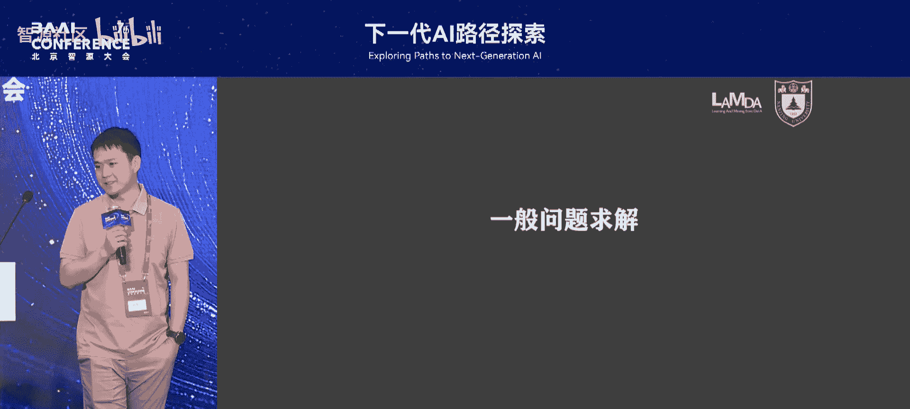

变的例子对吧？当时op air的这个O one刚出来的时候就给了一个例子啊，最早说的是这个how many are in the strawberry啊，那我们把这个问题稍微变难一点啊。

把这个问题稍微变难一点啊，因为我喜欢看球，所以我就把这个这个这个解说员们一般用的这个字啊，这个go拖的很长。我说你能不能够数出来这里面有多少个原因。那这个问题其实交给当年的这个O one来解呢。

它是出现了一些问题的啊，出现了一些问题的那比如说在这个里面我不知道大家能不能看得清啊，在这呃我可以放大给大家稍微看一下唉。😊。

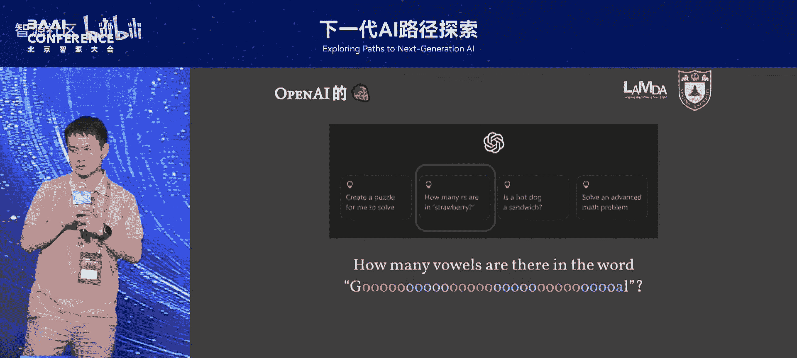

啊，OK反正他一开始给了我两个答案啊，如果看不清的话，我就简单给大家讲一下。他左边说呢这个东西有32个32个原因，右边呢说有31个原因，就我们回到前面那个呃问题来看的话。

他其实是一个要做mtyho reasoning的一个事情。你首先要知道什么是原因。然后呢，还要去做一个一个的counting，对吧？这个对于我们人来说是一个非常自然的一个推理的过程。😊。

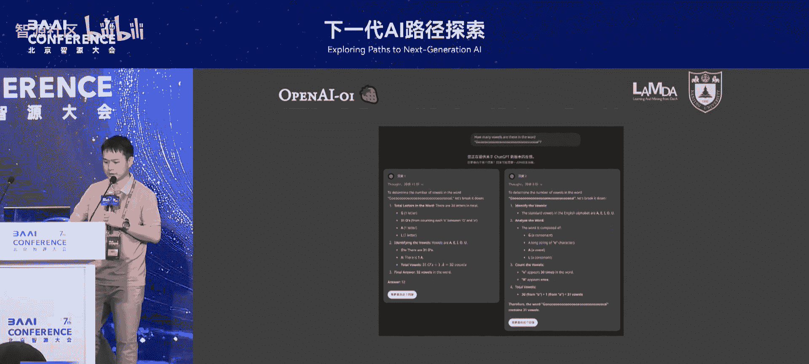

那么我大概当时OE刚出来的时候，我就试了10次啊，试了10次。那这个十次的这个结果就是。他其实就对了一次啊，其他的每一次呢几乎都差那么一点点啊，除了这个呃第五次好像差的比较多以外。

其他每一次都只差了那么一丢丢啊，那差这么一丢丢呢，我一开始觉得这里基本上全错了嘛。因为这个事情交给一个小学生来做，小学生都能做的非常非常准，他其实就是一个很明确的一个技术的一个问题。

但是呢对于现在所谓的推理大模型来说，他做的还是不够好啊，做的还是不够好。但是后来呢我又去请教了这个啊一些做认知科学的一些朋友啊，那么他说这个东西其实已经做的很棒了啊，他说这个其实已经很棒了。

你看这个每次的答案都只差那么一点点啊，这其实不是一个坏的现象，说明他们其实做的很好了。但这个同样的呀，就等到这个O三最近出来了以后，我也做了一些实验啊，也做了一些测试。

那O3呢做出来的结果其实还是差不多啊，基本上做了很多次，他也没有几次是对的。像这个3。😊，出来以后，他说这个同样的一个问题，他说这是26个原因啊，是26个原因。

所以认知科学的那个呃那位老师为什么说我们这个大模型做的还不错呢？啊，其实这个是一个很明确的一个认知的一个过程啊，这个叫sizing叫sizing就是人在做很多问题的时候呢，或者说在数数这件具体的事情上。

我们是可以去一瞬间就把这个比较小的这个数字啊，一下子就给看出来。啊比如说这个里面问有多少个苹果啊，那大概5到6个的话，我们在一眼就能够把这个答案给看出来啊，这个就等于瞪眼就能把答案瞪出来的一些一些问题。

但是呢如果大家要去看要要问这个里面橘子有多少个，对吧？问橘子有多少个这个事就不是那么好做的了，你会发现你必须要一个一个的去数啊，因为他已经超过了我们这个sizing的一个能力。那么对于呃大模型来说。

为什么这些认知科学家们觉得他做的还不错呢？啊，就是因为他瞪眼就可以直接。😊，出来1个30多个数字的时候，这个能力就已经远远超过人类了啊，他因为并没有真正的调用reasoning啊。

并没有真正的调用这个reaing或者说没有去调用我们所说的这个刚才前面很多老师都提到的这个sstem one和stem two对吧？那么sstem one呢就是我们这种基于直觉的推理。

那么对于stem two呢就是我们要用一个算法，或者调用我们的注意力来一步一步的进行推理。那他在没有调用这种一步一步的推理的情况下，能做到这个地步已经非常不错了。那尽管像O一还有O3啊，我也试过dt啊。

他们都有所谓的这个chan啊但那个chan呢从来没有说我有一个算法啊去把这个里面的东西用手指一个一个去点啊他会回答说我假装用手指去点啊，但是答不出来。所以另一方面呢。

我就去现在最最新最好的reing model对吧？就除了刚出的这个以及这个这个。😊。

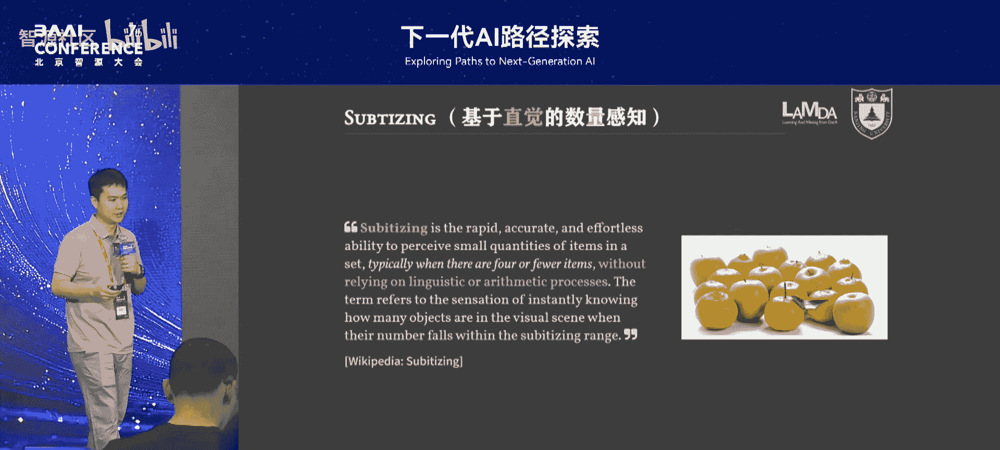

这个这个cloud以外呢，那就是这个O4了。那我同样问O4这个问题，他能不能解啊。O4我发现他解这个问题呢，一开始仍然是出现了很多很多障碍的啊，比如说在这个地方，他一开始数呢第一遍数，他说就是22个O。

加上一个A啊，一下变成23个。第二遍数呢又变成23个O，加上一个A。第四遍数呢变成24个2424个原因，再加223个O加一个A。😊，他每次会多数一个，然后最后会会进展到什么样的地步呢？

他发现他算不清楚了，他在这写代码了。😊，啊，他开始写代码了。😊，哎，这个写完代码以后，这个答案就非常好了啊，一下子就把这个这个正确答案就给算出来了。他甚至他写了一个这个我觉得他代码写的很漂亮。

他不仅把这个字符的长度给写出来了，还要把这个原因的多少个，甚至每一个字符有多少个全都给你列出来，然后给了一个非常标准的答案。😊。

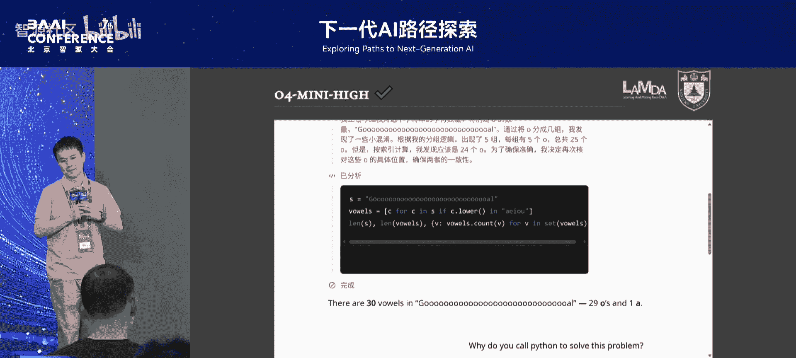

啊，我问他为什么要做这个事情啊，为什么你要写个写个python的代码来做这件事情？他说我用手指点可能点的不容易容易错啊。

所以呢他就特别他提到啊miss counting dozen of letters by hand，对吧？他说我用手来点是会容易出错的。啊，所以呢我也不知道他这个概念里面，他的手是在哪个地方啊。

但是呢他把这个事情就给做到了，所以能看到一个什么事情，这个为什么叫general problem solving呢？就是我们人工智能在解决问题的时候，其实都是走这么一个路径。

就是把一般的问题啊形式化形式化了以后呢，就可以求解啊，那我们早上的所有的报告几乎各位呃科学家们都在做这样的事情，对吧？呃，😊。

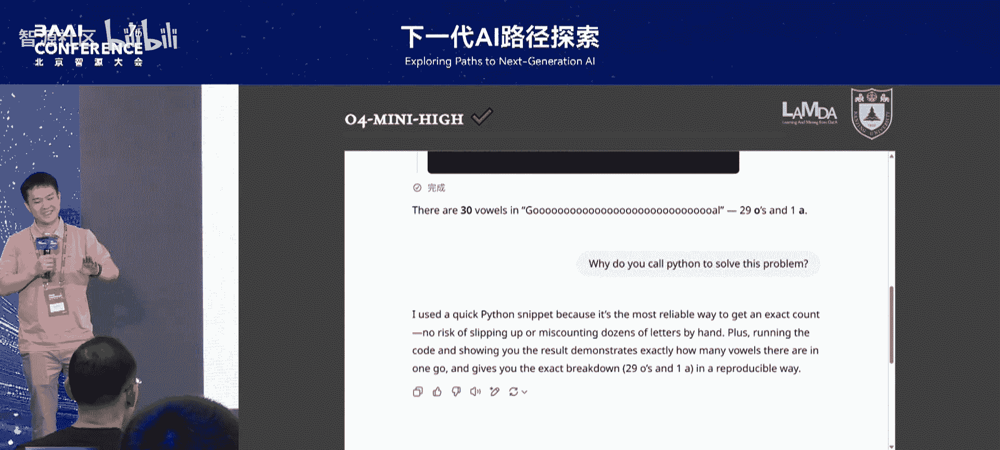

石老师在做的事情啊，就是他把这个associative recall这个事情给建模出来啊，建模出来了以后，我就可以去形式化它了。比如说我说用一个线性的这个tenion去形式化。

还是用一个这个多项式的逼近去形式化。然后呢接下来就交给这个优化的方法和计算就好了啊，对吧？然后前面这个汪老师呢他提到他在做机器人的这个巡路的时候，也要做这样的事情，对吧？

因为我们直接去做这种呃这种非常非常精细的这个地图的通信，它也做不了任何在它的效率是非常非常低的啊，因为要耗很多资源，那最后怎么办呢？把地图给参数化了啊，这也是一种形式化，要么呢就是变成拓扑。

那甚至拓扑就是两个两个点之间的这个连接了，那已经变成一个完全逻辑的表征了，所以这个其实是我们呃在这个欧4为什么成功啊，其实就是干了这么一件事情。他能把这个问题抽象出来。

然后合成了一个form的一个program，然后再去求解。那这个其实是我觉得人类。😊，在做推理的时候有一个非常非常强的一个能力。就我们能够很自然的做这样这样的事情。于是我就把这个问题也交给他了。

我说你能不能来数一数这个里面有什么苹果啊，有多少个这个苹果和多少个这个orange。哎，这个时候他一上来就很很聪明啊，他很聪明，他知道这个事情我不能直接用直觉猜了。😊。

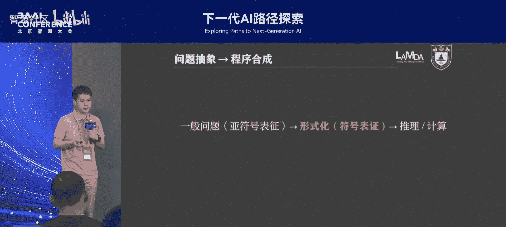

直接上来就开始写代码啊，他直接上来就开始写代码，这个很好玩。他上来写代码呢大家如果做CV肯定都知道用过open CV对吧？那用open CV它其实可以做很多事情啊。

这地方我就不去一一给大家展示他干了一个什么事情了，我大概介绍一下他其实就是这样，一开始呢他想着这个橘子和这个苹果颜色不一样我就考虑这个绿色通道就好了，做一个m，我把绿色都过滤掉。

然后去数这个最大的橙色的联通分量的个数，然后把橙色过滤掉数这个最大的绿色的联通分量的个数啊，一数嘛就肯定出来了，结果他发现算不对，因为所有的东西都都都都粘在一起了。甚至他说我在做绿色的这个通通量的时候。

发现怎么整个画面都变白了，连绿色都不见了，我要重新设一下这个然后呢接下来他又觉得这一套不行了，算不出结果。他说我现在开始做一些这个边的检测，然后数这个里面的圆圈到底有多少个啊。最后圆圈也数不清楚。😊。

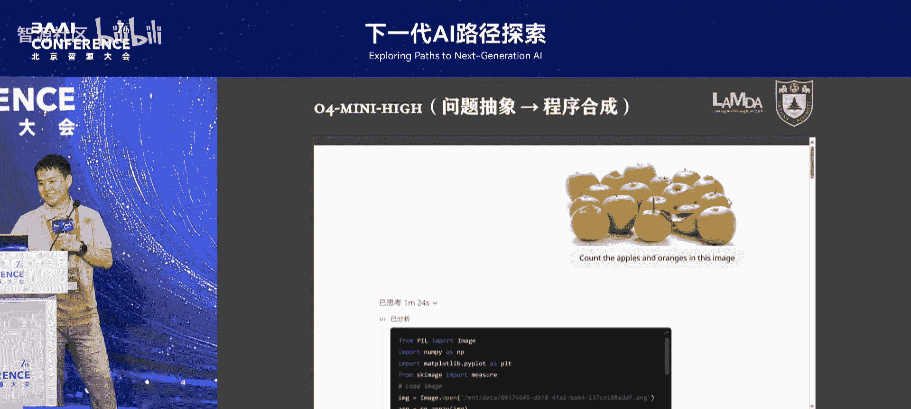

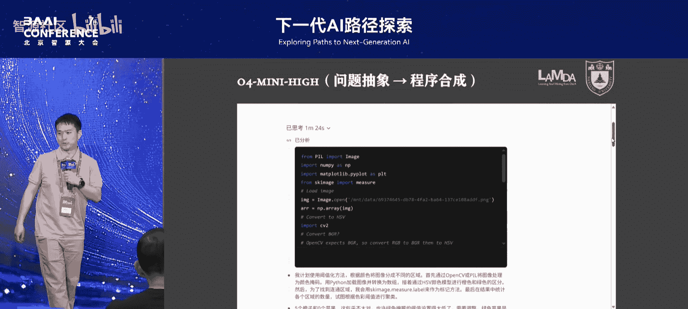

然后他就放弃了啊，最后他就放弃了，他又跳回了这个直觉的这个推理啊，他说我又开始按照一行一行来数，我们数第一行有什么，第二行有什么。然后最后呢给出了一个答案啊，又给出了一个答案，这个答案就明显是错的啊。

就明显是错的。😊，所以这个又有一个很好玩的事情，就是他在做形式化的时候，他是受到他的语言的限制的。比如说他调用这个open CV的时候，open CV在on里面从来没有定义过什么叫orange。

什么叫apple你要去想办法把我的这个问题到一些我现在能够处理这个问题的这个语言上对吧？所以他就想了很多办法orange是不是就是橙色的然后apple这个图里是绿色的那我就ground到我现在已有的这个lanage的这个两个符号的概念上然后去做这件事情。

发现不成功了以后，我又想openC是可以做圆形的检测的那我能不能把这个问题形式化成一个做圆形检测的一个东西。那最后为什么做不了这件事情呢？他会发现这两种形式化的方法或者抽象这个问题的方法都是错的。

因为这两个概念其实和是不是苹果和是不是橘子它没有关系。如果让我们人来做这个事情其实是个非常简单的事对吧？我们调一个这个net上训好的模型或者随便调一个这个目标检测的。😊，你检测几遍啊。

然后知道这里面有什么橘子，有什么苹果啊，然后把类别标出来以后，直接做一个counting就结束了。但是它的这个open呃这个这个这个呃欧4在做这件事情的时候呢，他没有这个符号啊，他没有这个符号。

甚至他也不知道我能不能去调用一个机器学习模型去做这件事情。所以这个是他没有完成这件事的一个最大的最根本的原因，所以回过头来，我们其实这个genepro已经做了很长时间了啊。

前面好几位老师都提到我们之前人工智能最对吧？汪老师也提到最我们就在做这件事情，我们怎么样把一个问题表表示成一个通用的形式，然后再用这种通用的形式去求解那个就是CPU的发展啊。

那么现在呢我们有很多所谓的这个神经符号学习都在做这件事情符号主义的AI也好，还有现在神经符号的AI也好，都在做这个事，但是他都有一个很明显的局限。就是前面这一步啊，这个中间的一般。😊。

问题到形式化这个事情全是人来做啊，全是人来做。我们经济学习来干什么呢？我们在给了一个标好的一个label的 set以后呢，我们把这个问题呢用一个机器学习模型学怎么样去把这些label给抽出来。

那么同样的神经和符号的结合，往往也都建立在我们人已经把这个问题给形式化好了的基础上啊，就像前面这个石老师在说的对吧？

佳明说的这个我们现在先把人的这个呃associative recall给建模成一个什么什么样的优化的问题，对吧？这个K和V的成绩和我的这个memory啊，这一个东西能够建一个连接啊。

然后就变成一个优化式，然后呢我就可以去做，所以中间所有的问题呢都是由这个来做到的啊，都是由人来做到。我们都要有预定义的一个语言。所以在15年的时候啊。

这个AIMA就是那个人工智能一种现代方法的这个教材的作者叫自己。😊，其实做符号主义人工智能的，他对人工智能对于符号主义人工智能有一个很强的批评啊，一个很强的批评。他自己做这个的。

但是他觉得呃符号主义有一个非常基本的假设是错的，就是符号从哪里来啊，所有的以前的人工智能，包括我觉得我们现在的人工智能，对吧？基本上如果想要解决一个问题啊，你都得人先把这一套流程先定义好。

这个里面要出现一些什么样的概念啊，都是我事先准备好，从来没有人说我能不能从这个经验的学习中把这件事情给学出来啊，所以他给的批评已经很很严重了。他说这个真正的uncertainty。

真正的uncertainty是什么东西在我这个世界里出现啊，这个跟我们呃现在的这个机器学习一对比的话呢，我们发现现在的机器学习完全没有解决这个问题。就哪怕所谓的大模型能够做到开放世界下的一些很多任务。

但是他是在我们人类的这个概念的群上面去做的这个事情啊，他没。😊，没有说我去发明一个新的概念，或者从数任务中去检测一个新的概念。就哪怕像这个呃O four那么强的一个东西，对吧？

他也没有说在图片里面我要怎么去定义好这个橙子和这个苹果啊，这两件事情他是没有办法去主动发明一个language。那这个事情其实是呃人是经常在做到的啊，人是经常在做的，就经验学习中做符号或者做概念的抽象。

其实是一个很正常的事情啊，是个非常正常的事情。那比如说我手上对吧？这有一个翻页器啊，这是一个翻页器，他就是一个很明确的符号，他带一个方式呢，就是可以翻页。啊，同样的呢。

假设这个时候突然有人上来要要要要要要攻击我，我可以拿它当个武器去锤，对吧？这个概念的变化其实是非常非常非常灵活的。所以我们不是说真的要从一个定义好的空间里面去学这个概念。而且不仅仅人能做这个事情啊。

猴子也能做这个事情啊，这个才是我觉得最有意思的。这个是我在这个神经所的一个合作的老师啊，那么他们在做一个很好玩的事情，就是让猴子去打这个吃豆人啊，那猴子去打吃豆人，他发现呃有几个几个很明确的现象。

就是呃猴子在做决策的时候呢，这个决策的路径，一定是他的这个过。😊。

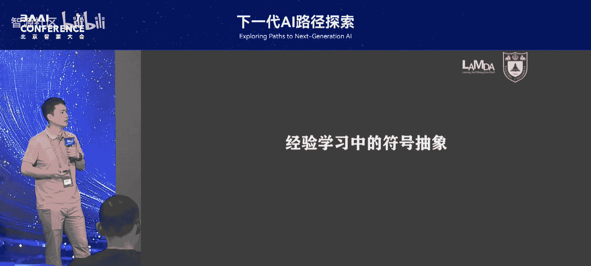

一定是离散的，就是我每一段时间我只会激活一个策略。比如说这个鬼要靠近我的时候啊，他这一段时间它只会激活一个策略，就是我要逃跑啊，这是一个很明确的概念啊，一个program啊，我要逃跑。然后鬼离他很远。

那我身边也有豆子的时候，他也只会激活一个信号，就是我要去吃身边的豆子。我身边豆子吃完了以后呢，它也会只激活一个新的策略，就是我要去远方去找更更更多的豆子。

所以可以看到就它下面的这个决策一定是一个像字符穿一样的东西构成的。尽管它是一些非常low levell的一些一些一些action。是上下左右包括有噪声的。但是这一段的这个行为，它都是一个离散的决策啊。

都是一个离散的决策。然后呢。😊。

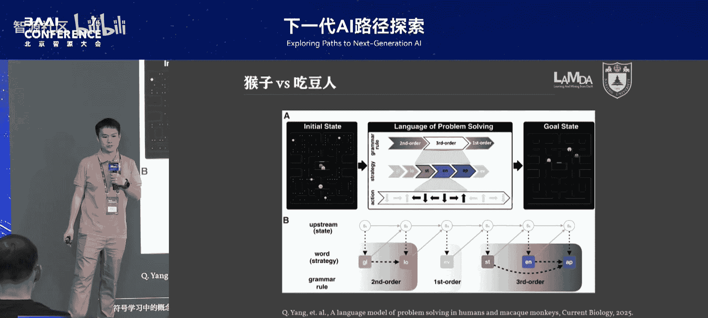

这些角色是形成了一些规则的啊是形成了一些规则的，或者它形成了一些策略。比如说他训了两只猴子啊，训了两只猴子。这两只猴子呢打的这个打游戏的时候，这个分数有高有低啊，有高有低。

那第一个猴子呢大概他这个猴子玩吃豆人，总共玩了3年啊，玩了3年啊，不像人学的这么快。那第一只猴子呢大概学会了一些二阶的语法，就是我吃完了身边的豆子以后啊，这个豆子没了，我要到远方去。

然后还有一些呢就是吃吃豆人里面有一个大豆子叫eneizer对吧？我吃了这个以后我要去追鬼啊。那这个这两个词汇啊，在符号上它是有强的关联的，所以它会形成一个语法或者形成一个语法的规则。

所以就能看到呢你学的这个语法学的越快啊，这个分数是越高的。像这个第二只猴子他在第一年就学会了这个去去抓鬼这件事情。第一第一只猴子这个monkey O呢它第一年只会吃豆子啊，吃完豆子它不会抓鬼啊。

第二年他才学会了我要去抓鬼这件事。😊。

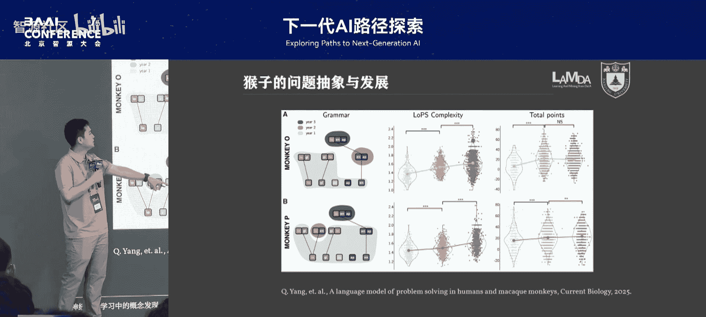

所以他的分数就会比第一个猴子要低一点啊，要比第一个猴子要低一点。同样呢他们还在人的这个群体上做了一些实验，招招募了一些志愿者，对吧？在呃人玩这个session呢就总共玩了两次啊，玩两天。

就发现呢人的群体也分两类，一类是这种新手啊，他新手学到的这种语法术呢是非常非常小的，但是对于那种非常非常资深的这种高级玩家来说，他是可以学到很复杂的策略啊，学到很复杂的策略。

那么这两个呃人和这个猴子再一对比呢，人会抽象出一个新的概念啊，人会抽象出一个新的概念叫什么呢？叫把这个大豆子先存着，就他可以把周边的小豆子都吃掉，然后呢这个大豆子就留在那个地方，然他不吃。

然后在那个地方就左右的来回移动啊，所以人的这个策略里面多了两个符号啊，多了两个新的概念，一个是sfe啊，还有一个是tay。然后它形成了一个更长距离的一个规则。我可以把这个豆子。😊，横在这个地方。

然后等到鬼追来我的时候，我在这个豆子边上等着。然后这个大豆子，我一旦鬼追的越近的时候，我一口把这个豆子吃掉，可以很快的追上去，把所有的鬼全吃了啊，那个时候他的加分是最大的啊。

所以人的策略呢不仅仅能够涵盖之前这个猴子的策略，他甚至发明了一些新的符号啊，发明了一些新的符号。这些符号造成了更复杂的规则啊，造成了更复杂的规则。

然后这个规则的复杂度就是和我们的这个呃所谓的这个智商的高低，或者玩这个游戏的表现，他就是成正相关的啊，也就是越高级的玩家，他往往能够应对更复杂的策略，甚至它的这个学习也会变得更有意思。

像这个呃专家级别或者说这种比较厉害的人类玩家呢，他在玩第一次和第二次的时候，他会有这种策略上的更新啊，我们能学到新的策略啊，能学到新的策略。但是对于普通的这个新手玩家来说，他是学不到新的策略的。😊，啊。

他第一次是什么样子啊？第二天晚上他还是那个样子啊，所以他的分数的成长也没有那么好，他可能在微操上好一点，但是他在策略上并没有任何的新的进步。所以。😊。

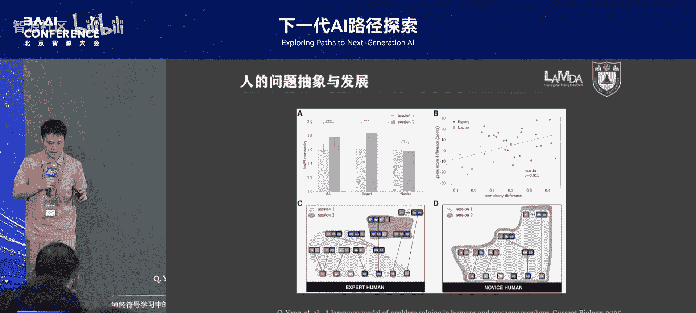

这个最后就启发我们的思考了，就是符号抽象的能力，其实是更关键的。在现在的神经符号学习里面，我们往往忽略了这一点。我们永远都是先说好这个符号，我们由人给他定义好，然后来做这件事情。然后呢。

符号抽象的能力是直接关系到你能不能提出新的概念，总结出新的规则。啊。那么在刚才的实验也能看到，基本越高级的智能，就等于越规越复杂的一个规则系统。😊，第二呢，决策的背后啊决策的背后。

它一般都是基于抽象结构的形式化推理啊。那现在很多经济学习，我们希望是做端到端的推理，对吧？就是我们给一个输入，然后直接就告诉我决策，但中间到底经过了什么样的这个reing的步骤。

其实大家不是那么care。但是在真正场复杂的场景下面啊，我们去做这样的任务呢？啊，为什么神经符号学习，在现在还是很多人在研究啊，有一大部分的原因就是因为这个形式化推理。

它能带来更好的可靠性和更高的可解释性。那么这个决策的底层呢？😊，往往就是说我的一个小步骤的这个决策。比如说我要怎么躲开这个鬼，或者要怎么去更快的去吃到这个豆子这种非常细的这种微操啊。

那才可能他不需要太多的规则。那是你练的越多越好。所以是什么呢？你有更高级的一层推理。但是这个更高级的推理呢？你最后要ground到一些非常非常low level的一些action上面。

那这个事情呢是需要积极学习的然后第三个呢，刚才所说的这个符号的抽象，我们是可以在不定义任何符号的时候，直接把它学会的那这个就是我们直接呃和这个神经所的这位老师在在沟通的时候，我们共同得到的这几个结论。

😊，啊，我们想做的事情呢，其实就是下面第三条，我们能不能在这个亚符号的环境下，我们不定义任何的规则，不定义任何的这个符号，让他把这个里面一个任务的逻辑结构给学出来啊，能不能把这个任务的逻辑结构给学出来。

也就是说我们的符号能不能自然的从没有符号的环境中涌现出来。😊，所以我们就合作了今年发了一篇这个文章啊，刚刚中啊，我们叫把它叫基于反应学习的问题抽象。这个问题是什么呢？也些很简单啊。

比那个猴子的任务稍微要要难一点啊，我们是用I来做？这个大家也都很熟悉了，是一个那个min给的里面的一个环境。那这个环境呢是比较比较底层的，就我们现在的这个目标就是要到到达那个绿色的方块啊。

那底层的动作呢只有前进左转右转，然后比如说拿开关啊，或者说把一个东西放下去，把一个东西拿起来，奖励也很简单，你走到终点就有啊，走到终点就有没走到终点死掉了，踩到岩浆里面，那就是一个负一。

那么我们给他的这个seing是什么呢？它的输入就是一张端到端的图片啊，就是一个纯pixel表示的图片。那我们希望它能够把这个能解决的很好。其实如果不加任何的像现在有很多大家如果做强化学习。

有很多方法可以解对吧？我可以用层次强化学习。😊，把这个任务分解掉，然后作为一个知识结构放进去啊，这个任务就解的非常非常好。但是能不能在不给任何东西的情况下，让他把这个层次结构学出来呢？😊。

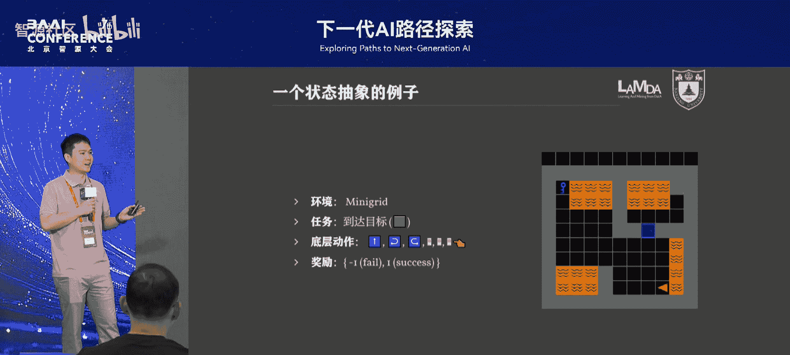

所以我们是这么定义的，就是原始问题呢啊我们把它叫一个groundMDP啊，它是一个非常底层的表针。它的表征是什么呢？我的状态空间一定是一个连续的原始空间，对吧？原始图像构成的空间。

然后这个action呢也是非常low level的，它都只有上下左右这样很小的这个行动。然后P呢就是我们MDP里面这个转移矩阵啊，它的转移矩阵仍然是一个底层的转移矩，甚至是一个不可观测。

我们做一个行动以后，这个图片会变成什么样子啊，而不是说我们做了这个图片以后，就我们做一个行动以后，的agent会往前走一步，那这个你已经把这个问题给抽象出来了。什么叫ag什么叫一步啊，全都有。😊。

我们能知道的事情就是你做了一个动作以后啊，这个图片可能会变啊，这个图片可能会变。所以这其实是一个怎么说呢？我们要解决这个任务的话，很显然，刚才要做这个任务，我们要先去把钥匙找到，对吧？

然后拿钥匙再去把这个门给打开啊，打开门了以后呢，你就可以走到这个终点了啊，这其实呃简单的来看啊，它也是一个呃规则的学习。而且这个规则的学习对应的是什么呢？是一个任务的分解。😊。

所以如果我们有这样的一些命题逻辑的符号，比如说你我手上有没有钥匙啊，我手上这个门地图里的门有没有解锁，或者我有没有走到终点。如果我有这些符号的话，这个任务很容易解决啊。

它的这个表征其实就是这么一个很明确的一个逻辑的这个这个表达式而已啊，也就是说我没有key，也没有开门也没有也没有走到终点的情况下，我第一件事情应该是把这个key拿到手，对吧？然后呢再去开门。

最后再走到终点，啊其实就是这么一个一个很明确的一个表针，但是现在在没有这些符号的情况下，你这些概念从哪来呢？甚至这些概念的关系要从哪来呢？就你们想象一下，就自己是这个这个强化学习的这个agent啊。

在没有进行任何学习的情况下，你看到的这个图像就是一个白噪声，对吧？因为你是区分不了这个图像上任何东西的这个图像就是一整片白噪声。你在一个黑灯瞎火的环境里啊，你要把这个任务解决掉啊。

尽管你有几百万次几千万次的迭代，但是一旦。😊，有这么复杂的结构以后啊，这个事就不能做了。所以非常困难。因为我们没有办法把符号从这个图片里面直接分离出来。所以我们就退而求其次啊。

我们看看能不能至少把这个几个状态之间的这个结构给离散出来啊，把这几个状态给离散出来。这个也也很简单，我们是呃启发是来自于谁呢？来自于minky的这个很早的一篇啊一个一个一个一个假说吧。

minky有一本书叫sci mind啊，他当时是批评当时的这个模式识别学家啊，他说你们学了那么多定义了那么多凳子的结构。那什么是凳子。现在我们把这个问题重复的反过来啊。

说这个是视觉解决了什么是凳子这么一个问题，对吧？啊，那你在任何一个凳子的图片，你交给一个学的很好的这个呃机学习模型啊，他都能给出来。😊，告诉你啊，这99%的概率应该是一个凳子。但是呢。你想想一个机器人。

或者说我们一个人啊走到一个森林里面去，哪来的凳子，对吧？哪来的凳子？😊，但其实每个东西都可以当做我们的凳子，对吧？那石头也可以坐凳子，下面树干也可以做凳子，任何一个东西都可以是我们的凳子。

所以minky提出了一个很重要的东西，一个很重要的概念啊，就是他说concept这个事情不单单只是它的这种perceptual的一个一个一个re，它不是一个感知的表征。它还有一个更重要的东西啊。

还有一个更重要的侧面是什么呢？是函数啊，是一它是一个函数，是一个是一个function。😊，那这个函数是什么呢？😊，比如说凳子这个概念啊，它就是能够帮助我进行一个状态转移啊，就是我能从站着的状态啊。

变成很舒服的坐下的状态啊，我的两条腿不用受力了，变成我的屁股和我的腰在受力。那这种情况下，任何东西都可以作为凳子。😊，那人的泛化能力其实很大程度上是从这个地方来的啊，是从这个地方来的啊。

当你没有起子去起一个螺丝的时候，你会掏出一把钥匙说，反正我也可以拿这个东西来起螺丝，对不对？😊，它的功能是以我们泛化性的来源。然后这个功能本身存在的是离散状态之间的跳转啊。

这个就是我们觉得哎人工智能可能未来要去做逻辑推理的话，可能有一个大的问题就是要怎么去解决我去发现这样的离散状态和中间的这个离散状态之间的这个关系。

所以我们其实定义了一个呃叫extract state machine啊，tract machine细节我就不不去讲了。我们其实就是用一些集合论的方法啊。

用一种集合的外延的方式去定义了什么叫做这个一个抽象的状态，简而言之呢这个一个抽象的状态，就是我的这个ground的这个这种纯的图片的状态空间里面的一个子集。那这个子集它能起到什么作用呢？

就以往做这个呃强化学习抽象的人，他会把这个空间定义成一个划分，也就是两个集合，两个集合之间是不相交的。但其实那个是存在很大问题呢。它在逻辑的表达能力上是有有一定缺陷的。所以我们把这个去掉啊。

把这个限制给去掉。这个集合和集。😊，合之间可以相交，然后集合和集合之间甚至可以有这个呃有有有相互的关系。比如我在没有钥匙的情况下，我是可以走到有钥匙的这个情况下。然后这两个集合呢。

我觉得呃就我们希望的做法呢是让基于学习自己把它给学出来。那呃数学上它的定义，其实就是我们把这个MDP抽象成了一个子代数啊，它变成了这个原来的MDP的一个子代数。那这个子代数里面的每一个新的东西。

一个抽象的状态啊，是我原始状态空间的一个子集。然后呢，我所有的这个这个状态转移啊，也是由这个不同抽象状态之间的这个状态和状态之间的这个交集来构成的。比如说我可以从这个没有钥匙的情况下走到有钥匙的情况下。

是因为这两个东西之间啊，有钥匙的这个非终止状态和拿没有钥匙的这个终止状态，他们两个是产生了交集的。所以用这种方式呢一个任务呢，其实原来的这个端到端的这种呃。😊。

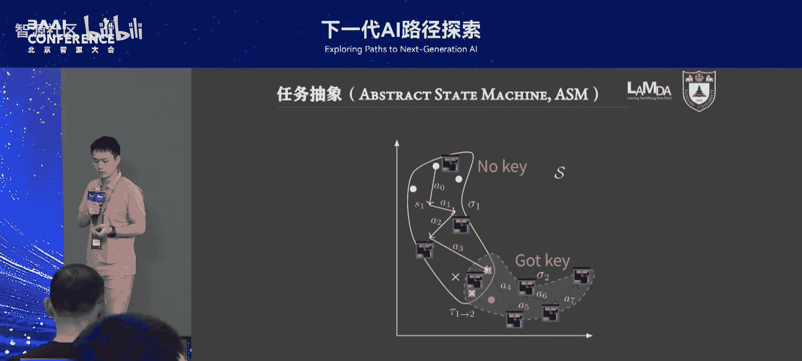

机器学习呢或者说强化学习呢，他学的就是这样一条路，对吧？我要从这个开始的状态走到这个终止的状态。那其实在我们人在做规划的时候。😊，我们是把它拆成两三步来做这个事情的那最后要做到一个什么事呢？

就是我们可以把这个状态转移呢，用一个逻辑的方式给它表示出来。也就是我第一个初始状态，可能是呃没有是在这个属于这个抽象状态，就是没有钥匙的状态。那没有钥匙的状态，我要干什么呢？就是先走到有钥匙的状态。

然后呢，到了有钥匙的状态以后呢，我再去走到这个终点的这个开门啊，或者是走到终点的这个状态，那它就变成一个递归的一个规则了。那我们就希望啊能不能不去定义这个里面的任何符号啊，我们把这个里面的状态转移函数。

包括这个什么叫一个状态，全部都给抽象出来。所以呃我们是基于我们呃这个周老师提出来的反应学习框架呢，做这么一个事情。就是在强化学习空间里面，我们是可以对trace进行采样的。

然后他肯定有成功的tra有失败的trace对吧？对于这种需要长序列规划的一些任务啊，长序列规划的任务。我们在没有任何结构的情况下，我们只能怎么做呢？就是做聚类。那聚类其实就是。😊。

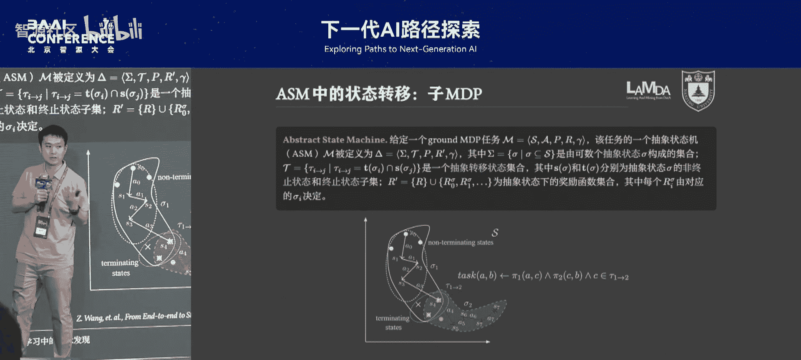

一个反应推理啊，反应推理是什么呢？这里我就不再做更多的解释了啊，他其实就是对这个不完备的观测下面找一个解释。😊，这个解释是什么呢？就是我在这个状态空间里面再找一个路径的时候呢。

它一定会有一些非常关键的节点啊，这些关键的节点呢就是我们的这个公共状这些关键的公共状态呢，就是我们希望建模出来的这个突变的状态，或者说符号就可能发生在这个地方。让大家想想啊，如果你在玩一个游戏。

你甚至都不知道这是个钥匙，或者这是个道具的情况下，对吧？你会拿着东西到处砍一砍这个玩意消失了。😊，然后你的道具栏里蹦多出来一个东西。这个时候你会明显的得到一个一个一个信号，就是这个状态突然发生变化。

或者说我在玩塞尔达的时候，我踩到一个开关，我也不知道是什么，但是突然想起了噔噔噔噔噔噔噔噔，对吧？这个声音你也不知道是什么地方出现了这个这个门打开了。但是你知道这个状态变了。

所以这些东西其实就是我们对这个符号的解释，一旦出现了状态上的突变，那么他们一定。😊，一定是有重要信息的啊，所以就基于这个事情呢啊我们参考了一个这个认知科学上的一个叫基于僵局的状态发现。

那么它可以做这种递归的呃这个这个状态发现。比如说一开始我已经发现了两个离散状态了啊，那么现在碰到一个更难的任务。这个状态是我之前没见到过的，于是我就开始随机探索，直到探索到我见到的。

他走到了一个我见到过的状态。然后呢再在这个里面把这个trace做一遍我们之前的这个反应反应学习的这个这个这个推理吧。然后再把这两个状态给它分离出来啊，简单来说这个流程就是这个样子的啊。

细节我就不再去讲了。那最后能做到什么呢？就是我们可以呃在这个环境下面啊，把这个任务的这个整个符号关系给学出来，甚至在这个状态和状态跳转之间的过程中，我们就把钥匙还有门还有终点啊。

这样的概念就直接发明出来了。就大家虽然看到这个规则都是用这个东西形成的对吧？一个派是一。😊。

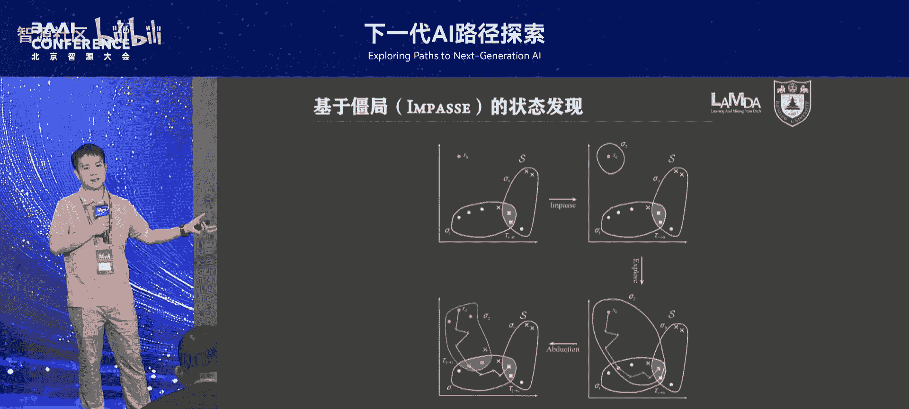

策略从状态0到1的这个派，然后状态一到状态二的派。那这个我们从来没有定义，我们给的是什么呢？是我们的这个呃语言里面，我们给了他一个可数的集合啊。

这个可数的集合里面你可以自己随便往里面填符号那这些符号呢具体怎么样的应用在这个这个规则上面呢，都是由他自己来来manip他得到了这些符号以后，自己再把它拼成一个这样的规则所以我们最后也做了一些实验啊。

做了一些实验，就端到端的强化学习也比了。然后这种呃和这种预定义好这个层次关系知识的这个强化学习我们也比了就你把知识定义好了以后，就这个粉红色的线啊，基本上都可以学到最优啊。

因为这个任务确实你把任务关系人都抽象好了的话，交给强化学习层次强化学习来做就可以做。但是如果我们简单的用1个PPO或者用第QN这种端到端的方式，他不去给任何预先定义的知识啊。

基本上在第二个任务或者第三个任务的时候，这个就是如果门也是锁上的。然后这个要。😊。

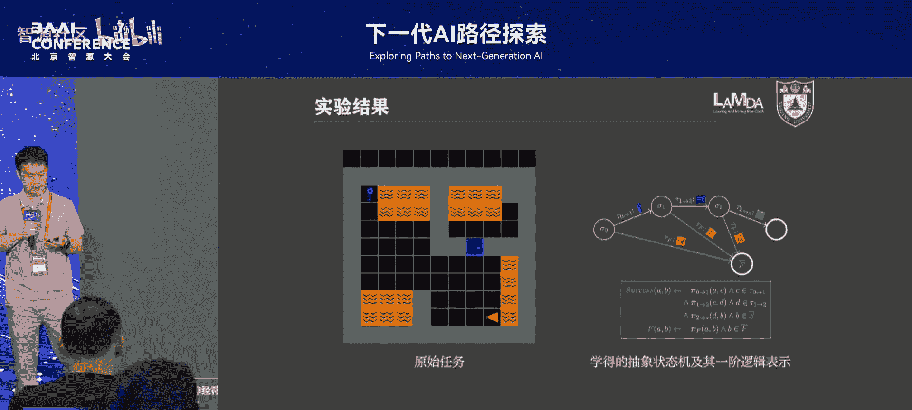

是也是摆在很远的地方，那这个事儿就做不了了啊，这个事就做不了了。在接下来呢，我们的方法呢，基本上他在碰到一个新的状态的时候，他的这个东西都会掉下去。😊，然后他发现我得新发明一个符号了。

或者新发明一个策略。然后在新的环境下面呢，这个东西会慢慢慢慢的涨上来。然后到最后最难的任务上仍然可以赶上。就是我在不定义任何知识的情况下，我可以可以达到我原来把所有知识都预先定义好的这种这种程度。

然后还有一个这个好处是什么呢？就大家都知道强化学习的泛法性能很差。像刚才那个min的地图，你在上面训练好，一个强化学习模型，你把地图换一下。比如说把门的位置换掉，把这个钥匙的位置换掉。

甚至多摆一些这个岩浆，原来的那个那个训练的那个强化学习模型就直接掉啊，直接直接fa掉，它是不work。因为你的环境感因为它完全基于这种视觉的感知，对吧？它完全基于视觉的像素的感知。

但这个分布只要变一点点就出问题。所以我们的呃做法是什么呢？我们在50个地图里面做随机的训练啊那普通强化学习已经完全不work啊，已经完全不work。但是呢我们的方法呢，可以把这三个状态。😊。

学出来以后啊，然后我们在新的这个随机地图上面去做测试啊，它完全走成功的呢也比较少啊，大概10%左右。但是呢它有一大部分至少可以把把钥匙拿到。然后还有一些agent呢，他可以有一些地图上。

它能把这个门给打开啊，它是有一定的迁移能力的。而且这个迁移能力呢，我可以在原始的这个这个学到的这个状态空间里面，这个状态空间里面去给他做增补。然后呢再去做学习，这个收敛速度就变得非常非常快。

所以它的泛化性能也变得非常好。这意味着什么呢？我们把概念离散化的概念给抽取出来了以后啊，就像我们人一样，我们就可以把这些概念做组合，然后做其他环境下的这个泛化。

那么它的这个能力显然会比原来的这种端到端的强化学习要好很多。😊，所以简单的做一个小结的话，就是我们是始终认为这个stem一和stem2它是存在的。但它中间的这个这个联系其实是一个非常妙的一个东西。

就是感知啊，就是我们怎么从这种这种连续的空间里面感知出符号。然后这个符号怎么样抽象出来以后变成一些知识，这个知识最后变成一些离散的决策。

这个决策呢最后又要变成非常非常low level的这个这个这个action，对吧？我要往前走还是往后走，甚至我的这个手该摆多高。那这两部分到底哪个该用积极学习，哪个该用这个逻辑推理呢？

现在我们的结论是不行。😊。

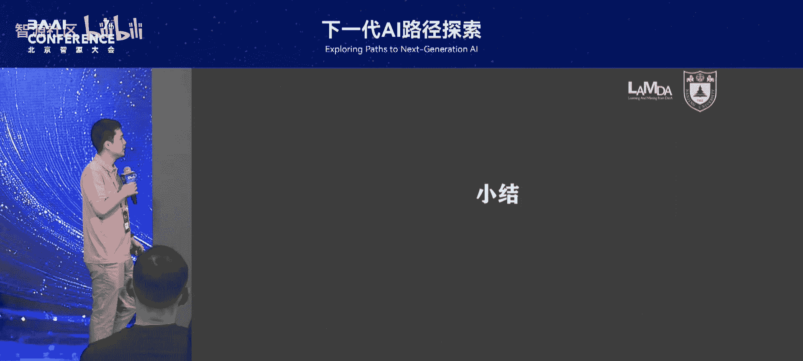

应该端到端的把这两个东西全都合起来啊，一起来学问题的抽象，也要在这个有一些这个呃经验的环境下去学。那么知识呢同样的也应该从这个环境里面去得来，所以昨天这个呃sturn的这个报告其实也提到了，对吧？

我们这个的er of experience啊，他的那篇文章里面也提得很清楚。我们能不能在不依赖任何人类的数据和任何人类的这个先预先定义的知识的情况下去把这个planning和reaing给学出来啊。

这个其实在他们提出来之前，我们大概去年就已经开始做这个事情。好，那非常感谢大家。😊。

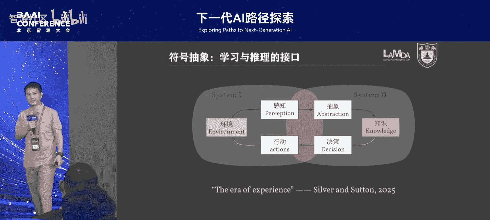

感谢戴老师的精彩报告，这个非常有意思。然后像这个那可能现在大家做学习或者做最热的topic和曾经可能最最不热的topic这个有机融合在一起的。但能够看到这个呃这个推理逻辑啊。

还有包括像这种概念的这个抽象的等融合在一起非常的非常的好啊。我们看留意1到2个问题。😊，有那个反义学习跟那个归纳学习是不是同一个东西？第二个就是如果是同一个东西的话。

他是不是说现在的AI没有做那一个从从具体的数据抽象为抽象的概念的能力。第二个呢就是说现在的LLN它的那个 vocabulary，就是一个固定长度的token。你的你你刚刚说的呃新的概符号的话。

应该是有新的token。那我怎么去把这个呃新的token加进这个 vocabulary里面去。非常好非常好。第一个问题可能是我报告的疏忽啊，我没有讲这个反应学习框架啊。

因为反应学习更多的是怎么把知识融入到这个积极学习里面去，就是我预先定义好一些knowledge啊，不管是rs knowledge还是 secondcond logic knowledge都可以放进去。

然后呢去帮助积极学习学的越来越好，归纳呢是反过来的啊，归纳是我这个知识不足的时候，我能不能从训练样本里面去把知识给补出来啊，我们这个框架其实更多的就是您说的这个归纳的学习这一块。

怎么样从经验数据里面把这个符号给归纳出来，甚至把这个符号之间的关系作为规则归纳出来。然后第二个问题其实我觉得非常有意思。因为我自己就觉得token这个事就是对我们这个积极学习的一个很大的限制啊。

你的token一定一旦固定了，你没有办法去做更多的组合。当然这个呃我觉得这个。😊，它也有好处，就是自然语言，我们可以在自然语言层面上做一些组合。比如说反译这个词，虽然以前不存在，但是我们提出来以后。

我们把反和义这两个字给拼起来，它就变成一个词了。但是更多的我们想讨论的是这个概念层次上的新的问题。就比如说我自己呃给我学生举的例子，就是这个孟德尔在发现这个遗传子的时候，他凭什么提提出了显性。

什么叫隐性，这两个概念是以前的人类从来没有接触过的，它就靠这个视觉的观测，对吧？什么红色的都呃不是黄色的豌豆和绿色豌豆的比例，然后还加上一些这个一些数学的计算。

然后就把这个显性的概念和隐性的概念提出来了。那这个东西是只能在你的 vocabulary之外去加的，它甚至都不是以前的这个任何的token的一个组合。所以只有能在这种呃没有符号的环境下把符号发现出来。

有这个能力的话，那他才可能像我们人一样，可能在这个token的空间上做的越来越广，发现越来越多的新概念。所以我认为在这个。😊，呃，科学发现呀也好，或者像我们现在强化学习啊等等等等。

很多情况都是面临这样的一个开放的问题的啊，谢谢。😊，好很啊，简简单一个问题啊。你好，我我我刚看那个最后的一个框架，有讲到说呃可以通过强化学习，让那个呃A正的自主的从这个样本数据里头学到符号和知识。

然后我想问一下，就是这个知识能否文本化。可以呃被人工再去校验，是否这里头可能会存在一些过拟合的一些错误的外打阵着的经验和知识。这个其实我我还是第一啊，能不能验证能不能组合这个事情其实是可以做的。

就我们之前呃我在这个英国那边的导师的时候做过那个导师做过一个事情，就学一些逻辑规则出来，他是教小孩子玩那个，然后让小孩子去从游戏里学，还有从机器学习学出来的规则里学。

最后他发现机器学习的规则没有任何可解释性的。就是你这个规则如果很复杂。对于小朋友来说他也看不懂啊，他也学不会。所以呃第一个问题就是能不能学出可验证的规则，这个规则一定是可验证的。

因为我们背后是用一套的 language来定义的，所以他是formly veryfiable，但是人可不可以理解啊，就是另外一个问题啊，我觉得人不一定能理解。

然后第二个他会不会学出一些歪打正着的这个策略出来。这个我觉得就是说 lesson，说不定你学出来的，反而比人要更好，就是人定义出来的规则。😊，像下围棋、金角银边草肚皮那些定式。

现在已经远完全被机器探索出来的这个定式几乎全部替代掉了。所以他也能未来应该也是能表示成规则。但是。我觉得不一定要以人的这个为基础，谢谢。好，再次感谢盖老师的精彩报告。好，感谢。😊。

