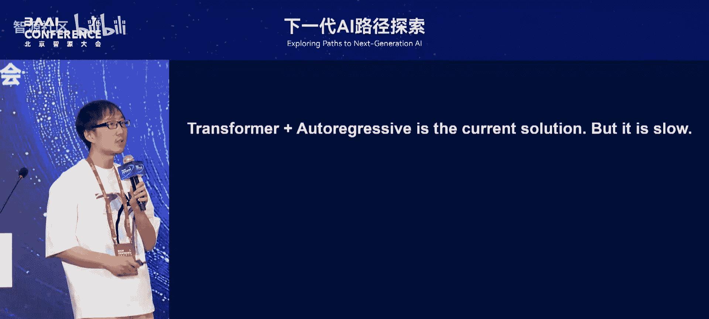
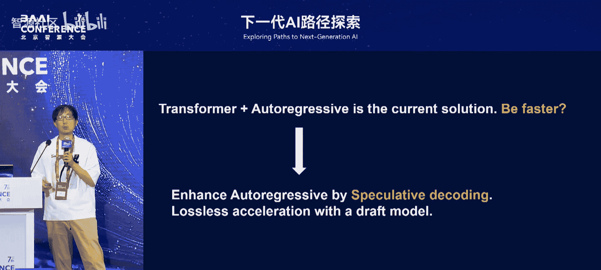
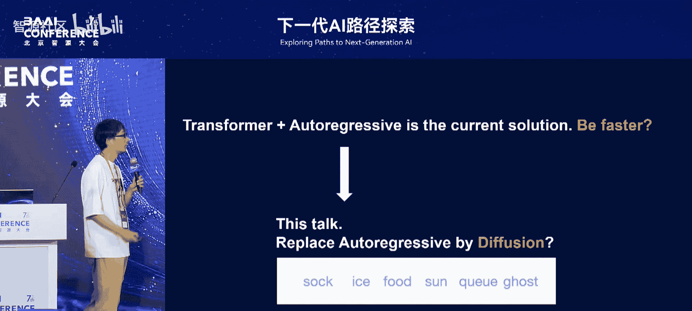
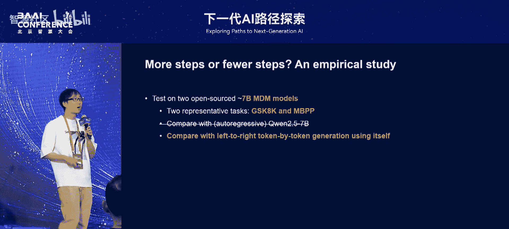
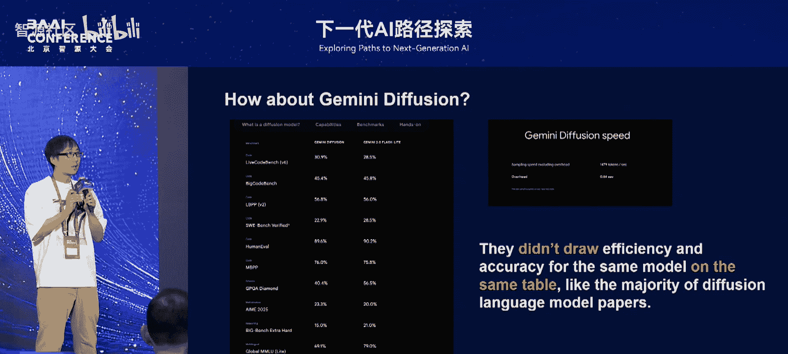
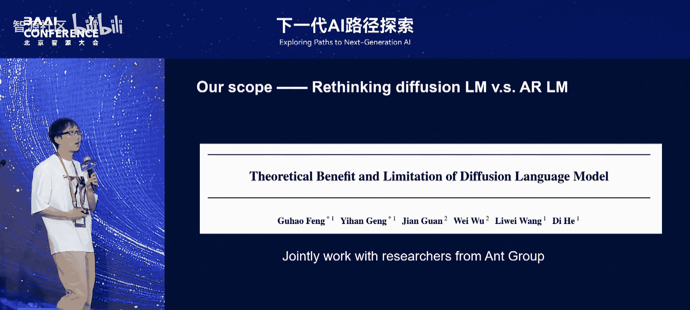
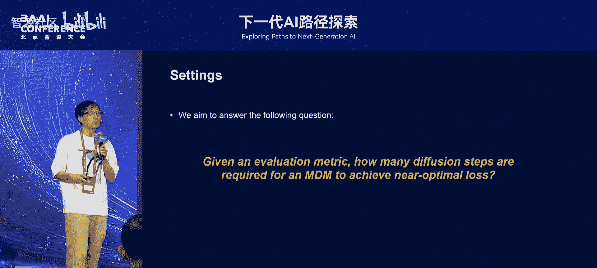
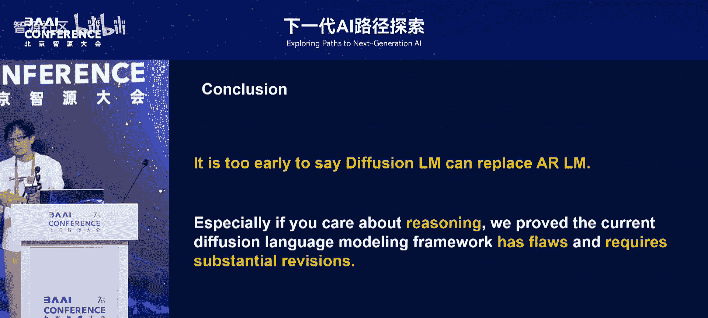

# 2025北京智源大会- 下一代AI路径探索 p07 Diffusion vs  Autoregression  Which is the Key to Next-Generation LLMs：贺 笛 -BV1c5NxzqESk_p7-

好，我们今天上午的这个筛选还有最后一个非常重要的一个报告啊。那也是可能大家非常关心就是这个diffusion autogress到底怎么选。那到底是哪一个是未来的这个啊这个啊更更有前景或者是中局啊。

这个有很多很多讨论。那今天我们也是请到的这个百大的贺迪老师给我们做一个啊做一个分享。那贺迪老师也是在这个记忆学习方面做了大量的优秀的工作。

然后也获得过I clear的啊23年的杰出论文奖和24年的杰出论文奖的提名奖啊，然后特别在理论分析方面做了呃很深刻。那我们啊欢迎贺迪老师给我们做报告。好，谢谢朱老师。然后很高很很感谢大家。

现在还坐在下面。然后我希望能够做到两点。第一点是说呃速度可以稍微快一点。第二点就是希望我讲的东西稍微有点作用。😊，OK我们其实看到现在所有的大模型，大家使用的范式基本上是统一的。

他们使用的模型结构基本上都是这样的trans梭的模型结构，包括一些简单的变种，以及一个字回归的范式，然后让我们的每一个词可以一个一个的生成出来。

但是大家也知道，当大模型刚出来的时候，大家就知道大模型非常非常的慢。这个慢一方面是由transer本身造成的。另外一方面也是由auto regressive这件事情造成。那围绕这个东西呢。

其实大家整个的学术学和工业界做了很多的。这种这种调整或者修改。那对于transformer的模型结构的调整，一般我们会管它叫做efficient architecture。

然后大家去设计各种各样的比transformer self attention更快的模型结构。然后他们在很多的下游任务上面去测，然后发现OK在这些下游任务上面，一些设计的很精巧的结构。

并不会造成任何的performance的 job。然后另外有些人呢实际上是在这个整个的autoregressive上面去做。

比如说在工业界上面广泛大量使用的一套技术叫做speculative decoding，就翻译过来应该是叫做投机解码。然后这套东西实际上是一个无损的这样的一个加速，它的加速比大概是2到3倍之间。

但我们这个talk里面实际上采用的并不是一个呃要讲的并不是一个speculative decoding。

因为我们看speculative decoding只是enhance auto regressive。而我们今天要讨论的是一个最近的一段时间，大家讨论的非常火的一个东西，就是用diffusion。

就是来看用diffusion我到底能不能去像auto regressive一样去解决自然语言生成的问题，以及自然语言生成这个任务里面一系列重要的类似于推理啊等等各种各样的任务。

那dilion是啥呢？dil实际上一开始出现的时候是在CV里面OK它实际上想建模的是一个图片的生成过程。它的建模的方法实际上是有一个前向和一个反向。那对于前箱过程来说，给我一张真实的图片。

OK我觉这样一个真实的图片，不断的加噪声，不断的加噪声，直到这张图片成为了一个白噪声。OK这是一个前箱的过程，它相对来说有一定的确定性。而我反向过程就是我的dorory model要学习的东西。

就是我的dfiory model，希望在反向的过程中能够去让模型学会和前向过程类似的一些表现。那既然前向过程是从标准的图片到nise，那反向过程实际上就是从nice到标准的图片的这样的一个过程。

那为什么diffusion做NLP的人关心呢？因为diffusion在CV里面，他们是每个像素点的像素值都是并行的去生成。比如说对于一张图片来说，类似于imnet，我可以做1个256乘256的图片。

你如果不严格的讲它里面有多少个pixel，它里面有65536个pixel。那对于diffusion model来说，我去生成这样60066065536个pixel上面的值大概需要多少步呢？

实际上大概需要64步，我就可以生成出来6536个值。那甚至我可以把diffffusion做的更好做的更快，甚至是说用几步ok我就可以生成一张相对来说比较逼真的图片。那对比来说，在NLP里面。

大家的现状是什么呢？大家的现状是说我每次我只能生成一个token，我生成完你一个token以后，我生成第二个token。那对如果把NLP放到这个CV里面，相当于是说我的模型要执行6万多次。

我才能够生成6万个图片。OK那这个肯定是没有办法去承担的那NLP的人就去想既然difuion在CV里面，他可以用更少的部署生成更多的内容。那我希望OK在NLP里面能不能把fuion这样的技巧借鉴过来。

我也是希望能够用更少的部署，更小的网络执行次数去生成更长的文本。这个是。人们想把diffusion放到language model里面去代替auto regressive最大的原因。

那我们刚才看到fuion是从CV里面来的CV里面，大家怎么用diffusion呢？大家就是说往上面加高斯的噪声。然后我希望在反向的时候，我希望可以把这个噪声通过一个去噪的神经网络把它还原出来。

但噪声这个东西在里面你可以用高斯的这张的这个这个方法去去去加。但是对于NLP里面，我们看到的都是一个一个离散的token。那它加的东西肯定不能是这种连续的类似噪声一样的东西。

那对于在NLP里面大家使用的办法是什么呢？大家使用的所谓的往这个一句话里面加噪声。大家现在常用的做法，就是不断的把一句话里面的一些内容mask掉O比如说在一开始的时候，我可能是一个完整的句子。

然后我希望经过了这种轮加噪以后，它变成了一个全是m的这样的一个sequence。然后我反向过程也是说给我一个mask的 sequence以后，我怎么样一步一步的把它去噪，然后还原成一个一个真。

指的一个像人一样说出来的话。所以现在所有的deurion language model也都叫做这个mask deion model，或者也叫做discreet deion model。

但大家可以看到的一件事情是说，对于auto regressive来说，我生成多长，我的模型就会执行多少次。因为我的每一个词都是一步一步生成出来。但是在diffusion里面。

我生成的长度和我执行的次数实际上是可以不一样的。甚至是说我的dusion step，它是一个hber parametermeter，我可以dusion step很长，那样我可能会比较慢，我也可能很短。

那我可能会比较快。那这个超参数该怎么调节，实际上就变成了一门艺术。那我们实际上围绕着现在很多的开源的这种dfuion language model。

我们真的去测了一下OKdfuion的s到底对我的模型的performance有什么样的影响，到底是怎么样影响它的速度，包括到底是怎么样影响它的效果。

那我们去采用了两个随机找了两个7B左右的mus di model网上还有一些其他的国际上国内上都有很多的msask di model这样的大模型。然后呢。

我们找了两个相对来说比较重要的task一个叫做GSM8K一个叫做MVPP它都是和一些推理等等自然语言理解相关的那既然我们有两个dfu model以后，我肯定要找一个ba斯 line。

那比如说我找的就是一个在。大圆模型里面大家觉得做的还比较好的baaseline就是这个千万2。5B2千万2。5的7B的模型。然后呢我怎么做的呢？我在这两个task上面 run一下千问。

看一下它的 accuracy，并且看一下它的cost就computal cost。同时呢对于上面这两个大模型，我也采用不同的dusion steps run一下他们的模型。

最后出来一个 accuracy。然后最后也出来一个computal cost。那样我所可以把所有的模型放到一个图里面，这张图的横轴是computational cost的纵轴是accur。然后呢。

我也可以把这个这个千问的模型挪到原点，挪到原点以后呢，实际上我们就可以严格的比一下千问的这样的一个autoregress model和现在事院面上开源的两个okdusion的大语言模型。

它们之间的performance之间的变的的差别。那原点的话是这个天问的这样的一个模型。那如果我的d model，它可以。达到更高的accuracy，同时达到更高的performance。

那么他应该在哪？他应该在第一象限。OK因为第一象限是。相对来说更高的eency，并且相对来说更好的accur。如果你在第二象限的第四象限，那这个就是tra off就是你或者更快，但更快的代价就是更差。

你可以更好，但更好的代价就更慢。第四象限是最不能不想看到的。但结论是说OK我们看到的现在的很多的这种musask language modelmusask debu language model。

它实际上如果你真的用一个非常非常公平的角度和autoregressiveso他的大模型对比的话，实际上它的performance它的accur。

它的cos实际上都是远远的不如现在auto regressive。这个时候大家可能会问说你天然有一个biers在里面，为什么呢？因为你千问我这个那么大的团队，我经过了非常非常久的数据积累。

非常久的数据筛选。我curate了一个非常非常好的训练数据，我是在上面去train，但其他的大模型，每家公司我训练数据都不一样。那你这样比明显不合适吗？我用data bias，那天问好。

是不是因为data更好呢？对吧？那于是我们做了另外一个实验，我们这个实验是啥呢？我们把它的base不用这个天文22。5的7B模型，我就用deput model自己O我不是有两个deput model吗？

我把每一个di model都让他强行让他从左向右一个一个token一个一个token生成。OK那实际上对他是一个非常不公平的。我强强行的第一四个det生成第一个位置，第二个s生成第二个位置。

最后一个sap生成最后一个位置，OK让它模拟auto regressive的生成方式，把它作为一个原点。那我们看我们的di model performance到底怎么样，那大家可能会很乐观。

乐观的觉得说我这样设计了一个真的丑陋的生成的办法。他的performance应该不会很好吧，或者是说maask defion model，我自己跑，我怎么着也应该出现在第一象限了吧。

但结果是什么呢？结果是说OK我的原点是让一个mask debu language model像auto regressive model一样生成。红点和这个蓝点是他们按照他们自己的想法自己生成。

但结论是啥？结论实际上是说这些模型其实都不如让他自己从左向右生成，或者是说它相对于让他自己从左向右生成，它并没有变得更好。那这个时候可能还会有人问说，呃。

最近谷歌出了一个大模型叫做dman diffusion，但大家一定要仔细的去看他们的blog，以及围绕着m degree相关的所有paper。你会发现围绕着m degree相关的所有paper。

他们从不会在同一个table里面，同时展示这个模型的 accuracycur和perform。比如说我看过一个今年3月的paper，他们在一个table里面展示他们的accur非常高。

在另外一个table里面展示他们的。

performance也非呃他们的com cost非常低。OK但是他们在他们的。附录里面非常非常诚实的写了OK我当比较我的computational cost的时候，我的dstep是64次。

当我去比较我的 accuracycuracy的时候，我的staper是多少次，我的sstepper是4096次。OK某一篇不是国内的paper，某一篇不是国内的paper，包括manion也是一样。

OK你画了这么大一个表，两边有非常非常多的空白。你在你的第一列、第二列受 accuracy第三列第四列受一下你的死pe的，有什么不好吗？

你既然做了这么好的一个工作去展示你的工作非常非常s的展示下有什么不好吗？但是他们是在两张表里面去展示的。但然我不知道背后的问题是什么。😊。

所以为了去仔细的去考虑diffusion language model，它和auto regressive language model。

它到底的区别在哪里以及diffusion language model到底是不是一个。真的能够去replace auto regressiongress model方法。

实际上我们最近和蚂蚁的同事一起做了一个工作，专门去研究deput language model。它的理论的上限的好处是什么呢？以及它理论上面有什么东西没有办法达到。

但整个paper里面是有大量的数学。所以我们在这个toplk里面只是非常非常简单的去介绍一下我们研究的sing是什么。我们去研究这个东西的infuition是什么，以及最后的理论的结果。

理论它OK到底哪些方面是d可以做好的，到底哪些方面d问做不好的去展示一下这个。然后呢，如果大家对techical的detail比较感兴趣的话。

我们这个paper也挂在了archive上面也可以去看相关的这种detail。O我们这个pa的 setting是什么呢？我们sing就是我们刚才讲的。

我们去研究现在市面上最流行的m distribution model。也就是说我从一个纯m的 sequence出发，1。1点的虚糟，得到一个得到一个正确的这样的一个 sequenceequence。

然后呢我们关心的什么呢？我们关心的是两个metric。第一个metric叫做token error rate。它衡量的就是说O我如果它能够生成文本的话，那它生成的这段话是不是足够的流畅。

比如说perplexed，就是一个非常经典的token error rate。再比如说我们还去另研究另外一个叫sequence error rate。

采用了一个相对来说还算自然的办法去衡量我generate出来的sequ，它的逻辑是不是正确的。然后比如说这个如果大家关心TER的话，那他其实对这种article generation可能会比较有用。

如果是看SER的话，他可能其实对rening更加有用。那么我们理论上想回答的什么问题呢？我们理论上想回答这样的一个问题。我们刚才讲了很多的evaluation metric。

刚才讲了两个evalation metric。我关心的是说，如果现在有了对于某一个evaluation metric。那如果我要训练一个m de model。我希望这样一个mask de model。

在这个metric上能够达到一个near optimal performance。那这个时候如果要达到一个nearop performance。

它到底理论上严格的需要多少的de steps才能够到达这一点。O。因为我如果知道它的dfuion steps比autoregressive大，那这个就不用说了，那肯定不好。

如果它比比auto regressive要低很多，okK那dfuion language model还是有一定的前途的。

首先我们展示positive part，也就是说在token error rate的角度，我们在token error rate得到这样的一个结论，大概来说得到的结论是什么呢？大概来说得到的结论是说。

如果你关心token error rate，也就是说你关心文本的流畅度。那这个时候对于任意长的生成的文本。你关心的任意长的生成的文本。

我的dion model可以用多少个sstep能够达到这样的一个new optimal的 error呢？它需要的长度和我的它需要的数量和我的文本长度无关。那换句话说。

你可以认为我只需要constant的常数的d step，我就可以达到就可以生成一个相对来说比较流畅的文本。那这个其实是我们想看到的我们想看到d能够用更少的sstep生成更高质量的文本。

因为autoregressive它生成的文本的s数量永远和我的生成的长度是成正比的。那围绕这样一个东西呢，我们实际上也做了实验。

那刚才我说他们在两个表里面展示的那我们这个地方也是用两个表展示的那为什么用两个表展示的呢？是因为你如果看paper的话，基本就一个表就充满了整个的这个宽度，导致不得不用两个表。

而不是proposedly去把不同的结论放在不同的表里面。OK。结论还是一致的，就是OK我如果去用关心的token error rate，实际上我只要用非常非常少的de呃s step。

我就可以达到相当相当高的精度，甚至是跟AR在统计上面基本compitive的精度。第二个结论是negative的。第二个结论，neative说的是啥呢？说的是说。

如果我关心的是sequence上面的 error rate，也就是说我关心整个一句话的结构性，那结构不能有一点错。我们可以证明在word case的意义下。

OK如果你的dusion的step即使达到了和我的生成文本的长度是同阶的，它的arrow也永远大于2分之1。那换句话说，这个意味着啥？

意味着是说你diffusion只有用超过你的文本长度这么多的st去生成，你才有可能让你的错误率看起来不那么的低。OK那换句话说，至少现在的这样的一个more这样的一个seing。

如果你让d language model去做reing，它可能表现很差。包括我们像刚才我们看到的展示的两个，我们自己 empiricalir去做的这个实验，实际上都是和reing相关。

它就是在reing上面，至少现在的打不过autoregress。而我们证明的理论是说，至少目前的sing可能你就是打不过。当后我们也做了一些实验，比如说在一个很小规模的实验上。

auto regress or loss零年级。但如果你看这个这个dusion这样的langu model，它的lo可能是O计时，而且随着长度的变化，它并没有一个非常非常明显的降低。

那背后实际上有很强的intuition。因为我们人做reasoning，我们也是从左向右做的。比如说不会说给你到应用题，让你先给生成第700个token生成完第700个token以后。

你下一步生成第300个token，生成完第300个token以后，你下一步再给我生成第5个token，人不是这样做reasoning。我们所有不管是学。

我们还是写我们还是脑子里去想所有的reasoning都是从左往右的。所以你让一个fuion model并行的。哎呀，那我脑子里并行的吐出很多个token这件事情可能对于我们人来说都不现实。

那你让机器来说，那实际上它有更大的困难。OK我们提前了好久。对对，所以我们这个talk大概想deliver的东西，实际上就是说现在如果我们说我们这个dfu model，现在就可以replace aR。

我觉得是一个非常非常早的时候，因为它的上限其实远远没有我们想象的那么高。特别是如果你ca reasoning的话，那么我们理论上实际上是说你如果使用现在的framemework。那它严格是做不出来的。

你如果想让O未来有一个dfu language model，它能够做resoning。并且它比autoregress快。

那一定要对现在的整个的difffu language model框架做非常非常大的改动。OK这个是我想跟大家讨论的所有的东西，谢谢。

好，谢谢谢谢何迪老师非常critical一后很谱的一个一个分析。然后我想拖例可能就像AR现在也不能完全取代usion来做做vi样。但但这个我觉得讨论是非常非常重要的，就是大家一直在关心这两个路径。

它的之之间的优点和缺点啊，包括我们第一个报告里边也讲了就是关于这个可能ion在序列数据上可能并不是op但或许就是对，这就是其他的架构可能在在那个在在某种意义上在B啊。

但是他可能会在一些其他任务上又展示出来它的这个潜力。好，那我们同样的有两个问题。看大家。😊，呃呃，我我我想问一个问题啊，就是呃。就说目前这个经过这个比较，我们说现在很早是吧？呃，我想我想知道。

就说这个现在这个diffusion model这个不行，主要的原因是什么？是因为我们的呃训练方法的问题，是因为它是mask的这种方法的问题，跟它相关。这还还还还是其他的什么原因，这是第这是第一个且。

我希望有一个呃更深入的一个理解。第二个问题我我想知道是什么？就说假如我们说ffusion model不行？我们是说再回到CV这个领域是不是autoregress这个方法可以改进这个CV这个领域。好。

谢谢。😊，里边是这个样子里，比如大家都说auregressive autoregressive实际上是一个确定性非常强的给我一个数据以后。

我第一个token预测第二个第二个预测第三个第三个预测第四个给我一个我任没有任何随机性但不断加噪不噪你训练过程不知道个噪你噪你不知道噪声去掉。

你不知道噪噪所以本它在整个的训练在整个推理里面有着gress的不确定。训练不确定。明噪音真跑过ion的同你知道gress的训练带来的难训练这件事情第一点二V里面有没有可能代替ion但V里面实际上是说。

AR的话，我可能就需要考虑用token我如果用token的话，我就会损失信息。这个损失损失的信息到底是不是我能接受的这件事情其实也是不知道的对，第二点就是说我们说O里面不行。

我们也只是说如果你的任务是非常非常严格的这种ing不行。但如果你要生成非常流畅的话，我们理论实际上是证明它完全可以。那对于CV来说，我可能会更重视我的图片的流畅度啊等等这些东西。

那这个我觉得是导致在CV里面看起来仍然很work，而且比其他的方法都work的一个原因，就是它能够很好的利用我数据里面，它更和我数据本身的一些特性，包括我的任务的性更加ign对。

son过程当中通过啊O啊就是这个ion model，它有没有可能在并行化的这种生成的过程当中，然后产生跟我们人不一样的这种思我觉得是这个样子，就是说我们理论给的 case做很。

然后我说的是说大家怎么样能够直观的理解它很慢。那我说的是你讲人都是顺序的生成生成生思考。那我让一个东西这个并行的思考，人都很困难，那会不会模型很困难。我当然是以这样一个逻辑而不是说因为人很慢。

所以一定很慢我们是先有的结果，然后一种更更友好的方法是让大家去理解这件事情。O第二点就是这个真的是是它极限嘛？我觉得那需要去有一些性的突破。对而且可能需要非常非常大的突破。

才能够让真的gu里面gress。😊，O。冇。到都帮我解。Yeah。这个的速度你有去呃呃做实验吗？第二个呢就是如果未来你觉得if you更b一点。

还是说那个LL更b一点第一就是第个如果是他们怎么去结合在一起第一个问题我实际上没听懂，就是你说con model那些对吧？就是扩散模型其实他已经一步已经是很快的而且这一步的生成的话呢。

它的那个roice所谓的其实是更多是一个表示，它已经没有ice了呃，它的输入有no那个输入 noise你你你顶不掉的对因他他那个ice其实是 of。啊，这个我不确定你可以再想一下。

那我先回答你第二个问题嘛。呃，第二个问题哦，AR和那个diurion到底未来谁胜谁，我觉得depends on application。

depends on application我举个我举个更更更不一样的东西。比如说在AF science里面，大家关心我这个原子的这个分子在空间中怎么移动，那这个要遵循物理定律。

你物理定律可能就是ion。那这个时候我为什么不用ion，反而而求心是用AR呢？我觉得就是什么自然用什么，对你像我们画图，我们也不会像AR一样那样画图，我们说话我们也不会像ion那样说话，对吧？

所以我觉得就是嗯怎么自然怎么来嘛，就是随性而为。😊，ok。好，感谢感谢何迪老师给我们带来一个非常精彩的一个思变。那呃确实我们说这个不同的架构，不同的路径，不同的模态。

那那今天我们其实这个论坛的一个核心的点也是呃希望用这些几位嘉宾的这个引导的报告来去给大家一些启发，能够对这个呃下一代的或者未来更好的这个人工智能做一些探索。啊。那今天用我们呃报告很精彩。

大家交流也非常的热烈。然后我再次感谢大家的这个坚持到这个这么晚的一个时间啊，再次感谢谢谢大家。😊。