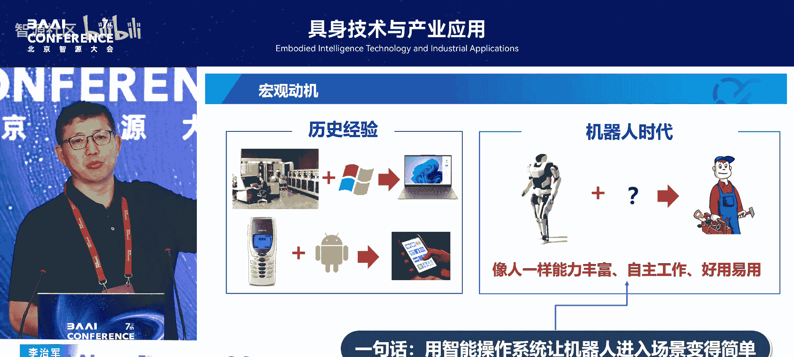
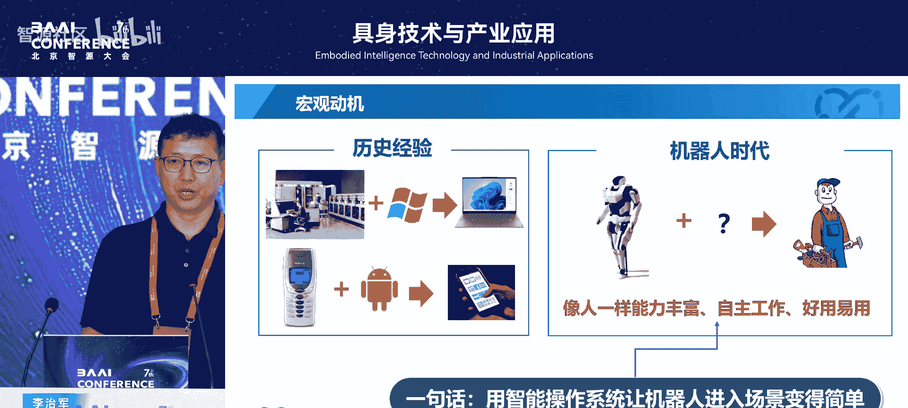
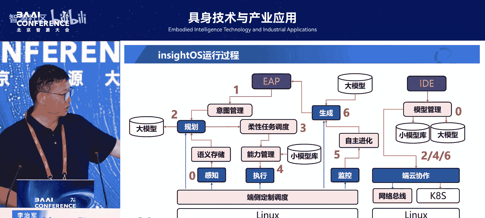
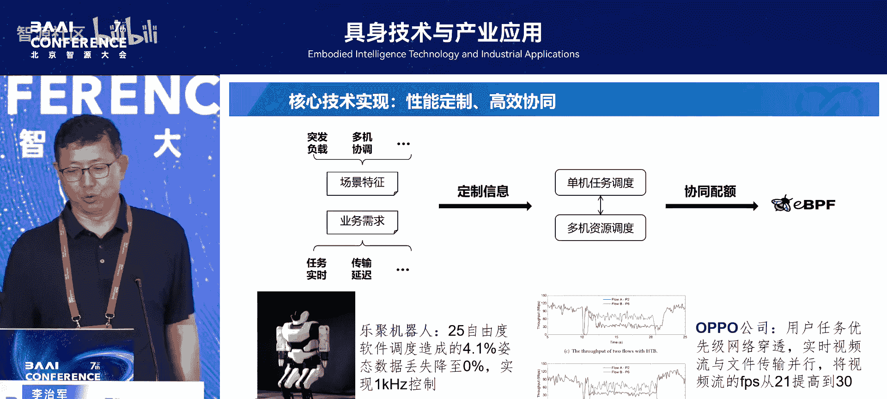

# 2025北京智源大会- 具身技术与产业应用 p02 机器人智能操作系统研制与应用：李治军 -BV1ViNtzcEiZ_p2-

我们有请哈尔滨工业大学教授、上海巨石智能科技有限公司董事长李志军为我们带来题为机器人智能操作系统研制与应用的主题报告，分享exitOS系统，在提升机器人智能化与工业效率方面的探索与实践，掌声欢迎。🤧嗯。

这个非常荣幸能在这里和大家一起交流。那个呃我简单给大家做个小的汇报。那个前面两位大咖级学者是吧，一个是孙老师是吧，是我的老师，那个做的多年在机建领域，一直是领军事人务，我一直向孙老师学习。

那个刚才李总是吧，华为的这个华为是我们景仰的大公司啊这个。也非常值得我们学习是，我就是这个小老师。所以这个我有两个角色。第一个我是哈工大的一个老师啊，所以向孙老师学习。第二个，我自己不才是吧？

这个还照亮开了一个小公司啊，叫上海巨石制呢向华为学习啊，所以那我简单说一下，我们做了一点小工作。然后希望能够得到大家的这个至少能得到一点这个支持和理解。好。

那个我们做的内容叫机器人智机机器人智能操作系统。那么首先简单说一下什么是呃机器人智能操作系统。然后大家大概长什么样，里面的关于技术大概是什么？第四个他的应用上就有哪些使用的用途是？

第一个我简单说一下这个机器人智能操作系统，就是为什么要有个操系统。这个实际上我从这个也干了好多年的呃教学啊，这个哎包括科学工作，我从本科生开始就做操系统，已经干了30年。所以实际上从某种程度来说。

这个我还是蛮自豪的，真正干过30年操作系统的人，在国内还是挺少挺少。我本科毕业设计做的就是linux。然后那个从历史发展来看的话，当时我们用的PC机呃，就是我们用的电脑就是左侧这样。

但后来通过windows这一个实叫微软是个挺伟大的公司啊很简单的一套设计。当然这个系统实际上蛮复杂的。通过就让这个大家都用起来非常容易进入了PC机时代。那个手机是一夜之间把诺基亚是打的非常惨。

那智能手机实际上得益于像安卓啊IOS这样的智能操这样的操作系统能让手机的功能变得非常丰富。现在手机厂都能干，以前只能打电话，所以必然会被消亡。那么谁都知道人形机器人将来会成为另一个非常重要的端。

那么既然做一个端设备它就必须要解决两个事情。当然我们既望这个端最终进入C端了这个谁都知道未来的人性机器人一定要进入千家万户的，但进入C端了时，它一定要解决两个问题。第一个是门槛一定要低。

就是像PC机手机一样，谁都会通过吧？然后另外一个它功能。

要多，他不能只完成一个什么跳个舞啊拧个螺丝啊，他要做各种各样的事情。哎，所以要做到功能丰富，要做到好用易用是吧？同时它要自主性。所以要达到这三个要求，操系统是通过历史的发展，这个操系统是必不可少。

但真的是操系统嘛，这个实际上虽然说不好，至少这个形态大家还不太清楚了，也许就是一个大脑是吧，就就是个大模型是吧。但但我的我的观点是就是还是要有一个超系统。

历史是这么发展我不觉得这个IT不会会走一个新的路是吧？所以那就是要有个超系统来解决三样问题。

那么其他的我就不不不说了，时间的关系。那么就宏观就不讲了。那么要要想让操作系统能真正就是把它用起来，就是操系统和实际上就说到操作系统和机器人要累积累积要干好几件事什么事呢？我简单解释了一下。

就总结了一下。第一个就是开发快现在机器人人机器人上面用途少，很简然，没人吧就是开发出来的东西是吧？就是你的应用太少了，像手机一样，有500万个应用吧APP什么都能干，所以你想可想而知。

也就是说如果我们有个操系统或者有个环境，能让大家开发出什么东西呢，非常快，那么这个绝对会让它提高的很好，所以第一个要开发快，我第二就不展开了。第二是应用好，这个东西能真的用起来体验好。第三个要迭代快。

这个世界没有一下100分的产品永远会有100分的产品，20分的产品怎么迭代30分要不断用，所以操系统就要不断用。实际上我们知道一开始windows在我们那个年代老。死机。

但现在window手机几乎不带死机的，这中间迭代了好多好多的，所以不是这个要要敢于是吧，就是要敢于使用它，但是要一个迭代路径。这是所以操行统要完成这三样功能。那么其他我就不再展开了时间的关系。

这个我就直接说干货哎，这个是个什么东西。那个我们团队啊自己做了一个，这也是我们这个团队一直围绕做操系统总体有个东西啊。然后我们开公司也总体有个产品啊。

这个产品我们把它右侧的不是左侧的又左侧著名的安卓是吧？右侧的就是我们的操系统叫OS那个左侧的这个安卓，如果大家应该对操系统有点熟悉是吧？左侧的安卓就长成这个样子，实际上看起来你蛮简单。

但是里面有这几千万行代码，就是他四个组件activity体操，我就不再展开了，用这四个组件很多人甚至小学生都可以开发出一个能上架的APP。我再重复一遍，就是用这四个组件。

有个普通的一个学生是吧甚至一个小学生啊，曾经华为这个曾经中国有些人组织过一些比赛，一些小学生真能开发出挺不错的APP所以他把这个APP这个事情拉的门槛特别低。

所以我觉得一个伟大的技术一定是一个平民化技术，大家谁都能玩是吧？这个才是最重要的。所以正是有这么好玩，这么简单，哎，所以就会卷一堆生态开发者，最后那500万个APP这不难想象啊，肯定谁都可以玩。

自然就会有各种各样的人冲进来去玩这个事情。一旦开玩了，哎，东西多了，就形成马太效应，这个这个产业就开始运转。我们的思想和这个思想是非常一致的。

我们提出了8个组件是吧这个因为不太有名吧我就不一一展开了这些左边的四个组件太有名。但我们会逐渐把这8个组件做的越来越有名。其中包括一些柔性任务，后面会简单说一下，我们支持的一种应用开发叫做。

我们把它起名叫ebody agentent package。也就是我们可以通支持我用这个嗯这个操作系统，我们也会提供ID用这个ID可以打包出一个我们自就很容易实现的。

我待会会给你看一下长什么样这个ag的一个APP就叫lic它是一个包一个软件包这个软件包就可以上架到安卓系统上可以打开在你在你手机上展开。

那相应的我们这个body agent个 packet也可以在任何机器人上记住是任何机器上展开，并且展开出同样的效果，这是我们这个团队要做的核心工作。它长什么样子呢？大概就是我左侧所描述这个样。

这就是个AP他描述了一个核心的意图。就是我到底要干什么。因为任何一个agent就是你想一个人形机器人一旦放在一个场景中，他一定会一个角色。比如像今天我来我来这个这个北京，我有个角色。

就是要就是给大家讲这个报告。我不管是坐车来还是怎么来，我这个目标一定不会丧失是吧？即使我迟到了，我也会什么通过什么各种手段在比如串串场啊一定会把这事情完成。所以这就是一个东西它的核心。

所以作为一个A整的一定会有目标。有了这个目标以后，他他要通过组织来完成这个目标，这个目标绝对不是靠预先写好的预先学的程序永远不会成为A整的程序，或者永远不会成为智能程序，因为人不是靠预定的计划来完成。

他要随时调整的。所以要必须要有一个随时调整的一个工作流是吧？当然这工作流有个雏形。那我知道要来这讲座，我一定会做或这些来到北京，然后怎么怎么样。但是如果比如买不着票或者买不着票，我一定会买飞机票等等。

所以也就是他围绕这个目标，他会动态组织工作流，然后来完成这个工作，凭什么能够组织这工作流的，核心是哎这里面有一套语义的东西。定义的东西，人都是靠语义来活着的。那个我们来到北京，这个来这个字怎么实现的？

我不管是买票也好，还是坐火车也好，人都知道来的含义要怎么把它变成行为，这套东西都是可以的。所以我们给出了这一套这样的一套这个定义以后非常柔性的一套语义化的定义以后，通过我们就可以解析执行部署。

当然在解析的过程中，肯定要调用大模型和小模型的能力。但我们始终认为它只是调用能力而已。光靠大模型是解决不了这么长城的复杂任务的这个你不能始终围绕意图是吧我我我大概就说到这里是吧，这核心技术。

这个核心的构想，大概说到这里这是他一个工作的路径，我不再展开时间的关系。

那么用了这个东西，我们能解决刚才所说的三个问题吗。哎，这个这个我们初步claim是可以做的，但要经过实验的打磨，这个也非常感谢于飞总，待会这个飞总会给大家讲。

他们在国上中心国际中心做的工作训练场在训练场中给了我们机会进行打磨。但我们要不断的在行业中打磨，要感谢大家将来能给我们机会用用我们的系统也批评批评我们那第一个做到开发快原来如果这两个机器人一个是乐居一个新海图完成这个放橘子这个流程。

需要写一对肉代码，而包括他们之间的这个协作，甚至你要操作DDS总线的。那么现在我们只需要描述一段任务，实际上都是语以描述这个和给人编程是一样，你把一个保姆请到你们家，你绝对不会告诉他，请你找9。

05走到什么桌子台前面一米什么这个什么什么处一定不会这样。你只会告诉他早上我8点要吃饭，9点钟我要上班，10点钟孩子要接回来等等。或者都是非常宏观的语义动作。所以你用这个非常宏观的这个描述。

通过我们操作系统展开来这个宏观的描述，任何人都可以讲。所以把一个门槛拉低。原来需要知道既知道slam，又知道地图，还要知道什么模型的人，又要知道可能机器人自由度的人是道腐的人但现什么都不用知道。

你只要描述一个你宏观的一个一个意图和你达到这个东西大概的语义逻语路径是吧？我们就可以解析执行啊，完成他的要求啊，可以迅速拉低他的开发路开发时间。那么这第一个第二个用的好这个大家都讲这个大小系统。

我觉得是挺靠谱的。实际上最开始我们设计操作系统的时候就采用这样思路，我始终认为人不是靠人不是靠一个大脑生活的肌入系统更重要人是很多工作，我们是很多任务完全是靠肌入记忆。你举个例子，你在做饭的时候。

你会不断向我下一个部分是把碗拿起来还是把盘子拿起来，都是肌入记忆会直接拿上来。所以人在人的工作中会有一套自主的这个什么自动化流程，我们把它叫自动化流程，在这个自动化流程不可以一直工作。

因为会遇到各种各样的开放条件和和问题啊，比如说这个碗突然你没拿住掉地的。这个时候它就懵了，这个时候就要启动认知系统。所以我们这个系统是自动化流程，就是普通的程序流程。因为操系统是解析执行程序的。

当发现问题的时候，我们有异常检测。通过异常检测的时候会出现问题的时候，我们调用大模型，等于大模型。这个大模型实际上都不需要用。高级的VIA我们就直接用普通的语言大模型完事了。因为这里不涉一到执行。

只涉一到常识的理解。当晚掉了以后会怎么样？你们大模型他绝大多数都会告诉你哎，晚掉了，你应该把它截起来，或者扫一扫，这个直接通过反思行成工作以后再回到任务流中再继续执行。

当然这个任务流就和传统的rose上面的任务流就完全不一样。所以我们叫柔性任务流这背后的技术要怎么做这个我今天没有时间展开了。这里面实际上包括这个d flow就是计算的过程中如何动态组织计算。

实际上函数原来A调B调，所以中间查了个D是怎么动态产进去，而且要保证效率，实际这是挺难的。那么这你这样的话才能保证你才能把这运用好第三个迭代快你要有迭代这个迭代绝不是说离线的做一堆训练。

你们任何一个人在这个工作在生活的过程中不可能我们回去重新在学习我们人都是什么不断去现场调整。哎，所以这就是我们。能够做到功能，因为操作系统可以解决呃可以什么？就是它可以收集任何线上数据。

这个是只有操作系统能做到，而且大模型它也做不到。它大模型太黑盒子太多了，就是太就是黑盒子太黑了是吧？就是啥也看不到，但操系统不一样，大家打开操作系统。

你把windows一起就者把linux随便你打开日志系统，你看一看背后的日志一面一面的所以操系统里面会有大量日志记录你所有的细节，这些细节可以分析到底在哪里出错。当出错的时候。

它分析完了以后就会产生新的数据，实际上就是你当时的数据记录下来，这个数据是非常重要通过它可以再做在线的更新这样的话整个这个东西迭代又快又准，这就是我们第三个核心。那么这样的话就可以完成这样的工作。

关于技术我刚才讲了很多了，我就不再展开了时间只剩下6分钟吧我再我再简单的说一说这个应用的示范是吧这个。

对，今天只是给大家宏观的介绍一下，实际上背背后的细节，我们可以看看我们的团队发了很多论。那么第一个就是我们在这个刚才于我刚才说的这个于飞总在待会可能会给大家讲训练场。那么在训练场的过程中。

通过我们这一套系统中，当你我们提供SDK通过这个操系统提供SDK你可以达到模型的使用，你可以构建场景的流程，你可以完成异构的协作。哎，那么。通过操作系统提供了以后，你可以编程序。

然后让多个机器人进行协作。然后我们也推出这个通过ID可以让普通人是吧这个普通的这个开发者是吧？比如说职业大职业大学的学生是吧？

将来未来的世界肯定是前排是一堆机器人工作后排是教机器的人这些人肯定是绝对不是大学生是吧？绝对绝对不是特别高的知识分子。

就是原来的那些工人可能退居二线原来的工人绝大多数可能都是不可能这个世界全是985院校。那么这些学生他会他也可以很简单的，所以不能理解人性机器人背后的很多什么算法啊模型啊。

但是他知道最起码场景是什么意思这里面这个这个这个什么就是这个行为是什么意思吧？原化服务是什么意思模型是什么意思数据什么意思？那么知道这些道理以后通过我们ID是可以编排出他所要的机器人具生智能场景是吧。

可以并且能支持他下工厂，他可以。做未来可以在这里就业是吧？那么也可以做运行监控，我们可以做评测是吧？因为你做大量的日志分析和监控以后，你可以做场景是评测，根据评测，你会得到一些结果是吧？好。

然后我们也做了一些工业方面的落地是吧？这是我们已经识配的一些机器人是吧？在适配的过程中，非常感谢啊这个啊大家能给我们更多的这个适配的机会是吧？好，我就讲这么多，感谢大家。

