# 2025北京智源大会- 具身技术与产业应用 p03 具身智能前沿进展与展望：王业全 -BV1ViNtzcEiZ_p3-

下面我们有请北京智源人工智能研究院研究员王业全为我们带来题为巨生智能前沿进展与展望的主题报告，分享巨生智能系统的发展现状及未来引进方向。我们欢迎王一璇老师。🎼嗯，大家好。

今天非常荣要有机会能跟大家分享一下我们对巨深智能这一个领域。接下来这些分享。然后开玩笑说，我又返场了。对，然后在刚才在台下的时候，我思考了一个问题，我的这一个报告的名字做什么样的修改。

能够让大家觉得哦这件事情可能更有意思。我觉得如果我在修改一下这个题目的话，他可能变成了再次思考巨深智能这个题目。我今天的这个报告的主要目的是想跟大家分享一下，我们对巨深智能这件事情。

目前的一个更加深的一个思考，希望能启发大家，然后今天的报告分成了4个角度，第一个是大模型与真深智能。为什么要讲大模型与巨深智能呢？因为我们都知道目前巨深智能这一波发展的浪潮。

本质上来说是大模型驱动的大模型的技术是非常重要的。所以说我们要讲大模型和巨深智能的相关关系。然后第二个呢为了重新认识好巨深智能这件事情，我们必须要。😊。

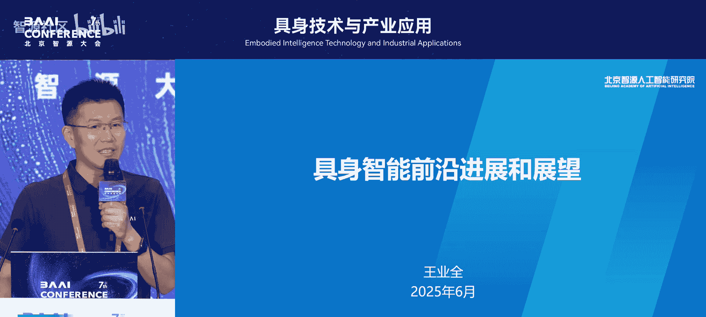

对目前的主流技术路线再一次进行梳理，看看大概是什么样子的，能不能更好的启发大家。然后接下来我们会引出来。我们认为有可能接下来很重要的一件事情，就是说全模太大脑路线，然后最后会对产业的趋势进行一定的研判。

来供大家参考。然后先讲第一趴大模型与巨深智能。然后呢我的PPT显示出来了呃无论是大模型和巨身智能等等。它过去的一个发展路线。然后对于AR人工智能这件事情来说，相信大家理解比较多啊。

比如说1956年达到毛式会议，然后AR诞生，然后接下来有1958年到1980年单层神经网络，然后有多层神经网络有深度神经网络，包括直到现在有大模型等等人工智能三起三落。

然后整个的历史凝结成了这一个简单的一个曲线图。然后与此同时，巨身呃智能相关的领域以机器人为主要代表的，它也发生了很多变化。比如说1961。😊。

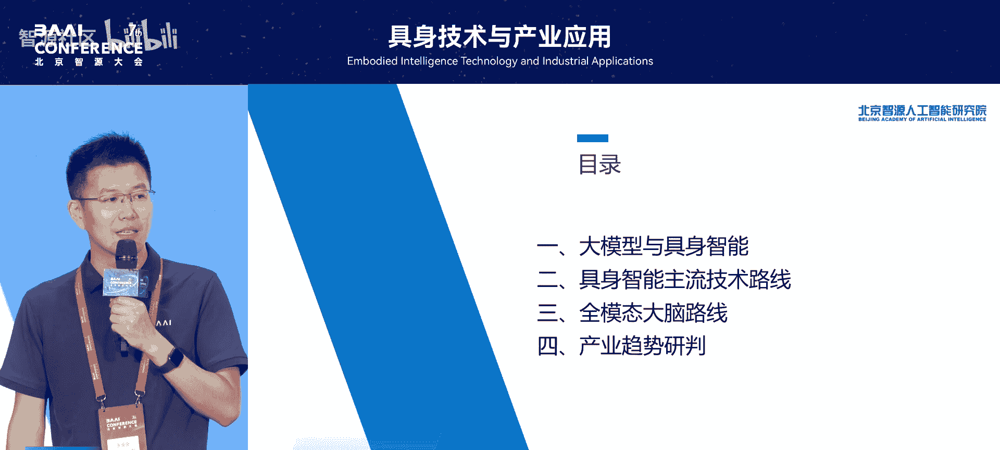

年的时候，世界上首台工业机器人诞生。然后73年的时候，首台人形机器人就诞生了。然后在2000年的时候，呃，日本的阿什莫就已经实现了双足行走这件事情。然后包括10年到20年之间波生动力。

然后在人形机器人做出来的一些非常多的事情，然后让我们所有人看到了人形机器人的一个巨大的潜力。然后总体上来说，呃在2022年以前，然后整个的机器人它是属于基于规则的。然后大模型到来了以后。

然后我们认为接下来整个的机器人领域会演进到基于大模型的这么一种方式。然后我们把它定义成机器人2。0。😊，然后在开始讲我们目前以人形机械为主的大模型之前，我想跟大家一起分享一下。

目前啊一个具身智能非常重要的领域就是自动驾驶。然后在大模型出现之前和出现之后，它发生了什么样的一个巨大的变化。这是我想跟大家探讨的一个非常主要的地方。首先在大模型诞生之前。

然后我们都知道整个的自动驾驶领域是分了大量的模块进行相耦合的。然后就是大家所熟知的或者说workflow之类的方法。然后对于这个自动驾驶领域来说，很重要的一些模块感知认知决策移到最后的行动action。

然后对于感知来说，可能有各种摄像头，对吧？大家都知道的，目前买了很多汽车的情况下，然后前后者各种摄像头雷达等等各种。然后包括目前摄像头是否够是否需要雷达这些事情。

大家都是属于存在的一些技术路线方面的思考和分析的。然后有了感知模块以后，我们会有认知。比如说有。😊，摄像头的输入以后，我们会知道哪些东西是一个人，哪些东西是一个障碍物，包括红绿灯等等。

我们就可以对这个交通现状有了一个非常明确的评估。有了这个评估以后，然后接下来我们就可以有相应的决策模块，对吧？大家都非常了解，对于决策模块来说，我们首先要考虑安全，不能撞到人，不能撞到一些危险的物体。

然后呢包括我们会有交规的约束，不能闯红灯，不能走应急车道等等相关，这都是属于相关的一些决策模块需要考虑的事情。同时的话在安全还有一个非常重要的角度，就是鬼探头等等相关的一些 case非常复杂的现象。

我们也需要把它考虑进去。所以说决策模块相对来说是复杂度高很多的。然后对于自动驾驶这种领域来说，它的行动其实是非常简单的，它无非是有两个量。第一个是方向，第二个是速度，这两个量就足够了。

然后而且呢我们在自动驾驶这个领域来说，一般情况下。😊，不需要建模一种什么样的情况呢？至于车会掉下去，还是说车会上天，这种强一般不需要建模。一般情况下当然不排除一些非常极端的情况。

然后在去深在大模型出现以后，我们的整个自动驾驶领域啊，发生了一个非常显然的变化。我不知道大家是否对这个领域有所了解。比如说在大模型相关技术出现之前，自动驾驶相关的领域已经发展了十多年啊。

然后大家把自动驾驶发展到一个L2加加加的水平，比如说大家看广告，看这个车企的广告对吧？后面可能加了七八个加，然后有人还想再往后加，然后这么一种方式，啊，但是始终没有人说L3等等，甚至来说更高的级别。

然后呢在两年前然后特斯拉AI搞定了他们的FSD1112以后，用了相关的大模型驱动的方法搞了端到端的方法以后，大家是不是发现最近一两年包括接下来未来的一两年。

然后很多车企都在说他们要推出来L3L4甚至更高级别的自动驾驶。😊。

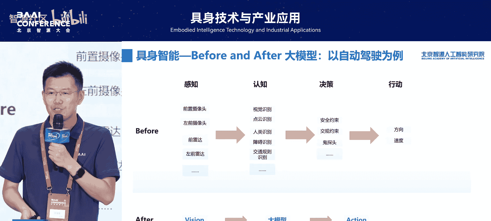

然这本质上来说就是采用了新方法带来的一些新的突破。😊，呃，刚才给大家讲的就是属于我们以自动驾驶为例，这个最贴近巨深智能这一个领域给大家做出来的一些思考。然后呢。

我们简单总结一下传统的模式和我们目前大模型模式，然后在这个技术方面的一些非常主要的区别。首先在架构的复杂度上面来说，虽然说大模型很复杂。但是它只有一个模型，相对于以前来的这种非常多的一个多系统耦合来说。

在这方面来说它是相对简单的。第二个呢开发效率而言，我们都知道目前大模型很重要的一件事情，它是在呃某种程度上来说解决了泛化性的一个问题。所以说它的泛化性是比较好的，可以快速迁移的。然后对于传统的领域而言。

我们都知道需要非常长期的一个场景适配，需要大量的工程师人类物理搭在里面的。然后第三个角度是属于知识运用。我们知道以前的情况下，包括刚才提到的自动驾驶相关的领域，可能需要大量的规则，专家知识在里面的。

那么这种就需要人工编码的一些知识库。😊，都在里面的。然后对于大模型来说，我们都知道所有的东西都不需要了。最后一个协同能力，则是从呃传统模式的话。

可能更多的是一种 pipeline或者说workflow相关的模式。但是对于我们大模型来说，它的自动化程度来说相对来说是比较高的。然后简单概括就是两个方面。第一个对于大模型方式来说，它是一个统一的架构。

然后单一大模型就能干了所有的事情，简而言之就是这句话，第二个角度呢，智能维度它发生了一个跃迁。在大模型出现之前，我们都知道以前的这种呃无论是属于各个场景，各个模块，对吧？大家都知道是分成所有的模块。

分成了大量的模块，一个复杂的系统性的工程。然后呢，每个模块的解决就需要大量的科学家啊，工程师是在里面去解决这个问题的。但是大模型出现以后，我们发现我们很惊讶的发现它确实好像具有一定的智能能力。😊。

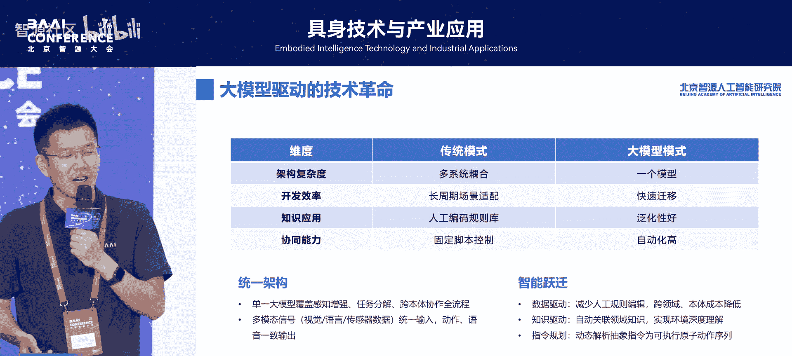

好，然后刚才说了大模型和巨深智能相关的东西以后，然后接下来我觉得需要给大家简单概述一下巨深智能的主流的技术路线。由于刚才的各位专家领导已经介绍过很多了。所以说这个地方的话，我主要是给出了一些概述。

巨深智能它分成三个主要的方面。第一个则是属于智能化。第二个是属于运动控制。第三个是本体，所以说我们先开始从它的智能化路线讲起，然后第一个相信大家非常熟悉也一定不会陌生的一较多，就是端到端路线，对吧？

刚才已经提到了制作驾驶领域采用相关的端到端领域获得了很大的成功。然后目前最主流的一种路线叫什么呢模型 action等等相关的模型，本质上来说，他在做一件什么事情呢？它是直接通过模型的输入。

通过程方为代表的一个大模型，直接输出机器人的一个机械动作，这属于目前最主流的一种方式。然后左下角我列出来了目前各大机构对这个方面的进展。然后。😊。

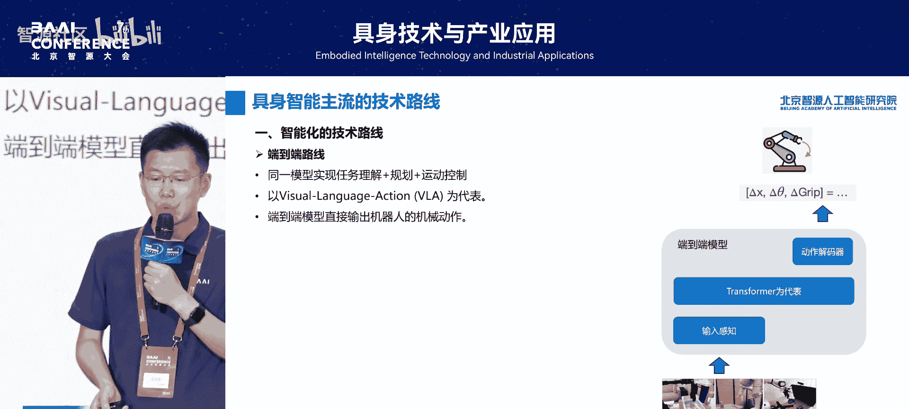

呃比如说谷歌做了后生产服做了opOA直些跳动等等，做了大量的工作。但是本质上来说，他们是在目前的VA相关技术上做的一些变种，做的一些优化。然后第二条路线呢则是属于大脑加小脑相关的路线。

刚才华为的这个李李女士已经介绍了很多然后等相关的工作。本质上来说就模仿人类的这种方式，大脑做一些高层，然后小脑做一些运动控制相关的一些工作。然后目前的话这方面也有不少的工作诞生。然后就不再赘述了。

然后呢接下来介绍一下强化学习目前最主流的一些技术路线，这方面是属于目前一个非常火热的方向，大家做了大量的工作在里面首先提及到运动控制。我们不能绕开的一个技术路线。也就是说大家非常熟悉的一个技术路线。

就是强化学习。然后呢强化学习在大模型领域发挥了巨大的作用。在我们的巨深智能领域也发挥了一个非常重要的一个作用。他的好处是。😊。

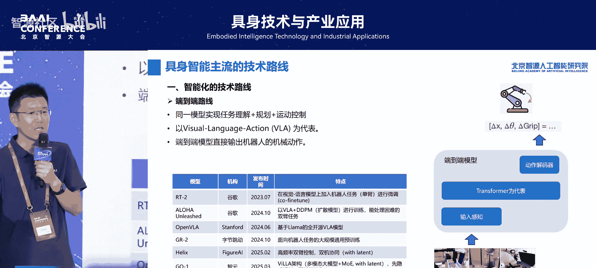

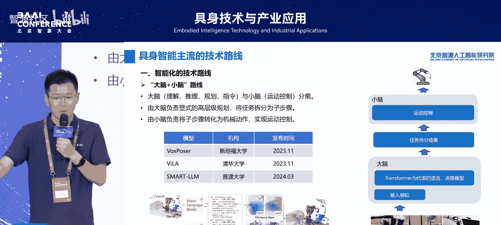

能够有效探索不同的未知策略，应付一种动态的环境是没有问题的。但是呢它的缺点是训练的稳定性，不易保证数据的获取成本比较高。我给大家举一个例子啊，如果大家用过市面上很多很多的大模型。

你会发现有些机器人他的脚步声音很轻。有些人他的机器人他的脚步声音很重。为什么很重的情况下会带来一个应用上的问题啊，呃，还是说比如说在一栋楼里面手共1层楼，我在第七层放了一个机器人，他的脚步声很重。

然后可能从第二层到第六层会不堪其扰，会来投诉我们的，这属于我们看到的一种现象。然后为什么会有这种现象呢？本质上来说是他在训练这个模型相关的应用控制策略的时候。

他只他关注的更多的是属于这个机器人能不能稳定的行走，能不能做他想要达成的目标，脚步的这个重还是轻，他不ca，这就是属于这个强化学习相关的路线。然后他可能存在优点和缺点啊，他更看重reward。

你给他什么reward他就。😊，更可能带来什么样的效果。甚至来说，如果我们让这个机器人行走，人行机行行走，如果我们没给他设置如果的不像人，他就走路非常不像人，是很有可能达到这种现象，但是他能走。😊。

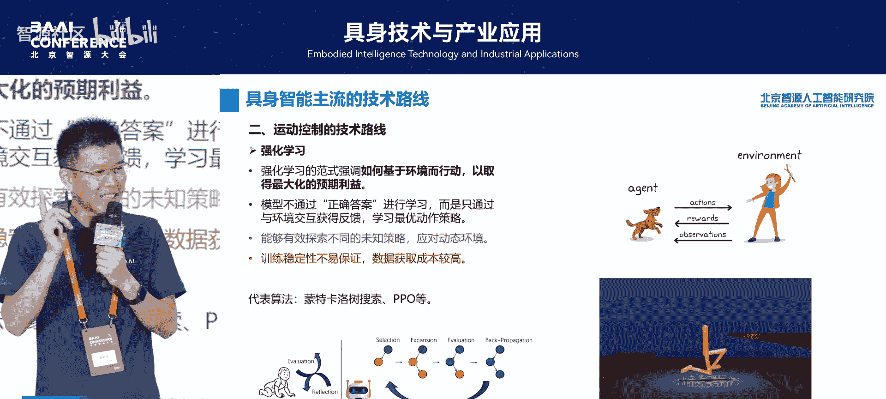

第二条路线呢则是属于模仿学习，模仿学习也是一种非常非常呃目前主流的一种方案啊。比如说大家想到了人类是具备智能的对吧？军身智能人形机器人就是模仿人的。那么在这种情况下。

很多人说我直接让我的机器人像人不就好了吗？这个问题是不是就解决掉了呢？很好，这个思路没有什么问题啊？😊，但是实践起来，我们会发现他有些问题，为什么呢？比如说我现在站在讲坛上，然后跟大家分享我的观点。

然后呢，我可以把我的重身放在我的右脚上，我也可把我的重身放在左左边，对不对？我能保持平衡不摔倒，然后还能手举麦克风跟大家分享，但是机器人的情况下，他能学到我的这个形式，但是神不是，为啥呢？

他很有可能就直接啪就摔倒了，会产生很多这种问题的。然后讲到这个地方，聪明的大家一定会想到一个方法啊，既然模仿学习有这个优点，像人对吧？然后强化学习有刚才说的优点，那么我们为什么不把他们给结合起来呢。

非常好，大家已经具备了一个科学家的潜责啊，然后目前的这个科研界就是这么干的，然后大家把强化学习的优点和模仿学习的优点相结合起来，这也是属于目前一种非常常见的一种方法，也选到了很好的一种效果。

然后再往后的情况下，然后刚才讲到很多路线啊，然后是一种偏真机偏运动控制的角度。还有一个很重要的角度是什么呢？很多人都想到了，包括。😊。

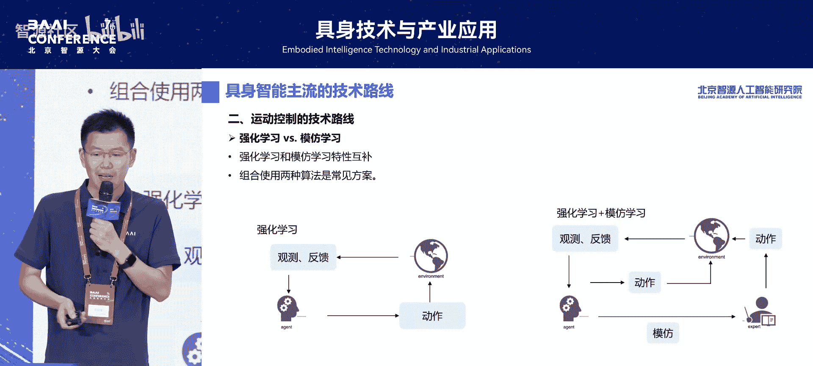

刚才的几位老师啊，教授都分享了很多观点，由于真机会面临着各种成本高的问题，那么我能不能在仿真环境里面去把相应的数据等等成本给降下来，然后在仿真环境里面得到的模型算法等等，直接部署到真机里面去。

是不是就能达成我的目标呢很好的一个想法，没有什么太多的问题啊。然后但是现实是属于非常骨感的，在仿真环境里面得到的效果是非常丝滑的，你让他怎么动，它就怎么动非常好。但是呢一到现实中用一个词来行了就不该了。

马上就不行了，现实中怎么来什么是不行，本质上来说相信这个地方大家都有一个比较好的认知吧。为存在一个较大的g所以说存在这种相关问题。然后目前有很多典型的解决方案我就不再赘述了。

总之很多人是相信采用这种方法能够解决很多问题的。所那么这种他们的本质上的一个解决的问题的关键点就成了把相关的g给降低，是不是这个问题解决。😊，原了呢很好的一条思路啊。

至今没有定论是否这条方案是好还是不好，我也不知道呃，让大家思考好，然后接下来介绍一下这个本体的技术路线啊，本质上来说，目前本体的话我们都知道的一件事情以电动驱动成为了一个主流啊。

然后这件事情已经是一个现实了。电动驱动的好处在哪啥呢？它的这个响应然后它的速度控制精度等等都是比较好的。但是它的成本相对来说是比较高的。然后还有一个好处是它静音性相对来说是说比较好的。

液R驱动的一个非常典型的代表就是刚才我提到的2010年到2020年之间所的波顿动力，它那一个机器啊则是属于典型的液R驱动，然后做了非常大量的工作取得了很好的效果。然后呢它的好处在于输出功率比较高，对吧？

能够负重，能做很多事情，包括续航电池这个问题，它也不需要太过考虑等等都是比较好的。但是它的成本相对来说是比较高的，而且呢它的噪音相对来说是比较大的，很有可能会让大家觉得嗯旁边有个拖拉机，然后就可能会有。

😊，一定的应用方面造成一定的影响。然后气动驱动及其他的驱动方法呢，则是有它的好处，有它的坏处。目前的话没有形成一个完全主流的方案，大家还处在实验室苦口探索的阶段，所以说就不再给大家概述了。然后好。

刚才我给大家从目前巨身领域三个最重要的角度，第一个是属于智能化，第二个是运动控制。第三个是本体的角度，然后给大家进行了一下概述。然后呢，接下来我想给大家分享一下。

我们对这个地方的一个很重要的一些思考是什么样子的。首先第一个问题，巨身智能的挑战。然后我先明确一下目标，我们做剧深智能，是希望做出了一个机器人，人形机器人或者说异形的机器人，真正的向人具备向人的能力。

对不对？然后对于我们人类来说，是不是我们有很强的各方面的能力。无论我们能听到中听到还是能说话还是能思考，还是能做动作等等，这些能力是非常全面的。目前的话大部分的模型，它能跨两个模态。

但是能向我们人类项把各个模块。😊。

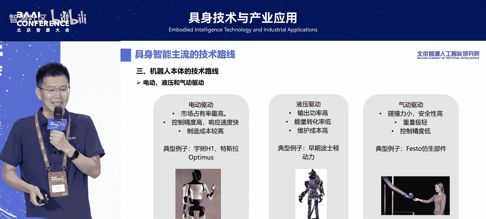

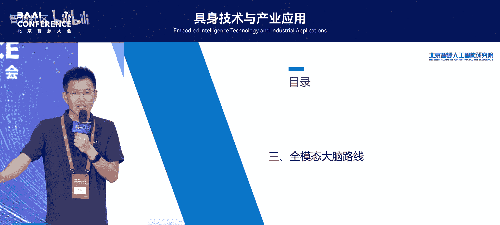

都放到一个脑子里面去，这种模型还是非常少见的这也是属于我们提到的第一个挑战关键的能力欠缺。他无法满足巨深智能。对于这种试听说想做多种模态，联合建模的要求。然后第二个关键的问题呢，对于我们人类来说。

我们今天见到了哪位好朋友，今天接识到了哪位新的朋友等等，我们都是非常清晰的对吧？目前的机器人在这方面的话，他们的能力啊还没触及到这一方面，换句话说，目前的机器人大部分来说是无状态的。

你让他去干一些什么事情，干完了就结束了。然后你问他认不认识你自己，不好意思，他不认识他这种方面类人的能力等等都是没有的。我们总结起来，目前的巨身智能是什么的特点呢？不具备自我的认知，以及后期的记忆。

包括人物识别等等相关的这些能力都是不具备的。然后第三个角度呢，则是属于目前的话，我们知道呃相关的一些技术路线，无论是VV路线还是等等其他路线，他都存在一个问题啊，数据成本极高的一个问题。

泛化性不是特别好的一个角度的问题。😊，那么这种下它的数据成本是极其高昂的。我们认为这个地方最好能降一下。那么这种下我们这件事情做起来会更有意思一些。然后有了这三大挑战以后。

然后我们初步提出来一个全态大脑的一个框架。然后这个地方还是说是希望通过我们这个报告能启发大家思考，并不是说这一方案就是属于最终的终极方案了，只是启发大家思考的。所以说呢我列出来一些关键的角度啊。

也是从目标驱动的角度，而不是说如何实现的角度来跟大家分享这些观点的。第一个能力呢就刚才提到的全能大脑关键的模态的能力都要具备。刚才说了这个听说看想做等等一个模型里面实现。

这才是属于相相和我们人类的大脑表较象的。然后这个地方可能有观众想问我一个问题啊，你们做的这些想法和工作和做内脑具的内脑的那一部分有什么区别区别是这样的。我们的目标很相似，但是我们的方法不一样，我们。😊。

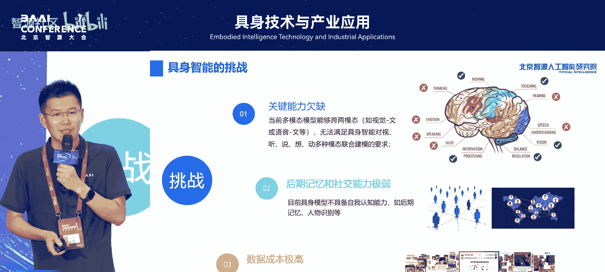

采用计算机科学的方法，他们是想通过仿生的方法来解决这问题，这是本质上的一个区别。然后第二个呢，这是属于原生的实时性。然后这就是属于我左边的这个图啊，为什么说要加上这个编制的一个原因，它能体现出来实时性？

😊，第三个则是属于精准的控制。然后这个地方我们认为呃有必要性。因为对待计生智能领域来说，未来他要进行很多很多工作的情况下，那么相关的控制的准确度啊，想的速度等等方面都是一个核心性关键的问题。

最后一个则是刚才给大家提到的类人的记忆和相关的社交能力，我们给他的他的英文是lifelong的一个一个角度，比如说记忆，比如说社交能力等等各种角度都被归结为这个的角度里面去了。

然后接下来我会从这四个方面给大家简单介绍一下我们目前的想法，仅仅是为了启发大家。首先第一个全能关键能力都具备。然后我刚才提到了5个能力，对吧？叫听说是想做等等相关的能力。

然后大家一定聪明的想到了一个问题。我们人类的触觉，然后包括嗅觉嗅觉这些能力要不要有呢？然后我目前给出来一个分享，是说我们认为这种能力，现阶段是可选的。然后等到刚才说的这种。

我们认为必备的能力发展的一定的角度以后。😊，说不定现在可选的未来会成为必选。但现阶段来说，把它当做一个必选就OK然后第二个是是属于原生的实时性。原生的实时性，还是说在技术方案方面，我不给大家探讨过多。

然后我给大家分享两个例子啊，第一个叫做动作的实时性。比如说我现在站在讲台上，然后再进行讲话，然后呢旁边有个机器人，我让机器人过来。

如果这个机器人它的视觉和它的行动可能存在着某些不实时的现象控制的不够好的情况，可能会产生什么样的后果呢？它撞到了我把我撞伤了，有可能距离我3米以外就停下来这种实时性还是在某些情况下非常有必要的。

然后第二个呢则是属于语音的实时性。然后还是给大家举一个例子啊，比如说我们大家都看过电影，对吧？我们在看电影的时候会发现一个什么现象呢？如果音频和视频不同步。无论是发生了提前还是延后。

大家是不是会感觉这个电影看的有点就总是不对位，脑子海中总是怪怪的，这个体现出来我们人类本质上来说对待这种实时性。😊。

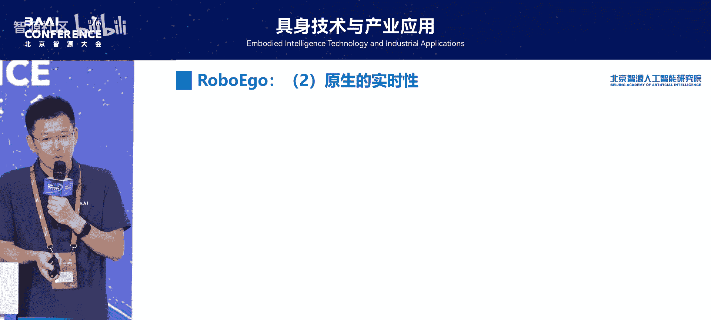

其实要求挺高的，由于我们天然存在实时，所以说我们只是感觉不到的。然后对于我们接下来的巨深智能相关的领域来说，我们认为实时性这件事情是一个很重要的一个角度。我们需要考虑到它。然后第三个这是属于精准的操作。

精准的操作啊，操作这件事情，我们目前的话有直接控制这条方案，对吧？比如说我们再干一个动作，抓起来一个水平，抓起来一件事情，很多时候我们的方法是说比如说我这次失败了，怎么办呢？我从试一遍。😊。

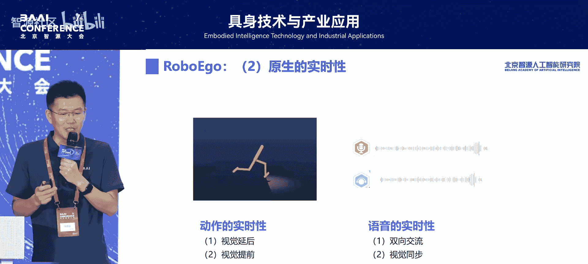

如果我的成功率是10%，我从事十遍，大概率会有一次成功，对吧？从这一个概率论的角度来说，那我这种方法好不好呢？我们重新回过头来思考我们人是如何解决这个问题的。我们人的解决方案可能是这样的。

我发现我的手距离我的目标有偏移的时候，我通过视觉通过大脑给他的的反馈，让他移动到正确的位置上去，就成功了，更有可能采用的是这种类似于反馈闭环控制的方法来解决这个问题，而不是属于采用从事的方案。

所以我们认为这个地方，接下来在如何更加精准的操作等等方面，我们还需要深思去如何把这个问题给解决的好。然后达成真正的是属于一种更好用更好使的一个状态。最后一个则是属于类人的社记忆和社交能力啊。

然后这个地方我列出来了一个场景啊，比如说在家庭场景中，然后我们的机器人未来进入到千家万户以后，他是知道谁是爸爸，谁是妈妈，谁是爷爷，谁是奶奶等等相关的一个问题的。然后呢，并且呢这个家居。😊，领域。

除了家居领域，比如说我们家里有台机器人，我在上班的时候，我想知道家里是不是出现了一些危险等等相关的情况，所以很能很有可能发生这种现象的对吧？那么我就可以在办公室里面向我的这个机器人发一定的要求，对吧？

你去看看窗户关了没有下暴雨了。是不是我家里已经血流成河了等等相关的问题都可以去问，那么这就体现出来了。如果我们有这种类人的记忆和社交能力的情况下，一导多体等等，它会发挥一个非常广阔的现象。

同时还是告诉大家，一导多体只是属于我们思考。然后认为很有可能会很有意识的一个现象，并不代表未来它就一定是一个主流路线，还是一定必必要的实现的一个功能，我们只是想阐述类人的记忆和社交能力。

这件事情才是一个更加有必要更加重要的一个角度。好，然后讲了我们刚才讲的全不太大脑的路线以后，最后我用简单的一分钟左右的时间给大家来分析一下产业的趋势。我们对他的一个研判。然后首先呢第一个角度。

我们认为对。😊。

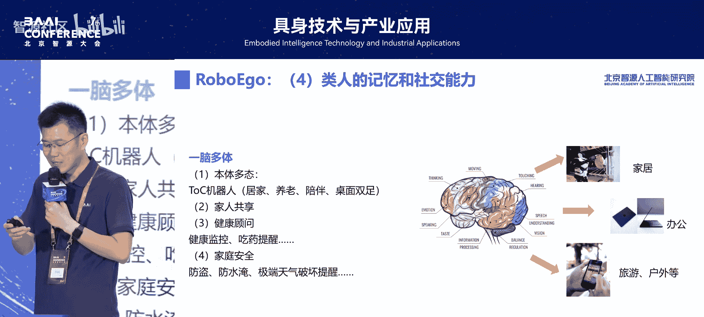

巨深智能来说，全模态大模型接下来一定会成为一个核心。刚才已经给大家讲述过了，无论是属于全面的环境感知能力，还是属于刚才提到的我们无损的信息捕获能力，包括类人的这种思考能力。

都是对待我们巨身智能非常重要的一个角度。然后第四个角度这是属于泛化性。刚才讲了泛化性才是属于巨深智能等等更重要的一些维度，而不是说我只搞定学一件东西是一件东西。

这种方法无法应对我们人类社会中非常复杂的一种对吧等等相关的问题都是无法覆盖得到的。然后最后在行为上来说需要综合一致准确合理的行为输出。然后从应用的角度来说，我们接下来是这么认为的。

首先由于巨身智能是一个非常庞大的一个场景和领域，且它的能力在要求是很高的。那么短期之内很有可能它是属于部分的重点能力产生一定突破，并且聚焦在一定的专业的场景中去。但是呢从中。😊。

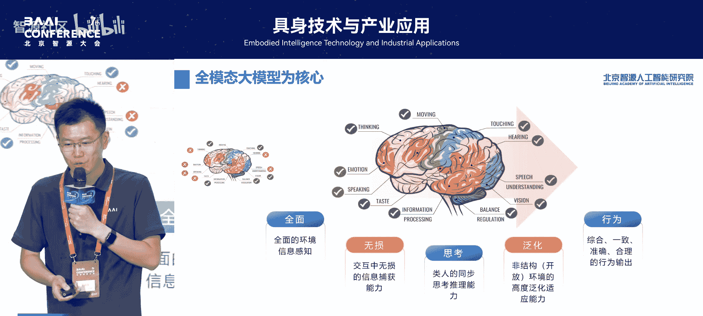

的角度来看，一定会进入一个通用化的阶段。这样的话才能最终达到我们巨生智能机器人可能具备我们类人的这种智能的一个本质上的一个长期目标。好，最后呢我借用自动驾驶。

然后领域的能力分级体系定义一下我们通用智能机器人的一个里程碑。首先对待自动驾驶领域，大家都知道L1和L2本质上来说是一种辅助驾驶，它是一种低级别的驾驶。在有了大模型相关的技术加持以后。

然后终于到了今天我们发现了自动驾驶领域的曙光，可以到L3L4等等，以及甚至更高的级别，对不对？这是一种现状，对待我们机器人领域来说，我们认为也存在相关的这种分级体系。

比如说对待L一和L2应该是属于有限的或者说组合的任务执行。比如说大家经常看到的 workflow等等，都是用这种方法来进行的。然后在这个L1和L2以上会有L3这种L4L5的通用的高度通用的完全。😊。

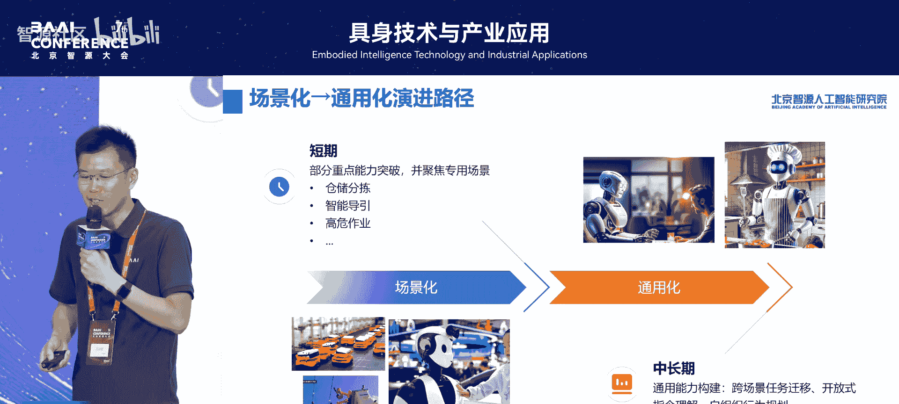

用一个机器人供我们启发供我们思考。由于我们已经有了大模型相关的技术，然后在过去取得了很多突破。所以说到今天我坚信接下来更高级别的通用智能机器人会取得一个非常重要的突破和进展。好。

我的思考就跟大家分享到这里，谢谢大家。😊。

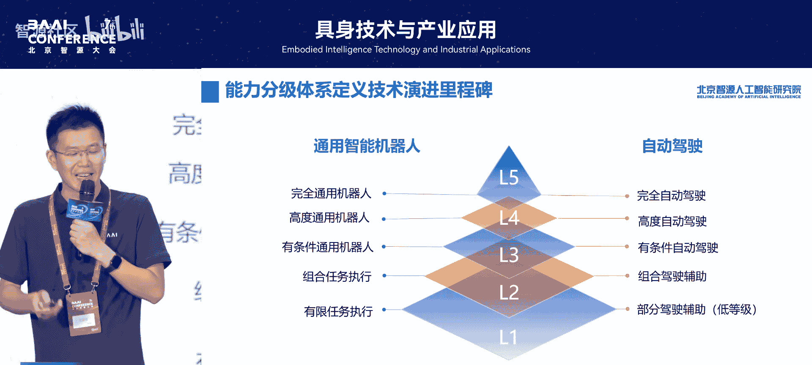