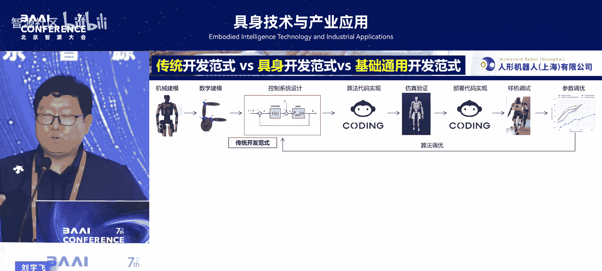
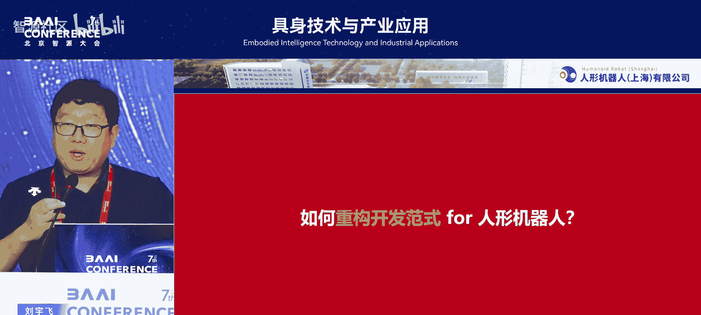
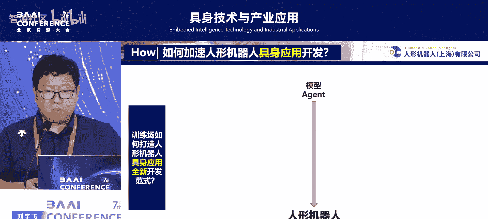

# 2025北京智源大会- 具身技术与产业应用 p04 训练场打造具身智能新开发范式：刘宇飞 -BV1ViNtzcEiZ_p4-

我们有请国家地方共建人形机器人创新中心副总经理刘宇飞先生为大家带来题为训练场，打造巨生智能新开发范式的报告，介绍国地人形创新中心人形机器人训练场的关键进展。那我们掌声欢迎刘宇飞先生。呃，尊敬的孙老师。

尊敬的各位各位专家，各位各位同仁呃，非常荣幸能参加北京支援大会，非常荣非常感谢乐剧的邀请。😊，呃，好像现在PPT还没有打开，然后这块我我我简要介绍一下我们团队吧，我们团队因为今天非常好的机会啊。

就后我们团队大部分还是做机器人开发为主的。然后我今天呢主要还是介绍一些机器人方面的，再就是计身智能开发范式方面的。我们前期的一些工作和我们的一些思考。😊，呃。可能PPT比较大呃。

我的PPT里边可能大量的很多我们做的一些动画，还有一些我们前期的一些开发的内容。OK。那那我就那我就开始我我我我的一个简要的介绍。首先呢巨深智能大家可以呃前期都了解。因为这个呢其实不是一个陌生的概念呃。

1950年呢其实就在论文中体现了inligence的这个概念。呃，其实现在呢很多在发展到现在呢，其实我们已经不仅仅巨身智能是一种自身的体验的一个状态了。

它其实也经改已经演变成了可以改变物理世界的一个智能。呃，其实这个视频我想必大家有的人可能看过有的人没看过，就是20年的打靶的的这个比赛。当时呢因为我当时还是在做4组机器人控制这个板块。

给我了很多给我了我们团队非常多的震撼。因为他它相当于是第一次用端到端的这种智能去让一个四组机器人在一个矿山和一个仿运变的环境里面做了非常多的非常多的这种自主探索。而且呢在整个的这个探索的过程中。

其实是机器人是完全没有摔倒，然后也能达到了当时的一些很多功能性的预期的一个。😊，工作。所以这个呢是当时在20年是一个非常当时非常先进和非常前沿的这样一项技术。

当时呢大家其实我们还在做很多model base的一些控制方面的一些工作。😊，所以总的来讲呢，就是呃以前我们其实在做的都是动力学，将加这种强化学习的做下肢的一些控制的工作。

其实这里边呢就是就就相当于是当时呃做大语言模型里面的认知域的这方面的板块的工作。但是后来呢因为随着巨身智能的发展，从22年开始，其实很多时候是加上加加入了一些时间域和空间域的概念。所以说呢。

随着后期像刚才各位老师提到的像VLA方向发展，之后呢，相当于后期就是相当于把LMM加上时空域，包括空间域做了很多动力学方面的控制。

然后就演变成了现在巨深智能里面这种动力学强化学习加预训练这这样的一个技术路线。呃，就是刚才提到的呃，ETH的这个板块，其实它很重要的几个几个点呢，就包括它ETH发布的OCS2。0。

可能有一些开发者用过这方面这个这个控制器，它相当于呢是可以去用这种单臂双臂以及四族机器人刚才开源了一些非线性的通用的优化器。他用这种优化器呢就就实现了给让机器人在线的去辨识它的一些控制的一些参数。

就function的一些东西。再一个呢他融入了很多感知的信息。因为因为开始ETH在发布的时候，他们在很多它相当于给了我们很多的震撼，是在于它可视化的一些界面和路径的一些规划。然后呢。

当时是做了很多这种采梅花装，还有这种这种在仿真里做了很多这种落足点的一些规划。其实这里边呢都是很多在线生成和和离线的一些规划的一些工作。呃，包括他很多的软硬件结耦的一些能力。

包括他现在开发的一个非常成熟的这种可视化界面，非常便于开发者去去开去用这样的一套软件去做它的开发工作。然后他还有非常多的机器的开发的一些案例。呃，再一个里程碑事件呢。

就22年英伟达发布的ac其实很多人可能以前在20年的时候，我们其实用的是用的是O2。0的个版本。但是在22年开始呢ac出现，我们用了多这些开发平台。包括后面开源的一些的一些平台。

但是呢其实用这个平台里边，它相当于是可以。😊，用并行计算的这种能力，能快速的适配机器人的很多开发的工作，也可以适配不同的机器人去做这方面跟虚拟人，包括大量的训练的工作。所以当时他的有个概念。

就是它的在Sac lab里边可以用10分钟的训练等于你以前十年的一些工作量。呃，再一个呢就2025年英伟达一当时发布的基础大模型的一些开发范式也给了当时现在业界很多的震撼。

就是当时呢他他对开源和开发者可以免费的做一些定制，可以适配不同的机器硬件。这里面呢就涉及到很多的驱动总线还有一些SK一些软件的一些开发。所以就正如正如当时对现在人工智能带动一样。

当时呢一也给了大家非常多的启发。所以总的来讲呢就是传统的开发式巨深的开发式，和基础通用的开发方式。我们团队总结就是最在最开始从19年之前，其实我们在都是在用传统的这种先做控制系统的设计。

可能大家课本里学到的也是这样的一个模式。先用控制系统设计，再做算法代码的实现，再用仿真再再用部署代码的实现，最后做样机的调优，再做re的一些调整。但是后来呢通过巨深智能的发展呢。

现在在做一些训练策略的设计。当时我的博士论文里面其实也当时做了一部分这方面的工作。😊。

但是当时都是很简单的一些像优化算法，在这里面起到了很重要的一个一个一个实现。但是当你用这种居深的开发方式用训练策略的一些设计，设计了你的function，还有你的边界条件以后。

其实后期最主要的就是sem to real这个这个过程里面的一些。😊，部部署代码的一些实现。其实这里边就涉及到很多做做机器人的PD控制参数等等一些调试的一些问题。呃，其实到最后呢。

其实它就是一个基础通用范式。也就是现在我们创业中心目前在做的很多的工作，就是在于你要用基础通用的一些一些范式能实现你的不同的低代码向导式的一个机器人的开发。

然后呢可以部署到你通用的一些部署的部署的框架里面。最后呢就像李志军老师刚才提到的，用这种通用的操作系统，能够实现让让你让你让你的系统适配不同的机器人。不光是它的总线通讯以及SDK。

而且你能在顶层能设计它很好的一个整体的架构。这样的话就相当于我们用通用的方式来解决了一个通用的系统的问题。😊，呃，所以说总总结来看呢，传统机器人的开发f式呢，它的代表性的系统呢就像MPCWBC等等。

但是新的呢就主要是以数据驱动和模型驱动来做。所以整整体来讲，包括前期我们我们现在在做的就是构建新的来来来去加速实现我们模型的导出技能的训练，还有驱动的绑定。然后再做一些软件的支撑。

所以我们总总体来讲感觉呢应该是巨身智能新的f式呢，它应该是模型讯推和操作系统和巨身应用三者的结合，最后实现我们现在现阶段人形机器人这种巨身智能人形机器人，它的一个新的开发方式。😊。

🎼所以说在整体的整体的跟大家汇报了一下整体的背景的情况下呢，那如何构建如何要开把这种开发方式应用到人形机器人上呢？所以我们在上海建了一个人形的机器人训练场，这里边呢。

其实我们受到了当时224年5月特斯拉的一个启示。当时他们做了一个人形机器人实训场，主要还是做一些电池分解包啊，包括多大端的一些一些视教。这里边他当时提到了100家数据训练团队，还有40家训练工位。

然后再一个呢就像当时呢开25年5月21号发布的这样的一个视频，就是人他用人形机器人去做了很多的倒垃圾清理桌面，打开橱柜等等11项的这种原子技能。但是这里边呢。

我们其实在在上海还有包括很多的很多的人形工都做了很多这样的工作。但是他们提到了一个非常非常重要的重要的一个技术的突破。就是他可以用这种第三人称的视角和第一人称的视角去做视频加载到人形机器人的训练。

这个其实是后期很多数据采集方面。😊，🎼一些新的一些突破。所以说我们在呃我们在我们在上海呢，其实建了在今年的1月份，我们建了一个呃将在国内第一个最大的一个虚事融合训练场里边呢，我们涉及到三大领域。

18个细分场景，包括右侧的这些图片呢，就是我们现在我们当时训练场里面的一些现在的一些情况。就是这里边呢，我们涉及到智能制造民生服务，还有特种作业，及很多的一些场景，包括一些激光弱化啊。

 kiting配料，上下料，还包还有这种面板清理等等一些工作。在在提炼了这种真实场景的应用需求之后，我们又开发了很多我们自己的自己的一些操一些开发平台，包括我们机器人做一些解决方案的适配。😊。

所以说我们建立训练场呢，当时也受到了国内呃很多的这个媒体的宣传。其实我们最终的训练场其实主要还是实现五大板块的赋能。第一个呢就是做数据收集和规模化。第二个呢就是做模型训练和发育。

第三个呢就是面向真实的场景，去做去做模拟和应用落地。第四个呢我们会做大量的包括像ACTDTDT派0派0。5等等。这些模型的应用。这些模型呢像开源的这些模型，我们都做了很多的适配。

在我们的机器上都做了很多的一些部署。然后最后呢就是人才培养与生态建设。因为训练场是一个非常庞大的一个系统，这里边需要需要需要很多的专家学者学生来做这个工作。

特别是我们其实我们创业中心做这块的工作的都是一些00后的同学。然后这些这些人呢有非常强大的一些一些一些创新能力。所以这块呢是像习大大提到的这个像现在的军神智能行业是年轻人的一些事业。😊，呃。

这最后一个重重点呢，我想给大家介绍一下这种呃如何重构这种开发范式给人性机器人。这个其实是我们我们做的最重要的最重要的工作。也是基于训练场这这一年的将近一年的时间半年的时间。

我们我们所做的一些对行业内做的一些贡献。呃，首先呢就是如何加速机器人具身应用的开发。其实这里边呢就是其涉及到模型和agent的事情。其实刚才李志军老师提到过，这里边呢第一件事。

我们其实在1月份之前把训练场打造出来，主要是有10个场景，现在有116台机器人在做这样的一个训练。呃，但是它里面提提炼的问题是什么呢？就是你的异购数据集的统一的标准是什么？然后包括你异构机器人。

你怎么能够快速适配，然后模型呢如何积木式的一一种组合，再一个呢就如何降低开发者的开发门槛。因为我们其实在这个过程里采购了非常多不同的机器人公司的产品。但是呢你怎么去把这些产品统一起来做一个统一的开发。

这是很重要的一个很麻烦的。😊。

一个工作。所以呢后面我们就开我们就开发了我们格物支知的去真智能开发平台。这个这个这个开发平台呢，现在我们在25年5月29号正式的发布，后面呢我们会把这个平台做一个开源性的工作。

这里边呢我们会我们已经搭建了一些财讯推的一些框架。包括一些依托我们的oppo龙开源社区。我们我们链接了非常国内自主可控的一些操作系统，包括鸿蒙，包包括包括欧拉他们的一些系统，然后包括一些芯片驱动。

还有一些多任务调度的IDE这里边呢就相当于用给让给开发者一个非常好的一个机会，让他能够不用考虑那么多二次开发的接口，让他能够快速的去适配我们现在的这个这套这套软件。😊，呃。

再一个呢我们形成了我们自己比较呃完备的一套一套技术路线，也是开发框架。这里边呢就是大才提到的左边左边这个板块呢就是我们现在的数据这个板块呃，里边呢既包括我们数据源的收集，还包括了我们数据采集的一些范式。

然后这里边数据采集里面呢，我们包括本体的数据采集甲爪的采集，还有一些一些其他的巨深的一些采集，包括后期很多的数据治理的工作和数据分发的工作，我们前期呢像跟华为云等等，我们也做了很多深度的探讨。

包括la实验室。呃，这里这里边呢其实最重要的工作呢，我们其实形成了我们的数据湖的一些概念。呃，特别是5月29号我们发布了我们100万就国内100万第1个100亿购的真集数据集。

这个这个数据集是非常的宝贵的。相当于我们做了大量的工作，其10万的数据集。们当我们当时其实其实采了大概都有500万的这种数据，把很多的很多的低质量的数据都给进行了一些抛除。

最后就剩了这么多100万的左右的一个数据量。但今年呢我们会努力。😊，突破。然后在上半年达到500万的数据这样一个规模。其实这里面最终的一些成果呢就是我们数据白虎数据集和基术大模型。基术大模型。

后面我们会讲我会讲到，但是整个开发平台里面呢，我们是其实分了几个板块。一第一个呢就就是仿仿真软件的一个板块，就是我们的格物的仿真平台。这个仿真平台是非常快速的一键式导入多机训练的这么一个平台。

就我们里面涵盖了102个URDF这机型的不同的URDF文件，可以相当于你可以快速的用这些URD文件去适配你不同的机型的训练。然后呢支持开发平台呢是一个面向于硬件的这样一个一个平台。

然后再加载里面其中包括操作系统中间件，还有一些芯片，包括的芯片，还有还有一些那个英特尔的芯片，我们其实都做了很多开发的接口。其实这里面大量的还都是工程化的落地的一些问题。我们解决了非常工程化的问题。

而不是学术性的问题。😊，呃，再一个呢我们形成了一些开发的基础设施。这里边呢就既包括了我们现在的数据的一个训练场的一些采集范式，然后形成了高质量的一些数据池。呃。

我们我们每天现在大概有大概有5万条左右的数据的产生。而且我们大量的是这种两班导的形式。所以说数据刚才刚才有专家提到数据非常的重要，非常的而且非常的紧俏。

所以说这块呢我们是持续的在默默的把把这个事当成我们最主要的事业，其实在去做。包括数据标准，我们已经我们现在也我们现在牵头了大概有呃有4个航标，还有很多的团标。就这里边呢在标准这个行业这个领域里面。

我们其实做了很多的工作。然后再一个呢就是我们整体的介绍一下我们的仿真训练平台。这里边其实包括的包括的一些内容呢，就包括我们现在生成式的模型驱动的一些动作生成。

其实这里边呢我们做了很多的一些模型的就动作重映射的一些模块。因为大家也知道，就是现在像特斯拉等等一些现在具体的。😊，技入线呢，它是用人体的一些数据做了很多这种动作的生成，形成很多的巨身动作库。

但是这个动作库如何形成这种生成式的模型，赋能给机器人，它里面是涉及到非常多的这样的一些开发式的工作。所以我们呢其实是跟像个复旦大学，我们一起做了很多这方面剪切的工作，让现在人体采集的很多数据。

能够非常快速的部署到现在的人机器人上。然后再一个呢我们是用用这种前馈的动作来结合L的方法来实现这种给定了它很好的一些期望的一些数据。然后让他去做加速这种神经网络的训练，减少这种探索的空间。

可以更快的实现机器人的部署和迁移。第三个呢就是一件式的模型导入训练。这个其实是一个工程化的一个问题。就是你相当于你做UDF模型的导入之后呢，你你需要对每一个机器人进行训练参数的配置。

所以我们前期呢就已经把这100多个UD文件已经配置到了我们现在的训练训练的这个平台里边。相当于你可以可常比如你想。😊，调语数的机器人，你想调乐聚的机器人。

你可以我们这我这我们这里边都有它明确的UID文件，还有它的配置参数，你直接导入进去就可以快速的适配。而且我们这套歌物的仿生平台已经在上进行了开源。然后再一个最后最后4和5呢，其实就是我们的一些训练案例。

就我我们现在已经有非常多的训练案例。再一个我们里面内置了很多就口的一种或的这样的一些一些一些模块能够快速的给开发者进行开发，让他快速的上手。呃。

右侧呢就是我们现在已经做的像包括我们自己青龙我们做的一些行走的训练，也是基于我们现在这种开发平台能快速的做快速的去适配。😊，呃，下一个板块呢就是像我们自知的这种通用巨深的开发平台。

这里边呢就是我们自己我们用了呃包括orin的一些芯片，然后呢把运控单元转变为这种模型输入输出的接口。这个是什么概念呢？就是相当于我我以前的运控单元，其实大家理解呢就是一个控制的控制的单元。

后面呢我们其实对于神经网络，它的OBS系统的就是相当于做了一些状态观测的一些估计，然后未来呢相当于现在的训练呢是一个神经网络的一个黑盒子，相当于你这个黑盒子怎么能够快速的部署到你现在的机器人上。

这就是action转化成你的控制信号的一个问题。所以在这个方面的工作里面呢，我们相当于做了很多实质性共享内存的一些方法，让你让让相当于这个主控，包括它的一些接口，能够快速适配你的神经网络的训练的控制器。

这样的话呢就减减少了你在这方面的投入。所以我们现在做人做我们现在青龙等等不同的平台做这种训练。其实效率是非常高的。再一个呢就我们可以用这种。😊，加速推理的一些架构。

呃包括我们现在用我们现在国产的操作系统或者软件框架来支持我们现在一些一些系统的一些格式的转换，还有模型的一些切换。再就是刚才提到的这种低代码的通用配置文件。

就不不不光是URDF啊USD模型来做这种这种那个面向传感器方向啊，或者传感器参数啊，就这些的重复的一些开发工作。我们相当于都已经设定好了很多的通用配置文件。😊。

最后一个呢就是呃自自集成链路的传感器的四部单元的驱动。因为驱动大家知道，因为做过人形机器人开发的同学其实都知道这个驱动是非常复杂，非常麻烦的一个事情。你要配置一个驱动的话，不管你是看net总线等等。

你都需要去去去去适配，需要花很多很多的时间，特别是现在人形机器人有这么多的假爪MU还有相机雷达这些驱动库，它是非常多的。所以我们在前期做了很多的工作。呃，因为也是因为我们我们训练场有12家的机器人在。

所以我们做了非常多的驱动库嵌入到了我们这套系统里面。然后可以去做快速的配置，还有模块化的集成。所以最右侧的呢就相当于我们用这种端侧的部署的一些知识能够实现这输入到输出这种直接链路的一个一个驱动的工作。

包括我们下面的一些新，包括我们下面的一些呃不同的芯片in特尔的，还有一些传感器。😊，呃，再一个就是具身软件的一个框架。这里边呃因为时间有限，我就不具体不具体说了。因为这里边都是做机器人控制方向。

其实大家可能了解的就是这种共享内存，做实时的信息交互，这个是非常非常重要的可以去大容量数据的一种交互。因为不像以前做我们做底层开发的时候，做很多现成多线程的一些工作。这个其实也并不快。

主要还是要用共享内存的这种方式，让你的让你整体把你的架构加速起来。然后包括我们后期在训练场里面，我们做了很多数据落盘，还有操控落盘，还有我们模型部署即插即用的一些工作，能够快速的去适配我们的样的系统。

呃，所以呢整体我们用了所有的这套我们架构下的这个这这这套系统呢，我们形成了我们现在全球首个百万量级的这种数据集。然后呢，我们后期呢会会开发一部分我们的这这套系统，然后会开源一部分我们的数据。

也也也欢迎大家去在open上去关关注一下我们的社区。呃，再一个呢就是我们。😊，在这个这么多的工作里面呢，其实我们做了很多呃操作运动方向大模型的一些工作。我们把它称之为生成式大模型。

我们把它定义成慢德龙GBT。然后这个这个呢其实非常跟李志军老师当时提到那个有点相像。因为我们相当于是用语音文本的转换，给机器人一个输入。然后相当于就你告诉他你要去跳一个比如说什么样的舞蹈。

然后呢他在网上搜索到这个舞蹈的一些工作或者舞蹈的一些动作，然后输入输入给人形机器人，然后去做一些离线和在线的动作生成，最后通过工程师去做动作的部署，还有模型的一些重定向。

因为在因为他因为在人体的这个这个转向等等跟机器人可能有些不一样。所以在这种通过这样的形式呢，能够快速的做技能的一些训练。呃，所以呢我们用这种方式呢，其实呃做了在青龙上做了很多的部署。就像现在看大家看到。

当然我们现在实时性，就是因为驱动器的原因，我实质性还没有做到很快。所以说右侧的这个这个图呢，就是我们啊这个。😊，视频我没放出来，就是你仿真里面做的一些机器人的训练，呃，包括它的动作。

可以完整的完全的 to到我们的真机上，然后做一些打拳等等。可能大家也看到很多的机器人做一些跳舞啊打拳啊这些工作。其实其实有些东西是训练了很久才达到的一个效果。

但是我通过我们的慢龙GPT它可以很快速的去实现从语音到基础基础源动作范式的一个转化。这里边呢我们我们也是在生成了这种7生成式模型的一个个GPT动作。当然这个7B也不算大T7B呢就是在一个单上就能部署。

当然这是一个语音文本的一一个整体的概念。最后呢我其实在整体的所有的我们做了这么大这么多的工作里边，还是感谢像像乐包括巨石多的企业给了我们非常多的支持。

我们我们包括我们实训场大模型巨神应用还有开发平台里边有很多大家的一些一些一些一些工作的一些贡献。然后我们也在里。😊，成我们在这个过程里面也是也是作为作为整体的一些集成。然后包括我们做了很多的开发。

所以我们的团队大量的还是做很多机器人开发，真正的面向底层技术去推进人性基金产业的这么一个团队。呃，所以我们后期希望大家能够多关注我们open loan然后我们会把我们的很多的技术在open room上进行发布。

呃，感谢大家。😊。