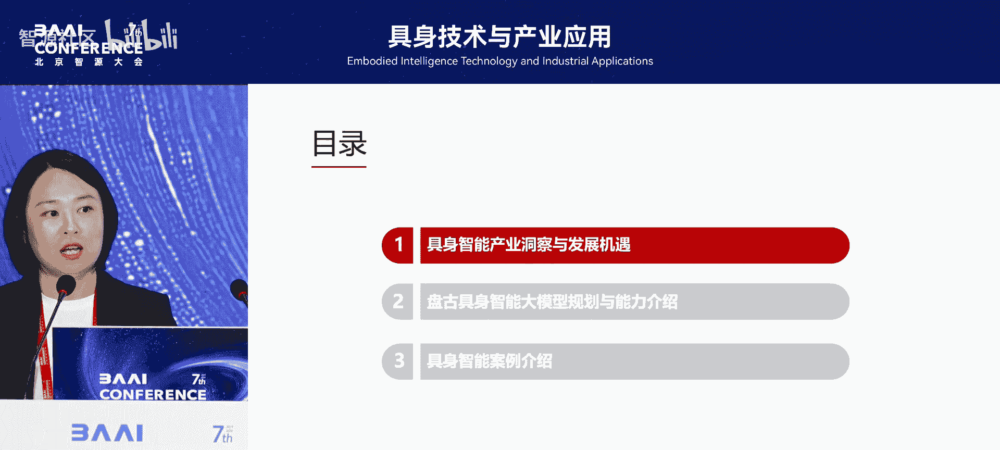
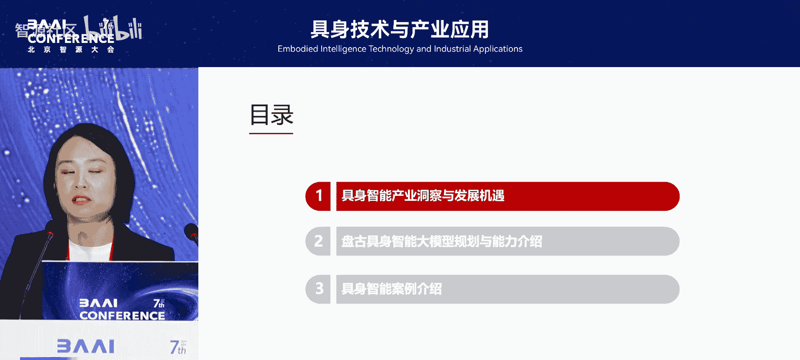
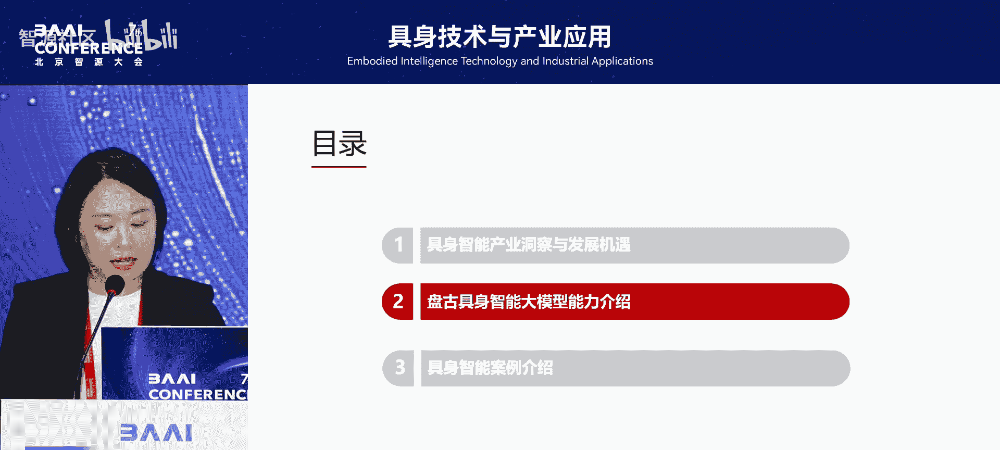
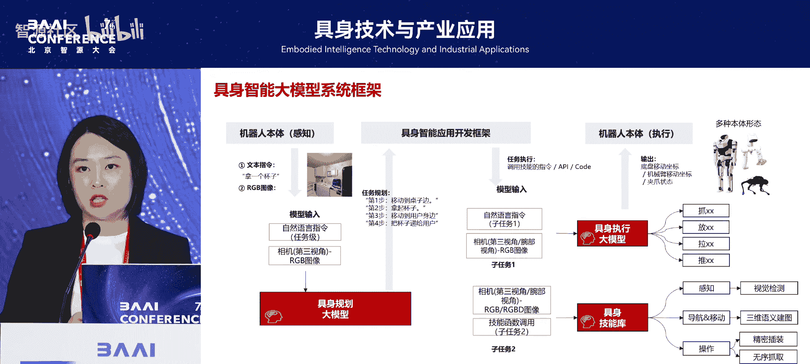
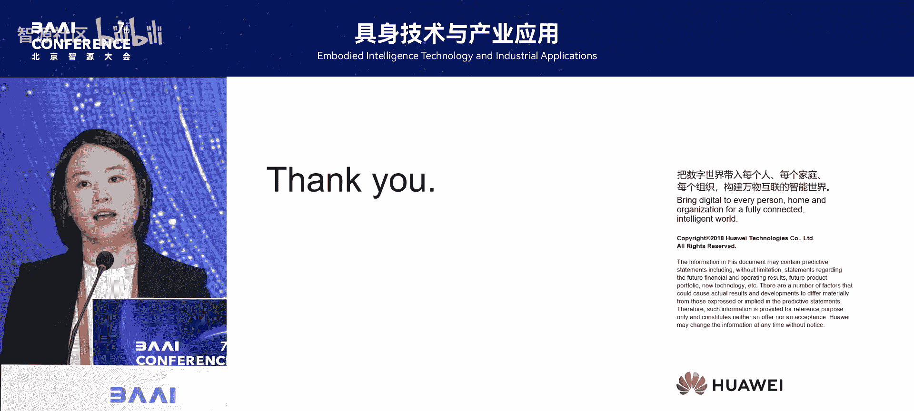

# 2025北京智源大会- 具身技术与产业应用 p05 华为云具身智能技术探索与实践：李 寅 -BV1ViNtzcEiZ_p5-

呃，大家好啊，今天非常有机会啊，受到乐居的邀请来这里跟大家探讨一下关于巨深智能的一个发展。呃，其实呃我这边最早其实是在做负责整个盘古大模型的这个技术研究和规划的那也是从去年开始，我们发现这个巨深智能。

可能和大模型，它是一个密切结合的一个技术。所以呢现在整个的这个我们现在华为公司呃，在华为云这儿做的这个巨深智能，更多的都是和大模型结合的一些技术。啊。

今天呢也跟呃各位专家和老师分享一下我们现在做的一些内容。那首先呢就是我们现在发现呃这两年不不管是我们华华为公司内部，我们的这个南方工厂，我们的制造部，我们做这个手机的这样的一些工厂。

还是我们看到的一些像深圳市的这样的一些工业企业。啊，大部分呢希望用巨深智能这样的一个技术去改变他们当前的这个产业格局。那我们可能原来。

看到的更多是这种离身的智能或者是这种教学系统。那比如说我们教会机器人一个动作，它可能只能在这样的一个产线的固定位置上去做固定的动作。那如果发生了一些突发的情况，或者是一些柔性的装配。

那可能这些机器人他是做不了的那现在呢我们看到了呃当前的这个巨神智能呢，它主要是能够真正的和我们的这个物理世界去做一个精准的交互，那这个其实对大模型也提出了一个难题。

我们原来我们看到像类似我们原来做的这个盘古大语言模型，以及现在呃特别火的deept等，它都是一些这种语言类的模型，它解决的问题呢是从感知到认知到决策。但是再往下呢。

它可能更多的就属于精神或者是思维层面的东西，就没有办法真正的和我们物理世界的这样的一个需求去做结合。那其实在感知认知决策的下一步应该。开是执行。那这个执行呢就涉及到和物理世界的交互。

那只有巨深智能和大模型技术的这个结合，才有可能去解决我们啊智能时代的下一跳的就是。行为的这样的一个问题。好，那这个呢就是我们呃华为公司在巨深智能把大模型结合的这样的一个初衷或者是一个出发点。

那其实我们也看到从2023年最早就是我们看到了这个google发布了这个对吧？最最早这个goo的 NP大模型叫它是一个大语言模型那其实到了223年它加了这个inbody的这个词就加了E这样的一个词。

就变成了一个巨深智能的这个大脑，其实就是我们现在的巨生规划大模型的一个早期的一个雏形。那后来呢我们就发现从2023年其实这一波的这个巨深智能这个爆火，它是跟大模型技术的这个发展是始终联系在一起的。哎。

后来我们又看到了fi这家公司open eye合作用open eye的大模型去赋能fi的这样的一个本体给他加持了这样的一个大脑的能力啊那我们看到了非常酷炫，他当然在一个厨房里面去操作很多事情。

那后来呢gogle又发。发布了这个RT two啊，一直到呃后来这个在今年那个25年的3月份，google又正式发布了这个RTH。那这个呢他就是把大脑和小脑这样的一些技术合在一起。

那也就是说把我们原来的规划大模型和执行大模型就结合在了一起啊，那再后来呢我们就发现了一个呃黑马的这个企业啊，我说错了，是24年哈，25年是呃从到这个语数才开始。

那后来我们就发现了一个黑马企业呃出了一个派林这样的一个公司。它是physic intelligence在美国的一家公司。他大概就用了3B的参数量做了一个VRM。

也就是一个多么太理解和diffusion结合的这样的一个端到端的从规划到执行的这样的一个模型。而且用的这个参数量并不是很大啊，那当然这个这个参数量到底应该有多大。这个现在也是大家都在研究的一个问题啊。

那接下来呢我们就看到了fire又。自己开始自己做大模型了啊，发布了helex这样的一个模型，又提出来了这个巨深智能大脑的这个stem one和stem two的这样的一个快思考和慢思考的一个理念。

那其实这个跟我们现在看到的这个大语言模型，或者是推理能力的这个模型，提出来的这个快思考和慢思考是非常相似的啊，那也就是说我们在做完了一系列的慢思考的规划推理能力了之后。

我们需要一个快思考的能力快速的把这一系列的这个action组合成组合成一起，快速的给它执行出来。啊，那这个呢其实也是我们看到今年整个大模型在具身智能规划方面，或者是技术方面的一个演进的一个关键点。

那这个时候呢我们就看到了英伟达基于去年的这个cosmos的这个基础上，又发布了这个cosmos transfer one和cosmos reasoning one以及groupRT啊，那这样的一些能力。

一个是体现了大模。模型和具深智能的这个深入的结合，也就是在快思考和慢思考在推理能力以及执行能力方面的一个快速的结合。同时呢我们也看到了在屈深智能的泛化性上，大家都开始在做一性定的这个突破性的研究了。

比如说怎么去合成我们巨深智能大模型需要用到的这个训练数据啊，那这个事情也是今年很多厂商在发力的一个点。大家都知道我们巨深智能只之所以比较重要，跟原来的这个技术不一样。我认为它最不一样的一个点呢。

就是它的泛化性是比较好的那如果我们做一个大语言模型或者做一个视觉大模型，可能它的这个泛化性更多的体现在这个认知层面，但是我们真正到了3D世界，我们到了真正的物理世界，对吧？那我们的这个泛化性。

就不仅仅是认知层面的泛化性，还包含了我们对环境理解的这样的一个泛化性，对抓取物体理解的这样的一个泛化性，以及。包括机器人本体的这样的一个泛化性。因为我们现在看到巨身智能，就很多也有很多这个客户问我啊。

是不是巨身智能就等于人形机器人啊，那我认为这两个概念它是不一样的。其这本人形机器人呢，它只是本体的一种。而巨身智能呢，我认为它更多的是一种智能的这个机器人的这个统称。

那也就是说我们巨身智能的这个大脑真正做好了之后，比如说我们部署在华为云上，它应该始能不仅仅是人形机器人，还包括我们工业领域用的这样的一些机械臂啊，还有这个呃VGA系统。

以及还有一一定的这样的一些特种的机器人。比如说我们在水下的机器人。甚至我们可以说像无人机无人船自动驾驶本身的它都是一种差异化的这个机器人本体啊。那所以说我们认为就是这样的一个泛化性的实现。

和我们数据合成的大模型技术也是强相关的。啊，那这个呢我们我们国家其实这几年从2023年10月份开始，也一直在巨深智能以及人形机器人方面发布了非常多的这样的一些文件。那我们认为主要的这些任务呢，分为三种。

第一种呢是技术的公关啊，这个我们的这个认知是比较一致的那前面两个是这种大脑和小脑方面的和大模型软件相关的这样的一些创新技术。那最后呢还有我们的这个本体的创新技术。

那第二个呢就是我们有了这样的一些技术的孵化之后，需要用这些技术去赋能我们的产品去想办法跟我们的这个产业密切的结合在一起。那这个呢就从整机到基础部件，再到大脑小脑这样的一些软件。

需要有一些这样的一些产品化的呃商业体去承在。那最后呢就是场景的拓展。那当然就是我们行业里面基本上可能包括刚才。这个孙老师讲的，在医疗领域也是非常需要机器人的加持的那也就在其实我们产业里面。

它的不同场景都需要机器人，但是它难度和落地的这个优先级紧迫性时间点可能是不一样的啊，所以我们现在看到的比较常见的这个场景，就是汽车，比如说自动驾驶啊，除了自动驾驶之外。

还有这个汽车生产线的这样的一些装备，对吧？装配，以及我们的这个3C集成电路。啊除此之外呢，还有我们的这种民用的场景，比如说家政的养老的医疗的物流的等等。那除了这些我们这种商业的和民用的场景之外。

其实还有大量的这种特种的要求啊，我们现在也跟一些特种的这种机器人的本体厂商啊，包括政府机构在进行合作啊，那这个呢就是我们现在看到的一个三个和军人智能相关的这个三个任务。那它的这个发展趋势是怎样的。

那我们现在看到或者我们华为公司的这个进展呢，是我们认为就是从2023年是刚开始嘛，对吧？大家都在做一些技术的这个孵化和准备。我们也是在2023年啊做好了我们的呃巨深智能的三个大模型啊。

一会儿也给大家介绍一下我们巨深智能相关的这个三个大模型啊。那24年我们就发布了我们整个这个华为的巨深智能呃，大模型啊，可能去年关注呃关注我们的这个HDC大会的，也都注意到。

当时呃平安总和我呃和这个乐聚的机器人夸父一起做了一个巨深智能相关的一个演示啊。那今年呢也就是在今年的6月2020号，我们会继续的在HDC大会上重磅发布我们巨深智能相关的这个技术。

那今年我们就不仅仅是聚焦于一个模型，或者是几个模型啊，而是会完整的聚焦一套。部署在云端的巨深智能系统啊，那这个这个也给大家起提前剧透一下啊。那这个我们认为就是24年到25年开始。

有了这样的一个巨深智能技术之后，可能更多的是一些呃政府提供这样的一些扶持去赋能本地的伙伴，本地需要用巨深智能的这样的一些企业去把巨深智能这个技术去做一个完整的产业方面的这个调研。

并且和我们当前已有的呃高效机构，以及公司的这样的一些技术结合在一起，去做一些场景的创新和孵化。那到了今年和明年，我们看到它更多是涉及到真正的产业落地了。

那我们就要从通过一些相对来讲比较成熟的场景去找到巨深智能的这个落地计划。那最后呢可能从27年往后，我们感觉可能会实现从工业到家用的一个商商用的规模复制。啊，那只有这个时候可能。

聚生智能才能真正的走入到我们的这个生活里面去。呃，那这个就是为什么呃在华为公司巨深智能的这个产品化是由华为云来承载的那主要因为我们也依然认为未来云计算可能是巨深智能通向AGI的一个不可或缺的底座。

刚才我也说到了，我们接下来真正用到巨深智能的这个不管是环境，还是我们操作的这个物体，还是你巨深智能的这个本体，它的差异是非常大的那如何做到一个非常好的泛化性，并且能够降低我们巨深智能使用的这个成本。

那我们不可能接受比如说我们现在最大的这个巨深智能规划模型，会达到718B这样的一个参数量。那这只是其中的一个大脑，还没有包含我们巨深智能的这个仿真系统，以及数据合成的这样的一个模型。

那仅仅是这样的一个模型，我们在本体上去部署这个几乎是不可能的那可能这个本体真的就要向我们有些大型客户，比如说徐工集团这样的大型的这种操作挖掘机，可能才能部署。得了这么大的一个模型。

那所以说接下来呢我们会把我们的主要的巨深智能的模型以及系统和工具部署在云端。那这样的话呢，就可以通过快速的云端的和本体的一个通信，能够通过云端的模型去操控我们的机器人本体。

能够保证我们机器人本体的这样的一个泛化性。而且呢也可以让我们更多的伙伴和机器人的相关厂商和产业，基于我们的云平台去开发适合自己的当前的行业场景的巨深智能大模型，或者是巨深智能系统啊。

那这个呢就是我们一直以来坚定在执行的这样的一个技术演进方向。啊，那我们现在看到刚才我也提到了，就是居深智能呃，现在的这个落地。因为我现在重点还是聚焦在这个巨深智能的产业以及行业落地上。

那可能大家对盘古大模型比较熟悉的这些老师和呃同学可能知道我们盘古大模型一直以来重点在做行业大模型，就是真正的沉淀在行业里面解难题做难事。

那到了巨深智能其实也是一样的我们还是希望通过我们华为提供的这样的一套平台，或者是技术能够赋能我们更多的伙伴，我们的做机器人本体的这样的一些厂商，去赋能我们的行业客户工业客户等等制造业的客户。

特种设备的这些客户，去更好的把巨深智能使用在行业场景里面啊。那这个我们认为我们一定不可能做一个最终形态的一个产品。而是需要和这些厂商一起。那这样的话呢，那我们需要提供的其实更多。

多的是基础的能力和工具啊，那这个里面呢，我们在落地过程中发现了三个难点。第一个就是数据是严重不足的啊，尤其是我们在其实工业产线相对来讲，其实它是一个半结构化，或者是半标准的一个场景，相对来讲。

它会比这种呃泛就是泛化泛化性要求非常高的这样的一些家用场景会有一定的这个区别。但即使这样我们现在工业生产线上去使用巨式智能，比如说我们在这种汽车的装配线上，包括我们华为自己的这个手机装配线上。

可能大家觉得一个很很简单的场景，就是你现在买到的华为手机，那里面的呃电源线，对吧？这个华为手机的这样的一些呃这个说明书，还有手机本身，包括送的这个膜，它都是很好的包装在一个盒子里的，对吧？

包括现在华为手机，比如说X5，它越出越复杂。我们里面的这个零部件件也是非常多的。那大家肯定觉得唉这个事情是不是都是极其来做的但。即使这样这样的一个一个一个操作。

其实它对巨深智能来说也是一个非常复杂的这个长城任务啊，因为首先不说别的，它这个线本身它就是一个柔性的，它不是一个固定的这个这个具有具体形状的这个物体。你让机器人去识别的时候，有时候这个线。

它也属于这种柔性的一个环节啊，所以说呃把整个的这样的一些工具装到一个盒子里这样的一个问题。也是我们现在公关的一个点啊。目前我们大概能够做到呃通过具身智能的这个大脑操控端侧的机器人。

把这些不同的这个物体放在盒子里了啊，那那等等这样的一些操作，包括我们的这个柔性的插装以精密的装配。现在呃也逐步的转向，用机器人去解决这样的一个问题。但是去解决这些问题的前提。

就是我们的数据依然是稀缺的啊，现在可能大家看到很多呃很多地势建立了这个数材中心啊，那也其实也是为了去解决我们数据不够的问题。第二个呢就是模型，就是首先呢我们现在看到巨身智能的这个模型还是。

目前处于一个百花齐放的这样的一个呃一个一个现状。那到底最终的这个模型应该做成什么样的对吧？怎么样的去真正的让这个模型具备强大的推理能力，能够理解我们的真实世界的复杂的环境，并且准确的去执行它的任务。

而且具备一定的鲁棒性和泛化性啊，那这个依然是我们在做模型过程中的一些难点啊，那最后一个就是我刚才也说到了，接下来巨深智能在产业里用，它会有不同的场景，不同的行业。它的任务类型会有非常大的一个碎片化。

那怎么样的让我们的伙伴我们的巨深智能本体的厂商和华为公司一起啊，把这一套巨深智能系统给做起来。那就需要我们去提供一个完整的工具链去赋能大家伙一起去开发这样的一个巨深智能模型或者巨深智能系统啊。

那这个呢是我们现在认为比较重要的这个三个方向，或者说呃目前巨深智能挑战比较大的。的难点。那接下来呢我们也我也快速介绍一下我们呃目前盘古巨深大模型的一些能力。啊。

这个呢是目前整个盘古大模型的一个呃能力的这个全集。啊，那在这个里面呢，其实我们隐藏了一个大模型啊。我们在这个里面主要只列了两个大模型，一个是规划大模型，我们管它叫大脑啊，一个是执行模型，这个执行大模型。

管它叫小脑，还有一些传统的这种高级技能库。那这个也是属于小脑的一部分。但是其实我们现在发力点很大的是在底底座这个方面，其实我们更多的是在做这块内容。

就是怎么样的通过我们的世界模型去合成巨深智能的这个数据，就是这个AIGC的这个数据的合成。

啊，那这个呢是我们整个呃巨深智能大模型系统的一个框架啊。那这个里面除了我们传统会看到的一些机器人本体感知啊以及执行的一些技能库之外，我们会包含刚才说的那几个大模型啊。那在这个里面呢。

我们重点是呃通过巨深规划模型去生成我们的任务规划。接下来呢我们会以通过这种相机的不同视角，作为可控条件，和我们刚刚才大脑生成的这个任务规划一起输入到我们的执行大模型。

也就是小脑里面去给出呃具体机器人要执行的一些动作。当然这一部分呢也会配合我们的感知导航移动操作这样的一些技能库一起去发力啊，那这个呢就是会呃介绍一下我们的这个规划大模型啊，那那刚才也说到了。

我们的规划大模型的这个底座是我们的多么太理解大模型啊，多么态理解大模型的这个上限，可能。

很多做大模型的呃专家也大概了解，就是呃它的上限是取决于里边的这个NLP大模型的能力的那我们现在大家都知道，就是我们尽可能的在我们的大语言模型上去做强它的这个推理能力。那这样的话呢。

我们接下来通过这个NLP大模型发展出来的多模态理解大模型，在进一步训练出来的巨深规划大模型，它就会具备比较好的这种复杂任务的理解能力，做到更准确的这样的一个决策和规划啊。

那这个呢就是所以接呃接下来我们会在HDC上重磅发布我们今年做的这样的一个呃盘古呃多模态呃盘古盘古NLP大模型。它重点做的是这种推理的能力啊，那我们接下来也会把这个模型用在我们的巨深智能的大脑上。

那这个呢其实除了刚才说到的巨深推理能力之外，那1个NLP模型，它只要是呃具备这样的一个智能能力或者推理能力。在我们的呃认知层面去发力，其实就够了。

但是其实我们真正的要用在机器人上这个模型还需要加上空间感知的能力，以及和我们的这个环境，真正的这个交互和理解的能力啊，那这一部分呢就需要我们准备更多的这个数据。

让机器人在我们真实世界的三维空间里面具备比较好的感知和理解的能力，并且呢能够在我们的真实空间里面和环境做到一个交互啊。那这个呢也是除了推理能力之外，我们要在巨深智能大脑或者巨深规划大模型上做的一些工作。

啊这个呢就是我们现在看到的当前的一些技术痛检。那其实这个执行不管是执行大模型也好，还是这个规划大模型也好我们。现在看到的这个业界通检都是缺乏这种多任务的能力。其实本章来讲，它就是一种泛化性的体现啊。

所以说那我们做执行大模型的时候，虽然它的参数量没有大脑那么大，但是依然会具备这样的一些问题啊，那除此之外呢，还缺乏跨任务跨场景的一些能力啊，那其实这个可能大家想你做工业的话。

其实你不需要去解决民用的这样的一些场景的问题。但其实我们发现仅仅是在工业，或者在一个具体的汽车装配的生产线上，它依然需要非常强的跨任务和对场景的泛化性理解的一个能力。

另外呢就是我们我们现在也发现就是大家真正用大模型的时候，可能更多是开箱即用的啊。目前已有的这个模型，它缺乏给我们行业客户提供的这个预训练增量训练，以及呃微调的这样的一些能力啊。

那这种呢我们接下来都会通过我们的大模型，加上工具链帮助大家去解。决这样的一些问题。好，那这个呢是我们呃具身执行大模型的一个架构，这个是比较有意思啊。

原来我们最早是用DIT这样的一个架构去做执行大模型的这样的一个呃结构。但后来发现仅仅是DIT它这个泛化性以及理解能力还是不够的。

所以说我们在前面又加上了一段MLLM这样的一个多模态理解模型的这样的一个结构啊，那另外呢就是在训练数据的方面，其实我们的这个数据合成，目前我们合成的大部分还是视频的这个数据。

但是我们最后要用到具身执行大模型上训练的这个数据或者出来的这个结果，其实它是机器人轨迹的这个数据，也就是一系列坐标系的这样的一个链接。那其实机器人轨迹的这个数据，我们如果要获取它是非常昂贵的。

但我们现在发现其实在整个的这样的一个大模型系统上，我们有了一个非常好的一个呃也是也是一个实践或者一个发现吧，我们发现用大量的这个视频数据作为预训练去训练整个模型的这个底座用少。

量的啊轨迹数据或者是机器人的这个执行动作的这样的一些数据做微调，它会起到一个非常好的一个效果。那这个也是我们在大模型上啊发现的这个大模型比小模型，或者比传统的这个技能库里面的小模型能力更强的一个点。啊。

好，那这个呢就是刚才我说到的这个呃。巨深巨深智能的数据合成的这样的一个模型。其实我们从去年2月份开始就一直在发力呃，在公关这样的一个为巨深智能合成数据的一个世界模型啊。

那今年呢我们也会在我们6月20号的HDC上去重磅发布这样的一个模型。那现在其实我们整个巨深智能啊大模型训练背后用的这个数据很多也来自于这样的一个模型。那这个整个系统呢其实它是一个完整的端到端仿真系统。

大家可能会想，那你大模型生成的数据，它基本上就不具备什么可控性，对吧？那我怎么保障它能够生成的数据，真正用于我某一个固定的这个场景。那其实这个呢我们就跟我们传统的这个仿真引擎合在一起。啊这样的话。

我们传统的仿真引擎只需要出来一些这种比较粗糙的这种仿真的这样的一些动作的控制啊，这个跟MIT的这个lucy的sim是呃比较接近的一个技术哈。那就是我们只要做到这样的一个这样的一个。😊。

非常粗糙的一个动作的这个生成。看大家可以看一下，这个是传统的仿真隐形生成的。然后再加上我们它作为一个控制条件和我们的巨深生成模型合在一起，它就会生成大量的我们巨身智能领域，要用到的这些训练数据。

同时呢我们也会不断的用我们真实世界的这些数材数据，去矫正当前的这样的一个系统生成的这个数据。那这样的话呢，其实它就构建了一套端到端的这个仿真系统。啊，现在我们不管是在巨深智能领域，还是在自动驾驶领域。

都在用这个端到端的仿真系统去合成我们需要的呃工业界的数据啊，那这个呢就是我们目前这个巨深的呃视频生成模型生成的一些数据和结果。首先呢就是我们可以用手针作为控制去生成一些控呃这个数据。那也就是说这样的话。

我们就能固定好我的操作的操作的物体以及周边的环境是怎么样的。第二个呢，我们可以去做到这个物体的一个编辑啊，那这个呢就是我们可以把这个白色的盒子，通过这个编辑换成一个黄色的盒子。

第三个呢就是刚才提到了环境的这个泛化性，其实也是非常重要的。所以我们现在也做了一个这样的一个光照的这个编辑。后面这两个其实都是我们的这个模型啊，通过前面的这个原始视频生成出来的啊。

那最后一个就是深度图的这个控制。那比如说啊我们怎么让这个机械臂推动这个抹布往左移啊。那这个呢是我们的这个输入的一个呃仅仅的是具备深度信息的这样的一个视频。

那最后呢我们可以生成真实世界的这样的一个机械臂推动抹布往左移的这样的一段视频啊，大家可以看一下。那这个只是我们呃做的一些比较初步的一些操作啊，我们在我们的呃南方工厂，就是华为的制造部做的真实的场景。

这一次都会在我们的这个HDC上发布，也也希望大家到时候可以关注一下。好，那刚才除了这个大模型之外呢，其实我们在具体的这个场景上也做了一些高级技能库。比如说这样的一个啊需要具备通用3D表征啊。

以及需要使用6个自由度的这个末端未资表示的这样的一个非常复杂的无序抓取的这个技能啊，这个现在我们也会作为技能库的一些呃具体的技能放在我们的这个平台上，供大家去使用。

啊这个呢就是我们在我们的这个制造部做的刚性精密插装的这样的一些啊对视觉利控等传感信息融合要求比较高的一些场景啊。那这样的一些算子，我们也会接下来放在我们的这个平台上，巨深智能的这样的一个平台上。

供大家去呃跟大模型一起组合成一个完整的操作的一个工具链啊，去实现我们最终的这个产线上的一些任务啊，那这个呢就是刚才说到的这个工具链啊。我们会把这一套完整的这个工具链上线到我们的巨深智能平台上啊。

供大家去定制自己的巨深智能系统，或者是巨深智能大模型。那这个从数据工程，到我们的这个模型训练工作流，到最后的这个评测，再到你最终的这个数据的反哺，包括刚才演示的这一套仿真平台，啊。

都会放在这样的一个呃工具链上面给大家去开放使用啊，那最后呢就是我们这两年也做了一些实践啊。那首先介绍一下我们跟无锡市的这样的一个巨深智能创新中心的这样的一个实践。

那目前呢无锡市它是具备非常多的集成的电路高端装备，包括生物医药纺织等等这样的一些制造业相关的一些企业。那非常急需用巨深智能的这个技术去赋能。另外呢我们看到这个无锡市也有大量的巨深智能组建相关的一些企业。

那怎么样的向下能够链接这些巨深智能。本体或者组建的一些企业向上赋能呃，这个无锡市的各个的产业生态。那这个问题其实就是我们要解决的一个问题。所以我们在整个的这个无锡市也做了一个巨深智能的这样的一个平台。

能够让这些不同的厂商和伙伴，在这个平台上去开发自己的巨深智能模型。那这个呢就是我们联合其中一个厂商啊，由于这个这个需要有这个脱敏的要求哈。那所以我就不具体说这个厂商的名字了。我们和他联合在一起。

一起去做这个巨深智能的上下料机器人，并且通过中间展示的这一套工作流，可以半自动化的去实现整个巨深智能系统的一个开发。😊，那这个呢是和另外一个厂商呃联合打造的车架六足装配机器人啊。

那这个其实我们也是灵活的啊，通过执行模型、规划模型以及技能库的，包括数据工程的一个灵活的一个一个一个组合，去形成了呃针对它的这个车架装配的一套解决方案啊。

那这个呢就是我们呃跟深圳市宝安区做的这个呃华为云保安巨深智能创新中心的这样的一个呃一一个项目。那我们的这个发力点呢，还是希望从技术创新到产业创新能够通过我们提供的这个平台。

尽可能的减少中间的这个建设时间以及执行的这个链条。那就是说用我们的这个用户的话说，就是啊楼上科研楼下创业，可以让聚深智能更快的深入到我们的这个产业系统里面去。那这个呢就是当前在保安区的一个呃。

企业的要求，我们宝安区现在是有5000多家归上的这样的一些企业，需要用到巨深智能，而且大部分都是工业的企业。大家可以看到他们的这个场景是非常多的。而且差别也比较大。

那我们怎么我们就是整合了当地的一些合作伙伴啊，比如说其实呃乐聚也是深圳的这样的一个企业。我们现在也在跟乐聚一起啊，去赋能保安区的这样的一些工业场景啊，那这个呢就是其中的一个场景。

比如说这个呃分拣和码垛啊，我们现在在用呃当前基本上在这个物流领域，是呃全部都是人工干预的，就是人工要辅助当前的这个分拣码垛。那接下来呢我们希望呢是即使是在呃复杂的情况下。

都可以去实现多变开放复杂环境的这样的一个自动的分析拆解以及任务的执行，并且基本。能做到不需要人工干预。好，那这个呢是另外一个面向CNCC的这个柔性灵活上下料的这样的一个场景。

其实可能呃做做多军人智能应用的这个这个大家都知道啊，现在巨深智能处理这个柔性的一些物体或者是装备，还是比较困难的啊。

那所以说我们也是跟这个企业一起面向这样的一个柔性上下料的场景去赋能它的一些复合的机器人。大家可以看到这些机器人长得也是各种各样的，它并不是都是人性机器人。😊，好。

那个今天呢我主要是给大家介绍一下我们当前的这个技术，以及我们在不同的行业场景里面的一些实践啊，希望愿意跟华为合作的这个伙伴啊，以及这个科研机构能够连那个下来跟我们华为公司一起做更多的这个科研方面的创新。

或者是产业方面的创新。谢谢大家。

