# 2025北京智源大会- 具身技术与产业应用 p06 具身长时规划与导航的研究进展：穆亚东 -BV1ViNtzcEiZ_p6-

那接下来呢有请北京大学副教授啊，志援学者穆亚东教授为我们带来题为巨深常识规划与导航的研究进展的主题报告。欢迎。我是呃20分钟还是30分钟啊？20分钟OK好。行，那我就可能要超过一些细节。好那个呃。好。

那那这个大家好，我是孟亚东。那我今天那个要分享的是我这个实验室最近呃在这个巨深呃常识规划跟这个导航方面的一些研究进展。然后这是一页这个对呃过去这个十多年，我们在在那个机器学习方面。

人工智能方面这个一个这个范事的一种这种这种迁移。就是我们从这个呃大模型到呃就从这个深度模型到大数据，然后到这个呃大规模的模型，像这个GPT这样模型。

这个然后到最近呢就是说我们试图把感知跟控制做成一个闭环。那就是说大大家现在对这个呃对这个机器呃就是机器人模型的这个整个的这个还是处于一种百花齐放的一种状态。就是对这个呃技术路线其实还没有收敛。

这是我们自己的一个这个一个总结就是说大部分的这个模型里面其实会有一个就是说把这个接术指令，后做指定的这种种拆解所谓的这个planning模块。然后这个对每一个每一个这个动作的话。

会有一个呃对应的比如说啊，或者说如这样就是大家所知道这种I这样的一些模块进行一些对应的操作。然后右边是我们对现有的一些比如商业公司啊，或者是开源的一些项目他们的这个架构的总结。

然后我我们这个top主要是介绍我可能这个ch就是我们介绍这个常识规划的一些那个沿的一些方法。那么在过去的话，我们可以做这样一个一个分类。就是说从这个个基于搜索的比如说像这个PL是非常经典。

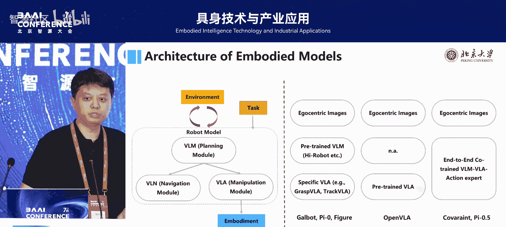

，这个机器人领域的一些方法，这个呃PRM这样的方法，然后包括这个北海比亚区这样的就就是层次呃层次规划的方法，还有那个MPC啊这样呃继续优化的方法。那那最近的话就是我就直接跳到这个大业模型。

这个就是因为跟我们的这个呃跟我的这介绍比较相关。就是大家这个现在其实会倾向于把这个大模型作为一个planner或者一个poy。我这里举个例子，这个是就是前两天我我送给这个一个一个查询。

就是让他去完成一个这个帮我拿一条毛毛毯这个任务。大家可以看到这个其实从从动作这个。

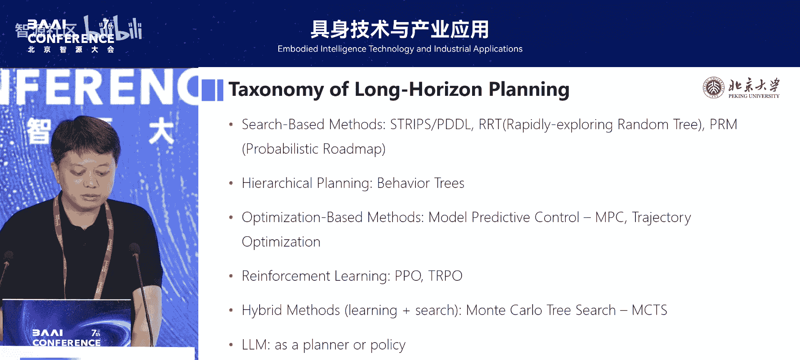

对吧就确认需求啊，到那个分分情况讨论啊，到那个异常处理，其实非常给出非常好的一些一些建议。然后这个其实在很多情况下，我们呃不仅是需要呃这个文本指令，其实还需要对呃场景。

就是我当前这个机器人周围的这个场景有有哪些呃情况要做一些呃就要做一些这个了解。所以说在呃。在很多在很多模型里面，其实还会还会把这个机器人第一视角的这个图片放进去作为呃作为输入。

然后经过这个token化之后，然后送给这个模型去做一个做一个planing。好，那我就开始介绍第一个工作，就是我刚才讲过，把这个大模型作为一个plan。它的它有很多问题。

那其中一个问题就是说它是一个单项的一个一个一个相关的。就是说我这个因为是通过这种next token prediction这种方式来去产生。那这样的话。

我前面的token就没办法去根据后面的token去做一些这个提前的一些一些规划呃。

所以我们这里的话就采取一种这种所谓的这个selfment，就是自我自我那个更自我自我提升的这种这种模式。就是说当我已经有一个当我已经有一个计划，那我可以把这个送给大模型。

让他去让他去那个就问他是不是可以再再去一下。那这样的话就是这个大模型可以被训训练来对这个模型进行这个更新。当然我们也可以把这个做成一个一个迭代的这样一个过程。就是每次我有一个plan。

我就我就送给一个那个反问器去拿到一些fe back，然后再去就是让他给我一个新的一个plan，然后再去拿fe back。这样的话整个这个整个这个过程就可以一直那个去去去运行。

然后直直到我们达到一个不动点，也就是说或者说进那个均衡点。就是说然后到这时候我们的计划跟我们的这个fe都没有再新的一些改进了。然后就是就是就是就是技术上这个可以，比如说我们用X表示我们的这个plan。

然后C表示contex。比如说我们从从这个反正反正这个反真器里面，或者说世界模型里面去拿到一些这个比如机器人摔倒啊，或者是一些情况，就是把这个作为一个context呃。然后我们考虑先考虑一种简单的情况。

就是说如果我们这里假定这个呃cont是一个是一个不变的那这样的话就是说从X0到最后那个Sstar就所谓的均衡点就有一个这样的序列。

然后我们可以把这个问题就是数据上可以转成这样一个转成这一个个均衡点的一个优化问题。然后这个问题的话就在优化方面是非常难的。因为因为你牵到一个序列就那个序列不停的去更新。

那这样的话就是他那个整个就是说它的优化有点像我们比如循环神经网络像TM那种就是沿着时间去做一个一个这种做一个图向传播。所以在在代价上非常大的。但是我们这里经过分析发现，其实可以用用一些技巧。

比如说我们根据这个函数定理，然后加上这个法则，你可以把这个就是整个整个那个最终的那个相对于参数的可转一。然后每一项的话只跟最后那个均衡点有关系。也就是说你这个序列不管多长。

我去算的时候是把这个序列的计算转成一个点计算。然后也可以通过一方式把进行进行加速。

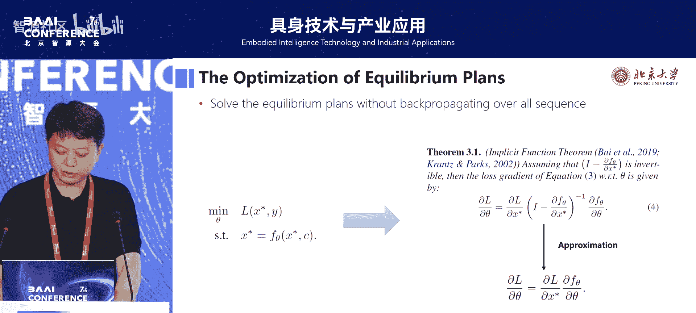

进进一步加速。然后如果我们把这个就是说呃就是反馈加进来，也就是说我每次做完动作，每次做完动作，然后这个。这个反程器或者说世界模型给我一个给我一个反馈。我们这个就是它随着随着时间在变化。

那这样的话其实也也是呃也是可以做的。就是说只不过说我前面那个很严格的数据分析就就丢掉了。但是我们在实际中发现这个这个做起来还是果还还是还是挺那个稳定的。

然后另外我们也可以比如因为这里这时候你要去你要去拿到反馈就需要去调用大模型，而那个大模型的话，它的整个的整个的这种这种就是每调一次就就很多时间，所以这个这个频率就没办法做的做的很高。

所以针对这个问题也可以我们也做了一些做了一些这个算法的一些改进，就是说做成把它做成这种的这种 solving。也就是也就是说我可以这个每次调用一次大模型可以可以对模型更更新很多次。

这样的话以把这个整个的这个调用的就降下来。然后这是整个的一个一个这个就说就跟我刚才讲，我们先通过通过这个均衡点这这样一个策略。然后不停的对模型进行更新，让大模型能够自动的去更新我的这个。

建了一个plan。然后在这个在均衡点的这个这个地方，我们我们引入把把那个把那个动作的那个gr truth拿过来，然后然后去通过这个呃标准的，就是说刚才这个策略，然后这个就是季度互互相传播。

然后对它进行呃参数更新。啊，就是对，就是然后在在时间的时候，我们也我这里强调一点，就是说呃。就是这这标准做法当然是用你有一个物理仿真器对吧？这样你把一个把一个计划执行一下，那他会给你反馈。

但这个就就说这个仿真器就不一定每次都有。所以我们这里也做了一个就是世界模型，就很简单的一个世界模型。也就是说我们知道这个某某一个某一个状态下一个动作它有什么的。那我可以把这个这些信息收集起来。

然后作为一个一些训练数据。所以可以训练一个简单的一世界模型。那这个这个也是可以做的。所以我们后面也有一些提供一些对比这是在这个就是我们现在标准的一些试规划一些做一些结果。

主要是这个第二列的第三类的这个个成功率的一个对你可以看到这个就是用标准的GPT来做。这个这个效果其实是非常差的，就是直接当盘的，这个是非常差的。

然后我们这个比如说把拉ma three拿过来做翻 tuning，然后加上我们刚才讲的那些那些那些策略吧，你可以看到一个非常非常显著的这样一种一种提升。然后如果我们允许这个就是说在就是每次每次执行了之后。

它发生错误，提的就是说这个模型接到反馈之后，可以对可以对这个对这个呃。可以可以那个对进行一些那个correction。那这样的话就是说比如说不超过10次。

这样的话你可以发现整个这个精度会有非常大的一个提升，可以从从40多提升到50多。就是嗯对。然后另外就是世界模型刚才讲过，就是说呃就是说这个整个其实非常依赖于我们的世界模型，就是说你有一个仿真器。

然后你把一个动作放进去，他会告诉你这个这个比如那个水灰掉地上啊这样这样这样一些一些结果。但是如果这个没有的话，我也那个什么就说你用这个训练数据去一个世界模型。比如说去一下拉嘛去搞一个世界模型。

这个这个结果也是可以拿到的。但是我们这里可以看下对比。就是其实在呃多数情况下，这个世界模型是没有至少目前是没有这个没有这个这个仿真仿真仿真环境的效果要好。

所以这就其我们其实这里是一个将来可以这个继续继续开发的一个点。然后这是一些结果，你可以看到这个呃左边是左边是现在所谓的这个别的方别的方法的一些这个这个效果。

你看到就这个因为他们不是没有没有没有被没有训练来做。所以说这这个经过多次之后还是会失败。但是我们的这个模型，因为那个刚才那些机制。那么他会接到一些错误的个之后就会。

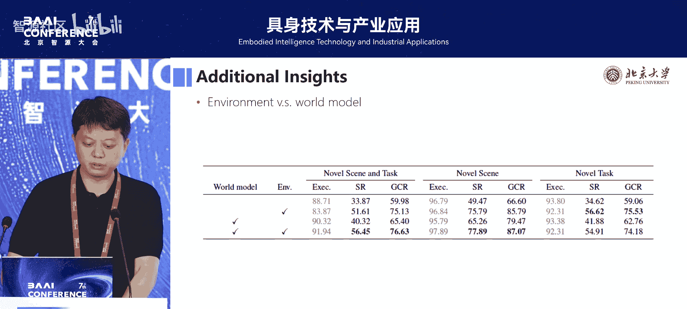

然后经过一次就可以把这个全部给fix啊，重新把这个任务执行成功。好，然后这个第二个工作是关于导航的，就是我我这三个工作分别是关于剧神大脑剧神小脑跟那个跟那个就是剧神导航三个方向。

这第二个是呃关于巨神导航的。就这里我这一页是讲这个剧神导航的。这里这里是讲那个军人导航的这个定义，就是通常我们给定一些指令。然后呃这个我们希望希望这个机器人在到了某个环境下之后。

他会他会那个就是选择一个选择一个更好的一个路径，能够完成这个事先给进的指令。然后这个之前的工作都一般都是说我们用一些比如图卷机啊这样方法去把现在的这个信息进行一些编码。

然后再就是等于是有点像那个就是非常近视的去选一个下一步，可能他比较觉得比较比较好的这样一个动作。但是这里面其实缺少对未来的一个判断。我这里举个例子，比如说这个机器人到了这个某个点，还有ABC3个选择。

这个机器人如果是说他的任务这里是那个要打扫书架。那其实这里很关键的就是说我不管是选择ABC还是什么？就是我将来的就是我往前走不管走多少步，那将来B就是希望有一个地方能能够找到书架这个物体。

也就是说我要在做判断的时候就要就要判断一下我这个往前走的时候，这个这个是不是能能能有这个相关的一些物体。然后我们这个就是这是之前别人做的这个工作。

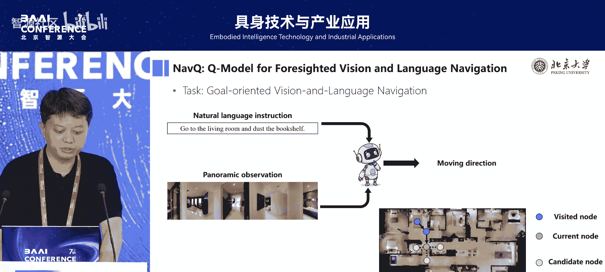

就大家要么是说我就渲染，我就那个就想象，然后这个就马上就就是就说我渲我渲染一下下一个屋子是长什么样子，然后然后就做决断了。或者说我有一个世界模型，这个这个当然我有一个很强的世界模型，对吧？

然后这样的话这样的话我可以往前想很多步，把这个把这个部署把这个这个往前多少步的这个信息啊聚合起来，然后然后再做一个决策。我们这里的话就是整个这个思路，就是说用刚才那个那个直觉出发。

就是我们希其实希望的是说在每个地方往前走的时候，我我往哪个哪个角落走，我希望这个我能马上判断出来。我在我在前面在概率上，我会看到有哪哪些物体，我将来可以看到。所以这个这个就是跟之前呢比如说强化学习。

这个因为强化学习大家用的比较多一点。在这个导航任务里面。但是跟强化学习比的话，那我们这里这个整个这个所谓的Q或者说我们的这个re不是在针对这个这所谓的这个这个奖励，而是说变成了一个一个特征的一个抽取。

就是说我们这里主要想判断我从这个地方走前走走多少步这无多步我能看到哪些哪些物体或者是这个场景。所以这个这个这里是不需要就做监督的。所以说这个完全可以用一个这个就说。

这个这个无标注数据上直接可以去做training。所以说我们这里搞的这个Q这个方法，它其实是可以在大海量的数据上做做这个预训练的。就是把这个整个呃场景的这种这种呃鲜应知识啊全部全部学进进来。

就比如说这里举个例子，这个蓝色的点是我们已经访问过的，已经走过的点然后绿色点是我当前在的然后黄色的四个点是我是我那个可能要选的。那这时候这个右边是黄那个四个点，然后它往前走的时候。

那个就是他将来要走的那些点可能要走的那点，比用红色标出来。那这部分其实可以通过就是说比如通过蒙蒙特卡罗啊这样这样一些一些技巧可以把它给采样采出来。就是说我们其实有些办法可以把这个去roout。

然后去去算一下我在这些点，那么我我将来我我可能会看到哪些物体吧比如说刚才那个子我要找一个书架，那么这四个4个场景里面到底未来我不管是走一步还是走十步，我有没有可能碰到一个书架，这个信息非常重要。

所以说我们就通过这种方式通过一个预训练的策略，然后去把这个信息给。就是学成这个一个一个Q function，所谓的Q model就返回这个值。然后这样的话就是呃有了这个信息。

我们就可以把它给现有的一些跟现有的一些方法。就是说呃作为一个即插即用的一个模块。就是之前我刚我刚讲过之前的这个方法，比如说把这个现有的现有的这些走过的路径，然后指令啊。

包括他那个呃机器人看周围的这些这个啊全景图全部做一个做为一个编码咱编成特征。那我们这个这个这个模块插进去之后，它其实可以把把那个将来的这些它的可可以选的这些这些啊场景。然后那个呃。

就是得到他的这个QQ future。就是说他会判断一下这个他将来走的话，会看到哪些东西。所以这个就是可以跟之前这些呃信息做一个融合，然后帮助机器人做一个更好的选择。

然后这是我们这个在各种数据集上的一些效果，就是这个这个底下这个例子可能比较直观一点，就是说我们怎么去呃这个左边是那个现在比较好的一个方法，就do一次，然后右边是我们的方法，就大家可以看到。

因为他这里做了预判，就是提前会判断一下，我到底往哪个方向走。所以说呃就是直接上看我们这个方法，他会他会那个就是走的弯路会更少一点。因为他很很快就把一些我我可能我找一个书架，前面没有书架。

我就把这个路给给那个给给排除了。这样的话他就走的就会非常非常直接，就很快就到达我们想要的地方。

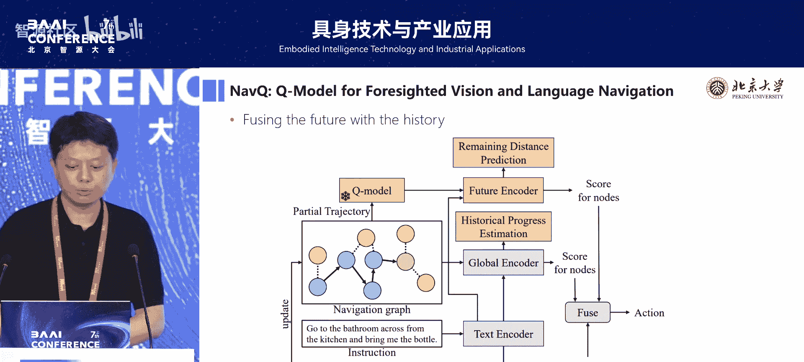

啊，这是就是因为它是一个这个即差机用的方法。所以我们这里也做了一个对比，就是你那个把一些线有的一些模型拿过来，然后我们把这个这个模块插进去，插进去，你会看到这个基本上所有的指标下。

我们都会有非非常大的一些提升。

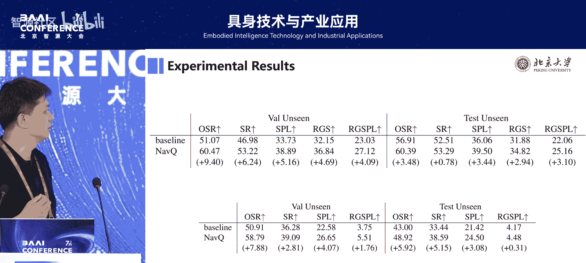

好，然后这个第三个任务是关于关于那个呃聚神小脑的。这个也是就是刚才刚才我看很多老师也介绍这个很多同事介绍这个VIV啊，就是呃这个当然也非常重要。我们这里也是也是那个针对聚神小脑，我们提了一个任务。

就是来验证我们的技术能力。就是这个任务是这样的，就是我们假定有一个假定别人搭了一个积木，假定别人搭了一个积木。那这这个积木的话，就是说呃就是像大家看的这个积木呃可能很多层，然后很多块这样搭起来的。

我们希望这个模型能够通过这个呃对这个场景拍几张照片。呃，拍几张照片，然后他要做几个，他要做一些事情，就是说要把这个这个积木这个这个积木厂里面所有的这些积木的这个类型啊，然后它的姿态啊全部给推断出来。

然后而且要把这个积木的搭建次序也要推断出来。就是做这样一个事情。然后这个事情在之前其实像那个斯坦福啊，像那个包括我们北大一些同事其实做过类似的，就是说有些是拿那个拿那个乐高积木的那个那个手册，对吧？

手册，然后这等于是在再做一个那个视觉的一个一个pasing，就是说把这个把这个这个信息呃从这个从这个手册里面去拆出来，然后来来去来去把这个读出来，就是我到底怎么去搭一个积木。

这个是这个是我们提的这个这个这个呃这个策略，就是我们这个整个这个呃，我们这里是做了一个假设，就是说我们呃希望在提前。这个场景中，每一个积木，每个这个物体，它的它的这个信息我们是是有一个库的。

所以说这个这个关于形状啊，关于关于那个纹理的这样这样一个库的。然后这个就所以是整个这个这个方法上，就是说它一方面要需要把这个多个视角的信息做一个融合。然后另外就是说要把这个通过两维的这种这种观察。

又然后去把三维的这些积木的这种这种位置啊，然全部给给估算出来。另外就是说在呃在那个就是呃大这个复现积木的时候，那么那么怎么去把这个整个的整个的这个呃答印的次序，就装备的次序给估算出来。

那这也是一个技术上一个比较难的地方。啊，这是我们的模型，就是我把我现在就把这个呃要点给大家介绍一下。那首先是就是说拿到这个拿到我们这里是采4张，就是拆4张图，拍这4张图的话。

然后对这个呃4张图分别做特征抽取。然后另外对你的这个这个这个库里面这些这些呃纹理啊，那个那个图像啊，那个是那个还有形状也做一些特征的抽取。然后这个做完之后，因为这个呃。

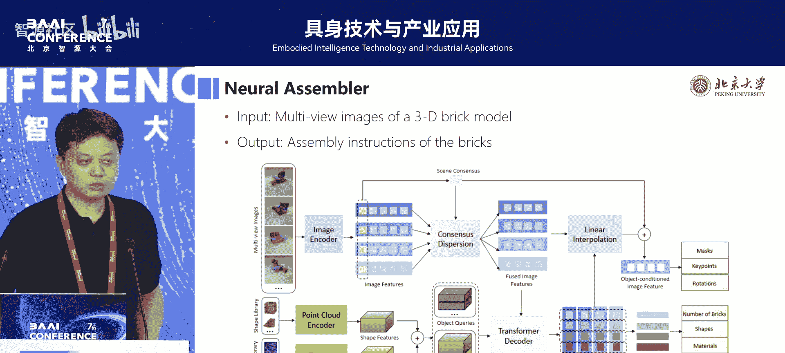

因为是多视图的一种数据。所以说我们这里也做了这个多个视图之间这个信息的一个融合。然后另外就是这个这里有点像像那个视觉里面，我们做DTR这种，就是基于呃基于查询的这种这种这这种方法。

我们把这个呃看到的这个信息，加上加上我们的提前的放好的这些库，然后作为作为这个case跟跟values，然后去呃把物体作为查询，这样的话就会得到这个场景中，就是潜在的这些物体的信息。

就是放在呃放然后把这个信息再呃再进一步的我们去接一些这个网络的一些做一些网络设计，然后他去来负责去呃就是就是。从视据估算我这个场景中有哪些的这个积木，然后有哪这个积木的姿态那个呃这个未姿。

然后它的这个它的这个中心点，包括它的这个呃装备次序。

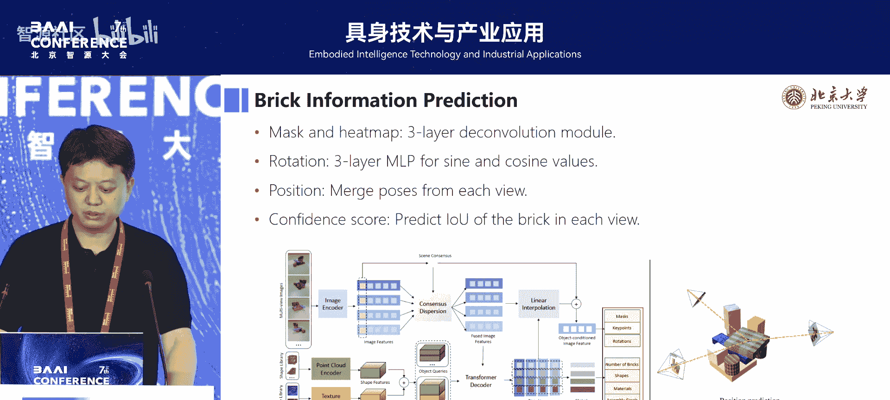

这个装备次序的话是这样的，就是说我们我们最后的实验方法是说去等于构造一个图，然后图里面的每个节点就是这个单幕的积木。然后这个这个图里面，因为呃因为积木的这个搭建它是有一些次序的，比如谁在谁上面。

那我就先先要把这个积木在下面积木就要就要放上去。所以说这是有一个就是有一个这个这个次序。然后这个在做的时候，我们就是通过一个一个凸卷进网络，然后把这个就是说呃估算估算这个积木之间，它们之间的这个关系。

就是说那个拓关系，就是估估算出一个一个概率的一个有向图。然后这个这个这个边的指向，就是说来反映出两个两个这个积木，他们之间的搭建的时候，一个一个一个相后的关系。然后这是我们自己建的一个d size。呃。

这是一些那个呃实间的设定。这个这个这个我快跳过来，因为这个实验结果都是非常呃非常正面的。然后这是我们这最后因为这个只是仿真级的话，大家可能不相信这个技术，我们这里也自己搭了一个实际的一个一个那个实验。

就是说这个这个你可以看到我们用国产的一个机械臂，然后搭了一个环境，就是这这边有那个上面是上面是那个别人的机就是别人搭好的积木，然后已经做了一个积木。我们希望在另外一个区域把这个场景重新给给那个复现出来。

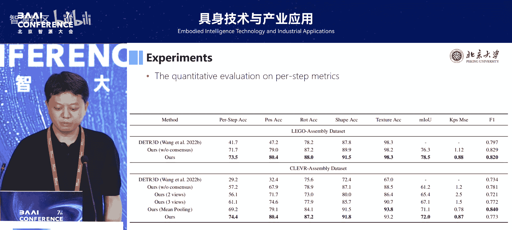

我就直接跳到这个。对，就是说他会先对这个场景拍，我们就是设定4张图，拍4张图。从不能角我拍4张图，然后马上这个这个信息会送到模型那边去。然后对这个呃对这个积木啊。

它的这个信息啊做一些呃做一些那个呃就估算它的类型，就这这边有。看这个积木的类型跟它的这个未资，然后它的装配次序，这个一次性的把这个整个用一个端端的网络全部训练出来。然后你可以看到这个例子里面。

其实这个是积木是分层的。所以说这个整个的次序应该是呃。

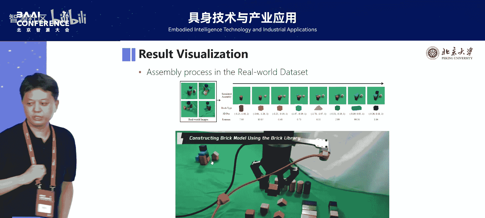

应该是那个有一个。有比较好的选择，才可以正常的去把它搭出来。好，我做一个总结，就是这里的话就针对针对这个常识规划问题。我们针对这个呃巨人大脑人小脑，还有这个。

我们分别介绍了我们自己实验室的这个近期的一个工作。然后你可以看到这个大模型现在是一个热点？但是那个大模型基于大方实里面有各种各样一些问题。我刚才举了一些这样这样的例子。就是所以其实有非常多的一些空间。

可以对它进行改进。然后这个大模型也非常这个呃耗时。所以说在用的时候这个效率也非常重要。所以我们在那个个个方里面各一些技巧去对它进行加速。

然后另外就是在很多的这个包包括我们刚才讲的这个个里面就是就所谓的世界模型其实很重要。然后对最后的那个结果影很重。这个非常关键的一个。

然另外就是说将来的话我们这里展示了就是说用用那个优化来去加大模型来做一些事情。其实就是你把一些个组合优化。

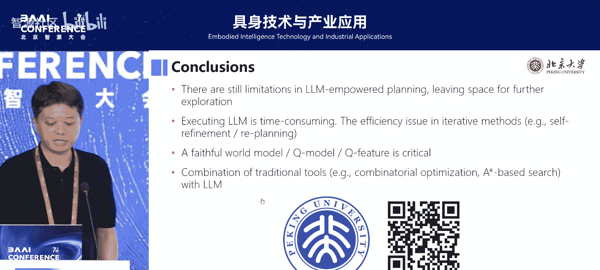

方法还跟大模型结合，往往会有一些非常好的结果。这个我们在实验室内部其实也做了一些尝试。就是说在在那比如在盘点上很多数据上，其实我们已经做了这个超过90%的一种这个这个成功率。

然后相关的技术就是我们这个这是我们实验室主页，大家有兴趣也去看一下。那后另外就是我们对这个对这个这些相关的技术也做了一些这个商业上的开发。就是有些商业上这工程商做更好的一些商业化版本。

如果有兴有兴有兴趣的话，也可以来找我们讨论。好的，谢谢大家。😊，感谢。