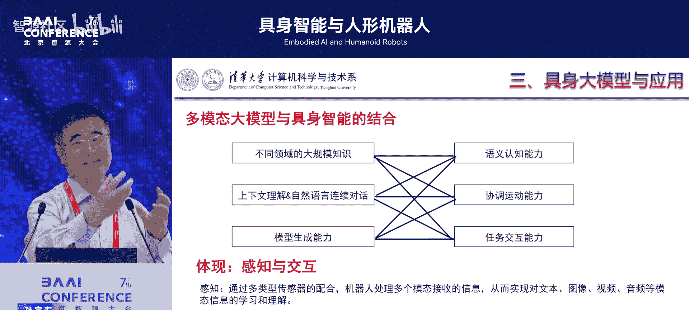
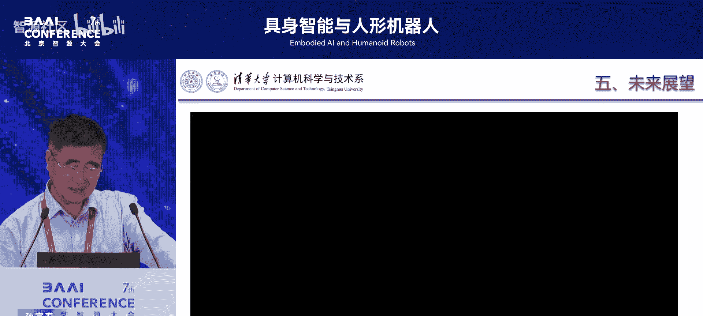
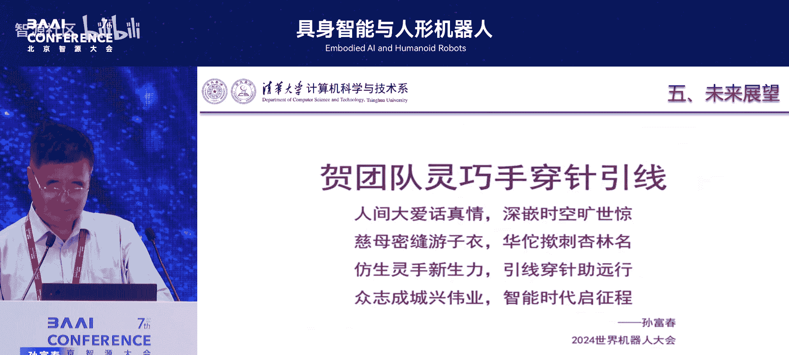
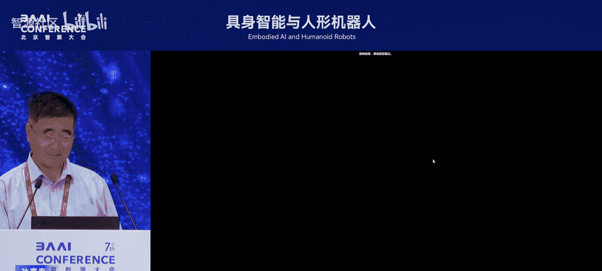

# 2025北京智源大会- 具身智能与人形机器人 p02 世界模型驱动的具身智能研究：孙富春 -BV1MSNEz8EuG_p2-

有请今天这个啊第一个talk啊，孙富春老师啊，这个给我们啊这个呃介绍世界模型驱动的巨深智能研究。孙富春老师是清华大学计算机科学与技术系的教授，博士生导师。

同时也是清华大学人工智能研究院智能机器人中心的主任。他还是i tripleEAICAA fellow国家杰出青年基金获得者，担任中国人工智能学会副理事长等重要职务，让我们掌声欢迎孙富春老师。

非常感谢王硕老师给我的邀请，也使我呢有机会今天跟大家汇报一下我的四界模型，包括四界模型驱动的巨深智能研究啊，我自己的一些认识。所以今天的报告呢看完时间是35分钟。首先我们来看一下。

世界模型里面的空间智能。其实巨生智能研究呢历来是两路人在做一路人呢是搞计算机视觉的，就是以李飞菲为代表。另外一路呢，就是搞机械人的人以赵明国为代表做巨生智能。那么这两个方面的人呢。

他对计生机的观念究竟一样不一样呢，显然是不一样的。好，那么李飞菲的话呢，在2024年在t上做了一个报告。他讲的叫有了巨生智能AI能够理解世界。那么他指出，空间智能是在三维空间中感知推理和行动的能力。

他特别强调视觉的作用。他说我们人类的进化最早是从视觉开始的，但视觉不是孤立的视觉的的话呢，它是同我们的秋老啊上丘，包括呢我们叫外侧气状体整个的这套发育系统诞生的。他认为的话呢。

其他的感觉系统呢可以通过视觉产生。所以他就是以视觉为中心。第一个呢叫视觉化为洞察，就是像我们做图像里的语理解里的，要做物体的检测空间关系，包括逻辑主体这些方面的工作。

第二个呢要在这个基础上实现对场景的理解。这就是我们经常谈到的图像的语理解。他是通过循环网络加语料库实现的。第三个，在理解的基础上呢，我要做行动，要给出三维事界当中合理有效的操作。包括互动。

所以李飞菲提了一个非常重要的字叫worker。起诉的概念，也就是说在。计算机里各件物理空间里的最小单元。这个单元的话呢，能够把一些物理属性。把它考虑进去。所以我有一个研究生就做了这个他做了这个工作啊。

那么李菲菲认为的话呢，自能体在具生智能当中，第一个要能够判别物理属性。比如说操作一个物体究竟有多重啊，我们能用手摸两下，就么知道这个是重的，那个是轻的。那么自能体就有这种能力嘛。第二个就是发现物理规律。

利用物理规律的能力。第三个比较重要的话呢，就如何做一些语言能够纠正的一些高精度的工作，他认为呢通过语言来做。啊，赵明国认为是触觉做这个可能是最重要的。最后一个呢就是多步任务的规划问题。

你比如说给定一个任务，将车体精确的打开一半，机器人能够根据视觉反馈，提出多步的操作策略。其实要到操作层面。仅仅靠眼睛看是显然不行的，所以触觉显然很重要。后面我会证明一下说为什么触觉会重要。

仅仅通过视觉推理，显然是不够的。好。那么事件模型是用于描述理解预测外部环境状态变化的抽象模型。它有两个非常重要的部分，一个就是如何。通过物理规律去理解你比如说一束花，它如何随着时间慢慢的盛开。

那么就是要掌握花的盛开的什么这个物理规律。第二个，如何利用孤立规规律来做事儿啊，你比如说咱们讲的非常简单，经常打扫卫生的人，他知道所以要把一个屋子打扫干净，先把拐角先打扫了，然后在中间部分。

像这种利用物理工具来做事情是他比较重要的。好了。那么第二个重要方面，世件模型我们把它称作叫全要素建模。这里很重要一点就是要构建力部表征来理解物理事件。你比如说我们经常看到说无人驾驶里面。

仅仅通过视觉知道一帧帧图像里面侧面的车前进的远和近。那么空间智能认为可以了。但是赵明国认为不行，他还得把这个车的动力学还得给我什么？把它构建出来，叫力部表征机制里面。第二个呢。

他有一个非常他能够预测未来状态模拟和指导。咱们讲一点，如果动力学不把它建出来，你能预测未来的发展吗？好，还有一个叫反事实分析。咱们这里如果有搞因果学习的人，就知道什么叫反事实分析。

就是我们开始理解事物里面各个要素之间的相关关系，那么有相关关系，怎么样得到因果关系呢？就要设定反事实分析。比如做这件事，有各种不同的做法，那么把这些不同的做法得到不同的结果。

通过不同的结果又反过来推证机理是什么？就能找到事物之间的因果关系，这叫反事实分析，这个谁提出来的破京购，它是获得2011年的图灵奖。好。那么空间智能和世件模型究竟是什么样的关系？

其实呢我们现在公平来讲呢，世件模型是一个全要素模型。那么空间智能仅仅是世界模型向视觉空间的一个投影。这一点可能大家是看到的。啊，但是呢通过空间视觉的话呢。你比如像我们做动作解析过程里面。

视觉是给什么突谱关系的。突谱关系在这里面是非常重要的。但是突谱关系能不能把解析成知识呢？就要用到听觉。和触决，比如两个物体究竟有没有接触上？怎么去纠偏？显然，触觉纠偏远远高于视觉纠偏。

量过去有没有连上呢？通过力的感受就知道了。还有一个就是听觉啊，我们经常大家说一个啊一个铁棍空的还是实的呀，敲一下打磨正常不正常呢，通过声音即可以去判断。所以说的话呢，我们认为的话呢。

空间制能里面通过视觉推理，紧仅的话呢，是抓住了突谱啊。那么啊四件模型呢是构建内部表征。要做到历史理解和图像和预测。如果今天有人在问我说，那么怎么解释这个问题？你比如说我们过去呢做触觉。

就把触觉一整帧图像，触觉把它变成图像，找到图像之间的失去关系。空间质能认为可以了。但是实间模型认为不行。你得把这个初决模型建出来。所以呢我们要建立么行行动态系统的办法去构建触决模型。哎。

要这一步内部机制，能么把它构建出来。最后利用这个模型呢再去生成。甚至生成更多的触决信息。所以大家看到的相互关系呢大概就是这样好。那么我们为什么要构建四件模型？在机械操作里面？其实大家看到一个重要的例子。

去搞计算机视觉的话呢，很多人现在做的机神智能主要集中在机身导航，就包括这个李飞菲，他们最近在做的无人驾驶里面，他做了一个当大家感觉到比较有意思的是，就是把雷达不要了，通过视觉推理取代雷达。

然后在做无人驾驶，但是你们看到有几个操作过程呢，特别是跨任务跨场景的操作过程，这个大家看到是很少的。啊这里面很重要的一点，我认为就是要学我们人怎么操作物体。大家看我们人怎么操作呢？

要了解这个操作环境的物理属性。操作物体的形状质地。娄性。还有什么利的反馈哎，我们在操作，就需要这些信息。我们呢可以用手去操作，有的有的要利用工具呢做导向操作。

最后呢我们要通过感知预测调整这个闭环要反复练习。所以大家看到的，我们人为什么会反要反复练习呢？就需要通过这个过程形成映射，就是通过神经可塑性建立这样一个映射过程。最后呢在操作过程当的话呢。

再做一些适应和调整。这些调整就是显得非常非常小。所以大家呢思想里有一个感觉，就是我如果做一件事，不断的做。也许将来闭着眼睛都知道该怎么做。这个就是要形成这么一个过程。其实的话呢。

我们也经常谈说同一个物体，如果这个。操作的物体在不同的状态下，其实操作策略是不一样的。哪怕是同一个物体采用的操作的什么这个木端执行器不一样，操作出来它也不一样。

大家都知道的5个手指操作物体跟两个手操作物体，它显然也是不一样。所以说话呢操作的话呢，由此大家看到是人工智能最难的问题。那么我们过去做的人工智能大今天讲说计算机稿的啊这个。比如说符号主义的推理啊。

深度学习。我们今天看的很清楚，就这个开环指路。但是操作一段引入就是他要包括闭环大家看到的。你看感知预测调整。第二个很重要什么？还要上升到论知程度。所以呢我们来看的话呢。

我们应该充分理解我们人是怎么操作物体的。然后呢，把这些东西的话呢，把它用到。整个的这个操作过程当中。好。所以呢我们一个很重要的观点就是如何构建一个沉浸式的感知。

而这个思想呢也是1962年麻省理工学院reach heard。他当时提出巨深的时候提出的叫沉浸式reaction。这个沉浸式rection呢就是要构造一个计算机的环境，要跟真正的物理世界产生沉浸感。

那么现在有哪些工具在做呢？你比如说这个unified robot descriptionform像它主要做语意和运动结构的模拟。还有一种的话呢叫unit做抓取操作三维层层。

最近呢这些工作里面也开始注入了光照啊啊这些材料啊，这些物理属性呢慢慢构建起去了，像4。5，大家也看到了，最近呢也考虑了一些物理属性在建模过程里面的这个作用。

所以大家看到了机械的训练环境呢在逐步逐步的向沉浸式发展。那么当然第二个就是在计算机事件里面，两个物体相互作用产生的reaction怎么去体现？这个呢我想也是世界模型构建的比较重要的部分。由此呢。

我们看到四个方面值得我们后面去研究。第一个是3D改制技术如何获取深度信息。另外呢，第二个就是乐府。三高斯flating啊，这个机缘建模将感知变成三维模型，这是第一部分。第二个部分就要做空间推理。啊。

这个推理的话呢，要做特色感知。这里包括物理运动的属性关系啊，你比如说像我们团队呢很重要的一个工作，就是如何通过视觉听觉触觉能够做操作物体的形态感知，包括它的物理属性啊，它的重量转动惯量。

包括它的这个钢度tanness啊。第三部分呢就是要用在动态交互和操作过程当中，能够在多变环境中与人和其他资能性进行有效的交互。最后一个就是怎么用在这个操作规划过程当中去。所以呢我们觉得的话呢。

现在的计算机环境，包括exus，还有其他的一些你看列出来了thether啊。那么基本上来讲是点源为主。缺乏力觉触觉发觉与真实场景呢差距比较大。再一个无法复现真实环境中智能和环境的交互。

而基于仿真所吸得的技能，也难以应用到真实场景。后面呢我们有个公式，推导了一个公式，给大家解释一下，说这种沉浸式究竟有多重要。所以呢正是因为这方面的发展呢，它限制了以操作为主导的居生智能的发展啊。

所以呢我们要构建呢我们提出一个新的名词叫数字物理系统。它能够实现的话，沉浸式，并且呢做高鲁棒的强可迁移的啊这个研究。这个呢就是我们去年发表的一篇文章，发表的HV上面，它就是构造一个沉浸式的。

数字物理系统它包括了像物体的质量、杨氏模量、不松比、转动惯量。第二个，这个物体每个实体包括自能体的动力学。包括呢它的非钢体属性的操作目标，包括力觉运动触觉和接触触觉的产生。

那么这里一个很重要的工具用的就是。叫神经辐射场和三高tting相结合，实现铰链物体的建膜和沉浸时相互作用。好，这个呢大概是我们做的一些工具。因为时间关系呢，我就不一一再讲啊，包括刚性。铰链重建啊。

包括呢还有如何跟大模型结合做这种复杂铰链的重建问题啊。这个呢都是一些工具好。那么再一个的话呢，就构建这样一个数字物理系统呢。接下来呢就是我们叫世件模型，就观察它在三维世界中的推理。

其实我们大家都知道一个装配过程呢，通常要有大量的任务。所以这里面首先要做一个工作，叫任务编排。这个任务编排尤其重要。如果不编排好呢，就有可能说这件事做完了。

其他几个事再做其他的时候发现前面几个事影响了后面的操作，甚至可能要把前面的什么操作拿掉。所以这里面的话呢，很重要的就是空间位置关系的推理问题啊，这里呢还要考虑到几何和图谱。你比如说面板这种装配过程。

先装哪个后装哪个，他都要考虑到什么物理属性这一块。第二个部分我觉得比较重要，就是多模态的这个推理过程。啊，我们团队呢这方面呢做了两方面的工作。一方面是同构多模态的场景感知问题。

主要这里讲到的就是深度信息，和RGB信息，分别是什么？边缘特征和形状特征的做物体的分割，包括重建过程。那么第二部分呢，实际上我们做的就是视听觉和触觉的我们这种录配对的这个物体的重建问题。好。

那么再一个呢，就是如何利用。这种世界模型来结合物理属性做精细操作。空间智能体如何根据物体的位置、几何属性、材质进行操作？再一个就是如如何做人机协作里的意图理解啊，提高人机协作的效率，包括呢交互的安全性。

那么再下来一个工作，就是如何从三维感知到四维感知。从单纯的几何信息到时空联合的物理信息。最后呢从空间推理。到物理推理。这么一个过程。那么在这里的话呢，我们提出了一个工作。这个工作呢。

当然发表了今年的工程上，就是我们提出的一个baant的举生词人体。它有物理的感知部分，也有物理的行为部分。再有一个呢，像人力的大脑啊，他能够来做推理，就是实现了刚才谈到的三维到四维，从空间到物理。

那么世这模型构建以后呢，一个很重要的就是我们实现了过去从被动感知进入到了主动感知。而，这个主动感知不是我们现在大家这种强化学习实现的，它是大脑的嘛，知识引导下的这种主动感知。

第二个呢就是从单一模态到模模态，包括同购模态到异个模态。然后呢，我们确实提出叫如何从依赖模型到融合知识。那么这里面我们特别谈到的就是知识加端到端来实现这样一个过程。当然这里面也牵扯到一个非常重要的东西。

就是大模型，我会后面会单独讲时间关系啊。那么下面我们谈谈知识的迁移。在这里究竟发挥一个什么样的作用。其实我们大家都知道，我们人为什么能够做通用操作，就是因为我们人从小到大学到了大量技能。这些技能的话呢。

分为感知层面的技能，认知层面的技能，运动方面的还有操作层面的这种技能。那么这些技能的话呢，如何通过。反复的学习。形成呢老体协同。那么这篇文章的话呢，基本就谈到这个过程是如何构建的。以后呢。

以及让他如何实现学习和进化。那么时间关系的话呢，我以前的报告里有如何构建知识、感知层面的啊认知层面的操作和运动层面的。好。那么最近呢我们正做了一个工作，就在一个物理数字系统里面训练一个策略。

当把这个策略迁移到真正的物理世界的时候。这个策略物它的上界是多少？那么这个上件大家看到了，我们有这么几个从最优策略部分到样本分布。到样本数量就带标签的样本数。那么这一点就大家看到了，是带视觉样本。

视觉标签、触觉标签、听觉标签在这里就发挥一个非常重要的作用。第二，再一个就是如何做减少样本会导致的趋势迁移的误差。这几个方面，从这个地方我们不难看到。那么标签越多。当然呢，这个上界就越小，说明的话呢。

沉浸是感知它的重要性。好，那么这个呢就是我们构建的一个学时同步的数字物理系统和迁移学习的啊一个软件系统。这里包括触觉的模拟啊，包括。用过神经复射场的渲染，最后通过剧神强化学习实现了这样一个操作过程。

这里的用到了什么知识引导，包括呢学习过程中导致的交互残差，如何通过神经符号系统来修改知识这个过程。好，下面呢我们介绍在制造业方面的应用。那么这里的话呢，我们做了两个比较重要的事儿啊，一个呢就是。

面向单机。第二个是面向云边端，而面向云边端呢，我觉得是应该是下一步聚生智能面临的重要问题。而这个问题的话呢。显然很重要啊，那为什么说它重要呢？我想讲一个非常简单的例子，现在中美大贸易战啊。

其实我们的公司啊到美国，欧洲去建厂都不赚钱。那么为什么不挣钱呢？就是全市人工费太高。你比如像美国欧洲的，他的这个主原材料也比咱们贵很多。唯一的办法就是把赵明国老师做的机器人带过去。

然后通过云边端实行远程操作。啊这个方面呢，我觉得一定一定是下一步居神智能研究的核心问题。好，那么下面谈谈我们团队啊，最近在居神智能大模型方面做了一些工作啊。那么其实大家也都知道，大模型呢。

它只不过给我们的垂直方向提供了这么几个方面。大模型呢有内部资源库，可大家知道的。第二个，它垂直搜索能力很强。第二个上下文对话。第四个是样本生成，模型生成。这个模型生成呢包括了代码生成编程序嘛。

说白了就这几个好处。聚生有什么好处呢？说有一个机智人体积在咱们的空间里，跟咱们在一块交互。哎，把这两个一结合。

会带来什么呢？其实呢我在这里讲的很重要的里面就是这个大模型里一定有一个沉浸式的实验室。这个实验室呢一定是计算机构建的软件实验室，它跟真正的什么实验室之间一定要交互。也就是说我很多的训练。

我是在大模型里训练的。而真正的来源是哪呢？现实中的物理系统。所以这里面大家看到我们提出的数字物理系统的概念就发挥比较重要的作用。它能够跟远端的环境进行交互，进行模型修正。这个修正呢是两个层面的。

不光是动力学几何。感知层面。这也是为什么我觉得比较重要呢？就是感知层面和动力学相关全要素要构建到这个环境当中去。这个呢我就不多说啊，你看我们构建的正式场景，在数字物理系统里面各跨场景的训练。

最后呢进行最后呢把它迁移到真正的实界当中去。那么这个呢是我们跟立讯跟BIRP在做的一些事儿。这个呢是最近我们广东省的一个项目验收的一个小视频跟大家做一个分享。那么这里呢做了几个方面。

一个是手机的打磨作业。这个是软排线的。装配是比较难的，而且呢这个它是有各种类型的软排线，所以对它的装配整个的泛华能力和鲁棒性是一很高的要求。其实大家看到的。

我们现在用来操作的整个过程用的是一个末端来进行的这个也是居神智能未来执行器方面的一个非常重要的工作。就他能够根据操作对象的。几何形态、物理属性，它能够做通过博弈进化变构型啊，实现这样一个过程。好。

下面呢我们介绍一下未来展望。其实大家看到的大模型目前用在操作里面呢，大家经常提到的就VRL啊，还有pame啊，这些呢基本上从计算机视觉过来的。那么他比较难在哪里呢？第一个。

如果通过语言去描述机前操作的行为。那么这里的话呢，就用到了通过文本去描述图坑啊。第二个呢就是视觉的图坑的设定，然后呢构造训练啊大模型训练。那么这里大家明显看到一个重要的部分，触觉到哪里去了。

那么这就是为什么赵明国同志，他从计算机从机器人过来的时候，觉得触觉怎么去做他是这里面比较关键的一个问题啊。所以说呢VRI肯定是不完整的。这个大家不要去讲啊。那么在这里面的话呢。

一个很重要的部分就是如何构建训练环境。嗯。你比如说像现在的大模型，我这边提到只用到了图文视觉的。这些数据显然是影响未来跨场景跨领域操作的一个重大瓶颈。在这地方。第二个就是语言在论知方面的作用。

2、那么大语言模型为什么具有很大的作用，很强的推理能力呢，主要是语言和知识的有效利用。2、推理规划输出如何有效转为具体的行为控制策略。再一个呢就是看到VR它缺少了足够的控制轨迹啊。

所以尾轨迹采样呢就显得比较重要。我也听到咱们现在这个王王贺老师也在做训练场是吧？其实这个上海人行也在构造了100多人人形做训练场。那么因为前面我们有一个先例，就是这个英伟达啊。

这个英伟达现在构造了120万条轨迹。这个数据量是多少呢？32个TB。那么我们最近也想做，当然我们的目标是更多。200万条轨迹。52个TB的数据。所以大家看到的大模型训练聚神智能很重要的一块。

就是大模型训练的这种轨迹产生啊，而且呢多模态轨迹采集需要同步怎么采啊。前面呢大家看麻省理工他们推出一个单模态轨迹采集器，那么机器人显然不够，做导航够了，但是做操作可能一点都不够。

你比如像我们我跟风斌写了一本书，我们第七章就谈到一个轨迹怎么采。轨迹我们一般触觉要采叫两路触觉，两视觉要踩两路。触觉。啊，所以多模态的这种轨迹采集啊，我觉得未来的比较重要。

再一个就当然比较重要的复杂操作技能。他如何通过高效的主动思考建立动态策略？那么如何做实施训练？所以大家看到的就是从构建这样一个沉浸式的世界模型，如何到任务初步的规划，通过思考尝试。

通过虚拟事间的交互和执行。不断经炼。好，再一个比较重要的就是犯在场景。巨神模型的采集。其实我们大家都很清楚，我们希望我们训练的策略具有很强的泛化能力。就像我们今天做了一个大模型，将来推广到各个工厂里去。

那么希望在各种场景下，它具有很强的鲁班性和泛化能力。所以这里面一个很重要的部分就是要用到对抗学习。要生成各种不同的路径，不同的物体的操作特性，包括通过多步学习，提高这种泛化能力。

你比如说我们如何通过强化学习来实现策略覆盖，让每一次学习覆盖更多的这种场景和任务，在不同的任务过程里面去精炼模型，通过精炼的模型又怎么样得到最好的策略，实现呢学习和进化。我觉得也是未来啊比较重要的部分。

那么再一个呢就是制能体究竟如何通过学习掌握挖掘规律？以及呢如何。设计开发评价体系评测来验证这种通用智能性。这就是我们现在谈到的一个叫巨生图灵测试。那这个方面的话呢，工作才刚刚开始。

我上一次在中国聚神大智层大会里面，我提出了我很多一个章节谈到了巨神图灵测试，这种闭环测试究竟怎么测。而我们今天的图灵测试都是开盘测试。其实这方面的话呢，牵扯到很多问题啊。那么我们团队呢这几年的话呢。

一直在做巨神指能，相关的工作呢也用在了一些国际比赛当中。去年我们在日本呢获得了2024两个赛道的冠军。那个我们在这个用在3C里面呢，去年也是获得日丽瓦国际发明奖的金奖。啊，主要在操作方面。

那么今年这个呢是我们研制的凝翘手新一代的。

这个林翘水呢，我给大家做一个很好的介绍。这个零销所的话呢，是负载12公斤地外全程。而且的话呢，我们现在的一秒钟的。即谈次数是20次。大家知道我们人是多少呢？16次过去大家看到的用机械弹钢琴。

包括我当年封冰我们做的这个弹钢琴。在8年前在中央电视台，去年强老科技也在弹钢琴。一个最大问题就是激烈的声音，弹不出来。也就是就是我们宁翘手的一秒钟的击谈次数，达不到人16次。

但是呢我们现在现在到做到了20次。所以下一步呢我们就要开发这种能力。就是让宁翘手谈这一些什么比较激烈的音乐。啊，再一个呢我们现在呢我们正在研发出0。05毫米的新一代处理传感器啊，当然成本比较高。

就是我们比较头疼的问题。你比如说装在指尖上，这个零撬手卖出去，可能传感器可能就要增加1万块钱。所这是我们感觉到这个下一步如何降低成本的问题啊。那么去年呢，我们借用了这个林巧手在深圳参加比赛嘛。

我们拿到了这个冠军，去年是104家单位啊。再一个呢，我们今年呢，说实话我们没有去美国，我们参加了一个线上的sem的比赛。那么经过呢有8483支队伍吧，我这里我看到有马省理工和哈佛大学啊，都是世界名校。

我们在三个单项比赛，包括总分都拿到了冠军啊，这个是助力人性机器人的。那么最后呢，这个再把这个结果我用了几次了啊，就是关于这个灵翘这传针引线。那么为什么我强调它呢？他用到了感知和行为的发语。

我们一起大家在。看一下。🎼Yeah。🎼Yeah。🎼，🎼这个刚才我们是。🎼穿的是硬线。🎼那么接下来我们穿短线。🎼其实大家都知道老太太怎么穿这一鞋啊。🎼是把这个软线的线头部分要在嘴里什么。

要捋一遍来增加它的钢度。🎼我们主要通过石子和。🎼母子。🎼是不断的磨蹭，增加它的钢度。🎼所以大家看到的，我们这下面有一个。🎼展示的是触觉。🎼，这个呢是我们去年世界经英大会上展录的这么一个视频。

其实当时华珍写了一首诗啊。这个我就不念了，但是呢我给我们这次会议啊，我写了一首诗。

就祝贺我王硕老师的居神智能和人心机贤的这个论坛。

不他好的。这个呃。呃，非常感谢孙老师的报告。那么我们看时间的原因，我们呃这个在座的呃各位听众提一个问题，好吧，抓住机会啊。好好，那位同学好。你好我来听下。然后我想问一下。

就是您觉得负觉得这感谢下一步降低成本的。就我目前可见有哪些？好的好的，我觉得这个问题问的很重要。其实传感器的发展呢也是下一步。像协作机器人啊，包括呢像像在人形这个人机协作领比较重要的部分。

目前触据传感器呢研究呢主要有老的方法，比如说一些压阻式啊，电容式。这种磁传感器。还有我们在座的基于V视觉的触置传感器。那么将来要降低成本呢，我觉得从这几个方面，一个比较重要的方面就是材料技术。

其实现在想做V视觉的处理传感器，它成本质所以比较高呢，就是它的材料，像辅轴层的材料、弹性体这些材料。他价格比较贵。所以呢，如何进一步的降低材料？第二个呢就是工艺啊。这个你比如说像我们卫视纸也是同样的。

它目前比较贵，主要原因就是它的战设要在一个平方厘米上面做出几百个特征完全不同的标志点。这个工艺水平也是很花钱的。所以呢我将来觉得应该从材料工艺进一步的简化这种制助成本来着收。

当然我们讲说将来进一步的增加批量，增加产品的数量，那么这些都是未来降低成本比较重要的部分。好的，谢老师。然后呃我自我介绍一下，我是中科大二级微电子卞耀亮。然后我想问一下。

就是像作为这种就是呃芯片领域的这个呃就是本科生。然后就是如何就是呃把就是用自己的能力来为这个机器人行业做一些贡献。我觉得你将来的用途太大了。现在呢就是居身智能一个非常重要的部分，就是智能计算，有前移。

要迁移到传感器和执行器上。而，在前移以后的整个处理过程就需要芯片。所以你的专业将来不光是在卡脖子的大模型训练里面有作用。在我们这个小小的传感器上，你的芯片同样发挥巨大作用。

老师请问这个传感器主要是数字数字IC是吗？对好好，谢老师。好，谢谢孙老师。