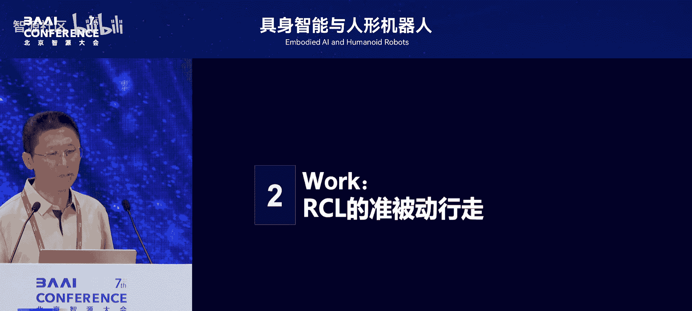
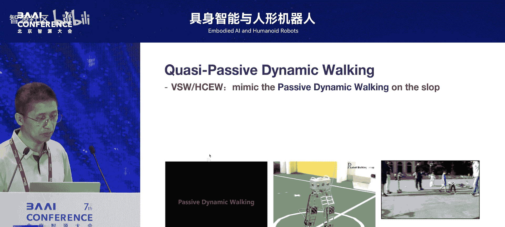
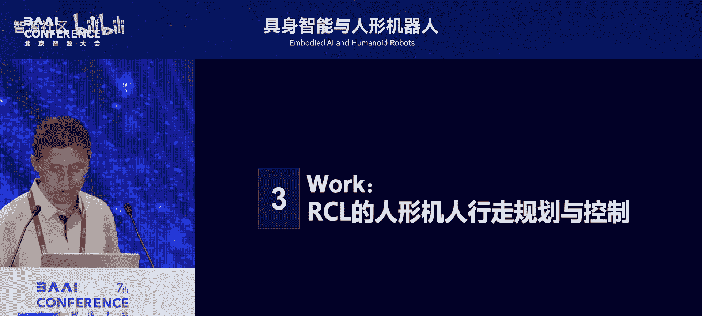
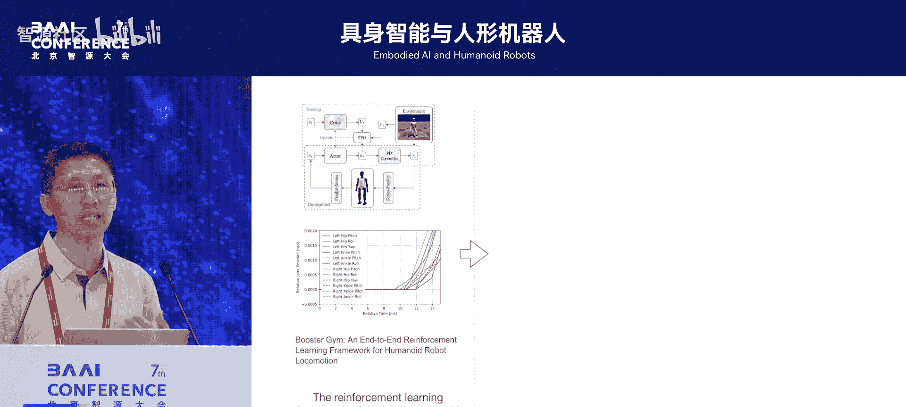
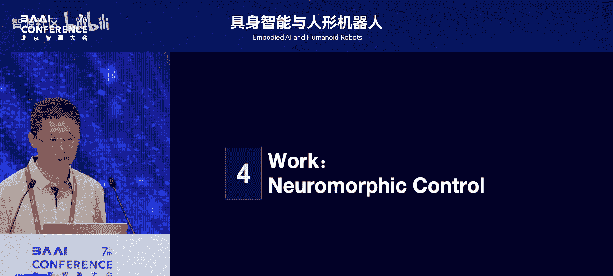

# 2025北京智源大会- 具身智能与人形机器人 p03 人形机器人的仿生—从控制到具身智能：赵明国 -BV1MSNEz8EuG_p3-

那么下面呢我们把topic呃sw到人形机器人啊，那我们呃欢迎清华大学的赵明国老师给我们带来人形机器人的仿生。从控制到具深智能啊。

赵老师呢那么也是清华大学自动化系的研究员、机器人控制实验室的主任清华大学无人系统中心类脑机器人中心的负责人。他发表了数百篇论文授权国家发明专利十余项。

在人形机器人领域呢提出了虚拟斜坡行走法广义模型预测控制等等啊，具有影响力的工作。他的这个用类脑技术构建智能无人驾驶自行车的工作呢啊发布于啊发表于nature封面。

被评为2019年度中国科学十大进展来让我们听一听啊赵老师精彩的报告。呃，大家上午好啊，这个那个我以前也经常看一些脱口秀节目，开场的都是有孙老师给我们垫底，我们后面就好办。呃。

我我报告的题目是人心机器人的仿生，从控制到巨生智能。孙老瑞原来也提过，我原来是搞机械的，然后又去搞控制。然后最近又又跨界到这个巨身智能的这个这个这个这个范畴里面来，其实我也很糊涂，有很多问题跟大家一样。

所以我这里面有很多都是问题啊，不是能给大家做答案，也都是我的问题，可能引起大家思考，就是最近一直在提巨生智能。然后呢，我也不知道这个问题是怎么个缘起，或者是让大家好多人追溯到图灵那个方面呃。

我就好比较好奇啊，我就去查了一下，呃，我我想还是要给生物一个定位，既然叫仿生嘛。就大概在人类这个发展过程中，呃我们700万年前。😊，是直立行走，开始使用工具，到200多万前呢出现了语言。

然后近几万年前才出现了文字，就是我们有记载，大概7000年，但是肯定是之前就有。然后呢，近几百年才出现我们现在这些工艺，所谓的更现代的这些智能。所以我想这个我们巨人智能到底是指什么？我个人理解啊。

其中起码有一部分是在文字出现之前，就是我们如何去行走，如何去使用工具，对吧？如何原始能爬树爬山，对吧？这些到能用石头到最后用更复杂的一些工具，这些部分是用了几百万年进化而来的。

然后我们大部分现在高级智能会写诗会作画，会唱歌会跳舞，对吧？这些文学艺术是高档的这些东西呢，可能是最近呃几千年才出现的对吧？这可能是我们高级的这个智能，所以整个这个智能情况。那我们去搞巨人智能。

我们应该怎么搞，可能跟这个有一点底层的关系，所以我我大概我希望。🎼好的这个范畴呢就是前面这些就是运动相关的操控相关的对吧？那它并不一定用到。所以我比较好奇，就是那个VLA里面那个L到底是指的是什么。

对吧？就是大家可能含义也不一样。大概我简要的通过这几个方面来做些介绍，先介绍我们的实验室，我主要做人形机器人，从最开始我工作开始去做。然后呢，呃最近几年又做了一些关于这个这个类脑芯片方面工作。

主要是在类脑和机器人的结合，呃，这个些工作，我我就简单有个小的视频，先给大家放一下，以便于大家理解，就是我们用一个。

🎼一块内脑的芯片，然后在一个自行车上面呢，呃当然这个相对是整个内脑中心的工作，就是把一个自行车完全它的感知控制决策全放在一个芯片上。然后通过这个内脑芯片这些算法呢把它完成。

🎼这样呢这个对我来讲就是芯片设计是一部分。然后呢，对我们找机器人的来讲呢，就是能够在一块芯片上把这些都做完，我觉得是一个非常呃完美的一件事情。所以这个我就一直后面还坚持做一些这方面的工作。

那另一个就是这个呃足球机器人，我一直在做机器人、踢足球这件事情。然后呢，希望通过这件事情能把智能的问题解决掉。然后当然更多的是前期是在搞这个控制问题。我就快送过了啊。那么呃最开始我们怎么搞的这个工作呢。

就是偏力学的一个叫被动行走。这个是呃。

两个工作呃，这两个工作都非常有名。然后呢，第一个工作就叫被动行走，就是一个纯粹的机械结构，可以在一个斜坡上面，它可以给一个初始条件，就自己就可以走下去，就形成一个稳定的周期性运动。那么根据这个工作呢。

2005年康奈尔在 science上做了一个工作。这个机器人可以呃非常拟人化的就是完全能量效率跟人相当这样跟人效率几乎是99。9，这样一个条件去行走。那这些工作呢它结受两个道理啊，我就用两个简单视频。

这个抽象的力学层面最基本的两个道理，就是占最主要的一个是落地的碰撞和一个摆动腿的摆动。如果把这两个问题结合起来。那我们其他走路就很容易去实现了。就是说我们的骨骼就自动的带有这样的力学特性。

那是个非常力学的一个一个一个工作。所以他要被动行走。那根据这个工作呢，我们会做很多。😊，呃，这样方面一些工作就是把被动的这个原理啊，在斜坡上行走研究搞得很清楚。然后呢把它放到平地上去。

那用某种控制的方式或者驱动的方式替代这个斜坡的作用，那产生这种就是准被动行走。就是它在力学是和被动一样的。但是它能在平平地上行走。那它自然的效率就会比较高和人的情况就比较接近，这是非常仿生的一结果。

然后呢我们再去增加更多的控制的层面，适应地面的各种环境。呃，这个在2005年到201几年这个期间，这套逻辑是非常有呃就比较科学性，很多很多人认可的。但是它没有解决最终的复杂问题啊。

我在这个里头做了一些工作。呃，主要是这个几个方面。哎，嗯第一个呢是这个从被动行走，被动行走前面呢，我们加了一个弹簧，就增加了它很多的这个它的稳定性。

这个这个地形就可以极大的增强这个被动的这个这个这个行走的效率和它的能量这个这个。

这个状况。然后呢，基于它呢做了一个所谓的虚拟斜坡的方法，这个方法呢就可以用一个开环的控制，但是它自身具有一个稳定性，就是说能量会自动的控制它的能量达到一个平衡状态，还可以很好。

然后呢利用髋部两个弹簧之间的耦合。那我就像大家髋部运动的时候，髋部这个有肌肉肌肉上面有肌韧带这些东西可以产生一个自动的这样一个规律，可以产生一个非常稳定的这样行走。啊，这些都是早期的一些工作。

那这些工作呢很难在具体应用的作，但是可以帮助我们去接示一些这个力学上的原理。那另外的一部分工作呢，就是要我我我中间从15年到21年和深圳的UB险合作。

我们要去做一个它的walker这套系列机器人的这些工作。所以我们基本第一步呢采用了这种呃简化的动力学模型。那实际的方式说动力模型做一个规划，做规划这个轨积之后呢，那然后用控制的方法。

让机器人各关节来实现这个规划，然后去。

🎼cherack这个轨迹，然后产生这个行动。如果这个发生干扰以后呢，那个轨迹又重新来进行规划，就形成一个大的闭环。那在这个里面我们用了一些仿生的原理。

就是说在也是基于被动的现我们有一天那呃s的子檀上面讲这个人类走路的时候，相当于一个倒立板，它的支撑点实际是在地下的。所以我们就把这个摆呢就也放在了地下变成一个就是一个虚拟的倒立板这样一个支撑点的方式。

所以它产生效果就自然的在一个脚印上会留下一个支撑点的这个这个CMP轨迹，这个和人的这个轨迹就比较接近。但它整个这个模型就非常简单就可以实现。😊，那我们做的另一部分工作就是这个到控制层面了。

就控制前面都是做的非常简单的控制。但是到16年以后，因为从大pa搞个DRC比赛之后呢，我们都在去做这些呃叫基于优化的控制。那么形成两个方法，国际上就一个是WBC一个是MPC啊。

这两个东西呢其实全部是用优化器来把问题解决掉，就是把机器人的控制问题和规划问题全部定义成一个优化问题。那我们基本这样理解，我个人理解这个事情其实非常简单的两步。但是就是操作起来，对具体问题要具体去落实。

那第一步呢就是要建一个全动力学的模型，就是这这个部分权力动力学模型呢把机器人的所有的多任务和多个约束放在一个优化问题里去去，就是我机身同时要实现多个的任务目标。但是同时呢我带有很多的约束。

比如说每个关节上的这个力的。约束运动范围的约束，速度的约束，以及一些我们难以理解。就是走路时候，比如说你的ZMP不能超过脚面，这些约束通通的放在一个优化器里面。如果能求解出来。

那这个控制就可以实现保证这些执行。但是这个执行起来，计算量非常大。你很难去呃做特别复杂的运算，所以做一定的简化。但这个时候它必然是在整个完整动力学模型下，就变得非常非常的这个有效。

但是它有一个重要的问题，就是无论你怎么优化，只能在当前的时刻做优化最优控制。但是比如说我们骑自行车，我们看到前面呃有一个水坑或者有一个什么，我们会避开。但是我们不会说等到我撞到这个墙或者撞遇到这个水坑。

我再产生这个行为，所以应该有很强的预测。但如果我用一个优化器来做预测的话，这个计算量就太大了，不可能用全动力学模型做预测。所以我们就会通常会产生一个简化的模型，在它前置上面去做一个简化的预测啊。

就像我们做一个导航，我们不会。考虑我们的车是四个轮子开，还是我们骑自行车，从我们现在会场到天安门怎么走。但我们基本认为它是一个呃小的钢体简化模型去做。所以简化模型把持这个预测之后呢。

由全动力学再去校正去跟踪。这两个配合起来，我们就会解决很多问题。呃，我我曾经做这个问题时候，觉得这是一套非常从控制角度上非常完美的方案，无非是大家把这里的问题做细做的很清楚。啊。

我们做了比较早的在国做了一些这方面的工作。比如说很早在19年就做了一个小的机器人就可以呃当然它是利空的，就可以在呃各种粗糙路面上去行走。然后包括呃抗这个干扰，也可以包括这两个机器人呢。

就是在受到两个地面的干扰和整个这个这个这个上升的这个直接的干扰啊，包括握手这些都都就在这个方法下比较好的做。但它问题是。😊，只能对一个任务要一套方法去做。

要有一些有条件的这个研究人员要花很大的精力去把它实现了，然后再验证。但是换到另外一个场景下就比较困难了。他就这个事儿就是很完美，但是实用性我觉得可能还遇到很大的挑战。嗯。

那么后来因为很多人都在强化学习上做了很多工作。呃，我我后来从去年我也开始做一些强化学习工作，但是主要场景还是基于踢足球，跟大家一样，做了这个仿真的训练，然后我们增加了一个叫虚实融合的训练。

主要是为了验证代码在部署上是不是在可行性，现在另一个仿真里用真实的这个控制器把这个代码再步一遍，看看行不行。如果行的话呢，我们去做。但是我们做的事情呢，典型的跟踢足球相关有这么几项啊。

第一项比如说是行走，呃，第二项是踢球，第三项比如说是带球呃去去用视觉来带球，然后和这个这个因为两个机人在比赛中会发生对抗。那这种我们叫做push recovery。

就是在push的情况下能不能保持继续的稳定站立。另外呢一旦摔倒之后呢，那应该怎么在站起来，就是快速的站起来，就这几项工作是最基本的。当然还有一些比赛辅助的。比如说我们希望这个机人能够被我拖着从。😊。

场外呃，或者他发生违违违力了，然后裁判能够直接拖着他拽着机器人的后背，就把这机器人拽出场外。然，如果是没有这项功能的话，那就这个我们有p recoverycovery。如果你去拽它。

它就相当于这个机器人是会反抗，在那使劲的对抗，这个就不好，应该有些拖拽这个功能，这个我们也正在做嗯。基于这些呢我们去做了这些呃一些尝试。所以我们开发了一个最基本的就是强化学习的基本框架。

在这个框架下呢做其他强化学习。然后呢，我我们第一个做的就是想快速爬起啊，p car这些都都可以在第一个做。然后呢，爬起是单独用一个两阶段学习的方式。然后未来我们希望做另一个比较通用的框架。

就是直接基于端到端的，就是通过视觉直接感受场地的这个环境，然后直接到机器人怎么去。

走路去踢球这些行为的产生啊，初步有一些结果啊。那我重点讲一下这个关于神经这方面，我们做的一些想法，就是大家都看这个机器人是在操作，和我们希望他和人一样完成这样操作。但是我们都知道这两个是不相等的。

主要原因是我们在机器人里面是用的一些控制的方式在完成，就传统的控制。那就各各种控制的方法都在用呃很很复杂的方法用。但这两个呢就是机器人的操作，在效率和效果上面都达不到人的这个状况。

所以我觉得这块是在力脑上面可以做。那我们怎么去从大脑里面去找一些这个要素来去做，我觉得就是很重要的一块，就是从仿生的角度，我从呃元器件到原理层面，人人到底是怎么完成这些操作的嗯。

那回过来我们回顾一下这个大脑就是神经系统就在运动的控制。这个神经系统方面，需要这样几个部分，就是有大脑是在做运动的规划。它大概大脑有690亿的这个神经元。然后呢，小脑部分呢是在做复杂的运动控制。

是综合各个关节的运动，保持身体带流畅这些东西。那大概有180亿的神经元。那脊髓这部分呢是做简单的运动控制，就包括简单的反射和一些节律性的控制。我们的心跳，我们的呼吸可能都是由这个脊髓在直接控制。

大脑其实我们谁也控制不了我们的心跳对吧？就是这个这个那它呢大概也有7亿的神经元。然后还有两个部分就是胸脑和脑干，大概也有7亿的神经元，其实参与到我们整个运动这个里面就是我们做一些简单的就是说行走。

能够使用一些工具，实际上是5个部分在参与。我自己的理解啊，就是不仅仅是我们的小脑部分，其实大脑也参与。这些是一个复合的一个一个结果。那我们看怎么去利用。呃，我就想去抽象它一些功能。

我们希望能够做到用脑的方式呃，脑的某些特征做一个结构，然后呢把原来的控制给它剃掉，剃掉之后呢，那我们近似的等于它的效果和效率，能达到这个人操作的这个水平啊去做。但这个需要一个探索的这个过程。

我们希望解决这块的这个这个这个这个目标。当然这个里头分成两部分工作。就是我们想借鉴中枢神经系统对它进行一些抽象或者是描述，把它最主要特征拿下来。因为我们不可能第一条啊。

不可能去完全揭示开这个神经系统工作的详细的机理，然后按照这个机理，重造一个这个神经系统，这个不是不太可能的，也不太现实。所以我们去抓它最主要的要素。那这个时候呢，然后再通过数学和物理方式熟现。

那第一部分呢，我们希望把利脑的仿生的算法解决掉，就是这个算法呢只依赖于结构，只依赖于它的一些计算的方式。不依赖你用什么器件来做。因为我们CCPU也可以做。

只不过它没有呃GPU没有类鸟器件的些呃那些方面的这个这个特性。但是算法的结构方面特性是有的。然后再去做硬件的部署，就是从硬件再进一步提高的效率。因为这两个中间存在着我我在实践过程中发现存在着巨大的耦合。

就以说现在器件的能力受限。那你这个算法就提高不了，就无法得到验证，所以我还必须找到一个方法，说我这算法可以控制一个全身呃几十个自由度的机器人。那这样的话芯片呢只能去计算一个无自由度的机器人。

那你这个就没法做了。所以必须把这个耦合概，所以我们把它分成两部分，先要解决第一部分。我们现在目前做了一个简单的尝试，这个工作就是啊类脑的东西，然后我们分成一个和大脑基本相似的一个框架。

然后呢再设计一些类脑的数学的这个或者算法的实现。然后再把它最终未来会部署到一个芯片上面去去通过这个来解决掉啊，就是那么这个脑的工作和神经就密切相关。我们知道啊我们现在是两代的神经网络。

那实际上第三代的神经网络就叫脉冲神经网络，对吧？就脉冲神经元，它实际上就是说细胞膜里面的这个离子的电位和内外之间有差，到它达到一定程度以后，它就产生了放电啊，对外去传递信号，但信号是脉冲形式的信号。

那这个呢我们现在的AN不是这样做的AN是变成连续系统，它是个脉冲，但是这有很多其他的好处，这样它是什么信息比较丰富，它计算效率比较高。简而言之就是能量效率，就同样一个计算。如果你用脉冲神经网络做。

那它的能量效率就会比较高啊，它的计算的这个编码。也比较高效率，就是在时空两个方面去做一些工作啊，大家可以参考一些其他的工作。那我们这样就说它里面这些是呃五个部分是什么数突啊、细胞体啊、轴图啊。

突出这些计算功能，我们想利用它来做。那看看整体对整体的结构，整体结构呢，我们分成了呃抽象来做的，就是所谓我提取的信息，就是五个层面就是一个大脑小脑丘脑脑干和脊髓，把他们的各自工作都列出来。

就是说大脑是明确参与到运动这件事情，整个我们的神经系统分成了5块工作共同参与这里面去参与到这个工作里来。但是另外一个就是神经这个信号角度，从感受器它向上存在一个信号传递，就是我们信号感知以后。

向大脑上面一路传输。然后大脑这这个这条通路里的每一个区域都会做出处理。然后在向下分别做向下传输，所以存在着两个传输的通路，一个是。向上的信号传输，一个是向下信号传输。

就是我们的控制系统里也希望能够体现它这个信号两个特性。那同时呢这个里边传说就是存在着三个回路，就是这个三个回路是它叫一阶神生理上叫一阶神经元，二阶神经元和三阶神经元。所谓一阶神经元，我觉得非常简单。

就是在我们手上有最简单的。比如说对热的这个感受。然后呢也有肌肉的驱动，但这两个神经呢就是热的感受器呢和神经，他们在脊髓上就就就就就能连通，对吧？所以当我们比如说被烫到以后，这个手被烫到以后。

这个神经马上就会发出很强的脉冲，但这个脉冲一直到往大脑上要传一节一节的要传递。但它最先传递的就是手上的这个肌肉，这个手上肌肉马上就产生长期训练就我就产生这个人的本体就产生这个收缩运动了。

所以这个手已经收回来了，收回来结果呢我们过了0。5秒，大脑才知道哦，我被烫到对吧？所以这些行为它不是说大脑时我感受烫到了，我做出角色，我要手收回来回来，这是事后的这个事情了。

但是这个你整个手是由好几个肌肉组成的，这个烫到时候还能可能做一些摆动，甚至要放到什么地方，对吧？像降降温或去避免这个烫伤。所以小脑部分也还有其他的工作，协调多个关节，大脑最初整体的角色。

所以整个这个过程是一个综合的反应。这三节第一个回路就是本体这个回路。第二个回路是在小脑呃附近形成的回路。第三个回路才叫大脑。这三个回路呢就是当然工作的频率也不一样，这个底层一接的非常非常的快。

就瞬间就一个反应周期就回来，希常叫做反射。然后上面这个反应就会比较慢，大脑可能会在甚至到一秒钟左右的这个反应时间啊，就是零点几秒这样反应时间。所以这个跟好多其他领域里的尤其张老师们讲这个快系统慢系统。

我觉得可能也有一些生理的相似性啊，就是但这个就是我会把它简单提升三个，就是相当于快中慢三个回路啊，我们控制里经常也采用这样的办法，就是你计算不过来。😊，那我们把它真呢进行了这个用SN去做了一些实现。

就是对大脑模块，就是小脑模块怎么去做。但是大脑模块呢是怎么产生这个运动的？我后面会有一个PPT专门讲这件事情，我就没有去在控制这个层面，就控制成面只涉及到这四个模块。

就是没有涉及到大脑大脑是另外更复杂的一个一个过程，我我们这个研究就涉及不到了，就把它剔除了，就是默认是有一个大脑给我产生的运动的需求。然后呢，我们下面怎么用仿生的方法去执行。

所以用小小脑这个模块产生一个重力的补偿。呃，然后呢，秋脑模块呢产生适应对负载变化的一个适应的一个一个一个一个功能。然后呢，脑干模块呢提供一个反馈的系数的调节。然后呢，脊髓模块体现这种最基本的反馈。

就通过这个脊个功能的不断叠加。然后把这个整个这个控制系统做下来。然后那它的一阶回路呢，就是最底层的这个就是脊髓。模块就传感器到脊髓到执行器。然后二阶回路呢就是从传感器到脊髓到脑干。

然后从末端执行器到丘脑，这样整个就是脊髓执行器这样一个回路。三阶回路呢就是到最上面去了啊，就是从传感器到脊髓到脑干到胸脑丘脑，然后向下又回来，最后回到这个执行器，这样的一个一个三个复合的回路。

但是第一个回路非常快。然后第二个回路呢控制周期是中等的。第三个回路工具是长的，可能甚至长达到一秒钟左右做一个长期的规划。那这个三路复合结果，这个信号自然就存在上向上行和向下行两个这个这个通道。呃。

那我们用了一个这个基于搏松编码的这种LIF神经元呢就是非激发神经元去做它。然后呢，产生就是。主要是做它的拮抗。因为我们任何一条肌肉，比如说对肌人控制一个关节。我们通常比如说一个电的驱动。

用一个电击控制这个电机的好处就是可以双向控制。但是我们人的生理结果不是这样的。人生理又是一个关节的双向运动，是两个肌肉对抗的结果是个拮抗肌。所以我们用了两个神经元分别代表一个是向左，一个是向右，对吧？

就是一个是正，一个是负，在这两个共同作用的结果，还产生了最终的这个运动。呃，后面我们看数学公式，实际上这个运动的结果呢。

和这个我们传统的这个PID公司里面对的很多东西是一样PID里面其实就是一个你的指定和你的这个实际两个的差。对吧我们希望对位置速度和其他方面都做一些要求。所以这个跟优化的过程一样。

所以脑干模块呢也基本就是在实现这样1个PID但是它和传用PID的方式是，它可以每个地方都产生很多的调节啊和优化的这个这个部分。

所以他用了我们用了很多的这个就是这个呃就是这个SN上面的一些一些概念把它用网络的方式来实现了，不用一个数学公式来做啊，就是到秋脑模块。那么到小脑模块呢，因为小脑要涉及到多个关节的耦合。

所以用了一个SN形成的这种就是这个这个叫叫循环神经网络。但是这个里头技术细节，大家可以用不同的神经网络都可以啊，就是逻辑是他因为这个地方要产生运动的序列，要对未来的事情做预测啊。

对我们主要是对负载和空载这个很多东西做做事应。所以这个地方呢就用了循环神经网络，就用一个比较深的一个网络。但是大家比如说我。一个呃类似于transformer这样也可以，但是显然可能太大了，没必要。

就是稍微有一个循环特性的就就可以了啊，就可以把这个就是记忆的功能和推理的功能做出来啊，那么整个这个结果是这样的。我们通过一些类脑的算法啊，把这个放进去，然后通过仿真和实物来验证。我们怎么验证呢？

就是在轨迹跟踪上面，因为大脑的任务是产生轨迹，然后呢，我们现姑且这么认为啊，因为未未来是研究发现如果大脑的任务呃轨迹到底是一个命令还是一个结果，我们也说不太清楚，对吧？但是我们现在对控制来讲。

把这个当成一个指令，就是给我轨迹，那我要去追这个轨迹，那我们就会追不同的轨迹，就是因为人的运动，比如说画一个圆，其实对人来讲是很很难的一件事情，对吧？达芬奇要画极碳，就是很难。

但是对一个机器来讲画一个圆相对就容易，对吧？就是你对一个圆规来讲画圆就是更最简单，它是画的最好的。所以这个时候呢。轨迹的剧烈的程度，比如书法家的轨迹的剧烈程度和一些日常生活中操作。

这些都不是我们机器人擅长的。就是剧烈轨迹怎么去做。那我们选了不同的轨迹。同时这个负载呢也选了很多不同的负载，就是负载，就但是对机器人来讲都是未知的。就是机器人在训练的过程中，它有一个标准的负载。

但实际上我们给他执行任务的时候，我们并不知道我抓的一个杯子是一个空杯子还是一个装满水的杯子，还是装满里面装满了沙子的杯子，就是它是完全不知道的，就要求这个机器能够去适应这个不同的轨迹和不同的负载。

都要完成同样的这个操作。那么经过这个实验和对比呢，我就不放这个视频啊，因为它是就简单的动，其对大家看视频来讲也看不出来，就是从外侧性看不出来多大的区别。那我们对比的和传统就是工业机器人的这个差距。

我们发现底下有这样一个特点。因为第一点就是从这个曲线上面看，呃，人类的运动的曲线啊，有一些特征，我们不能一一对比啊，但是有一些特征会体现。在这个就是我们在我们这个方法里面会体现出一些相似的地方。

第一个就是这个我们的关节的刚度和阻移的状况会产生一些变化，会产生一些相关的一些关系。跟你的任务会随着这个东西变化。那传统的工业基群控制的时候呢，就比较难。因为要么是设定好了。

要么是某种自适性的算法去做啊，就相对难以有这种机制去产生这种变化。所以我们得出一个结论说脑这个脊髓的模块和脑干的模块呢，是可以产生某些类类人的一些方式的那你只要恰当的去做。

那另外一个呢是在这个就是丘脑和小脑模块，这个就是怎么去实现的重力补偿，怎么去呃表现负载的，根据负载自动调节这些变化的规律。就是我们方法里面有这些自动变化的一些曲线，和人在同样的情况下产生的这个变化曲线。

也有一些相似的关系。如果传统方法就是乱的，就没有这种对应的关系了。所以我们得于就秋脑模块和小脑模块是。以类人的方式在工作啊，我们就想这个是能够。初步有这样的一个结论。那么另外一个呢。

整个的控制框架就是对呃。变化的这个负载的一个突发一个负载的变化，就是左上面这个图，就是我们突然间让这个负载里面空的杯子里面，突然间给它倒进去沙子。

那发现这个这个因为我们里面的丘脑的部分有一个强化学习的这个这个适应负载的过程。它会在非常短的时间内启动这个在线的强化学习。然后很快就辨识出来适应这个负载，然后以这个正常情况去运行。当你再突然改变的时候。

它又产生一个学习的过程，然后这和我们突然间抓一个习以为常，认为默认一个杯子里，比如说是满杯子水，突然抓到你是空杯子的时候，你会很快就适应。然后就就然后发生变化。

人也就适应我们特意做这个情况呢去测试它的结果对比和人类的反应其实差不多人也有一个非常短的适应的过程，就人的适应系统可以非常快去调节这些要素，所以我们觉得这个控制框架。

基本在这三个方面能产生了一些这方面的类人的一些效果。然我个人的一些思考，这个也是这个是临时加进来的就是最新。两天被一个呃就是属于这种呃不是我们专业内的人去做，但是他要把这个事情理清楚。

这要我假如累脑到底和这些你能不能取代VLA我想了半天也没有办法，我大概想的结论是这样的，就是我们在大脑方面就是中间这块，我们在做VLA对吧？很多人都都在做。是当前智身智能研究的这个主流或者主战场。

很多人都在做这方。实际上我不管怎么样，你是有一堆传感器在向里面做输入对吧？视觉的输入语言的声音的输入啊，有力的输入甚至嗅觉的输入或者其他等等等吧。就个很多输入都要输进去。实际上对面是传感器输进去之后呢。

呃最开始我们VRAA是简单是微嘛。那输进去到底A是什么？对我我我自己的理解是对着你还是用大家所有的演示还是用一个传统的机械B来实现的这个机械B的控制还是用传统控制器来做的。

就是那视觉传感器传听觉传感器这些还是用已有的传感器做。所以就是主要的部分就是在这边如何把一个传感器的信号变成一个控制的指令，就变成。😊，一个我们的关节角角度对吧？角速度这些指令要要要让控制去执行。

或者是这个这个操作空间，就是我的末端的一个轨迹啊，对轨迹怎么提都有不同的理解啊，那但是一定是轨迹，然后你交给控制器去做啊，这是传统的，就是说我们创新的部分，原来是有一个规划器，现在没有规划器了。

你是VLA那等等等啊，很多方法都在做，这是当前知识智能要解决的问题。但是我们内脑呢。我做的类脑不在这个上面去，不解决VLA的任何问题，也替代不了VLA这是是大脑的部分。

但是比如说有人做这个SN的这个这个这个VRAA或者SN的trans。那他可能去做这部分。但我觉得是什么呢？我们可以做内脑的视觉内脑听觉内脑触觉和内脑导航等等等这些工作这些工作和器件非常僵硬。

我觉得典型工作，一个人黄老师没在。然后我们这黄小军老师数老师他们都在内脑视觉上最近有很大突破。而且邵老师他们是去年的也是 nature的分面，就一直做做一个就是这个类脑的传感器，就说视觉传感器。

那这个方面因为他偏器件级，他可以做的我觉得做的非常完善啊，就可以照传统的相机，照传统的传感器有非常大的革命啊，不是导航利用海马体或者一些结构，可以做内脑的这些部分工作。但对我来讲呢我不做传感器。

不做器件没法做这一部分。但我可以做后面的这个我前面讲些。😊，大概是做把传统的控制器用内脑的控制器控掉。所以基本对应起来，就是我们内脑工作。呃，当然我觉得短期内在VLA这层面肯定做不过，就是现有的方法。

但是可以在前端和后端这两个层面，在一个是在器件层面。另外一个在后面的控制器层面可以做很多这个改进和改进，那么对比的是传统的控制器啊，那你会得到一个比较大的提高。所以我自己的理解，要否则就会被问的很混乱。

但是你去我们做了很多也叫聚深，但是人家问你能不能替代VLA这个这个事情永远会谈不了。我就跟大家做一个简单的汇报。我知道另一个事情就是人形机器人啊，这个是主主流，就是这个里头有很多问题。

人形机器人巨身人到底怎么搞，大家对人形机器人的期望也很高。但我个人觉得呃还是要呃把它给一个很好的一个定位。我通过几个例子来看，比如说我们做这个机器人。

他可以就参加去年呃人人形机器人的这个这个就是这个humanize这个国际会议上面有一个小的竞赛。这个竞赛任务就是机器人绕过障碍去开门。呃，以速度取胜为主。那实际这个过程呢是由一个操作拿着遥控器去走的。

但是这个机器人是怎么样的？是他自己走的，然后呢，智能的成分是人来遥控器，通过遥控器来做的，否则他也不知道怎么开门，他也不知道怎么对。但是它智能成分是帮着他适用地面的这个起伏啊或者干扰，这些它是能做的。

所以这个就是loccomotion加 stability，就是带有稳定性的应用，但这个也是就是我们就用RL做的那另外一些，比如说。这些大力的气球。我大家觉得可能4起来也挺费劲的。😊。

包括大家看到很多机器人机器人的跳舞翻头对吧？他都是也是locomotion加就是只不过它的难度要比走路更难一点，要对硬件的要求算法要求可能都有一些不同的要求。

但是总的来讲共同特性都是只是把运动是运动简单运动复杂稳定性要求高与低这些差别没有太大的这个区分另外一个工作呢包括我们也在做庞老师也在做很多人都在做这个这个机人必须需要的一个功能。

但他的我的理解是不仅仅是一个动作他也需要对外部的做一但是不是明确的感知说我一定知道坡度多少知道这个这个地面粗糙程度到少是但是他对外面的感知这机器人不是死的，一定要把这个动作做出来，他是相对是活的。

再起来干扰情况会起来自己的理解是什他对外部的我们里面会有一个状态的这个判别器。这个状态的感知恰好用到。和走路或者做一个动作，同样的传感器，它不需要做一个视觉传感器来判断就可以了，对吧？

如果你要视觉传感器，它就相似。所以它这个相当于呃就是要有一个locmotion stability，再加一定的适应性。它是靠本身传感器可以做到这些功能啊，那再往下看。🎼这些是靠视觉决策就可以做到，是吧？

虽然这个其实很简单，但是它是用视觉来替环所以完全不知道这个球在什么地方，他要去实验找球，然后追到球。那这个机因就是一个活的机因人。所以这个研究和前面的研究应该是不一样的。

那我们还想做的就是通过视觉到行走到踢球，这个疑次端到端完成，同时也具有一定的稳定性。嗯，因为这个结果还没有完全这个逻辑框架没有缺好只分半个初步的结果。🎼它产生的结果就是对我的激光软觉就踢球特别快。

就不用再想，就直接就踢了。而且他永远知道这个门在什么地方，它内部去做了一些这个概念的调整，但实际上还是一个端到端的，就没有中间的一个比谓大模型，整个是一个强化学习的过程。在强化学息要带有视觉。

从视觉到行为。😊，就多目标的一个情况去去做。所我们同时要学习走路，同时要学习对一个逻辑的一个判断这样一个东西。那这个时候我慢慢我就大概有点感觉说怎么能促进我们人性机器人发展，我们做了那么多。

其实我们做的很少。那第一个就是我们基本都在最下面这一行，就是从能力来讲，就是闭着眼睛做的运动，闭着眼睛做走路跑步，到翻跟斗什么等等等，只是难度的变化。那第二层就说如果能不能加上视觉，能够有感知情况。

作为一个导航去完成一个情况。第三个呢就是到上面一层，就是说能不能去提一个更复杂的这个运动。因为我只要球门在什么地方，中间有障碍，我要避开带有一定思考和决策，然后再往上一层呢是团队的行为。

比如说两个机人传球，然后呢，再到这个这个多个机人障碍啊或者怎么去决策。这这上面一层呢是说一个团队，两个机人队做对抗。然后甚至到最后是机人队和人类的世界冠军队做去做对抗。这样难度。

那实际上看，我们现在做做的能力，如果从最深角度来讲，大部分坐在这个我这顶标的就是最底下的就L0，有一小部分工作能进入到L1。所以要想做到一个机身实用，那到家庭生活或者到场景中去用的话。

可能要到L4这个层面。或者到中间某个层面。所以我们要很多很多工作去做，所以大家就不用特别呃担心说机器人还在用遥控器在控制有什么问题，就永远是在智能没有达到最上面这层之前，就是两个二元的复合体。

就是一个人和这个机器人对吧？永远在复合，只不过人的这个操作员的那个那个站的成分是越来越少，最后降成0，但是这个能力的提升，这纵轴方向我觉得是智能水平的提升，最底下的底层可能就是具身智能的层面。

但到上面咱们产生一个团队的行为，这些可能要大脑的介入。然后呢，这个横向的我觉得可能是任务的难度的增加，不同难度要求的。成果也不一样。那对应这两个呢，如果智能水平增家，就是希望硬件的复杂度。

你传感器的复杂度，这个这个这个这个这个这个这个计算的器件的复杂度都要增加。那对应这点呢就是计算的这个算法的复杂度需要增加。啊，我把后做的些工作一些思考呃，给大家做一些汇报啊，谢谢大家。

这个非常感谢赵明国老师啊，应当说您的这个talk从仿生的角度给了我们很深的一些启迪。那么呃我们时间非常有限，只有一个快的问题啊，有哪位同学想或来宾想提问吗？好呃，还是刚刚那个同学啊嗯。

那你这次只能问一个问题啊，来，你说。然后打问一下就是那个天新的那个加译D。然后就是的话你们集成到，就是把所有的那个就是复理机构，就是集成到一起。就是您讲的那个那个。啊。啊，因为当时还是做科研。

它不是一个商业的芯片，所以基本是呃史老师的学生和我们的学生，我们几个教授的学生在一起手工传的，有人负责做算法，有人错这个东西直接是对里面写的最底层的程序了。就是因为认为比较简单。

但商业芯片是有一些工具链在去解决这些问题的。啊，是过的。问题大概就是他。像哪些就是都集成了我同一个芯片能。好的，部分就是。呃，感知控制决策交互都放在一起了。好，谢谢老师好，谢谢。好，再次感谢赵老师。

