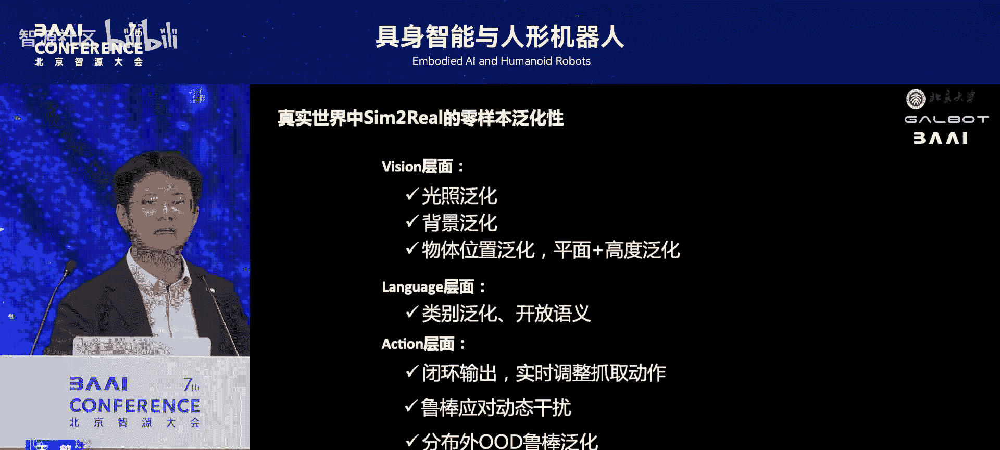
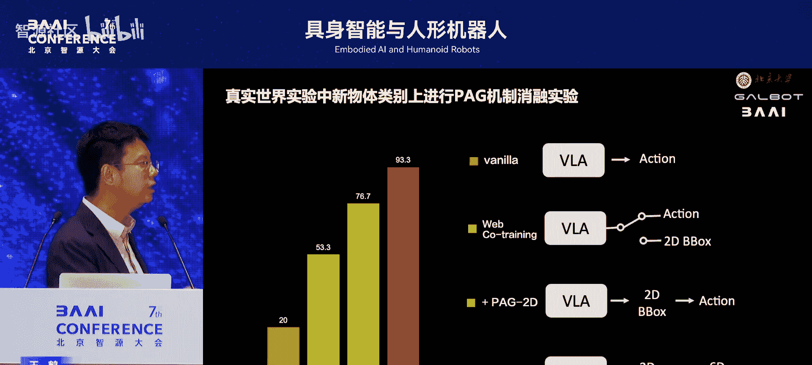
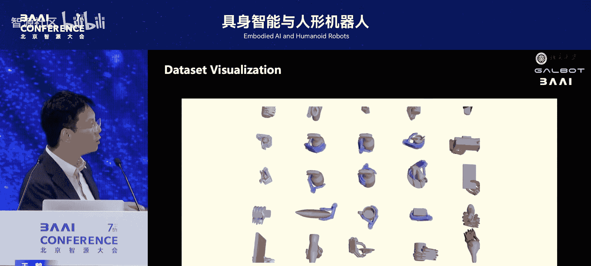
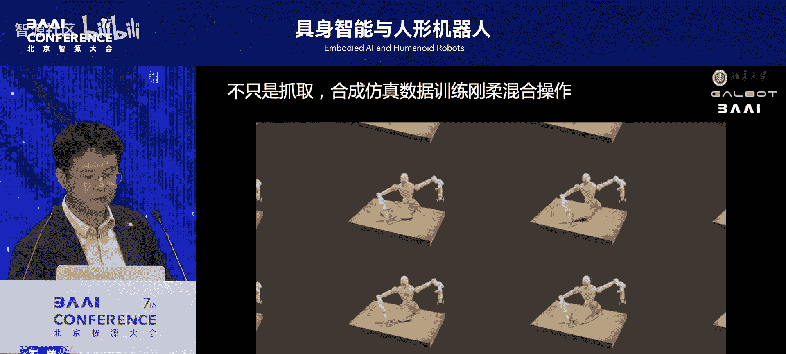
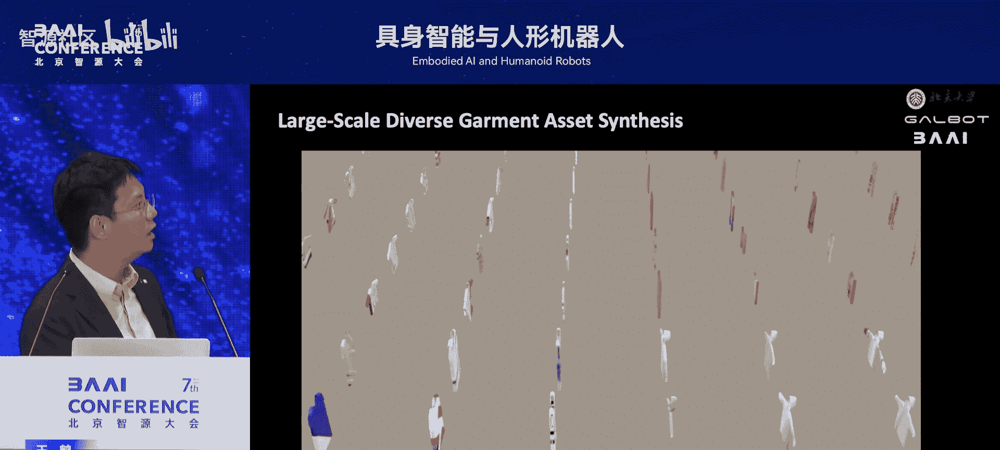
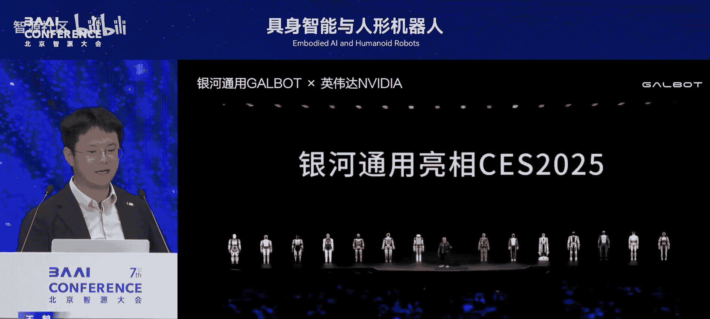
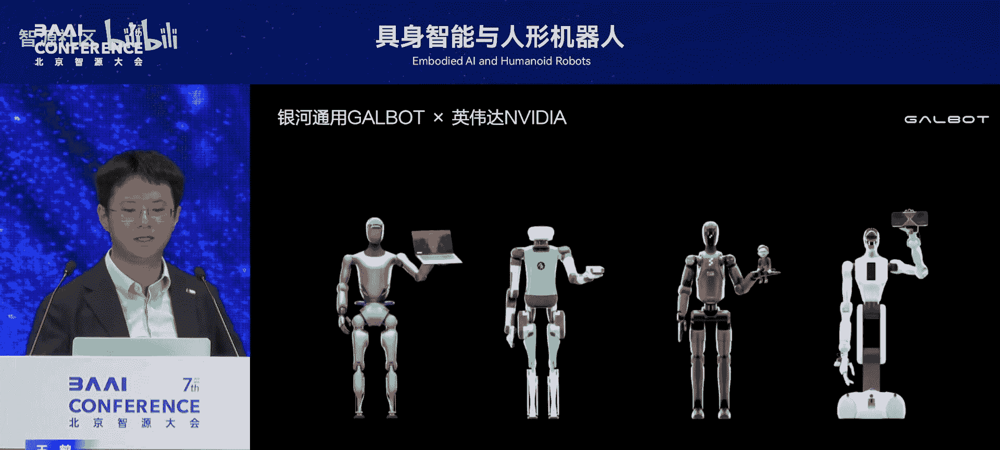
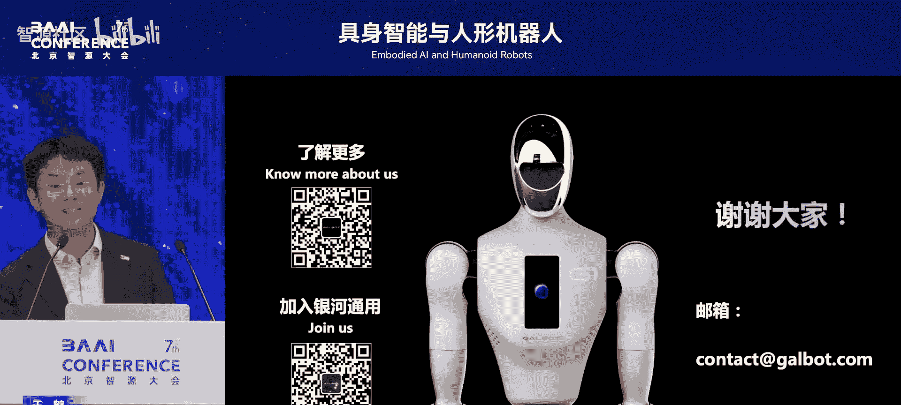

# 2025北京智源大会- 具身智能与人形机器人 p04 合成数据驱动的具身VLA大模型：王鹤 -BV1MSNEz8EuG_p4-

那么下面啊就由我跟大家这个呃这个我们一起探讨一下啊，就是非常的热闹。也同时呢呃饱受争议的这个VLA啊，这个vision language action model。

那么呃这个我相信呢今天啊在座的很多人啊关注巨身智能，关注人形机器人，其实最本质的原因呢是你们希望有一个通用啊，通用的人形机器人啊，通用机器人啊，那么通用机器人的本质是什么呢？

就是啊能够通过具身智能驱动高自由度的仿人本体，实现呢人干的活，机器人都能干。这个就是我们讲的通用啊，那么这样的通用机器人呢，它不是啊做某一件具体的事情。它呢的这个目标呢是啊服务千行百。也千家万户。

那这里头呢背后必然有很多的问题啊，就是它的这个本体应该是什么样的，它的控制应该是什么样的？它的智能应该是什么样的？里面呢有哪些模型啊，哪些呢是对应我们人类的大脑，哪些对应我们的小脑。

哪些对应我们的脑干等等等等啊。那么今天呢呃我想说的呢就是这里面一个啊非常promising的这样的一个技术路线就是呢VOA啊，那么VOA呢，它其实是这个vision language action啊。

就是视觉语言动作模型，这样的一个简称啊，那么这样的一个模型呢？我们可以看到。它呢首先是一个端到端的这个多模态大语言模型，它的输入呢是我们人类的一个语言指令啊，这个是非常啊这个重要的，实现通用的一个关键。

因为你随便说什么话，给这个机器人听让机器人去干，它都能干。这样的一个指令的接口是比我们用一些这个数字化的，说让你实现多少速度，实现多少加速度投低多少更加通用的。那么另外的一个重要的模态，就是视觉啊。

视觉呢其实占到了我们人类每时每刻这个信息输入啊，每天信息输入量的80%以上。所以说呢我非常认同前面几位嘉宾讲的视觉不是全部啊。如果呢你说只要有视觉，这个人就能够这个干所有的事情，他肯定不对，但没有视觉。

基本上也没有活，是靠闭着眼睛干的对吧？所以说我们要实现通用机器人的话呢，先把视觉模态纳入进来是非常重要的。那么它的输出呢。

它这个呃模型的输出呢是action啊action呢在最原始的这个呃谷歌的这篇RT two的文章里头呢，它的方式呢是直接输出这样的谷歌的这个everyday robot它末端执行器的瞬时啊。

这个手腕的瞬时屏动三维屏动和瞬时三维转动啊，那么这样的一个这个机制呢，它呢是可以用我们下面啊进行IK繁结以后，用这个控制的这个PID controll啊，PD controltrol等方式呢去执行的。

所以如果我们要类比啊，我们按照刚刚赵老师讲的，我们这个呃人体的这个呃运动控制的这样的一个啊。大脑控制的这样的一个系统。那么我们的VOA呢，它首先是用于实时生成轨迹的啊。

那么控制呢我们是把它交由给这个在这个工作里是交由给机械臂的这个啊做IK以后呢，在基于positional或者positional velocity controltrol去执行的。所以它不是小脑。

它是大脑。那么同时呢啊这个呃今天的VOA呢都强调一个比较快速的一个这个闭环的反馈。它的频率呢啊从刚刚提出来的时候是这样的呃三赫兹啊，到现在呢最快的呢啊有讲自己有50赫兹啊。

甚至更高的这样的一个啊这个反馈频率。那么这个呢就是我们大脑里头的一个快系统啊，那么啊更高的是一些逻辑推理和这个长城规划的东西呢，它思考。更慢。按照刚刚赵老师讲的呢，那个可能是啊更加慢的一些这个反馈回路。

而我们VRAA呢应当是比较快的一个反馈回路。那么即使是一个比较快的反馈回路呢，它仍然是一个端到端的大模型。这样的端到端大模型呢，我们遇到的问题呢，就是怎么训练它啊。

那么今天呢这个VOA的这个国际上最主流的训练方式呢，是通过真机采集大量的谣操作数据啊，那么特斯拉呢那那个建立了谣操工厂啊，我的母校奥斯坦福大学的研究团队呢，也是把这个allo哈啊这样的主从B啊。

这个呃就是谣操的方案呢，其实并没有什么真正的就是啊最新呃新的东西啊，但是呢就是把这套方案呢啊让众人皆知啊，所以现在呢大家的这个很多市场啊啊或政府的观点啊，就是都是。要不要建大型的摇草场，到底多少够啊。

那么我们也可以考虑一下自动驾驶用了多少人类的摇操数据。为什么说自动驾驶也是姚操呢？因为车就是机器人，方向盘就是摇操的主臂啊，那么人就是摇操，驾驶员就是摇操员。

我们这么一类比就知道今天的头部车场呢是基本上是百万台级别的车，每天在路上跑，按15秒到30秒是一个datac的话，日回流上亿clip。

那么今天我们巨深智能同等的15秒到30秒1个clip最大的数据集多大呢？100万啊200万这样的一个数据级啊，那么自动驾驶是日回流1亿，我们是呢全球最大的呢是100万到200万啊。

那么车呢就是一个方向盘和一个油门刹车两个自由度啊，油门刹车其实是一个自由度啊，那么我们人形机器人对吧？如果我们一条B，现在7轴B，6轴B都是7个六七个自由度。

两条B就是12到14灵巧手这一只手有20个自由度，大家可以算。对吧一根手指，如果你这个也算是全区的话，就是4个一只手就是20个。所以人全身多少个自由度呢啊，如果全加起来肯定上百个啊。

那么我们这么高维的一个问题，我们完全依赖于真机数据采集，我们现在全球的头部的人形机器人厂商啊，包括我们啊银河通用今年呢都是千台级的一个规模啊，那么我们跟汽车啊，这个百万台的销量。

这个中间呢有数个数量级的差距。这就是为什么呢？我的观点呢就是我们不能够完全压宝真实数据。如果我们完全压宝真实数据呢，我们就得先把人形机器人量产到百万台千万台，然后呢再雇用百万千万人去做数据采集。

然后呢我们才能够希望它能达到通用。那这一点呢啊会让。让人性机器人的发展呢或者是VRA的发展呢陷入一个长期的这个啊无法落地，无法实现通用的一个状态。所以在这里头呢，我们最主要的一个学术观点呢。

就是用合成仿真数据破解啊具深智能的数据难题。那么我们的团队呢从物体资产的生成啊，可以交互的这些家用电器加具到呢在这些物体上呢生成大量的灵巧手的抓取标签和轨迹。然后呢去研究视觉层面，仿真和真实之间的差异。

我们叫sim gapap，并且呢在仿真器中呢通过大量的这个强化学习，本质是一种试错呢去自主探索，就是这个啊灵巧手抓取的方式啊。

也在国际上获得了一些啊icra23的最佳操作论文候选ICCV23的最佳论文候选等啊。就是这个呃一些国际的呃这个奖项的认可。那么这些工作呢，我们在今年的开年。

我们构建了一个完全用合成数据训练的剧身端到端VOA大模型，这是全球第一个只用合成数据这个只用合成的动作数据，没有用真实世界的这个动作数据做任何预训练的这样的一个VOA大模型。

那么它背后呢是10亿级别的这个franca arm上的抓取的这个轨迹帧。那么每一个帧呢都有vis language action model。

并且呃呃sorry vision language action的 label，并且呢我们穷尽了各种可能的在桌面上的各种物体，他们的名字，他们的材质，它们的形状，它们的堆放方式。那么背后的光照背景。

桌子的颜色纹理，我们能想到的。啊，各种各样的这个呃就是呃这个变量。那么训练的我们的这个gra VA的这个模型呢，它是一个啊几亿啊这个计呃就是几B啊。

也就是几十亿参数的这样的一个端到端的这个快系统大模型啊，不是deep seek那些千亿万亿啊，就是几十亿啊，那么我们模型的特点呢是它呢用它在输出的时候呢。

用到了一个啊聚深的chan of thought，它先输出我要你比如跟我说picick up a box。那么我先输出这个box的 to地的一个ing box。

那么再用这个输出呢去进一步reason对这个bing box，我应该怎么样做six grasp的 pose。那么基于这两个输出呢本质上都是autoregressive的啊这个离散的一些token。

我呢用一个flow matching的a啊。这个expert去输出其自由度的continuous的这个delta action。这个delta action就跟google RRT two一样。

是瞬时的移动啊，瞬时的平动，瞬时的转动和瞬时夹爪的开关。那么我们这样的一个模型呢，它呢也是第一次把这个to d啊，这个six的 grasp pose啊，这些引入作为ch of salt。

最终呢输出delta action的。那么这样的一个模型，它的训练数据怎么构成呢？第一个呢就是合成数据。在合成数据里头呢，我们想要什么我们都有。所以说呢这个你要抓的物体。

它的to d to d的这个包围盒的这个标签，它的six0 pose的抓取标签，它的这个动作的轨迹标签全部都是在我们合成数据的时候啊，一起合成的，全都是一致的consistent的。那么这样的话呢。

这个实亿啊规模的合成的VLA的 pair就进来了啊，用于啊训练这个啊所有的三个这个沿着啊123啊进行一个全部的训练。但是呢大家就会讲说你完全用合成数据，你的。合成数据能把世界上所有东西。

所有东西的名字全部都覆盖在里面吗？那么其实还是不能的那怎么办呢？就是我们再用互联网的图文视频数据。那么互联网的图文视频数据呢，它呢那么有一些这个啊就是我们叫caption啊，就是对它图片的描述。

并且呢有些数据集呢也做了这个bing box的一些annotation，一共呢我们收集到了1亿个互联网上的bounding box，它呢对应着啊这个啊数百万啊image text的 pair啊。

那么这样的图文对再加上一亿个这样的bing box呢，我们可以跟我们的合成的数据进行一个混合训练。那么这些数据呢它没有action的标签。它也甚至有些东西不是为了抓取的。它呢只有bing box标签。

所以我们的模型呢就只训练到第一步bing box。后面的这个这个COT。后面的啊这个graing pose和action就没有啊不输出。那么经过这样的一个混合训练呢。

我们就把互联网上所有的这些感知和视觉的这样视觉和它的语意的这样的对儿全部吸纳进来。那么我们这样的一个端到端大模型训练以后呢，我们产生了非常强的零样本泛化能力。我们知道今天哪怕是派0派0。5。

他不敢说我在没有见过的环境里直接干我成功率对没见过的物体没听说过训练集里头都没有见过的这个在这个物体上的action，我直接泛化。那么我们先展示的是大家公认的一个这个呃测试集libal。

那么我们跟派零进行了一个对比，怎么对比呢？就是我们直接上我从来没见过这个环境。我直接在这个环境里头进行操作。派零呢是需要翻俊的啊，所有physical。

intelligence他们的模型都需要在指定的测试环境里进行一定数据的微调才能工作。我们则是完全不微调，直接工作。可以看到呢我们的thro shot的这样的一个长程任务的成功率啊，够的成功率啊。

物体抓取的成功率都全线的盖过了派零经过微调以后的成功率啊，那么为什么我们比他们强，因为说到底说穿了派零也只用到了100万啊，甚至几百万这个规模的数据集还是一个很脏的数据集啊。

跨本体各种各样不同的机械币人形轮式混在一起的一个数据集，我们则是高精的单一机械臂的大规模高质量高质量物理仿真高质量物理渲染的一个合成数据集。所以我们的假打过了他们乱的真啊，那么我都这只是在仿真器里头。

我们可以进入真实世界啊直。接进行测试。那么我们的零样本泛化性就更强了。我们关于光照背景、物体位置、平面高度、类别、语翼、闭环、鲁棒性都有充分的零样本的泛化性。那么这个呢是我们在啊输入语言指令啊。

就是抓一个鸭子，可以看到呢各种各样的光照环境里头，包括打disco灯，这都是非常的我们叫OODout of distribution的环境里头，我们从来没见过这种环境。

我们在里头呢直接去根据语言指令工作。那么这个不是一个开环的模型，可以看到呢人的手这儿的人的手伸过来了，把这个鸭子移动到这儿，这个机械臂立即进行了一个这个反应啊。

它就追着人手抓这个大家可能看不清楚鸭子本身在这儿现在被人挪到这儿了啊，机械臂立即去抓取。那这个都显示了我们这种闭环的端到端大模型的能力。包括呢我们在不同的背景上去抓这个啊strawberry啊。

啊，各种各样不同的环境，这些都是我们训练集里头没有任何一个是还原过的，没有经过real to scene啊，全都是zero shot直接搞的啊，包括背景里我们还放一些视频啊，这都是随机的啊。

全都是可以泛化的。那么包括呢我们对一些我们合成数据里没有的类别。比如说呢购物车啊，这个叫啊推土机，这个是游泳游泳的眼镜，这个呢是测电笔，都是实现了零样本，我们合成数据里都没有抓它的data，我都能抓它。

为什么呢？因为我们合成数据的量，足够大足够精，它已经彻底学会了抓取。彻底学会了抓取以后的特点，就是呢你可以用一堆的东西去干扰它。那么它呢还能在这么一堆静态的东西里找到你说的那个物体把它抓起来。

并且呢你还可以动态的学。干扰他啊，我们让他抓这个呃这个stper这个订书机啊，那么抓的过程中呢，不停的扔新的东西去打它，让他的位置不停的变化，我们还是抓得到。那么对这一个工作呢。

我们也对它的模型的架构和数据做了一些啊这个消融实验啊。那么派零的模型就是直接输出action啊，那直接输出action呢用到了我们所这个那么直接输出action呢，它就只能用仿真数据啊。

因为只有仿真数据有action。所以它的成功率呢是其实是没有我们想象的那么高的，就是20%在真实世界成功率。但其实呢我们的仿真数据里头呢。

是有这个bing box和 grasping pose和action的全部标签的啊，如果你能用到bing box grasping pose actionction的全部标签。

你的成功率在真实世界里直接达到了93%零样本在真实世界没见过的物体类别上直接达到93%的抓取成功率那么这里头呢还有像派0。5%这样的在不同的任务中切换的和我们这样的巨深COT的两种。架构它俩怎么比呢？

我们在fair comparison的情况下，可以看到，我们巨深COT呢比派0。5的这种啊多任务的一个这个就是平行训练。我们高了二十几个点。所以我们不论是从这样的inence方式，还是从数据上呢。

我们都占据优势。那么这样的一个呃就是这个消融实验呢，我们仍然没有用到任何真实世界的这个动作数据。如果你给我真实世界的动作数据，你只能让我更强。比如说这个场景呢，如果我让你抓一个瓶子。

那么实际上呢我不知道抓哪个，如果我没见过真实世界数据，我随便抓一个，你可觉得抓抓抓乱了。那么我在真实世界里头呢，我就踩一点点摇草数据踩多少呢？一瓶我踩10个不同的 trajectoryjectory。

那么我我也会换这个这个就是这箱水的位置。那么这样的话呢，一这一箱水，我一共踩了200条数据，它呢相对于一个人半天的。

工作量就是一个下午的工作量。那么一个下午的工作量，我们用来翻oon的模型以后呢，我们就能在这20瓶水上从头到底从头抓到尾全部成功啊。这一点呢，其实派零就讲它要1000条，而且呢里头的物体呢。

其实我们这是啊20个物体。它那个一般是几个物体放在桌子上啊，我们这还是密集排放，很容易就戳到了盖儿，你就插不下去了。那么不仅是我们能做这样的200条，就把这个技能给学好翻俊好。

我们还可以零样本去这个泛化到其他饮品。我们训的是怡宝一行是四瓶，一共5排。我们测的时候变成一一排是三瓶，一共四排位置大小高度，颜色盖子的这个呃直径全变了。如果你是一个简单的记忆，你肯定是会抓错的啊。

因为一排有几瓶都变了。那么我们现在呢能够零样本的泛化在新的饮饮品上，这就意味着什么呢？你假如说以后要进场培训或进店培训，你就一类这个样品培训一个啊，它自动在同类物体之间泛化。这样子的话。

我们的VRAA呢才能成为一个就是啊老百姓或者是我们的这个工厂啊，超市用得起的技术啊。如果你要求所有东西都采所有东西都挨个的换着位置采啊，像这个特斯拉做这个电池，它光那个电池就采了10万条数据。

啊这个东西没有人用得起，啊，因为你能采集的成本比你最后啊雇那个人干一年的成本还高那你没有意义，对吧？所以我们今天呢提出的这样的一个巨身端到端VOA训练的新范式，就是说合成数据，它类比我们这个啊就是人。

类的一个义务教育。这个义务教育呢，它呢通过啊这个把一个技能充分的10亿百亿规模的学习彻底学会。彻底学会以后呢，在真实世界呢，它就是一个上岗培训。用很少量的数据，它还能举一反三啊，去做非常真实的场景。

那么这个呢我们啊这个团队呢其实也是谣操的。但是呢我们姚操的量非常小。我们姚操的量呢是今天人形机器人，这个产业可以支持的一个量啊，那么在这样的可支持的一个谣操的量下呢。

我们训练出非常难的这样的密集货架的一个啊技能。这个是我们在智援大会，大家啊在智援大会的展区可以现场体验。啊，这也是全世界第一次琳琅满目啊，这个数十种不同的SKU完全密集摆放下进行一个货架的抓取啊。

我们第一单我们下了两个SKU，一个是安慕希啊，这个是VLA，这是一个端到端的VLA啊。那么啊sorry，我看错了啊，这个下的是一个这个这个可口可乐啊，真不是啊，你看下的是可口可乐啊。

不不是不是他抓错了啊。对，下的是可口可乐啊，然后呢呃同时呢呃第二个啊这个第二个呢啊下的是这个什么什么东西。啊，这个奥利奥啊，这个是一个袋装的东西啊，它从侧边去小心的把它给取下来啊。

那么这样的一个端到端的VOA呢，我们也是首次在这个就是公众的情况下啊，做了昨天的直播演示啊，我们可以看到它跟呃过去一些技术的区别是什么啊，过去的一些啊基于视觉的vision啊。

对抓取pos进行估计在进行轨迹执行的。那么它呢是需要把这个啊就是商品放的开一点的。为什么呢？因为轨迹规划呢，它必须要避账。如果你像我们放的这么密的话呢，它就没法避账了啊。

它就没有可以啊plan出来的轨迹，像我们这种放的特别密的，懂的人一看就知道它不是原先的这些数视觉的方法能做出来的，它一定是闭环模型啊，那么同时呢它支持抓取的种类非常多啊，袋装的。啊。

这个这种啊袋儿这个就柔性的啊这种面包啊，这个方便面甚至散装的卤蛋啊，这个各种瓶装我们就不说了啊，像这样的一个呃全品类的抓取呢，也是首次展示。那么我们的训练采集场景呢。

其实呢是在一个我们的采集的环境里头啊，只用了非常少量的采集机器人，但你看我们的测试场景长什么样完全不一样，灯光这个是非常高的高顶光啊，这是昨天在智援大会现场这个直播的一个演示。啊，不好意思。

这个节的好像看不见它抓的是什么啊，抓的是一个果粒爽啊，那么这是我们在这个展区的，你看光照也非常不一样。甚至呢你还可以改变这些物体的位置啊，采集的时候在这儿，但是测试的时候在这儿还可以泛化啊。

在这个过程中呢，你可以发现它不是乱取的。他呢是按照我们合成数据和真实数据里头，我给他指定的一个顺序啊，先取第一瓶，再取第二瓶，再取第三瓶，再取第四瓶。啊，这是他的双头输入和这个呃这个万部相机的输入。啊。

那么这样的一个bing box也是我们gra VA里头，它这个ch of thought过程中产生的一个输入。那大家不要以为这是个模块化的，先做什么bing box detection，再做轨迹规划。

再做这个啊就是呃动作的控制，它是端到端的啊。那么他也是抗干扰的。哎，你看突然间拿走了他要抓的那瓶，他呢直接抓下一瓶。啊，在抓的过程中，哎，突然给他放进一瓶儿。在抓的时候往右推这个一瓶儿。往左推这一瓶。

把蹄往里推，全都是闭环的啊，只有这样的，他抓的过程中倒了，他都能扶起来啊，这样的技能呢才是真正能使用的。那么有些团队就讲你们都是二只甲爪，对吧？其实不是的，灵巧手，我们也做了很多很长时间了。

那么我们今年呢用我们的自研合成管线呢，第一次把人手分类学讲的33种人类抓取模式全部覆盖啊，从这种大齿径的啊这个报啊，小尺径的钻中尺径的这个啊这个啊包啊，到什么使用筷子的手势啊。

使用剪刀的手势举起这种真的手势。那么我们全都能合成。那么对于一个抓取的类型，随便给我什么物体全部给你啊3秒钟内合成啊，那么换各种各样的手五指手四只手，不同品牌的手全部给你合成。

那么这是我们自研的整套的基于数学优化和物理仿真的一个全链路的一个合成管线啊，这个合成管线里头呢，它能够这个产生啊。高效的GPU并行的产生大量的这个灵巧手抓取数据覆盖啊每个颜色是一种抓取的模式啊。

覆盖上千万个不同的这个物体的抓取。那么这样我们训练出的模型呢，现在你都可以讲你想怎么抓同样一个药盒。这个呢我们叫大尺度爆，这个呢是大拇指翘上的一个钻，这个是握笔抓，对吧？这个是持针抓啊，你可以看到呢。

我们的模型呢现在呢能够让你用非常细颗粒度的方式去形容你想怎么去操作这个物体，它都可以进行一个展示啊，那么不仅仅是抓取。我们还有各种各样的操作，这也是我们自研的合成啊，这个刚柔一体的仿真去支持的。

对这样的这个衣服的一个泛化的这个啊操作啊，那么在仿真世界学完了以后呢，我们就能在真实世界里头叠个。

挂各种各样的衣服。啊，最后呢这些衣服呢全部都给你挂起来啊。

啊，那么啊这个背后呢其实呢需要大量的数字资产，这也是我们团队啊自研的这个啊上万件不同的这个各种品类的从啊帽衫啊，跨栏背心啊，长袖短袖无袖啊，这个啊这个长裤短裤啊，各种各样各种纹理的大规模合成数据。

这样的大规模合成数据呢，我们还能进行非常长城的demonstr啊，合成数据动作数据的生成。我们可以看到呢，这个是长城的，它有它有这个就是啊就是这个皱褶的时候，我会多步调整，把它顿平啊。

这样的合成手段都是我们团队啊拥有的。那么所以经过大量的在不同这个光照情况下，不同纹理的衣服和桌面情况下大规模合成以后呢，我们就可以在真实世界里头again，这是一个闭环的模型zero shot的去。

啊，处理各种各样不同的衣服啊，那么有正着放的，有反着放的啊，我们的模型呢会给它调整好位置以后呢，再对它进行一个逐步的折叠啊，我们快一点逐步的折叠，对吧？啊，在这个过程中呢，如果你呢去干扰它。

你拿撑子啊去这个挑这个衣服，啊，刚刚这儿拿这个撑子去挑这个衣服。啊。那么它还是可以闭环的，再给瞪回来，继续干啊，这个不是一个我们讲的这种开环模型拥有的能力。那么除了就是这个操作，我们还有这个导航啊。

那么我们的合成数据呢覆盖了这个自然语言，视觉自然语言导航寻物找一个物体啊，在环境中呢边走边去寻找问题的答案，跟随人，这时我们马上呢要在南呃这个呃在这个呃呃 Los Angeles啊。

这个洛加呃洛杉矶啊开的RSSS上汇报的一个工作啊，我们在从来没见过的场景里没有slam没有这个定位见图的方法，是新环境zero shot服从一个非常长的指令啊。

move to the man on the right side，henfollow the man until you see asofa。我们看到呢他跟着跟着跟着他看到了这个沙发以后呢。

哎他不理这个人了，他开始去。这个往这个沙发，这两个人试图干预干扰他没关系啊，最后呢我们还是去执行找这个电视啊，这样的视频呢很多啊，非常非常的长，在没见过的。

还有玻璃门的这样的环境里头进行一个长城指令服从，包括呢简单指令，找一个椅子。这个狗头，它太矮了啊，这是他的视角实时模型输出，它看不见这个椅子。所以他在一个环境里呢开始从零端到端寻找一把椅子啊。

到这个角落啊找。😊，我们可以看到呢，他最后呢哎看到椅子的一刹那，他就停下了啊，这就找到了。那么我们把这个技能呢进一步的通过人类跟随的合成大数据去增强啊，每一个人类呢，我们会形容他的衣服的颜色。

他是不是穿的西装，打没打领带，给了这些关于人类的identity身份的一个描述。我们在真实世界就可以用一句话，跟着我们这个穿黑色衣服的同学，在非常复杂的环境中进行避障行走啊，包括我们这个人。

你看这是模型书的视角，他都已经这样了。😊，对吧我们的模型还能稳健的跟着走。那么这套自动驾驶的技术用没用真实数据呢？我们知道刚刚我讲了，头部车厂是单天回流1亿条，我们怎么做？这小狗，我们找100万人开它。

对吧？不是的，这里头全合成数据。我们这个跑着跑着人都从镜头里跑不见了，我们的狗还能追着它，全无人操作啊，没有摇操。你看看商场里有多少人。不行。啊，非常复杂的一个环境。我们能一直跟到底啊。

包括在北大校园里头，从这个呃一直走到卫民湖。嗯。啊，这种呢我们都是靠合成数据做到的。那么今天呢这个呃就是我们的这些大模型技术呢，也在零售接待康养工业里头啊逐步的落地。

那么现在呢在啊这个某啊这个呃delivery的平台上，那么你下单呢，店里头其实已经是我们人形机器人在取货了啊，那么针对呢24小时药店里头的开货架区密集货架区，包括呢柜子存储区。

现在呢都是我们的人形机器人在里头进行一个这个取货啊，完全取货了以后呢，这个快递员来了以后输入密码就拿到了这个货柜里头的货啊，这样的店呢北京呢已经常态化运行7家。在中国呢我们啊已经签了100家的订单啊。

北上深今年年底呢部署100家，真正的把人形机器人呢真正当做生产力去用。因为24小时的店，大家要知道是。三班倒意味着你一个店呢要付三个人的工资。那么这个工资呢我是远远高于我们卖给他机器人以后。

他运营三年的一个成本的啊，所以说我们管他三年的运营啊，那么这个大家知道三年的这个一个人的工资啊，三个三班岛的工资大约是多少钱呢？是70多万啊，那么我们的人形机器人呢啊只需要卖的比70多万便宜就可以了啊。

还不用担心他离职和生病，对吧？啊，这个是我们运营的这个自动售货店啊，也是很多老百姓围着我们的店看啊，买各种各样的饮品。好，我们在极客车厂里呢做这样的这个物料搬运，全视觉的啊。

没有任何的slam和这个就是呃这个addoitory和这个二维码和什么天天马地马都没有啊。那么呃我们在中东的这个呃七星酒店里运行的运营的礼品店。好。

那么呃其实呢银河通用成立呃两年里头呢呃我们也跟Nvidia建立了很好的合作伙伴。在今年的CES上呢啊这个黄安勋钦典我们的机器人呢举起了他们当天发布的RTX5090显卡。

那么呃我们现在的这些技能呢啊这个呃慢慢的会汇总到一个人形里头。那么最后一个问题就是什么时候我们去做全人型啊，就是全人型呢，我相信是更难的。那么我们先从四足上呢做了强化学习，让他呢能够把什么时候停。

什么时候低头手怎么伸，全部闭环在一个端到端的模型里头。这个呢也是体现了我们做仿真环境中，做大量的强化学习的一个能力。那么今天最后一件事呢，就是我想跟大家说，我们呢在全人形上呢也开始了一些工作啊。

那么过去的全人形上身摇操呢？他由于不能摇操腿，它就。

摸不到这个东西啊，那么现在呢我们的这个全身控制的基于强化学习端到端，全身控制的摇操，不仅能蹲，还可以向前前倾啊，用摇操呢抓握地面上的东西。那么我们呢也在各种各样的环境里头去做这样的全身摇操。

并且呢全时维持身体的平稳。那么这样的技术呢其实呢也是通过强化学习的原子技能进行一个编码解码之后呢，再把中间的串联的这些连接呢，通过强化学习进一步学习，最后构成了一个技能的组合。那么我们这个工作呢。

open wBT啊，就开源的全身摇操呢，那么只需要大家用啊这个手VR手头显手柄笔记本就可以轻松的搭建。那么我们呢把它这个啊就是既能在真世界里摇，又能在仿真世界里摇，还可以跨机形啊。

这个语数的小人他是不够高，对吧？大人H one啊，能够往前前伸到1。3抓到2米的位置。这个只有大人的摇操才能做到，这是比较难的。

那么这个工作呢也是我们银河通用和清华大学上海七志院建立了一个这个呃这个合作的这样的一个合同啊，那么由清华大学的伊利教授和他的团队和银河通用的这个诸多的硬件和工程师团队，我们一起合作。这个整套方案呢。

我们已经完全开源了，大家可以下单购买各种摇操手柄。那么欢迎呢大家也关注我们的全人型团队。好，就这样，不好意思，超时了，谢谢大家。😊。

